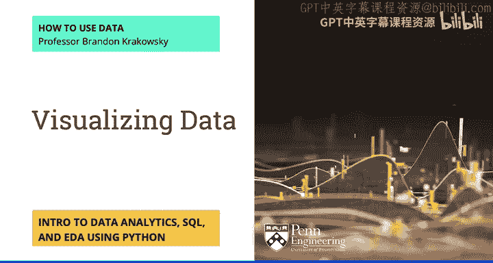
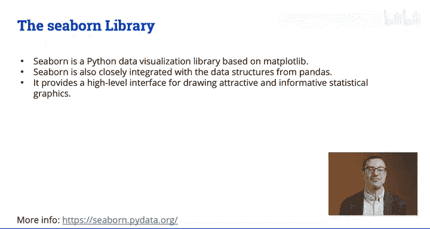

# uPenn《如何运用数据1（Python数据分析、SQL、EDA）｜How to Use Data》中英字幕 - P50：49_数据可视化.zh_en - GPT中英字幕课程资源 - BV1wKxJz3EFB

Matpllootlib is a popular plotting library for Python。 Matpllootlib is included in the P lab package。

 It's a very powerful tool that can plot a wide variety of figures and even animate them。

 Seaborn is a Python data visualization library based on Matpllootlib。

Seborne is also closely integrated with the data structures from pandas。

 It provides a high level interface for drawing attractive and informative statistical graphics。

It can also be used to enhance matteplt Lib graphics。

