# uPenn《如何运用数据1（Python数据分析、SQL、EDA）｜How to Use Data》中英字幕 - P51：50_编程演示：直方图可视化.zh_en - GPT中英字幕课程资源 - BV1wKxJz3EFB

A histogram is a graphical representation that organizes a group of data points into a specified range。

 Histograms are typically used to show the underlying frequency distribution of a set of continuous data。

 For example， numeric data。

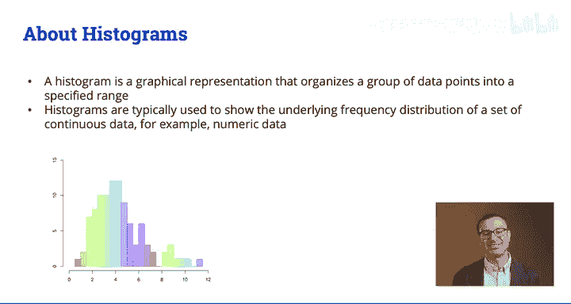

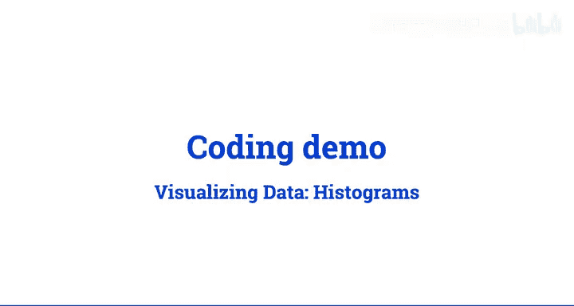

Let's look at visualizing data using a histogram。 Suppose we want to display the counts of reordered products。

 For this example， we'll use Matplotlib。 So first， we need to import pi plot from matpllib。

And I'll give it an alias of PLT。Run that。I want to check the counts of reordered products。

 so first I need to prepare my data for the visualization。

 I'm going to join the products table with the orders table。

 which contains information about the reordered products。😡，So from the Pandas library。

 I'm going to use the merge method。On the left， we'll have the product data frame。

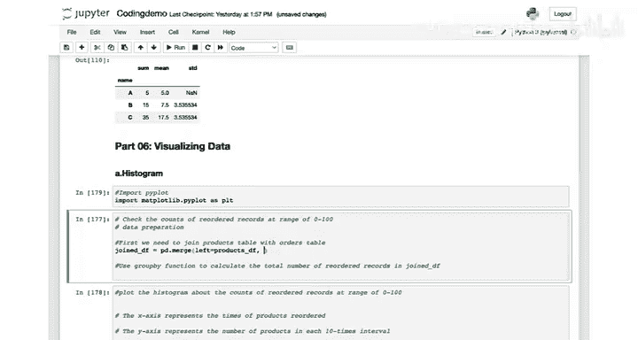

On the right， we'll have the orders data frame。I'll do an inner join。

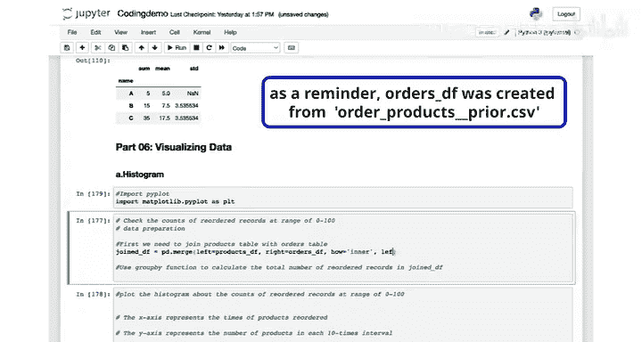

To join the two data frames， I'll use the product ID and the product data frame。

And I'll use the product ID in the orders data frame。

I'm going to store the merge data set in the Jo data frame。

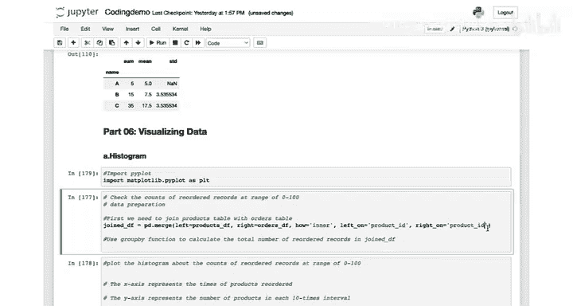

If I run that and then display the join data frame。

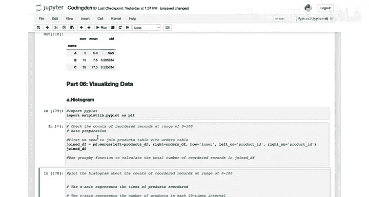

For the order information on the right， I could see the merged product information on the left。

So now I'm going to use the group by function to calculate the total number of reorders per product in the Jo data frame。

I'll take the Jo data frame。I'll call Group by。A group by product name。And for each of those groups。

 I want to calculate the sum of the values in the reordered column。

 calculate the sum of the reordered column， I'm also going to reset the index。

 which resets the index of the data frame back to the default indexes starting at zero。

 and for a multi index， this method removes one or more levels。

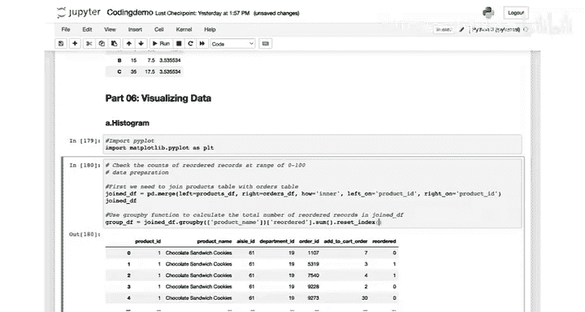

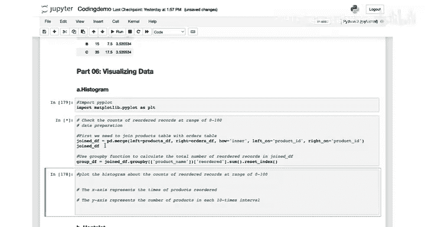

Let's display the group data frame。

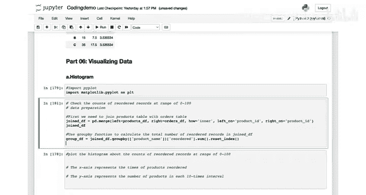

Let's run that。As a result， we can see a data frame with two columns。

 the first one is the product name， and the second one is the count of reorders for each product。😡。

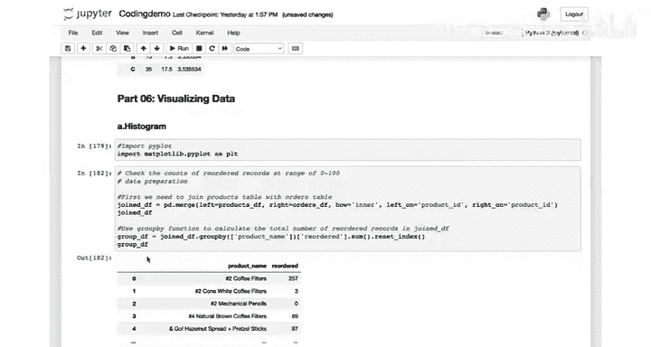

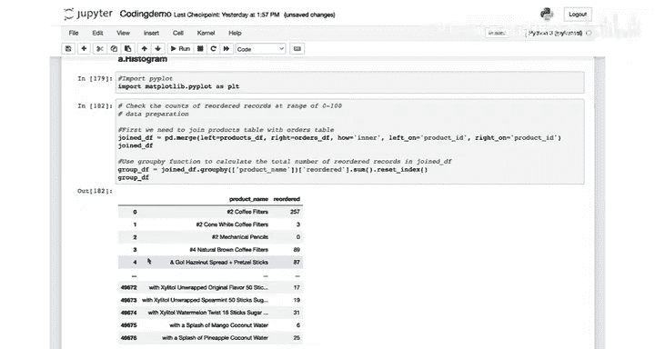

Now we're ready to plot。

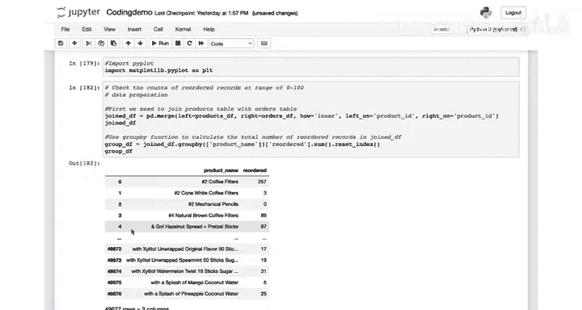

From the Pi plot library， we're going to use the hisst function。

There are several parameters we need to set。First， we provide the data。

This is our grouped data frame。😡，Which includes the counts of reorders per product。

 So we're going to look at the values in the reordered column。Those are the counts。

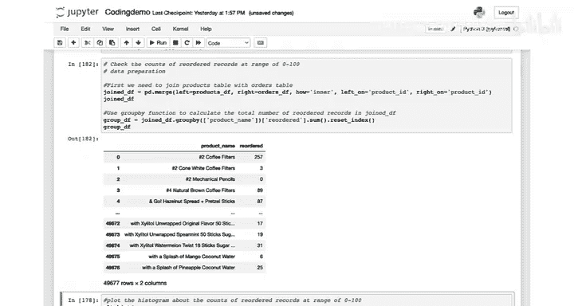

Then we'll set the transparency called alpha。Set that to 0。3。also set the color of the histogram。

Let's set that to blue。We can also set the edge color。Said that to black。

We'll configure the histogram to group the reored counts into bins or increments。Said this to 10。

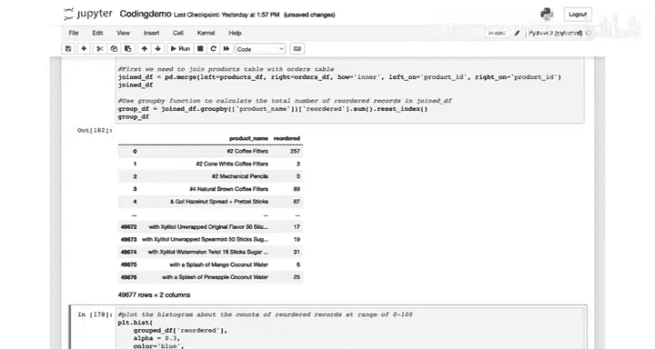

And finally， I only want to display the reordered counts in the range 0 to 100。

I'll set the range for the X axis to a list 0 to 100。

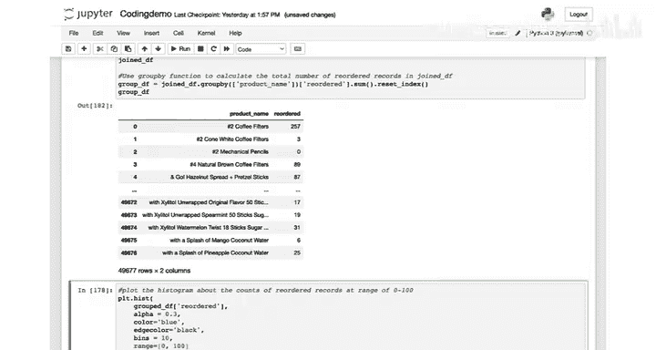

Let's set the label for the X axis。This is going to be times。Of products reordered。

So the X axis represents the number of times products were reordered。

 and then let me set the label for the y axis number of products。

The Y axis represents the number of different products for each count on the X axis。

I'll set a title for the histogram， review distribution。Of products reordered。

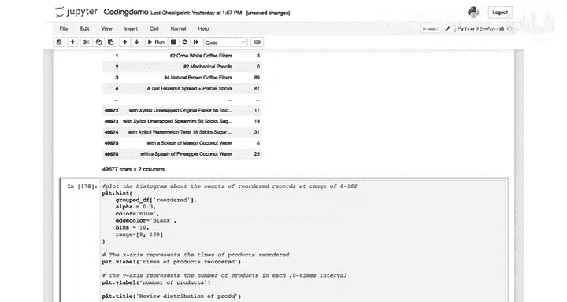

We'll run this to view the plot result。

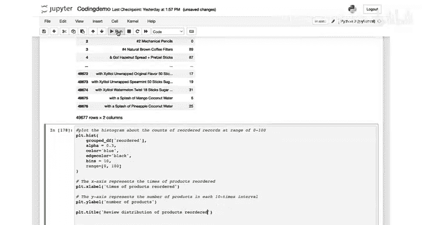

So this histogram shows the number of different products on the Y axis that were reordered a particular number of times on the X axis。

 For example， slightly more than 5000 different products were reordered between 10 and 20 times。

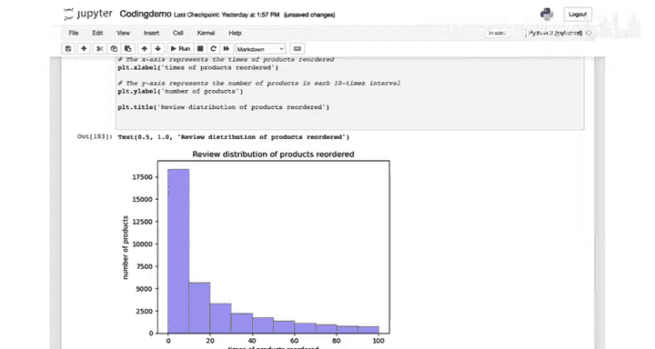