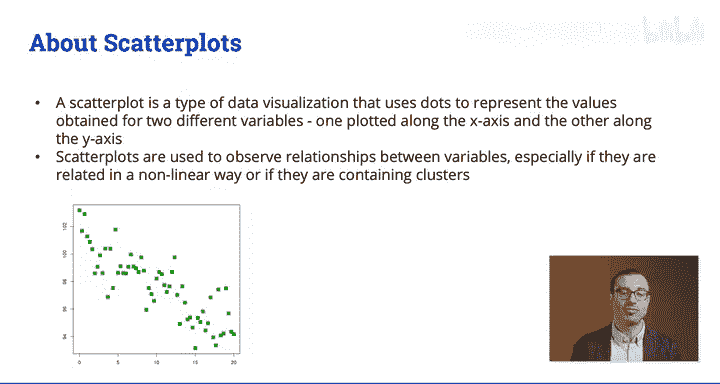
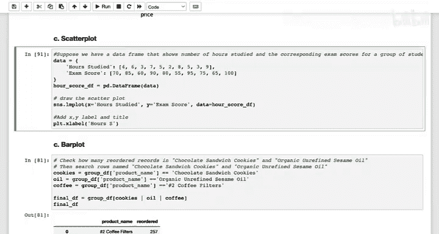
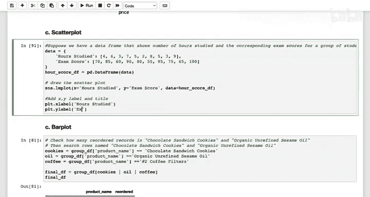
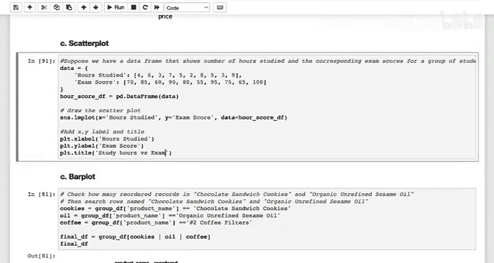
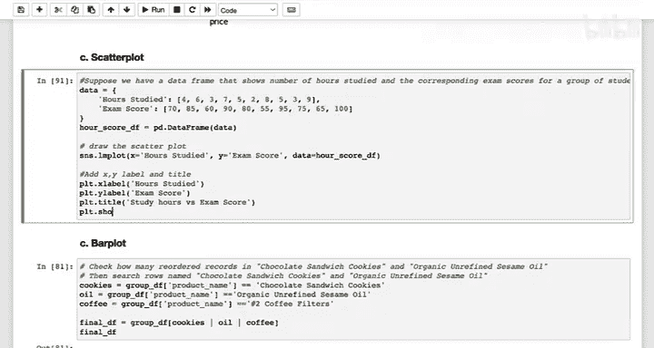
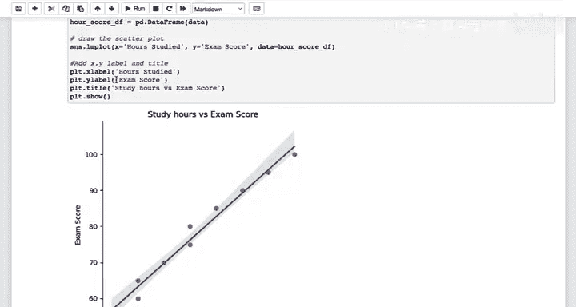
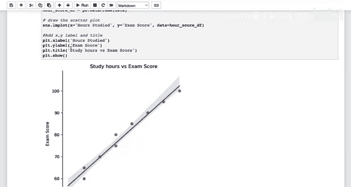

# uPenn《如何运用数据1（Python数据分析、SQL、EDA）｜How to Use Data》中英字幕 - P52：51_编程演示：散点图可视化.zh_en - GPT中英字幕课程资源 - BV1wKxJz3EFB

A scatter plot is a type of data visualization that uses dots to represent the values obtained for two different variables。

 one plotted along the X axis and the other along the Y axis。

Scatter plots are used to observe relationships between variables。

 especially if they're related in a nonlinear way， or if they are containing clusters。

Yeah。Suppose we have a data frame that shows the number of hours studied and the corresponding exam scores for a group of students。

 Here's the code that creates that data frame。 It's called hour score D F。

How do we know the relationship between those two sets of numerical values。

 Let's create a scatter plot。 We'll use Cborn's LM plot function to do this。LM plot。The data。

For the X axis。Will be the hours。Studied column。In the data frame。And the data。For the Y axis。

Will be the exam score column from the data frame。And then we provide the data。

Which is the data frame itself， our score， Df。Let's set a label for the X axis。PLT dot X label。

That'll be hours studied。

And a label for the Y axis。Why label。😔，That'll be exam score。

Add a title。PLT。 title。This will be study hours versuss。

Exam score。And then I'll call PlT。show。

Here's a result。 Each dot of the scatter plot represents a single student。

 including their hours studied an exam score。 For example， for one student。

 when they studied five hours， they received an 80 for another student。

 When the student studied5 hours， they received a 75。

 Also note the regression line that L M plot places in the scatter plot。

 This depicts the relationship between the two variables in the scatter plot。 In this case。

 the relationship between hours studied and exam score。

