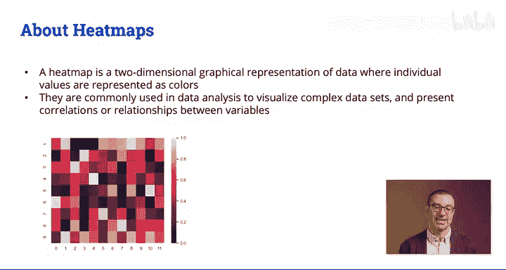
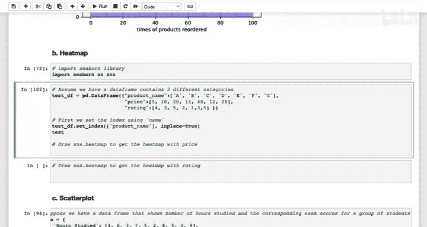
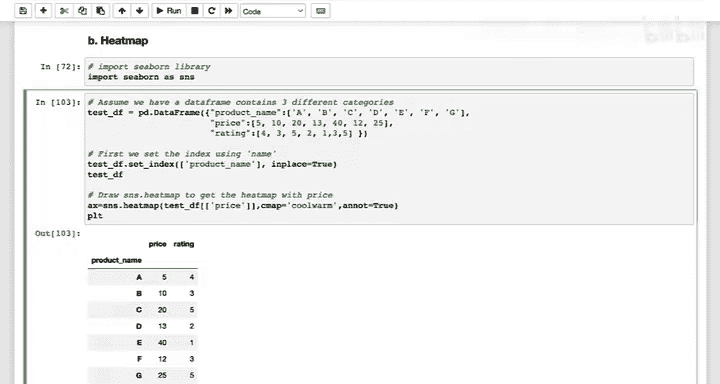
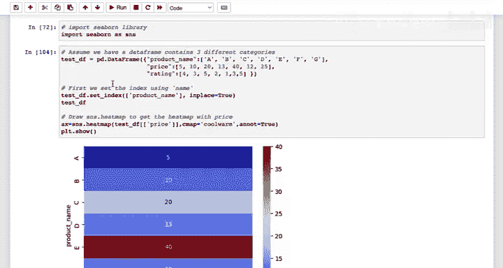
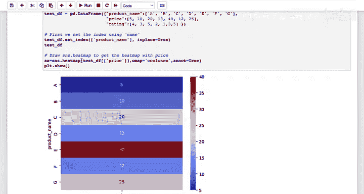
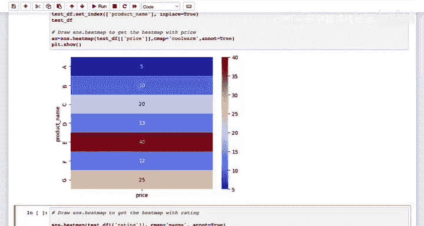
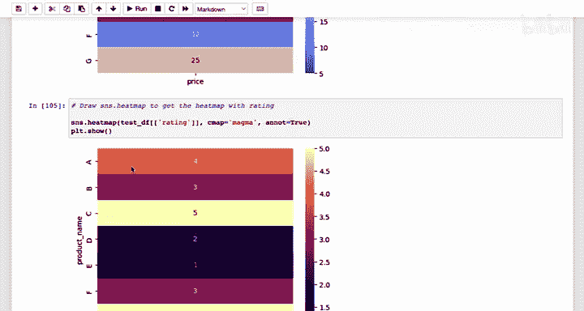

# uPenn《如何运用数据1（Python数据分析、SQL、EDA）｜How to Use Data》中英字幕 - P53：52_编程演示：热力图可视化.zh_en - GPT中英字幕课程资源 - BV1wKxJz3EFB

A heat map is a two dimensional graphical representation of data where individual values are represented as colors。

They're commonly used in data analysis to visualize complex data sets and present correlations or relationships between variables。

Let's look at an example of a heat map for this， we're going to use the Seaborn Library。😡。

So first we'll import Seaborne as SNS。And then suppose we have a data frame with three columns。

 product name， price， and rating。The first step will be to prepare the data。

 We want to view the price and rating for each product name。

 An easy way to do that is to set the index for the data frame to product name。

Let's take the test Df data frame。 we'll call set index。 and I want to set the index to product。

namee。The set index function sets the data frame index to an existing column or set of columns。

 as opposed to the default numeric indexes will update the data frame in place。

And then display the data frame。

We see the three columns of data， but we can see that the product name is the index。

Now we can draw a heat map for price against the product name。We'll use SNS。heatmap。

First parameter will be the data。We'll say test DF data frame。

And I specifically want to look at the price。Against product name。And we'll set the parameter C map。

To cool warm。We also want to set the numerical annotations。We'll set that to true。

Then I'll call PLT dot show to display the heat map。Here's our result。

This heat map shows the price for each product name， for example。

 C has a price of 20 and B has a price of 10。😡。

What if we want to show the heat map with a different color palette？

I'm going to use the same code to create the heat map。Sebornne's heat map function。Provide the data。

This time we're going to show rating。Against product name。This time， I'll set Cmap。To magma。

Set the numeric annotations。And then I'll call PlT。show。

Here's the result。 This heat map shows the rating for each product name。 For example。

 C has a rating of 5 and B has a rating of 3。

