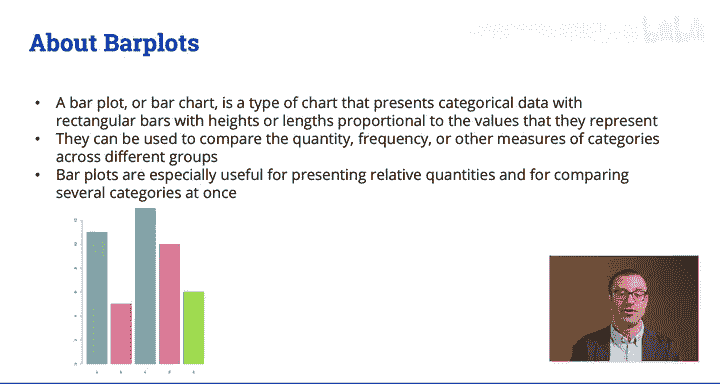
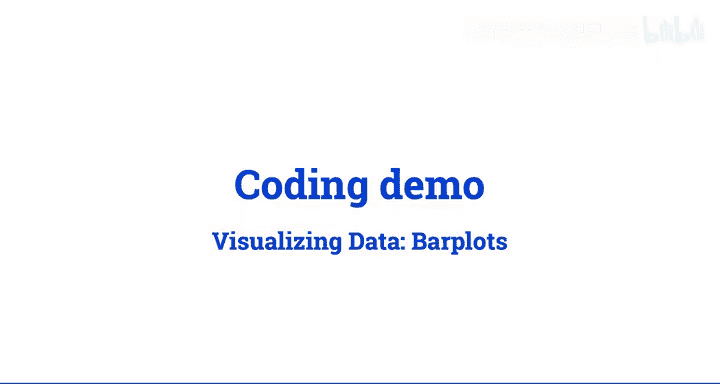
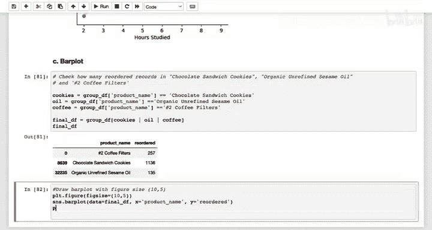
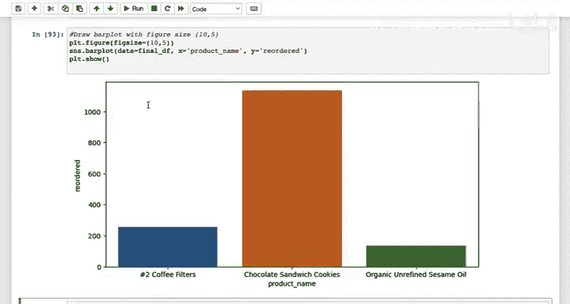
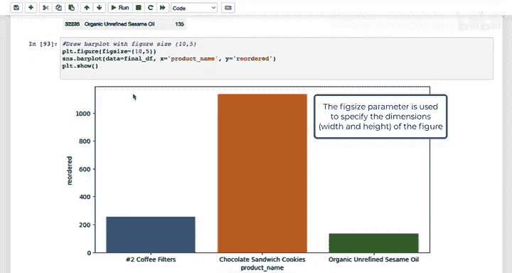

# uPenn《如何运用数据1（Python数据分析、SQL、EDA）｜How to Use Data》中英字幕 - P54：53_编程演示：条形图可视化.zh_en - GPT中英字幕课程资源 - BV1wKxJz3EFB

A bar plot or bar chart is a type of chart that presents categorical data with rectangular bars with heights or lengths。

 proportional to the values that they represent。They can be used to compare the quantity， frequency。

 or other measures of categories across different groups。

Bar plots are especially useful for presenting relative quantities for comparing several categories at once。

Let's check how many reordered records there are for chocolate sandwich cookies。

 organic unrefined sesame oil， and number two coffee filters。 First， let's prepare the data。

We already have the number of reorders per product name stored in the group D F data frame。 Now。

 let's filter that data and look for rows with the product's chocolate sandwich cookies。

 organic unrefined sesame oil or number two coffee filters。 We'll create three conditions。

1 for cookies， one for oil， one for coffee， and then filter the data in the group D F store that in final Df。

 If we take a look， we could see the three products with their reorder counts。Now。

 we'll draw a bar plot using seaborn's bar plot function。 First， let's set the figure size。

 We'll use pi plot's figure function， and then we'll set the figure size to 10 by 5。

Now let's call SNS。Dockbar plot。Provide the data。That's the final Df。

We'll set the X axis to product name。And we'll set the Y axis。To the counts of reorders。

We'll call PlT。s。If we run that， we could see the bar plot here。

 Each bar shows the number of reorders for a particular product。 For example。

 chocolate sandwich cookies was reordered more than 1000 times。

 And you can see the figure has a width of 10 and a height of 5。

