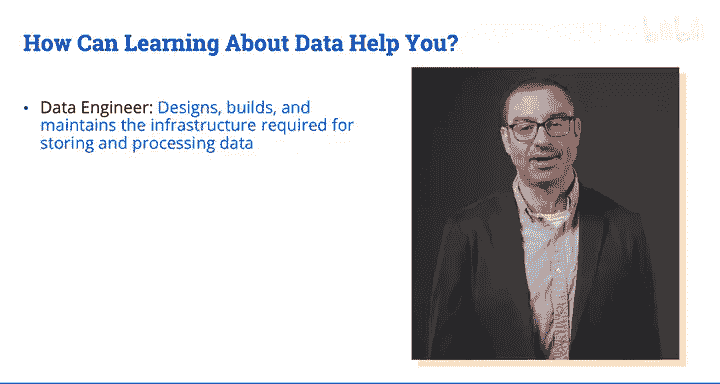
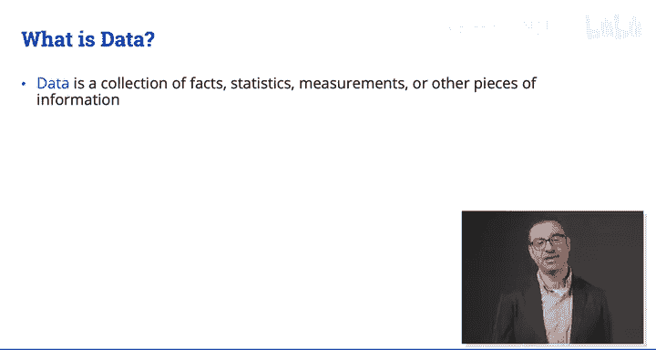
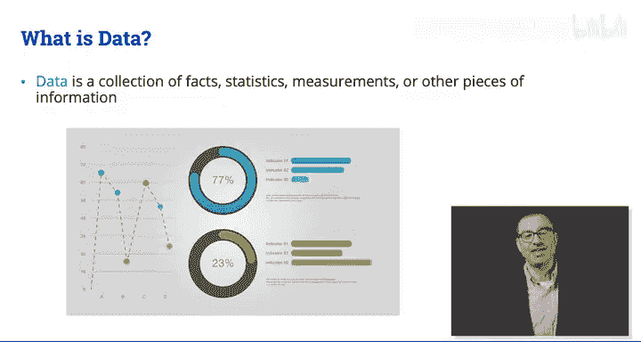
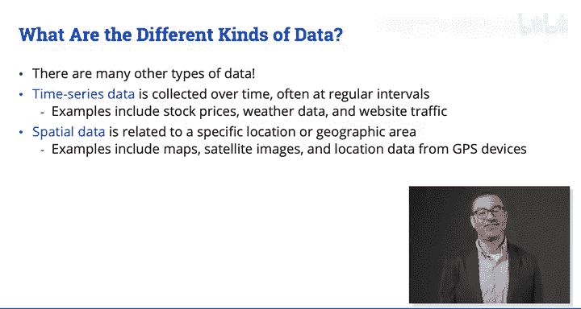
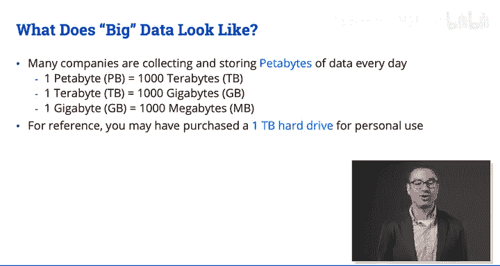
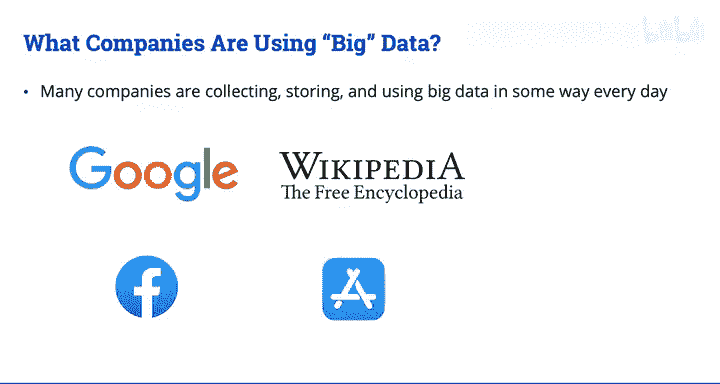
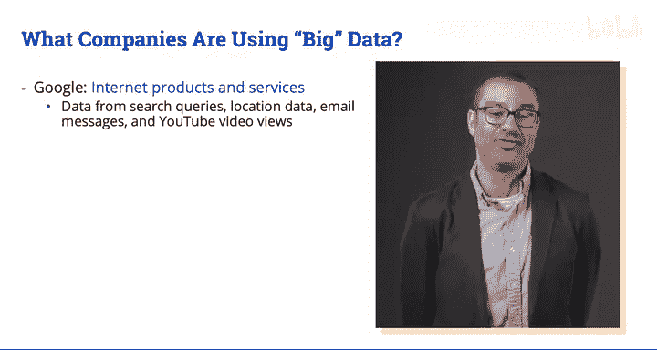
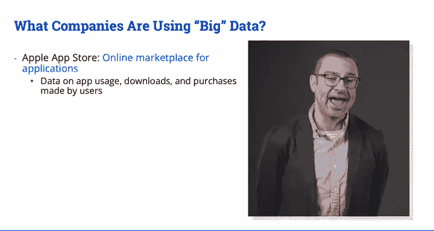
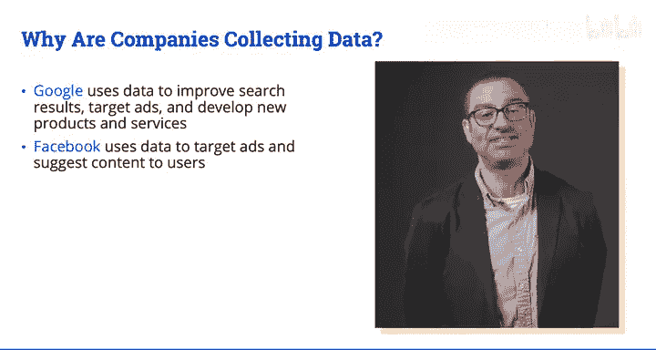
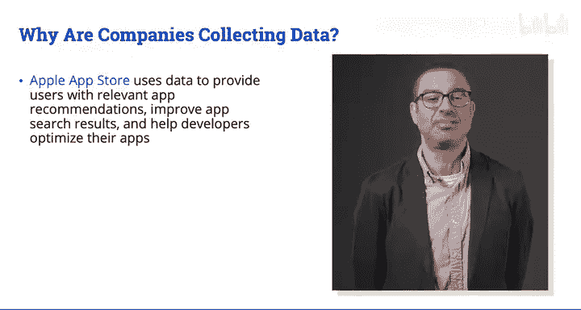

# uPenn《如何运用数据1（Python数据分析、SQL、EDA）｜How to Use Data》中英字幕 - P5：4_数据与数据分析导论.zh_en - GPT中英字幕课程资源 - BV1wKxJz3EFB

The ability to understand and work with data has become increasingly important in today's world。

 where data is ubiquitous and valuable。 The first module in this course covers a range of topics。

 including what data is and its different types， what big data looks like and how companies are using it。

 It also explores the fields of data analysis and data science and how the two come together to help form the field of data analytics。

We'll look at the entire data analytics process and how it works from defining the analytics problem to interpreting and presenting the results。

 We'll also look at some case studies， which are presented to illustrate the application of data analytics in real world scenarios。

😡，Learning about data will help you in many jobs。 For example， a data engineer who designs。

 builds and maintains the infrastructure required for storing and processing data。

Or a data analyst who analyzes and interprets data to extract insights， trends and patterns。

 or a data scientist who develops and applies advanced machine learning and statistical techniques to extract insights and build predictive models from data。

 or for any number of other roles from product managers to business analysts to software engineers to cybersecurity specialists。

😡，Learning about data will help you in any field where data has an impact。

Across a landscape of industries as far and wide as healthcare care， finance。

 marketing and advertising， education， transportation， political science， science and sports。

Here's a quote from Hal Veran on how the Web challenges managers。The ability to take data。

 to be able to understand it， to process it， to extract value from it， to visualize it。

 to communicate it。 That's going to be a hugely important skill in the next decades。

So what is data technically speaking， data is a collection of facts， statistics。

 measurements or other pieces of information。

Data can be generated from any number of sources such as sensors， surveys， experiments， transactions。

 social media and web browsing。Data can take various forms， including numbers， text， images。

 audio or video， and data can be used for various purposes such as analysis， research。

 and communication。😡，It can also be used to gain insights into particular subject or phenomenon to solve business problems and for making decisions。

 In fact， the biggest value of data lies in its ability to provide insights and informed decision making。

There are many different types of data。 Structured data is organized in a specific format。

 usually within a database or a spreadsheet。Typically， this kind of data is easy to search， sort。

 and analyze because it's well organized。Unstructured data has no predefined format or structure。

 Exles include emails， social media posts and multimedia files。Typically。

 this kind of data is more difficult to analyze because it requires more complex processing and analysis and semi structured data is data that is partially structured。

 such as data stored in X ML files or JSO format。 typicallyypically。

 semistructured data is more challenging to work with and structured data。

 but it's often easier to analyze than unstructured data。 There are many types of data。

 time series data is collected over time， often at regular intervals。 Examples include stock prices。

 weather data and website traffic。😡，Spatial data is related to a specific location or geographic area。

 Examples include maps， satellite images and location data from GPS devices。

Categorical data is divided into categories or groups， Exles include gender。

 age groups and types of products。Nummerical data consists of numerical values。

 Examples include prices， quantities and measurements。

 and textual data consists of written or spoken language。 Examples include emails。

 articles and customer reviews。So data can come in a variety of different formats and sizes。

There's a lot of available information about big data。 In fact， too much。 Basically。

 big data is extremely large data sets， so large or complex that traditional data processing applications are inadequate to handle them。

Big data， just like smaller data， can be analyzed computationally to reveal patterns and trends and to extract value。

So what does big data look like？ Many companies are collecting and storing petabytes of data every day for scale。

1 petabyte equals 1000 TBtes。1  TBab equals 1000 GB， and 1 GB equals 1000 MB。 And for reference。

 you may have purchased a one TBab hard drive for personal use。

Companies owned and or utilize huge data centers covering hundreds of acres with lots of servers running sophisticated software to process terabytes and petabytes of data。

Many companies are collecting， storing， and using big data in some way every day。We can， of course。

 look at some of the really big companies like Google， Facebook， Wikipedia， the Apple App Store。

 Pandora and Microsoft。

Data sets grow rapidly， every activity generates data。Google collects data from search queries。

 location data， email messages， and YouTube video views。

Facebook collects data from user profiles， posts， likes。

 and shares to create detailed profiles of its users。

Wikipedia collects data on user interactions with its websites such as page views， edits。

 and searches。😡，The Apple App Store collects data on app usage， downloads。

 and purchases made by users。

Panddora collects data on users music preferences， listening history and feedback on songs。

 and Microsoft collects data from its users devices， including search queries。

 email messages and app usage。So why are companies collecting all this data。

 Because they can afford it， Stage is cheap and because they can monetize it。

 Data can be processed and analyzed to derive value。 Google uses data to improve search results。

 Ta ads and develop new products and services。 Facebook uses data to target ads and suggest content to users。

Wikipedia uses data to monitor the performance of its website， identify areas for improvement。

 and track user engagement。The Apple App Store uses data to provide users with relevant app recommendations。

 improve app search results， and help developers optimize their apps。

Panddora uses data to personalize the listening experience for each user。

 and Microsoft uses data to improve search results， develop new products。

 and personalize advertising。😡。