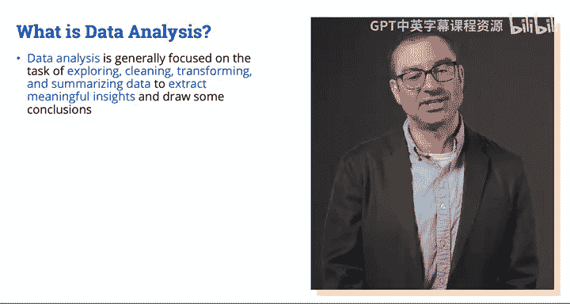
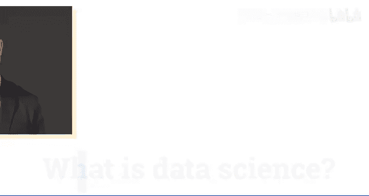
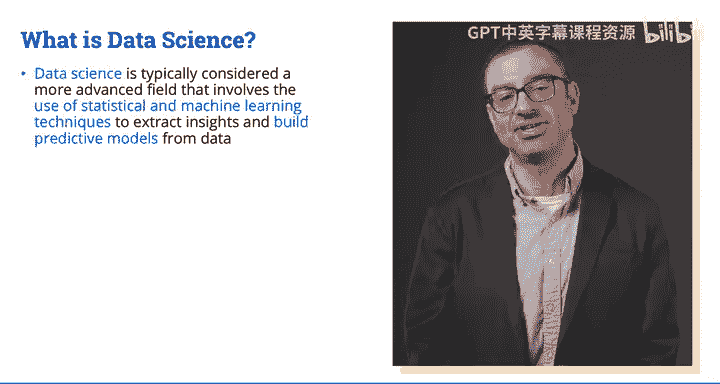

# uPenn《如何运用数据1（Python数据分析、SQL、EDA）｜How to Use Data》中英字幕 - P6：5_数据科学与数据分析导论.zh_en - GPT中英字幕课程资源 - BV1wKxJz3EFB

What is data analysis， Data analysis is generally focused on the task of exploring， cleaning。

 transforming and summarizing data to extract meaningful insights and draw some conclusions。

Data analysis is often performed with a specific purpose in mind。

 such as to identify trends or patterns or to make recommendations。 For example。

 a company could use data analysis to assess sales performance by region。

 product category or sales channel， identifying high performing segments and opportunities for improvement。

So then what is data science， Data science is typically considered a more advanced field that involves the use of statistical and machine learning techniques to extract insights and build predictive models from data。

Data science is often used to solve complex problems such as predicting customer behavior。

 detecting fraud， or identifying high risk patients in a healthcare setting。

Extending the previous example， a company might use data science techniques like machine learning to predict future demand for products or services。

In summary， while data analysis is typically focused on exploring and interpreting data to derive insights。

 data science is more focused on creating models that can predict or explain phenomena based on data。

