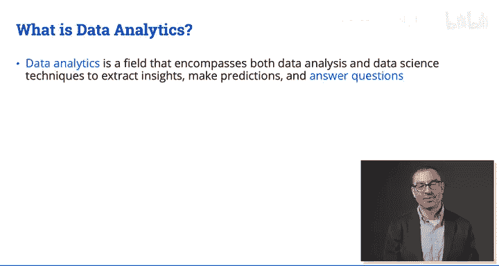
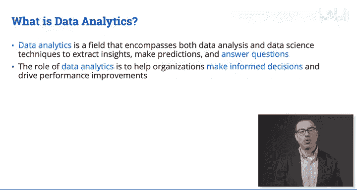
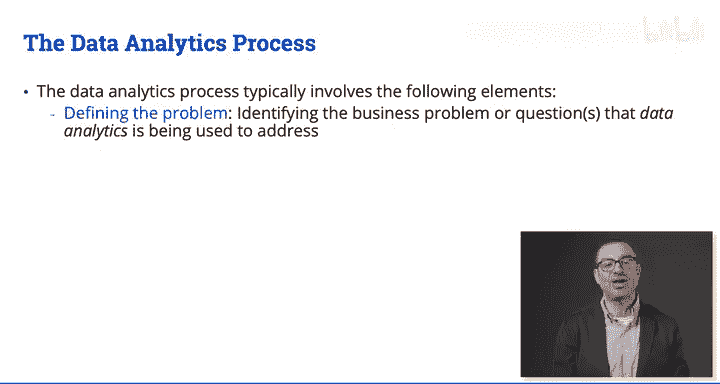
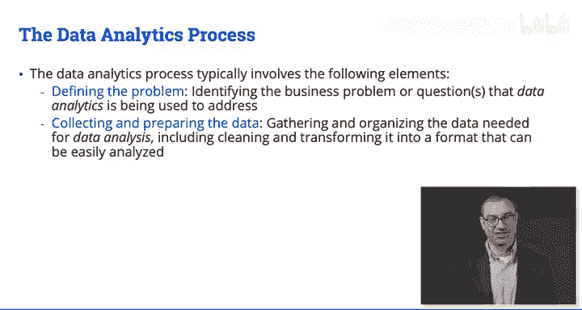
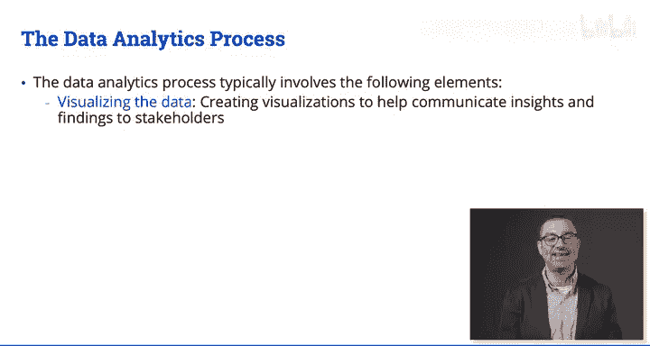
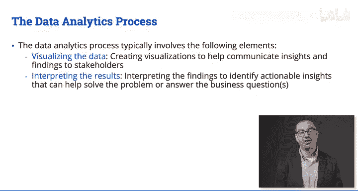
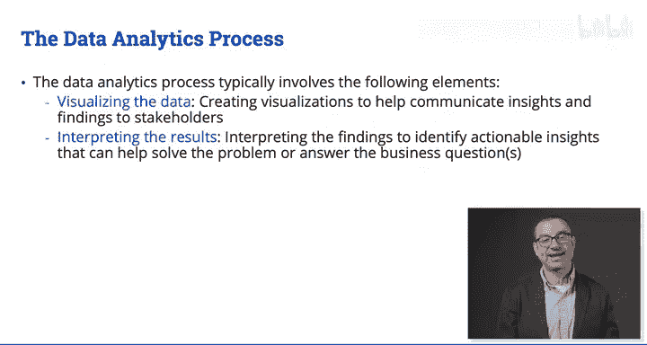

# uPenn《如何运用数据1（Python数据分析、SQL、EDA）｜How to Use Data》中英字幕 - P7：6_数据分析基础.zh_en - GPT中英字幕课程资源 - BV1wKxJz3EFB

Data analytics is a field that encompasses both data analysis and data science techniques to extract insights。

 make predictions， and answer questions。

The role of data analytics is to help organizations make informed decisions and drive performance improvements。

Extending the previous example even further， a company might use the sales predictions to enable better inventory management。

 resource allocation and pricing strategies。The data analytics process typically involves the following elements。

Defining the problem， which is identifying the business problem or questions that data analytics is being used to address。

Collecting and preparing the data， which is gathering and organizing the data needed for data analysis。

 including cleaning and transforming it into a format that can be easily analyzed。😡。

Exploring the data， which is conducting initial data analysis to identify patterns， outliers。

 and trends in the data。Applying statistical and machine learning techniques。

 which is using data science techniques to analyze the data and generate insights and make predictions。

Visualizing the data， which is creating visualizations to help communicate insights and findings to stakeholders。

Interpreting the results， which is interpreting the findings to identify actionable insights that can help solve the problem or answer the business questions and communicating the results。

 which is presenting the insights and findings to stakeholders in a way that's easily understood and actionable。

The data analytics process usually also involves implementing solutions。

 which is using the insights and findings generated by data analytics to develop solutions and take actions。

😡，This course will cover the basic concepts， skills。

 and tools used for each element of the data analytics process。

