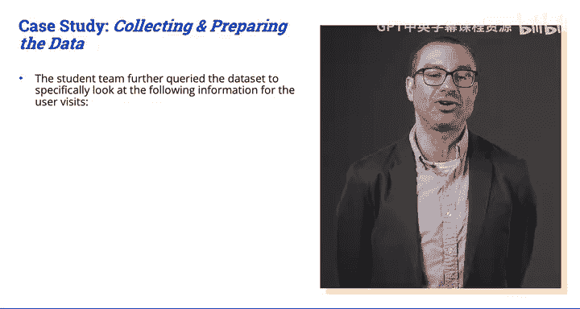
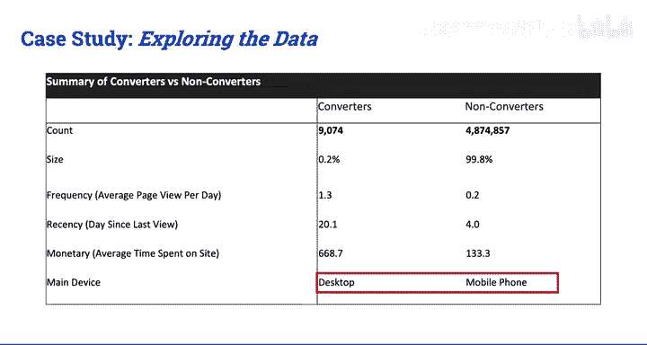
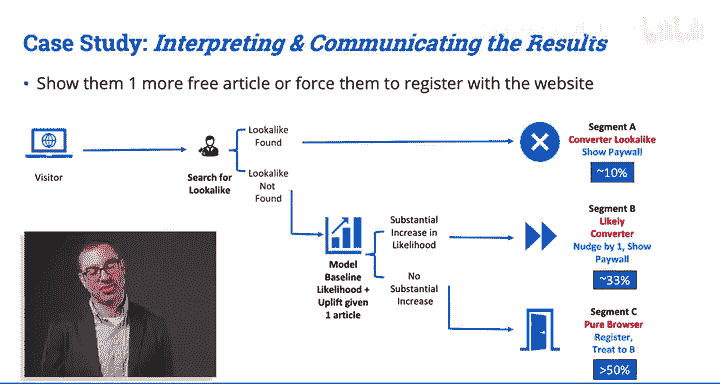

# uPenn《如何运用数据1（Python数据分析、SQL、EDA）｜How to Use Data》中英字幕 - P8：7_赫斯特案例研究：数据分析流程.zh_en - GPT中英字幕课程资源 - BV1wKxJz3EFB

Here's a real world example of how a student team of analysts and data scientists work with a company to solve a real world business problem using the company's data and the data analytics process。

 The company is Hest， an American multinational mass media and business information conglomerate。

Hest owns newspapers， magazines， television channels， including the San Francisco Chronicle。

 the Houston Chronicle， Cosmopolitan， and Esquire。Hearst partnered with Wharton AI and Analytics for Business and the team of students to solve the following business objective。

To increase consumer revenue for the news brands by increasing digital subscribers to do this。

 Hirst wanted to convert anonymous users or non subscribeubscribers who come to their news sites into paying customers or subscribers。

Harst provided the student team with a data set， including historical information for anonymous users or non subscribescribers who came to the Hersst news site。

The students filtered the data set to focus on the Houston Chronicleles data from January to March of 2023。

The student team further queried the data set to specifically look at the following information for the user visits。

 page views or views of the specific website pages， including the source of traffic and location。

 content， which is the content viewed on the website pages， including the category， photo and URL。😡。

Paywall information， which are the events where visitors hit a paywall。

 including the session and timest and subscription information or info for the anonymous users who became subscribers for the website or converted。

Including subscription durations and payment type。The students wanted to understand the similarities and differences between anonymous users who become paying customers or subscribers and those who do not or those who remain non subscribescribers。

They started by exploring and summarizing the differences between converters and non converters。

They found that data was made up of mostly non converters。

They also found the average page views per day， the number of days since last view。

 the average time spent on the site， and the main device for each group。

To further understand the similarities and differences between subscribers and non-subscribers。

 the team generated clusters of converters and nonconverers using a K means clustering model to group users with similar user characteristics together based on distances。

😡，Those closer to one another belong to the same cluster K meanss is one of the most widely known and easily understood clustering models。

Then they identified non converters who look like converters by defining how close they are。

 such that they can be considered lookalikes。The team then wanted to make recommendations accordingly for what to do for each type of user。

They started with non converters who look like converters。 It was recommended to show them a paywall。

 as they're likely to subscribe for the website。For non converters who don't necessarily look like converters。

 they predicted the conversion probability using an X G boost predictive model for those with higher likelihood。

 It was recommended to show them one more free article。 and for those with lower likelihood。

 it was recommended to force them to register with the website。

