# uPenn《如何运用数据1（Python数据分析、SQL、EDA）｜How to Use Data》中英字幕 - P9：8_定义分析问题.zh_en - GPT中英字幕课程资源 - BV1wKxJz3EFB

The data analytics process starts with defining the problem。 That is to say。

 identifying the business problem or questions that data analytics is being used to address。

When defining the problem in data analytics， consider the following， the objective。

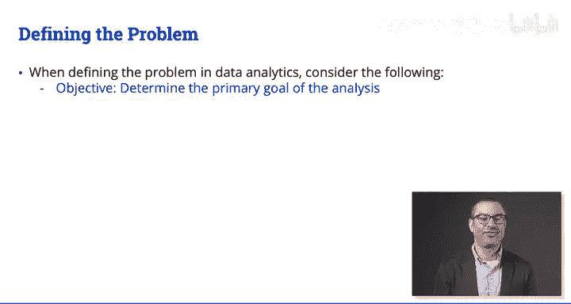

Determine the primary goal of the analysis， for example。

 a retail company wants to analyze customer purchase data to identify patterns in order to increase sales。

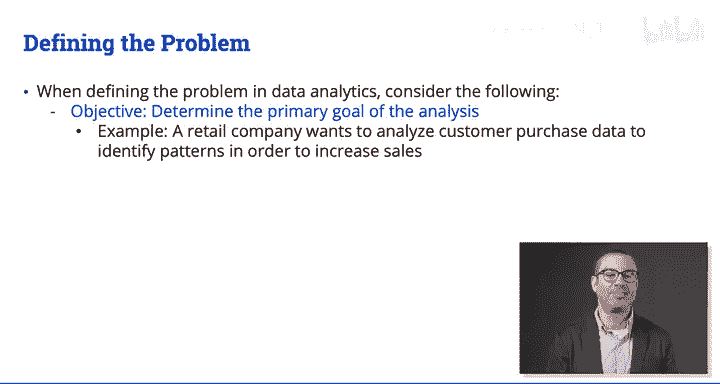

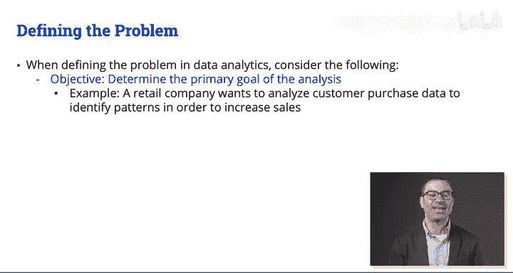

The scope create specific goals and or identify specific business questions or problems that need to be addressed。

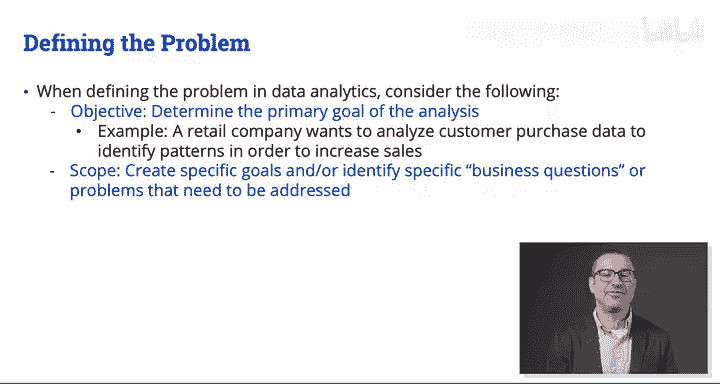

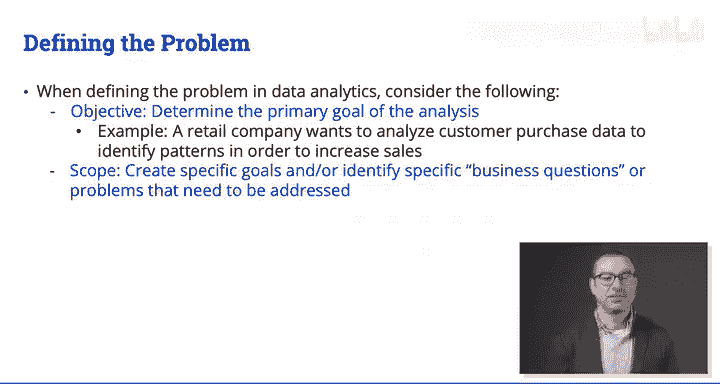

As an example goal for the retail company， the analysis should focus on customer demographics and seasonal trends。

 A potential business question for the company to address might be。

What are the demographic characteristics of our most valuable customers and how can we tailor our marketing and promotions to target those customers。

Another business question to address might be， what are the seasonal trends in the sales data and how can we adjust inventory levels to match demand。

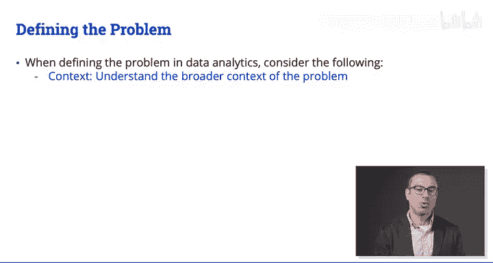

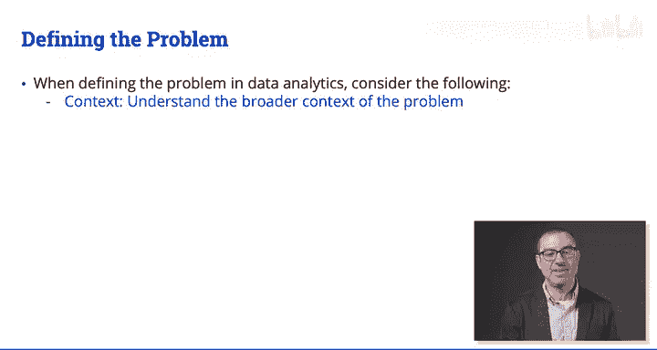

Consider the context that is， understand the broader context of the problem。 For example。

 the retail company should consider economic conditions， competitor strategies and industry trends。

 which could impact customer purchasing behavior and preferences。 Also， consider data availability。

 evaluatevalate the available data sources and quality。 For example。

 the company may have access to transaction records，  customer profiles and market research。

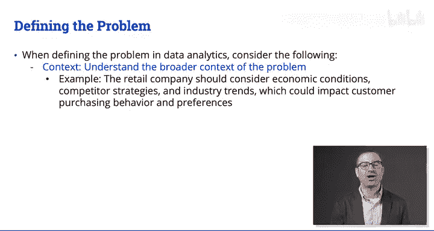

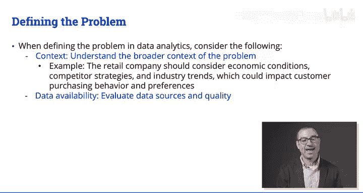

They need to ensure the data is reliable， complete and as unbiased as possible。

 Consider the stakeholders identify key stakeholders and their expectations。 For example。

 for the retail company， stakeholders may include store managers。

 marketing teams and upper management。

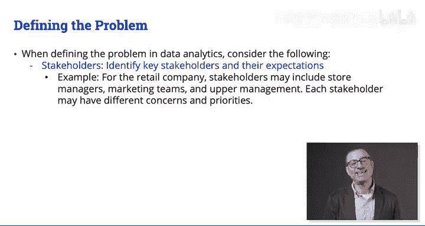

Each stakeholder may have different concerns and priorities。Also。

 consider constraints and limitations that may impact the analysis。 For example。

 the retail company may have limited data， a limited budget for data collection or may need to adhere to privacy or security regulations that restrict the use of particular customer data。

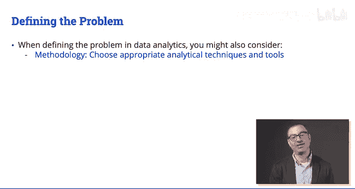

You might also consider the methodology or the appropriate analytical techniques and tools for the job。

 For example， the retail company might want to use clustering techniques to segment customers and time series analysis to identify seasonal trends。

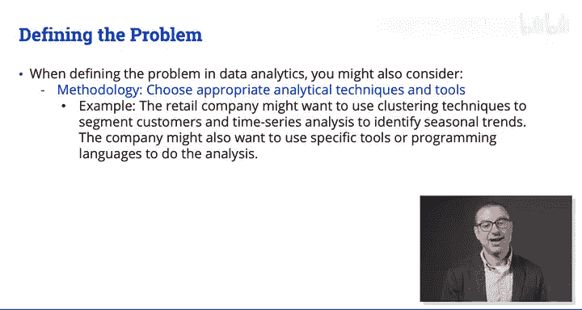

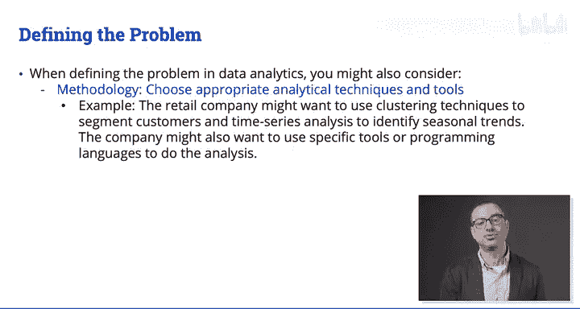

The company might also want to use specific tools or programming languages to do the analysis。

 Finally， you might also consider defining the deliverable。

 which is to say the desired outcomes and format of the deliverable。

