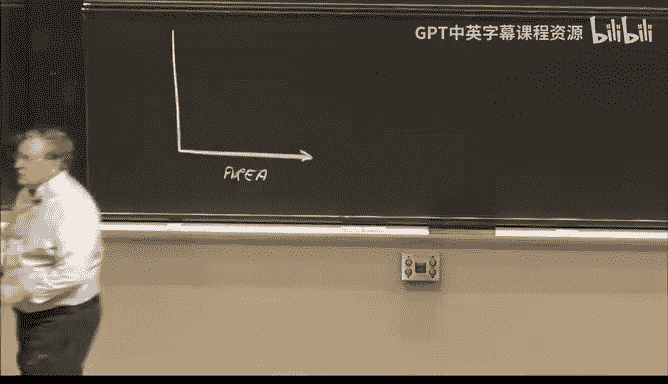
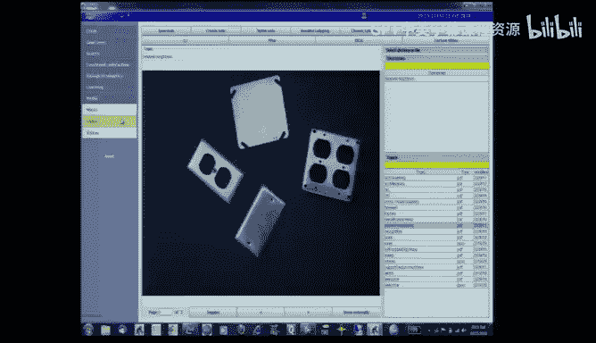
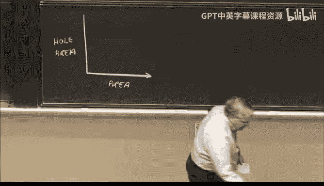
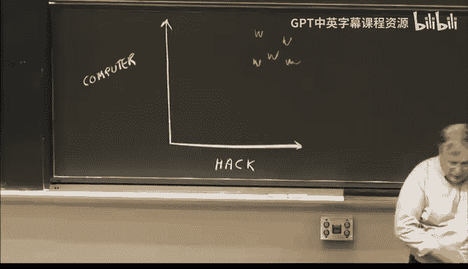
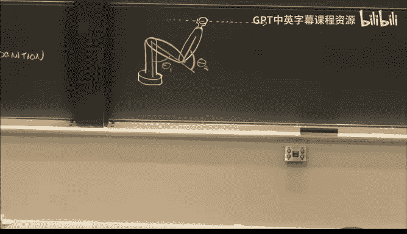
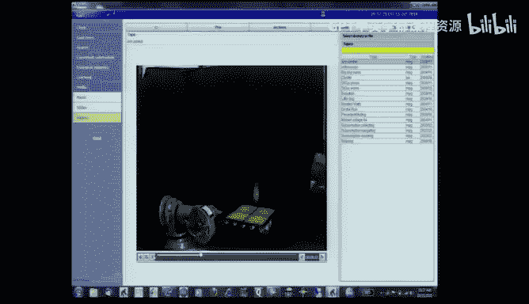
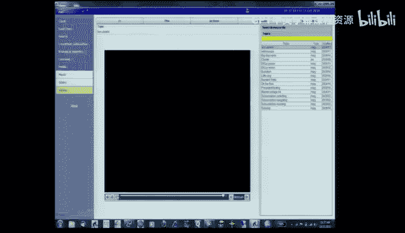
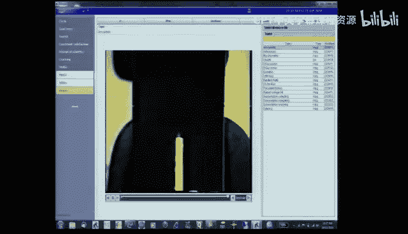
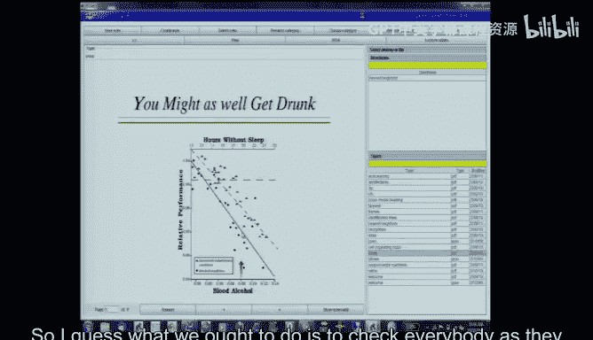

# 《人工智能｜6.034 Artificial Intelligence, Fall 2010》中英字幕 - P10：[10]10. Introduction to Learning, Nearest Neighbors.zh_en - GPT中英字幕课程资源 - BV14fqSB2ECY

Well， that's the Kodo drummers。There are a group of about 30 or 40 Japanese people who live in a。

Village on some island off the coast of Japan and preserve traditional Japanese music。

It's an unusual semi communal group。Generally， run about。10 kilometers before breakfast。

 which is served at 5 a。Strange group。Wouldn't miss a concert for the world。

 although last don't seem to be coming down to the Boston area very soon。

If you go to a concert from the Kodo Jumers， then you should。And if you are no longer young。

You'll want to bring earflugs because。As we humans get older。

 the dynamic range control in our inner ear tends to be less effective。So that's why a person。

Of my age might find some piece of music excruciatingly loud。

 whereas you'll think it's just fine because you have better automatic game control， just like in a。

Any kind of communication devices？Control on how intense the sound gets。But。系。Go off on a sidebar。

 Many of you have。Looked at me in astonishment as I drink my coffee。

And you've doubtlessly been saying to yourself， you know。

 Winston doesn't look like a professional athlete。But he seemed to have no trouble。

Drinking his coffee。So today's material is going to be pretty easy。

 so I want to give you the side problem of thinking about how it's possible for somebody to do that。

How is it possible， How would you make。Computer program that could reach out it。

Frinkrick a cup of coffee。Don't wanted a cup of coffee。So that's one puzzle I'd like it to work。

 there's another puzzle too。And that puzzle concerns diet drinks。开始。So called diet Coke。That's right。

啊。If you take it， a diet Coke。And ask yourself。What would a dog think a diet Coke is for？

That's another puzzle that you can work on。While we go through the material of the day。

So this is our first lecture on learning。 And I want to spend a minute or two in the beginning talking about the lay of the land。

And then we'll race through some material and nearest neighbor learning， and then we'll finish up。

With a discussion， with the advertised discussion of sleep。Because I know many of you。

I think that because you' MIT students， you're pretty tough and you don't need to sleep and stuff。

We need to address that question before it's too late in this semester。To get back on track right。

Here's the story。Now the way we're going to look at learning is that there are two kinds。

There was this kind。And there's that kind。And we're going to talk a little bit about both kinds。

The kind on the right。Is is learning based on observations of regularity。

And computers are particularly good at this stuff。And among the things that we'll talk about。

In connection with regular based learning are today's topic， which is nearest neighbors。

Then a little bit downstream。We'll talk about neural nets。

And then somewhere near the end of this segment， we'll talk about boosting。

And these ideas come from all over the place。 in particular， the stuff we're talking about today。

 nearest neighbors， is the stuff of which the field of pattern recognition。

It's the stuff of which pattern recognition journals are filled。

This stuff has been around a long time， does that mean it's not good？

I hope not because that would mean that everything you learn。

In 1801 is not good because the same course was taught in 1910。So it's been around a while。

 but it's extremely useful。 And it's the first thing to try when you have a learning problem because it's the simplest thing。

 And you always want to try the simplest thing before you try something。

More complex that you will be less likely to。Understand。

So that's nearest neighbors in pattern recognitions and the custodians of knowledge about neural nets。

Well， this is sort of attempt to mimic biology。And I'll cast a lot of clumy on that when we get down there to talk about it。

And finally， this is the gift of the theoreticians。So we and AI have invented some stuff。

 we've borrowed some stuff， we've stolen some stuff， we've championed some stuff。

 and we've improved some stuff。 that's why our discussion of learning will reach around all of these topics。

So that's regularity based learning， and you can think of this as the branch of bulldozer computing。

Because。When doing these kinds of things， a computer is processing information like a bulldozer processes gravel。

Now， that's not necessarily a good model for all the kinds of learning that we humans do。

 And after all， learning is one of the things that we think that characterizes human intelligence。

So were to build models of it and understand it， we have to go down in this other branch， too。

And down this other branch， we find。Learning ideas that are based on constraint。

And let's call this the human like side of the picture。And we'll talk about ideas that they enable。

 for example， one shot learning。Where you learn something definite from each experience。

And we'll talk about explanation based learning。By the way。Do you learn much by self explanation？

I think so。 and advise you once weve got nothing but A's and F's。And I said。

 what other subjects you get A's in？And why don't you get A' in all of your subjects， and he said。

 oh， I get A's in the subjects when I convince myself the material is true。

So the learning was a byproduct of self explanation。SoImportant kind of learning。But alas。

 that's downstream。And what we're going to talk about today。

Is this path through the tree nearest neighbor learning？And here's how it works in general。There is。

Here's just a general picture of what we're talking about。

When you think of pattern recognition or nearest neighbor based learning， you've got some sort of。

Mechanism it generates。A vector of features。So we'll call this the feature detector。

And out comes a vector of values。And that vector of values goes into a comparator of some sort。

And that comparator。Compares the feature vector with feature vectors coming from a library of possibilities。

And by finding the closest match。The compare to our determinants。What the object？What some object is。

 it does recognition。Okay， so let me demonstrate that with。These electrical covers。Suppose so。

They arrived on an assembling line and some robot wants to sort them。

 how would it go about doing that？Well， it could easily use the nearest neighbor sorting mechanism。

So how would that work， well， here's how it would work。You would make some measurements。

And we'll just make some measurements。In two dimensions。

And one of those measurements might be the total area。

Including the area of the holes of these electrical covers。

Just so you can follow what I'm doing without craning your neck。

Let me see if I can find the electrical covers。Yes， there they are。So we've got one big blank one。

Several others， so we might also measure the whole area。

And this one here， this guy here。This big blank one has no whole area。

 and it's got the maximum amount of total area。 so it will。

Find itself at that point， in this。Space of。Peachatureers。Then呢。We've got the。Gou here with。

Room four sockets in it。 that's got the maximum amount of whole area。

 as well as the maximum amount of area， so it'll be right straight up。Maybe up here。

And we have in addition to those two。A blank covered。Like this。

 it's got about half the total area that any cover can have。 so we'll put it right here。And finally。

You've got one more of these guys。Oh， yeah， this one， half the whole area and half the to area。

So I don't know， let's see， where will that go？Maybe about right here。

So now our robot is looking on the assembly liner， and sees something coming along。

 and it measures the area， and of course there's noise。There's manufacturing variability。

So it won't be precisely on top of anything， but suppose it's right there。Well。

It doesn't take any genius human or computer to figure out that this must be one of those guys with maximum area and maximum whole area。

But now let's ask some other questions where。Would。Where would a。What would that be？

Or what would this be？so on。Well， we have to figure out what those。

Newly viewed objects are closest to in order to do an identification。But that's easy。

 We just calculate the distance to all of those。All of those standard。

Platonic ideal descriptions of things， and we find out which is nearest。But in general。

 it's a little easier to think about。Producing。Some boundaries between these various。

Idealized places。So that we can just say， well， which area is the object in。

 and then we'll know instantaneously to what category it belongs。So if we only had two。

 like the purple one。And the yellow one， it would be easy。

Because we just construct a line between the two。With the line between the purple and the yellow as a perpenicular bicycler。

And so drawing it out instead of talking about it， if there are only two。

 that would be the boundary line， anything south of the dotted line would be purple and anything north would be yellow。

And now we can do this with all of the points， right， so we can figure out， oh， could you Pire。

 could you just。Clly wrap up， please。So if we want to do this with all these guys。

It would go something like this。I better get rid of these dotted Xs before they confuse me。But' see。

 we got if， if these were the only two points， then wed want to construct a perpendicular bisector between the line joining them。

And these two were。The only points is I don want to construct this per particular bysector。And if。

These two were the only points I want to construct a perpendicular bisector。And at these two points。

Were the only ones involved。 I'd want to construct。 Oh， you see what I'm doing。

mConing perpendateicular byses。 and those are exactly the。

Those are exactly the lines that I need in order to divide up this space。

And it's going to divide up like this。And I won't say we'll give you a problem like this on an examination but we have every year in the past 10。

To divide up a space and produce。But we would like to give something we would like to give a name。

 You know， a rumble still skin affect when you have a name， you get power over it。

 So we're going to call these decision boundaries。Okay。

 so those are the simple decision boundaries produced in a simple space by a simple idea。

But there is a little bit more。To say about this。Because I've talked about this as if we're trying to identify something。

There's another way of thinking about it。That's extremely important。And that is this。

 S I come in with a brand new cover。Never before seen。And I only measure。Well。

 let's say I only measure。Slay only measure the whole area。And the whole area is。Has that value？

What is the most likely？Total area。Well， I don't know。

 but there's a kind of weak principle of if something is similar in some respects。

 it's likely to be similar in other respects。 So I'm going to guess if you hold a knife to my throat and back me into a corner that its tall area is going to be something like that orange。

C total area。So this is a contrived example， I don't make too much of it。

 but I do want to make a lot that first principle over there。

 and that is the idea that if something is similar in some respects。

 it's likely to be similar in other respects。Because that's what。Most of education is about。

Fairy tales， legal cases， medical cases， business cases。

 if you can see that they're similar in some respects to a situation you've got now。

 and it's likely that they're going to be similar in others respects as well。

Some when we're learning， we're just not just learning to recognize a category。

 we're learning because we're attempting to apply some kind of precedent。That's the story I that。

Well， that's a simple idea， but it doesn't have any application。 The answer is sure。

Here's an example。My second example， the the example of cell identification。

 Suppose you have some white blood cells。 What might you do。

You might measure the total area of the cell。And not the whole area， but maybe the nucleus area。

And maybe you might measure four or five other things。And put this thing in a high dimensional space。

 You can still measure the nearness。In a high dimensional space so you can use the idea to do that。

 it works pretty well。A friendriend of mine once started the company based on this idea。

 he got wiped out， of course， but it wasn't his fault。

 what happened is that somebody had been in a better stain and became much easier to just do the recognition by brute Force。

So let's see。 that's two examples。The introductory example of the holes of the electrical covers and the example of cells。

And what I want to do now is。Show you how the idea can reappear in disguised forms and areas where you might not expect to see it。

So consider the following problem you have。A collection of articles。From magazines。

And you're interested in learning something about。How to address a particular question。

 How do you go about finding the articles that are relevant to your question？So this is。

This is a puzzle that has been studied for decades by people interested in information retrieval。

 And here's the simple way to do it。I'm going to illustrate。Once again， in just two dimensions。

But it works and has to be applied in many， many dimensions。 The idea is， you count up the。Words。

And the articles in your library。And you compare the word counts。

To the word counts in your probing question。All right。So might be。

 you might be interested in 100 words。I'm only going to write two on board for illustration。So。

 we're going to have。We're going to think about articles from two magazines。Well， first of all。

 what words are we going to use， One word is going to be hack。

And that will include all derivatives of hacker， hacking， and so on。

And the other word is going to be computer。And so it would not be surprising for you to see。

That articles from Wired magazine might appear in places like this。

They would involve lots of uses of the word computer and lots of uses of the word hack。

And now for the sake of illustration， the second magazine from which we are going to draw articles is town and Country。

It's a very Tony magazine。And the people who read town and country。Tend to be social parasites。

They still use the word hack because you can talk about hacking's some sort of specialized term of art in dealing with horses。

So all the town and country。Articles would be。Likely to be down here somewhere。

And maybe there'd be one like that。Where they talk about。

Hiring some computer expert to keep track of the results of the of the weekly hunt or something。

And now。Then you come with your probe， and of course。

 your probe question is going to be relatively small。It's not going to have a lot of words in it。

So here's your probe question， here's your unknown。Which article is going to be closest？

Which articles are going to be closest？Well， a ask。All those town and country articles are closest。

So you can't use the nearest neighbor idea it would seem。

Anybody got a suggestion for how we might get out of this dilemma， yes Christopher？いう one。

then would you want to use that as a threshold？F shall。但你。Using decision boundaries that are。

Your professors if be treated。Wre and1 sort of is like。S targets。We。If it's within a certain Regius。

あ就。Oh here we go， we're not going to use any including distance metric。

 we're going to use some other metric coming。Let me give you a hint。Let me give you a hint。

There are all those articles up there。Out there。And out there。Just， for example。

And here are the town and country articles are out there。And out there， for example。

And they are unknown。Is out there。I I got idea now。Hey， Bradtt， what do you think？

Iant the ratio or in then case and take。Let's speak off there we go， we're getting your horse p。

你喺度配乜。The vectorctors， good。So we're going to use a different metric。

 what we're going to do is we're going to forget about Euclidean distance。

 and we're going to measure the angle between the vectors。So the angle between the vectors。Well。

 let's actually measure the cosine of the angle between the vectors。

Lets see how we can calculate that。So we're going to take the cosine。

On the angle between the vectors， we'll call it theta。That's going of be equal to the sum。Of the。

Of the unknown。Values。Times。The article values。Those are just the values in various dimensions。

 and then we'll divide that。By the。Magnitude of the other vectors。

 So we divide by the magnitude of u。And we'll divide by the magnitude。

Of the art director to the article。So that's just the dot product， right？

That is a very fast computation。So with a very fast computation。

 you can see if these things are going to be in the same direction， by the way， if。

If this vector here is actually identical to one of those articles， what will the value be？Well。

 then the cosine will be 0 and we'll get the maximum guy of the cosine， which is one。What if。Yeah那对。

So if we use any of the articles to probe the article space， they'll find themselves。

Whis a good thing to have a mechanism do。Okay， so that's just the dot product for those two vectors and it works like a charm。

It's not the most sophisticated way of doing these things there are。Harairy ways。

 you can get a PhD by doing this sort of stuff in some new and sophisticated way。

 But this is a simple way。 It works pretty well。 And you don't have to strain yourself much to implement it。

Ss cool， that's an example where we have a very。Nonstandard metric。Now， let's see。

 what else can we do， How about a robotic arm control。Here we go。

 we're going to just have a simple arm。And what we want to do。I we want to get this arm。

To move that ball along some trajectory。诶，你。Speed， velocity and acceleration that we've determined。

So we've got two problems here。 Well， let's see。 We've got two problems because first of all。

 we've got angles。Theta 1。And Theta2。It's a two degree of freedom of arm。

 so there are only two angles。So the first problem we have is the kinematic problem of translating the X。

 Y coordinates of the ball， the desired ones into the。theta 1 theta 2 space。

 That's simple kinematic problem。 No f equals I there。 It doesn't involve forces or time or。

Soaries for anything。Pretty simple。But then。We've got the problem of。

Getting it to go along that trajectory edit。You know， with positions。

Speeds and accelerations that we， whether we desire。And now you say to me， well。

I've had 801。I can do that。And that's true。 You can， because。It's Newtonium mechanics。

 all you have to do is solve the equations。They are the equations。Good luck。

Why are they so complicated， well because of the complicated geometry？

You knows we've got some products of theta 1 and theta 2 in there somewhere。

 I think you got theta 2s， I see an acceleration squared。 and yeah。

 there's a theta1 dot times a theta 2 dot。A velocity times a velocity。Where the hell I come from。

 I'm supposed to be f equals MA， right？So those are corioliose forces because of this complicated geometry。

Okay， so you hire B old Horn or somebody to work these equations out for you and he comes up with something like this。

 and you try it out， doesn't work。Why doesn't it work， it's Newtonian mechanics， I said。

It doesn't work because。We forgot to tell birth all there's friction in all the joints。

And weve forgot to tell them that they werent a little bit since yesterday。

And we forgot that the measurements we make on the lab table are not quite precise。

So people try to do this and just doesn't work。As soon as you get a ball of a different weight。

 you have to start over， it's gross。So I don't know。 I can do this sort of thing。Plessly， I。

Couldnt begin to solve those equations。So let's see。

 what we're going to do is we're going to forget about the problem for a minute。

And' talk about building ourselves a gigantic table。And here's what's going to be on the table。

 and the table。Theta 1。Tayta2。Theta 3 whoops there are only two。 since's theta 1 again。

 but it's is's the velocity。Anngular velocity。And then we have the accelerations。

So we're going to have a big table of these things。

And what we're going to do is we're going to give this Aric childhood。

And we're going to write down all the combinations we ever see every 100 milliseconds or something。

And the arm is just going to wave around like a kid does in the cradle。And then we're not quite done。

Because there are two other things we're going to record， can you guess what they are？

They're going to be the torque on the first motor。And the torque on the second motor。And so now。

We've got a whole bunch of those records。And the question is。What are we going to do with it？

Here's what we're going to do with it。We're going to divide this trajectory that we're hoping to achieve up into little pieces。

And there's a little piece and then that little piece。Nothing is going to change much。

There's going to be an acceleration velocity。Position。And so we can look those up in a table。

That we made in the childhood。And we'll look around and find the。Cllosest match。

And this will be the set of values。For the positions， velocities。And accelerations。

That are associated with that particular movement。And guess what we can do now。

Well we can say in the past， the torques associated with that particular little piece of movement lie right there。

So we can just look it up。Now， this message is thought up。

And rejected because computers weren't powerful enough。 And then this is the age of recycling， right。

 So the idea got recycled when computers got strong enough。And it works pretty well。

For things like this。But you might say to me， well。Can I do the stuff。

That we humans could do like this。👏And the answer is。Let's look。So this is the training phase。

It's going through his childhood。You see， what's happening is this。

The initial table won't be very good。But that's okay because there are only a small number of things that it's important for you to be able to do。

So when you try those things， it's still writing into the table。

So the next time you try that particular motion， it's going to be better at it because it's got better stuff to interpolate amongsts in that table。

So that's why this thing is getting better and better as it goes in。As good as I was doing。

Pretty good though I think there's just one thing I want to show you at the end of this clip。

 It's just for fun。

Maybe you've seen some old Zorro movies。So here's a little setup where this thing has learned to use a lash。

So here's the lash and there's a candle down there。So watch this。

Pretty good， don't you think？So how fast does the learning take place。

 let me go back to that other slides and show you。So。

Here's some graphs that show you how fast that goes。哦。

That gives you the curves of how well the robot arm can go along a straight line after no practice with just some stuff recording the memory and then with a couple of practice runs。

 they give it better values amongst which to interpolate。So that's， I think。

 I think is's pretty cool。 So simple， but yet so effective。But you still might say， well。

 I don't know。It might be something that。Can be done in a special case。

 And I wonder Winston uses something like that when he drinks his coffee。 Well。

 we ought to do the numbers and see if it's possible。But I don't want to use coffee。

 it's the baseball season that we're approaching the World Series。

We might as well talk about professional athletes。So， let's suppose that this is。A baseball pitcher。

And I want to know how much memory I'll need to record a whole lot of pitches。

Is there a good picture of these days， the Red So suck， so I don't red socks？Play buckhole， I guess。

I don't know， some picture。And what we're going to do is we're going to say。

For each of these little segments。We're going to record 100 bytes per joint。And we， you know。

 we got joints all over the place。 I don't know how many are involved in doing a baseball pitch。

 but let's just say that we have 100 joints。And then we have to divide the pitch。

Up and a bunch of segments。So let's just say for sake of argument that there are 100 segments。

And how many pitches does a pitcher throw at a day？喂。And a day。This we all know is about 100。

Everybody knows that they take them out after about 100 pitches。

So what I want to know is how much memory we need to record all the pitch， the pitches in his career。

So we started to work on this a little bit more， how many days a year does a pitcher pitch？Well。

 they've got winter ball and that sort of thing。Let's just approximate it as's 100。I don't know。

 Some of these may be a little high， some of the others may be a little low。 And of course。

 the career。Just to make things easy。I，100 years。So that's one， two， three， four， five， six。

 so we have 10 to the 12th bytes。Is that helplessly big？The Thor in here。

100 pitches in a day and we're going to record Christopher's asking some detail。

 what we're going to do is we're going to record everything there is to know about one pitch。

And then we're going to see how many pitches he pitches in his lifetime。

 and we're going to record all that。Cl。Okay， so we want to know if this is actually a practical scheme。

 And this， by the way， is cocktail conversation。 Who knows， right。

 But it's useful to work out these numbers and know some of these numbers。

So the question we have to ask is。How many， how much computation is in there。

And first question relevant to that is how many neurons do we have in our brain？Volunteer。

 neuroscience。No one might volunteer。All right， well， this is the number you should know。

 because this is what you got in there。There are。10 to the 10th neurons。And the brain。Of which。

10 to the 11th are in the cerebellum alone。What the devil do I mean by that。

 I mean that your cerebellum is so full of neurons， it dwarfs the rest of the brain。

So if you exclude this cerebellum， you've got about 10 to the  tenth0th of neurons。

And there are about 10 to 11th neurons in the cerebellum-， what's the cerebellum for？Motor control。

H interestingter。So we're a little short。 Oh， but we forget that's just the number of neurons。

 We have to count up the number of synapses。Because conceivable。

 you might be able to adjust those synapses， right？So how many synapses does a neuron have？

The answer is it depends。But the ones in cerebellum。I should be pointing back there， I guess。

10 to the fifth。So if we had all that up， we have 10。To the 16th。No problem。

It's just an existence proof that you don't have to worry too much about having enough storage。

 so maybe our cerebellum functions in some way as a gigantic table。

And that's maybe how we learn motor skills by filling up that table as we。Run around。Emerging from。

The cradle learning how to manipulate ourselves as we go on。So that's a story on， on arm control。Now。

All this is pretty。Straight forward， easy to understand。 And， of course， there are some。

There are some problems。Problem number one。What if the space of samples looks like this？

What's going to happen in that case？Well， what's going to happen in that case is that。

Let's see which values are going to be more important。The X valuesities， right。

TheW values is spread all all over the place。So you like the spread of the data to sort of be the same in all the dimensions。

So is there anything we can do to arrange for that to be true？Sure， we could just normalize the data。

So we can borrow from our statistics course and say， well， let's see， we're interested in X。

 and we know that the variance of xs。Is equal to1 over n times the sum。

Of the values minus the mean value。Squared。That's a measure of how much the data spreads out。

So now instead of using x， we can use x prime。Which is equal to one over。Sigma。Which is equal to x。

Over sigma， what's the variance of that going to be x overs？Sigma back。

And I see instantaneously what the variance of that's going to be， or do we have to work it out？

That one。work out the algebra format me。It's obvious， it's simple。Just substitute。X prime。

And this formula for the various。And to the algebraic high school manipulation。

 you'll see that the variance turns out now to be of this new variable。

 this transform variable will be one。So that problem， the non uniformity problem。Spread problem。

Is easy to handle。M。What about that other problem？No cake without flour。

What if it turns out that the data， you have two dimensions。

And the answer actually doesn't depend on why at all。What will happen？

Then you're often going to get screwy results because it'll be measuring a distance that is merely confusing。

第 answer。Right。So problem number two is the。Is the What Matt problem？Problem number 3。Write it down。

 what matters？Problem number 3 is what if the what if what if the answer doesn't depend on the data at all。

 then you got to know you've got to trying to build a cake without flour。 When somebody asked me。

And a classmate of mine who went on to become。An important executive and an important credit card to ask me if we could use。

Artificial intelligence to determine when somebody was going to go bankrupt。And the answer was no。

 because the data available。It was data that was independent of that question。

 so he was trying to bake the cake flour， you can't do that。Allright。

 so that concludes what I want to say about nearest neighbors。

 Now I want to talk a little bit about sleep。Now， over there on that left side branch。

Now disappeared。We talked about。The human side of learning。And I said something about。One shot。

 an exhibition based learning。 And what that means is that you don't learn without problem solving。

And the question is， how is problem solving related to how much sleep you get？

And to answer questions like that。 Of course， you want to go to the people who are the custodians of the kind of knowledge you're interested in。

 And so you would say， who are the custodians of knowledge about how much sleep you need and what happens if you don't get it。

And the answer is。The United States Army。Because they're extremely interested in what happens when you cross 10 or 12 time zones。

Have no sleep and have to perform。So they're very interested in that question。

 And they got even more interested after the first Gulf War。

 which was the most studied war in history up to that time。

Because there were after action reports that were full of examples like this。

US forces in a certain part of the。Thatttlefield。Had drawn up for the night。

 nose of Bradley fighting vehicles there。And back here are Abraham's tanks。

And they're all just kind of settling down for a good night's sleep。

They've been up for about 36 hours straight， by the way。When much to their amazement。Acros。

Their field of view。Hme a column。Of Iraqi vehicles。And both sides were enormously surprised。

 A firefight broke out。The lead vehicle over here。On the Iraqi side， caught on fire。

So these guys in these Brad fighting vehicles went around to investigate。Whereupon。

These guys started blasting away。An acts of fricidal fire。And。The interesting thing is that。

All these folks here。Swore in the after actionction reports that they were firing straight ahead。

And what happened was their ability to put ordinance on target was not impaired at all。

 their idea of where the target was， what the target was， whether it was a target was all screwed up。

So this led to a lot of experiments。In which。People were sleep deprived。 And by the way。

 you think you're a tough MIT student right， These are Army Rangrs that doesn't get any tougher than this。

 believe me。So here's one of the experiments that' performed。In those days。

They had what they call fire control teams。And their job is to take information from an observer over here。

About a target over here。Until the artillery over here。Wherere to fire？

So they kept some of these folks up for 36 hours straight。And after 36 hours， they all said。

 we're doing great。And at that time， they were bringing fire down on。Hospitals。Masks。Churches。

 schools and themselves。Because they couldn't do the calculations anymore。

After 36 hours without sleep。And now you say to me， well， I'm an MIT student。I want to see the data。

So I'll have a look at the data。Okay， so there it goes， that's what happens to you。

After 72 hours without sleep。These are simple things to do。

 simple things to very simple calculations of doing your headlight。Adding numbers。

 spelling words and things like that。So after 72 hours without sleep。

 your performance relative to what you were at the beginning。Is about 30%。

So loss of sleep destroys ability。Sleep loss accumulates。So you say， well。

 I need eight hours of sleep， and that's what you need， by the way， variesries。

 but I'm going to get by with seven hours of sleep。

So after 20 days of one hour's worth of sleep deprivation。You're down about 25%。If you say，Well。

 I need eight hours of sleep， but I'm going to have to get by with just six。After 20 days of that。

 you're down to about 25% of your original capability。So you might say， well。

 does caffeine help ares， naps in this case？And the answer is yes， a little bit。

Some people argue that you get more effect out of the sleep that you do get if you divide it into a two。

 Winston Churchill always took a three hour nap in the afternoon and he said。

" that way you got a day and a halfs worth of workout out of every day。He got a full amount of sleep。

 and he divided them into two pieces。 Here's the caffeine one。 So caffeine does help。But now you say。

 well， shoot， you know， I think。I'm going to take it kind of easy this semester。

 and I'll just work hard during the week before finals。

Maybe I won't even bother sleeping for the 24 hours。Before the 6034 final。It's okay。 Well。

 let's see what will happen。Let let's worth the numbers， here's 24 hours。

And that's where your effectiveness is after 24 hours。

Now let's go over to the same amount of effectiveness on the blood and alcohol curve。

And it's about the level at which you would be legally drunk。

So I guess what we ought to do is check everybody as they come into the 6034 final and arrest you if you've been 24 hours without sleep。

And not let you take any finals again for a year。So， if you。Do all that you might as well get drunk。

 I know we have one thing left to do today。 and that is addressed the original question of why it is that all the dogs and cats in the world。

Think that the diet drinks。Makes people fat。Most answer。

It's because only fact guys let me drink this crap。

So since the dogs and cats don't have the ability to tell themselves stories。

Don't have that capacity to spring together events into narratives。

 They don't have any way of saying， well。This is a consequence of desiring not to be fat。

 not a consequence of being fat。 They don't have that story。

And so what they're doing is something you have to be very careful about。

 and that thing you have to be very careful about is the confusion of correlation with cause。

They see the correlation， but they don't understand the cause。 So that's why they make a mistake。

