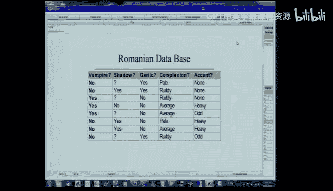
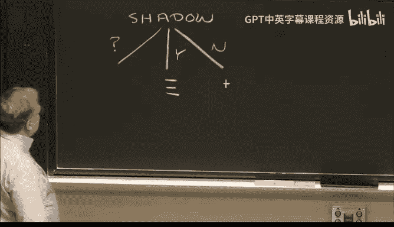
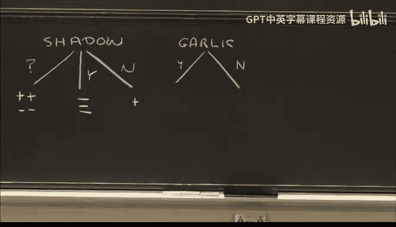
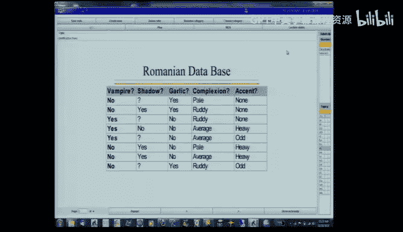
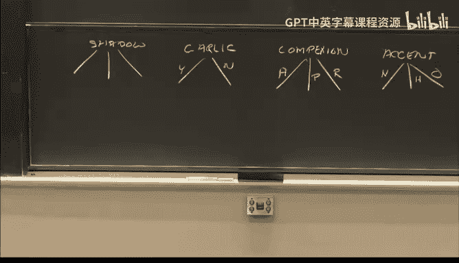
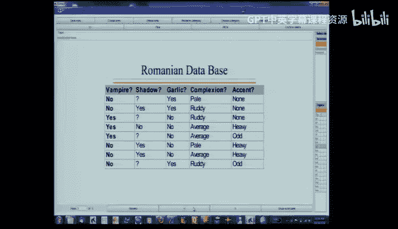

# 《人工智能｜6.034 Artificial Intelligence, Fall 2010》中英字幕 - P11：[11]11. Learning_ Identification Trees, Disorder.zh_en - GPT中英字幕课程资源 - BV14fqSB2ECY

Ladies and gentlemen， the Romanian national Anthem。

I did not ask you to stand because I didn't play it as a symbol of Romanian national identity。

 rather to celebrate the end of the Cold War， which occurred about the time that you were born。

Before that， no one came to MIT from Eastern Europe。But since that time。

 we've been blessed by having in our midst。Lithuanians， Estonians。Polls， Czechs， Slovakox。

 Bulgarians， Romanians， Slovenians， Serbs and all sorts of people from。

Regions of the world formerly excluded to us。Flieve me you' are all welcome in our house。

Almost all that is to say because。You may recall that Romania is the traditional home of vampires。

And since the end of the Cold War of Vas have had new vectors for emerging from。

Their traditional places and penetrating into the world at large。 You may have a vampire。

In your suite。Or on your floor。And it's important to know how to recognize them and take the necessary precautions。

So， if。You will have this concern。I would expect that the first thing you would do would be to look at some data concerning the characteristics of vampires。

So there's a little database of samples。Of individuals who have been。

Determined to be vampires and not vampires。And our task today。

 and what you'll understand how to do by the end of the hour is to use data like this to build a recognition mechanism that would help you to identify whether someone is a vampire or an ordinary person。

So this is a little different from the kind of problem we worked with neural nets。Right， so what's。

 what's the most conspicuous difference between。This data set and anything you could think to work on with that I say no nearest neighbors。

There's neighbors， which we studied last time。 Katie， do you have any thoughts about？

Why it would be difficult to use nearest neighbors with data like this。Oh， by the way。

 the question mark is there because this is MIT and a lot of people are completely nocturnal。

 so you can't tell whether they cast a shadow or not。We want to take that into account。

So what's different about this from the？Electrical cover data set。

If you use the nearest neighbor technique to。Identify vampires with this data。してな。

It's so obvious overlook at it since yes， why。对X是。Yeah。然后我来吃。This is not numerical data。

 this is symbolic。So长 saying日。s 。7。因为。Cast a shadow， don't cast a shadow， or we can't tell。

 it's a symbolic result。So problem number one that we have to face with data。

 this kind is that it's not numeric。And there are other characteristics as well， for example。

It's not clear that all of these characteristics actually matter。

So some characteristics don't matter。And a corollary to that is that some characteristics do matter but they only matter part of the time。

And finally。There's the matter of cost。Some of these tests may be more expensive to perform than others。

For example， if you wanted to determine whether someone casts a shadow。

 you'd have to go to the trouble of getting up during daylight。

That might be an expensive operation for you。You'd have to go find some garlic and ask them to eat it。

 That might be expensive。So some of these tests might be expensive relative to other tests。

But once you realize that we are talking in terms of tests。And not a vector of real values。

Then what you do is clear。You build yourself a little tree of tests。

So who knows how this problem will turn out， but you can imagine a situation where you have。

One test up here。Which might have three outcomes。And one of those outcomes might require one。

 but only one of those outcomes might require you to perform another test。And only。

When you've created a tree of tests that look like this， are you finished？

So given a set of tests and a set of samples。The question becomes。

 how do you arrange the tests in a tree like that。So as to do the identification that you want to do。

So since we're talking about identification， it's not surprising that this kind of p is called。

An identification tree。And there's a tendency， and I may slip into it myself to call this a decision tree。

But a decision tree is a label for something else。 This is an identification tree。

 and the task is to create a good one。So what is a good one versus a not so good one？

What characteristic would you like for a decision tree？For an identification tree to have。

If you're going to call it a good identification tree。What do you think， Krishna。

 what would be a good characteristic。な。Yeah。He said the minimum number of levels。

What's another way you can say what a good one is？Each test costs something， right。

 So what's another way of thinking about。What a good tree would look like。

The minimum cost and if they all have the same cost。That is the minimum number of tests。So overall。

 what you like is a small tree。Rather than a big one。

So you might be able to take your sample data and divide it up so that at the bottom of the tree at the leaves。

All of the sets that are produced by the test are uniform， homogeneous。

But you like that tree to be the simplest possible tree that you can find。 Not some big。

 complicated one that also divides up all the data into uniform subsets。By uniform subset， you know。

 at the bottom of the tree， you have all of the vampires together and all the non vampires together。

All so you like a small tree。 So why not just go all the way and do British museum and。

Calculate all possible trees。Well， you can do that， but it's one of those N problems。

 And as you know， N problems。Suck in general。 And， and so you don't want to do that。

 You want to have some kind of。Euristic mechanism for building a small tree。

 and we want a small tree， because。Why do we want a small tree because of the cost。

 But there's another more important reason why we want a small tree。Let me give you a hand。

It's Aham's Razor。The simplest explanation is often the best explanation。So if you have a big。

 complicated explanation， that's probably probably。Less good。Then a simple small explanation。

 Opims Razor。Spelled so many ways。 It doesn't matter how I spell it。

 And that's good because I can't spell。So I don't know how are we going to go about finding。

The best possible arrangement of。Those four tests。In a tree like that。Well。

 step one will be to see what each test does with the data and by the way。

 before I go a step further。You know， and I know that this is eight。

Sample data set that's very small， suitable for classroom manipulation。

You'd never bet your life on a dataset this small。We use it only for classroom illustration。

 but imagine that these rows are multiplied by 10。So instead of eight samples， you've got 80。

Then you might begin to believe the results that are produced。

 so I'm just going to pretend that each one of those。Represents。

T0 other samples that I haven't bothered to show。But we can't work with this one in the classroom because it's pretty small。

 And we can say， well， what does this shadow test do。Well， the shadow test divides。

The sample population into three groups。There's the I don't know group of people who are nocturnal。

 there are the people who do cast the shadow。The yes people and the people who do not cast the shadow of the no people。

So if I look at those rows up there。And see which ones are vampires。

 it looks to me that if they do not cast a shadow。There's no shadow cast。

 there's only one that doesn't cast a shadow， and that is a vampire。

So that's a plus over there vampire。Now， if we look at the ones who do cast a shadow。

 all of those are not vampires， they're all okay。

And now they're eight。Three are vampires。So that means that too of these must be vampires。

And I've got three， four， five， six， so far， so there must be two left。

So that's the way the shadow testivifies up the data。Now let's do garlic。

Ampies traditionally don't eat garlic， I don't know why。So we look at the garlic test。

 and we see that。All of the nos are were are only three yeses all， and they all produce a no answer。

So if somebody eats garlic。They're not vampires。That means the three vampires must be over here。

And then there are two left， so that's what the garlic test does。

Sa what we're trying to do is we're trying to look at all these tests to see which one we like best on our basis how it divides up the data。

So， now， we got。I don't know。啊。Complexion。And there are three choices for this。

You can have an average complexion， but a lot of vampires in my experience， are rather pale。

So pale is a possibility。And then the other option is that just after gorging themselves with blood。

 they tend to get a little red in the face。So we'll have it ready over here。Once again。

 we have to go back to our data set to see how this test divides things up。So， there are。3 readies。

 and ones a no。One's a no and one's a yes， so two knows， and yes。Two knows， and yes。

Now we can try for pale complexion people， there are only two of those， a no and an no。

That must mean that there are two pluses over here because there are three vampires altogether， two。

 four， six， seven。8，9。Well eight， sorry， eight。Only8。Ill just one more to go， and that's the accent。

Historically， vampires go to great length to perfect their accent and not their origins。

 But nevertheless， we can expect that。If they've just arrived。

 if they're just in from a Transylvania part of Romania， they may still have an accent。

 so there's a normal some still have a heavy accent and some persist in having odd accent。

So let's see accent， four of them right at the top have no accent， two nos， and yes。Heavy accent。

Three of those， A yes。And two knows。That means we must have a plus here。3，6。Pss and minus。

So we can look at this at this data and say， well， what would be the best test to use and the best test to use would surely be the one that produces。

Produces subsets or produces sets here。At the bottom of the branches that correspond to the outcomes of the test。

 we're looking for a test that produces homogeneous groups。So just for the sake of illustration。

I'm going to suppose that we're going to judge the quality of a test by how many sample individuals it puts into a homogeneous set。

So we want to， we want to ideally， we would like a test that would put all the vampires in one group。

And all the ordinary people in another group right off the bat。But there are no such tests。

But we can't add up the number of。Sample individuals who are put into at least homogeneous sets。

So why dont we do that？This guy has three in a homogeneous set here， a fourth。

 but these are not in a homogeneous set， so the overall score for this guy will be four。This one。

Well， not quite as good。 It only puts three individuals in homogeneous set。This one here。

Two window the homogene也3。Everybody else is all mixed up to some other kind of person。And over here。

 how many samples are in homogeneous set， zero？So on the basis of this analysis， you would conclude。

That the ordering of the tests with respect to their quality is left to right。

So the best test must be the shadow test。So。Let's pick the shadow test first。

See what we can do with that。If we pick the shadow test first。And we have this arrangement。

We have question mark。And we have， yes。Cast a shadow and no doesn't。We have three minuses here。

We have a plus here， and unfortunately over here， we have plus plus minus minus。

 so we need another test to divide that group up。Yes。社家先。Well。

 if I look at the data and I see who we have- the question is what about that shadow test。

 if you look at the shadow test you say， well， there are four question marks。

And if we look to see what kind of people belong to those four question marks。

 there are two vampires and two non vampires that's why it's two pluses and two minuses Well I understand that question is how did you get to this work？

Oh， yeah， no， I'm， I'm scoring this。 The question is， how do I get this number 4。

 It's not have nothing to do with this， because it's a mixed set。 In fact。

 I've got three guys in a homogeneous set here and one guy in a homogeneous set here。

 I'm just adding them up。

So a very simple classroom illustration wouldn't work in practice。Yes。Can you adjust this for？

Wheres I left you if anybody have any。The question is。

 how do I adjust this for larger data sets you're one step ahead？Thank you。So trust me。

 I'll be dealing with large data sets in a moment， I just want to get the idea across。

 and I don't want there to be any thought that the method we use for larger data sets is kind magic about it。

Okay， so we're all from running。 And now we have to pick。A test that will divide those four guys up。

So we're going have to work this a little harder。And repeat the analysis we did there。

 but at least it'll be simpler because now we're only considering four samples，9 eight。

 just the four samples that we still have to divide up that have come down that left branch。

So we have the shadow test。It has three outcomes， we have the complete garlic test。

It has two outcomes。Yes and no， we have the complexion test。There three outcomes。Average。

 pale and ruddy。And we have finally， the accent test。And that comes out to be either normal。

 heavy or odd。And now it's a little awkward to figure out what the results are for the data set has shown。

 so let me just strike out。

The ones that we're no longer concerned with and limit our analysis to the samples for which the outcome of the shadow test is a question mark。

 this is exactly the four people we still need to separate。All right。So I'm switching colors。

Keeping the color the same。We actually don't want to do the shadow test anymore。

 right because we've already done that， so there's no point in doing that again。

 we don't have to look at that。It's already done all the division of data that it can。

So the garlic test， well let's see garlic， two yeses， two nos， the yeses produce nos。

 and the nos produce yeses。So if the person does eat garlic。They're okay。

And if they don't eat garlic。Bad news， there're vampires。that looks like a pretty good test。

 but just for the sake of working it all out， let's try the others。Complexion。Two readies。

 a yes and a no。One pale， and that's I know。One pale， and that's a no。And we must have one average。

And sure enough， that's a yes。Now we can do accent at the one on the far right。 and look at how that。

Measures up against the people still under consideration as samples。Aent， let's see two nuns。

 a yes and a no。Two heavy or one heavy， no heavyavs， two odds， yes， I dont know。All right。

 so now we can do the same thing we did before and just say for sake of classroom illustration。

 how many individuals are put into homogeneous sets。 And here we have four。And here we have。2。

And here we have zero。So plainly， the garlic test is the test of choice。

 so we go back over here and we've completed the work that we needed to do。So that's a garlic test。

And that produces。Two pluses， let's see。Eat garlic， yes。Eat garlic， no。I guess。

Plus this go over here。Like so。 And these are the two ordinary people。 and we're done with our task。

 and now you can quickly run off。And put this into your PDA and forever be protected against the possibility one of those vampires got out and the flood of people came in from Eastern Europe。

Except。What do we do with a large data set？Trouble is a large data sets。

 not you put no test at the beginning of a large data set that's likely to do the job for any。

If you have a large data set， no test is likely to put together any homogeneous set right off。

So you never get started。Everything would be zero。Every test would say， oh。

 it doesn't put anybody into homogeneous set so you're screwed， you need some other way。

You need some other more sophisticated way of measuring。

How disordered this data is or how disordered。These sets are。

That you find at the bottom of the tree branches。That's what you need a way of measuring disorder。

Of these。Tests of these sets that you find at the bottom of these branches。

So you can find a kind of overall quality to the test based on your measurement of disorder。Now。

 the first heuristic of a good life is when you have a problem to solve。

 ask somebody who knows the answer。 It's the least amount of work。

 It's not even as hard as going to Google。So who would you ask about measures？

Ways of measuring disorder in sets。There are two possible answers。哦，又回不去。What entropy。

 who studies entropy？What kind of class physics？Thermodynamics。

The thermodynamicists are good at measuring disorder because that's what thermodynamic is all about。

 entropy increasing over time and all that sort of stuff， there's another equally good answer。

Ex visions。Statisticians。Perhaps， but it's not the best， second best answer。

It's actually not even the best answer， that's the best answer， which you name？对有有。I don't know。

Theonardo has got his finger on it， the information theorists are pretty good at measuring disorder because that's what information is all about too。

So we might as well borrow a mechanism for measuring the disorder of a set from those information theory。

 guys。So what we're going to do is exactly that。Let's put it over here。

 so we'll have it handy when we want to try to measure those things。What they say is the gospel。

 according to。To information theorists is that the disordered D。Of some set。Is equal to。

 now let's suppose that this is a set of。Of binary value。 So we have positives。

 and we have negatives， pluses and minuses， but pluses。

 they don't go very well at an algebraic equation because might be confused with adding。

 So I'm going to say P and。P and N。 and then there'll be the total， which is P plus n。

 We only got two choices， positive and negative。So the disorder of a set according to those guys。

Is equal to minus。Number of positives over the total number。Times the log。To the base2。

Of the positives over the total。Minus， the negatives。Over the total。Times a log。

Two of the negatives over the total。Those negatives will worrisome because you think， well。

 maybe this thing can go negative， but that's not going to be true right。

 because these ratios are all less than one。And the logarithm of something that's less than one is。

Negative。So we're okay。So that's a lovely way of measuring disorder。

And maybe we got a drug graph of what that curve looks like。

And what we're going to graph again is the ratio of。Positives。To the total number。

So that's going to be an axis where we go from zero to one。So I don't know。

 let's just find a couple of useful values， and by the way。

 pays to pay attention to these curves because if you pay attention to stuff。

 you can work the quiz questions on this。Very rapidly。Otherwise， you。

You know we see people getting up the calculators and quickly becoming。Both lost and screwed。Okay。

 so let's see， let's suppose that the number of positives is equal to the number of negatives。

 so we've got a completely mixed upset。It has no bias in either direction。So in that case。

 if p of P over t is equal to12。Then this is equal to。Minus12。Times the logarithm。Of one half。

And I guess as they're both the same， we can multiply by two。And what's that value？what is that？

Calculate up。M is not half percent。Well， with a minus sign， you just turn the argument upside down。

 So it's log 2。 So what's log2 based logarithm of base two of two。One so后 thing。This whole thing is。

One， so Manasa in her software voice says， let's see。

Two times a half that cancels out the minus that flips the argument so it's logged to the base two of two。

 and that's one， so this whole thing works out， you work out the algebra is 1。So， that's cool。

So right here in the middle， where they're equal。We get a value of one。

Next thing we need to do is let's calculate what happens。P over T。Is equal to one。That does it say。

 everything is a positive， any guesses？Maybe 10， 20。Min-15， let's work it out。

So that would be if p P of over t equals 1， that would be minus-1。Times a log to the base too。

The one。What's that？0。 Oh yeah。 because two raised to the one is。Two raised of the zero is1。

 so this part is  zero。Now， what about this other part， we have minus？

If everything's a p then nothing's an end， so we got zero， and we can quit it already。Well。

 not quite， we ought work it out， logged to the base too。Of zero， what's that？ho？Minus infinity。

Oh zero times minus infinity is what， I didn't get that when I was in high school。Finally。

 1801 makes a difference。系。Finally， what's the answer？We're interested in the limit。As。

N over T goes to zero， right？And when you have a deal like this。What do you do？Use。That famous rule。

 we all mispronounce when we see it written， right。We'll use the good OL hospitals rule。Okay。

 it's lopeal， lopeel's rule， you have to differentiate the。

 I guess we differentiate this guy as a ratio or something and see what happens when it goes to zero and what we get when we use Lopeel's rule is that。

 oh thank God， this is still zero。So now we know that we have a point up there and a point down there。

So now we've got three points on the curve and we can draw it。Goes like that。No。

 it doesn't go like that。 It's obviously a Gaussian， right。

 because everything in nature is because you put that laptop away。

 please everything in nature is a Gaussian， so it looks like this。That right？No。

 actually not everything in nature is a Gaussian， and in particular。

 this one isn't a Gaussian either。It looks more like a。

One of those metal things I used to call Quan at huts。That's what it looks like。嗯害手。

So that is the curve of interest。Now， did God say that using this way of measuring disorder was the best way？

No， God has not indicated any choice here。We use this because it's a convenient mechanism。

It seems to make sense， but in contrast to the reason it's used in information theory。

It's not the result of some elegant mathematics。 It's just a borrowing of something that seems to work pretty well。

Any of those curves will work just about the same。Because all we're doing with it is measuring how disordered a set is。

So one thing to note here is that in this situation。Where we're dealing with two choices， P and n。

 positives and negatives。We get a curve that maxes out at one。

And notice that it kind of gets up there pretty fast。 In fact， if you're down here at two thirds。

And you go up here， this is about。9。So quite a bit of the gives you a large number for quite a bit of that area in the middle。

So that unfortunately still doesn't tell us everything we need to know。

 that tells us how to measure a disorder in one of these sets。

But we want to know how to measure the quality of the test overall。

So we need some mechanism that says， okay， given that this test produces three different sets。

And we know how to measure the disorder in each of these sets。 how do we measure the quality。

 overall quality of the test？Well， you could just add up the disorder。

Let's write that down because that sounds good。So， you can see that the。

We'll call it the quality of a test。Is equal to sum sum。Over the sets produced。

And what we're going to do is we're going to add up the disorder。Of each of those sets。

And we're almost home， except that。This means that we're going to give equal weight to a branch that has almost nothing down it as we do we're going to give the same weight to that as a branch has almost everything going down it。

So that doesn't seem to make sense。 So one final flourish。I we're going to wait this sum。

According to the fraction。Of the samples that end up。Down that branch。

So it's as usual easier to write it down and to say it。So we're going to multiply that times。

The number。嗯。Samples。And the set。Provided by a number。Of samples。Handled。By test。

So if half the samples go down a branch and if that branch has a certain。Disorder。

 then we're going to multiply that disorder times one2。All right。

 so now let's see how it works with our sample problem。Well。

 here is our sample data and we didn't need anything fancy for it。

 but let's pretend it was a large data set。Well， let's see， what will we do。

We down this way therefore。Samples down that direction， that's half of the total number of samples。

 so whatever we find down there we're going to multiply by half。

 this one we're going to multiply by three/8s。And this one we're going to multiply by 1，8。

Now what do we actually find at the bottom of these things， Well here's a homogeneous set。

 everything's the same。 So if we go to that curve and see what is the disorder of a homogeneous set。

 it's zero。Oh，Let's see。 they're all the same。 I guess that means it's。Zero over there。

So the disorder of this set。Of three samples is zero。The disorder of this set of one sample。

 all the same is zero。The disorder of this set， well， let's see half of the individuals there。

 half of the samples there are plus and half or minus。 So we go over to our curve and we say。

What's the disorder of something with the equal mixture of plus as a minus， and that's one。

So the disorder of this guy is one。So now we've got one half times one。38 times 0，1，8 times 0。

 so that this order of this particular the quality of this particular test。

 as determined by the disorder of the sets that it produces is。One/ half， 0。5。Right。

Let's do this one。So we have three eighths coming down this way。F8s coming down this way。

38s has multiplied it by the disorder of a set of uniform things， that's disorder zero。

So this guy over here。Let's see， that's。Two fifths and three fifths。ultYou know。

 this is one of those deals where if you look at the curve。You know。

 you're pretty close to the middle， and that curve goes all the way up to about 0。9 there。

So you can kind of just look at this and eyeball it and say， well。Whatever it is。

 it's going to be the overall， this is going to be something multiplied times58。

 something like 09 times 58s， so let's just say the sake of discussion that's going to be about 06。

 which is。Within 100th， I think of being right。Just kind of guessing。Okay， well now we're on a roll。

 here we have three eighths coming down this branch。Three8s coming down this branch。

 one quarter coming down this branch， this is zero。

And this is one of those deals where these two are about 0。9。So it looks like it's going to be。

Three plus three as。3，4 times about 09。 So that's going to turn out to be about 0。上。Okay。

 so one last go here， three，8s。3，8。And one fourth。Oh， that's interesting because these two。

Or what we got contributed up to that 0。7。This one is 0。4 times this is evenly divided。

 so that's going to have a disorder of one。So that's going to be 2。25。

Bigger than the number we got over here， so that's going to end up being about。0。95。So thanks God。

 our answer is the same as we go with our simple classroom measurement of disorder。

Except this is measuring how disorder stuff is， we want the small number， not the big number。

So once again， based on this analysis， you'll be sure to pick the shadow test because 0。

5 is less than 0。6， which is less than 0。7， which is less than 0。95。Acent test is really horrible。

 don't use it。Just because somebody has a heavy accent doesn't mean they're a vampireir。 in fact。

 most vampires have。Worked very hard on their accent， as I mentioned before。All right。

 so now we know that we're still going to pick the shadow test。As our first go。So that's good。

Now let's see if we can repeat the exercise with our second selection。

 the one that we have to have to pick those guys apart。

And it is going to be easier because there are fewer things to work with and they're， oh， wow， look。

 that's zero。That's zero， that's1， that's1 half。 value so the disorder of this guy is。0。0。

So this is one quarter。One quarter。One half。0，0，1 half times1。 oh that's0。5。That was easy。

 How about this one？He says one， let's see。 that's one。 That's one， that's one half。 That's one half。

 Yeah， it is one。So sure enough， the answer also comes out to be the same as before when we did our just simple intuition exercise。

So I don't know， Christopher， is this all about using information and theory？No， no， no。

 no is this is。See it's not about the math， it's about the intuition and the intuition is that you want to build a tree that's as simple as possible。

 and you could build a tree that's as simple as possible if you look at the data and say， well。

 which test does the best job of splitting things up。

 which test does the best job of building subsets underneath it that are as homogeneous as possible。

So all this information theory， all this。Entropy stuff。

There's just a convenient mechanism for doing something that is intuitionally sound。 Okay。

 it's not about information theory。 It's about。A sound intuition。Oh， by the way。

 does this kind of stuff ever get used in practice？Tens of thousands of times。

This is a winning mechanism。It's used over and over again。Even when the data is numeric。

How would it work if it's numeric data， well， let's think about that for a little bit。

So let's suppose that， you know we have an opportunity we're an EMT or something we work in infirmary。

What do they call it these days something else， but anyhow you work in that kind of area and you have the opportunity to take people's temperature。

And so over time， you've accumulated some data。On the temperature of people。

 And maybe you found that there's a vampire here。At about 102， there's a normal person here。

 about 98。6， but they're scattered around， you know。Some people have fevers when they come in。

So the question is， is there a way of using numerical data， things that you can put on real numbers。

 is a way of using that with this mechanism？And the answer is yes， you just say。

 is the temperature greater than or less than some threshold？That gives you a test。

 just a binary test， just like any of these other tests。Right， commission。

But where do I put the threshold？I suppose I could just put it at the average value。

But that might not be the test the place that does the best job。Ex's split that。

Samples into homogeneous groups。Chris， numerical analysis。So youve tried different places， he says。

 and he's right， because this is a computer。 this is our slave。

 We don't care how much it works to figure out the right threshold。So what we do is we say， well。

Maybe the thresholds halfway between those two guys are halfway between those two guys or those two guys or those two guys are those two guys。

So we can try one less threshold and we have samples， and we don't care if there are 10。

000 samples because this is a computer and we don't care if it works all night。

So that's how you find the threshold for a numeric test。By the way。

 I asserted earlier on you would never use the same test twice， Is that true for this？Yes。

 you would still never use the same test twice， but what you might do is you might use a different threshold on the same。

On the same measurement the next time around。So in this when you start having numerical data。

 you may find yourself using the same。The same test with the same。The same axis。

But with a different value。All right， so now I can say。Now that we have this。

 then we can go back and compare how this method would look when we put it up against。

The sort of stuff we were talking about last time。WithWith the electrical covers。

So with the electrical covers， we had a situation like this。

I don't know we had samples or in places like this。And we had。

A division of the space that looked pretty much like that。Not quite exactly in the right spots， but。

Pretty close。So these are the decision boundaries。For the situation where we are using nearest neighbors to divide up the data。

What would the decision boundaries look like if these were four different kinds of things？

And we were using this kind of mechanism。And maybe there's a whole lot of samples all clustered around places like that。

What would the decision boundaries look like？Will they be the same as this？God， I hope not why。

Because what we're going to do is we're going to use a threshold on each axis。So therefore。

 the decision boundaries are going to be。Parallel to one axis or the other。So we might decide。

 for example。Oh shoot， I think I'll draw it again because it'll get confused if I。

Drt over the other one。Looks like this。And that's how nearest neighbors does it。

But a identification tree approach will pick a threshold。 And along one axis or the other。

 let's say it's this axis。 It's only got one choice there。 So it's going to put a line there。

I know what's the next thing it does？Well， still has these。Two different kinds of things to separate。

 we're going to assume we've got four different kinds of things。So， it's going to say。I've come down。

The negative side。So I need a threshold on the remaining data。

And these are the only two things that are now remaining。So my only choice is fully。

Not a threshold in there。Now， I guarantee this。Absolutely guaranteed on a quiz， somebody。

Presumably somebody who doesn't go to lectures will draw that line all the way across。

 and that's desperately wrong。Because。We've already divided this data set in half now the choice of what we do over here is governed only by the remaining samples that we see。

 these two， and so the threshold is going to go in there like that。Okay。

So that's what happens when you。Go back， this is used。Tens of thousands at times。

Always use what are the virtues of it， number one？You don't use all the tests。

You use only the tests that seem to be doing some useful work for you。

So that means that you do a better job because your measurement technique is simpler and it costs less。

Because you're not going to the expense of doing all of the testing。So it's a real winner。

 but you know what， some classes of people。're not scientists， but I mean people like。

Doctors and stuff。They don't like to look at these trees。They're kind of rule oriented。

So they look at a tree like this for determining what kind of thyroid disease you have。

 and it would have maybe 0 or 20 or so tests in it of various kinds of hormones like thyoxin and this and that。

And they say， oh， we can't deal with that。So we have we have to。We have to work with them。

 so what we do is we convert the tree into a set of rules。

How do we convert the tree into a set of rules？hoops。Wrong one。Go away， go away。Oh。

 here's what I want。 Yeah， good。 How do we convert this tree into a set of rules。

It's straightforward， Christpher， what we do？Baically each branch you'd basically just go down each branch to at leaf。

So you say， for example， here's one rule。If。Shadow。Echs question mark。And garlic。Equals。Oh。

 which branch should I want to choose no？Doesn't eat garlic。No， I think I'll say yes。Yes。

 that changes the answer then。嗯。Then。If it East S it's not an empire， right。

 so that's one of four possible rules because there are four leaf notes。Now。

We're almost done and we are done except for one thing we can actually take these four rules and start thinking about how to simplify them。

 you can ask questions like if I have a rule， that test both the shadow and the garlic。

Do I actually need both of those antecedents？ And the answer is， in many cases， no。

 and in particular， in this case。Now， because if we look at our data。What we discover is。

That in the event。That we're talking about a shadow question mark。

Oh I guess I had a better choice the other way。 Oh no， if you look at the garlic， all the garlics。

Yes， yes。 and yes。It turns out that the answer is no independent of what the shadow condition is。

So we can look at the rules and in some cases we'll discover that our tree is a little bit more complicated they need to be。

 we can actually get rid of some of the clauses， so in the end we can develop a very simple mechanism based on good old-fashioned old-based behavior like you saw almost in the beginning of the subject that does the job and now you're all free to put this without any royalty。

 you're all free to put this into your PDA and use to protect yourself in the days that come especially since Halloweens just around a corner。

