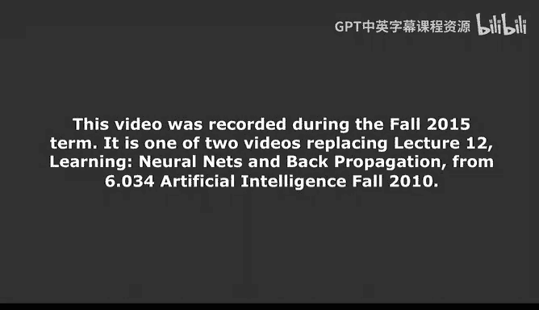
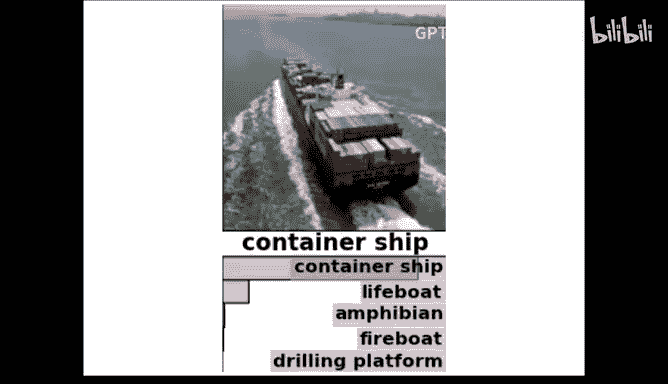
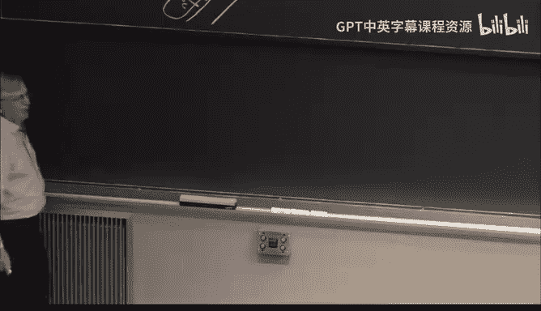
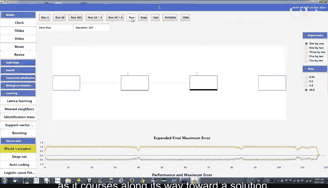

# 《人工智能｜6.034 Artificial Intelligence, Fall 2010》中英字幕 - P12：[12]12a_ Neural Nets.zh_en - GPT中英字幕课程资源 - BV14fqSB2ECY

The following content is provided under a Cative Commons license。

 Your support will help Mi T Opencourseourseware continue to offer high quality educational resources for free to make a donation or to view additional materials from hundreds of Mit courses。

 Visit Mit Opencourseseware at Ocw。 Mt Eduu。

It was in 2010， Yes， that's right， it was in 2010。We were having our annual discussion about what we would dump from 603。

4 in order to make room for some other stuff。 And we almost killed off neural nets。

Now that might seem strange because。You know， our heads are stuffed with neurons。

If you open up your skull and pluck them all out， you don't think anymore。

So it would seem that neural nets would be。A fundamental and unassailable topic。

But many of us felt that the neural models of the day weren't much。In the way of。

Faithful models of what actually goes in inside our heads。 And besides that。

 nobody had ever made a neural net was worth darn for doing anything。 So we almost killed it off。

 But then we said， well， everybody feel cheated if they take a course in artificial intelligence intelligence don't learn anything about neural nets。

 And then Ill go off and invent on themselves。 and waste all sorts of time。

 So we kept the subject in。Then two years later。Jeff Hinton from the University of Toronto。

Stunned the world with some neural work he had done on recognizing and classifying pictures。

And he published a paper from which I am now going to show you a couple of examples。

Jeff so neural net， by the way， had 60 million parameters in it。

And its purpose was to determine which of1 thousand categories。Best characterized a picture。

So there it is。 There's a sample of things that。The Toronto neural net was able to recognize or make mistakes on。

 I'm going to blow that up a little bit。 I think I'm going to look particularly at the example there labeled containership。

So what you see here is that the program returned its best estimate of what it was ranked first five。

According to the likelihood of probability or the certainty that it felt that a particular。

Class was characteristic of the picture。And so you can see this one。

 it's extremely confident that it's a container ship。

It also was fairly moved by the idea that might be a lifeboat。

Now， I'm not sure about you， but I don't think this looks much like the lifeboat。

 but it does look like a container ship。 So if I look at only the best choice， it looks pretty good。

 here are the other things that it did pretty well on。 Got the right answer is the first choice。

 is this first choice。So over on the left， you see that it's decided that the picture is a picture of a mite。

The mi is not anywhere near the center of the picture， but somehow it managed to find it。

The container ship again， there's a motor scooter， a couple people sitting on it。

 but it correctly characterized the picture as a motor scooter。And then on the right。

 a leopard and everything else is a cat of some sort。 So it seems to be doing pretty well。 In fact。

 it does do pretty well。But anyone who does this kind of work has an obligation to show you some of the stuff that doesn't work so well on。

Or it doesn't get quite right。 And so these pictures also occurred in Hton's paper。

So the first one is characterized as a grill， but the right answer was supposed to be convertible。Oh。

 no， yes。 Yeah， right answer is convertible。In the second case。

 the characterization is of a mushroom。And the alleged right answer is。Gerrick。

 is that pronounced right？ It turns out that's a kind of mushroom。 So no problem there。

In the next case， it said it was a cherry， but it was supposed to be a Dalmatian。 Now。

 I think a Dalmatian is a perfectly legitimate answer for that particular picture。

 So hard default fault it for that。 And in the last case， it didn't。 you know， the。

 the correct answer was not in any of the top five。

I'm not sure if you've ever seen a Madagascar or cat， but that's a picture of one。

 And it's interesting to compare that with the first choice of the program。 squirrel monkeykey。

 This is the two side by side。So in a way， it's not surprising that it thought that the Madagascar cat was a picture of a squirrel monkey。

So pretty impressive， it blew away the competition。

 it did so much better that second place wasn't even close。And for the first time。

 demonstrated that a neural net could actually do something。 And since that time in the。

Three years since that time， there's been an enormous amount of effort put into neural net technology。

 which some say is the answer。So what we're going to do today and tomorrow is have a look at this stuff。

And ask ourselves why it works， when it might not work， what needs to be done， what has been done。

 and all those kinds of questions will emerge。So。I guess the first thing to do is to think about what it is that we are being inspired by。

We're being inspired by those things that are going。That are inside our head。

 All 10 to the 11th of them。And so if we take one of those 10 to the 11th and look at it。

You know from 70 something or rather approximately what a neuron looks like。And by the way。

 I'm going to teach you in this lecture how to answer questions about neurobiology with an 80% probability that you will give the same answer as a neurobiologist。

 so let's go。So here's a neuron， it's got a cell body。And there is a nucleus。

 And then out here is a long thing of jger， which divides maybe a little bit。But not much。

And we call that the axon。So then over here， weve got this much more branching type of structure。

That looks， maybe a little bit。Like so。I， maybe like that。And this stuff branches a whole lot。

 And that part is called a dendritic tree。Now， there are a couple of things we can note about this is that these guys are connected axon to dendrite。

 So over here， there'll be a so- called presynaptic thickening。

 and over here will be some other neurons dendrite。And likewise， over here， some other neurons axon。

Is coming in here。And hitting the dendite of our of the one that occupies most of our picture。

So if there is enough stimulation from this side in the axonal tree or in the dedritic tree。

 then a spike will go down。That axon， it acts like a transmission line。And then after that happens。

 the neuron will go quiet for a while。 as this kind of recovering its strength。

 That's called the refractory period。Now， if we look at that connection in a little more detail。

This little piece right here。It sort of looks like this。Here's the axon coming in。

It's got a whole bunch of little vesicles in it。And then， there's a。Dendrite over here。

 And and when the axon is stimulated， it dumps all these vesicles into this inner synaptic space。

For a long time， it wasn't known whether those things were actually separated。

I think it was Ramoni Kahalal， who demonstrated that the。

That one neuro're on is actually not part of the next one。

 They're actually separated by these synaptic， by these synaptic gaps。So oh， there it is。

How can we model that sort of thing？Well， here's what's usually done。

 here's what is done in the neural net literature。First of all， we've got some kind of。Binary input。

 because these things either fire or they don't fire。 So it's an all or none kind of situation。

So over here we have some kind of input value， we'll call it x1， and it's either a 0 or a1。

So it comes in here。And then， it gets multiplied。Time， some kind of weight。我靠。第二笔。1。So this。

 this part here is sort of modeling this， the synaptic connection。 It may be more or less strong。

 And if it's more strong， this weight goes up。 And if it's less strong， this weight goes down。

So that's， that's， that's the influence。 that reflects the influence of the synapse on。

 on whether or not the whole axon besides it stimulated。And we got other inputs down here。Xim n。

 also01。It's also multiplied by a weight。We'll call that W。 Savan。

And now we have to somehow represent the way in which these。These inputs。Are collected together。

 how they have collective force。And we're going to model it very， very simply， just by saying。Okay。

Go run through the summer。Like so。But then we have to decide if the collective influence of all of those。

Inputs is sufficient to make the neuron fire。So we're going to do that。

By running this guy through a threshold。Bocks like so。

Here is what the box looks like in terms of the relationship between the input and the output。

And what you can see here is that nothing happens until the input exceeds some threshold T。

If that happens， then the output。Z is a one， otherwise it's a0。So binary in， binary out。

We model the synaptic weights by these multipliers。

 We model the a aulative effect of all that input to the neuron by a summer。

We decide if it's going to be an all or none one by running it through this threshold box and seeing if the sum the weight some products。

Add up to more than the threshold。If so， we get a one。So what in the end are we in fact modeling？没有。

With this model。We have number one， all or none。Number 2。Cumulative influence。And number 3。Oh。

 I suppose synaptic weight。But that's know that there might be to model in a real neuron。

We might want to deal with the refractory period。Not noted in these biological models that we build neural nets out of。

We might want to model axonal bifurcation。We do get some division in the axon of the neuron。

 And it turns out that that pulse will either go down one branch or the other。

And which branch it goes down depends on electrical activity in the vicinity of the division。

So these things might actually be fantastic coincidence detectors。😊，But we're not modeling it。

 We don't know how it works。So exxonal bifurcation might be model。Have a look at。Time patterns。See。

 what we don't know is we don't know if the timing of the arrival of these pulses in the dendritic tree has anything to do with what that neuron is going to recognize。

So there are a lot of unknowns here。And now I'm going to show you how to answer a question about neurobiology with 80% probability。

 you'll get it right。Just say。We don't know。And that'll be with 80% probability what the neurobiologist would say。

So， this is a model。Inspired by what goes on in our heads。But it's far from it's far from clear。

If what we're modeling is the essence。Of why those guys。Make possible what we can do。Nevertheless。

 that's what we're going to start。 That's where we're going to go。

So we've got this model what a neuron does。So about what does a collection of these neurons do？Well。

 we can think of your skull。There's a big box。Full of neurons。

Maybe a better way to think of this is that your head is full of neurons， and they， in turn。

 are full of weights and thresholds。Like so。So into this box come a variety of inputs， X 1 through x。

M。And these find their way to the inside of this。Gagle of neurons。 and out here。

Come a bunch of outputs。See one。Through Z N。And there's a whole bunch of these， maybe。Like so。

 and there are a lot of inputs like so。And somehow， these inputs。

Through the influence of the weights and the thresholds come out as a set of outputs。So we can。

 we can write that down a little fancier by just saying that。Z。As a vector。Which is a function。Of。

 well， certainly， the input vector， but also the weight vector and the threshold vector。

So that's all an neural net is。And when we train a neural net。

 all we're going to be able to do is adjust those weights and thresholds so that what we get out。

Is what we want。So a neural net is a function appximator。It'sGood to think about that。

 It's a function appxiator。So maybe we've got some sample data。That gives us an output。Effective。

 that's desired。As a function， and as another function of the input。

Forgetting about what the weights and the thresholds are， that's what we want to get out。

And so how well we're doing can be figured out by comparing the desired value with the actual value。

So we might think then that we can get。A handle on how well we're doing， like。

Constructing some performance function。Which is。Determined。By the。Desired vector。

And the input vector。Sorry， the desired vector and the actual output vector for some particular input。

Or for some set of inputs。And the question is， what， what should that function be。

How should we measure performance？Are given that we have。

What we want out of here and what we actually got out of here。Well， one simple thing to do。

Is just to measure the magnitude of the difference。That makes sense。But of course。

That would give us a performance function。That is a function of the distance between those vectors would look like this。

But that turns out to be。Mathematically inconvenient in the end。

 So how do you think we're going target it up a little bit。不是。Well， I don't know。

 How about did we square it。And that way， we， we're going to go from this little sharp point down there to something looks more like that。

So it's best when the difference is zero， of course。And it gets worse as you move away from zero。

But what we're trying to do here is we're trying to get to a minimum value。

And and and I I hope you'll forgive me。 I just don't like the direction we're going here。

 because I like to think in terms of improvement is going uphill instead of downhill。

So I'm going to dress this up just one more step， put a minus sign out there。

And then our performance function looks like this。It's always negative and the best value it can possibly be is zero。

So that's of what we're going to use just because I am who I am。And it doesn't matter， right？Still。

 you're trying to either minimize or maximize some performance function。Okay。

 so what are we going to do， I guess what we could do。I we could treat this thing。

But we already know what to do。I'm not even sure weever。Deotting a lecture to this。

 because it's clear that what we're trying to do。Is we're trying to take our weights and our thresholds and adjust them so as to maximize performance。

So we can make a little contour map here with a simple neural net with just two weights in it。

And maybe it looked like this。Contour map。And at any given time。

We've got a particular W1 in particular2 W2， and we're trying to find a better W1 and W2。

So here we are right now。And there's the time term map。 and it's a 6034。 So what do we do？

A simpleple matter of hill climbing， right？So we'll take a step in every direction。

If we take a step in that direction。Not so hot。 That actually goes pretty bad。

These two are really ugly。 but that one。That one takes uphill a bit。So we're done， except that。

I just mentioned it Htton's neural net has 60 million parameters in it。

So we're not going to hill climb with 60 million parameters because that。Yeah。

 it explodes exponentially in the number of weights you've got to deal with。

The number of steps you can take。So this approach is computationally intractable。Fortunately。

 you've all taken 801，1801 or the equivalent thereof。So you have a better idea。

Instead of just taking a step in every direction。What we're going to do is we're going to。

Take some partial derivatives。And we're going to see what they suggest to is in terms of how we're going to get。

 get around in this space。 So we might have the parcel of that performance function up there。

With respect to W1。And we might also take the partial derivative of that guy with respect to W2。

Anice will tell us how much improvement we're getting by making a little movement in those directions。

 right？How much of change is given that we're just going right along the axis。

So maybe what we ought to do is if。This guy。Is much bigger than this guy。

 It would suggest that we mostly want to move in this direction。Ors put in 1801 terms。

 What we're going to do is we're going to follow the gradient。And so， the change。AndW vector。

Is going to equal to。This partial derivative times I。Plus， this partial derivative times J。

So what we're going to end up doing in this particular case by following that formula is moving。

All in that direction right up the steepest part of the hill。And you know， how much we move is。

 is a question。So let's just have a rate constant R that decides how big our step is going to be。

And now you think we were done。没有。Too bad for our side。 We're not done。

There's a reason why we can't use。Creian。A sense， or in the case that I've drawn or gradient and Pcent。

 If we take the performance function the other way， why can't we use it。The remark is local maximuma。

 and that is certainly true， but it's not our first obstacle。When does gradient andcent work？So。

There's something wrong with our function。It's right。 It's nonlinear。

 or it's whether it's discontinuous。So gradient requires a continuous。Space， continuous surface。

So too bad for our side。It isn't。So what to do。Well。Nobody knew what to do for 25 years。

People were screwing around with training neural nets for 25 years before Paul Webos。

 sadly at Harvard in 1974， gave us the answer。Now， I want to tell you what the answer is。

First part of the answer is。Those thresholds are annoying。They're just extra baggage。To deal with。

What we really like， instead of C being a function of X。

 W and T was like C prime to be a function F prime of X。And awaits。

But we got to account for the threshold somehow， so here's how you do that。What you do is you say。

Let us add another input。To this neuron。And it's going to have a weight。W0。好。

And it's going to be connected to an input that's always  -1。Be with me so far。

 We're just going to add。 Now， what we're going to do is we're going to say。Let。W0 equal T。

What's that do to the movement of the threshold。What it does is it take that threshold。

 moves it back to zero。So this little trick here takes this pink threshold and redoes it so that the new threshold box looks like this。

喂。Think about it。 if， if this is T。And this is -1。 then this is  T。

 And so this thing ought to fire if everything is over the sum is over 0。 So it makes sense。

 And it gets rid of the， it gets rid of the threshold thing for us。

 So now we can just think about weights。But still， we've got that。 we've got that。We've got that。

Step function there。And that's not good。So what we're going to do is we're going to smooth that guy out。

So this is trick number two。Instead of a step function。

 we're going to have this thing we lovingly call a sigmoid function because it's kind of kind of an S type shape。

And the function we're going to use。Is this one？1。Well， I'll better make up a little bit different。

1 over1 plus e to the minus， whatever the input is。Let's call the input alpha。Does that make sense？

You see， if alphaalpha is0， that's 1 over1 plus 1。So that's one half。If alpha is extremely big。

 then e to the minus alpha is extremely small and it becomes one。

Goes up to an asymptotic value of one here。On the other hand， the alpha is extremely negative。

The e to the minus。Alpha is extremely positive， and it goes to 0 oymptically。

So we got the right look to that function。It's a very convenient function。

 Did God say that neurons ought to be。Has that threshold a lot of work like that？No。

 God didn't say so， who said so？The math says so。It has the right shape and look and the math。

And it turns out to have the right math。We， as we'll see in a moment， okay。So let's see。

 where are we？We decided that what we like to do is take these partial derivatives。

We noted that it was awkward to have those thresholds， so we got rid of them。

 and we noted that it was impossible to have the step function。 so we got rid of it。

Now we're in a situation where we can actually take those partial derivatives and see if it gives us a way of training the neural net so as to bring the actual output into alignment of what we desire。

All right。So to deal with that， we're going to have to work with the worlds。Simplest neural net。Now。

 we've got one neuron。It's not a net。But if we've got two word neurons， we've got a net。

 it turns out that's the world's simplest neuron。So we're going to look at it。

Not 60 million parameters， but just a few。Actually， just two parameters。So let's draw it out。

Weve got input。X。That goes into a multiplier。And it gets multiplied times。W1。And that goes into。

A sigmoid box like so。 We'll call this P1， by the way， product number one out here comes y。

W gets multiplied times another weight。We'll call that。W2。The neck produces another product。

 which we'll call P2。And that goes into a sigmoid box。And then that comes out as Z。

And C is the number that we use to determine how well we're doing。

And our performance is actually going to be。Our performance function P is going to be12。-1 half。

 because I like things are going in that direction times the difference。Between the desired output。

And the actual output squared。Okay， so now let's decide。

What those partial derivatives are going to be。哦。Let me do it over here。

So what are we trying to compute partial？Of the performance function P with respect to W2。Okay。Well。

 let's see， you know。We're trying to figure out how much this wiggles。Let we we go away啊。はい。

But you know， it goes through this。Variable P2。And so maybe what we can do is figure out how much this wiggles when we wiggle。

 how much Z wiggles when we wiggle P2 and then how much P2 wiggles when we wiggle。W2。

And just multiply those together。I forget， what's that called？In 180 something or other。

The chain rule。So what we're going to do is we're going to rewrite that that partial derivative using a chain rule。

 And all it's just doing is saying that there's an intermediate variable。And we can compute how much。

That an wiggles with respect to how much that an wiggles by multiplying the。

How much of the other guys wiggle， let me write it down， it makes more sense in mathematics。

So that's going to be equal to the partial of P。With respect to Z。Times the partial。Of P， Oh， sorry。

 partial。Of Z， with respect to。P2。啊。Keep me on track here。Partial of Z with respect to。W2。

Now I'm going to do something for which I will hate myself。I'm going to raise something on the board。

 I don't like to do that。 but you know what I'm going to do， don't you。I'm going to say。

This is true by a chain rule。But look， I could take this guy here。

And screw right with it with a chain rule too。And in fact。

 what I'm going to do is I'm going to replace that。With partial of Z。With respect to P2。

And partial of P2 with respect to W2。So I didn't erase it after all。

You can see what I'm going to do next。I'm going to do the same thing with the other partial derivative。

But this time， instead of writing down and。Writing over， I'm just going to expand it all out one go。

I think。So partial of P。Resspective。W1。Is equal to the partial of P。The spec a Z。The parcel of Z。

With respect to P2。Partial of P2。With respect to what？喂。Partial of Y with respect to P1。Partcel of。

P1。With back to W1。So that's just kind of going like a zipper down that string of variables。

 expanding each by using the chain roll until we got to the end。

So there are some expressions that provide those。Partial derivatives。But now。If you'll forgive me。

 it was convenient to write them out that way that matched the intuition in my head。

 but I'm just going to turn them around。It's just a product， I'm just going to turn them around。So。

 partial P2。Marsial W2。Times partial of Z。Partial P2。Times a partial P。Res respect to the same thing。

And now， this one。Keep me on track because if there's a mutation here， it will be fatal。

Partial of P1。Ashael W1。Partial why。Partcel P1。Partial Pihu。Partial of why。Partial of Z。

In termss of partial of P2。Partial of performance function with respect Z。Okay。

NowNow all we have to do is figure out what those parcels are。

 and we have solved this little simple neural net。So it's going to be easy。嗯嗯。

OhWhere where is my board space。 Let's see， parcel of P2 was respected to。What partial。

's that's the product， Part of Z， Part the performance function with vector Z。 Oh。

 now I can see why I wrote it down this way。Let's see。 it's going to just be D minus E。

We can do that one in our head。What about the partial of the P2 with respect to W2。Well。

P2 is equal to y times W2。 So that's easy。 That's just y。

Now all we have to do is figure out the parc of Z with respect to P2。

Craple just it's going through this。This threshold box。

 so I don't know exactly what that partialc of the river is。So we'll have to figure that out， right？

Because。The function relating to him is this guy here？

And so we have to figure out the partial of that with respect to alpha。All right， so we got to do it。

 there's no way around it。So we have to destroy something。Okay， we're going to destroy。Our neuron。

So the function we're dealing with。Is we'll call it beta is equal to one over1 plus E to minus alpha。

And what we want is the derivative。IWith respect to alphapha。Of beta。

 and that's equal to D by D alpha。哦。You know， I can never remember those quotient formulas。

So I want to rewrite it a little different way。I want to write it as1 minus E and minus alpha。

To the -1。Because I can't remember the formula for differentiated quotient。Okay。

 so let's differentiate it。That's equal to。1 minus alpha。1 minus E to the minus alpha。So minus-2。

And we got that minus comes out out of that part of it。 then we got to differentiate the。

It's got to differentiate the inside of that expression。

 and when we differentiate the inside of that expression， we get key to the minus alpha。没有。ちこ。

Oh yeah， sorry。 Thank you。 That was， That was one of those fatal mistakes you just prevented。

 So that's1 plus。 These this one plus here， too。 Okay， so， so we we've differentiated that。

 we've turned that into a -2。 We brought the minus sign outside。

 Then we're differentiating the inside。 The derivative and exponential is an exponential。

 Then we got to differentiate that guy。And that just helps us to get rid of the minus sign red。

So that's the derivative。I'm not sure how much that helps。Except that。

I'm going to perform a parlor trick here。And rewrite that expression。Vlie。

I'm going to say that's going to be。E to the minus alpha。Over。1 plus E to the minus alpha。Times。

1 over1 plus e to the minus alpha。And， okay。I've got a lot of nodding heads here。

 so I think I'm on safe ground。But now I'm going to perform another polar trick。I'm going to add one。

Which means I also have to subtract one。All right， that's legitimate， isn't it？

So now I can rewrite this as。1 plus e to the minus alpha over1 plus e to the minus alpha。

Minus1 over 1 plus e to the minus alpha。Times1 over1 plus e to minus alpha。

Any high school kid could do that。 I think I'm on safefe ground。Oh， wait。This is beta。This。I beta。Oh。

 sorry， wrong side。Theytter make this beta， and this was。Any high school cake could do it， okay。

So what we've got to is that this is equal to1 minus。Beta times beta。That's the derivative。

 And that's weird because the derivative of the output with respect to the input is given exclusively in terms of the output。

Strange。It doesn't really matter， but it's a curiosity。

And what we get out of this is that that partial derivative there。That's equal to。Well。

 the output is P2。No， the output is Z。 So it's z times 1 minus z。So whenever we see output。

 the river is one of these sigmoids。With respect to its input。

 we can just write the output times 1 minus the output。 we've got it。

 So that's why it's mathematically convenient。 It's mathematically convenient because when we do this differentiation。

We get a very simple expression。In terms of the output。

We get a very simple expression that's all we really need。So。Would you like to say demonstration？

This is a demonstration of the world's。Smallest neural in action。Whereas and all that so we go。

So here's our neural net。 And what we're gonna do is we're gonna train it。To do absolutely nothing。

 what we're going to do is train it to make the output the same as the input。

Not what I call a fantastic leap of intelligence， but let's see what happens。Wow， nothing's happened。

Well， it finally got to the point where the maximum error， not the performance。

 but the maximum error went below a threshold that I had previously determined。

 So if you look at the input here and compare that with the desired output on the far right。You see。

 it produces an output， which compared with a desired output， it's pretty close。

So we can test the other way， like so。 And we can see that the desired output is pretty close to the desired actual output in that case。

 too。 And it took 694 iterations to get that done。 Let's try it again。Oh to 823。 of course。

 this is all the consequences。 Its starting off with random weights。By the way。

 if you started off with the weights， all the weights being the same， what would happen。

 Nothing because it always stay the same。So youve got to put some randomization into the beginning。

So that took a long time。 Maybe the problem is that our rate constant is too small。

 So try let's crank up the rate constant a a little bit and see what happens。那我是。Pretty fast。

 let's see it was a consequence of。Random chance。呃。Run。Now， it's pretty fast there。

 57 times57 iterations。Third try。67。 So it looks like my initial rate constant was too small。So if 0。

5 was not as good as 5。0， why don't we crank it up to 50 and see what happens。Oh， in this case，124。

 let's try it again。In this case，117。 So it's actually gotten worse。And other it gotten worse。

 you'll see that there's a little bit of。A little bit of instability showing up， as of course。

 is along its way toward a solution。

So what it looks like is that if you've got a weight rate constant too small， it takes forever。

If got a rate constant too big。 It can sort of。Jump too far。As in my diagram。

 which is somewhere underneath the board， you can， you can go all the way across the hill and get to the other side。

 So you have to be careful about the rate constant。

 So what you really want to do is you want your rate constant to vary。

With what's happening in as you progress toward an optimal part， an optimal performance。

So if your performance is going down when you make the jump， you know。

 you've got a rate constant is too big。If your performance is going up when you make a jump。

 maybe you want to bump it up a little bit until it doesn't look so good。Okay。

 so is that all there is to it， well， not quite。Because。This is the world's simplest neural net。

And maybe we ought to look at the world's second simplest neural net。Let's call this。Well。

 let's call this X。What we're going to do is we're going to have a second input。

And'm just I don't know， maybe this is screw， but I'm just going to use color coding here too。

Differentiate between the two inputs and the stuff they go through。

Maybe I'll call this Z2 and this Z1 and if X1 and X 2。Now， if I do that。

 if I've got two inputs and two outputs， then then my performance function is going have。

Two numbers in it， the two desired values and the two actual values。And I'm going to have two inputs。

But， you know， it's the same stuff。 I just repeat， I just repeat what I did in white only I I make an orange。

Oh， but what happens if。What happens if I do this？So put cross connections in there。

So these two streams are going to interact。And then there might be some。

 this Y I can go into another multiplier here。And go into a summer here。And likewise。

 this why I can go up here。And into a multiplier。Like so。And there our weights all over the place。

Like so， this guy goes up into here。And now what happens。 Now。

 we've got a disaster on our hands because there are all kinds of paths through this network。

And you can imagine。That if this was not just two neurons deep， but three neurons deep。

What I would find is expressions that look like that。But， you know。

 you could go this way and then down through here and out here。Or you can go this way。

And then back up through here。So it looks like there is an exponentially growing。

Memer of paths through that network。And so we're back to an exponential blow up， and it won't work。어。

Yeah， it won't work except that。We need to let the math sing to us a little bit。

 and we need to look at the picture。And the reason I turned this guy around。Was actually because。

From the point of view of letting the math sing to us。This piece here。Is the same as this piece here。

So part of what we needed to do to calculate the partial derivative with respect to W1 has already been done when we calculated the partial derivative with respect to W2。

And not only that。If we calculated， the partial with respect to these green Ws at both levels。

 what we would discover。Is that that sort of repetition occurs over and over again。And now I。

 I'm going to try to give you an intuitional idea of what's going on here rather than just write down to math and salute it。

And， and here's，'， here's the way to think about it from an intuitional point of view。

Whatever happens to this performance function。That's back of this row， back back of these P's here。

The stuff over there。Can influence P only by going through。

It influence performance only going through this column of peace。And there's a fixed number of those。

 It depends on the width， not the depth of the network。So。

The influence of that stuff back there on P is going to end up going through these guys。

And it's going to end up。并。So。That we're going to discover that a lot of what we need to compute in one column has already been computed in a column on a rank。

So， it isn't。Explode exponentially。Because the influence。Let me say it one more time。

The influence of。Changes。The influence is。Of changes in P on the performance。

Is all we care about when we come back to this part of the network。

Because this stuff cannot influence the performance， except by going through this column of peace。

So it's not going to blow up exponentially。 We're going to be able to reuse a lot of the computation。

 So it's the reuse principle。Have we ever seen a reuse principle？At work before。Not exactly。

 but you remember that little business about the extended list？We， we know that we've seen。Heth。

We know we've seen something before， so we can stop computing。It's like that。

We're going to be able to reuse the computation that so we've already done so as to prevent an exponential blowup。

 By the way， for those of you who know about fast Fourier transform， same kind of idea。

Reuse of partial results。So， in the end。What can we say about this stuff？In the end。

 what we can say is that。It's。Pnier。In depth。That is to say if we increase the number of layers to so called depth。

Then we're going to increase the amount of computation necessary in a linear way。

 because the computation we need in any column。Is going to be fixed。

What about how it goes with spectrum。With respect to the width。Well， respectively width。

 any neuron here can be connected to any neuron in the next realm。

So the amount of work we're going have to do will be proportional to the number of connections。

So the spectral of width it's going to be。W squared。But the fact is that in the end。

 this stuff is readily computed。And this。Phenomeally enough was overlooked for 25 years。

So what did they take， What， What is it in the end， In the end， it's extremely simple idea。

 All great ideas are simple， Well how come there aren't more of them， because frequently。

That simplicity involves finding a couple tricks and making a couple of observations。

So usually we we we humans hardly ever go beyond one trick or one observation。

 But if you cascade a few together， sometimes something miraculous falls out that looks in retrospect。

 extremely simple。So that's why we got the reuse principle at work， around a reuse computation。

 In this case， the miracle was a consequence of two tricks plus an observation。

 And the overall idea is all great ideas are simple and easy to overlook for a quarter century。그。그。

