# 《人工智能｜6.034 Artificial Intelligence, Fall 2010》中英字幕 - P13：[13]12b_ Deep Neural Nets.zh_en - GPT中英字幕课程资源 - BV14fqSB2ECY

The following content is provided under a Cative Commons license。

 Your support will help Mi T Opencourseourseware continue to offer high quality educational resources for free to make a donation or to view additional materials from hundreds of Mit courses。

 Visit Mit Opencourseseware at Ocw。 Mt Eduu。

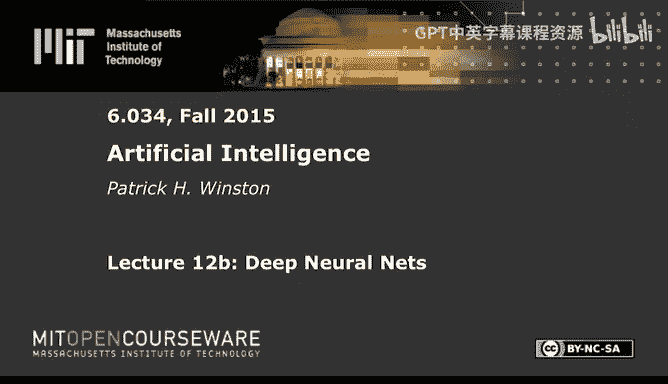

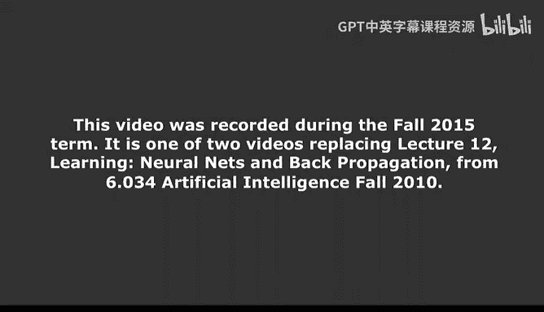

Well， what we're going to do today is climb a pretty big mountain because we're going to go from a neural net with two parameters。

To discussing the kind of neural nets in which。People end up。Dealing with 60。60 million parameters。

So it's going to be a pretty big jump。But along the way are a couple of things I wanted to underscore from our previous discussion。

Last time I tried to develop some intuition for the kinds of formulas that you use to actually do the calculations in a small neural net about how the weights are going to change。

And the main thing I tried to emphasize is that。When you have a neural net like this one。

Everything is sort of divided。In each column。You can't have。The performance， based on。This output。

Effect some weight change back here without going through this。finiteite number of output variables。

 the y1s。By the way， there's no Y2 and Y4。There's no Y2 and Y3 that dealing with this is really a notational nightmare。

And I spent a little time。A lot of time youre straight trying to clean it up a little bit。

But basically what I'm trying to say has nothing to do with the notation I've used。

 but rather with the fact that there's limited number of ways in which that can influence this。

 even though the number of paths through this network can be growing exponential。

So those equations underneath。Are equations that derive from trying to figure out。How the output。

Performance。Depends on some of these weights back here。

And what I've calculated is I've calculated the dependence。Other performance。On W1， going that way。

And have also calculated the dependence on performance。A performance on W1 going that way。

So that's one。Of the equations I've got down there。 And another one deals with W3。

And it involves going。Both this way。This way。And all I've done in both cases。

 in all four cases is just take the partial derivative of performance。

With respect to those weights and use the chain rule to expand it。And when I do that。

This is the stuff I get。And that's just a whole bunch of partial derivatives。

 But if you look at it and let it sing a little bit to you。

 what you see is that there's a lot of redundancy in the computation。So for example。This guy here。

 partial performance with spec W1。Depends on both paths， of course。

But look at the first elements here。These guys right here。

And look at the first elements in the expression for calculating the partial derivative of performance respect W3。

These guys。It the same。And not only that， if you look inside these expressions。

And look at this particular piece here。You see the。

That is an expression that was needed in order to calculate。

One of the downstream weights changes one of the downstream weights。

But it happens to be the same thing as you see over here。And likewise， this piece。

It's the same thing。It's the same thing。You see over here。

So each time you move further and further back from the outputs toward the inputs。

 you're reusing a lot of computation that you've already done。

So I've tried to find a way to sloganize this。And what I've come up with is。

What's done is done and cannot be。 No， no no。 That's count。 I' Not quite right， is its。

What's computed is computed and need not be recomputed。Okay， so that's what's going on here。

 And that's why this is a。Calculation that's。Linear in the depth。The depths of the neural net。

 not exponential。There's another thing I wanted to point out in connection with。These neural nets。

And that has to do with what happens when we look at a single neuron。

And note that what we've got is we've got a bunch of weights。

Which are multipling times a bunch of inputs like so。

And then those are all summed up in a summing box。Before they enter some kind。Of non nonlinearity。

In our case。A sigmoid function。But if I ask you。To write down the expression。

For the value we've got there， what is it。some。Of the Ws。Times the xs。What's that。

That's the top product。Remember a few lectures ago。

 I said that some of us believe that the dot product is a fundamental calculation that takes place in our heads。

So this is why we think so。If neural nets are doing anything like this。

Then there's a dot product between some weights and some input values。Now。

 it's a funny kind of dot product， because。In the models that we've been using。

 these input variables are all or none or 0 or1。But that's okay。

I have it in good authority that there are neurons in our head， for which the values that are。

Produced are not exactly all or none， but rather have a kind of proportionality to them。

 So you get a real dot product type of operation out of that。

So that's by way of a couple of decides that I wanted to underscore before we get into the。

Center of today's discussion， which will be to talk about these so called deep nets。

Now let's see what's a deep net do？Well。From last time。

You know that a deep net does that sort of thing。And it's interesting to look at some of the some of the offerings here。

 By the way， how， how good was this performance in 2012。 Well， it turned out that the。

Fraction of the time。That the system。Had the right answer in its top five choices was about 15%。

And the fraction of the time that it got exactly the right answer as its top pick was about 37% error。

15% error if you。Coun of there's an errors。What am I saying？

You got it right if you got it in the top five， an error rate on that calculation is about 15%。

 If you say you only get it right， if you got it， if it was your top choice。

 then the error rate was about 37%。So pretty good， especially since some of these things are highly ambiguous even to us。

And what kind of a system did that， Well， it wasn't。It wasn't one that looked exactly like that。

 although that is the essence of it。The system actually looked like that。

There's quite a lot of stuff in there and what I'm going to talk about is not exactly this system。

 but I'm going to talk about the stuff of which such systems are made because there's nothing particularly special about this。

 it just happens to be a particular assembly of components that tend to reappear when anyone does this sort of neural net stuff。

So let me explain that this way。 first thing I need to talk about is the concept of。Well。

 I don't like the term， it's called convolution。I don't like the term because。

 in the second best course at the Institute signals and System。

 you learn about impulse responses and convolution intervals and stuff like that。Hins at that。

 but it's not the same thing because there's no， there's no memory involved in in what's going on as these signals have process。

 But they call it convolutional neural less anyway。So here you are， you've got some kind of image。

And even with lots of computing power。And GPUs and all that sort of stuff。

 We're not talking about images with， know，4000，4 million pixels。

 We're talking about images that might be 256 on the side。As say。

 we're not talking about images that are 1000 by 1000 or 4000 by 4000 or anything like that。

 They tend to be kind of compressed into a 256 by 256 image。And now what we do is we run over this。

With a neuron。That is looking only at a 10 by 10 square。Like so。And that produces an output。And next。

 we run over that again， having shifted this neuron a little bit like so。

And then the next thing we do is we shift it again。So we get that output right there。So。

 each of those。

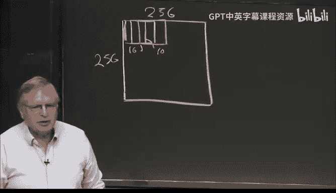

Deployments of a neuron produces an output。And that output is associated with a particular place in the image。

This is a process that is called convolution。As a term of art。This guy。

This convolution operation results in a bunch of points over here。And the next thing that we do。

With those points is we look in local neighborhoods。And see what the maximum value is。

And then we take that maximum value， and we construct。

Yet another mapping of the image over here using that maximum value。Then we slide that over like so。

And we produce another value。And then we slide that value。Let me slide that over one more time。

The different color。And now we got， we had another value。So this process is called pooling。

And because we're taking the maximum， this particular kind of pullinging is called max pullinging。

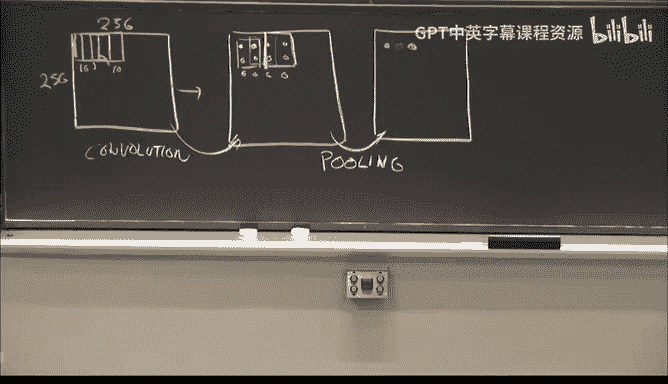

So now let's see what's next。 This is taking a particular neuron and running it across the image。

But maybe there are lots， we call that a kernel， again。

 sucking some terminology out of signals and systems。

But now what we're going do is we're gonna say were， We can use a whole bunch of kernels。

So the thing that I produce with one kernel。Can now be repeated。Many times。Like so。In fact。

 a typical number is 100 times。So now what we've got is we've got a 2，56 by 2，56 image。

 We've gone over it with a 10 by 10。Colonel， we've taken the maximum value of。

Values that are in the vicinity of each other。 And then we repeated that 96100 times。

So now we can take that。And we can feed all those results。Andto some kind of neural net。

And then we can do perhaps a fully connected job on the final layers of this。

 And then in the ultimate output， we get some sort of indication。Of how likely it is。

That the thing that's being seen is， say， a mi。实在是。Roughly。How these things work。

So what have we talked about so far we've talked about。Pulling。And we've talked about convolution。

And now we can talk about some of the good stuff。But before I， I get into that。

 this is what we can do now。 And， you can compare this with what was done in the old days。

It was done in the old days before massive amounts of computing。Became available。Is a kind of。Re咩。

Activity that's a little easier to see。You might in the old days， only have。

Enough computing power to deal with a small grid of picture elements or so called pixels。

And then each of these might be of value。That is fed。As an input into some kind of neuron。

And so you might have a column of neurons。That are looking at these pixels in your， in your。

 in your image。And then there might be a small number of columns that follow from that。 And finally。

 something that says。This neuro is looking for things。Likes are a number one。That is to say。

 something it looks like。Number one。And the image。So this step up here。

It is is what you can do when you have a massive amount of computation relative to the kind of thing you used to see in the old days。

So what's different？Well， what's different is instead of a few hundred parameters we've got。

A lot more， instead of 10 digits， we have100 classes。Instead of a few hundred samples， we have maybe。

1 thousand examples of each class， so that makes a million samples。

And we got 60 million parameters to play with。And the surprising thing is。

And the net result is we've got a function appximator。It astonishes everybody。

And no one quite knows why it works， except that when you throw an immense amount of computation。

Into this kind of。Arrangement。It's possible to get a performance。

That no one expected would be possible。So that's sort of the bottom line。 But now。

 there are a couple of ideas beyond that that I think are especially interesting。

 And I want to talk about those。First， idea that's especially interesting is the idea of auto coding。

And here's how the idea of auto coding works。I'm going to run out of board space。

 so I think I'll do it right here。You have some input values。They go into a layer of neurons。

 the input layer。Then there is a so called hidden layer that's much smaller。So maybe there are。

 in an example， there'll be 10 neurons here and just a couple here。And then these expand。

To an output layer。Like so。Now we can take the output layer， C1。Through Z N。And compare it。

With with desired values， D1 through DN。You follow me so far。Now the trick is to say， well。

What are the desired values？Let's let the desired values。We the input values。

So what we're going to do is we're going to train this net up。

 so the output is the same as the input。What's good of that。

 But we're going to force it down through this。Neck down piece of network。

So if this network is going to succeed。In taking all the possibilities here and cramming them into this。

Smaller inner layer， this so called hidden layer。Such that they it can reproduce the input at the output。

 It must be doing some kind of generalization of the kinds of things it sees on its input。

And that's a very clever idea。And it's seen in various forms in a large fraction。

Of the papers that appear。On deep neural nets。But now I want to talk about examples。

 so I can show you a demonstration， okay。So we don't have GPUs and we don't have three days to do this。

So I'm going to make， make up a very simple example。That's reminiscent。What goes on here。

 but involves hardly any computation。What I'm going to imagine is that we're trying to recognize animals。

From。How tall they are。From the shadows that they cast。So we're going to recognize three animals。

cheeah。Azebra。And a giraffe。And they will each cast a shadow on a blackboard。Like me。

 no vampire involved here。And what we're going to do is we're going to use the， the shadow。

As an input to an neural net， all right？So let's see how that would work。So， there is。Our network。

And if I just clicked into one of these test samples， that's the。

Height of the shadow that a cheated cast on a wall。

And there are 10 input neurons corresponding to each level of the shadow。

They're rimmed through three inner layer neurons。And from that。

 it spreads out and becomes the outer layer values。

And we're going to compare those outer layer values to the desired values。

 but the desired values are the same as the input values。 So this column is a column of input values。

 On the far right， we have our column of desired values， and we haven't trained this neural net yet。

 All we've got is random values in there。 So if we run to test samples through。We get that and that。

Yeah， cheetahs are short。 zebras are medium height， and giraffes are tall， but our output is just。

Pretty much。05 for all of them， for all of those shadow heights。 no training so far。

So let's run this thing。 We're just using simple backpro， just like。

 just like on our world's simplest neural net。And it's interesting to see that。What happens is we。

 you see all those values changing。 Now， I need to mention that。When you see a green connection。

 that means it's a positive weight and the density of the green indicates how positive it is。

And the red ones are negative weights， and the intensity of the red indicates how red it is。

So here you can see that we still have， from our random inputs， a variety of red and green values。

 We haven't really done much training。 So everything correctly looks pretty much random。

So let's run this thing。And after only 1 thousand00。Ittererations。

Going through these examples and trying to make the output the same as the input。

 we reached a point where the error rate has dropped。 In fact， it's dropped so much。

 it's interesting to relook at the test cases。So here's a test case where we have a cheetah。

 And now the output value is， in fact， very close to the。

Desired value and all the output and all the output neurons。So if we look at another one。Once again。

 there's a correspondence in the right two columns。And if we look at the final one。Yeah。

 there's a correspondence in the right two columns。嗯。Knowing you back up from this and say， well。

 what's going on here。It turns out that you're not training this thing。To classify animals。

You're training it to understand the nature of the things that it sees in the environment。

Because all see is the height of a shadow。 It doesn't know anything about the classifications。

 You're going to try to get out of that。All it sees is that there are。

 there's a kind of consistency in the kind of data that it sees on input values。はい。Now。

 you might say， okay， oh， that's cool， because what must be happening is that that hidden layer。

 because everything is forced through that narrow pipe。Must be doing some kind of generalization。

So it ought to be the case that if we click on each of those neurons。

 we ought to see it specialized to a particular height， because that's what sorts of stuff。

 that's the sort of stuff that's presented on the input。Well， let's go see what is， what， in fact。

 is the maximum stimulation to be seen。On the neurons in that hidden layer。

So when I click on these guys。What we're going to see is the input values。

That maximally stimulate that neuron。And by the way。

 I have no idea how this is going to turn out because this is all， you know。

 the initialization is all random。Well， that's good。

 That one looks like has generalized the notion of short。嗯。That doesn't look like medium， in fact。嗯。

The maximum stimulation doesn't involve any。Stimulation from that lower neuron here。

 Look at this one。That doesn't look like tall。 So we got one that looks like short and two。

 looks just。Look completely random。So in fact， maybe wed better back off the idea that what's going on in that hidden layer is generalization and say that what's going on in there is maybe the encoding。

Of the generalization。It doesn't look like a encoding we can see， but there is an encoding。

 There is a generalization that's。Let me start that over。 We don't see the generalization。In the。

Stimulating values。 What we have instead is we have some kind of encoded generalization。

And because we've got this stuff encode it's what makes these neural nets so extraordinarily difficult to understand。

 we don't just don't understand what they're doing。

 We don't understand why they can recognize a cheetah。

 We don't understand why it can recognize a school bus in some cases。

 but not in others because we don't really understand。What these neurons are responding to？Well。

 that's not quite true， there's been a lot of work recently on trying to sort that out。

 but it's still a lot of mystery in this world。In any event， that's that's the auto coding idea。

 It comes in various guise。 sometimes people talk about boltsman machines and things of that sort。

 But it's basically all the same sort of idea。 And so you can do this layer by layer。

 Once you've trained the input layer， then you can use that layer to train the next layer。

 And then that can train the next layer after that。 And it's only at the very， very end。

That you say to yourself， well， now I've accumulated a lot of knowledge about the environment and what can be seen in the environment。

 Maybe it's time to get around or using some。Some samples of particular classes and train on classes。

So that's the story on auto coding。Now， the next thing to talk about。Is that final layer？

So let's see what the final layer might look like。Let's see it might look like this。There's a summer。

There's a minus1 up here。Let's see， there's a minus1 up here。There's a minus1 up there。

There's a multiplier here。And there's a threshold value there。

Likewise there's some other input values here， let me call this one X。And it gets multiplied。

By some weight。And then that goes into the summer as well。And that in turn， goes into a sigmoid。

It looks like so。And finally， you get an output。Which we'll call Z。

So it's clear that if you just write out the value of Z as it depends on those。Inputs。

usingsing the formula that we。Worked with last time。And what you see is that Z。Is equal to。1。Over。

1 plus E to the minus。W。Times x。Minus T。Plus T， I guess。Right。So that's a sigmoid function that。

Depends on。The value of that weight and on the value of that threshold。So， let's look at how that。

Those values might change things。So。Here we have an ordinary sigmoid。

And what happens if we shift it with the threshold？value。If we change that threshold value。

Then it's going to shift the place with that。Sigmoid comes down。

So a change in T could cause this thing to shift over that way。And if we change the value of w。

 that could change how steep this guy is。So we might think that the performance。

Since it depends on W and T。Should be adjusted in such a way。As to。

Make the classification do the right thing。But， what's the right thing。Well。

 that depends on the samples that we've seen。Suppose， for example。That this is our sigmoid function。

And we see some examples of a class。Some positive examples of a class that have values。

That lie at that point。And that point and that point。And we have some。Values that correspond to。

Situations where the class is not one of the things that are associated with this neuron。

And in that case， what we see is examples that are over in this vicinity here。

So the probability that we would see this particular guy。

In this world is associated with the value on the soid curve。

So you can think of this as the probability of that positive example。

 And this is the probability of that positive example。

 And this is the probability of that positive example。

What's the probability of this negative example。Well， it's one minus。It's value in that curve。

And this one's one minus the value on that curve。So we could go through the calculations。

 And what we would determine is that。To maximize the probability of seeing this data， this。

 this particular stuff in a set of experiments， to maximize that probability。

 we would have to adjust T and W so as to get this curve。Doing the optimal thing。

And it's nothing mysterious about it。 It's just more partial derivatives and that sort of thing。

But the bottom line is that the probability of seeing this data。

Is dependent on the shape of this curve。And shape of this curve is dependent on those parameters。

 And if we want to maximize the probability that we've seen this data。

 then we have to adjust those parameters accordingly。Let's have a look at a demonstration。Okay。

 so there's an ordinary sigmoid curve。Here are a couple positive examples。Here's a。Negative example。

Let's put in some more positive examples over here。And now， let's。Rner。A good old。

Great an ascent algorithm on that。And this is what happens。You see how the probability。

As we adjust the shape of the curve。The probability of seeing those examples of the class goes up。

And the probability of seeing the non example goes down。So what if we put some more examples in。

 if we put a negative example there， not much is going to happen。

But what happen if we put a positive example right there？

Then we're going to start seeing some dramatic shifts in the shape of the curve。

So that's probably a noise point。But we can put some more negative examples in there。

And see how that had just occurred。All right， so that's what we're doing。

 we're viewing this output value as something that's related to the probability of seeing a class。

And we're adjusting the parameters on that output layer so as to maximize the probability of the sample data that we've got in hand。

はい。Now there's one more thing。You can see what we've got here is we've got the basic idea of back propagation。

Which has layers and layers of additional。Let me be flattering and call them ideas layered on top。

 So here next here's the next idea that's layered on top。So。We've got an output value here。

And it's a function， after all。 And it's got a value。 And we're going to have a。

If we have 1000 classes， we're going to have 1000 output neurons。

 and each is going to be producing some kind of value。 And we can think of that value as。

A probability。But what it really I didn't want to write a probability yet I just want to say that what we've got。

For this output neuron is a function of class one。And then there'll be another output neuron。

 which is a function of class2。And these values will be presumably higher。

 this will be higher if we are， in fact， looking at class1。And this one down here will be。

 in fact higher if we're looking at class N。So what we'd like to do is we'd like to not just pick one of these outputs and say。

 well， you you've got the highest value， so you win。

What we want to do instead is we want to give some。

 we want to associate some kind of probability with each of the classes。Because after all。

 we want to do things like find the most probable five。So what we do is we say， all right。

 so the actual probability。Of class one。Is equal to the output of that sigmoid function。

Divided by the sum。Over functions。So that takes all of that entire output vector and converts each output value into probability。

So when we use that。Sigmoid in function。We did it with a view toward thinking about that as a probability。

 and in fact， we assumed it was a probability。When we made this argument。But in the end。

 there's an output for each of those classes。 And so what we get is in the end。

 not exactly a probability until we divide by a normalizing factor。So this， by the way， is called。

This， by the way， is called not on my list of Things， but it soon will be。

Since we're not talking about taking the maximum and identifying the。

And using that to classify the picture， what we're going to do is we're going to say。

 we're going to use what's called softmax。So we're going to give a range of classifications and we're going to associate a probability with each。

And that's what you saw in all of those samples。You saw yes， this is a container ship。

 but maybe it's also this that or a third or fourth or fifth thing。So， that is。

A pretty good summary of the kinds of things that are involved。

 but now we've got one more step because what we can do now is we can take this output layer idea。

 the softmax idea， and we can put it together with the auto coding idea。

So we've trained this middle layer up。And now we're going to detach it from the output layer。

 but retain those weights that connect the input to the hidden layer。And when we do that。

 what we're going to see is something that looks like this。And now we've got a trained first layer。

 but an untrained output layer。We're going to freeze the input layer。

And train the output layer using that so called that sigmoid curve。

Let's see what happens when we do that。 Oh， by the way， let's run our test samples through。

You can see it's not doing anything， and the output is half for each of the categories。

Even though we've got to train the middle layer。 So we have to train the outer layer。

 Let's see how long it takes。Whoa， that was pretty fast。

Now there's an extraordinarily good match between the outputs and the desired outputs。

So that's a combination of the auto coding idea and the softmax idea。

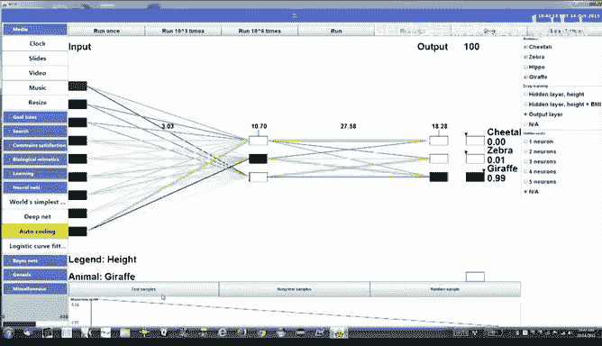

They get one more idea。That's worthy they mentioned。And that's the idea of dropout。

The plague of any neural net is that it gets stuck in some kind of local maximum。

So it was discovered that these things train better。If on every iteration。You， you。

Flip a coin for each neuron。And if the coin ends up pales。You assume it's just died。

And has no influence on the output。It's called dropping out those neurons。And in the next generation。

 you drop out a different set。So what this seems to do is it seems to get this thing from prevent this thing from going into。

A frozen local maximum state。So that's deep nets， they should be called， by the way， wide nets。

Because they tend to be enormously wide， but rarely more than 10 layers。10 layers， 10 columns deep。

Now， let's see where to go from here。 Maybe what we should do is talk about。The awesome。嗯。

Curiosity in the current state of the art。And that is that。

All of this sophistication with output layers that are probabilities and。

Training using auto coding or Bolsman machines。嗯。It doesn't seem to help much relative to plain old。

Back propagation。So back propagation with a convolutional net seems to be do just about as good as anything。

And what we're on the subject of。An ordinary deep net。I'd like to examine a situation here。

Where we have a deep net。Well， it's a classroom deep men。And we'll put five layers in there。

And his job is still to do the same thing， its to classify an animal as a cheetah， a zebra。

 or a giraffe based on the height of the shadow it Cass。And as before， if it's green。

 that means positive， if it's red， that means negative。And right at the moment， we have no training。

So if we run our test samples through， the output is always a half。No matter what the animal is。

Right。So what we're going to do is we're just going to use ordinary backdrop on this。

Same thing as in。That。Sample that's underneath the blackboard。

Only now we've got a lot more parameters。Five columns。

 and each one of them has nine or1 neurons in it。So let's let this one run。Now。

 look at Dutch stuff on the right。 It's all turned red。 At first。

 I thought this was a bug in my program。But you know， it makes absolute sense。

 If you don't know what the actual animal is going to be and there are a whole bunch of possibilities。

 you better just say no for everybody。Just like when a biologist says， we don't know。

 that's the most probable answer。But eventually after about 160，000 iterations。

It seems to have got it， let's run the test samples through。ThatThat's doing great。

Let's do it again just to see if this is a flute。All right on the right side。

Finally you start seeing some changes go in the final layers there。

 and if you look at the error rate down at the bottom， you'll see that it kind of falls off a cliff。

So nothing happens for a real long time， and it falls off a cliff。Now。

 what would happen if this neural net were not quite so wide？Good question。

 but before we get to that question， what I'm going to do is I'm going to do a funny kind of variation on the theme of dropout。

What I'm going to do is I'm going to kill off one neuron in each column。

And then see what if I can retrain the network to do the right thing。

So I'm going to reassign those to some other purpose。So now there's one fewer neuron in the network。

We rerun that， we see that it trains itself up very fast。

So we seem to be still close enough to the solution we can do without。

One of the neurons in each column， let's do it again。Yeah， it goes up a little bit。

 but it quickly falls down to a solution。Try again。Quickly falls down to a solution。Oh my God。

 How much of this am I going to do？Each time I knock something out and retrain it finds a solution very fast。

Whoa， I got it all the way down to two neurons in each column， and it still has a solution。

It's interesting， do you think。But let's repeat the experiment。

 but this time we're going to do it a little differently。

We're going to take our five layers and before we do any training。I'm going to knock out。

All but two neurons in each column。Now I know that were two neuronss in each column。

 I've got it a solution， I just showed it， I just showed one。But let's run it with this way。

It looks like increasingly bad news。What's happened is that this sucker's got itself into a local maximum。

So now you can see why。There's been a breakthrough in there's neural net learning stuff。

And it's because when you widen。Than that。You turn local maxma into saddle points。

So now it's got a way of crawling its way through this。

Bs space without getting stuck on a local maximum。As suggested by this。Alright， so those are some。

 I think， interesting。Things to look at by way of these demonstrations。

But now I'd like to go back to my slide set and show you some examples that will address the question of whether these things are seeing like we see。

So you can try these examples online， there are a variety of websites that allow you to put in your own picture。

And there is a cottage industry of producing papers in journals that fool neural nets。

So in this case， a very small number of pixels have been changed， you don't see the difference。

But it's enough to take this particular neural net from a high confidence that it's looking at a school bus to thinking that it's not a school bus。

Those are some things that thinks are're a school bus。

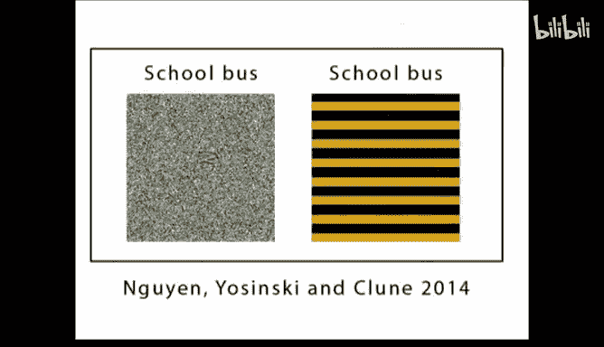

So it appears to be the case that what is triggering this school bus result is that it's seeing enough local evidence that this is not one of the other 999 classes。

And enough positive evidence these local looks to conclude that it's a school bus。

So do you see any of those things？I don't。Here you can say， okay， well， look at that baseball one。

Yeah， that looks like it's got a little bit of baseball texture in it。

 So maybe what it's doing is looking at texture。These are some examples from a recent and very famous paper by Google。

 which uses essentially the same ideas to put captions on。Pictures。So the thing this， by the way。

 is what has stimulated all this enormous concern about artificial intelligence because a naive viewer looks at that picture and says。

 oh my God， this thing knows what it's like to play。Or be young。Or move。Or what a Frisbee is。 And。

 of course， it knows none of that。 It just knows how to label this picture。

And to the credit of the people wrote this paper。They show examples that don't do so well。

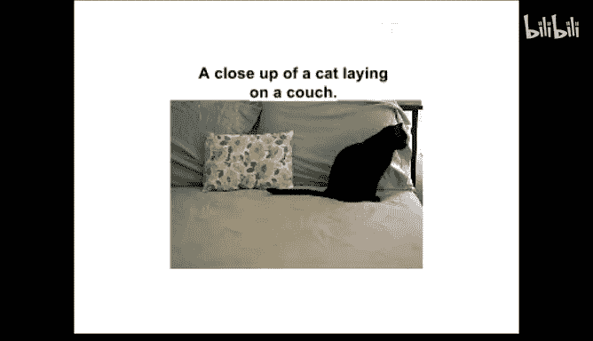

So yeah， it's a cat， but it's not lying。I was a little girl， but she's not blowing bubbles。

What about this one？

So we've been doing our own work in my laboratory on some of this。

 and the way the following set of pictures was produced was this。

You take an image and you separate it into a bunch of slices representing each representing a particular frequency band。

And then you go into one of those frequency bands and you knock out a rectangle from the picture。

 and then you reassemble the thing。And if you hadn't knocked that piece out， when you reassemble it。

 it would look exactly like it did when you started。

So what we're doing is we knock out as much as we can and still retain that neural net's impression that it's the thing that it started out thinking it was。

 So what do you think this is。It's identified by a neural net as a railroad car。

Because this is the image that it started with。How about this one， that's easy， right。

 that's a guitar。We weren't able to mutilate that one very much and still retain the guitarness of it。

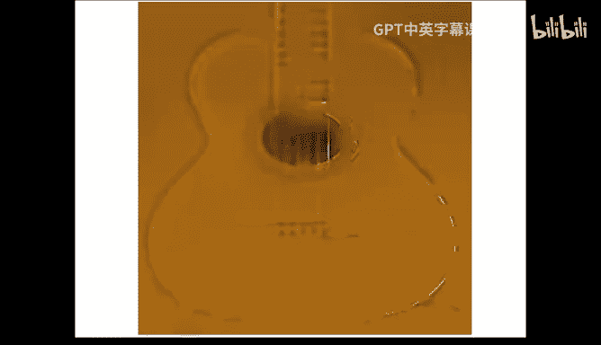

How about this one？或者。What。😮，A lamp， any other ideas？

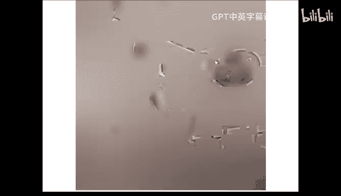

Ken， what do you think it is？See， he's an expert on the subject。It was identified as a barbell。

What's that。系喂。helello。We didn't say the。Little girl or the instructor。How about this one。

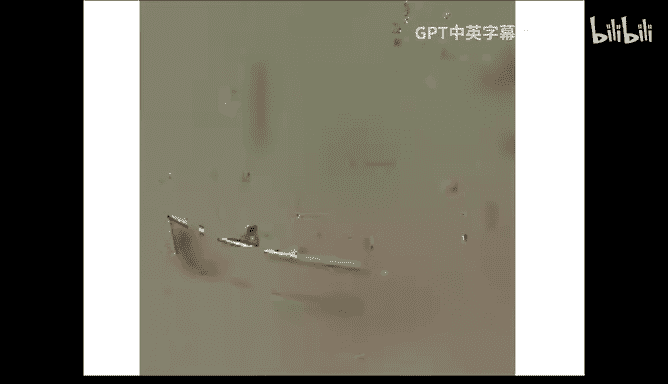

What。

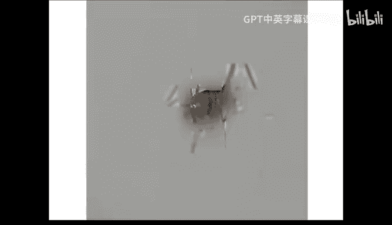

It's a grassho。

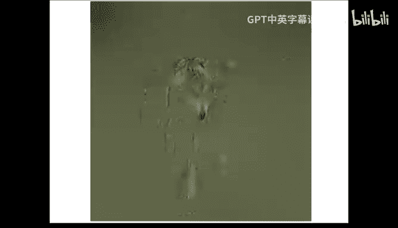

What's this？Wow， you're good。It's actually not a two headed wolf。Two wolves are close together。

That's a bird， right？Good for you， it's a rabbit。我在。

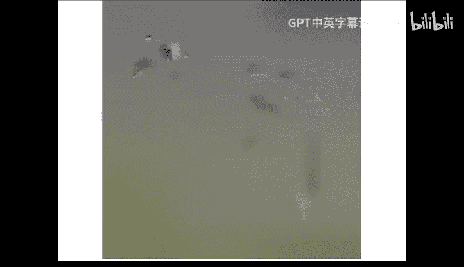

Russian Wolffo。If you've been to Venice， you recognize this。So bottom line。

Is that these things are an engineering marvel and do great things， but they don't see like we see。

