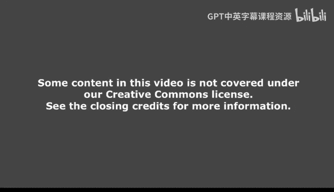
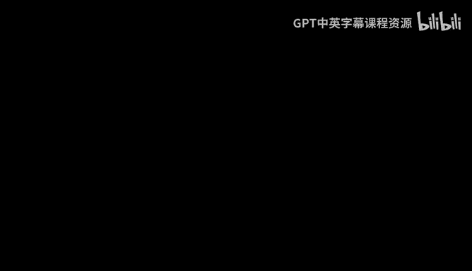
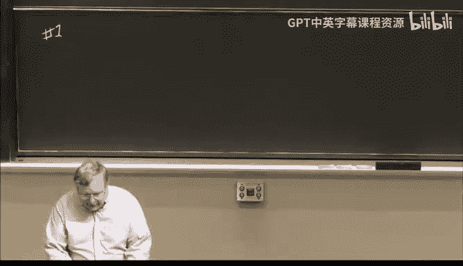
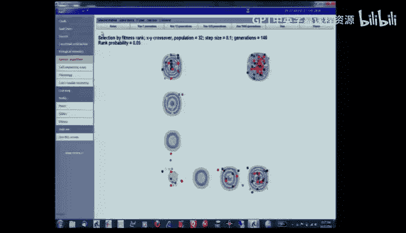
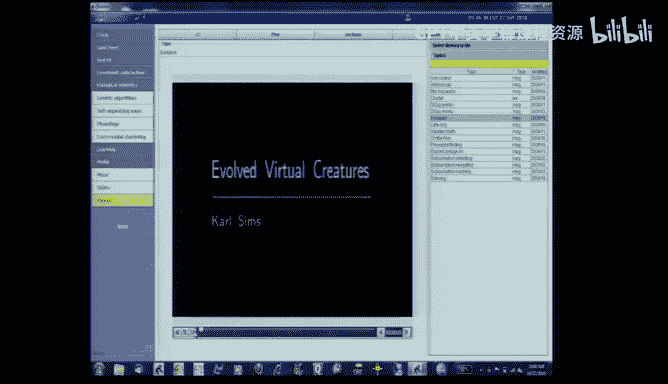
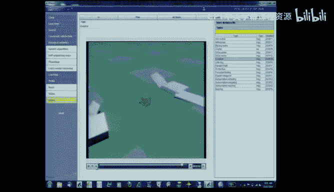

# 《人工智能｜6.034 Artificial Intelligence, Fall 2010》中英字幕 - P14：[14]13. Learning_ Genetic Algorithms.zh_en - GPT中英字幕课程资源 - BV14fqSB2ECY

I have extremely bad news。Halloween falls this year on a Sunday。

But we in 6034 refused to suffer the slings and arrows of outrageous fortune。So we've decided that。

Halloween is today as far as 6034 is concerned。Kenny， could you give me a hand， please？

Take that hood it over there。嗯哼， just是给不住。You can take as much of this as you like。

The rest will be given to that herd of stampeding freshmen that comes in after。It's a cornucopia。

Of legal drugs。Chocolate。Does produce a kind of mild high， and I recommend it before。

Quzzes and giving lectures。I have a friend of mine， one of the Nobel laureates in biology。

 always eats chocolate before he lectures， give him an edge。Otherwise。It would be flat。So。

I recommend it。It will take， I suppose， a little while to digest that neural net stuff。

richer than usual in mathematics。So today we're going to talk about another effort at mimicking biology。

This is a。This is easy stuff。It's just conceptual。And you won't see this on the next quiz。

 but you will see it on the final， it's one of those quiz five type problems。

Where we ask you questions to see if you were here and awake。So a typical question might be。

Professor Winston is a creationist。Or something like that， not too hard to answer。In any event。

If it's been hard to develop。A real understanding of intelligence， occasionally， the hope is that by。

Mimicking biology or mimicking evolution， you can circumnavigate。All the problems。

And one of those kinds of efforts is an effort to。Imitate evolution。

So we're going to talk today about so calledled genetic algorithms which are。Naive。

Attempts to mimic naive evolution。Now I realize that。

Most MIT students have a basic grasp of sexual reproduction。

But I found in talking with students that many times the details a little fuzzy on some of the details。

So let's start off by reflecting a little bit on how that works。So let's say we need pink and blue。

And here's our cell。And here's its nucleus。And here are mummy and daddy's chromosomes willll just pretend there's one pair。

Now ordinarily， an ordinary fell division。You get two cells。Both have a nucleus。

And the process of producing them。Involves the duplication of those chromosomes。

And then one pair ends up in each of the。Child cells。And that's all there is to that。 That's mitosis。

But then when we talk about reproduction， it's more complicated because。

Those chromosomes get all twisted up and they break and they recombine。

So when we talk about the cells that split off from。One of these germ cells。

It's no longer appropriate。To talk about the pink one and the blue one。

Because the pink one and the blue one are all mixed up。So you get two chromosomes here。And two here。

But through some miracle of nature。Which is always amazed me。These two cells split in turn。

And to four cells altogether together。And each of those。F cells at the bottom。

It's one of the chromosomes that was produced by that twisting up of the rope and recombination。

Then along comes。along comes a special occasion。And。Now we can think of this as being。

A blue one and this is being a pink one。And they come together。And you get。A new person。

Like so note that your mother and father's chromosomes are never recombined。

 it's your grandparents chromosomes that recombine。So that's what it's like。

 and the main thing to note about this is， well， a couple of things， if you happen to be female。

This part of the process。This part over here。Took place before you were born。

If you happen to be male。It's going on right now as we speak， which probably explains something。

In any event is's going on right now。But whenever it goes on， there are lots of opportunities for。

For throwing dice。So God threw all the dice。Before you were born。

 if you happen to be a female in this part of the process over here。Then， of course。

 more dice got thrown here where the decision was made about which particular cells got to。

Fewed to form a new individual。So I want to beat on this idea of lots of choice。

When we talk about genetic。Genetic algorithms we talk about nature。

 there are lots of choices in there， and that means there are lots of choices to intervene。

To screw route。To make things work out the way you want。Not about there we are。That's a basic idea。

 and it all starts with chromosomes。So we could think of implementing something that imitates that with the ACT。

 G。Stuff that you learned about all about 701， but we're computer scientists we don't like。Base 4。

 we like base 2。 So I'm going to just suggest that our chromosomes。Are binary。

In this system that we're going to build。So that might be a chromosome。It doesn't have to be binary。

 It can be。It could be symbolic for a like hair， but it's just some string of things that determine。

How the ultimatega system behaves。So it all starts out then with some of these chromosomes。

Some of these。Simulated chromosomes。Simulated， simplified。And naive。

And there's a population of chromosomes。The population of chromosomes that might be subject to a little bit of mutation。

 that as I say， a0 becomes a1 or a one becomes a0。That happens a lot of that mutation stuff happens over here when things get twisted up and recombine their copying errors and stuff。

Cosmic rays hit it all the time， all sorts of reasons why there might be a single point of change。

that produces the mutation effect。So here we have a population。It starts off over here。

And some of those things are subject to mutation。And you'll note here's a whole bunch of choice already。

 how many of these mutations do you allow per chromosome？For example。

How many of the chromosomes just slip through without any mutation， those are choices you can make。

Once you've made those choices， then we have the crossover phenomenon。

And let's identify one of these guys as the pink one and one of these guys as the blue one。

And so now we have the pink one cruiseman along。As well as the blue one。

 the pink one and a blue one cross。And produce a new chromosome。Just like in nature。

So we take the front part of one， back part of the other。Ffuse them together。

And some may slip by without any of that。Like so。Well， these things are meant to be。

Combine new pairs like so， but they may not。They may not have any crossover in them so you have another set of choices。

 how many crossovers do you allow per recombination？Yet had another set of choices。

So now we've got a population of。Modified chromosomes through mutation and crossover。

 so the next thing to do is we have the genotype。To phenotype transition。

That is to say the chromosome determines the individual， it may be a person that may be a cow。

 it may be a computer program， I don't care what， but that code down there。

Has to be interpreted to be a something。So it is the genotype。

 and it has to be interpreted to be something which is the phenotype。

The thing that the stuff down there is encoding for。So out here we have。A bunch of individuals。Now。

 each of those individuals， because they have varying chromosomal composition。

 will have a different fitness。So， these fitness might be。

WellW who knows they how they might be scored。 But we're computer scientists。

 we might as well use numbers。 So maybe this guy's fitness is 88。 and this guy's fitness is 77。

And so on。So now that we've got fitness。By the way， notice all the choices involved there。

 choice of how you interpret the geno choice about how the phenotype produces a fitness。

And now we have a choice about how。The fitness produces the probability like 0。8。And point。

One or something like that， probability of survival into the next generation。So now。

 once we've got those probabilities， we actually have selection。

And those phenotypes out there produce genotypes。A new set of chromosomes。And that completes our。

Loop。It goes back in there。 and so that's。The new generation。Sound simple。

So if you're going to make this work， of course， you have a million choices。

 as I'm going to emphasize over and over again。 And one of your choices is。For example。

 how do you compute the fitness。How do you compute the probability of survival to the next generation？

Given the fitness。 So we have to go somehow from。Numbers like these to probabilities like those。So。

 I'm going to talk about。Several ways of doing it， none of them are magic。

 none of them was specified and stipulated by God as the right way。

But they have increasingly good properties with respect to this kind of processing。

So the simplest thing you can do。Idea number one for computing。

The problem see what you do is you get this whole bag of， of individuals。

And you have to decide who's going to survive to the next generation。So at each step。

Everything in the bag has a probability of being the one you pick out and put it in the next generation。

 so at any step， sum of the probabilities for each of those guys is one because that's how probability works。

 the probability of a complete set is at all up is probability a one。

So one thing you can do is you could say that the probability。

Whether you're going to draw individual eye。Is equal to or maybe proportional to the fitness。

A very individual。I haven't completed the expression， So that's why。

I haven't completed the expression， so it's not a probability yet because。

Some of our piece of buy won't add up to one， how could I ensure that it will add up to one？Oh。

 that's easy， right？All they have to do is。Divide by the sum。Of the fitness。Over eye。

So there's a probability measure。It's produced one of the fitness。 need to make sure are。

I have to make sure the fitness are what。He says， I have to make sure the fitness aren't negative。

 Yeah， I wouldd be embarrassing if they were。So we'll just trun anything like that as here。

 you got a lot of choice how you can calculate the fitness。

And maybe you will produce negative members， in which case you have to think a little bit more about it。

So now what about an example， Well， I'm going to show you an example。

Why don't I show you the example？What we're going to do is we're going to have a genetic algorithm that looks for an optimal value in a space。

And there's the space。And you'll notice it's a bunch of contour lines。A bunch of hills in that space。

 Let me show you how that space was produced。The fitness。Is a function of x and Y。

And it's equal to the s。Of some constant times x。one of these squared times a sign。

Of some constant y quantity squared。E。To the plus x plus y divided by some constants。

 So sigma and omega there are just in there so that it kind of makes a nice picture for demonstration。

So there's a space and clearly where you want to be in this space is in the upper right hand corner。

That's the optimal value， but we have a genetic algorithm that doesn't know anything。

All it knows how to do is。Mutate。And cross over。So it's going to start off with a population of one。

 it's a little red dot down there in the lower left。So here's how it's going to evolve。

There's going to be a chromosome。Consisting of two numbers。An X number and a Y number。Like say， 0。

3 and 0。7。Here's another one。Which might be 0。6。And 。2。

So the mutation operator is going to take one of those values and change it a little bit。

So it might say， well， we'll take three and we'll make it。Point2。

And a crossover operation is going to exchange the X and Y values of pairs。

So if we have a crossover here。Then what we're going to get out。From this one， well。

 we're going to get out a combination of these two。And it's going to look like。This。

That what we're going to do is we're going to take the。

X value of one and combine it with a y value of the other one。So this is going to be 0。2。

 my mutated value。And 。2。And this is going to be 0。6。And。7。

So that's how my little genetic algorithm hack is going to work。So having coded this up。

 we can now see how it flows。Oh， let's run it 10 generations。

So the population has rapidly expanded to some fixed limit。 I forgot what it is，30 or so。

And we can run out 100 generations。And so this seems to be getting stuck kind of right。

 So what's the problem。The problem is local maxima。Fundamentally， a hill climbing mechanism。

 You note that I have not included any crossover so far。So if I do have crossover。

 then if I've got a good x value and a good Y value and。I。

 I can cross them over and get them both into the same。In the same situation。But nevertheless。

 this thing doesn't seem to be working very well。Yeah。

That picture is the contour lines of that function。 con contour lines of that function。 So the。

 the reason you see a lot of contour lines in the upper right is because it gets much higher because there's that exponential term。

 It increases as you go up to the right。So， I don't know。's。Let's put some crossover in。

And repeat the experience。On 100 generations。I don't know， it just doesn't seem to be going anywhere。

Sometimes it'll go right to the global maximum。Sometimes it takes a long time。

 it's got a random number generator in there。 So I have no control over it。

So it's going to get there， I couldn't tell whether the crossover was doing any good or not。Oh， well。

 here's one。Let's make this a little bit more complicated。Suppose that's the space。

Now it's going to be in real trouble because they'll never get across that moat。You know。

 you would think that it will climb up to one。One to the x maximum or to the y maximum。

 But's it's not going to do very well。Even with crossover。

 it's just not going to do very well because it's climbing up those local hills。

 Anybody got an idea about one simple thing we could do to。To make it work better。Yeah， you do。

 you could increase step size， right？Let me see that will help。You know。

 even that doesn't seem to help。So we have to conclude， do we conclude that this is a bad idea， well。

 we don't have to conclude it's a bad idea yet， because we may just look at it and ask why five times。

And we might ask， well， maybe we can get a better fitness a better mechanism in there to translate fitness into probability of survival。

You know， using this formula is kind of strange anyway， because， you know。

 if you suppose temperature is one of your fitness characteristics。The hotter， the better。

Then the ratio of the probability you will survive versus some。The person next to you。

That ratio will depend on whether you're measuring the temperature in Celsius or Fahrenheit。系。

Because you've shifted the origin that shifts the ratio。 that shifts the probability of success。

So it seems kind of strange to just take these things right straight into probabilities。

So a better idea， idea number two。Is to say， well， shoot。 Maybe we don't care about what the actual。

Fitnesses are all we really care about is the rank order of all of the candidates。

So the candidate with the most fitness will have the most probability of getting in the next generation。

The candidate with the second most fitness will have the second highest probability and so on。

But we're not going to use the actual fitnesses themselves to make the determination。

Instead of what we're going to do with this mechanism number two， this is the rank space method。

Is this， we're going to say that the probability of the highest ranking individual。

Getting into the next generation is some some constant P of C， which， of course。

 you can select yet another choice。Then if if that guy doesn't get selected。

The probability of the second highest ranking individual getting in the next generation is going to be the probability that that guy didn't get in there。

That's  one minus P of C。Times the same probability constant。And so you can see how this is going。

P3 will be equal to1 minus。Pce of C。Squared times P sub C。Pece of。And -1 will be equal to1 minus。

That probability constant to the n minus。N -2。Times P of C。And then there's only one individual left。

I mean， if you've got through all these guys and haven't got anybody selected。

 then you've got to select the last guy。And so the probability you're going to select the last guy is going to be one minus p of C。

To the n -1。So it's a probability。Mised all of those guys at first。N minus one choices is， yeah。

 it is honest to God， see this is the probability。That this last guy is going to get selected。

 it's not probability the last guy getting selected， given that the others haven't been selected。

Trust me， it's right。I think you ought to be one。Orre you think it ought to be one？No。

You already reroll the dice， you've got a probability each time， except for the last time。

 when of course you have to take it， there's nothing left， there's no other choice。Yeah。

When you jump from。就在面前。不是。You're saying probability of the first two choices the second choice probability minus well think about it this way is the probability you didn't choose the first two so the probability you didn't choose the first one is one minus P sub C。

 the probability you didn't choose the next one as well as because you're choosing that next one with probability P sub C it's the square of it。

Okay。So that might work better， let's give it a shot。Let's go back to our original space choice。

And we said。And switched to the fitness method。And we'll run that 100 generations。Well。

What happened there， that was pretty fast， maybe I used a big step size。

And that's my reasonable oops， what happened？It's really getting stuck on a local maximum。

So evidently， I've choose a constant piece of C。Such that it just drove it right up the nearest hill。

On the other hand， if I change the step size a little bit， maybe I get it to spread out。I sure did。

And now that it's managed to evolve over there to find the maximum value。

 now I can clamp down on the step size again。And now it shows no more of diversity。

 it's just locked onto that global maximum。So this is not unlike what evolution sometimes does。At。

Sometimes。Species collapse。Into a state where they don't change for five or 600 million years like sharks。

 for example。Sometimes need sometimes they only survive if they've got a lot of diversity built into their。

wayay of life so that they can adjust to habitat changes。Now， when you increase the step size。

 because you're stuck on a local maximum。It's like heating up a metal， you make everything kind of。

Vibrate more。Make bigger steps。So this kind of process where you may start with。A big step size。

 and then gradually reduce the step size。It's called simulated and kneealling。

Because it's like letting a metal cool down， so you start off with a big temperature。

 big step size that kind of covers the space， and then you slowly reduce the step size so you actually crawl up to the maximum。

 but they local maximum they're available。So thats seemed to work pretty well。

 let's see if we can get it to work on them。The harder problem with the moat。

So it's not doing very well， but increased the step size。No， it's still kind of stuck。

even though it's got the capacity to cross over， it's so stuck on that lower right hand corner。

 it can't get up that vertical branch to get to a point where crossover will。

We'll produce a value up there in the upper right hand corner。 So we're still not home yet。

So what's the trouble？The trouble is the fitness mechanism。

I's just driving things up the local maximum。It's just terribly unfortunate。What to do。 Well。

 here's something you can do。 You can say， well， if。

If the problem is we've lost the diversity in our population。

Then we can measure the diversity not only the fitness of the set of individuals we're selecting from。

 but we can measure how different they are from the individuals we've already selected for the next population。

In other words， we can factor in， we can get a diverse population as well as a fit population。

 if when we make our selection， we consider not only their fitness。

 but how different they are from the individuals that have already been selected。

So that's going to be mechanism number three。So。Now we have a space。

And we can measure fitness along one axis， ordinary fitness。And this is rank space fitness。

 So that's going to be P sub C。There'll always be some individual with the highest fitness。嗯。

And and over here， it might not be P of C， actually。

But therell be some individual with a maximal fitness。

And at any given step in the selection of an next population。

 there'll be some individual that's maximally diverse。From all of the individuals。

That have been selected。For the next generation so far。

So what kind of individual would you like to pick for the next generation？Well。

 the one with the highest。Fitness rank and the one with the highest diversity rank。

So what you really like is you'd like to have somebody。Right there。

And if you can't have somebody right there， if there's nobody right there with maximum。

With a maximum fitness and maximum diversity at the same time， then maybe you can draw in。

Iceo goodness lines like cell， which is just how far you are from that ideal。So let's summarize。

 we've got to pick some individuals for the next population。When we picked the first individual。

All we' got to go on is how fit the individual is because there's nobody else in that next generation。

After the first individual is selected。Then we can look at our set of candidates and we can say。

 which candidate would be more different from the set of things we've already selected than all the others。

 that would get the highest diversity rank。And so on down the candidate list。

So let's see how that might work。So we're going to use a combination of fitness rank。And。

Diversity rank。And we'll just use the simple one so far。These are a small step size。

And we'll let this run 100 generations to see what happens。Binggo。

It crawls right up there because it's trying to keep itself spread out。

 It uses that diversity measurement to do that。And at the same time， it's seeking high fitness。

 so that's why it's crawling up to the upper right hand corner。But in the end。

 that diversity piece of it is keeping the things spread out。

So suppose you're a shark or something you don't care about diversity anymore。

 and we can just turn that off。That's still running。And go back to fitness rank， bingo。

So there you are， your stuff for 600 million years。So let's see if this will handle the moat problem。

See， our step size is still small。I'll just let this run。

So the diversity piece of it keeping it spread out。prettytty soon bingo， it's right in there。

 even it's crossed that big moat because it's got the crossover mechanism that combines the best of the X's and the best of the Y's。

So that seemed to work pretty well。Okay， so see these are some of the things that you can think about when you're thinking。

 oh， and of course。We're shark， we're going to forget about diversity。

 change the selection method from。Fitism and diversity range to just diversity or collapses down the highest hill。

Yeah， thinkball what？あサです。just the question is how does step size translate into mutation？Oh。

 instead of allowing myself to take steps as big as a10。

 I might allow myself to take steps as big as。3 tenth。According to somebl distribution。

So what to say about all this。It's very seductive because it's nature， right？

The trouble is it's naive nature。And。This is a， as evolutionary theories go， this is horrible。

This is naive。So we would like to use real evolutionary theory。

 except we don't have real evolutionary theory。 evolutionvolution is still a mystery。

 Some things are pretty obvious， you can breed fast racehors。That works just like so。

The trouble is we don't have any real good idea about how speciation takes place。And how。

A lot of evolution works because all these chromosomes。

Are connected to their phenotype consequences in very complicated ways that nobody fully understands。

So there's a great deal of magic in that genotype to phenotype。

Transition that nobody really understands very well。So when people write these programs they do。

That are in the style of the so calledled genetic algorithm。They're their' own。

Taking a photograph of high school biology and spending a long time building programs based on that naive idea。

But that naive idea has lots of places for intervention。Because you can。

Look at all the things you can screw around with in that process of going from one generation to the next。

You got。By the way， what does mutation do？It's basically hill climbing， right？

It's producing a little spread out and you're using the fitness thing to climb the hill。

So you got a lot of choices about how you handle that。

 then you got a lot of choices about how much crossover you do and what does crossover do。

Kind of combines。Features of。Strong features of multiple individuals into one individual maybe。嗯。

So you got all kinds of choices there， and then your genotype to phenotype translation。

 how do you interpret？Something like those zeros and ones， as an if federal， for example。

 is something that's in the hands of the designer。And then you got the rest of those things。

 all of which are。Left up to the designer。So in the end， you really have to ask。

 when you see an impressive demonstration， you have to say， where does the credit lie。

 and I mean that pun intentionally。Because usually the people who are claiming the credit are lying about where it's coming from。

But nevertheless， let me give you a couple of examples of where this has found。Actual bona fiti。啊。

Practical application。So when you look for a practical application， you might say， well， where？

And what kind of problem？Does a good front piece combined with a good back piece to produce a good thing overall。

And the answer is when you're making a plan。So you might have a problem in planning。

That requires you to take。A series of steps。And you might have two plans。

Each of which is a series of steps。And you might combine these to produce。Something new。

That's the front half of one。In the back half of another。So that's practical application number one。

And that requires you to interpret your chromosome。As an indicator of the steps in a plan。

Another example comes。Is。Tron from them。You're our project a student did for me some years ago。

Came to me and said，He's a freshman， he came to me and said， I want to do your project。And he said。

Have you taken six0 before and he said， no， I said， go away and he said， I don't want to go away。

 I don't want to do Euro project， so I said have you read my book， he said， no， I said。

 well go away then and he said，  I don't want to go away， I want to do a Euro project"，So I said。

 I don't have any ERO projects， he said， that's okay， I've got my own。肯定。And he was interested。

He's a finance type guy。So he was interested in whether he could build a rule based expert system。

That could predict the winners at horse races。So his role based expert system。Consistent。

Of rules like this。If x and y。Then。Some conclusion。Yes。L and M。Then。Some kind of conclusion。

 And from these， he would produce rules like if。X prime。 That's a slightly mutated version of the。

Of the ex anacecedent。And M。Then。Some conclusion。So it mutation and crossover。

 and he was able to produce a system that seemed to work about as well as the handicas。

In the newspapers， so he started losing money at a less fast rate。不。

He is now doing something in the stock market， they say。It doesnn't talk so much about it， though。

But an interesting， interesting application， and it came up with rules like if the sum of the jockey's weight and the post position is low。

 that's good。Well， that makes sense in the end because the jockey's weight is always between 10 and 110 pounds and the post position is always between one and 10 or something。

 so they are kind of commmeurment values and a low one is good in fact。Not bad。But neither of those。

 I mean， this is real stuff。My company uses this sort of stuff to do some planning work。

But neither of those is as impressive。As a demonstration I'm about to show you。

That involves the evolution of creatures。And these creatures consist of。Block like objects like so。

And they combine like this and so on。And so how can you make a creature like that from a 01 chromosome？

Some of the bits in the chromosome are interpreted as the number of objects。

Others are interpreted as the sizes of the objects。

Others are interpreted as the structure of how the objects are articulated。And still。

 others are interpreted as。Fixing the control algorithm by which the。Creature operates。

So you see how that roughly goes。Would you like to see a film of that in action？Yes。

Still always likes to see the films。How did you measure that diversity in， like in that。

question is how do I measure the diversity of the graph， I did it the same way I measure the fitness。

That is I say， I calculated the。The distance， the actual metric distance of all of the candidates for the next generation。

 from all of the candidates had already been selected， I summed that up。

And from that sum I could rank them according to how different they were from the individuals that are already in the next generation so that gives me a rank and then from the rank I use that kind of calculation to determine a fitness a probability of survival then I just combined the two kinds of probabilities So you always every time something。

And everything that you。I was always the individuals have already been selected at every step。

 so every step is a little different because it's working with a new set of individuals that have already been selected in the next generation。

All right， so let's see how this works。

So this is showing the evolution of some swimming creatures。

And they're involved according to how well they can swim， how fast they can go。

Some of them have quite exotic mechanisms and some of them quite natural。

 that look like a sperm cell。Floating away there。Once you have these things evolving。

 then of course you can get groups of them to evolve together。

So you saw already some that were that were evolving to swim。

These are evolving to move around on the land。It's interesting。

 this was done by Carl Sims who at the time was at a then thriving company thinking machines fresh spin off from MIT。

 so he was using a vastly parallel computer super powerful for its day of thousands of processors to do this。

 and it was a demonstration of what you could do with lots of computing。In the early stages of the。

The experimentation， though， notion physics wasn't quite complete。

 so some of the creatures evolved to move by hitting themselves in the chest and not knowing about the conservation of momentum。

Thought that was just great。So here they are doing some further。So you look at these and you say。

 wow， there must be something to this。 This is interesting。 These are complicated。This one。

 I think this is one of the ones that was trained initially to swim and then to do a land locomotion。

So eventually， Carl got around to。Thinking about how to make these things evolve so that they would compete for food。

That's the fastest， I think， by the way， of the。A land locomots。

Something that was training them evolving them to jump。

 This is evolving them to follow a little red dot。Some of them have quite exotic have stumbled around quite exotic methods。

 as you can see。Seem to be flailing around， but somehow manage。

Sort of like watching people take a quiz。Making progress on it。

But now we're under the food competition。对。So some of them go for the food and some of them go to excluding their。

 their opponent from the food， not actually caring too much about whether they get it。 It's sort of。

My children didn。Okay。There's a's a kind of hockey。Hockey player， now here's two hockey players。

 What's this。one succeeds， reminds me a little bit of， I don't know， hockey， rugby。

 something like that。Sometimes they just kind of get kind of confused。

Go right after their opponent forgetting about the food。Gives up。

These are I think these are overall winners。In this elimination contest。I can't quite get there。Okay。

 so you look at that and you say， wow， that's cool， genetic algorithms must be the way to go。

I remember the first time I saw this film that was over in Kresky。

 I was walking out of the auditorium with Tamao Paggio。And we looked at each other， and we said。

The same thing， simultaneously。We didn't say that genetic algorithms are the way to go。

What he said was， wow， that space is rich in solutions。

What we were amazed by was not that simple minorgenetic algorithms produce solutions。

 but that the space was so rich。With solutions that almost any mechanism that was looking around in that space would find them。

But there's yet another way of thinking about it， and that is， you could say， wow。

 look at how smart curl Sims is。Because Carl Sims is the one who had his hands， all the levers。

 all those choices that I kept emphasizing all those choices that enabled him to trick this thing in some sense。

And to stumbling across the solutions in a space that was guaranteed to be rich with solutions。

So you have to ask， so first of all， diversity is good。

 we noticed that when we put diversity into the genetic algorithm calculations we were much better at finding solutions。

 but the next goal our idea that I'd really like to have you go away with is the idea that you have to ask where the credit lies。

 does it lie with the ingenuity of the programmer or where the value of the algorithm itself？

In this case， impressive as it is。The credit lies in the richness of the space and in the intelligence of the programmer。

 not necessarily in the idea of genetic algorithms。

