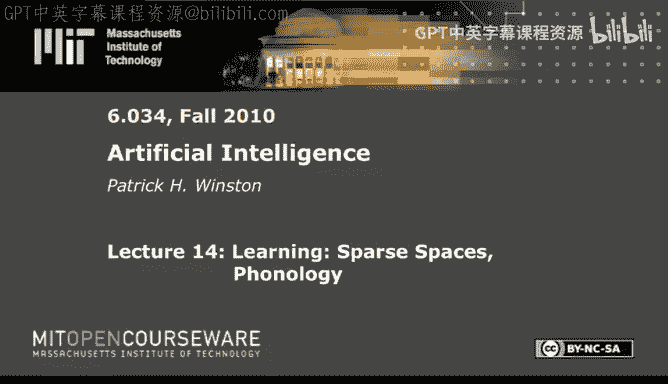
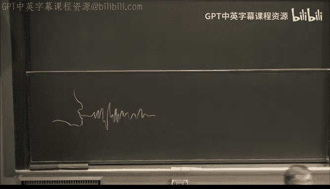
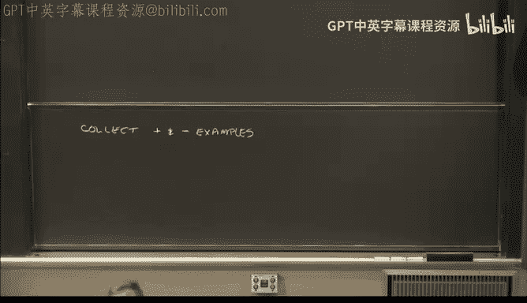

# 《人工智能｜6.034 Artificial Intelligence, Fall 2010》中英字幕 - P15：[15]14. Learning_ Sparse Spaces, Phonology.zh_en - GPT中英字幕课程资源 - BV14fqSB2ECY

So today。We're going to talk about a few miracles of learning。

In the context of the theme that we're developing here in the class。We started off。

With a discussion of some basic methods。Talked about nearest neighbors。

And we talked about identification trees， and those are kind of basic things that have been around for a long time。

 still useful， still the right things to do when you're faced with a learning problem and you're not sure what method to try。

Then we went on to talk about some naive biological mimicry。We talked about。They're on nets。

And we talked about。Genetic algorithms。And you look at those things。

 you think reflect back on what we talked about， and you have to say to yourself。

Are these nuatory ideas， perhaps perines？Or are they superau ideas that deserve to be center stage？

Doesbody know what those words mean？A pistolerine， well。Fiststerrine is a Spanish coin。

 it was so small， it was of little worth。These， these ideas like neural nets。Genetic algorithms。

I classify them as posterines。Getting them do something is rather like getting a dog to walk on its hind legs。

You can make it happen， but they never do it very well。

And you have to think it took a lot of trickery and training to make it happen。So。Not too。

Not too personally high on those ideas。But we teach it to you anyway。

 because of course we only editorialize part of the time and part of the time we like to cover what's in the field。

Today， we're starting a couple of。Discussions of mechanisms or ideas or。

Things to know about that are quite different because now we're going to focus on the problem rather than the mechanism。

And then a little later on， we're going to talk about deep theory， FIOS for its own sake。

But this week I want to talk about mechanisms that。That were devised， I want to talk about。

Research that was done。 Let me not say mechanisms。 Let me say research that was done to to。

 to attempt an account of some of the things that we humans do well， sometimes without even。

Knowing that we do it。Now， Christian here tells me his first language was telegu。Telego。

I once had another student whose first language was teleguop。I said to him。

 that must be one of those obscure Indian languages。And he said， yes。Spoken by 56 million people。

 French has spoken by 52。So he's going to be our experimental subject， Krishna， if I pluralize words。

 you know what it means to pluralize a word？So if I say， for example。Horse。

Then if I ask you for the prayerole， you'll say horses。So if I say dog， what's the pel？Or in no， no。

 no in English。And what about cat？And he got it right， not a miracle。

 when did you start speaking English？ but he still got it right。

 and he never learned that he's actually pluralizing those words differently。But he is。

So when you pluralize dog。What's the sound that comes after？That's a Z sound， dogs。

You stick your fingers up here， you can feel your vocal cordds vibrating。

If you stick a piece of paper in front of your mouth， you'll see it vibrate。But when you say cats。

The puralizing sound is like that。No vocalizing， no vibration of the vocal course。

And old Krisna here learned that rule as did all of the other non nativeative speakers of English effortlessly and without noticing it。

 you learned it。They always get it right， and how can that possibly be？Well， by the end of the hour。

 you'll know how that might be and you'll experience。

A case study and how questions of that sort can be approached with a sort of engineering point of view。

 you can say， what if God were an engineer or alternatively？What if I were God and I am an engineer？

Think about how it might happen that way。So we want to understand。

How it might be that the machine could learn rules like that， phonological rules， not just that one。

 but all of the phonological rules you'd acquire and of course on phonology， that part of。

Speaking that deals with。Those。syllabic and subsyllabic。Sounds， the phones of the language。So。

When Yep and Suss undertook to。Solve this engineering problem。Both being dedicated engineers。

The first thing they did was learn the science。So they went to sit at the foot of Morse Holly。

Who was largely responsible for。The development of theories of so called distinctive features。

 and here's how all that works。You start off。For the person who wants to say something。

And out that person's mouth。I some sort of acoustic pressure wave。And if I say。Hello， George。

 and you say hello， George， everybody will understand that we said the same thing。

 but that acoustic waveform won't look anything alike。

It be very different for all of us。So it's a miracle that words can be understood。In any case。

 it goes into an ear。And it's processed。And outcome comes a sequence。A distinctive feature。

Fectctorors。A distinctive feature is a binary。Variable like is the phone voiced or not。

 that is to say， are your vocal cords vibrating when you say it？If so， then that's plus voiced。

If not， it's minus voice。So according to the original distinctive feature theory。

And consistented with most of the theories that had been derived since the original one。

There are on the order of 14 of these distinctive features that determine。Which phone。You're saying。

So if you say a。That's one combination of these binary features if you say。

That's another combination of these binary features， 14 of them。So how many。

How many sounds does that mean that in principle there could be in a language？

And what's true to the 14th， Sebastian？Well， it oughtd be about 16，000， don't you think？

Two of the  tenth0 is 1，000， two to the fourth of 16th。So there are about 16。

000 possible combination， but no language on earth has more than 100 phones。That's strange。

 isn't it because。Some of those choices are probably excluded on physical grounds。

 but most of them are not， so we could have a lot more phones in our language than we actually do。

 English has about 40。So the sequence of distinctive features。

Could be viewed as then producing meaning。After perhaps a long series of operations。But in the end。

 those operations feed back in here。Because many of the distinctive features are actually hallucinated。

We think we heard them， but they're not there or they're there。

 or they're not even in the acoustic waveform， they're therefore the convenience of the phonologists who make rules out of them。

It's a remarkable。How much？How much of this feedback there is and even。

Injection from other modalities。Many of you may have heard about the MuGrk effect。

Here's how the McGrk effect works。Look at me while I say，Go， go， go， go， go， go， go。Okay， I said GA。

Now， how about爸888。Okay， I said。Bob like a sheep。But if I take the sound I make。换世吧。

And play it while while you're taking a video of me saying，Go， what do you think you hear？

You don't hear bah， some people report that they hear a DA sound like da。When I look at it。

 I can't make any sense out of it， it looks like there's a disconnection between the speech。

And the video。But it does not sound like bo。But if I shut my eyes and say， Bob。

 it's absolutely clear that it is。咩。So what you see has a large influence。On what you hear。

It's also interesting， although a side issue， it's also interesting to note that it's very difficult to pronounce things correctly if you don't see the speaker。

So many people wonder when they learn foreign languages， why they can't speak like a native。

And the answer is they're not watching the mouth of the speaker。

I was talking to a German friend once and said， you know。I just can't say the damned Umlaut's right。

And he said， oh， the trouble with you， Americans is that you don't realize。That American cows say mu。

 but German cows say mu。And of course， I got it instantly because I could see that the Ula sounds are produced with protruding lips。

 which we don't have any sounds in English that require them。

But back to what we know from the phonologists about all this stuff， if you talked to Morris， Holly。

 he will tell you。And over here。I like to think of it as a marionette。

There are five pieces of meat down here。And the combination of distinctive features that you're trying to utter。

I like the control of a marionette on those five pieces of meat。 So if you want to say an A sound。

 the marionette control goes into a position that produces that combination。So let's see。

 what is that？Distinctive feature。Sequence look like for a typical word Well， here's a word。AE P。L。

 apples。And。We can talk about what。Distinctive features。Are array。

In that particular combination of phones。So one of the features that they like to talk about is syllabic。

So我没。That roughly means can that sound form the sort of core of a syllable？And the answer is a can。

 but these can't， so it's plus minus minus minus。Down here a little ways， you'll run into the voice。

费 sure。And for the voice feature， well we can do the experiment ourselves。

 sounds like it's voice to me。no， that's not voiced。 Oh yep， we already said that was voiced。

So that's the combination you see when you utter apples for the voice feature。

Then another one is the conent one。That roughly says， is your vocal apparatus open。

 is there no obstruction？And so ah， plus。it's constricted all open。 This is open。

So that one happens to run right along with voice in that particular word。Oh。

 and they' are 14 altogether， but let me just write down。One more， the stridedent one。That says。

 do you use your tongue to form a little jet of air？So you don't on app Poo。What you do on。Z。

 so it gets a plus。So that's a glimpse through a soda straw of what it would be like to represent the wordapps as a set of distinctive features。

 all arranged in a sequence。So it's a matrix of features。Going down in the columns。

 we have our distinctive features and going across， we have time。

So it' the first thing assessment and Yip did in their effort to understand how phonological rules could be learned is to design a machine that would。

Interpret words and sounds。嗯。Things that you see。So as to produce the sounds of the language。

So they imagined the following kind of machine。The machine has some kind of mystery。

Afer at is over here。That looks out into the world and sees what's there。

So I'm looking out of the world and I see two apples。So what this machine might do then。

Is at some point decide that there are two apples out there。

Then thinking in terms of these guys as computer engineers。They think in terms of a set of registers。

That holds values for concepts like noun。And verb。I'm plural。

And we've not done anything with the machine yet。 we provided no input so those。

So those registers are all empty。Then up in here， we have a set of words。

And they're all kinds of words。Apple is one of them。

And those words out there know about how the concept is rendered as a sequence of phones。

 that is say， a sequence of distinct features。Then over here， most importantly。

They have a set of constraints。So we'll talk about a particular constraint， a plural constraint。

Plural constraint number one。And it's going to reach around and connect itself to some other parts of the machine。

Finally。There's a buffer。OfPs to be uttered。And they're going to flow out this way。

To the speaker's mouth and get translated into a。Acoustic waveform。

So those are the elements of the machine， now how are the elements connected together？不要。那个。

The words are connected， of course， into the buffer that is。Used to。

Generate the sound over here on the far left。The plural。

Register is connected to what you see in the world。

What you see in the world is connecting not only into the plural register， but to。All of the objects。

In the word。Repertoire。This plural constraint here deserves extra attention because it's going to be。

Desirrous of actuating itself。In the event that the thing observed in the world is plural。

 there are lots of them。So that it's going to be connected then to the plural。Port。

There's going to be a Z sound port down here。Connecting to that final element in the buffer。

And finally， over here is going to be a plus voiced。Port。Which is going to be connected。

To the second phoning of the sequence。That's how the machine is going to be arranged， and of course。

 this is just one of many constraints。It's a constraint that has a very peculiar property。

 information can flow through it。In multiple ways。So we think in most programs its having an input and an output。

But I've tried to be careful。To draw circles here instead of arrows。

 because these are ports and information can flow in any direction along them。

What I want to do now is just show you how this machine would react if I suddenly present it。

With a pair of apples like so。So the assumption is that the vision apparatus。Comes in and produces。

The notion， the concept of。Two apples。So once that has happened。That's operation number one。

Then information flows from that meaning register up here。To the Apple word。So that's part of。

Stage number two。Another part of stage number two is information flows along this wire。

And marks that as plus plural。So operation number one is the activity of the vision system。

 activity number two is the flow of information from that vision system into the。

Word lexicon and into this。Plural register。So far， so good， here's activity number three。This word。

There's also connected。To the registers。And information flows along those wires。

So as to indicate that that it's a noun， but not a verb。That's part of。Part number three。

At the same time。Part number three， information flows down this wire and writes A。PL。

Into those elements of the buffer。Now this constraint up here， this box。It says，" well。

 I can now see some stuff in that buffer that wasn't there before。So it says。

 do I see enough stuff on my ports to get excited about expressing values on other ports？

Well let's see， what is it got。The elements from this buffer。Also up here in step  three。

 flow the plural thing so it knows that the word is plural。 so it says is this voiced。啊。

P is that's not voiced。Is this a Z sound， no， that's not a Z sound。So， it sees。

What it likes on only one of its three ports。So it says， I'm not going to do anything。

 I'm order to comeba， I'm not in this particular combat。So far so good， what happens next？

What happens next？Is that some time passes。And the。

Elements of the buffer flow to the left toward the speaker's mouth。So we get an A。TL。

 same as we had before， but shifted over。Now what happens？Now what happens is that the P。

Or the L is now in the penultimate position， so information flows up here。Item number four。

 I guess that's item number five。Item number four is the。Left word flow of the word。

So in phase number five， the P is witnessed by this constraint。P is。Well， sorry。

 L is witnessed by this constraint， we've moved over over one， L is voiced。

So we have some flow up here like that， that's number five。Now we have Fist。And we have plural。

And we have nothing here。So there's a great desire of this buffer to have something written into it。

 So now there's a flow down in there。Of Z as item number six。So that's how the machine would work。

In expressing the idea that there are apples in the field of view。嗯。Real apples。

 not plastic imations。So that's how the machine works。But all those connections are reversible。

So if I hear apples。Now I get the machine running backwards。

And my visual apparatus can imagine that there are apples out there。So words。

That's just by way of background， the machine that they could see for using the phonological rules once they're learned。

all the phonological rules。Are expressed in these constraints。

But since these constraints are such that information can flow in any direction。

They deserve to be called propagators。And in the good old days， when everyone took 6701。

They learned about propagators as a kind of architecture for building complex systems。When event。

 there's the assessment Yp machine。And now comes the big question。How do you learn rules like that？

没有。What we need is we need some positive examples and some negative examples。

And for the simple classroom example， I've chosen。The same challenge that I presented to Krishna。

We're going to have cats and dogs。So we're got to look at the distinctive features。

That are associated with those words。Sabic。O。Continuinging。And stride it。

Just four of the 14 features that are associated with each of the sounds in those words。

Could you close the laptop， please？To just， just。For the young。Distinctive features that are。

A rate of those words。By way of illustration。So here we have K。8。See。Petically spelled。

And if we work that out。Let's see what is syllabic's not that is that's not。Voist come， nope。哎 grape。

T， nope。Z， yes。I can't be right， cats。I missbeled it。Because cats there's a hissing sound。

 but there's no wasting。So I not easy己 sound的真的 sound。So that's not plus voice， it's the minus voice。

Continuant。Let's see， is my mouth open when I say K， no， a， yes， T， no。S， yes。

And strident minus minus minus plus。It's only with the S sound that I have that kind of jet forming with my tongue。

Now we can look at dogs。And now we have the Z sound as the pluralization。

We know that because when we say it， dogs， yep， Eric comes out as a。Well。

 we're only going to look at the last two columns because they're the only ones that are going to matter to us。

 So that's plus。And that's minus。啊，的哥哥哥哥哥哥哥。That's plus and that's plus they're both voiced。

 Is that right， dog go？各个。Is G sound voice？Now， I didn't think so。She sound his voice。Like，Oh， it is。

It is voiced， but it's not a continuant。Like that。Yeah， cat dog goes， yeah， it is voice。

 and it has to be for my example to work out。And that's minus minus minus plus。

So what we're interested in is how come one word gets an S sound and how come the other word gets a Z sound。

Well。It's a pretty sparse space out there we've already decided that。There are 14。

000 possible phone names， and there are only 40 in the language。So that's one thing we can consider。

The other thing that we can think is that well。Maybe this is a logical problem。

 like kind of problem youd face if you were designing a computer。And so assessment。

 youep got stuck for three months thinking about the problem that way。

Couldn't make any progress whatsoever， and that happens a lot where youre。Doing a search。

 you think you've got a way of approaching it。Try to make it work。Stay up all night。

Stay up all night again， still can't make it work。Eventually you abandon ship， try something else。

Then they began to say， well， let's see。All we care about is the stuff before the two ending sounds。

 We care about that part of the matrix。And we care about that part of the matrix。And we can ask。

In what ways are those things different？And they're different all over the place。

 that's why they're different words。We can ask the question a little bit differently and we can say。

 what can we not care about？And still retain enough of a understanding of how the words are different so as to put the proper plro ending on them。

And they worried about that for a long time， couldn't find a solution， search space was too big。

And then， they said。Maybe what we ought to do。I we ought to think about generalizing。

This guy here so that we don't care about it。So now we don't care about that guy。

And then he went down on through here saying， well。

 let's see when when we have to stop generalizing because。

We've screwed everything up and we can no longer keep。The Z sound words separated from the。

Ss sound words。So that eventually distilled itself self down to the following algorithm。

First thing they did。Was to collect。Positive and negative examples。

And there's a positive example and a negative example， that's not enough to do it right。

 but that's enough to illustrate the idea。So then next thing they did was something that's extremely common in learning anything。

And that is to pick a positive example to start from。

It's actually not a bad idea in learning anything。To start with a positive example。

So they picked a positive example and they call that a seed。So in our particular case。

Cats is going to be our seed。And the question we're going to ask is。What are the words？

They get pluralized like cat。So we've got a positive and negative example。 We've picked a seed。

 and now the next step is to generalize。And what I mean by generalized is you pick some places in the phome that matrix that you just don't care about。

So when you maybe pick a positive example， you don't care about it， so you change it to。An asterisk。

 or as demonstrated in the program， I'm about to show you a ball。Or you pick one。A negative。

And you turn it into a ball。Both。So， cats， this seed。becomescomes a pattern。

And in order to pluralize the word this way， you have to match all the stuff in here。

 but now what we're going to do is we're going to gradually turn some of those elements。Into。

Don't care， symbols。Until we get to a point。Where we've not cared about so much stuff that we think that we puralize that one with it as sound。

 too。So we keep generalizing until。We cover。That is to say we admit or match。A negative example。

So that's how it works。So we generalize like crazy and as soon as we。Cover a negative example。

 we quit。Otherwise。And just go back up here。And generalize some more。And now。

We've got to pick a search technique to decide which of these guys to actually generalize when。

We could pick one at random。And they tried that， it didn't work。

But what they decided is that the thing that influences the pluralization most is the adjacent phony。

And if that isn't the thing that solves the problem， it'll be the one next to that。

 So in other words， the closer you are， the more likely you are to determine the outcome。

So these guys over here。Are least likely to matter。And those are the ones that are generalized first。

Right。So， we do that。What happens？Looks like we're going to come in here and see that there's a big difference between。

The nonvoice T and the voice to G。But that's only a guess because I'm going to show you a fraction of the 14。

Distinctive features that are involved。So I suppose you'd like to see a demonstration。

So theres our 14 features， and that's our seed there sitting prominently in the display。

With pluses and minuses indicating the values of the distinctive features for all three of the phones involved。

 that funny left bracket isn't a mistake that's。One convention for rendering the ass out in cat。

So it's pretty hard to tell from just that matrix what's going to be the determining feature that separates。

The positive examples from the negative examples。You notice that there are actually two examples down here。

 there's cat and duck。Is ducks got that sound ducks yep。So dogs and ducks。

 they both get pluralized with an S sound。On the other hand， Beach doesn't， that's beach jazz。Dog。

 we know that's the Z。Gun， guns，' not in the group。So we can run this experiment now here we go。

 we're generalizing like crazy， generalizing generalizing， generalizing from left to right。

So nothing in the first two columns matters。Now we get to the T。Wow， there it is。

So it looks like you pluralize with a S sound， the S。If and only if you're voiced。

You're not voiced and you're not strident。In the second to the last。

In the last phone of the word that you're trying to pluralize。

So that's one phonological rule that the system has learned and guess what。

 it's the same rule that's found in phonological textbooks。So now we can try another experiment。

So this time we're trying to deal with dog and gun。

And our negatives are what was previously positive， plus beach。

 which are' still in there as a negative example。So let's see how that warm works。Nothing matters。

Secept to the last column， the last phone。 and now we find out that if the last sound is。Voiced。

Then the pluralization gets the Z sound of voice conminator。Finally， just to deal with beaches。

That's speech， and it's funny， fantic spelling。For now， its if the second or the last。

 if if the final sound in the word is。Striidedent if it's got this jetty sound。Peach。Beach。

Then it gets the ES sound。So let's go back to experiment number one。

Because I want to point out one small thing about the way this works。

You'll notice that it talks about coverage and excluded down here in the lower left hand corner。

Excluded， well there are three negative examples， so they better all be excluded。

 you don't want to cover any of the negatives。But it says coverage two and two。

 that's because it actually is doing， and now we have the vocabulary to say it quickly。

 it's doing a beam search through this space。So it's not just doing a defaf first search。

 it's doing a beam search so as to reduce the possibility of overlooking a solution。So it says， oh。

 the coverage。Both of the beam search elements cover both of the。

Of the positive examples and in fact have converged to the same solution。

So that's how the assessment and Yip thing worked。And then the next question to ask is， of course。

Why did it work？So the answer。As articulated by Sussman and Yep。rather more by assessment。

Rather more by yip and a little bit less by assessment。

Yip thinks that it worked because it's a sparse space。

And when you have a high dimensional sparse space， it's easy to put a hyperplane。

Into the space to separate one set of examples from another set of examples。

So let's consider the following situation。Suppose we have。One dimensional。Situation。And we have。

Two white examples。And we have two purple examples。Well， too bad for us， you can't separate them。

But now suppose that this is actually the projection of a two dimensional space。That looks like this。

Here are the white examples down here。And here are the purple examples。I here。

Now it's easy to see that you can separate them with just a line that goes across like that。

Let's take this one more step。And suppose that this is actually a projection of a three dimensional space。

That looks like this。This will be dimension one。This will be two going back there。

And this will be three up here。And suppose that the positive examples。All right here on this line。

Let's say， this is。Well we're going to draw the little cube by so。Suppose our purple examples。

Or up there。How many ways are they partitioning the space along those axes。

 well now they're not even just two， they're three。Some one way to separate the。

Purple from the whitest to drop a。hyperperplane， or in this case， it's just three dimensions。

 so a plane through here on the number three axis， you could also put a plane in on that axis or you could do both。

So in one case you're。The dividing line would be。嗯。See， on the first axis of the one half。

And then the do hair。Don't care。Another solution that would be， don't care。

And then we divide on the number two axis。I was a plane at one half and don't care。

Or we could do it with。One half。ItOne half。 and don't care。So the higher the dimension of the space。

 the easier it is sometimes to put in a plane that separates the data。

 that's why Sesamment and Yip think that we use so little of possible phome space because it makes the thing learnable。

That's one possibility。So one explanation for。As far as spaces。Learnability。

There's another interesting possibility， and that is that。If you have a sparse space。

High dimensional space of 14 dimensions。And if the。40 points of your language。

Are spread evenly throughout that space。No， let me say it the other way。

 if they're placed at random in that space。Then according to the central limit theorem。

 they'll be about equally distant from each other。So it ensures that the phonemes are highly easily separated when you speak。

But。If you go to ask a linguist。If that's true， they don't know because they're not looking at it from a computational point of view。

But we can look at it from a computational point of view。So I did that。

After Sesamman yet published their paper。And here's the result。This is a diagram that shows。

All of the phonemes。That are separated by exactly one distinctive feature。

So if you look over in this corner here， you see that the constants W and X are separated by exactly one distinctive feature。

So they're not exactly。Distant from each other in the space。On the other hand。

 they are pretty easy to separate relative to the vowels。Which up here in this part of the diagram。

Which are all tangled up and the bowels are all close to each other， so guess what？

Vels are much harder to separate than constants。Not surprisingly because they often。

 because there are many pairs of them that are different in only one distinctive feature。

All right， so now you back up and you say， well， gosh， that's all been sort of interesting。

 but what does it teach us about？How to do science and stuff。

And what it teaches us is that this is an example。啊。

This is an example which we can use to illuminate some of the thoughts of David Marher。

 who I spoke of in previous lecture， connection with Viion， but here is。Here's Mar's catechism。

I can't spell very well， so I won't try to respell it， but this is Mars Cechism。

So what Marsh said is when you're dealing with an AI problem。

 the first thing to do is to specify the problem。Seeee， that sounds awfully normal。

The next thing is to devise a representation。Sed to the problem。The third thing to do。

Vocabulary varies， but it's something like determine an approach。Sometimes I'm thought of as。

A method。And then four。Pick。A mechanism。Or devise an algorithm。And then finally， five。Experiment。

And of course， it never goes linearly like that。 you start with a problem and then you。

Go through a lot of loops up here， sometimes even changing the problem。

But that's just a scientific method， right， you start with a problem and you end up with the experiment。

But that's not what people in AI。Over the bulk of its existence have tended to do。

What they' tended to do。He to fall in love。With particular mechanisms。

And then they attempt to apply those mechanisms to every problem。So you might say， well， gee。

 neural nets are so cool。I think all of human。Intelligence can be explained with suitable neural net。

And that's not the right way to do it。Because that's mechanism envy。

 you fall in love with the mechanism， you try to apply it where it isn't the right thing。

This is an example of starting with a problem。And bringing to the problem。

 the right representations got distinctive features。Once we've got the right representation。

Then the constraints emerge。Which enabled us to devise an approach。

 write an algorithm and do an experiment， as they did。So the assessments Y thing is an example。

Of doing AI stuff。In a way that's congruent。With the Marath catechism。Which I highly recommend。

They could have come in here and said， well。We're devotees of the idea of neural nets。

Let's see if we can make a machine that will properly pluralize words using an neural net。

And that's a loser。Because it doesn't match the problem to the mechanism。

 it tries to force fit the mechanism into some procresttian bed。Where。

Doesn't actually work very well。So what this leaves open， of course， is a question of， well， what is？

A good representation。And here's the other half of Mars catechism。Characteristic number one。

Is that it makes the right things explicit。So in this particular case。

 it makes distinctive features explicit。Another thing that Mar was noted for was stereo vision。

So in that particular world。Disconnuities in the image when you go across an edge were the things that were made explicit。

Once you've got a representation， it makes the right。Things explicit， you can say。

 does it also expose constraint？And if you have a representation that exposes constraint。

 you're off and running because it's constraint that you need in order to do the processing。

That leads to a solution。So don't have the right representation if it doesn't expose constraints。

 you're not going to be able to make a very good model out of it。And finally。There was a kind of。

Localness。Criteria。If you have a representation。In which you can see the right answer by looking at descriptions through a soda straw。

 That's probably a better representation than one that's all spread out。It's true with programs。

 right？If you can see how they work by looking through a soda straw。

We're in a much better situation to understand something if you have to look out here and there on the next page and in the next file。

So all this is basically common sense。But this is the kind of common sense that makes you smarter。

As an engineering scientist， especially as a scientist。

 because if you go into a problem with mechanism envy。You're apt to study。

Mechanisms in an naie way and never reach a solution that will be satisfactory。

