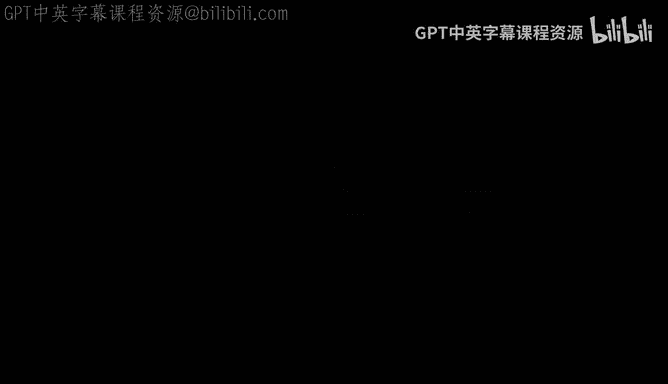
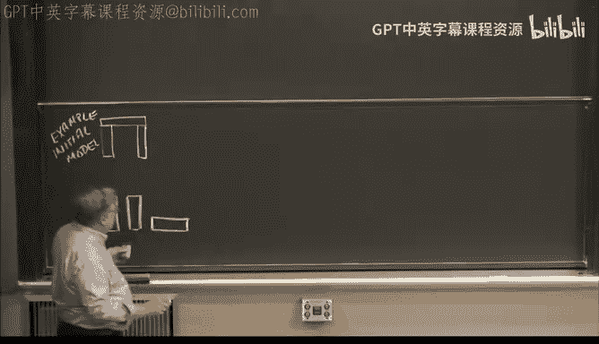
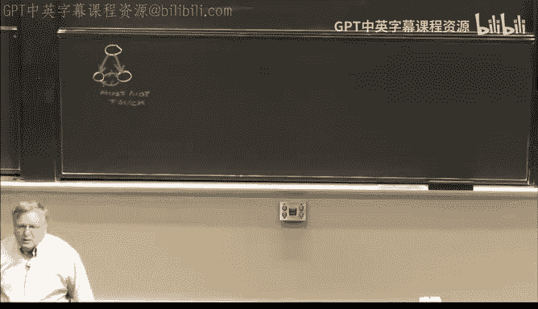
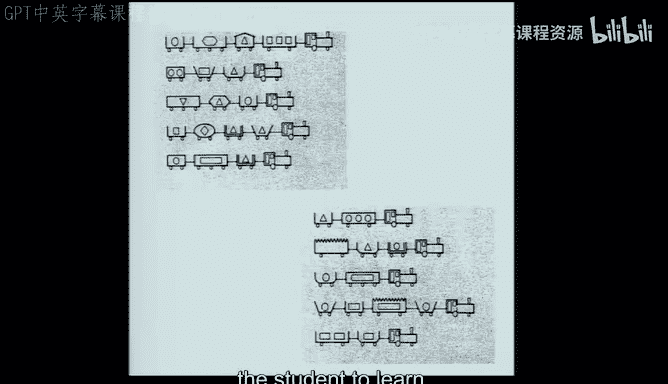
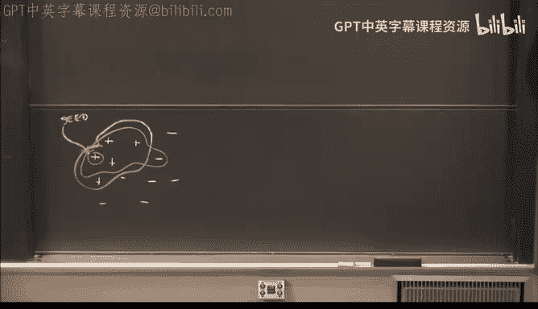
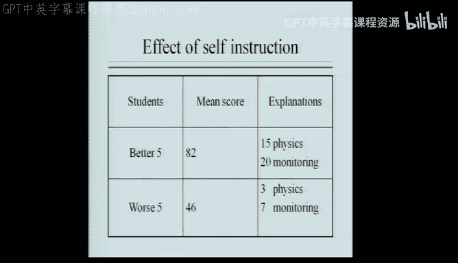
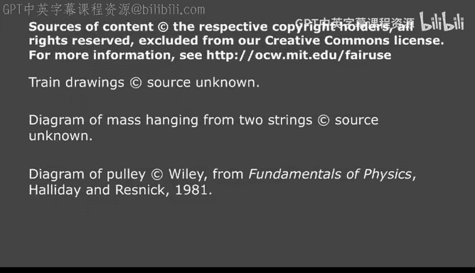
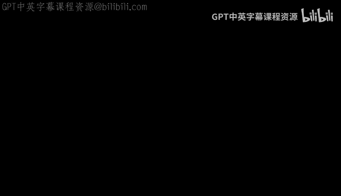

# 《人工智能｜6.034 Artificial Intelligence, Fall 2010》中英字幕 - P16：[16]15. Learning_ Near Misses, Felicity Conditions.zh_en - GPT中英字幕课程资源 - BV14fqSB2ECY

Yeah。You know。Some of you who， for instance。I don't know， Sania， Krishna， Shohanna。

Some of you I could count on being here every time。 some of you show up once in a while。

 the one of you who show up once in a while happen to be very lucky if you pick today because what we're going to do today is I'm going to tell you stuff that might make a big difference in your whole life。

Because I'm going to tell you how you can make yourself smarter。No kidding。

 and I'm also going to tell you how you can package your ideas。

So that you'll be the one that's picked instead of some other slug。

So that's what we're going to do today， it's the most important。Lecture of the semester。

 The sleep lecture is only the second most important， this is the most important。

Now the vehicle that's going to get us there is a discussion about how it's possible。

To learn in a way that is a little reminiscent of what we talked about last time。

 because last time we learned something very definite from a small number of examples。

 this takes it one step further。And shows how it's possible to learn in a humanlike way。

From a single example and one shot。So it's extremely different， very different。

From everything you've seen before， everything that。It involves learning from thousands of trials。

Gzillions of examples and only learns a little tiny bit， if anything from each of them。

 This is going to learn something definite from every example。So here's the。

Here's the classroom example。What's this， It's an arch。

 I know the architects are complaining that it's not an arch in。Architecture land。

 it's a post and lintel construction。 but for us today， it's going to be an arch。Now。

 if you were from Mars and didn't know what an arch was。

 I might present this to you and you would get a general idea of some things that might be factors。

 but you'd have no idea what's really important。So then I would say that's not an arch。

And you will learn something very definite from that。

And then I would shove these together and put this back on。

 and I would say that's not an arch either， and you learn something very definite from that。

And then I could paint the top one blue。 and you learn something very definite from that。

 And how how can that happen is the question， How can that happen in detail。

 and what might it mean for。Human learning and how you can make yourself smarter。

 that's where we're going to go。So how can we make a program that's as smart as a Martian about learning things like that？

Well， if you were writing that program， surely the first thing you would do is you would try to get off the picture as quickly as possible and into symbol land where things are clearer about what the important parts are。

So you'd be presented with an initial example。That might look like this。We'll call that an example。

But it's more than just an example， it's the initial model。That's the starting point。

And now we're going to couple that with something that's not actually an arch。

But looks a whole lot life one， at least on the descriptive level to which we're about to go。

So here's something。That's not an arch。But its description doesn't differ from that of an arch very much。

 in fact， if we were to draw this out in a kind of network。

We would have a description that looks like this， and these relations would be support relations。

And this would be drawn out like cell。And the only difference would be this。

 the only difference would be that those support relations that we had in the。Initial model。

The example。Have disappeared down here in this configuration。

 But since it's not very different from the model， we're going to call this a near miss。And no。

You see， we've abstracted away from all the details that don't matter to us。

Last time we talked about a good representation， having certain qualities。

 qualities like making the right things explicit。 Well， this makes the structure explicit。

And it suppresses information about blemishes on the surface。

We don't care much about how tall the objects are。We don't We don't think it matters what they're made of。

 So this is a representation that satisfies the first of the criteria from the last time it makes the right things explicit。

And by making the right things explicit， it's exposing some constraint here with respect of what it takes to be an arch。

 and we see that if those support relations are missing，It's not an arch。

So we ought to be able to learn something from that。

What we're going to do is we're going to put these two things together。

We're going to describe the difference between the two。

 and we're going to reach the conclusion that since there's only one difference。

One kind of difference with two manifestations， two disappearing support relations。

We're going to conclude。That those support relations。Are important。And we've got a term。

We're going to turn red。Because they're so important。And we're going to change the name from support。

To must support。So this is our new model。 this is an evolving model that now is decorated with information about what's important。

So if you're going to match something against this model。

 it must be the case that those support relations are there if'， if they're not there。

 it's not in march， all right？So we've learned something definite from a single example。

 This is not 10000 trials。This is a teacher presenting something to the student and the student learning something immediately in one step about what's important in an arch。

So let's do it again， that was so much fun。Let's do this one。Same as before。

Except that now when we describe this thing。There are some additional relations。These relations。

 and those are touch relations。So now when going to compare to that。Is that an arch， No。

 that's a near miss。When we compare that near miss with our evolving model。

 we will see immediately that once again， there's exactly one difference。Two manifestations。

 the touch relations。So we can immediately conclude。

That these touch relations are interfering with our belief that this could be an arch。

So what do we do with that， we put those together again。And we build ourselves a new model。

It's much like the old model。It still has the。Iperatives up here。

 we have to have the support relations， but now down here， let me draw knot signs through there。

 this these are must not touch relations。So now you can't match against that model if those two side supports are touching each other。

So in just two steps， we've learned two important things about what has to be in place in order for this thing to be connstrued to be an art。

 So our Martian is making great progress。But our Martian isn't through because there's some more things we might want it to know about the nature of arches。

For example。They might present it。Or this one。Oh， that looks just like our initial example。

It's an example。Just like our initial example。But this time。The top has been painted red。

But I'm still saying that that's an arch。So once again， there's only one difference。

And that difference is that in the description。Now this object。

We have the additional information that the color。On the top。Hes red。

And we've been carrying along without saying so that the color。

Of the top and the evolving model is white。So now we know that the top doesn't have to be white。

 it can be either red or white。So we'll put those two together。And we'll get a new model。

And that new model this time。Once again， we'll have three parts。It will have the。

Relations in imperative form that we've been carrying along now。

The must support and the must not touch。But now we're going to turn that color relation itself。

Into an imperative。 and we're going to say that the top has to be either red。Or white。So now。

 once again， in one step， we've learned something definite about archness。Two more steps。

Suppose now we present it with。This example。It's an example。

And this time there's going to be a little paint added here as well。

 this time we're going to have the top painted blue。Like set like so。And so the description。

We'll be like so。And now we have to somehow put that together with our evolving model to make a new model。

 and there's some choices here， and our choice depends somewhat on the nature of the world that we're working in。

So suppose we're working in flag world。There are only three colors， red， white， and blue。

Now we've seen them all。If we've seen them all。Then what we're going to do is we're going to say that the evolving model。

Now is adjusted yet again。Like so， oh， those are imperatives still， let me carry that along。

At this time， this guy， the color relation。Goes out here too。Anything at all。

So we could have just not drawn it at all， but then we would have lost track of the fact that we've actually learned that anything can be there。

 so we're going to retain the relation but have it point to the anything goes marker。Well。

 we're making great progress， and I said there's just one more thing to go。So let me。

 let me compress that into this area here。 What I'm going to add this time is I'm going to say that。

The example。Yes。Like。Everything you've seen before， except at the top。

There's now one of those kinds of child's bricks。So you have a choice actually about whether this is an arch or not。

But if I say， yeah， it's still an arch。Then we'd add a little something to its description。

 so its description would look like this。Same things that we've seen before in terms of support。

But now we have a relation that says at this top。Is。A wedge。And over here。

 something we've been carrying along， but not writing down this top is a block， a brick， I guess。

In the language of the day。So if we say that it can be either a wedge or a brick on top。

 what do we do with that？Once again， it depends on the nature of representation。

But if we say that we have a representation that has a hierarchy of parts。

So bricks and wedges are both children's blocks and children's box are toys。

Then we can think of drawing in a little bit of that hierarchy right here。And saying， well。Let's see。

Immediately above that， we've got the brick。Or。Wedge。And a little bit above that， we've got block。

And a little bit above that， we've got toy。And a little bit above that。

 we eventually get to any physical object。So what does it do？In response to that kind of situation。

You have the choice。 But what the program I'm speaking of actually did was to make a conservative generalization up here。

 just to say。And it's one of those guys。So once again， let's learned something definite。 Let me see。

 Let me count the steps。One， two， three。For。5。And it's learned four things。

So the generalization of a color it took two steps to get all the way up that don't care。

So note help at contrast with anything you've seen in a neural net。

Or anything you will see downstream and some of the other learning techniques that we'll be talking about that involve using thousands of samples to learn what it is。

 to learn whatever it is that，Hes intended to be learned。

Let me show you another example of how these heuristics can be put to work。

So there are two sets of drawings。We have the upper set and the lower set。And your task。

You smart humans working in vast parallelism。Your task is to give me a description of the top trains。

That distinguishes and separates them from the trains on the bottom。You got it。Nobody's got it。Well。

 let me try one on you。The top trains all have a short car with a closed top。

So how is it possible that a computer could have figured that out？

It turns out that it figured it out with much the same apparatus that I've shown you here in connection with the arches。

 just deployed in a somewhat different manner。In this particular case。

 the examples are presented one at a time。By a teacher who's eager for the student to learn。

In this case， the examples are presented all at once。

And the machine is expected to figure out a description that separates the two groups。

And here's how it works。What you do？Did you start with one of them？But you have a lot of them。

 you have some examples， we'll call the examples on top the plus examples and the examples on the bottom。

 the negative examples。So the first thing that you do is you pick one of the positive examples to work with。

Can anybody any good guesses about what we're going to call that？Yeah。

 you do We're going to call that this seed。ItIt's just highly reminiscent of what we did last time when we were doing phonology。

 but now at a much different level。We're going to pick one of those guys to be decceived。

 and then we're going to take these heuristics。And we're going to search for one。

That loosens this description so that it covers more of the positives。

 You see if you have a C that is exactly a description of a particular thing。

And you insist that everything be just like that。Then nothing will match except itself。

But you can use theses。To expand the coverage of the description。

 to loosen it so that it covers more of the positives。So in your first step。You might cover。

 for example。That group of objects。Too bad for your side。 You've also。In that particular case。

 included a negative example in your description， but perhaps in this next step beyond that。

You'll get to the point where you've eliminated。All of those negative examples and zeroed in on all the positive examples。

So how might a program be constructed that would do that sort of thing？

Well， think about the choices。 The first choice。That you have。Is to pick。A positive example。

To be the seed。And once you've picked a particular example to be the seed。

 then you can apply heuristics， all of them that you have to make a new description that may cover the data better。

 may have more of the positives and fewer the negatives than in your previous step。But this。

 if you have a lot of heuristics。And these are a lot of heuristics because there's a lot of description in that set of trains。

There are lots of possible things that you could do with those heuristics because you could apply them anywhere。

 So this tree。It is extremely large。So what do you do to keep it under control。

 well you know now you have answers to questions like that by knee jerkrk， right。

 the branching factor is too big， you want to keep a few solutions going。

You have some way of measuring how well you're doing。So you can use a beam search。

This piece here was originally worked out by。Fred of mine now alas to cease Richardharard Milkowski when he's at the University of Illinois。

 of course， he wasn't interested in toy trains。 He was just interested in soybean diseases。

And so this exact program was used to。Buildill descriptions of soybean diseases that turned out to be better than the plant pathology books。

But you know。We now have two ways of deploying the same heuristics。

But my vocabulary is in need of enrichment。Because I'm talking about those heuristics。

And one of the nice things that Millkowski did for me a long time ago was gave each of them a name。

So here are the names that we're。That were developed by Moowski。What's happening here。

 You're going from an original model。To an understand some things are essential。 So he called this。

 they requireling heuristic。And here， in the next step。

 we're forbidding some things from being there。So Mukowski called that heuristic。

 the forbid link heuristic。And in the next step， we're saying it can be either red or white。

 so we have a set of colors and we're extending it。And over here， in this heuristic。

 going from red or white to anything goes。That's essentially forgetting about color altogether。

 so we're probably going to call that drop link。Even though for。Reasons of keeping track。

 we don't actually get rid of it， we just have it pointing to the anything marker。And finally。

 in this last step。What we're doing with this tree of categories is we're climbing up at one step。

 So we called that the climb tree heuristic。So now we have the vocabulary of things we can do in the learning process and having that vocabulary gives us power over it。

 right， because those are names。We can now say， oh， well。

 watching' you new here is the drop link heuristic。And what you need over there is the。

Extend sat heuristic。So now I want to back up yet another time and say， well， let's see。

When we were working with that phenology stuff， all we did was generalize。

 Are we just generalizing here？No。We're both generalizing and specializing。

So when I say that the links。Over here that are developed on our first step。Are essential。

This is a specialization step。And when I say they can't be。They cannot be touch relations。

That's a specialization step。Because。We're able to match fewer and fewer things when we say you can't have touch relations。

But over here， when I go here and say， well， it doesn't have to be white， it can also be red。

That's a generalization。Now we can match more things。And when I drop the link altogether together。

That's a generalization。And when I climb the tree， that's a generalization。And that's why。

When I do this notional picture of what happens when Milkowski program does a tree search to find a solution to the train problem。

 they're both specialization steps which draw in the number of things that can be matched and generalization steps that make it broader。

So， let's see。We've also got the notion of。Near myths， and we've got the notion of example。

 some of these things are examples， some are near misses。

 and we've got generalization and specialization。Does one go with one or the other？

Are they all mixed up in a relationship to each other。

 can you generalize and specialize with their misses？What do you think？You thinks are you？护理费。

The nearest are seeking to lead to specialization。Let's see if that's right。

So weve got specialization here。And that's an near mess。We've got specialization here。

And that's an near miss。We've got generalization here。And that's an example。

And we've got generalization here。And that's an example， and we've got generalization here。

 and that's an example， so eight balls got that one out。

The example is always generalized and as near miss is always specialized。

 So we've got apparatus in place that allow us to both expand what we could match and shrink what we can match。

So what has this got to do with anything well？Which one these methods is better， by the way。

 this one。This one requires a teacher to organize everything up， This one can handle it。In bash mode。

This one is the sort of thing you would need to do with a human because we don't have much memory。

 That one is the sort of thing that a computer is good at because it has lots of memory。

So which one's better？Well， it depends on what you're trying to do if you're trying to build a machine。

That to analyze the stock market， you might want to go that way。Or。

Soybean diseases or anyone one of a variety of practical problems of trying to model people。

And maybe this is a way that deserves additional merit。But how do you get all that sorted out？

One way to get them all sorted out is to talk in terms of。

But our calls sometimes call Felicity conditions。So when I talk about felicity conditions。

 I'm talking about a teacher and a student and covenants that hold between them。So， here's。

The teacher。That's me。And here's the student。Thatax you。And the objective of interaction。Is to。

Transform an initial state of knowledge。Into a new state of knowledge。So that the student。Is smarter。

And able to make use of that new knowledge。To do things。It couldn't be done。The four。By the student。

So the student over here has a learner。And he has。Something that uses what is learned。

And a teacher over here has a style。So if any learning is to take place。

One side has to know something about the other side。For example。It's helpful。If。The teacher。

Understands。The initial state of the student。And here's。One way of thinking about that。嗯。我同。H。

You can think of what you know as forming a kind of network。So initially， you don't know anything。

But as you learn。You start developing quant of knowledge。

And these quant of knowledge are all linked together by prerequisite。

Relationships that might indicate how you get from one quantum to another。

 So maybe you have generalization links， maybe you have specialization links。

 maybe you have combination links， but you can think of what you know as forming this kind of network。

Now， your state of knowledge in any particular time can then be viewed as a kind of。

Wayfront in that space。So if I the teacher， know where your wavefront is。

 can I do a better job of teaching you stuff？Sure， for this reason。Suppose you make a mistake。M1。

That depends on Q1。Way， way behind your wayfront。What do I do if I know that you made a mistake of that kind？

Oh， I just say， oh， you forgot that you need a semicolon after that kind of statement。

I just remind you of something you certainly know you just overlooked。Right。other hand。

Suppose you make a mistake。It depends on a piece of knowledge way out here。That kind of mistake。

 I'm too。What do I say to you then。我 think that。What do you think I would say to make that kind of？

No， that's not when I would say explain that， you know what guys know what I do。

I would say something like that，S justs I saying。Oh。Don't worry about that， we'll get to it。

 we're not ready for it yet。So in this case。I remind somebody of something they already know。

 In this case， I tell them toll learn about it later。So what do I do？This mistake， number three。

That's the learning moment。That's where I can push the wavefront out because everything's in place to learn the stuff。

At the next radius。So if I know that the student has made a mistake on that wavefront。

 that's when I say this is the teaching moment。 This is when I explain something。

So that's why it's important。For the teacher to have。A good model。

OfWhere the student is in the initial state of knowledge。

The next thing that's important to know for the teacher to know is the。Way that the student learns。

Because if the student is a computer that can handle this stuff in batch。

 that's one thing if the student is a third grader who has a limited capacity to store stuff。

Then that makes a difference in how you teach it， you might teach it that way。To the third grader。

And that way， buried underneath this board。To a computer。

 so you need to understand the way that the learner。The computational capacity of the learner。

And there's also a need to understand the computational capacity。Of the user。Box down there。

 because sometimes you can be taught stuff that you can't actually use。So by now。

 most of you have attempted to read that sentence up there， right？And it seems screwy， right？

It seems unintelligible， perhaps。It's a garden pass sentence， it makes it's perfectly good English。

But the way you generally read it， it doesn't because you have a limited buffer。

In your language processor。What does this mean you're expecting this to be too？Question。

 but it's actually a command。 Here's the deal。 Somebody's got to give the students their grades。Well。

 we could have their parents do it。Have the。Bdes given to their students by their parents then。

So it's command and you garden path on it because you have limited buffer space in your language processor。

So with parentheses， you can understand it。You could learn about it。

 you could see that it's good English， but you can't generally process that kind of sentence without going back and starting over。

And what about going the other way， are there covenants that we have to have here？

That involve these student understanding and things about the teacher。Well。

 the first thing there is is trust。The student has to presume that the teacher is teaching the student。

Correct information， not lying to the student。Gratified the Earl here because presumably you all think that I'm not trying to screw you by telling you stuff that's a lie。

There's also this sort of thing down here。An understanding of the teacher's style。So you might say。

 well， Professor Xs， all he does is read slides to us in class， oh why go。

 you wouldn't be entirely misadvised。 That's an understanding of one kind of style。Or you can say。

 well， oh Winston， he tries to tell us something definite。

And convey a family of powerful ideas in every class。

 Some maybe it's worth dragging yourself out of bed at 10 o'clock in the morning。

 Those are style issues。 And those are things that the。Student uses to determine how to match。

Student style against that of the instructor。So that helps us to interpret or think about differences in in style so that we can appreciate whether we ought to be。

Learning that way， where that way is the。wayay that's underneath that here。

 the way you would teach a computer the way Milowski taught a computer about soybean diseases。

They can do it that way。Or we can do it this way。With a teacher who deliberately organizes and shapes the learning sequence sequence for the benefit of a student who has a limited。

Processing capability。Now you're humans， right？Think about what the machine has to do here。

 The machine in order to learn anything indeinite in each of those steps。

 the machine has to build a description。So it has to describe the examples to itself。

That's unquestioned， right， because what it's doing is it's looking at the differences。

 So it can't look at the differences unless it's got descriptions of things。

So if you're like the machine。Then you can't learn anything unless you build descriptions。Unless you。

Talk to yourself。And if you talk to yourself。You're building the kind of descriptions that make it possible for you to do the learning。

And you say to me， I'm an MIT student。I want to see the numbers。

So let me show you the numbers and what I want to show you numbers。

The numbers I want to show you show you the virtues of talking to yourself。So here's the experiment。

Sperment done by friend of mine， Michelle and Chei， always seems to go by the name Nikki Chie。

Oh I see。There is。So here's the deal， the students that she worked with。

We're expected to learn about elementary physics， 801 type stuff。And she took eight subjects。

And she had them， she took them through a bunch of examples， and then she gave them an examination。

So eight subjects。 And so they divide into two groups。The bottom half and the top half。

The ones who did better than average and the ones that did worse than average。So then you can say。

 well， okay， what did that mean， you can say how much did they talk to themselves， Well。

 that was measured by having them talk out loud as they solve the problems on an examination。

So we can ask how much self explanation was done。By the smart ones versus the less smart ones。

And here are the results。The worst ones， the worst four。Said about 10 things to themse。The best for。

Said 35 things to them。That's a pretty dramatic difference。

 here's the data and the straightforward form。 This， by the way。

 points out that the smart ones scored twice as high as the less smart ones。

And when we look at the number of explanations， they gave themselves。In two categories。

 the smart ones said three times as much stuff to themselves as the less smart ones。

So as you can see， the explanations break down into two groups。Some。

Have to do with monitoring。And not with physics at all。 There are things like， oh， hell， I'm stuck。

Or I don't know what to do。And the others have to do with physics and things like， well。

 maybe I should draw a forced diagram。Let me write down f equals MA or something like that as physics knowledge。

I think it's interesting that that the average score differed by a factor of two。

 and the average talking to oneself differed by a factor of three。Now， this isn't quite there。

Because。What's not clear is if you encourage somebody to talk to themselves and they talk to themselves more than they would have ordinarily。

Does that make them score better， All we know is that the ones who talk to themselves more do score better。

But anecdotally， talking to some veterans of 6034。They've started talking to themselves more when they solved problems。

And they think that it makes them smarter。Now， it would caution you not to do this too much in public。

Because people can get the wrong idea if you talk to yourself too much，It seem does， in fact。

Seemed to help。Now。What I did last time is I told you how to be a good scientist。

 What I'll tell you now is how to make yourself smarter。

 And I want to conclude this hour by telling you about how you can package your ideas so that they have a greater impact。

So I guess I could have said how to make yourself more famous。

But I have limited myself to saying how to package your ideas better。

 and the reason you want to package your ideas better is because if you package your ideas better than the next slug。

Then you're going to get the faculty position， and they're not。And he said to me。

 I'm to be an entrepreneur， same thing。You're going to get the venture capitalist money and the next slug won't if you package your ideas better。

So this little piece of work on the arch business got a whole lot more famous than I ever expected。

I did it when I was young and stupid， and didn't have any idea of what qualities might emerge from a piece of work that would make it well known。

 I only figured it out much later。But in retrospect。It has five qualities。That。

You can think about when you're deciding whether your packaging of your idea is in a form that will lead to that idea becoming well known。

And since there are five of them。It's convenient to put them。All， on the。Points of a star。Ex so。

So quality number one。I've made these all into S words just to make them easy to remember。

Quality number one is that there's some kind of symbol associated with a work。Some kind of。

Visual handle that people will use to remember your idea。So what's the visual symbol here？

Well that's astonishing and easy to figure out， right， that's the arch。For years。

 without my attendinging it， this was called Arch learning。So you need a symbol。Then you also need。

A slogan。That's a kind of verbal handle。It doesn't explain the idea， but it serves。

 but it's enough of a handle to。As Miski would say。

 put you back in the mental state you were in when you understood the idea in the first place。

So what is the slogan for this work， anybody have any ideas？Pretty obvious。

What' central does this process work？You really present examples very similar to the fact。

That constitute a model that isn't one of those。そすねます。

The next thing you need if your work is going to become well known is a surprise。

What's the surprise with this stuff？Well， the surprise。

 everything that had been done in artificial intelligence。

 having to do learning before this time was precursors to neural nets。

Thousands of examples to learn anything。So the big surprise was that it was possible for a machine to learn something definite。

From each of the examples。So that now goes by the name of one shot learning。

That was the surprise that a computer could learn something definite from a single example。

So let's see we've almost completed our star， but there are two more points on it。

 so this point is the salient。What's assailant？What's a salient idea。Jose。

 do you know what a salient that is？I was to shy its own。も知らい。好，我 said important。Brong answer。

 very good。真帅。So what， what is it really， yes。Somebody's already thinking about。

Rative to what somebody' is thinking about， not quite。不了。这件事。So suggestion of yes， yes。Really clear。

 We're getting closer。そしたらいいよ。Maybe看你又在公司。Once the parent graduate or're zeroing。

 we're circling the wagons here and zeroing in on it， yes。Pranable here。

I would say has through the doorway of how you can understand。それ？我。不是。It too。

 but if you study military history， what's the salient on a fort？Well。

 that's a good word having your vocabulary because it sort of means all of those things。

 but what it really means is something that sticks out。So on a fort， I mean， this were a fort。

These would all be salience because they stick out。

So a salient idea is usually important because it sticks out。But it's not meaning is not important。

 meaning is stick out。So a piece of work becomes more famous。 if it has something that sticks out。

 It's interesting。 There are theses that have been written in M I T that have too many good ideas。

And how can you have too many good ideas， Well you can have too many good ideas if no one idea rises above and becomes the idea that people think about when they think about you。

We have people on the faculty who would have been more famous if the thesess had fewer ideas。

 It's amazing。So this piece of work did have a salient。

And this salient idea was that you could get one shot learning。By the use of near misses。

 that was the salient idea。The fifth thing。'Talk more about this。W how to speak lecture in January。

The fifth thing I like to people to try to incorporate into their presentations is a story。

Because we humans somehow love stories。We love people to tell us stories。

 we love things to be packaged in stories， and believe me。

 I think all of education is essentially about storytelling and story understanding。

So if you want your idea to be sold as the venture capitalists。If you want to get that faculty job。

If you want to get your books sold to a publisher， if you want to sell something to a customer。

Ask yourself if your presentation has these qualities in it and if it has all of those things。

It's a lot more likely to be effective than it doesn't。And you'll end up being famous。

 now you say to me well。Being famous， that sounds like a sloan school type of concept。

Isn't it immoral to want to be famous？Maybe that's a decision you can make。But。

Whenever I think about the question， I， I somehow think of the idea that your ideas are like your children。

 you want to be sure that they have the best life possible。And so if they're not packaged well。

 they won't。I'm also reminded of。Theing I spent。At a soe。With Juliet Child。Julie， and there's me。

And I have no idea how come I got to sit next to Julia Charlie， I thought。One of the rich Winston's。

 the Winston Flow， Harry Winston Diamonds or something like that。

 there I was sitting next to Julia Child。And the interesting thing， by way， you notice。

 I'm now telling a story。The interesting thing about this experience was that。

There's a constant flow。Of。Of people。Happened to be all women。 people going past Miss Child。

 saying how wonderful she was to have made such an enormous change in their life。

There must have been 10 of them。 It was amazing。 Just steady flow。

So eventually I leaned over to her and I said，Ms Child。Is it fun to be famous？

And she thought about it a second and said。You get used to it。And that had a profound effect on me。

 because you always say， well， what's the opposite like？Is it fun to be ignored， And the answer is。

 no， it's not much fun to be ignored。So yeah， it's， it's something you can get used to。

 but you can never get used to having your stuff ignored， especially if it's good stuff。

So that's why I commend to you this business about。Packaging ideas。 And now you see that 6，0，3。

4 is not just about AI。 It's about how to do good science。

sHow to make yourself smarter and how to make yourself more famous。

