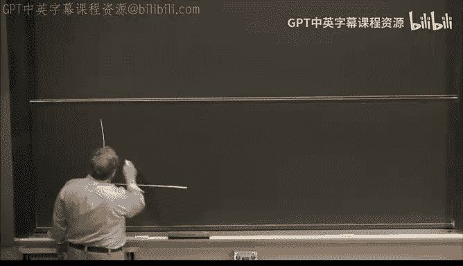
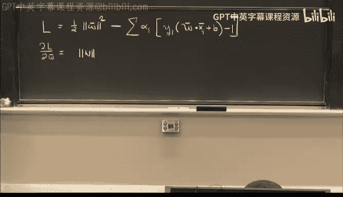
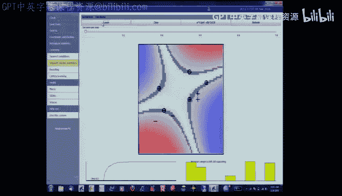
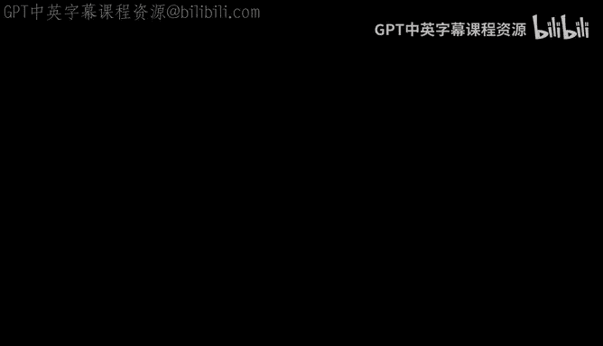

# 《人工智能｜6.034 Artificial Intelligence, Fall 2010》中英字幕 - P17：[17]16. Learning_ Support Vector Machines.zh_en - GPT中英字幕课程资源 - BV14fqSB2ECY

So where are we， We started off with simple methods for learning stuff。

Then we talked a little bit about。Learning approachesache of learning that we're vaguely inspired by。

The fact that our heads are stuffed with neurons are that we seem to evolved from primates。

Then we talked about looking at the problem and address the issue of phonology and how it's possible to learn concepts。

But now we're coming full circle back to the beginning and thinking about。

How to divide up a space with decision boundaries。But whereas you do it with a neural net。

Or a nearest neighbors or a ID tree， those are very simple ideas。That worked very often。Today。

 we're going to talk about。A very sophisticated idea that still has a simple implementation。So this。

Needs to be in the toolb of every civilized person。This is about support vector machines。

An idea that was developed。Well， I want to talk to you today about how ideas develop， actually。

Because you look at stuff like this in a book and you think， well。Vladimir Vapk just。

F this out one Saturday afternoon when weather was too bad to go outside， that's not how it happens。

 it happens very differently， I want to talk to you a little bit about that。Nice thing about。

About things that were great things that were done by people are still alive as you can ask them how they did it。

You can't do that with Fourier， you can't say to Fourier， how did you do it。

 did you dream it up on a Saturday afternoon？But you can call Vabnik on the phone and ask questions。

That's the stuff I'm going to talk about toward the end of the hour。Well。

 it's all about decision boundaries。Now we have several techniques that we can use。

To draw some decision boundaries and here's the same problem。

And if we drew decision boundaries in here。We might get something that would look like maybe this。

If we were doing a nearest neighbor。Approach， and if we're doing ID trees。

We'll just draw in a line like that。And if we're doing neural nets。Well， you know。

 you can put in a lot of straight lines wherever you like with the neural net depending on how it's trained up。

 or if you just simply go in there and design it so you could do that if you wanted。

And you would think that after people have been working on this sort of stuff。

50 or 75 years that there wouldn't be any tricks in the bag left。

And that's when everybody got surprised because。Around the early 90s。

Vladimir Vpnik introduced the ideas I'm about to talk to you about。So what Vabk says。

Is something like this。Here you have a space。And you have some。

Negative examples。And you have some positive examples。

How do you divide the positive examples from the negative examples and what he says we want to do is we want to draw a straight line。

But which straight line is the question？Well， we want to draw a straight line。Well。

 would this be a good straight line？When it went up like that。Probably not so hot。

How about one that's just right here？Well， that's my separate them。

Seems awfully close to the negative examples。So maybe what we ought to do is we ought to draw our straight line in here sort of like this。

And that line is drawn with a view toward putting。And。The widest。Street。

That separates the positive samples from the negative samples。

 That's why I call it the widest street approach。So that makes way of putting in。

The decision boundary。Is to put it in a straight line。

 But in contrast with the way I D tree puts in a straight line。

It tries to put the line in in such a way as the separation。

Between the positive and negative examples， that street is as wide as possible。Hi， so。

You might think to do that in a EuroO project and then let it go with that what's the big deal。

 so what we're going to do is we're going to kind of go through why it's a big deal。So first of all。

 we kind of like to think about。How you would make a decision rule that would use that decision boundary。

So what I'm going to ask you to imagine is that we've got。A vector。Of any length you like。

 constrained to be perpendicular to the media。Or if you like perpendicular to the gutters。

 it's perpendicular to the media line of the street。It's drawn in such a way that that's true。

 we don't know anything about its length yet。Then we also have some unknown。Say right here。

And we have a vector that points to it。Iel。So now what we're really interested in is whether or not that unknown。

Is on the right side of the street or on the left side of the street。

So what we want to do is we want to project that vector U。

Down on the one that's perpendicular to the street。

Because then we'll have the distance in this direction。

Or a number that's proportional to the distance in this direction， and the further out we go。

 the closer we'll get to being on the right side of the street。

But the right side of the street is not the correct side， but actually the right side of the street。

So what we can do is we can say。Let's take W。And dot it with you。

I measure whether or not that number。Is equal to a greater than some constant C。

So remember that the dot product is taking the projection onto to W。

And the bigger that projection is the further out along this line。

 the projection will lie and eventually be so big that that projection crosses the media line of the street and we'll say it must be a positive sample。

Or we could say。Without loss of generality。That the dot product。Plus。

 some constant B is equal to or greater than 0。 if that's true。Then it's a positive sample。

So that's our decision rule。And this。Is the first in several elements that we're going to have to line up to understand what this idea called support vector machines。

So that's the decision rule and trouble is we don't know what constant we to use。

And we don't know which W to use either。We know that W has to be perpendicular to the media line of the street。

But there are lots of Ws that are perpendicular to the median line of the street because it can be of any length。

So we don't have enough constraint here to fix a particular B or a particular W。

Are you with me so far？All right， so what we're going to do next。And this， by the way。

 we get just by saying that。C equals minus B。What we're going to do next is we're going to lay on some additional constraints。

Whether you're toward putting enough constraint on the situation that we can actually calculate a B and a W。

So what we're going to say is this。That is if we， if we look at this quantity。

That we're checking out to be greater than or less than zero to make our decision。

Then what we're going to do is we're going to say that if we take that vector W。

And we take the dot product of that。With some x plus。So I'm positive sample now。

 this is not an unknown。 This is a positive sample。If we take the dot product of those two vectors。

And we add B， just to like in our decision rule。We're going to want that to be equal to or greater than one。

So in other words。You can be an unknown anywhere in this street and be just a little bit greater or just a little bit less than zero。

 but if you're a positive sample， we're going to insist that this decision function gives a value of one or greater。

Likewise。If W dotted was some negative sample。Is provided to us。

 Then we're going to say that that has to be equal to or less than minus-1。喂。

So if you're a minus sample。Like one of these two guys or any minus sample that may lie down here。

This。Function that gives us the decision rule must return minus one or less。

So there's a separation of distance here of minus1 to plus one for all of the samples。So that's cool。

But we're not quite done because。I don't know， this is carrying around two equations like this。

It's kind of a paint。So what we're going to do is we're going to introduce another variable。

To make things make life a little easier。Like many things we do。

And when we developed this kind of stuff。Introducing this variable is not something that God says has to be done。

It's just a。M thought， what is it we introduced this additional stuff to do what？

To make the mathematics。More convenient， It's a mathematical convenience。

So what we're going to do is we're going to introduce a variable Y。Sub I。Such that。

Y sub I is equal to plus1。For plus samples。And minus1。For negative samples。はい。So for each sample。

 we're going to have a value for this new quantity。 we've introduced why。

And the value of y is going to be determined by whether it's a positive sample or a negative sample。

If it's a positive sample， it's going to be plus one。For this situation up here。

 it's going to be minus-1 for this situation down here。

So what we're going to do with this first equation。I we're going to multiply it。My wife and I。

And that is now x sub I。Plus， B。And equal to or greater than one。And then。

 you know what we're going to do， We're going to multiply the left side of this equation by We're going to multiply the left side of this equation by y subi as well。

So the second equation becomes。Why survive I。Times x of I plus B。And now what does that do over here？

We multiply this guy times minus1。So it used to be the case that that was less than minus1。

 so if we multiply it by 1 then it has to be greater than plus one。Oh， oops。

 the two equations are the same。Because of that introduced this little mathematical convenience。

So now we can say。That y sub I。Times x sub I。Plus B。我要。What we're going to do。Right。

Oh I leave out to W， I'm sorry， thank you。Yeah， I wouldn't have got very far with that。

So that's doted with W， it with W， thank you， Rick。Those are all vectors。

 I'll pretty soon forget to put the little vector marks on there， but you know what I mean that's W。

Plus， B。And now let me bring that that one over to the left side。

And that's equal to a greater than zero。All right， and with breast correction。

 I think everything's okay， but we're going to take one more step and we're going to say that。

Why survive I。Times x。S I times W。Plus， B。-1。You know。

 it's always got to be equal to greater than zero。 but what I'm going to say is that we。For。X of I。

In a gutter。So they're always going to be greater than zero。

 but we're we're going to add the additional constraint that it's going to be exactly zero for all of the samples that end up in the gutters here of the street。

So the value of that expression is going to be exactly zero for that sample。Exactly， sorry。

 zero for this sample and this sample， not zero for that sample， it's going to be greater than one。

All right。So that's。Step number two。And this is step number one。Okay。

 so now we've just got some expressions that talk about some constraints。

And what are we trying to do here， I forgot？I remember now we're trying to figure out how to arrange for the line to be such that the street。

 separating the pluses from the minuses as wide as possible。So maybe we better。

Figure out how we can express the distance between。The two gutters。Let's just repeat our drawing。

We've got some minuses here。That plus is out here。And we got。Fs that are going down here。

And now we've got a vector here to a minus。And we've got a vector here。To a plus。

So that's we'll call that x plus and this。X minus。So what's the width of the street？I don't know yet。

 but what we can do is we can take the difference of those two vectors。

And that will be a vector that looks like this， right？So that's x plus minus x minus。

So now if I only had a unit normal， that's normal to the media line of the street。

If it's a unit normal， then I could just take the dot product to that unit normal and this difference vector and that would be the width of the street。

 right？So in other words。If。I had a unit vector in that direction。

Then I could just dot the two together， and that would be the width of the street。

So let me write that down before I forget。So， the width。Is equal to。X plus minus x minus。Okay。

That's the difference vector。 And now I got to multiply by a unit vector。 But wait a minute。

 I said that that W is a normal， right。TheW is a normal。So what I can do is I can multiply this。

Times W。And then we'll divide by the magnitude of W。And that will make it a unit vector。So， that。

That。That dot product。Not another product， that dot product is， in fact。A scalar。

 and it's the width of the street。It doesnn't do as much good because。

It doesn't look like we can get much out of it。Oh， but I don't know， let's see。

 what can't we get out of it？Oh T， you know， we got this equation over here。

This equation that constrains the samples that lie in the gutter。So if we have a positive sample。

 for example。Then this is plus one。And we have this equation。So it says that。X plus。Times W。

Is equal to。Oh，1 minus B。See， I'm just taking this part here， this vector here。

 and I'm dotting it with x plus。So that's。This piece right here。Y is one for this kind of sample。

 so I'll just take the1 and the B back over to the other side and I've got1 minus B。Okay。Well。

 we can do the same trick with x minus。If we've got a negative sample。Then why sub I is negative？

That gives us our negative。W times dotta with x of I。

And now I take this stuff back over to the right side。And we get one minus b，1 plus b。Right？

So that all licenses us to rewrite this thing as two over the magnitude of W。How do they get there？

Well， I decided I was going to enforce this constraint。I noted。That the width of the street。

There's got to be this difference vector times a unit vector。

Then I used the constraint to plug back some values here。

 and are discovered to my delight and amazement that the width of the street is too。

Over the magnitude of W。Yes， Brett。Yeah。Let's see if I've got a minus here。

Then that makes that minus， and then the B is minus and when I take the B over the other side。

 it becomes plus。Yeah， so。No sorry， this expression here。I's one minus1 plus B。Trust me， it works。

I haven't got my legs all tangled up like last Friday， quite not yet anyway。It's possible。

 there's going to be a lot of algebra here eventually。So this。Finally here。

This is miracle number three， this quantity here。Is the width of the street？

And what we're trying to do。And we're trying to。Maximize that， right？So we want to maximize two over。

The magnitude of W。If we're to get the widest street under the constraints that we've decided that we're going to work with。

All right， so that means that it's okay。To。Maximize。One over。W， instead。We just dropped the constant。

And that means that it's okay to minimize。The magnitude of W。Right。

And that means that it's okay to minimize。One half。Times a magnitude of W。Squared。Right， Brett。

Why did I do that？Why do I multiply by half and square？It's mathematically convenient， thank you。

So this is a。This is point number three in the development。So where do we go。

 we decided that was going to be our decision rule。

 we're going to see which side of the line we're on。

We decided to constrain the situation so that the value of the decision rule is plus one in the gutters for the。

Positive samples and minus1 in the gutters for the negative samples。And then we discovered that。

Maximizing the width of the street。Let us to an expression like that， which we wish to maximize。

How we how we。Should we take a break， should we get coffee too bad， we can't do that。

Kind of situation。 But we would， if we could。 And I'm sure when Vtany got to this point。

He went out for coffee。So now we back up and we say， well。

 let's let these expressions start developing into a song。Not like that。Vapid， speaking of vk。

What song is it going to sing？We've got an expression here。That would like to find the minimum of。

 the extreme of。And we've got some constraints here。That we would like to honor。

What are we going to do？Let me put what we're going to do to you in the form of a puzzle。

Is it got something to do？With Lejandre。Has it got something to do with。Laplace。

Or does it have something to do with LaGe？She says LaGrange。Actually。

 all three were said to be on Fourier's Doal Defense Committee， must have been quite an exam。

But we want to talk about LaGge because we've got a situation here。This is 1801？1802，18 oh2。

We learned in 1802 that if we're going to find the exism of a function。With constraints。

Then we're going to have to use the lagge multipliers。That will give us a new expression。

Which we can maximize or minimize。Without thinking about the constraints anymore。

That's how thegris multipliers work。So this brings us to miracle number four。

Peace of developmental piece number four， and it sort of works like this。We're going to say that L。

 the thing we're going to try to maximize in order to maximize the width of the street。

Is equal to one half。Times the magnitude of that vector w。Squared。Minus。And now we' got to have。

As sumation over all the constraints。And each of those constraints is going to have a multiplier。

 alpha sub I。And then we write down the constraint。And when we write down the constraint。

 there it is up there。But I've got to be hyper careful here because otherwise I'll get lost in the algebra。

So the constraint is。Why survive I？Times vector。W。Dotted with vector x。So I。Plus， B。

And now I've got a closing parenthesis。A minus1。That's the end of my constraint。Like so。

I sure hope I've got that right。Because I'll be in deep trouble if that's wrong。 Does。

 anybody see any bugs in that， that looks right， doesn't it， We got to。

We got the original thing we're trying to work with， now we've got Larangee multipliers。

All multiplied with respect to that constraint up there were age constraint。

It's constrained to be zero。Well。There's a little bit of mathematical sight of hand here。

 because in the end。The ones that are going to be zero， the Lagangrange multipliers。Here。

The ones that are going to be nonze are going to be the ones connected with vectors that lie on the gutter。

 The rest are going to be 0。But at any event。We can pretend that this is what we're doing。

And then we've got to find a max。I don't care whether it's a maximum or minimum I've lost track。

 But what we're going to do is we're going to try to find an extreme of that。 So what do we do。

 What is。1801。Teach us about。Finding the maximum- well， we got to find the derivatives。

And set them to zero。And then after we've done a little bit of that manipulation。

We're going to see a wonderful song start to emerge。So let's see if we can do it。

Let's take the partial of L， the Lagrangian。With respect to the vector W。Oh my God。

 how do you differentiate with the respect of a vector？

Turns out that it has a form that looks exactly like differentiating with respect to a scalar。

And the way you prove that to yourself is you just expand everything in terms of all the vector's components。

 you differentiate those with respect to what you're differentiating with respect to。

 and everything turns out the same。So what you get when you differentiate this with respect to the vector W is。

Two comes down， and we have just。Mitude of W。Is it the bank W。Yeah。Like so。

The magnitude of the the well and event。It's not the magnitude W。 It's just W。Like so。

No matter too involved。Then we got a W over here we've got differentiate this part of with respect to W as well。

 but that's part's a lot easier because all we have there is a W， there's no magnitude。

 it's not raising any power。So what' W you multiplly by。Well， it's multiplied by x。

And why sub I and alpha Sa I。All so that means that this expression。

This derivative of the Lagrangian。With respect to W is going to be。W minus the sum。Alpha sub I。

Why survive I。Exify。And that's all got to be set to zero。And that implies。The W。Is equal to the sum。

Of some alpha I， some scalrs times this minus1 or plus1 variable times x of I。Over eye。

And now the math is beginning to sing。Because it tells us that the vector W。There's a linear sum of。

Of the samples， all the samples are some of the samples。It didn't have to be that way。

It could have been raised to a power， there could have been a logarithm。

 all sorts of horrible things could have happened when we did this， but when we did this。

 we discovered that W，Its going to be equal to a linear sum。Of these vectors here。

Some of the vectors。In the sample set， and I say some because for some alpha will be0。はい。So this。嗯。

Something that we want to take note of。As something。Important。Now。Of course。

 we've got to differentiate L with respect to anything else that might vary。

 so we've got to differentiate L with respect to B as well。So what's that going to be equal to？Well。

 there's no B in here， so that makes no contribution。This part here doesn't have a B in it。

 so that makes no contribution， there's no B over here， so that makes no contribution。

 so we got alpha I times y sub I。Times B。That has a contribution。So that's going to be the sum。

Of alphapha I。Times y sub I。And then we differentiate， we're differentiating with respect to B。

 so that disappears。There's a minus sign here， and that's equal to zero or。That implies that the sum。

Of the F I times y sub I。Is equal to zero。Hmm that looks like that might be helpful somewhere。

Now it's time for more coffee。By the way， these coffee periods take months。You stare at it。

 you work on something else。You've got to worry about your finals and you think about it some more。

And eventually you come back from coffee and do the next thing。Oh。What is the next thing？Well。

 we still got this expression that we're trying to find。呃 the啊。Minimum for。

And you know what you say to yourself， this is really a job for the numerical analyst。

 Those guys know about this sort of stuff。Because of that little power in there that square。

 this is a so called quadratic optimization problem。So at this point。

 you'd be inclined to hand this problem over to a numerical analyst。

 they'll come back in a few weeks with an algorithm， you implement the algorithm。

 and maybe things work， maybe they don't converge， but in any case you don't worry about it。

But we're not going to do that because we want to do a little bit more math。

Because we're interested in stuff like this。We're interested in the fact that the。

Decision vector is a linear sum of the samples。So we're going to work a little harder on this stuff。

And in particular。Now that we've got an expression for W， this one right here。

We're going to plug it back in there。And we're going to plug it back in here and see what happens。

To that thing， we're trying to find the extrem up。Is a break kind of relaxed， taking deep breath。

This isn't actually， this is the easiest part。 this is just doing a little bit of the algebra。

So the thing we're trying to， to maximize or minimize is equal to。One half。

And now we got to have the。The magnitude of those magnitude we're got to have this vector here。

In there twice。Because we're multiplying it together。So let's see we've got。

From that expression up there， one of those w's will just be the sum of the alpha I。Time is why abye。

Times the vector xmi。And then we got the other one too， so that's just going to be the sum。

Of alpha now I want to keep things， I'm going to actually eventually squish those two sums together into a double summation。

 so I have to keep the indexes straight。So I'm just going to write that as alpha sub J。Yhy said J。

X sub J。So those are my two vectors， and I'm going to take the dot product or those。

 That's the first piece， right？Well， this is this is not。This is hard， so minus。

And now the next term。Looks like alpha I， y sub I。X sub I times W。

So we've got a whole bunch of these。 We' got a sum of alpha I。Times y sub I。Times x of I。

And then that gets multiplied times W。So we'll put this like this。Of Al J。Why said J。

X sub J and there like that， and then that's a do product or that。that wasn't as bad as I thought。啊。

Now I've got to deal with the next term， the alpha I times y sub I times B。So that's a minus？

S of alpha I times y sub I。Times B。And then to finish it off， we have。Plus， the sum。

Of alphapha survive。That's that minus1 up there， minus1 in front of the summation。

 because thats just the sum of the alphas。Are you with me so far， just a little algebra？

It looks good。 I think I haven't mued it yet。Let's see。

Alpha I timess y sub items timess B B is a constant。So I'll pull that out there。

 and then I just got the sum of alpha subbi times y sub I。Oh， that's good， that's zero。

And now so for every one of these terms， we dot it with this whole expression。

So that's just like taking this thing here。And dotting those two things together， right？Oh。

 but that's just the same thing we've got here。哎。So now what we can do is we can say that we can rewrite this Lagrangian as。

比较未较的。That sum of alpha I。That's the positive element。And then we got one of these and half of these。

 so that's minus。One half。And now I'll just convert that whole works into a double sum over both I and J。

Of Al I。Times。Alpha J times y sub I times y sub J。Times x sub I。Dden。TheX J。

We sure went through a lot of trouble to get there， but now we've got it and we know that。

What we're trying to do is we're trying to find。A maximum。Of that expression。

And that's the one we're going to hand off to the American analyst。

So if we're going to hand this off to the numerical analyst anyway。

 why do they go to all this trouble？Good question。Wa。

 do you have any idea why I went to all this trouble？

Because I wanted to find out the dependence of this expression as one' telling me as I'm translating as I go。

 she's telling me in Romania。I want to find what this maximization depends on with respect to these vectors。

 the sample vectors。And what I've discovered is。That the optimization。Depends only。

On the dot product。Of pairs。Of samples。And that's something we want to keep in mind。

 that's why I put it in royal purple。Now， up here。So let's see。

 what do we call that one up there that's two。I guess this， we'll call this piece here。3。

This piece here is four， and now there's one more piece。Because I want to take that W。

And not only stick it back into that Larangian， I want to stick it back into the decision rule。

So now my decision rule with this expression for W。Is going to be W plugged into that thing。

So the decision rule is going to look like。The sum。Of alpha I times y sub I。Times。X y。Doted。

With the unknown vector like so。And we're going to subtract。I guess add B。And we to say。

 if that's greater， then or equal to 0。Then。Plus。So you you see why the math is beginning to sing to us now。

Because now we discover。That the decision rule。Also， depends only on the dot product。

Of those sample vectors and the unknown。So there's a total dependence。

Of all of the math on the dot products。系。And now I hear a whisper。Someone is saying。

I don't believe the mathematicians can do it， I don't think those numerical analysts can find the optimization。

I want to be sure of it， give me ocular proof。So I like to run a demonstration of it。Okay。

 there's our sample problem the one I started the hour out with now。If the optimization algorithm。

It doesn't get stuck in a local maximum or something。

 it should find a nice straight line separating those two guys。

 defining the widest street between the minuses and the pluses。So in just a couple of steps。

 you can see down there at step 11， it's decided that it's done as much as it can on the optimization。

And it's got three alphas。And you can see that the two negative。

The two negative samples both figure into the solution。

 the weights on the lagrangian multipliers are given by those little yellow bars。

So the two negatives participate in the solution is does one of the positives。

 but the other positive doesn't， so it has a zero weight。So everything worked out well。Now， I said。

 as long as it doesn't get stuck on a local maximum。Guess what？Those mathematical friends of ours。

Can tell us and prove to us。That this thing is a convex space。

That means it can never get stuck in a local maximum。So in contrast with things like neural net。

Where you have a plague of local maxima， this guy never gets stuck in a local maximuma。

Let's try some other examples。Here's two vertical points， no surprises there， right？You say， well。

 maybe it can't deal with diagonal points。Sure again。How about。This thing here。Yeah。

 it only needed two of the points。Since of those any two， a plus of minus will define the street。

Let's try this guy。Oh。What do you think will happen here？Well words' proved， right。

 because it's literally unseparable。Bad news。So in situations where it's linearly unseparable。

 the mechanism struggles and eventually it will just slow down and you truncate it because it's not making any progress and you see the red dots there are ones that have got wrong。

So you say， well， too bad for our side， it doesn't look like it's all that good anyway。Not then。

A powerful idea comes to the rescue。One stuck switched to another perspective。

So if we don't like the space that we're in， because it gives us samples that are not linear acceptable。

Linearily separable， then we can say shoot。Here's our space。Here are two points。

Here are two other points。We can't separate them， but if we could somehow get them into another space。

 maybe we can separate them because they look like。This。In the other space。

 and they're easy to separate。So what we need then。

Is a transformation that will take us from the space we're in into a space where things are more convenient。

 So we're going to call that transformation。Fi。Of the vector x。That's the transformation。

 and now here's the reason for all the magic。I said。

That the maximization only depends on dot products。So all I need to do the maximization is。

This is the transformation of one vector。Dotted with the transformation of another vector。Like。

 so that's what I need to maximize。Or to find the maximum one。Then in order to recognize。

 where do they go？Underneath the chocolate。Oh yes， here it is to recognize all I need is dot products too。

 so for that one I need。Phi of x。Dotted with fee。Of you。

And just to make this a little bit more consistent in notation， I'll call that xj and this xM I。

And that's xM I， those are the quantities I need in order to do it。So that means that if I have。

A function。Let's call it K。Of x sub I。And x of J。但这个就。Fee。Of x sub I。Dotted with the。Of x to J。

Then I'm done， this is what I need。I don't actually need this。All I need is that function K。

Which happens to be called a kernel function。Which provides me with the dot product。

Of those two vectors in another space， I don't have to know the transformation into the other space。

And that's the reason。That this stuff is a miracle。So what are some of the kernels that are popular？

One is the linear kernel that says that。You dotted with。With。V plus one。To the end。

Its such a kernel because it's got U in it and V in it， the two vectors。

 and this is what the dot product is in the other space， so that's one choice。Another choice。

I's a kernel that looks like this。E。To the minus。Let's take the dive product。

Of the difference of those two guys。Let's take the magnitude of that and divide it by some sigma。

 That's a second kind of kernel that we can use。So let's go back and see if we can solve this problem by transforming it into another space where we have another perspective。

So， let's。That's it。That's another kernelel。And so sure we can。

 and that's the answer when transformed back into the original space。

We can also try doing that with a so called radioial basis kernel。

 that's the number of the exponential in it。We can learn on that one， boom。No problem。

So we've got a general method。

That's convex and guaranteed to produce a global solution。

We've got a mechanism that easily and allows us to transform this into another space。

So it works like a charm。Of course， it doesn't remove all possible problems。

Look at that exponential thing here。If we choose a sigma。That is。Small enough。

Then those sigmas are essentially shrunk right around the sample points and we can get overfitting。

So it doesn't immunize this against overfitting。But it does immunize us against local maxa and does it provide us with a general mechanism for？

Doing a transformation into another space with a better perspective。Now， the history lesson。

 all this stuff feels fairly new。It feels like it's younger than you are。Here's the history of it。

That make emmigrated from。The Soviet Union to the United States in about 1991。

Nobody ever heard of this stuff before he emigraterated。

He actually had done this work on the basic support factor idea。

It is PhD thesis at Moscow University in the early 60s。

But it wasn't possible for him to do anything with it because he didn't have any computers that he could try anything out with。

So he spent the next 25 years at some oncology Instituteute and the Soviet Union doing applications。

Somebody from Bell Labs discovers him， invites him over to the United States where he subsequently decides to emigrate。

In 1992 are thereaboutouts。ThatMC submits three papers to NIPPS。

 the Neural information Procesing Systems Journaled。All of them were rejected。He still sore about it。

But it's motivating。So around 1992， 1993， Bell Labs was interested in handwritten character recognition and in neural nets。

Fabic thinks that neuralness。What would be a good word to use。I can think of the vernacular。

 but he thinks that they're not very good。So he bets a colleague a good dinner。

That support vector machines will eventually do better handwriting recognition。The neural nets。

And it's a dinner bet， right， it's not that big a deal。

 but as Napoleon said it's amazing what a soldier will do for a bit of ribbon。

So Vabnik's colleague who's working on this problem of handwritten recognition。Deidedes。To try。

A support vector machine。With a kernel in which n equals 2。Just slightly nonlinear。

 works like a charm。Was this the first time anybody tried a colonel。

 Fabniick actually had the idea in his thesis， but never thought it was very important。

As soon as it was shown to work in the early '90s。On the problem of handwriting recognition。

Vni resuscitated the idea of the kernelel， began to develop it and became an essential part of the whole approach of using support vector machines。

So the main point about this is that it was 30 years。

In between the concept and anybody ever hearing about it。It was 30 years between。That makes。

Understanding of kernelels and his appreciation of their importance。

 And that's the way things often go。Great ideas followed by long periods of nothing happening。

 followed by an epiphaous moment when the original idea is seen to have great power with just a little bit of a twist。

 and then the world never looks back and Babnik who nobody ever heard of。

Until the early '90s becomes famous for something that everybody knows about today who does machine learning。

