# 《人工智能｜6.034 Artificial Intelligence, Fall 2010》中英字幕 - P18：[18]17. Learning_ Boosting.zh_en - GPT中英字幕课程资源 - BV14fqSB2ECY

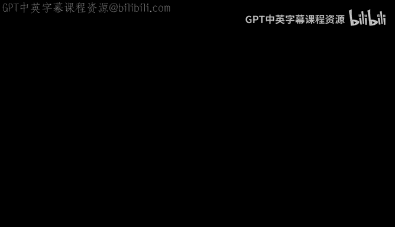

We've now almost completed our journey， this will be it。

We're talking about several kinds of learning， the venerable kind。

 that's the nearest neighbors and decision tree identification tree types of learning。 still useful。

 still the right thing to do if there's no reason not to do the simple thing。

Then we have the biologically inspired approaches， neural nets。

All kinds of problems with local maxa and overfitting and oscillation if you get the rate constant too big。

I don't know。Genetic algorithms。Like neural nets， both are very naive in their attempt to mimic nature。

So maybe they work on a class of problems， they surely do each have a class of problems which they're good。

A general purpose， first resort， don't recommend it。

But now the theorists have come out and done some things that are very remarkable。And in the end。

 you have to say， wow， these are such powerful ideas I。I wonder if nature has discovered them too。

Is there a good engineering in the brain？Based on good science。

Or given the nature of evolution a just random junk that。Isn't the best way for doing anything。

 who knows？But today we're going to talk about an idea bet is in there somewhere。As aCC的。

It's extremely powerful in what it does。And it's the essential item in anybody's repertoire of learning mechanisms。

It's also a mechanism which if you。Understand only by formula。

 you will never be able to work the problems on the quiz， that's for sure。Because on the surface。

 it looks like it'd be very complicated to simulate this approach。

But once you understand how it works and look at a little bit of the math and let it sing songs to you。

 it turns out to be。Extremely easy。So it's about letting them。Multiple methods work in your behalf。

So far we've been talking about using just one method to do something。

And what we're going to do now is going to look to see if a crowd。

Can be smarter than the participants than the individuals in the crowd。

But before we get too far down that abstract path， let me just say that the whole works has to do with classification。

And binary classification。You knowA I holding a piece of chalk in my hand or a hand grenade？

Is that a cup of coffee or tea， those are binary classification problems？

And so we're going to be talking today strictly about binary classification。

 We're not going to be talking about finding the right letter in the alphabet。

That's written on the page， that's a 26 way choice， we're talking about binary choices。

So we have we assume that there's a set of classifiers that we can draw on， here's one H。

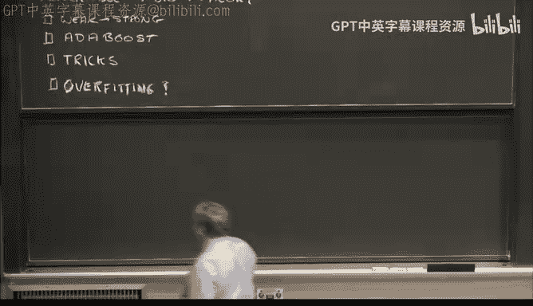

And it produces either a minus1 or a plus one。So that's how the classification is done。

If it's coffee plus one， if it's tea -1。If it's chalk plus one， if it's hang grenade minus1。

 so that's how the classification works。Now， too bad for us。

 normally the world doesn't give us very good classifiers。 so if we look at the error rate。

OfThis classifier or any other classifier。That error rate will range。From zero。To one。

 in terms of the fraction of the。For fraction， the cases got wrong on a sample set。

So you'd like your error rate to be way down here。You're dead if it's over there。

But what about in the middle， if it's say？Right there， just a little bit better than flipping a coin。

If it's just a little bit better than flipping a coin， that's a weak classifier。And the question is。

 can you make a classifier that's way over here？Like there， a strong classifier。fi。Combining。

Several of these weak classifiers and letting them vote。So how would you do that， you might say。

 well， let us make a big class fair capital H。That works on some sample。X。And has its output。

Produces something that depends on the sum of the outputs of the individual classifiers。

So we have H1。Working on X。We have H2。Working on X。And we have H3。Also working on X。

 say three of them just to start us off。And now let's add those guys up。And take the sign。

Of the output。So if two out of the three of those guys agree。

Then we'll get an either plus one or minus one。And if all three agree。

 we'll get plus1 or minus-1 because we're just taking the s。

We're just taking a sign of the sum of these guys。So this means that one guy can be wrong as long as the other two guys are right。

But I think it's easier to see how this all works。 if you think of some space of samples。And you say。

 well， let's let that area here。Theyware H1。Wrong。And this area over here。Is where H2 is wrong。

And in this area over here。Is where H3 is wrong。So if the situation is like that。

Then this formula always gives you the right answers on the samples。

I'm going to stop saying that right now because I want it to be kind of a background thing on the sample set。

We're talking about wrapping this stuff over the sample set。Later on， we'll ask， okay。

 given that you trained this thing on a sample set。

 how well does it do on some new examples because we want to ask ourselves about overfitting questions。

But for now， we just want to look and see。If we believe。That this arrangement。

Where each of these guys， each of these H's is producing plus1 or minus1。

 we' adding them up and taking a sign， is that going to give us a better result than the test individually if they？

If they look like this one draped over a sample set。

 then it's clear that we're going to get the right answer every time。Because there's no area here。

Where any two of those tests are giving us the wrong answer。

So the two that are getting the right answer。In this little circle here for H1。

 these other two are getting the right answer so that they'll vote it and you'll get the right answer every time。

But I don't know， it doesn't have to be that simple。It could look like this。There could be。

A situation where this is H1， wrong answer， this is H2。Wrong answer， and this is H3。Wrong answer。

And now the situation gets a little bit more murky。Because we have to ask ourselves。Whether。

That area where two out of the three or three out of the three get it wrong。Its sufficiently big。So。

 as to be。Worse than one of the individual tests。So if you look at that Venn diagram and stare out long enough and try some things。

 you can say， well。There is no case where this will give a worse answer。

Or you might end up with a conclusion。That there are cases。

Of where we can arrange those circles such that。The voting scheme will give an answer that's worse than an individual test。

But I'm not going to tell you the answer because I think we'll make that a quiz question。

So good idea， okay。So I'll make that a quiz question。So that looks like a good idea。 and we can。

We can sort of construct a little algorithm that will help us。

Pick pick the particular weak classifiers plug in here。 We got a whole bag of classifiers。We got H1。

 we got H2， we got H 55， we got a lot of them we can choose from。

So what we're going to do is we're going to use the data。And。Disturbed。To produce H1。

We're just going to try all the tests on the data and see which one gives us the smallest error rate。

 And that's a good guy。 So we're going to use that。Then we're going to use the data。

WithWith an exaggeration。Of。H1 errors。In other words， this is a critical idea。

 What we're going to do is we're going to。We're going to run this algorithm again。

 but instead of just looking at the number of。Number of samples that are got wrong。

What we're going to do is we're going to look at the。

We're going to look at a distorted set of samples where the ones we're not doing well on has an exaggerated effect on the result。

So we're going to wait them or。Multiply them or do something so that we're going to pay more attention。

To the。Samples on which H1 produces an error， and that's going to give us H2。And then。

We're going to do it one more time because we've got three things to go with here in this particular little exploratory scheme。

 and this time we're going to have an exaggeration。Of those samples。

 which samples are we going to exaggerate now？We're going to exaggerate。

 we're going to look for the ones where。Oh， we might as well look for the ones where H1 gives us a different answer from H2。

Because we want to be on a good guy's side。So we can say。We' we're going to exaggerate。

Close samples for which H1 gives us a different result from H2。And that's going to give us H3。

All right， so we can think of this whole works here as part one。I a multipart idea。So' see。

 I don't know what might be step 2。 Well， this is a good idea。Then what we've got。

We can easily derive from that。A little tree looked like this。 and we can say that H。

Of x depends on H。H 2。Then age three。But now that's a good idea。

And that gives us a better answer than any of the individual tests。

Maybe we can make this idea a little bit recursive。And say， well， maybe H1 is actually not。

An atomic test， but maybe it's the vote of。Three other tests。So we can make a little tree structure。

 it looks like this。So this is H11， H12， H。

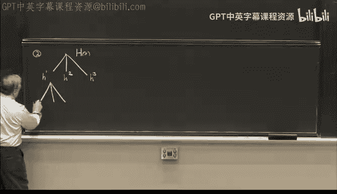

One，3。And have three here， and then this will be。H31。H32， H33。

And so that's a sort of get out the vote。I dear。We're trying to get a whole bunch of individual tests into the act。

So the reason， I guess the reason this wasn't discovered until about 10 years ago was because you got to get so many of these ducks all lined up before the idea gets through that long filter of ideas。

So that's only idea number two of quite a few。Well， the next thing we might think is。

 well we keep talking about these classifiers， what kind of classifiers are we talking about？

I've got。Oh， shoot。 I've spent my last niggle。 I don't have ac coinquaintted flip， but that's。

 that's one class fire， right。The trouble that classifier is。

It's not a weak classifier because it gives me a 50，50 chance of being right， I guess。

I guess there are conditions in which a coin flip is better than a。It is a weak class fire。

 if the two outcomes are not equally probable， then a coin flip is a perfectly good weak class fire。

But I don't know。 what we're going to do is we're going to think in terms of。

A different set of classifiers and we're going to call them。Decision tree。Well。

 you remember decision trees， right？But we're not going to build decision trees。

 we're going to use decision tree。Decision tree stopumps。So if we have。My two dimensional space。

That looks like this。Then a decision tree stump is a single test。

It's not a complete tree that will divide up the samples into homogeneous groups。

 it's just what you can do with one test。So each possible test is a classifier。

How many tests do we get out of that？12， right？Yeah， it doesn't look like 12 to me either。

 but here's how you get to 12。One decision tree test you can stick in there would be that test right there。

 and that would be a complete decision tree stump。But of course， you could also put in this one。

That would be another decision tree stop。Now， for this one on the right。

 I could say everything on the right is a minus。Or I could say everything on the right is a plus。

They happened to be wrong， but it's a valid test with a valid outcome。

So that's how we double the number of tests that we have lines for。And you know what。

 we can even have a kind of test out here that says that everything is plus。Or everything is wrong。

So for each dimension。The number of decision tree stumps is the number of lines I can put in times 2。

And then I got two dimensions here， that's how I got the 12。So there are three lines。

I can have the pluses on either the left or the right side to that six。And then I got two dimensions。

 that gives me 12。So that's the decision tree stump idea， and here are the other。

Decision tree boundaries。We obviously dislike。Yeah。All right。

 so that's one way you can generate tests。A batch of tests to try out。With this idea of。

Using a lot of tests to。Help you get the job done。 Can you also have a decision tree on the right side Well。

 you don't the question is， can you also have a test。On on the right side。 See， this is。

 this is just a stand in for saying everything's plus or everything's minus。

So it doesn't matter where you put the line。We on the right side to the left side。

 the bottom of the top。Or you don't have to put the line anywhere， just an extra。Test。

 in addition to one you put between the samples。So this whole idea of boosting。

 the main idea of the day， does it depend on using decision tree stumps？The answer is no。

Do not be confused。 You can use boosting with any kind of classifier。

So why do I use decision tree stumps today because it makes my life easy？We can look at it。

 we can see what it's doing。But we could put a bunch of neural nets in there。

We could put a bunch of real decision trees in there。 We could put a， I don't know。

 a bunch of mirror， neighbor things in there。 the boosting idea doesn't care。

I just use these decision tree stumps because I and everybody else use them for illustration。

All right， so that's。We're making progress。Now， what's the error rate for of any of these tests and lines we drew？

Well。I guess it will be。The sum。The error rate is equal to the sum。Of one over n。

 that's the total number of points。Number of samples。Summed over the cases where we are wrong。

All right。So gee， you know， we're going to kind of work on combining some of these ideas。

 and we got this notion of exaggeration。At some stage in what we're doing here。

 we're going to want to be able to exaggerate the effect of some errors relative to other errors。

So one thing we can do is we can assume。Or we can stipulate。

 or we can assert that each of these samples has a weight associated with it。 H's W1。

 this is W2 and that's W3。And in the beginning， there's no reason to suppose that any one of these is more or less important than any of the other。

So in the beginning。W sub I at time step1 is equal to 1 over n。So the error is just adding up。

The number of samples that were got wrong。And that will be the fraction of samples that you didn't get right。

 and that will be the error rate。So what we didn't want to do is we want to say。

Instead of using this as the error rate for all time。

What we want to do is we want to move that over and say that the error rate。Is equal to。

The sum over the things you got wrong。In the current step， times the weights。Of those were got wrong。

So in step one， everything's got the same weight， it doesn't matter。

 but if we find a way to change the weight's going downstream。So as to， for example。

 highly exaggerate。That third sample。Then W3 will go up。Relative to W1 and W2。

The one thing we want to be sure of is no matter how we adjust the weights。

 that the sum of the weights。Over the whole space。Is equal to one。So in other words。

 we want to choose the weights so that they emphasize some of the samples。

 but we also want to put a constraint on the weights。Such that all of them added together is。

Someing into one， and we'll say that that enforces a distribution。

Distribution is sum is a set of weights that sum to one。Well， that's just a nice idea。

So we're making a little progress， we've got this idea that we can add some plus minus1 classifiers together to get a better classifier。

We got some idea about how to do that。It occurs to us that maybe we want to get a lot of classifiers into the act somehow or another。

And maybe we want to just think about using decision tree stumps so as to kind of ground our thinking about all this stuff。

So next step is to say， well。How actually。Should we combine this stuff？

And you will find in the literature libraries full of papers that do stuff like that。

And that was the state of the art for quite a few years。But then people began to say， well。

Maybe we can build up this classifier H of X。

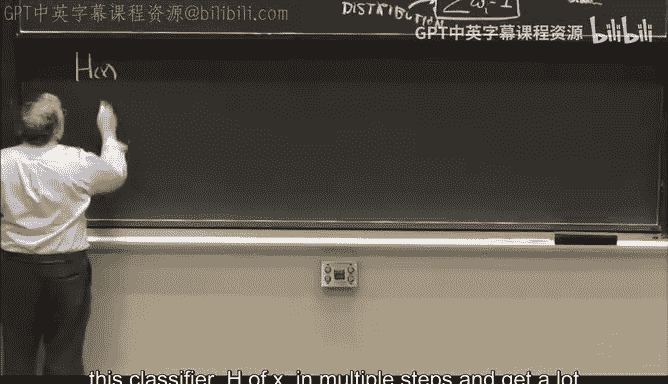

In multiple steps and get a lot of classifiers into the act。

So maybe we can say that the classifier is the sign。The sign。Of。H。You know。

 that's the one we pick first。That's the classifier we pick first。That's looking at samples。

 And then we got H2。And then we got age3。And then we got how many other classifiers we might want。

Or how many classifiers we might need in order to correctly classify everything in our sample set。

So people began to think about whether there might be a way an algorithm that would develop a classifier that way one step at a time。

 that's why I put that。That's why I put that。Step number in the exponent。

 because we're picking this one at first。Then we're expanding it to have two。

 and then we're expanding it to have three and so on。

And each of those individual classifiers are separately looking。At the sample。But of course。

 it would be natural to suppose that just adding things up wouldn't be enough。And it's not。

So it isn't too hard to invent the next idea， which is to modify this thing just a little bit。

Like doing what？It looks almost like a scoring polynomial， doesn' it？

So what would we do to tart this up a little bit？看得见。有么。什么。Out there， someone's murmuring。

Add weights。Excellent， good idea。So what we're going to do is we're going to have。Alphas。

Associated with each of these classifiers。And we're going to determine if somebody can build that kind of formula。

To do the job。So maybe I had to modify this gold star idea before it can get too far downstream。

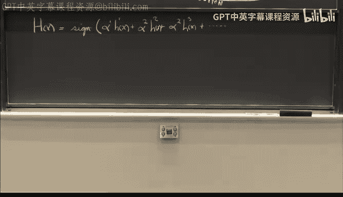

And we're gonna to say。We're not going to treat everybody in a crowd equally。

We're going to weight some of the opinions more than others。 And by the way。

 they're all going to make errors in different parts of the space。So maybe it's not the wisdom of。

Even aed crowd， but a crowd。Of experts。Each of which is good at different parts of the space。

So anyhow， we got this， this formula。 and there are a few things that。One can say sort of。

Sort of turn out but first let's。Let's write down a sort of algorithm for what this ought to look like。

Before I went out of space， I think I'll exploit the right hand board here。

put the overall algorithm right here。So we're going to start out。

By letting the weights all the weights at time1。Be equal to one over n。That's just。

Saying that they're all equal in the beginning and they're equal to one over n。

 and n is the number of samples。And then when I got that。

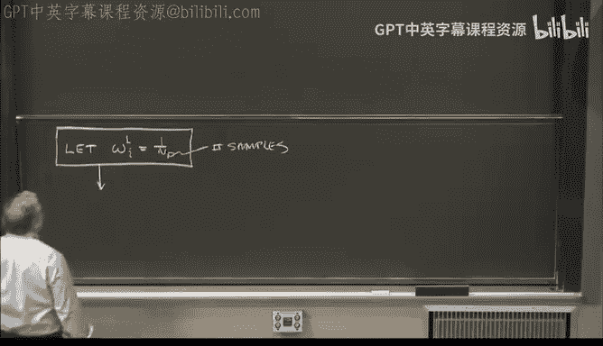

I want to compute alpha。三口。Let's see。Now， I don't want to do that。 I want to pick。

 I want to pick a test。 I want to pick a。Clasifier。That minimizes the error rate。M ams。Or time T。

 and that's going to be at time T。 and we're going to come back in here。

 That's why we put a time or step index in there。So once we've picked。

Any classifier that produces an error rate， then we can use the error rate to determine the alpha。

 So I don't want the alpha over here。That'll be sort of a byproduct of picking that test。

And then with all that stuff in hand， maybe that will be enough to。Calculate。WT plus one。

So we're going to use that。Classifier that we just picked。To get some revised weights。

 And then we're going to go around that loop until。This classifier produces a perfect。

Set of conclusions on all the sample data。So that's going to be our overall strategy。

maybe we've got if we're going to number these things。The fourth big idea。

And this arrangement here is a fifth big idea。Then we got the sixth big idea and the sixth big idea。

Says this。Suppose。That they wait。On the I sample。At time， T plus1。Is equal to。The weight at time T。

Of that same on that same sample。Divided by some normalizing factor。Times E。To the minus。Alpha。

At time T。Times H。At。At。Time t。Times some function y， which is a function of x。

But not a function of time。And you say， where did this come from？

And the answer is it did not spring from the heart of a mathematician in the first 10 minutes that they looked at this problem。

 in fact， when I asked you Pery how this worked， he said， well。

He was thinking about this on the couch every Saturday for about a year and his wife was getting pretty sore。

 but he finally found it and saved their marriage。So where does stuff like this come from？Really。

 it comes from knowing a lot of mathematics and seeing a lot of situations and knowing that something like this might be mathematically convenient。

Something like this might be mathematically。Convenience。But we got let。

 We got it back up and let it sing to us。 What's why。

 we saw why last time in sort support vector machines。 That's just a function that's plus 1 or -1。

 depending on whether the output ought to be plus 1 or -1。So。If this guy。

Is giving the correct answer， And the correct answer is plus。Then this guy will be plus one。

2 because it always gives you the correct answer。So in that case。

 where this guy is giving you the right answer， these will have the same sign。

 So that will be a plus one combination。 On the other hand。

 if that guy is giving you the wrong answer， you're going to get a -1 out of that combination。

So it's true， even if the right answer should be minus， right。

 So if the right answer should be minus and this is plus， then this will be -1。

 and the whole combination will give you -1 again。 In other words， the y just。

Flipps the sign if you've got the wrong answer。No matter whether the wrong answer is plus1 or minus1。

These alphas shoot。 Those are the same alphas that are。In this formula up here， somehow。

And then that Z， what's that for？Well， if you just look at the previous weights and its exponential function。

To produce。These Ws for the next generation。That's not going to be a distribution because they won't sum up to one。

So what this thing here， the Z is。That's a sort of normalizer。

And that makes that whole combination of new weights add up to。So it's whatever you got。

By adding up all of those guys。And then dividing by that number。我要服。I don't know。

 now there's it turns out that。We're going to do rather we're going to imagine that somebody has done the same sort of thing we did to support vector machines。

We're going to find a way to minimize the error。And the error we're going to minimize is the error produced by that whole thing up there in four。

We're going to minimize the error of that entire expression as we go along。And what we discover。

 when we do the appropriate differentiations and stuff， you know， that's what we do in calculus。

What we discover is that we get minimum error。For whole thing。If。Alpha。Is equal to。1。

Minus the error rate at time T。Divided by the error rate at time T。

 but let's take the logarithm of that。Multiply by a half。

And that's what Shapiri was struggling to find。But I haven't quite got it right。

 and so let me add this in separate chunks so we don't get confused about this。It's a bound。

On that expression up there， it's a bound on the error rate produced by that expression。

So interestingly enough， this means that。This means that the error rate can actually go up move。

 as you add in terms for this formula， all you know is that the error rate is going to be bounded by an exponentially decaying function。

So it's eventually guaranteed。To converge on 0。 So it's a minimal error bound。

 It turns out to be exponential。Well， there it is。We're done。

 and would you like to see a demonstration？Yeah， okay。Because you know， you look at that and you say。

 well， how can anything like that possibly work？And the answer is surprisingly enough。

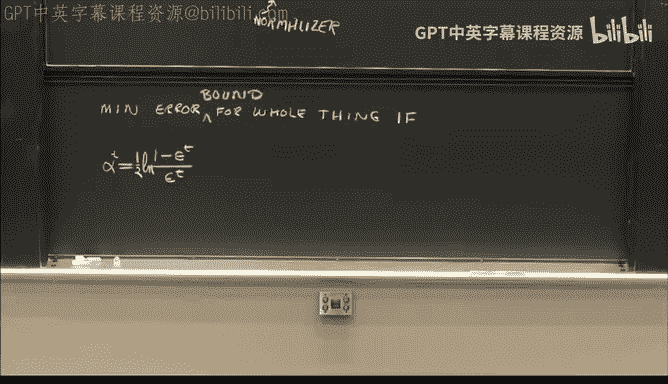

Here's what happens。There's a simple little example。So that's the first test chosen。

Their greens are pluses and the reds are minuses， so it's still got an error。

Still got an error boom there in two steps it now has， we can look in the upper right hand corner。

 we see it's used three classifiers。And we see that one of those classifiers says that everybody belongs to a particular class。

 three different weights。And the error rate has converged to zero。

So let's look at a couple of other ones， here's the one I use for debugging this thing。

llLet that run sail fast， boom。It converges to getting all the samples right very fast。

Here's another one， this is one we gave on an exam two years back。First test。 Oh， I'd let it run。

 So got everything instantously right。 Let's take that through step at a time。 There's the first one。

 Second one。Still got a lot of errors。The air rates dropping。And then flattened， flattened。

And goes to zero。Cool， do you think？But you say to me， wow， who cares about that stuff。

 let's try something more interesting， here's one。That was pretty fast too， well。

 there are not too many samples here， so I don't know we can try this。

So there's an array of pluses and minuses， boom。 You can see how that error rate is kind of bounded by an exponential。

So in the bottom graph， you've got the number of classifiers involved。

 and that goes up to a total eventually of 10。You can sort of see how positive or negative each of the classifiers is added is by looking at this particular tab。

 and this just shows how they evolve over time。But the progress thing here is the most interesting。

And now you say to me well。How did the machine do that， and it's all right here？

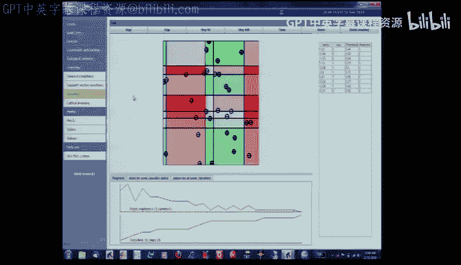

We。Use an alpha that looks like this， and that allows us to compute the new weights。

As soon as we got a preliminary calculation， we got to find a Z that does the normalization and we sure better bring our calculator because we've got。

 first of all the calculate to error rate， then we've got to take its logarithm divide by two。

 plug it into that formula。

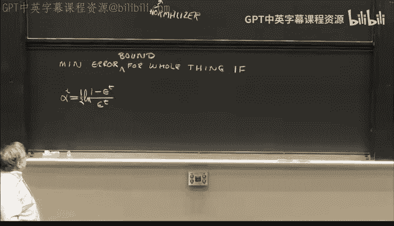

Take the exponent， and then that gives us the new weight。And that's how the program works。

 And if you try that， I guarantee you will flunk the exam。Now， I don't care about my， my computer。

 I really don't。 It's a slave。And it can calculate these logarithms and exponentials until it turns blue and I don't care because I've got four cores or something and who cares。

I mightight as well do this to sit around just burning up heat。But you don't want to do that。

 so what you want to do is you want to。You want to know how to do this sort of thing。

More expeditiously。So we're going to have to let the math kind of sing to us a little bit。

With a view toward finding a。Better ways of doing this sort of thing。So let's do that。

And we were going to run out of space here before long， so let me。

Let me reclaim as much of this board as I can。So what I'm going to do is I'm going to say， well。

 now that we've got this formula for alpha。It relates alpha t to the error。Then I can plug that into。

This formula up here at number six and what I'll get is that。The weight at t plus1。Is equal to。

The weight。At T。Divided by that normalizing factor。Multipied。Time something。

That depends on whether it's categorized correctly or not。That's what that why isn in there for。

 right？So we got a logarithm here。And we got a signed flipper up there in terms of that。

H of x and Y combination。So if the sign。Of that whole thing。At minus alpha。

And that Y H combination turns out to be negative。Then。But you got to have to。

Flip the numerator denominator here in this logarithm， right？And oh， by the way。

 since we got a half out here， that turns out to be the square root of that term inside the logarithm。

 right？So when we carefully do that。What we discover is。

That it depends on whether it's the right thing or not。

But what it turns out to be is something like a multiplier of the square root。Better be careful here。

Squa it or what？Well， let's see， but we have to be careful。 So let's suppose that this is for。

Things that we get correct。So if we get it correct。

 then we're going to get the same sign out of H of x and y， we've got a minus sign out there。

 so we're going to flip the numerator and denominator。So we're going to get the square root of。

E of T over。One minus epsilon of T， if it's correct。If it's wrong， it'll just be the flip of that。

So it'll be the square root。1 minus。The error rate over the error rate。

Everybody with me on that I think that's right， if it's wrong。

 I'll have to hang myself and wear a paper bag over my head like I did last year。

 but let's see if we can make this go correctly this time。So， now。We've got this guy here。

We've got everything plugged in all right。And we know that now this Z ought to be selected。

So that it's equal to the sum of this guy。Multiplily by these things as appropriate for whether it's correct or not。

Because we want， in the end for all of these WWs to add up to one。So let's see what they add up to。

Without without the Z there。So。What we know is that they be it must be the case if we add over the correct ones。

We get。

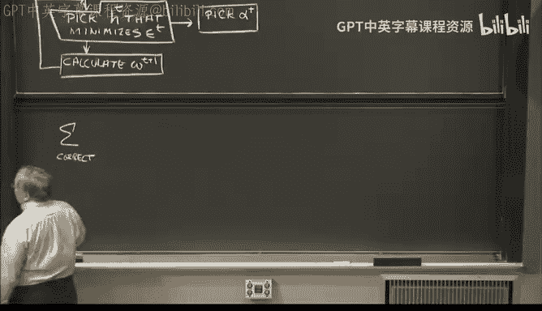

The square root。Of the error rate over1 minus the error rate。Of the WT plus1。WT， sorry。Plus。

 now we got the sum of1 minus the error rate。Over the air rate times the sum。Of the WI time T。

For wrong。So that's what we get if we added all these up without the Z。

So since everything has to add up to1， then z ought to be equal to this sum。Right。

That looks pretty horrible until we realize that。If we add these guys up。

Over the weights that are wrong， that is the error rate。This is。This is E。So therefore。Z is equal to。

啊。The square root。Of the error rate times1 minus the error rate。

 that's the contribution of this term。AndNow let's see what is the sum of the weights over the ones that are correct。

Well， that must be。1 minus the error rate。Oh， so this thing gives you the same result as this one。

So z is equal to two times that。And that's a good thing。

Now we are getting somewhere because now it becomes a little bit easier to write some things down。Oh。

 we're way past this， so let's get rid of this。And now， we can。Put some things together。

 let me point out what I'm putting together。I've got an expression for Z。Right here。

And I got an expression for the New Ws here。So let's put those together and say that。W of T。Plus。

 one is equal to。W of T。I guess we're going to divide that by two。And then we got。This square root。

Times that expression。So if we take that。Correct one and divide by that one。Eass of peak。Cancel out。

And I get one。Over1 minus the error rate。That's if it's。Correct。And if it's not correct。

 then it's WT over 2。Working through the math one over Epsilon。And wrong。

Do we feel like we're making any progress？No， because we haven't a lot of sing to us enough yet。

So I want to draw your attention to what happens to amateur rock climbers。

When they're sort of halfway up a difficult cliff。Theyre usually be sometimes they're not。

 if they're not， they're scared to death。And。Every once in a while as they're just about to fall。

 they find some little tiny hole to stick a fingernail in， and that keeps them from falling。

That's called a thank God whole。So what I'm about to introduce is the analog of those little places where you can stick your fingernail in。

 is' to thank God whole for dealing with boosting problems。Right。

So what happens if I add all these WI up？For the ones that the classifier produces a correct answer on。

Well， it'll be。One over two。1 over1 minus epsilon times the sum of the W sub T。

For which the answer was correct。What's this sum？Oh， my god。😮，1 minus epsilon。

So what I've just discovered is。嗯啊。If I sum the new Wies。Over correct。

Those samples for which I got a correct answer。It's equal to one2。And guess what。

 that means that if I sum them。Over wrong。It's equal to12 as well。

So that means that I take all of the weights。For which I got the right answer with the previous test。

And those weights will add up to something。And to get weights for the next generation。

 all you have to do is scale them so that they will have。

This was not noticed by the people who developed this stuff this was noticed by。Louis Arttiz。

 who was a 6034 instructor a few years ago。The sum of those weights。

Is going to be a scaled version of what they were before。

So you take all the weights for which this new classifier。

This one you selected to give you the minimum weight on the reweighted stuff。

 you take the ones that it gives a correct answer for。

And you take all of those weights and you just scale them。So they add up to a half。

So do you have to compute any logarithms？No， do you have to compute any exponentials， no。

 do you have to calculate Z， no？Do you have to calculate alpha to get the new weights， no？

All you have to do is scale them。That's a pretty good thank God hold。

So let's thank God hold number one。Now if for thank God， hold number two。

We need to go back and think about the fact that we're going to give you problems and all probability that involve decision tree stumps。

And there are a lot of decision tree stumps。That you might have to pick from。

So we need to thank God Hall for deciding how to deal with that。Oh， where can I find some room。

 how about right here？Suppose you've got a space that looks like this。

I'm just making this up at random。So how many， I see， one，2， three， four， five，6，7， eight，9， 10，11。

How many tests do I have to consider in that dimension？11。It's one plus the number of samples。

That would be horrible。I don't know， do I have to actually calculate this one？

How could that possibly be better than that one。It's got one more thing wrong。So this one。

That one makes sense。The other one doesn't make sense。So。In the end， no test。

That lies between two correctly classified samples will ever be any good。 So that one's a good guy。

 and that one's a good guy。 And this one's a bad guy， a bad guy， bad guy， bad guy， bad guy。Bad guy。

 bad guy， bad guy。So the actual number of tests you got。Is three。And likewise。

 in the other dimension。Well， I haven't drawn it so well here， but can this test be a good one， no。

 that one no。It。Actually， I better look over here and write and see what I've got before you draw too many conclusions。

 let's leave it with this because I don't want to think too hard about what's going on in the other dimension。

 but the idea is that very few of those tests actually matter。Now。

 you say to me there's one last thing， what about overfitting？

Because all this does is drape a solution over the samples。And like you know。

 support vector machines overfit， neural nets overfit， decision identification trees overfit。

 guess what？This doesn't seem to overfit。That's an experimental result for which the literature is confused。

With this respect to providing an explanation。So this stuff is tried on all sorts of problems like handwriting recognition。

 understanding speech， all sorts of stuff uses boosting， and unlike other methods， for some reason。

 as yet imperfectly understood， it doesn't seem to overfit。But in the end。

Leaving no stone unturned at 6034。Every time we do this， we do some additional experiments。

So here's a sample that I'll leave you with。Here's a situation in which we have a 10 dimensional space。

We've made a fake distribution， and then we put in that boxed outlier。

That was just put into the space at random so it can be viewed as an error point。

So now what we're going to do is we're going to see what happens when we run that guy。

And sure enough， in 13 steps and 17 steps， it finds a solution。

But maybe it's overfit that little guy who's in error。Well one thing you can do is you can say， well。

 all of these classifiers are dividing the space up into chunks and we can compute the size of the space occupied by any sample。

So one thing we can do， unless last， I'll have to get up a new demonstration。

One thing we can do now that this guy is over here。

 we can switch the volume tab and watch how the volume occupied by that error point。

Evolves as we solve the problem。So look what happens。This is of course randomly generated。

 I'm counting on this working。Never failed before。So。

It originally starts out as occupying 26% of the total volume。And ends up occupying。1。

4 times 10 to the minus 3% of the volume。

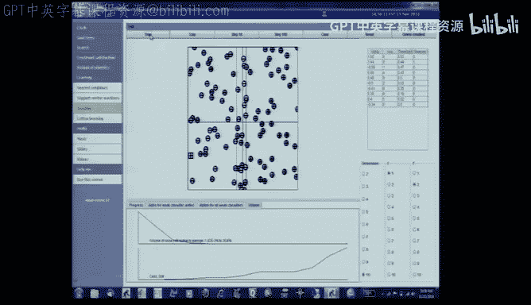

So what tends to happen is that。This。Decision tree stumps tend to wrap themselves so tightly around the air pointss。

 there's no room for overfitting because nothing else will fit in that same volume。

So that's why I think that this thing tends to produce solutions which don't overfit。

So in conclusion， this is magic， you always want to use it。

 it will work with any kind of speed of classifiers you want。

 and you should understand it very thoroughly because if anything is useful in this subject in the dimension of learning。

 this is it。

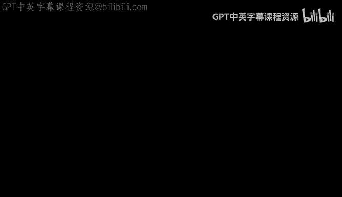