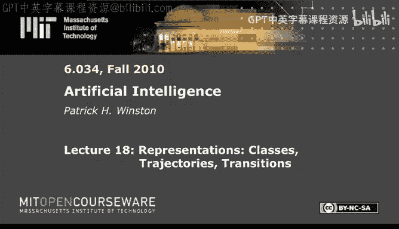
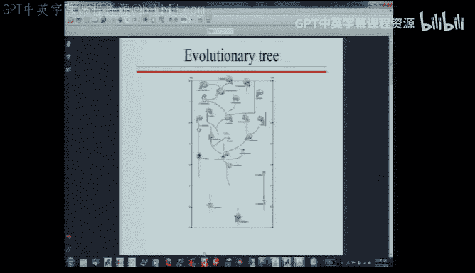
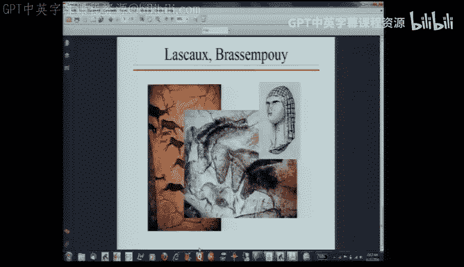
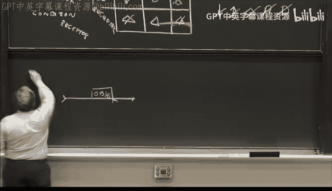
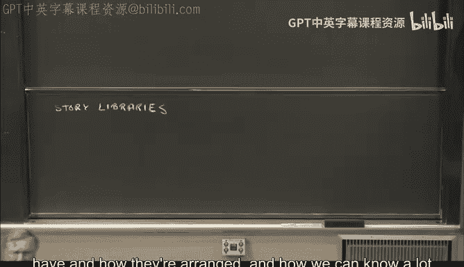
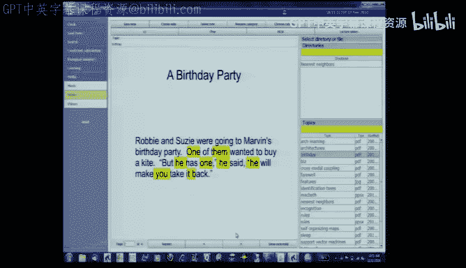
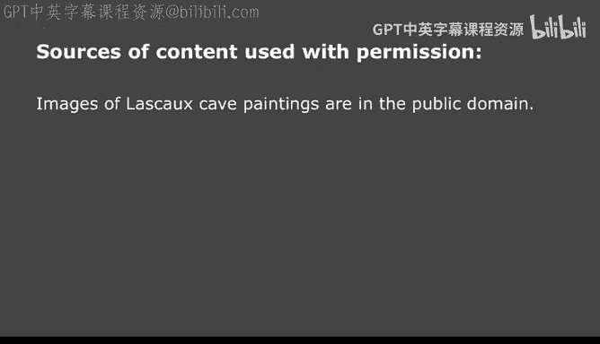

# 《人工智能｜6.034 Artificial Intelligence, Fall 2010》中英字幕 - P19：[19]18. Representations_ Classes, Trajectories, Transitions.zh_en - GPT中英字幕课程资源 - BV14fqSB2ECY

We might wonder。

A little bit about the nature of human intelligence。

And we might reflect a little bit on the kind of intelligence we've been talking about in the past few weeks。

 It's been an intelligence of sorts。Those programs support vector machines boosting。

 they can do really smart things， but the peculiar thing about systems that use those methods is that those systems don't have。

Any idea？About what they're doing。They don't know anything。

So they don't give us very much of an insight into the nature of human intelligence。And after all。

 I wouldd like to have a model of human intelligence because。

Let's face it with the smartest things around。So there are lots of ways to approach that question。

And we'll approach that question。First， from a。Evolutionary point of view。Some scientists believe。Me。

 for instance。That we have。Family tree。That looks about like。This。Too small to see much of that。

 but the main point is that we haven't been around very long。We humans have been around maybe 200。

000 years。And the dinosaurs died out 60 million years ago。So in the blink of an eye。

We seem to have more or less taken over。When you look at that family tree at a scale where you can see it。

One of the characteristics is increasing brain size。

There we are on the left。Chimppanzee on the right。Plainly mostly mouth， not too much brain in there。

That one down below is a reconstruction of one of those pthecus type。

My pedal apes from about four million years ago or so。

So we became bipedal a long time before we had much of a brain。So we might think that， well。

 maybe brain size has got a lot to do with it， and I suppose it does。

So we can plot brain volume of our ancestors versus time。

So the picture I just showed you was from about 3 million years ago， I guess。

And then up on the upper right hand corner， oh that's not just us， that's also the Neanderthal。

Their brains might have been slightly bigger than ours。So it isn't just brain size。

Here's what that guy looks like。 That's Neandertel。Of course， on the left。

And as one of us on the right， some conspicuous differences。They have big heads。

The rib cage is kind of conical in shape。They had a large pelvis。

People like to make a lot of speculations about how they must have moved around。one thing is plain。

They didn't amount to much。They could make stone tools。

 but their stone tools didn't change much over tens of thousands of years。

And that was pretty much the story with us too， until something happened。

 probably in southern Africa。Probably in a group of individuals。Maybe less than 1000。

What's the evidence for that， the evidence for that is mostly comes from DNA studies with a lot of probabilistic assumptions and Monte Carlo simulations。

 but it seems that among the competing hypothesis for how we came to populate the world。

 it seems that there was a group of homomo sapiens in southern Africa they' got something that nobody else had and the highest probability scenario is that we quickly took over。

 that population of homomo sapiens，Dominated the rest， went out of Africa。

 and within the blink of an eye did that sort of stuff。

What's that sort of stuff are those two paintings are from Lasco。About 25，000 years ago。

Poanthropologists like tatters all take that as plain evidence that there was symbolic thought on the people who were around at that time。

 us homomo sapiens。The head is a carving off of mastodon tusk of a woman 25，000 years ago。

Also plainly symbolic。People were making a lot of jewelry and doing self adornant。

 The Neanderthals never seemed to do that。

That jewelry making seems to have gone back。To southern Africa， maybe 70000 years ago。

 people were puncturing seashells and using them as necklaces， apparently。So something happened。 And。

 and the paleoanthropologists who write fascinating stuff don't quite know how to talk about it other than they say it looks like we became somehow symbolic。

And somehow， that has something to do with language。So if you talk to Noam Chomsky， he will say。

Let me get this precise as near quotation as I can get。

He thinks it was the ability to take two concepts。And put them together to form a third concept。

Without disturbing the original concepts， and without limit。And each part of that's important。

The without limit part is what separate breaks us from species that might be able to do that a little bit。

But we could do it without any apparent limit。So that's a linguist speaking。

 and he talks a lot about the merge operation and combinators in language using terms that are foreign to us。

 They don't use the term Cominator。 it's a kind of computer science term。But whatever it is。

 it seemed to happen about that time。It didn't happen slowly in proportion to brain size。

It seemed to happen all of a sudden。In consequence of a brain that had grown big enough to be an enablement。

But the capability was not what pulled evolution in that direction。

So I believe that whatever that was。That capability。Enabled。Humans， us humans。

To tell and understand stories。 and that's what separates from us from the other primates。

That ability to， that symbolic ability， whatever it is。Enabled storytelling and understanding。

 and that's what all of education is about， and that's why our species is special。

So what we're going to talk about today。Is some。Something you might think of as an instantiation of that hypothesis。

 one way of thinking about it。And it's a way of thinking about what the linguist would call the inner language。

It's not the language with which we communicate。It's the language with which we think。

Which is closely related to the language with with which we communicate。

 but may not be quite the same thing。So many of you are bilingual。Chrisina is bilingual。 Kris。

 have you ever had the experience of remembering that someone said something to you。

But not remembering what language they used。不对。How about you， So， if you had that experience？

WhatI got speak。So you not had experience of having。

 have you ever had that experience of having remembering some conversation but not remembering the language in which it was cast。

やるさ。帮我关。You usually don't remember， so that's a common view。

 You remember something that said that there was a conversation that had some content。

But if it's with a。Speaker of your own language and you're embedded than another place。

You often don't remember what language the conversation was in。Is that right， Juna。

 you remember things like that， not sure？So sometimes sometimes you don't have that confusion。

 she says， because you always speak to particular people in a particular language。

 but many people report that they have that experience of not remembering which language something was set in。

Well， okay， so what are we going to do， we need an inner language？

And maybe we can start just by saying， let's have something that looks sort of familiar to us。

 We have an object。And it's supported by some other objects。So those are support relations。

That's one example of what we might call a semantic net。It's a network， it's got nodes and links，'。

It's it has a meaning。That's where the word semantic comes from。

Or we might have another example that looks like this。There's Macbeth。There's Duncan。And Macbeth。

Murders Duncan。And we also know somehow。That there's a kill involved as a consequence。

And that ultimately。Duckcan。Has a property。And that property is the property of being dead。

So there's another semantic net recording something that happens in Shakespeare's Macbeth plot。Now。

 we can decorate that a little bit so as to get a couple of other concepts in play。 First of all。

 the thing we've got already is we've got combinators。Been come been a tourist。

The fancy name for those links that connect the nodes。

Another thing we've got is an opportunity for connecting the links themselves。So the murder。

Sort of implies the kill and the kill leads us to conclude that the victim is dead。So that。

Is treating the linksn themselves。As objects， that can be the subject or object of other links。

So we call that process reification。Now， in artificial intelligence。

 cementtic us were all over the earlier work。But， you know。

 if you have a big network that covers the wall， you need some way of sort of putting a spotlight on some pieces of it。

So Marvin Minsky。Put a lot of technical content into that idea。

And created the notion of a notion that deserves another a color here。

He suggested that we need a localization process so we have frames。So called frames or10 plates。

And a frame for this murder action might be that there's a murder frame that has an agent。

And has a victim。And the agent。Is Macbeth。And the。Victim is Duncan。

So that's a way of putting a kind of。Localization layer。On top of what we've got so far。

AndLater on I'll add sequence to that list， so this is where it rested for a long time and in some sense still rests there because this as soon as you've got combinators and reification。

 you've got something that's pretty much universal。You can do anything with it。The trouble is。

 is sort of down at the bit level。It's like assembly code。It doesn't have as a concept。

 enough organization。To help you go to the next level of achievement。

There's also a little problem here that deserves also some a mention。 and that is that we have。

Over this whole thing。The problem of parasitic semantics。Se。Semantics。

A kind of ugliness that surrounds this whole concept because when we look at a diagram like that and we say。

 oh， Mcbeth murdered Duncan， that means Duncan's the victim。

 we know that there must have been a motive， maybe MacMbeth wanted to the be king。

 we know all that stuff。And there's a tendency to project that knowing into the machine。

If you're going to。Play with your telephone， please leave。So。If。If we project meaning into that。

 that's our understanding， that's not the machine's understanding。

So much of the meaning can be said to be parasitic。iteWe're the parasite。

 and we're projecting the meaning into that thing。Putting that diagram into some machine form doesn't mean the machine knows anything。

It might be able to conclude some things， but its understanding is not grounded in any kind of contact with the physical world。

So we have to worry a lot about that。And we philosophers would stop there and go off and write a few books on this subject。

But we're not philosopher， so we're going to just mention the problem and go barreling ahead。

So we need to use this notion of semantic net and we have to ask ourselves some questions about what elements of the inner language are most useful in the end。

 it might be very complicated， but here's usefulness number one。The notion of classification。

So we know about stuff and we know about， for example， pianos。And we know about tools。

And we know about。Max。But we know about those things on different levels。

So when I say I'm thinking about a tool， do you have a very good image of what I'm talking about。

 the answer has to be no， because the notion of a tool is very vague。

 so it's hard for you to form a picture。Of what that's all about。On the other hand， if I say。

 I'm thinking about a Mac。Well， this is interesting because there's lexical ambiguity there。

 You don't know if I'm talking about。The Apple type Mac or the Apple type Mac。

Or should I say the fruit？Or the computer。So there's leambiguity there at two levels。Or more。

 But let's fill this in a little bit。 if I about I know I'm talking about a piano。

 you can form a picture of that。 So that seems to be at a more detailed level where you can do hallucination。

At a higher level， you have just a musical instrument。

And I can give you a tool to think about by writing hammer。And if I'm going to have a Mac。

 it's going to be an apple。And in this case， I want you to think about a fruit。And down here。

 I can be more specific about these things， too。I I can add a slight refinement of detail and say I'm thinking about。

I'm thinking about one of these。Do you know what this is。It's not a mere hammer。

It's a ball of pe hammer。In some circles， it's called a ladies hammer。 I don't know why。But it's。

What's it for？Most people buy it mostly because it's small and lightweight。But in fact。

 it's for metal working， it's for taking a piece of sheet metal and pounding it out into an ashtray or something。

 or for seatding rivets， it's a metal worker's hammer。So you might not have known about that before。

 but now at least you have a word to hang that knowledge on。 It's a ballpane hammer。

So we have various levels here。Going from very specific to very general。

 and we could even go to a level of specificivity for pianos by saying that we've got a boendorer。

Why is the Bzenor for special？I mean it is like a Baldwin。Something meanよか。Lots of piano types。

 What's special about least you don't know because unless you play the piano and probably unless you're a serious piano player。

 you don't know that a Bsendorer。Ariel， you know。いつどうしたね。啊，这个什么包。

It's got some extra keys at the bottom。And most people don't know that unless they're serious about the piano。

 Some professional piano players， when they're confronted with the Bszenorer。

 have to have to have someone cover those keys。Because it screws up their peripheral vision and hit the run key。

Because they're not used to having those extra keys at the bottom。

So that's a little detail about the Bnbuer。 so you can make a kind of graph。And you can say。

 let's go from。Oh。Very general。To a sort of basic level。To a specific level。

And so it is the case in human knowledge。That that graph has a tendency to look sort of like this。

So here's tool。Here's hammer。 Here's Ba Ping。So that level where you have a big jump。

 that's the general to basic level transition。So that basic level is probably there because that's the level at which on which we hang a huge amount of our knowledge。

We know a lot about pianos and it all seems to be。Hanging on that word piano。

 which gives us power over the concept。So that's example number one of a inner。

 of an element of our inner language， the ability to assemble things into。Hierarchies like that。

 and to hang。Knowledge about those objects in that on the elements in that hierarchy。

But given that you have elements in the hierarchy to talk about， how do you talk about them， Well。

 I'd like to consider the possibility just for the sake of illustration that you're thinking about a car crashing into a wall。

So you got the things to think about like。The speed of the car。The distance to the wall。

And the condition of the car。And you've got the period before the crash。

During the crash and after the crash。So you might want to think about。

How to talk about those objects in those three time periods。So。

We can do that with a vocabulary of change。And we do that because we believe that most of human thinking is thinking about change causing change。

And that flies in the face of what we learn as engineers。Because in engineers， in engineering。

 we learn about state。And once you know the state of a system， you know。

 everything you need to know in order to predict the future， the trouble is。In our heads。

Thinking about everything there is in the world， including the current phase of the moon is too much stuff。

So mostly our thinking， we think。Is。Is hinging on the idea that change leads to change。

So that's why we have a vocabulary change。 So So in the period before the crash。The speed of the car。

Is not changing。 There's a little notation for not change， no deelta。The distance to the wall。

That's decreasing。The condition of the car。And that's not changing。But then the car hits the wall。

So the speed of the car disappears。The distance of the wall disappears and the condition of the car。

Will change dramatically。Finally， after the crash is over， the speed of the car。Does not appear。

The distance to the wall does not change。And the condition of the car also does not change。

So that's hinting in a vocabulary of change。And its use。

Which will be the second element in our development of a vocabulary of ways in which we might have。

Constructed our inner language。So this is a particular idea， that's classification。

This is transition。And in any system that purports to understand stories。

 there'll be a heavy emphasis on this notion of transition。 And we believe that is a say。

 I think that that vocabulary has to have decreased。Increase change。Appear and disappear。

So there are 10 things that you can have in such diagrams。I've done five。 That's because。

For each of those。There's a not variation on that。So a vocabulary of 10 things can go a long way toward helping you describe things that are in process of changing or making transition and we have a lot of those words in our vocabulary。

 we use those words a lot in our vocabulary， they seem heavily connected with vision。

Our friend appeared。The cat disappeared。 the speed increased。So this is a description of a crash。

In terms of those kinds of elements， now I say to you， how does a camera work？Well。

 I could say a camera works because。A photon hits a photorecept。

 A photo A photon crashes into a photoreceptor。So when I say a photon crashes into a photoreceptor。

 why am I saying that and how does it help？I'm saying that。

 and it helps because it's the same pattern of change。

Do you already know about when you talk about a car crashing into a wall？How does that work？

The speed of the photon。The distance of the photon。To the receptor。And the condition of the receptor。

So analogies like that very much at the core of what we think about all the time。In any event。

 there is。There is representation number two。 Number one is class number two is transition。 and now。

 you're ready for number three。Which is trajectory。Linguists who study sentences。

Often talk in terms of fundamental patterns that seem to be in a lot of what we say。

 and a lot of what we say is about objects。Moving along trajectories。

So we can talk about a trajectory frame。

And a trajectory frame will have elements like this。

 it has an object moving along a trajectory that ends up at a destination。

It might start out at a source。It's probably been arranged by some kind of agent。

And their agent may assist himself。And making the motion happen with some kind of instrument。

There might be somebody helping out over here。A co agent。Well。

 what else can we have beneficiary someone who？It is helped out by the action。

Sometimes the motion is arranged by a conveyance。So these are a lot of slots。

Frame like slots in descriptions。Of actions， many of which involve motion along a trajectory。

We have a tendency in language to decorate these things in one way or another。

 depending on the language。In some languages， a declaration is by way of position in a sentence。

 in English， it's often by way of a preposition that's used to。Helped 0 in on the role of a。

On their particular role of an object in the trajectory scenario。So if I say I。Pate the cake。

With a friend。There's a width reposition。If I bake the cake for a friend。

The friend is the beneficiary。If I baked a cake with an oven。That's an instrument。

The object may be moving。To a destination from a source。And if I'm going to New York by train。

I put a buy on top of that。If the agent isn't in subject position， I would say something like， oh。

 all the work was done by a student。So those prepositions have a tendency to help us to zero in on the actual role of particular objects in this whole package。

 this whole frame。So this is number three。And there's a variation on this in which there's no actual trajectory。

 in which case we'll just call that a role frame。Because if there's no trajectory。

 you can still have things such as an instrument， a coag， and a beneficiary。

So now we've got three representations， you might say， well。

 what good are they and you can determine what good they are these days because it's easy to go over established corpes and say。

 what fraction of the sentences in such a corpus involve a classification or transition。

Or it trajectory。The most well known of these is the so calledled Wall Street Journal corpus that has 50。

000 sentences in it。Drawn from some period of time。Of。Language。

Syntactical language types work with that corpus a great deal。And we worked with it a little bit。

 too， to see what fraction of the sentences。Or what the density of trajectories and transitions are in those sentences。

So I have to say that a more a little carefully， because the finding is that in。100 sentences。

You'll find about 25。Transitions。Or trajectories。So they're very densely represented。

They're often very abstract， prices rose。啊，利啊。The economy went to someplace。

But there're still words that denote transition or trajectory。But of course。

 once you have all this stuff you begin to have a desire to put it together。

And so the next thing we need to talk about。His story sequences。

So a story sequence can be a single sentence。And I want to illustrate that with。One of my favorites。

Here's the sentence。 I think I've chosen gender neutral names。 So it's not a G8 trouble。 So Pat。

 by the way， I don't call myself Pat， because I decided when I was 18 years old that Pat is a unit measure for butter。

In any case， Pat comfortfor and Mary，Image of what happened。Probably not a very firm image。

You know that Pat did something。But you don't know exactly what。Nevertheless。

 when Pat comforted Chris， you can construct。Something that looks like。A role frame。

Because the role frame for that would have。An agent。And that would be Pat。There's an action。

We're going to put a question mark in there because we don't have a very firm image of what the action is。

In any event， we're building a role friend。Like so。The object is Chris。Oh， you know what that is。

The object。Is there anything else we can say， yes， we can probably say something more。

 something else comes to mind when you see Pat Company Chris， there's a sort of result。

And the result is a transition frame。And the transition frame。Involves an object。Which is Chris。

And Chris has a mood。Which， presumably。Is improved， it goes up。Did you have something El。I guess。

 analogize。Some for Chris。So something kind of like Pat gained comfort to Chris。

 which case Chris is the destination here。So is the。

Winandering into a very interesting area having to do with。

 couldn't you think about this in another way and think of it as something moving along a trajectory。

 comfort is moving， if not from Pat， at least to Chris。

And that's a very important kind of observation because what it suggests is that there can be a utility and thinking of things in multiple ways。

 multiple representations。 Marvin Minsky has a wonderful aphuristic phrases。

 which is if you can only think about something in one way， you have no recourse when you get stuck。

So multiple representations mean you have multiple ways of。

Gathering regularity from the world and collecting it， and therefore， that'll make you smarter。

So yes， you could do it that， you could do that， and that would be a compliment to what I'm doing now。

But let me continue with what I'm doing now。What have I done。

 I've got a role frame and a transition frame， and the transition frame is the target of the result slot in the。

 in the role frame。Now we can modify this a little bit。And maybe we want to say instead of comforted。

 terrorized。And how would that change things？We don't know exactly what。Pad did。

 so the action remains unknown。The agent and the object are the same。

 But the result here is presumably that the。Moved， went down。Just what we've got so far。

 we can answer a lot of questions， by the way， once we've got the sentence understood in these terms。

 we can say， who did the thing， what's this all about and the answer is Pat， What did Pat do， Com。

 terrorized。Who do they do it to？Always the object， it's Chris。What was the result？Chris felt better。

Chris felt felt worse。 So these these representations already give us a questioning。

 answer and capability。That makes for an understanding of the sentence。Still。

 we haven't been very specific。 So our next step takes the same sentence in a more specific direction。

So here's the way that goes。Justist。Chris。Now you begin to get a sense of what's going on。

 You can form a mental image。So that you could have a hallucination。

And that hallucination will also be。A kind of frame。 but in this case。It'll be a trajectory frame。

And the object。Would be， I don't know， Pat's lips。And a destination。Would would be Chris's lips。

I don't know， is that right？It depends。 It depends。

 Have you all formed a picture of what's going on here。So it will be different depending on whether。

Chris is Pat's girlfriend。Or if Chris is Pat's daughter。Or if Chris is a frog and Pat is a prince。

That's， I guess the way the news story usually goes。

So somehow we have in our heads all kinds of libraries that help us to form mental pictures of things when we see things like Ki。

So one final one just to show the variety。We could say that Pat stabbed Chris。What changes？Let's see。

 in the case of Ki。The moon is going up and the case of stabbed。The mood is going down。

 and you can also probably say that the health is going down。And the destination is Chris's body。

And the object that's moving is Pat's knife。But you get the same pattern with both of those sentences。

So both of them involve a sequence。It starts off with the action leads to a transition and a trajectory。

 and those are all arranged in a line。 And that line is something that gives us。A lot of power。

Over the situation relative to a semantic net。So I'm going to decorate that one more time。

And say that another。Element we get out of our internal language is sequence。Another element。

We need in order to have anything that looks like an account of an inner language is sequence。

Because if you think about things being arrayed in a vast spreading network。

 it's hard to deal with them。But if you think about things being arrayed along a line。

In a sequence of actions or events。Like， so。Then that imposes。

Enough constraint to get a handle on what's going on。So what we're going to call this is。

The representation。And I guess I'm up to1，2，3，4。 This is a representation of story sequence。

So even though that's a kind of micro story， it's still an example of a story sequence because we get the power out of it by arranging everything in a line Now you have a sense。

 I think， especially if you play a musical instrument of how dependent we are in sequence。

So if you play a musical instrument， you probably know how difficult it is to。

Start replaying a piece of music from the middle of a measure。

You have to go back to at least the beginning of the measure and probably to the beginning of the phrase。

 if not the beginning of the piece。So our memory seems to be， at least in music。

Very rooted in the idea of sequences。And that's often true in storytelling， too。

 We have to go back to the beginning of at least a scene because somehow these things are arranged in。

And in sequences that form。Somehow usefulness out of their sequentialness。

So there's one more thing we can talk about。 And that is the idea of not just。The idea of how。

These sequences are constructed and what they're constructed out of。

 but we can also talk a little bit in terms of。Libraries and stories。

And when we talk about libraries of stories， we can think about kind of the sort of standard。

Standard stories that we have and how they're arranged and how we can know a lot about something by what its superclass is。

So it's a variation on the theme of。Learning stuff from the superclass。So here's。

Here's an event frame。And then there's in addition to。Event frames， are are disaster frames。

And then there are party frames。And you know， parties。And disasters are both events。

And when we talk about disasters， we know that they in turn break up into a variety of things。

 we have earthquake disasters。And maybe we have hurricanes。And in the party world， we have。

 I don't know， birthday parties。And we have weddings。

And each of these types of frames invites us to fill in particular slots。

 So if we're reading a newspaper story about a wedding。

We know that we're going to be learning the same sorts of things we would learn about any party。

 except there is the additional information that we expect that says something about the bride and the groom。

If we have a raw event and we don't know anything more about it than that， there's a time and place。

If it's a disaster frame， it gets a little grizzly over here。 but if there's a disaster frame。

 you might have the fatalities。And how much it cost。If it's an earthquake frame。

 we need to know the magnitude。Of the。Of the quake and the name of the fault。If it's a hurricane。

 we have the category。And the name。So each of these things up there can be viewed as， as a， you know。

 not just an example of something， but as， as a new frame all by itself。 So as we， as we mature。

 we have。These first。Four things is building blocks。

And then we educate ourselves and we get all those kinds of frames that help us to understand the world。

But。How to fill those in？From a newspaper story can be sometimes quite a challenge。

 actually the worst thing to understand。Is children's stories。

BecauseAnd this was determined experimentally when people tried to understand a children's stories。

 because it turns out the children's stories。Are not？Simpler。

And the stories we write for adults in many cases， they are。They're harder。

If you reach about Shakespearean plots， it's all about intrigue， murder。Jealousy， greed。

But when you're talking about a children's story， it can be about anything。And worse yet。

The children's story often raises problems that you don't see in newspaper stories。

 let me illustrate that for you。Read that story。You have no trouble figuring it out， of course。

 but think about a poor machine。He's struggling to understand anything。

What's going to be the problem？It's going to have trouble figuring out those pronoun antecedents。

Look at them， they're complicated。They're the pronouns。One of them wanted to buy a kit， he has one。

 he said he will make you take it back。So that's pretty hard。 Actually。

 the principle here that I'm driving at is when you have a new story or any story。

If you have an old story， but read but you want to understand it quickly。

 the new instantiation of it quickly。You need to be sure that if you're the storyteller。

You don't add to the burden of the understanding any syntactic difficulty。

 So that's an example of telling a story with additional syntactic difficulty。

No newspaper journalist。Would ever write the story like that。Here's how they would write it。

They would even give you a clue that there's certain information that you're never going to get like who told the story。

That's that reliable sources business。So this brings us to the final bit that I want to deal with today。

 and what I'm going to do is if you came into this class today as a 97 pound writing weeklyling。

 you are about to emerge as a 250 pound。Mountain of a writer。

Because I want to tell you a few tricks that will make you usually better as a writer， especially。

Especially if you're Russian。Or German。And here's how it works。Rule one。

Because they place additional syntactic burden on the understanding of the story by the reader。

 So here' teaching if you're telling somebody about some difficult， new technical idea。

The last thing you want them to do is to burden their syntactic processor with figuring out prodents。

So don't use pronouns and your writing technical writing， at least will be much clearer。By the way。

 why does this especially apply to Germans and Russians？

Is it because is this an ethnic origin slur or is this a fact about their language。

 It's a fact about their language， What is the fact？

Why can they get away with proun usages that we cannot get away with in English？野さる。

Because if you have。All of your。All of your nouns decorated with gender that reduces by three the potential for ambiguity and the proun antecedent。

So you'll frequently find that German Russian writers will have pronouns all over the place that are perfectly clear to them because of gender that are uninterpreable by English speakers when translated because we don't have the gender to help a zero win。

So these things are all have to do with minimizing。Extra superfluous， gratuitous。

 unnecessary burden on the reader。 Number two is don't use。Former。Our lot。

You see that those words used frequently in taal writing and guess what。

 No human being ever encounters those words without having to stop and go back to or figure out what they refer to。

So that's another example of not placing an unnecessary syntactic burden on the reader。And finally。

Don't call a shovel。A spade。There's a habit probably instilled by well meaning but misadvised high school teachers that you shouldn't repeat words。

And so people will go to great length and use some different work。

The problem is that the reader doesn't know if the shift in the word is deliberate and attached to some subtle meaning shift。

 or if it's just adhering to some high school teacher's ammunition against using the same word again。

So you don't want to say， oh， the right way to dig this particular hole is with the spade and then switch to a shovel because the reader can't tell if it's deliberate。

 accidental， or a consequence of just the desire not to use the same word。

So this is how you get with some very simple mechanisms。Rorounded in AI。

 you can actually make yourself into a better writer by avoiding those kinds of things and put an unnecessary syntactic burden on the people who are reading your stuff。

