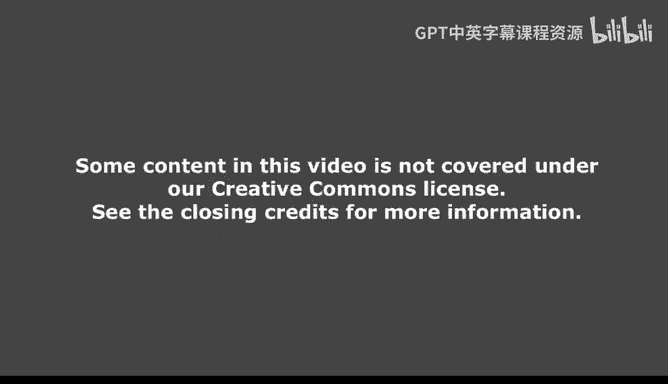
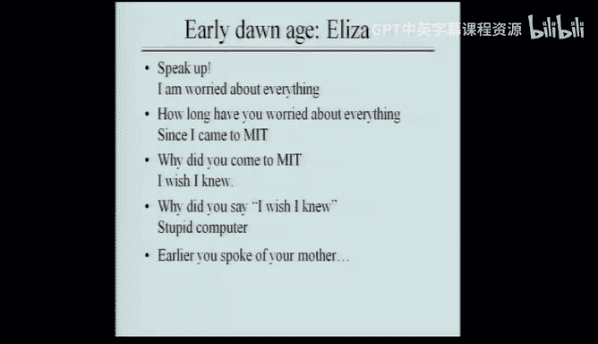
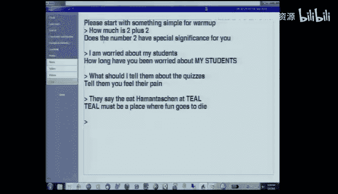
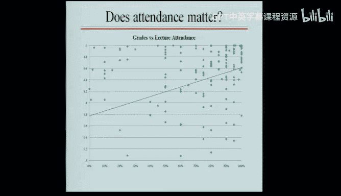
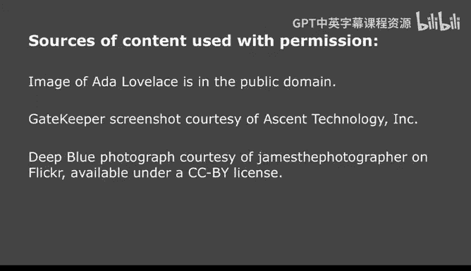

# 《人工智能｜6.034 Artificial Intelligence, Fall 2010》中英字幕 - P1：[01]1. Introduction and Scope.zh_en - GPT中英字幕课程资源 - BV14fqSB2ECY

Hey。Welcome to 6034。I don't know if I can deal with this microphone， but we'll see what happens。

 It's going to be a good year。 We've got。You're at a bunch of interesting people。

 It's always interesting to see what people named their children two decades ago。

And I find that we're overwhelmed with Emily's。And there are not too many Peters。

 Pauls and Mary's but enough to call forth a suitable song at some point。

We have lots of jss of both genders。We have a yang yang。Of both genders。And we have a Duncan。

 versus Duncan。There you are， Duncan， you've changed your hairstyle。

I want to assure you that the the of Cador is not taking the course this semester。

What I'm going to do is tell you about artificial intelligence today and what this subject is about。

There's been about a 10% turnover in the。In the in the roster in the last 24 hours。

 and I expect another 10% turnover in the next 24 hours， too。

 So I know many of you are sightsseers wanting to know if this is something you want to do。

 So I'm going to tell you about what we're going to do this semester and what you'll know when you get out of here。

I'm going to walk you through this outline。I'm going to start by talking about what artificial intelligence is and why we do it。

And then I'll give you a little bit of the history of artificial intelligence and conclude。

With some of the covenants by which we run the course， one of which is no laptops， please。

I'll explain why we have these covenants at the end。So what is it？Well。

 it must have something to do with thinking。So let's start up here a definition of artificial intelligence by saying that it's about。

Thinking。Whatever that is。But my definition of artificial intelligence has to be rather broad。

So we're going to say it's not only about thinking。It's also about perception。And it's about action。

And if this were a philosophy class， then I'd stop right there and just say， in this subject。

 we're going to talk about problems involving thinking， perception and action。

But this is not a philosophy class。 This is。It's， of course，6 class。

 It's an engineering school class。 It's an M T class。So we need more than that。And therefore。

 we're going to talk about。Models。That are targeted at。Thinking， perception and action。

 And this should not be strange to you， because model making is what MI T is about。

If you run into someone at a bar or a relative， ask you what you do at M I T。

 the right knee jerk reaction is say， we learn how to build models。That's what we do in MIT。

We build models using differential equations。We build models using probabilities。

We build models using physical and computational simulations。But whatever we do， we build models。

Even in humanities class。M I T approach is to make models that we can use to explain the past。

Predict the future。 understand the subject and control the world。That's what MT is about。

 And that's what this center is about， too。 Well now， our models are models of thinking。

So you might say， well， if I take this class， will I get smarter？And the answer is， yes。

 you will get smarter because you have better models of your own thinking。

 not just the subject matter of the subject。The better models of your own thinking。

So models targeted at thinking， perception and action。But you know。

 that's not quite enough because in order to have a model。You don't have to have representation。

So let's say that artificial intelligence is about representations。That。Support。

The making of models that facilitate an understanding。Of thinking， perception and action。Now。

 you might say to me， well， what's the representation of what good can I do？

 So I'd like to take a brief moment to tell you about gyroscopes。 Now。

 many of you have friends in mechanical engineering。One of the best ways to embarrass them is to say。

Here's a bicycle wheel。 and if I spin it。And blow hard on it right here。On the edge of the wheel。

Is it going to turn over this way？Or this way。Now I guarantee that what they will do。

I they will put their hand in an arthritic posture called a right hand screw rule。

Aptly named because people who use it。Tend to get the right answer about 50% of the time。

But we're never going to make that mistake again。Because we're electrical engineers。

 not mechanical engineers。 And we know about representation。

And what we're gonna do is we're going think about it a little bit。

And we're going to use some duct tape to help us think about just one piece of the wheel。

So I want you to just think about that piece of the wheel。As the wheel comes flying over the top。

 and I blow on it like that。What's going to happen to that one piece？It's going to go off that way。

 right？And the next piece is going to go off that way， too。So when it comes over。

 it has to go that way。Let me do some ground truth here， just to be sure。It's a very powerful field。

If I， I could try that， come on come on try， come， come。 We did a demonstration。

 I want don't want anybody to think that I'm cheating here。So， that's just。So。

Twist it one way or the other。So that's a powerful pull， isn't it？

Alex is now never going to get the gyroscope wrong。Because he's got the right representation。

So much of what you're going to accumulate in this subject is a suite of representations that will help you to build programs that are intelligent。

But I want to give you a second example。One a little bit more computational， but one of which was。

Very familiar to you By the time you went to first grade， in most cases。

 it's the problem of the farmer。The fox， the goose and the grain。There's a river。

A leaky rowbo that can carry the farmer and one of his four possessions。

So what's the right representation for this problem？It might be a picture of the farmer。

It might be a poem about the situation， perhaps a haiku。

But we know that those are not the right representation。Somehow， we get the sense。

That the right representation must involve something about the location。

Of the participants in the scenario。So we might draw a picture that looks like this。

Theres the scenario。And here in glorious green。Representing our algae infested rivers is the river。

And here's the farmer。The fox。The goose。And the grain。An initial situation。Now， of course。

 there are other situations like this one， for example。We have the river。And the farmer。And the。

Gose is on that side， the fox and the grain。Is on that side。And we know。

That the farmer can execute a movement from one situation to another。

So now we're getting somewhere with a problem。 This is an M I T approach to the farmer Fox goose some grain problem that might have stumped you when you were a little kid。

How many such situations are there。What do you think， Tanya。

Looks to me like all four individuals can be on one side or the other。

So for every position the farmer can be， each of the other things can be on either side of the river。

So itd be2 to the fourth， she says。Aggressively and without presentationsation。Yeah。

 it's through the 4，16 possibilities。 So we could actually draw out。The entire graph。

 it's small enough。There's another position over here。The farmer， Fox。Goose and grain。 And in fact。

 that's the one we want。And if we draw out the entire graph。It looks like this。

This is a graph of situations。And the allowed connections between them。Why are they not 16？Well。

 because the other， how many have I got four，10？The others are situations in which somebody gets eaten。

So we don't want to go any of those places。So having got the representation right。

 something magical has happened。We got our constraints exposed。

And that's why we build representations。 That's why you do algebra in high school。

Because algebraic notation exposes the constraints that make it possible to actually figure out how many customers you get。

For the number of advertisements you place in the newspaper。

So artificial intelligence is about constraints exposed by representations that support models targeted thinking。

 oh， actually， there's one more thing， too。 I'm not quite done， because after all， in the end。

We have to build programs。So it's about。It's about algorithms。Enabled。My。

Constraints exposed by representations that。Model targeted thinking， perception and action。

So of these algorithms， or we might call them just as well。Procedures。

 we might call them just as well， methods， whatever you like。

These are the stuff of what artificial intelligence is about methods， algorithms， representations。

I'd like to give you one more example。It's something we call an artificial intelligence generated test。

And it's such a simple idea， I'll never hear it again in this subject。

But it's an idea you need to add to your repertoire of problem solving。Methods。

 techniques and procedures and algorithms。So here's how it works。Oh。

 maybe I can explain it best by starting off with an example。Here's a tree leaf。

 I picked off a tree on the way over to class that I hope it's not the last of the species。

What is it， What kind of tree。Well， I don't know。 I never did earn my trees or my colors or my multiplication tables。

So。I have to go back to this book， the Audubon Society Field Guide to North American Tce。

 And how would I solve the problem。That's pretty simple。 I just turned the pages。One of the time。

Until I find something that looks like this leaf。And then， I discovered。It's a sycamore or something。

MitT is full of。So when I do that。I do something very intuitive and very natural。

 something you do all the time。 But we're going to give it a name。

 We're going to call it generate and test。And the generating and test method consists of generating。

Some possible solutions。Feeding them into a box that tests them。And then out the other side comes。

Mostly， failures。But every once in a while， we get something。That succeeds and pleases us。

That's what I do with the leaf。But now you have a name for it。Once you have a name for something。

Once you have a name for something to get power over it， you can start to talk about it。

So I can say if you're doing a generating test。Approach to a problem。You better build a generator。

With certain properties。That make generators good。 For example， they should not be redundant。

They shouldn't give you the same solution twice。They should be informable。

They should be able to absorb information such as this is a deciduous tree。

 don't bother looking at the conifers。So once you have a name for something。

 you can start talking about it。And that vocabulary gives you power。

So we call this the rumple stillkin principle。Perhaps the first of our powerful ideas for the day。

This subject is full of powerful ideas， that'll be sum in every class。

Rmble Stskin principle says that once you can name something， you get power over it。

 Do you know what that little thing is on the end of your shoelace。Did you think she's。

Geturing like mad， that's something we'll talk about later， too。

Motor stuff and how it helps us think。What is it？No one knows。It's an a， something， right。

 it's an aglet， very good。So once you have the name， you can start to talk about it。 You can say。

 you know， the purpose of an agla it's pretty much like the whipping on the end of a rope keeps the thing from unwinding。

Now you have a place to hang that knowledge。So I'll be talking about this frequently from。Now。

 into the rest of the semester， the power of being able to name things Sic labels give us power over concepts。

While we're here， I should also say that this is a very simple idea， generate and test。

And you might be tempted to say to someone。We learned about generate and test today。

 but it's a trivial idea。The word trivial is is a word I would like you to purge from your vocabulary。

Because it's a very dangerous label。And the reason it's dangerous is because。

There's a difference between trivial and simple。 What is it。What's the difference between。

Labeling something is trivial and calling it simple， yes。Crial sounds。Exactly so。

 He says that simple。Can be powerful。And trivial makes it sound like it's not only simple。

 but of little worth。So， many MI T people。Mis opportunities because they have a tendency to think that ideas aren't important。

 unless they're complicated。But the most simple ideas in artificial intelligence are often the most powerful。

Now we could teach an artificial intelligence course to you that would be so full of mathematics。

 that would make a course 18， Professor Gag。But those ideas would be merely gratuitously complicated and gratuitously mathematical and gratuitously not simple。

Simple ideas are often the most powerful。So where are we so far？Talked about definition。

Talked about an example of a method showing you a representation and perhaps also talked about the first idea。

 too。 when you've got the representation， right。You're often almost done。

 because with this representation。We can immediately see。

That there are just two solutions to this problem。Something that we wouldn't have occurred to when I were little kids and didn't think to draw the state diagram。

We know there's still one more thing。嗯。In in， in the past and in other places。

 artificial intelligence is often taught as purely about reasoning。

But we solve problems with our eyes， as well as。Our symbolic apparatus。

And you solve that problem with your eyes。So I'd like to reinforce that by giving you a little puzzle。

我是。Who's here。I don't see Conway， but Al bet he's from Africa。 Is anyone from Africa。

I one's from Africa。No。Well， so much the better。那。Because they would know the answer to the puzzle。

 here's the puzzle。How many countries in Africa。Does the equator cross？

Would anybody be willing to stake their life on their answer？Probably not。Well。

Now let me repeat the question， how many countries in Africa does the equator cross？Yeah，6。

 what happened is a miracle。The miracle is that I have。Communicated with you through language。

And your language system commanded your visual system to execute a program that involved scanning across that line。

 counting as you go。And then your vision system came back to your language system and said 6。

Nt is a miracle。 And without understanding that miracle。

 we'll never have a full understanding of the nature of intelligence。

But that kind of problem solving is the kind of problem solving。

 I wish we could teach you a lot about， but we can't teach you about stuff We don't understand。

 We can all give you urops for that。All right， so that's a little bit about。

The definition and some examples， what's it for， We can deal with that very quickly。

 If we're engineers， it's for building smarter programs。It's about building a toolkit of。

Representations and methods that make it possible to build smarter programs。 And you。

 you will find these days that you can't build a big system without having embedded in it somewhere。

 the ideas that we talk about in this subject。If you're a scientist。

 there's a somewhat different motivation， but in amounts to studying the same sorts of things。

 If you're a scientist， you're interested in what it is that that that enables us to build an account。

 a computational account of intelligence。That's the part that I do。But most of this。

 I think is' going to be about the other part。The part that makes it possible for you to。

Build smarter programs， and some of it will be。About what it is that makes us different from the chimpanzees。

With whom we share。An enormous fraction of our DNA。

It used to be thought that we shared 95% of our DNA with chimpanzees。Then it went up to 98。Thank God。

 it stopped about there and then it actually went back a little bit， I think we're back down in 94。

So how about if we talk a little bit now about the history of AI so we can see how we got to where we are today？

This will also be a history of AI that tells you a little bit about what you'll learn in this course。

It all started。With Lady Lovelace。The world's first programmer。

Who wrote programs about 100 years before there were computers to run them。

But it's interesting that even in 1842， people were hassling about whether computers could get really smart。

And she said。The analytical engine has no pretensions to originate anything。

It can do whatever we know how to order it to perform。Screwball idea that persists to this day。

Nevertheless， that was the origin of it all。 That was the beginning of the discussions。

 and then nothing much happened until。About 1950， when Alan Turing wrote his famous paper。

 which introduced the Turing test。Of course， Alan Turing had previously won the Second World War by breaking the German code。

 the Ultra Code。For which the British government rewarded him by driving him to suicide because he happened to be homosexual。

Mauring wrote his paper in 1950， and that was the first milestone after Lady Lovelace's comment in 1842。

And then the modern era really began with a paper written by Marvin Minsky in 1960 titled Stepepps towardward Artificial Intelence。

And it wasn't long after the Jim Lago。A nearly blind graduate student wrote a program that did symbolic integration。

Not adding out barrier under a curve， but doing symbolic integration。

 just like you learned to do in high school and when you were a freshman。Now on Monday。

 we're going to talk about this program and you're going to understand exactly how it works。

 and you could write one yourself。And we're going to reach way back in time to look at that program because in one day。

 it discussing it， talking about it will be in itself a miniature artificial intelligence course because it's so rich with important ideas。

So that's the dawn Age， early dawn Age。This was the age of speculation。Acccuulation。

 and this was the dawn Age in here。So in that early dawn age。

 the integration program took the world by storm because not everybody knows how to do integration and everyone thought that oh。

 well， if we can do integration today， the rest of intelligence will be figured out tomorrow。

Too bad for our side， it didn't work out that way。Here's another nonage program。The Eliza thing。

But imagine you further a demonstration。

Just reading it， right。Would you prefer a demonstration，Let's see if we can demonstrate it。Okay。😔。

All right。Yeah。Thiss left over from like the Hammanashian debate a couple of years ago。

Har spellham does anybody know。S CH， yeah。Sure hope that's right。 Well， it doesn't matter。

 Something interesting will come。Okay， your choice。Tel。Burton House。디。

So that's， that's Da age AI。 and no one ever took that stuff seriously except that it was a。

It was a fun Europe project level thing to work out some matching programs and so on。

The integration program was serious， this one wasn't。This was serious。

 programs that do geometric analogy， problems of the kind you find on an intelligence test。

 Do you have the answer to this， A is to B is C as to what？Better be two， I guess。

What's the second best answer？And the theories of the program that solved these problems are。

Pretty much identical to what you just。With what you just figured out？In the first case。

 you deleted the inside character or the inside figure。

 and in the second case the reason you got four is because you deleted the outside part and grew the inside part。

There's another one。I think this was the hardest 1 it got or the easiest 1 it didn't get。

 I've forgotten A is to B as C is to。3。In the late dawn Age。

 we began to turn our attention from purely symbolic reasoning to thinking a little bit about perceptual apparatus。

 and programs were written that could figure out the nature of shapes and forms such as that。

And it's interesting that those programs had the same kind of difficulty。With this。That you do。

Because now having deleted all the edges， everything becomes ambiguous。

 and it may be a series of platforms or may be a series of。

 can you see the saw blades sticking up if you go through the reversal？

Programs were written that could learn from a small number of examples。

Many people think of computer learning as involving leading some neural net to submission。

With thousands of trials， programs were written in the early dawn Age that learned that an arch is something that has to have the flat part on top and the two sides can't touch。

 and the top may or may not be a wedge。In the late dawn age， though。

 the most important thing perhaps was what you'll look at with me on Wednesday next。

 it's a rule based expert systems。And a program was written at Stanford that did a diagnosis of bacterial infections of the blood。

 It turned out to do it better than most doctors。Most general practitioners。It was never used。

Curiously enough。Because nobody cares what's actually where your problem actually is。

 they just give you a broad spectrum antibiotic， they'll kill everything。

But this late dot age system， the the so-called mycin system was the。

Was the system that launched  a000 companies。Because people started building expert systems built on that technology。

 Here's one that you don't know you used or that was used in your behalf。 If you go through。

 for example， the Atlanta airport。Your airplane is parked by a world based expert system that knows how to park aircraft effectively。

It saves Delta Airlines about half of。Million dollars a day of jet fuel by being a little smarter about how to park them。

So that's an example of an expert system that does a little bit of good for a lot of people。

There's deep blue。 That takes us to the next age beyond the。

The age of expert systems and the business age。Takes us into this age here。

 which I call the bulldozer Age。Because this is the time when。People began to see that。

We had at our disposal， unlimited the amounts of computing。And frequently。

 you can substitute computing for intelligence。So no one would say that deep blue does anything like what a human chest master does。

But nevertheless， deep blue by。Processing。Data like a bulldozer processes gravel was able to beat the world champion。

So what's the right way， That's the age we're in right now。Of course。

 we be introducing programs from those ages as we go through the subject。

There is a question of what age we're in right now。

 And it's always dangerous to name an age when you're in it， I guess。

I like to call it the age of the right way。And this is an age when we begin to realize that that definition up there is actually a little incomplete。

Because much of our intelligence。Has to do。Not with thinking， perception and action。

 acting separately。But with loops。The tie， all of those。Together。And we had one example with Africa。

 Here's another example drawn from a program。That has been under development and continues to be in my laboratory。

We're going to ask the system to imagine something。Okay。

 and we only imagine a matter ball all falls into a。O。

 I goingt imagine a matter man runs into a woman。You see， it does the best it can。

 if it doesn't have a good memory of what these situations actually involve。But having。

Imagine the scenic。 And then， yes， I have learned from experience that contact between a man and a woman appeared because a man runs into a woman。

Having， having imagined the scene it can then read answers using its visual apparatus。

On the scene that on the scene that it imagined。 So it's just like what you did with Africa。

 And now it's working with its own visual memory， using visual programs。Okay。

 I only imagine that not a man gives a ball to a man。I know these looks like。These look like slugs。

 but they're actually distinguished professors。It always does the best it can。Okay。

 I only imagine a matter of man flies。It's the best that they can do。So。

That concludes our discussion of the， of the， of the history and a little bit of。

 and provides you with a little bit of glimpse of what we're going to look at as the semester unfolds。

 yes， Chris。that is that actually a demonstration of something。 Yeah， of course。

 is it does it have a large database of videos， No， it has a small database of videos but。

It's intelligently picking amongst them they scam。Based on their content。

So if you say imagine that a student gave up al to another student， it imagines that。If you say now。

 does the other student have the ball， the other student take the ball。

 it can answer those questions because it can review the same video and see the take as well as the give in the same video。

So now we are。唉。Have to think about why we ought to be a little optimistic about the future。

Because we've had a long history here， and we haven't solved the problem。

But one reason why we can be a little optimistic about the future is because all of our friends had been on the march。

And our friends include the cognitive psychologist， the development Dbel psychologists。

 the linguists， sometimes the philosophers， and especially the paleo。Anthropologists。

Because it is becoming increasingly clear。Why we're actually different from the chimpanzees and how we got to be that way。

The high school idea is that。We evolve through slow， gradual and continuous improvement。

But that doesn't seem to be the way it happened。 There are some characteristics of our species。

That are informative when it comes to guiding the activities of people like me。

And here's what the story seems to be from the fossil record。First of all。

 we humans have been around for maybe 200000 years in our present anatomical form。

If someone walked through the door right now from 200，000 years ago。I imagine they would be dirty。呃。

But。Other than that。Pro naked too， other than that。You wouldn't be able to tell the difference。

 especially at MIT。And it's。The then ensuing 150000 years was a period in which we humans didn't actually amount to much。

But somehow， shortly before 50000 years ago， some small group of us。

Developed a capability that separated us from all other species。It was an accident of evolution。

And these accidents may or may not happen， but it happened to produce us。

It's also the case that we probably neck down as a species to a few thousand or maybe even a few hundred individuals。

Something which made these。Accidental changes， Acal evolutionary products， more capable of sticking。

But this leads us to speculate on what it was that happened 50000 years ago。And paleoanthropologist。

 Noam Chomsky。A lot of people reach similar conclusions。 And that conclusion is。If I。

 I'll quote chopmey。 So use the voice of authority。It seems that shortly before 50000 years ago。

 some small group of us acquired the ability to take two concepts and combine them to make a third concept。

Without disturbing the original two concepts， without limit。

And from a perspective of an AI person like me， what Chomsky seems to be saying is we learned how to begin to describe things in a way that was intimately connected with language。

 and that in the end， is what separates us from the chimpanzees。So you might say， well。

 let's just study language。 No， you can't do that because we think with our eyes。

So language does two things。Number one， it enables us make descriptions。

 descriptionscripts enable us to tell stories， and storytelling and story understanding is what all education' is about that's going up and going down It enables us to marshal the resources of our perceptual systems and even command our perceptual systems to imagine things we've never seen。

So here's an example。Imagine running down the street with a full bucket of water。What happens？

your leg gets wet， the water sloes out。You'll never find that fact anywhere on the web。

You've probably never been told that that's what happens when you run down the street with a full bucket of water。

 But you easily imagine this， the scenario and you know what's going to happen through this internal imagination simulation。

We're never going to understand human intelligence until we can understand that。

Here's another example。 Imagine running down the street with a full bucket of nickels。What happens？

nickels away a lot， you're going to be bent over， you're going to stagger， you know that。

But nobody ever told you that。We won't find it anywhere on the Web。

So language is at the center of things because it enables storytelling going up and marshaing the resources of the perceptual apparatus。

Going down。And thats。Where we're going to finish the subject this semester。

 but trying to understand more about that phenomenon。

So that concludes everything I wanted to say about the material in the subject。

Now I want to turn my attention a little bit to how we are going to operate the subject。

 because there are many characteristics of the subject that are。Confusing and。Yeah， confusing。

First of all， we have。Four kinds of activities in the course。Oops。啊。And each of these。

Has a different purpose。So I do the lectures， and the lectures are supposed to be。

 And are about introducing the material and the big picture。They're about powerful ideas。

They're about。They're about the experience side of the course。Let me step aside and make a remark。

M I T is about two things。 It's about skill building。And it's about。Big ideas。

So you can build a skill at home or at Dartmouth or at Harvard or Princeton or all those kinds of places。

But the experience you can only get in MIT。I know everybody there is the known artificial intelligence。

 I can tell you about how they think。 I can tell you about how I think。

 And that's something you're not going to get。Any other place。

 So that's my my role is I see it in giving these lectures。Reitations are for。

Much seeing and expanding on the material and providing a venue that's small enough for discussion。

Mega recitations are an unusual component of the course， they're taught at the same hour on Fridays。

 Mark Sifer， my graduate student will be teaching those。

 and those are wrapped around past quiz problems and Mark will show you how to work them。

So it's a very important component to。To the subject。And finally。

 the tutorials are about helping you with the homework。So you might say to me， well。

Do I really need to go to class？And I'd like to say that the answer is only if you'd like to pass the subject。

But you are MIT students and MIT people always like to look at the data。

So this is a scattergram we made after the subject was taught last fall。

Which shows the relationship between attendance at lectures。And the grades awarded in the course。

And if you're not sure what that all means， here's the regression line。

So that was that that information was is a little suspect for two reasons， one of which is。We。

Ask people to self report on how many lectures they thought they attended。

And our mechanism for assigning these numerical grades is a little weird。And there's a third thing。

 too。 And that is， one must never confuse correlation with cause。

You can think of other explanations for why that trend line goes up。Different from。

Whether it has something to do with。Lectures producing good grades。

You might ask how I feel about the people up there in the upper left hand corner。

There are one or two people who are near the top of the subject who didn't go to class at all。

And I have mixed feelings about that。Your adults is your call。On the other hand。

 I wish that if that's what you do habitually in all the subjects you take at MIT。

 that you would resign and go somewhere else and let somebody else take your slot。

Because you're not benefiting from the powerful ideas and the other kinds of things that involve interaction with the faculty。

So it can be done， but I don't recommend it。 by the way。

 all of the four activities that we have here show similar regression lines。

But what about that five point scale， Let me explain how that works to you。

 We love to have people ask us what the class average is on a quiz。

Because that's when we get to use our blank stareir。

Because we have no idea what the class average ever is on any quiz。Here's what we do。

Like everybody else， we start off with a score from 0 to 100。But then we say to ourselves。

What score would you get if you had a thorough understanding of material and would say， well。

 for this particular exam， it's this number right here。

And what score would you get if you had a good understanding of the material， That's that score。

And what happens if you're down here is that you're falling off the edge of the range in which we think you need to do more work。

So what we do is we say that if you're in this range here。

Following MI I T convention with GPSs and stuff， that get you a5。If you're in this range down here。

 there's a sharp drop off to4。And if you're in this range down here。

 there's a sharp fall off to three。So that means that if you're in the middle of one of those plateaus。

 there's no point arguing with this。It's not going to do you any good。

We have these boundaries where we think performance break pointss are。And you say， well。

 that seems a little harsh。 You might be a few points， blah， blah， blah， blah， blah。

 and start arguing， but then we will come back with a second。Major innovation we have in the course。

 And that is that your grade is calculated。In several parts。Part 1。Is the max。Of your grade on Q1。

And part one of the final。So in other words， you get two shots at everything。

So if you give a complete， glorious， undeniable， horrible F on the first quiz。

 it gets erased on the final。 if you do well on that part of the final。

So each quiz has a corresponding mirror on the final。 and you get the max。

Of the score you got in those two pieces。And now， you say to me。Im an MIT student。

I have a lot of guts。I'm only going to take the final。It has been done。We don't recommend it。

And the reason we don't recommend it is that we don't expect everybody to do all of the finals。

 so there' would be a lot of time pressure if you thought to do all of the final。

All five parts of the final。So we have four quizzes。

And the final has a fifth part because there's some material that we teach you after the last data。

 which we can give you a final by his rules。That's roughly how it works。

 and you can read about more of the details in the FAQ on the subject homepage。

So now we're almost done， I just want to talk a little bit about how we're going to communicate with you in the next few days while we're getting ourselves organized。

So number one， if I could ask a TAs to help me pass these out。We need to schedule you into tutorials。

 so we're going to ask you to fill out this form and give it to us before you leave。

So you'll be hearing from us once we do the sort。There's the issue of whether we're going to heaven。

呃。Reciitations and。A mega ordinary recitation and a mega recitation this week。 So pay attention。

 Otherwise， you're going to be stranded in a classroom with nothing to do。

We are not going to have any regular recitations this week。Are we having regular rectation this week。

 Dr no？We may and probably will have a mega recitation this week that's devoted to a Python review。

Now， we know that there are。Many of you who are celebrating a religious holiday on Friday。

And so we will be putting a lot of resources online。So that you can get that review in another way。

Well we probably will have。A Python review on Friday。

And we ask that you look at our homepage for further information about that as the week progresses。

So that's all folks。 That concludes what we're going to do today。

 And as soon as you give us your your form。We're through。

