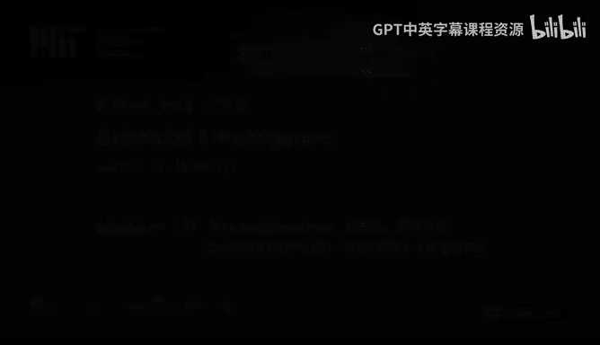
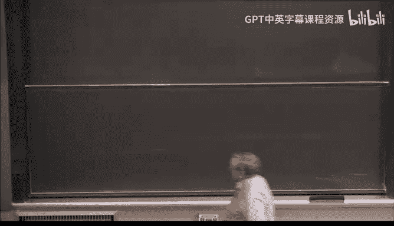
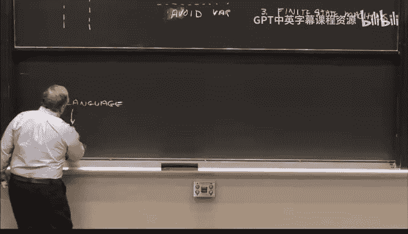
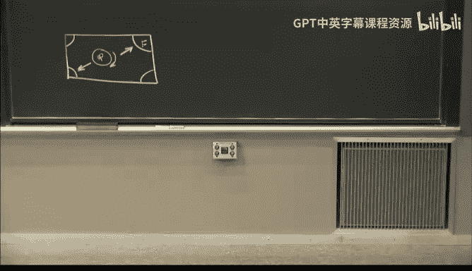
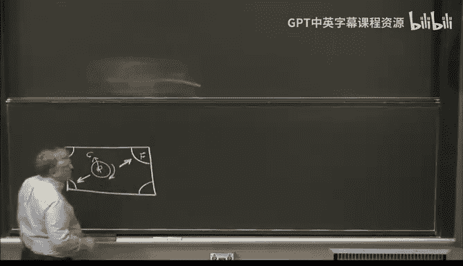
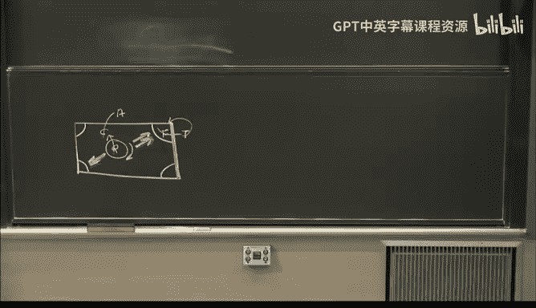

# 《人工智能｜6.034 Artificial Intelligence, Fall 2010》中英字幕 - P20：[20]19. Architectures_ GPS, SOAR, Subsumption, Society of Mind.zh_en - GPT中英字幕课程资源 - BV14fqSB2ECY

Thus， bake there thster was made famous and popular by 2001。

And that is music played at this magic moment when some primate suddenly gets an idea。

 presumably one of our ancestors。So how do we explain all that？

We've got all the ingredients on the table， and today I want to talk about various ways of putting those ingredients together。

So we've talked about representations， we've talked about methods。

 and today we're going to talk about architectures。And by the end of。The class。

You'll know how to put one of those things together。

 actually no one knows how to put one of those things together， but what you will know is。

About some alternatives for putting those things together。So as to make something。That's。

Arguably intelligent。In the same way we are。 So that's our agenda for the day。

We'll also talk a little bit more about stories。I think it was in 2007。When。The Estonians。

Moved a war memorial from the center of Tan off to a Russian。W cemetery。Prior to that time。

 the Estonians had been building up their national computer networks because they thought that computation was the way of the future networks and all that。

Shortly after the movement of that war memorial， someone brought the Estonian National Network down。

Cyber attack。It was widely believed to be the。Russians。

There's a large Russian ethnic population in Estonia to start with。

 and the movement of that warm memorial irritated the Russians。

 and so everybody thinks that they did it。But you know what。

 no computer can understand the story I just told。They can revel through all over the world by web finding information that's relevant to that。

But no computer can understand the story I just told。Except one。

 you'll see a demonstration of that later on today。So if by the way。

 if you're interested in understanding nature View of In， this is of course。

 the most important lecture of the semester。And I should tell you a little bit about what we're going to do on Wednesday because。

For some reason， the day before Thanksgiving， tends to be a lecture that's slightly populated except in this class。

 because I'm going to talk about。Business the artificial intelligence business and what can we learned from it about how to avoid going broke when you start your company。

So for many of you， that will be。The most。Important lecture of the semester Yeah good。

So it all started back in the dawn Age of artificial intelligence。

And really it all started at Carnegie Mellon sad to say。

Because people at Carnegie Mellon are notably newwell in Simon。

Well the first to think about sort of a general purpose way of putting things together so as to build a。

Structure or architecture for in which particular intelligence systems could be built。

So their idea was called the general problem solver。

A long name for a simple idea。And the simple idea is that you start your life out in a current state。

Call it。四。And you want to get to some goal state。Call it S。

And the way you do that is you measure somehow the symbolic difference between where you are and where you want to be。

So that's the difference。We'll call that difference D。And when you observe that difference。

 that's enough， they say， in this general approach to problem solving， you dislike some operation。

That will move you from your current state to some new state， an intermediate state。Call that I。

So I or that operator， O。Is determined。By the difference D。And then of course。

 the next thing to do is to measure the difference between that intermediate state。

And the state you want to be in。And choose some operator。It's relevant to reducing that state。

 So we'll call that D， and we'll call this O2。And D2 is what leads you to O2。And so， it goes。

So that's the idea， and that's often called means ends analysis。Right， because。

The end that you want to achieve is being in that final state， S。And the means is that operator oh。

So you have some notion of where you want to be and the difference between where you are and where you want to be and you pick an operator。

So as to reduce that difference， this is all very abstract。

Let's exercise it in solving a problem that you'll all be faced with here in a day or two。

 and that is for many of you， most of you， I hope the problem of going home。So here you are。

You're at MIT。And where you want to be。Is over here。At后。

So you measure the difference between MIT and home， and for many of you。

 it's further you can go by car and not so far that you can't go at all， so what you do is you say。

 well， the right operator is taking an airplane。So here you are， there's the operator。

Take an airplane。And this is the difference， D。And the difference D being sufficiently large。

You take the airplane trouble is。If you happen to be sitting here in 10 to 50。

 there's no way you can take an airplane because they don't fit in here。

So you've got another problem and that is to get to the airplane。

So the distance between here in Logan is such that the right way to do that。Is to。Take。The MBTA。

And that's determined because you're working on this difference reduction right here， the difference。

From being at MIT and being at the airport， so that difference dictates that you take the MBTA。

 so you see you're recursing。But you know， there are no MBT cars in here either。

 so there's still a difference。Like so， and that difference。Deics that you want。So you've got D1。D2。

And D3。And by the time you've exercised the operators relevant to those three differences。

 you're at Logan。Then you take the airplane and you get over to your hometown and you're faced with a smaller difference of getting from that airport to where you actually want to go。

 So that's the general problem solver idea。It was such an exciting idea。At the time。

 it was such an exciting idea at the time because people would say to themselves。

 this is a general purpose problem solver so we can set it onto the problem of making itself smarter。

And so there was a kind of imagined chain reaction that would take place。

And the developers of this architecture warned the public。That within 10 years， that is I say。

 by about 1970， computers would be。Generally， as smart as people。

And a lot of people made fun of them for that prediction。

 But it was actually scientists attempting to be responsible because they thought something。

A quite serious dislocation was coming along and that people should know that it was coming。

 and so they felt it was their responsibility in that age of scientific responsibility to war the public。

It didn't turn out that way because。Well， the problem of。

Collecting the differences and finding the operators。That's outside the scope of the architecture。

So this is the problem that has to be solved by a human before this architecture can be used。

 you have to have identified the differences that you might encounter。And the operators。

That you might use。And build this table。Which relates the two together。 So maybe that one， that one。

 some off diagonal elements and so on。 But building that table turned out to be a hard job。

So not surprisingly， the idea evolved and eventually。

The folks at Carnegie who developed the general problem solver。Most notably。

 Newell and his students developed a newer， fresher， more elaborate architecture called SOR。

And here's how so works first of all， what does so mean？啊。It doesn't mean anything used to mean。St。

Operator。Operate for。And。Result。But for some reason， the。

Proponents of the SOR architecture have decided they don't like the acronym and have asserted that SOR is merely a label that shouldn't be thought of as an acronym。

In any event， solar consists of various parts。It has。A long term memory。And has a short term memory。

And it has connections to the outside world。Maybe a vision system and an action system。most of the。

Activity of the sore problem solving architecture takes place in this short term memory。

So you can view the contents of a long term memory as shuttling in and out of short term memory。

 So you can see right away that this mechanism， this architecture。Is heavily influenced。

By certain cognitive psychology experiments having to do with how much you can hold in your short term memory。

 nonsense syllables and all that sort of thing that was popular back in those days。

So this was a architecture devised primarily by psychologists， and it had as amongst its features。

 a short term memory。And a long term memory。So that's part one of this architecture。

 what's in the long term memory， Well assertions。And rulesles。A可唉。Productionions。

A production being the。Kdly vernacular for rules， it's just rule based stuff like you saw in almost the first day of class。

So the whole thing is a gigantic real based system。

With assertions and rules that shuttle back and forth from long term memory into short term memory where processing takes place。

The third thing that comes to mind when you think of the soil architecture is they had an elaborate preference system。

You recall that when we talked about rule based systems。

 there was always a question of what do you do when more than one rule would work？

You have to have some way of breaking those ties， because soil architecture has a elaborate subsystem for doing that。

But I said that these are the first three things you think about and maybe that's not right。

 because the next thing you think about is perhaps a way of a better thing to identify with the solar architecture。

 and that's the idea of problem spaces。And that's the idea that if you're going to solve a problem。

You have to develop a space and do a search through that space。

Just like we did when we talked about how we can get from here to home。There's a space of places。

 that's our problem space。We can do a search through that space to find a way to get from one place to another。

That's the sort of thing that sore。Is focused on。Finally。

The fifth element you tend to think about when you think about SOAR is the idea of universal subgoing。

And that's the idea that whenever you can't think of what to do next。

That becomes your next problem that deserves its own problem space and its own set of differences and operators and rules and assertions。

So you start off on a high level， then you have to solve problems at a lower level。

 just like you did up there with a general problem solver。So if you have these two architectures。

 you can begin to say， well， what are they centered on？And this architecture is。

This general problem solver centered on the idea that everything is about problem solving。

It's the problem solving。Hypothesis。Knowing David that name， like that's what it was。

And this architecture did get its name。It was called always。

 it was said always by nu to be based on what he called the symbol system hypothesis。

The hypothesis that what we are as humans is symbol manipulators and we can。

Icover how that all works by giving people cryparrithmetic problems and having them talk out loud。

By thinking about what happens when you try to remember nonsense syllables。

By all that sort of stuff that was in Vogus in terms of psychology experiments in the day when this architecture was first articulated。

But when you look at architectures， you can sort of see where they come from and what their antecedents are。

It has a short term memory and a long term memory because。

Newell and his associates for cognitive scientists。It has assertions and rules and preferences。

Because。Newell and his associates were also AI people。

And it has problem spaces and universal subgoing。Because those are ideas that have been worked out in a more primitive form already in the general problem solver architecture。

So that's a glimpse of what SOR looked like in its early days and it's been very highly developed by a lot of smart people。

So although it's symbolcented， they've attached to it things having to do with emotion and perception。

 but generally with the view that the first thing to do when faced with a perception is to get it out of there and get it into a symbolic form。

That's sort of the bias that the architecture。That the architecture comes with。

So those are two architectures that are。Heavily biased toward thinking that the important part of what we do is problem solving。

But the most important， perhaps， at least from an MIT perspective。

 of these problem solving ored ways of thinking about the world， is Marvin Minsky's architecture。

Which he articulates in his book， The emotionmotion machinechine。

And Marvin is not just concerned with problem solving。

 but also how problem solving might come in layers。

So let me show you an example of the sort of problem that motivates some of Marvin's thinking。

So you can read that。It's a short little vignette。We have no trouble understanding it， right？那。

It's not difficult for us humans。 awfully tough for a computer。In part。

 because the thinking you need， the ability to understand your ability to understand that story requires you to think on。

Many levels at the same time。First of all， there's a sort of。At the bottom。

 there's instinctive reaction。You see where there's instinctive reaction， yeah。

 that's the part where。She hears a sound。And turns her head。 That's instinct。

 by that's practically built in。But then what he sees is a car。

 So that's something that we don't have wired in。 it would be unlikely that we've evolved in last。

100 years to have an instinctive appreciation of cars barreling down the road。

So the next level in Marvin's architecture is。Learn reaction。

So that's the part about thinking about the car。Now， spread throughout out there， well。

 let's see where's a particularly good example。She decides to sprint across the road。

So that's where she's solving a problem。So that's the deliberative thinking level。

But it doesn't stop there。Because later on。She reflects on。Her impulsive decision。

So she thinks not only about stuff that's happening out there in the world。

 but she also thinks abouts stuff that's going on in here。

So that's a level which we can call reflective thinking。Well you know， it doesn't stop there。

Because she also considers in another part of the story， something about。

Being uneasy about arriving late。So she's not only just thinking about events that are going on to her mind right now。

 but。Events are going on right now relative to plans she's made。And so Marvin calls that。

The self reflecting layer。But that isn't the whole thing either because toward the end of the story。

 she starts to worry about what her friends would think of her。

So there's a kind of reflective thinking in a more social context。

So he calls that self conscious thinking。So whereas the Knegie folks think？

The soilar architecture focuses mostly on。Problem solving。Minsky's emotion machine。不。

Considers not just thinking but thinking on many layers。And the blocker to doing any of that。

It can be said to be the development of common sense。Which computers alas， have never had much of。

So this is going to be said to be。Based on the common sense。Hypothesis。

And the common sense hypothesis holds， and order to do all of that stuff。

 you have to have common sense like people。And if you have to have common sense like people。

 you have to think about， well， how much of that is there and how can we go get it？And so this bond。

A lot of activity。In the media lab， amongst people influenced by Marvin。

 having to do with gathering Common sense， the Open mindd Project。

The work of Henry Liman and others having to do with the gathering of common sense from。

The World wide Web， as a way of。Populating systems that would。

Lay the foundation for doing this kind of layered thinking。So that is a brief survey of some。

Mechanisms。Some older than others， but。All but GPS GPS2， let's face it。

 It's hard to think of solving any problem without means ends analysis being involved。

 so GPS isn't wrong。It's just not all you need to think。

 and it's not the only tool you need to think about what to do。

So these are early and late and still current。But it's not the only thing there is， because。

There have been reactions against this problem solving way of thinking about the development of intelligence。

And the most prominent of those。Countercurrence of those alternative ideas。

Belongs to Rod Brooks and his subsumption architecture。So long about the early。

Long about the years surrounding 1990。Brooks became upset。Smer。Assumption。

Because robots couldn't do much。They would turn them on at night and then the next morning they'd come to the laboratory and they would have moved 25 feet。

Nicely avoiding a table， perhaps and not doing very much and taking a long time to do it。

So he decided that it's because people were thinking in the wrong way。In those days。

 people thought that the way you build a robot。As you build a vision system？

And then you build a reasoning system。And then you build an action system。

 and it can do almost nothing。But it does something。

So you improve the vision system and you improve the reasoning system and you improve the action system。

 and now you've broken it because all the stuff that you used to be able to do doesn't work anymore。

So what's the alternative， Well， the alternative， as articulated by Brooks。

 is a turnist idea on its side。So instead of having a。

Encapsulated vision system and encapsulated reasoning system， encapsulated action system。

 What you have is layers that are focused not on。The sensing and the reasoning and the action。

 But layers that are that are specialized to。Dealing with the world。

So in Brooks's way of thinking about things。At the lowest level。

 you might have a system that's capable of， well， before we get to that， avoiding objects。

And maybe the next level up is the wandering layer。And maybe the next level up after that is Exp。

And maybe the next level up after that is seek。Now， in the old days when people took 601。

 I had no trouble getting an answer to the question of what does this remind you of in 601， well。

 doesn't remind you of anything it' 6001 since you haven't taken it。

But if viewed as a generalization of a programming idea。What is the programming idea？

There are only a few powerful ideas in programming。And this is a generalization of one of them。

What is it， do you have a name？Yeah， Sand。Layers of abstraction and abstraction barriers。

That nails it pretty well because each of these guys can have its own vision。

 action and reasoning system。And if you think of these as abstraction boundaries。

 then when you got this thing working， you don't screw with it anymore。

You build this layer on top and it may reach down in here from time to time。

 but it doesn't fundamentally change it。Fooks was inspired in part by the way our brains are constructed。

 all that old stuff that we share with pigs is down in there deep and we put the neocortex over it。

So it looks layered in a way that would make Jerry Sussman proud。So。

This then is the way that Brooks looks at the world。

 and it's characterized by a few features just like。Just like so is。One of those features is。

No representation。So this is a detail。That's probably right at the level that Brooks was operating。

And very questionable when you get above the level that Brooks' operating。But before I go on。

 let me say what the。What the hypothesis is， the hypothesis is the preacher hypothesis。

It's the hypothesis。And once you can get。A machine to act as smart as an insect。

 then the rest will be easy。Well， how do you get a creature to be smart as an insect。

 Maybe you don't need representation。 We， we focused on representation in this course。

 So you can see that there's a little stress。まあ。Next thing is， well。

 what do you do if you don't have a representation？

Let's see your representation makes a model possible。 Models make it possible to predict。

To understand， to explain and to control。 So if you don't have one， what can you possibly do。

 Well Brooks's answer is。You use the world。Instead of a model。So everything you do is reactive。

You don't have anything in your head that is a map of this room。

But maybe I don't need one because I can get around that table by constantly observing it。

And we don't have to fill up a memory with that information， I could just react to it。

So no representation。Use the world instead of a model。And the mechanisms。In their peers form。

I just finite state machines。So with that。Brooks was able to do things that people were never able to do before。

What's the modern instantiation of this architecture？Now， according to books。

In use in 5 million homes in the United States。Yeah。It's the rum。The rumba robot is。

By Brooks's account， approximately the 13th business plan of I robot。 And it's the one that。

Made it big， because。The Ruba vacuum cleaner。Has been very successful。

 would you like to see a movie of its spreaddecessor？okay。So this is a film。

madeade some time ago that shows in some sense， the summa of。That architecture。

 what I want you to imagine very briefly is a robot that wanders around in the halls and rooms of the old tech square collecting the coatke cans。

Okay， you all got an image of that in your mind。Because I want you to compare the image you now have of that robot that's wandering around collecting the Coke cans with the actual movie。

Herber， the Sodaan collecting mobile roll。It was built at the MIT AI Lab in 1989。

 The work was done by John Cannell under the supervision of Rodney Brooks。

Herbert is a robot controlled by subsumption architecture。 This is a collection of small behaviors。

That influence the overall activities of the robot。 There are no centralized controllers。

 and no world model。Herbert navigates by using a number of infrared proximity sensors around its body。

And basically， following walls and corridors。You can also look for the cas with a laser light stripper。

Right now， it's come out of the door of an office， followed along the wall。

 and then it lasered light stripper has seen a tan on top of the desk in front of it。

When this happens， a robot stops and deploys the d。You can see the arm going out now。

The arm has a number of sensors itself， there are fingertip sensors， a brake beam in the jaws。

 and two infrared proximity sensors on the front of the hand。It grabs cans in a stereotyped fashion。

First， it lowers down to find pace surface somewhere。

Then it bounces along the surface until it sees a can in front。

It uses the hand based IRs to recenter the arm by rotating the robot's body。

Until the can comes between the jaws of the gripper。At which point the brake theme senses the can。

After acquiring CA， Herbert will tuck the arm back into its normal traveling configuration。

And attempt to go home。Since it has no central representation。

 it doesn't have any map of where it came from， instead it has an algorithm which uses a magnetic compass to determine every time it comes through a door。

😔，Will it be able to find the door， basically has a policy of always going north every time it exits the door。

So now the cams being tucked away。As the robot turns。

 you'll see a red stripe from the laser rangefiner。And now it's using the body IR to navigate back。

 find the door and go through the door with its prize。And there if you' were payque。

 attention you saw a little glimpse of John Cannell， who was the student who developed that system。

That was a tour of force。 That was a magic moment。 That was when you opened a champagne。

 It's not what you expected， of course， because when I say， imagine。

A robot wandering around in tech square， picking up the coke cans。

 That leaves it open a huge envelope of possible hallucinations。

And usually are whose nations about these things are。We imagine things to be more fluid。

 more natural and more impressive than they actually are， but that was impressive。

Because nobody came close to doing anything like that before。

More to be said about that during the business lecture on Wednesday。

So that's this assumption architecture， by the way。Maybe at this point， we can say something about。

How the other architectures relate to what Minsky was talking about。

What's this deliberative thinking layer？Correspond to。Well， that's what SR is about。And maybe GPS。

So what's subsumption about？It's about stuff down here。Yeah， it's about。

Instinctive reaction and learned reaction。But shoot， what about Minsky's other layers。

If we're going to be building systems that are as smart as those things。

 then we have to worry a little bit about that sort of thing too。

 So that brings us to the Genesis architecture。 and now let me give you the standard caution。

This should be early in the presentation of any academic， I will sometimes say I。

And what I mean is we。And sometimes I'll say we。 And what I mean is they。

 This was a system that was developed mostly by。Students of mine who persuaded me。

After a great deal of time that they were thinking the right kinds of thoughts。

But here's how the Genesis architecture works。As is no surprise， given recent discussions。

 it's all centered on language。And the language part of the genesis system has two roles。

 one of which is to。Guide and marshal， and interact。With the perceptual systems。

And the other。Is to enable。The description of events。Wow。😮，Iice spell。That's how it works。

 so is perception important？I don't know。I might ask you a question like。

Is there anybody sitting in the front row wearing blue jeans？

And it's hard for you to resist under those circumstances。

 your eyes from going over there and answering the question， your eyes answer the question。

No symbol no symbol processing system is involved， except insofar as my language。

System has communicated with your language system。Which drives your motor system and your vision system to go where there and answer the question for you。

But it's not just the real stuff that the language system directs your attention to。

 It's also the imagined stuff。Shoot， it's been a long semester if I told you the story about my table saw。

Probably not。 Here's the deal。 I bought a table song。 It's a wonderful table song。

 I was installing it with a friend of mine， who's a cabinet maker。😊，He said。

Never wear gloves when you operate this song。Why， I said。Before you could answer the question。

 I figured it out， can you figure out why you never wear gloves when you operate table saw？

You know what a table saw is， right， It's， it's a table with a spinning blade in the middle。

Use it to cut wood。Why should never wear gloves？Yes。Well， you know the answer。 It's not fair。

 That's old Bret up there。 He's heard this story too many times。Yes， Andrew， you got it？

You've told the answer， how about somebody who hasn't been told the answer， yes。しまいで。

Because the glove might get caught and pull your hand into the blade and then what happens。You know。

It's horrible， your hand gets mangled。And your fingers get cut off。

 and this happens a lot to professionals。It won't actually happen with that table saw that I bought because it's blade to text flesh and stops the blade。

 which then leads to stopping the blade and having the blade retreat into the table in about two microconds。

 two milliseconds。So in general， though， it's a bad idea and you always have to suppose that the mechanism isn't working anyway in order to use good safety practice。

 but here's an example of something that nobody ever told you that he was able to figure out。

By imagining what would happen。And reading the answers off of the scene that he imagined。

So nobody ever says many of the things that we know， but we know them anyway， here's another example。

 Imagine running down the street with a full bucket of water， what happens。

The water splashes out and gets your leg wet， right？You won't find that an Open Minds database。

 nobody ever said that over the web。It's not written down anywhere， but you know it。

Because we human beings， have a capacity to imagine perceptual things and read the answers to questions off of。

Off of our imaginations with that perceptual apparatus。So that's a very important。

Connection down there。And then if you' got the ability to describe events。

Then you've got an ability to tell and understand stories。And if you can do that。

Then you can start to get a handle on culture。Both macro。And micro。And by macroculture， I mean。1。

The country you grew up in， the religion you grew up with， and by micro。

 I mean your family and personal experience and all shades in between。

So I don't know what inspires me and my associates to think in terms in these terms。

 We talked little about a little bit of it last time when I talked about。Evolution。Any apparent？

Flowing of our species about 50000 years ago。At which time we got something？

And I believe that what we got。And this is the characterization of this particular hypothesis。

What we got is the ability to。Tell stories and understand them。

So if we want to label this representation。It's the label。Strong story。Hypoth。

So what's the weak story hypothesis， The weak story hypothesis is this is important。

 the strong story hypothesis is this it's all our is。But is there any other evidence that this is？

Really， really， really important。So I have a queried Krishna here before the class starts and he tells me I haven't told you about the following experiment。

This in my way of thinking is the most important series of experiments。

Ever done in cognitive psychology， developmental psychology， actually。So。Here's how we get started。

There's a rectangular room。If you're a person。If you're a rat， it's a rectangular box。

All the walls are painted white。You with me so far。So now in each corner。There's a basket or a cloth。

Or something。In under which you can put some food。Now you put the food there。

While the rat watches you。And then。You give the rat。A little spin to disorient it。All right。首先人。

The rat stops and goes for the food。And you can keep track of where the rat goes。And there rack goes。

With approximate equal probability predominantly to those two corners。

So I bes you didn't know that rats were that smart。

So they understand the rectangular nature of the room。

And they don't go to the diagonal corners where the food cannot be。So these are these genius rats？

Or maybe we're just rats with big grains because we do the same thing。

So if you repeat this experiment。And replace the rat with a small child。

And then you。He put a toy in there instead of。Food and the child is usually held in parents' arms。

Usually the child's mother。Usually because they think that if they participate in these experiments up there at Harvard。

 a kid will get into Harvard someday。So the kid goes to the diagonal corner just like a rat。

And then then the next thing you do is you try an adult。Maybe an MIT student。

And that way case you can use food again。And you get the same result。Who could be surprised？So rats。

 children and human adults， pretty much all the same with respect to this experiment until。

You paint one wall blue。Maats are not color blind， in case you're wondering。Then what happens？Well。

 if you paint one more blue。The rat still goes with equal probability to the two diagonal corners。

If you paint one wall blue。The child still goes to two diagonal corners with approximately equal probability。

It's only us genius human adults。H狗。Only to that corner。So this invites a couple of questions。

One of which is。When does a child become an adult？Any ideas。La， what do you think？你你啲。

So you can pick a number greater than one in less than 10。我 I扫理佢。Five pretty good guests。

Do you have siblings at that age？It's a surprise。 But why is it5， is it because。

What does it relate to is there any correlate to the onset of that ability？

You might try everything a Spelky does because she's extremely careful。So she's triedge。

She has tried the own set of language。I don't know， the appreciation of music， handedness。

And there's only one thing that matters。And that is that the child。

It becomes an adult at that time when they start to use the words left and right when they describe the world。

Now I said that very carefully because they understand left and right at an earlier age。

But they only have started to use the words left and right when they describe the world at the time that they begin to break this。

They been to break the symmetry and go to the correct corner。Now for the next element of this。

 I need something to read， because anyone've got a textbook handy。啊，有有。啊。China。Illustrated history。

Now I need to volunteer。Okay， Andrew， you want to do this， so here's what you're going to do。

You could stay there。But you can need to stand up。So what I'm going to do is I'm going to read to you a passage from this book。

 and I want you to say it back to me at the same time I read it。

 it's as if you are doing translation， simultaneous translation， except it's English to English。Gosh。

 just's got words I can't pronounce， okay you ready to go？はい。

When overwhelmed by the magnitude of the problems he tackled。

 he began to suspect that others were plotting against him or secretly ridiculing him。So it's not。

 thank you very much that's great So you see he could do it。 Some people can't do it。

 at least takes a little practice， but he did it。And guess what I've done to him。

I reduced his intelligence to that of a rat。Because if you do this experiment。With an adult human。

With。Who's doing this simultaneous English translation。

They go with equal probability to the two corners。So what's happened？

What's happened is you jammed their language processor。And when their language processor is jammed。

 they can't put the blue wall together with a rectangular shape。

So it seems to be that language is the mediator of exactly the combbininators you need in order to build descriptions。

Because they can't even put those things together when their language processor is jammed by the simultaneous translation。

phenomenon。So that brings us to the two gold star ideas of the day。And one is。

 if you want to make yourself smarter。You want to do those things， look， listen， draw and talk。

 because those are the particular mechanisms。That's surround this area down in here。

Which is the center of what we do， which is the center of our thinking。

So why do you take notes in class， not because you'll ever look at them before。

 but because it forces the engagement of your linguistic。Of your linguistic。

 your motor and your visual apparatus， and that makes you smarter because it's exercising that stuff。

Second thing you can say in conclusion， especially from this experiment。I。Beware。Of。Fast。Talers。

AndWhy do you want to be aware of fast talkers， it's not because they will talk you into anything。

It's because when they talk fast， they're jamming your language processor and you can't think。

That's why you want to be aware of。Fast talkers。Because if they jam your language processor。

 you won't think and you'll buy that car。Or you'll buy that drink。

 or you do any manner of things that people who want you to do those things have learned to do by。

By talking fast to jam your processor。So that completes what we're going to do today andll give you a demonstration of some of this stuff on another occasion。

