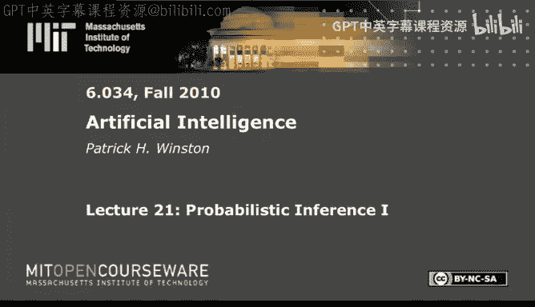
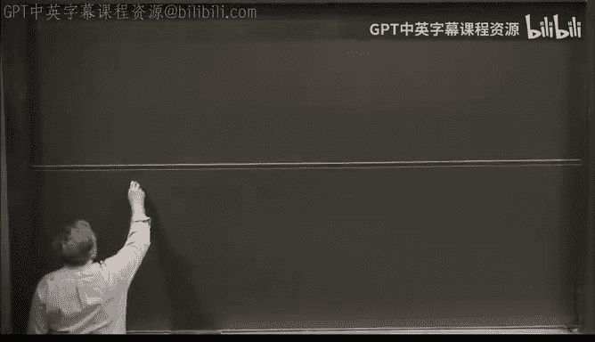
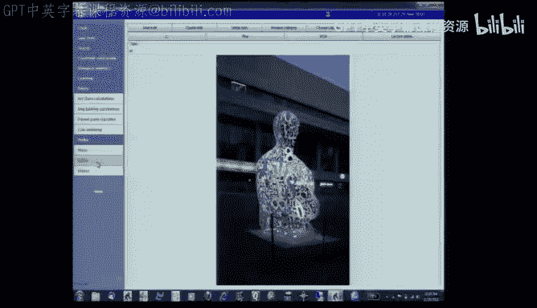
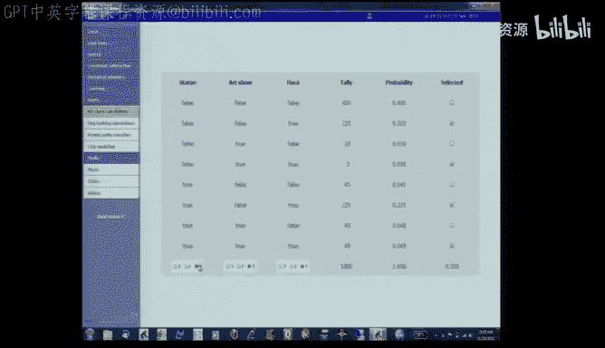
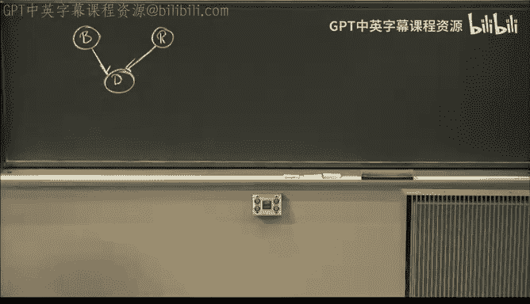
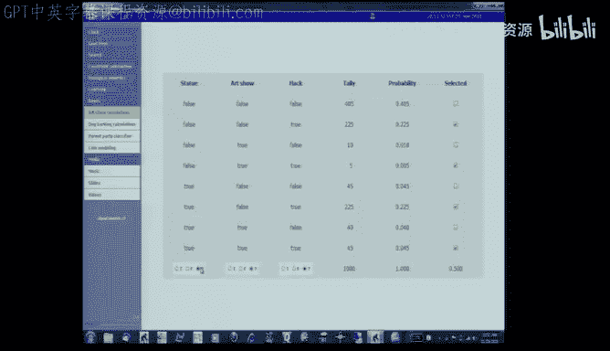
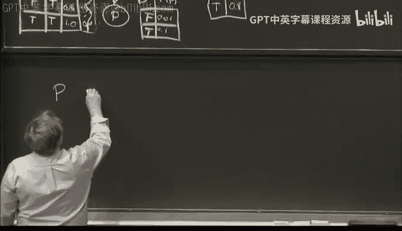

# 《人工智能｜6.034 Artificial Intelligence, Fall 2010》中英字幕 - P21：[21]21. Probabilistic Inference I.zh_en - GPT中英字幕课程资源 - BV14fqSB2ECY

Here we are down to the final sprint。Three to go。And we're going to take some of the last three。

 maybe two of the last three to talk a little bit about。

Stuff having to do with probabilistic approaches， use of probability in artificial intelligence。

Now for many of you， this will be kind of a review。

 because I know many of you learned about probability over the sand table。And every year since then。

But maybe we'll put another little twist into it， especially toward the end of the hour when we get into a discussion。

Of that， which has become to be called。Beliefness。But first。I was driving in this morning。

And I was quite astonished to see。As I drove in。This thing here。ためため感。And my first reaction was。

 oh my God， it's the world's greatest hack。And then I decided， well。Maybe it's a piece of art。

So Id like to address the question of how I could come to grips with that issue。

 There's a distinct possibility that this thing is a。Consequence of a hat。

Possibly the result of some kind of art show。And in any event， some sort of statue。

Appeared and statues don't usually appear like that。

So we've got the possibility of thinking about how all these things might。

Occur together or not occur together。So the natural thing。Is to build myself some sort of table。

And to keep track of my observations。So I have three columns at my table。 I've got。

The possibility of a statue appearing。A hack having it heard。And some sort of art show。

And so I can make a table of all of the combinations。Of those things that might appear。

And I happen to have already guessed。That there are going to be eight rows in my table。

So it's going to look like this。And this is the set of combinations in this row where none of that occurs at all。

And down here is the situation where all of those things occur。

 after all it's possible that we can have in that art show and have a hack be a legitimate participant in the art show。

 that's why we have that final row。Then we have all manner of combinations in between。

So those are those combinations， then we have FFT， T， FFTT。FT， F T， F。The f。

So it's plain that the number of rows in the table。

these binary possibilities is two to the number of variables。And that can be。

 that can be a big number。 In fact， I love to do a bigger example， but I don't have the。

I don't have the patience to do it。But anyhow， what we might do is in order to figure out how likely any of these combinations are as we might have observed the area outside the Student center and rest campus over a long period of time and keep track of what happens。

On1 thousand days。Or maybe a thousand months。For1 thousand years， I don't know。

The trouble is these events don't happen very often。

 so it's the period of time that I use for measurement。Nes to be fairly long。

 probably a day is not short enough， in any case I can keep track of， I can keep a tally。

Of how often I see these various combinations。 So this one might be， for example，405。

 This one might be 45。 This one might be 2，25。 This one might be 40。And so on。

And so having done all of those measurements， kept track of all that data， then I can say， well。

 the probability that at any given time period。3。One of these things occurs will just be the frequency or the number of tallies divided by the total number of tallies。

So thatll be a number between zero and1。So that's the probability。

So that's the probability for each of these events。And it's readily calculated from my data。

 And once I do that。Then， I can。Say that I've got myself a joint probability table and I can perform all manner of miracles。

Using that joint probability table。So let me perform a few of those miracles while we're at it。

There's the table。And now what I want to do is I'm just going to count up。The number of rows。

 I want to count up the probability in all of the rows where the statue appears。

 So that's going to be the probability of a statue appearing。

So I'll just check off those four boxes there。And looks like the probability of a statue appearing is about point。

3，5，5 in my model。 I don't think it's quite that frequent， but this is a classroom exercise， right。

 so。I can make up whenever numbers I want。Now， I could say， well。

What's the probability of a statue occurring？Giveniv given that there's an our show。Well。

 I can limit my tallies to those in which art show is true。Like so。And in that case。

 the probability is just summed up。 So if I know there's an art show。

 there's a much higher probability that this。That a statue will appear。

And if I know there's a hack as well as an art show going on， goes goes up higher still to 0。9。

But we can also do other kinds of things。 for example， we can go back to the original table。

 and instead of counting up the probability that we've got an art show going on。

 we can the probability。 we've got a statue， as we just did。

 we're going to calculate the probability that there is a。Art show。

 I guess that would be that one and that one。Not that one， but that one。 so the probability。

 there's an art show。There's one chance intent ten。Or we can do the same thing with a hack。

 in that case we get。That went off， that went on that one off， that one on， that one off。

 that one on， that went off so the probability of a hack on any given time period is about 50，50。

So I've picked up this little demo so that does the ands of all these things it could do ors too with a little more work。

 but these are just the ans of these various combinations。

But you can ask more complicated questions like， for example， you can say。

 what is the probability of a hack？Given there's a statue。And that would be。Limiting the。

Calculations to those rows in which the statue thing is true。And then what I get is 0。781。Now。

 what do you think the probability that it would be a hack。

 what would happen to the probability that it's a hack？If I know that there's an art show。

Will that never go up or down？Well， what's right？I went down。

So that's sort of because the existence of the art show sort of explains why the。

Why the statue might be there。Now， just for fun， I'm going to switch to another situation。

 very similar。AndThe situation here is that。A neighbor's dog。Often barks。

It might be because of a burglar， it might be because of a raccoon。

 sometimes as a burglar and a raccoon。Sometimes damned dog just barks。

So let's do some calculations there and calculate the probability that that's accoon。

 the probability a raccoon is true similar to what we did last time。It looks like on any given night。

 it's a kind of a wooded area， it's a high probability of raccoon showing up。

And then that we can ask， well， what what what the？

Probability of the dog barking given that a raccoon shows up。Well， in that case。

 we want to just limit the number of rows to those who are at raccoon where the dog is barking。

Looks like the。Probably of the dog barking， knowing nothing else is about 3，7。啊。

s now we want to know the probability of the raccoon， these guys here need to get checked。

 these are off。So that's the probability of a raccoon。诶识世机大位。TOh that's the probability of a burglar。

 sorry， that was too high。So let me go back and calculate I want to get the probability of a raccoon。

 that's true， false， true。Fse， true， false。So。So the probability of reckoning again as I said before is 0。

5， but now what happens to that probability if I know the dog is barking？Well。

 all I need to do is limit my rows to those where the dog is barking those bottom four。

And I'll click that there and you notice all these tallies up above。

The the midpoint of going to zero， as I'm only considering those cases where the dog is barking。

In that case， the probability that there's a raccoon。

 just the number of tallies over the total number of tallies， it's gee。

 I guess it's 225 plus 50 divided by 370。That turns out to be 0。743。So about 75% of the time。

The dog barking is countered for well， the probability of that a raccoon under those conditions is pretty high。

And now， once again， I'm going to ask， well， what is the probability of a raccoon given that the dog is barking？

And there's a burglar。And guess what will happen there， we did this once before with the statue。

 probability first went up and we saw the statue and then went down when we saw another explanation。

Here's this one here。Well， look at that it went back to it。Original condition。

 it a priori probability。So somehow the existence of the burglar and the dog barking means that the probability of a raccoon is just what it was before we started this game。

So those are kind of interesting questions and there's a lot we can do when we have this table by way of those kinds of calculations。

And in fact， the whole miracle of probabilistic inferences。Right in front of us， it's the table。

So why don't we go home well， because there's a little problem with this with this table。

 with these two tables that I've shown you by way of illustration。And。The problem is。

The problem is that there are a lot of rows。And I had a hard time making up those numbers。

 I didn't have the patience to wait and make observations。 That would take too long。

So I had to kind of make some guesses。And I could kind of manage it with eight rows， those up there。

 I could know put in some tallies it wasn't that big a deal。

So I got myself all of those eight numbers up there like that。

And similarly for the art show calculations。Produced eight numbers。

But what if I added something else to the mix？

What if I added the day of the week？What I had for breakfast， each of those things would。

Double the number of rows of their binary variables。So if I have to consider the possibility。

 if I have to consider 10 influences all working together。

 then I' have two to the1 I have1 thousand numbers to deal with。And that would be hard。

But if I had a pro joint probability table then I can do these kinds of miracles， but Dave。

 if I could have this little projector now， please。

I just want to emphasize that although we're talking about probabilistic inference and it's a very powerful tool。

It's not the only tool we need in our bag， trouble with most ideas and artificial intelligence is that their hardcore proponents think that they're the only thing to do。

And probabilistic inference has a role to play in。Developing a theory of human intelligence。

 and it certainly has a practical value， but it's not the only thing， and illustrate that point。

I' like to imagine for a few moments。That MIT were founded in 1861 BC instead of 1861 AD。

And if that were so。Then it might be the case that there would be a research program on what floats？

And this， of course， would be an problem in experimental physics。

And we can imagine that those people back there in that early MIT would be experimentally minded。

 try some things。I didn't know that what happened， it looks like chalk floats。Here's a rock。

No I didn't float。Here's some money。Doesn't float。Here's a pencil。No， it doesn't float， here's a pen。

Here's a piece of tinfoil I got from Kendra that floats。That's a metal。 The other stuff's metal， too。

 Now I'm really getting confused。 Here's a little w of paper。Here's a self- no， I' tried actually。

 I've tried that before， they don't float and they also don't work afterward either。

I don't need to do any of that in the MIT。1861 AD and beyond because I know that ourimedes worked this all out and all I have to do is measure the volume of the stuff。

 divide that by the weight。And if that ratio is big enough， then the thing will float。

But back in the old days， I would have to try a lot of stuff and make a big table。

Take into account such factors as how hard it is。How big it is， how heavy it is。

Whether it's alive or not。Most things that are alive float， some don't。Fished out， for instance。

So it would be foolhardy to do that。That's sort of a probabilistic inference。On the other hand。

 there are lots of things where I don't know all the stuff I need to know in order to make the calculation。

 I know all the stuff I need to know in order to decide if something floats。

 but not all the stuff I need to know。In order， for example， to。For example。

 to decide if the child of a Republican is likely to be a Republican。

There are a lot of subtle influences there， and it is the case that the children of Republicans and the children of Democrats are more likely to share the political party of their parents。

But I don't have any direct way of calculating whether that will be true or not。

 all I can do in that case is what I've done over here is do some measurements， get some frequencies。

 take some snapshots of the way the world is and incorporate that into a set of probabilities that can help me determine if any given parent is。

A Republican given that I've observed the voting behavior of their children。

So probability has a place， but it's not the only tool we need。

 and that is an important preamble to all the stuff we're going to do today。Now。

 we're really through because this joint probability table is all that there is to it。

Except for the fact that we can't either。Record all those numbers and it becomes quickly a pain to guess at them。

There are two ways to think about all this。We can think about these probabilities as。

Probabilities that come out of looking at some data， that's a frequent view of the probabilities。

 or we could say， well， we can't do those measurements so I can just make them up。

That's sort of the subjective view of where these probabilities come from。

And in some cases theres a there。Some people like to talk about natural propensities。

 like in quantum mechanics。But for our purposes， we either make them up or we do some tallying。

Trouble is we can't deal with this kind of table。So as a consequence of not being able to deal with this kind of table。

 the gigantic industry has emerged for dealing with probabilities。

Without the need to work up this full table。And that's where we're going to go for the rest of the hour。

And here's the path we're going to take。We've going to talk about some basic review of basic probability。

Then we're going to move ourselves step by step toward the so called belief networks。

 which make it possible to deal to make this a practical tool。So's let us begin。

 the first thing is a basic probability， let us say。没食。And basic probability。

 all probability flows from a small number of axioms。We have the probability。Of some。

Event A has got to be greater than zero and less than one。That's a number one。

Things have a probability of being in a binary world， things have a probability of being true。

 some have probability of being false， but the true event doesn't have any possibility of being anything other than true。

 so the probability of true。Is equal to one and the probability of false。The false event。

 the false condition。Has no possibility of being truth， so that's zero。

And then the third of the axioms of probability。Is that the probability？a。Plus，ly probability of B。

Minus the probability of A and B。Is equal to the probability of A or B。Yeah， that makes sense， right？

I guess it would make more sense if I didn't switch my notation in midstream。A and B。

So those are the axioms and mathematicians love to start up that way and they can derive everything there is to derive from that。

 but't I never can deal with stuff that way， I have to draw a picture and think of this stuff in a more intuitionist type of way。

So that's the formal approach to dealing with probability， and it's mirrored by an intuitions。

That have to do with discussions of spaces。Like so in which we have circles。Or areas representing。诶。

And B。And to keep my notation consistent， I'll make those lowercase。

So you can think of those as spaces of all possible worlds in which these things might occur。

 or you can think of them as。Sample spaces， but in any event you associate。With the probability of a。

 the size of this area。Here， relative to the total area in the rectangle， the universe。

So the probability of a is the size of this circle。

Divided by the size of this rectangle in this picture。So now all of these axioms make sense。

The probability that A is certain is just when that fills up the whole thing。

And there's no other place for a sample to be， that means it has to be A。

So that's probability goes all the way up to one。On the other hand of the size of a is just a infiniteestsimal dot。

And the chance of landing in that world is zero。And so that's the bound on the other end。So this。

Acxiom number one makes sense in terms of that picture over there， likewise， axiom number two。

 what about axiom number three？Does that make sense？In terms of all this stuff。

And the answer is sure。Because we can just look at those areas。With a little bit of colored shocklk。

And so the probability of a is just this area here， the probability of B is this area here。

And if we want to know the probability that we're in either A or B。

Then we just have to add up those areas， but when we add up those areas。

 this intersection part is added in twice。So we got to subtract that off。

In order to make the same make a rational equation。

 so that makes sense and axiom 3 makes sense just as axis one and two did。

So that's all there is to basic probability and now now you can do all sorts of algebra on that and it's elegant because it's like circuit theory or electromagnetism because from a very small number of axioms in this case three。

You can build an elegant。Mathematical system。And that's what probability subjects do。

 But we're not going to go there because。We're sort of focused on。

Getting down to a point where we can deal with that joint probability table that we currently can't deal with。

So we're not going to go into a whole lot of algebra with these things。

 just what we need in order to go through that network。

So the next thing we need to deal with is conditional probability。And whereas those are axioms。

This is a definition。We say that the probability of A， given B。Is equal to， by definition。

 probability of a。Andvy。I'm using that common notation to mean Ant as it conventional in the field。

And then we're going to divide that by the probability of B。And you can take that as a definition。

 and that is just a little bit of mysterious algebra。Or you can do like we did up there。

And take an intuitionist approach。And ask what that stuff means in terms of。

A circle diagram in some sort of space。And let's say， what does that mean。

We're going to restrict the probability of A to those circumstances where B is known to be so。

And we're going to say that。We've got this part here。And then， we've got the。

Intersection of A with B。And so it does make sense as a definition because it says that if you've got B。

 then the probability you're going to get A is the size of that intersection。

 the pink and orange stuff divided by the whole of B。

So it's as if we restricted the universe of consideration to just that part of the original universe that' covered by B。

So that makes sense as a definition。And we can rewrite that of course， as P of A and B。

As equal to the probability of A given B。Times the probability of V。That's all basic stuff。

Now we do want to do a little bit of algebra here。because I want to consider not just two cases。

 but what if we divide the space up into three parts？Then we'll say that the probability。Of A， B。

 and C。Is equal to what？Well， one way there are lots of ways to think about that。

 but one way to think about it is that we are。Restricting the universe to that part of the world where B And C。

Are both true。So let's say that why。Is equal to B。And see the inner the， the the。The union， sorry。

 the intersection of B and C， where A and B are both true。

Then we can use this formula over here to say that probability。Of a， given。Probably of A， B， and C。

Is equal to the probability of A and Y。Which is equal to the probability of a。Given。

Y times the probability of y。And then we can expand that。Back out。And say that P of a。Given。B and C。

Is equal to the probability sorry。Times the probability of y， but y is equal to probability。

Of B and C。Like so。But wait， B and C， we can run this idea on that over that one too。

 and we can say that this whole works is equal to the probability of A given B and C。

Times the probability of B。电 c。In terms of probability of C。

And now when we look stand back and let that sink to us。

 we can see that some magic is beginning to happen here。Because。

We've taken this probability of all things being so。

And we broke it up into a product of three probabilities。The first two are conditional probabilities。

 so they're really all conditional probabilities， the last one's conditional on nothing。But look。

 what happens is we go from left to right。A is dependent on two things。

B is only dependent on one thing and nothing to the left。

C is dependented on nothing and nothing to the left。So you can sense a generalization coming。

So let's write it down。So， let's go from here。Over to here。

And say that the probability of a whole bunch of things， x1。Through X， and。

Is equal to some product of probabilities。 We'll let the index I run from n to1 probability of x。

The last one in the series。Conditioned on all the other ones， sorry。

 that's probability of I is i minus1。Down to x1。Like， so。And for the first one in this product。

 I will be equal to n for the second one， I will be equal to n minus-1。

 but you'll notice that as I go from n toward1， these conditionals get smaller。

 the number of conditional things I'm condition on get smaller。And none of these things。

Are on the left。They're only stuff that I have on the right。

So what I mean to say is all of these things have an index that's smaller than this index。

None of the ones that have a higher index are appearing in that conditional。

So it's a way of taking a probability of the end of a whole bunch of things and writing as a product of probabilities。

 conditional probabilities。So we're making good progress， we've done one。We've done two。

 and now we've done three because this is the chain rule。And we're about halfway through our diagram。

Halfway to the point where we can do something fun。

But we still have a couple more concepts to deal with。

 and the next concept is the concept of conditional probability。So that's all this stuff up here。

Oops。All this stuff here is a definition of conditional probability。

And now I want to go to the definition of。Independence。Yeah。And。The and。啲。Yes。

So that's another definitional deal， but it's another definitional deal that makes some sense with a diagram as well as well。

 So the definition。Those like this。We say that P。Of A， given B。Is equal to P。Of a。If a。

In independent判。Of。咩。So that says that the probability of a doesn't depend on what's going on with B。

It's the same either way。So it's independent， B doesn't matter。

So what does that look like if we try to do an intuitionist diagram？Well， let's see。Here's a。

Here's me。Now， the probability of A given B。Well， let's see that must be。This part here。Divided by。

This part here。Right。So the ratio of those areas is the probability of a given B。

So that's the probability。Of。This way。Divided by。The probability。Of both ways。

So what's the probability of a？In terms of these areas， well。

 probability of a in terms of these areas is the probability。I would say if I got this right。

 I got this upside down。The probability of A given B is the probability of the stuff in the intersection。

 so that's both ways。Dviivded by the probability。Of the stuff in B， which is going this way。

And let's see the probability of A not conditioned on anything except being in this universe。I。

All these hash marks。I oops like so。Divided by the universe。

So when we say that something's independent， it means those two ratios are the same。

That's all it means in the intuitionist point of view。

 so it says that this little area here divided by this whole area is the same as this whole area for a divided by the size of the universe。

So that's what independence means。Now， that's quite a lot of work。

 but we're not done with independence because we got。Conditional independence to deal with。And that。

 too， can be viewed as a definition。And what we're gonna to say is that the probability of a。

Given B and Z。Is equal to the probability of A given Z。

What that means if you know that we're dealing with Z。Then。Probability of A doesn't depend on B。

 B doesn't matter anymore once you're restricted to being in Z。So。You can look at that this way。

Here's a。And here's B。And here is Z。So what we're saying is that we're restricting the world to being in this part of the universe where Z is。

So the probability of a。Given B and Z。Is this piece in here？A， given。B and Z is that part there。

 and the probability of A given Z。Its this part here？Divided by all of Z。

So we're saying that the ratio of this little piece here to。This part。Which I'll mark。That way。

The ratio of this to this is the same as the ratio of that to that。

So that's conditional independence。So you can infer from these things with a little bit of algebra that P。

Of A and B。好。Even Z。Is equal to P of A given Z。Times B of B。EZ。Oh boy， that's been quite a journey。

 but we got all the way through one， two， three， four， and five。

And now the next thing is belief nets， and I want to ask you to forget everything I've said。

For a minute or two。And we'll come back to it。I want to talk about the dog and the burglar and the。

And the raccoon again。And now， forgetting about probability， I can say the look， the dog barks。

If a raccoon shows up， the dog barks if a burglar shows up。

A burglar doesn't show up because the dog is barking。

A raccoon doesn't show up because a dog is barking。

So the causality flows from the burglar and the raccoon to the barking。

So we can make a diagram of that。And our diagram will look like this。Here's the burglar。

And here's the raccoon。And。These have causal relations。To the dog bark。

So。That's an interesting idea because now I can say that。Well。

 I can't say anything yet because I want to add a little more complexity to it。

 I'm going to add two more variables。You might call the police。

Depending on how vigorous the dog is barking， I guess， and the raccoon has propensity。

Two knocking over the trash can。So now I've got five variables。

 how big a joint probability table am I going to need？To keep my tallies straight。

Well it'll be2 to the fifth， that's 32。But what I'm going to say is that this diagram。

This diagram is a statement。That every node in it。Depends on its parents。

And nothing else that's not a descendant。Now， I need to say that about 50 times because you got to say it right。

Every node there is independent of every non descendant other than its parents。No。

 that's not quite right， given its parents。Every node is independent of all other nondesants。Well。

 what does that mean？Here's the deal with calling the police。Here's its one and only parent。

So given this parent， the probability that we're going to call the police。

Doesn't depend on anything like B， R or T。It's because oh。

 the causality is flowing through this dog barking。I'm not going to call the police。

In a way thats depend on anything else other than whether the dog is barking or not。

Because this guy has this is parent。And these are not descendants。I'm calling the police。

So this is independent of B， R and T。All right， so let's go walk through the others。Here's the dog。

 the dog's parents are burger appearing and raccoon appearing。

So the probability that the dog appears。Is independent。

Of that trash can over there because that's not a descendant。It is dependent on these parents。

How about the trash can？It depends only on the raccoon。

It doesn't depend on any other doesn depend on any other non descendant。

 so therefore it doesn't depend on D， B or P。How about B， it has no parents。

So it depends on nothing else。Because everything else。Is either an？

A non descendant because everything， sorry。Because。B does not depend。B does not depend on。R and T。

 because they're not descendants。哎。It's interesting that B might depend on D and P。

 because those are descendants。嗯。So it's important to understand that there's this business of independence。

Given the parents。Independence given the parents of all other non descendants。

And you'll see why that funny， strange language is important in a minute。But now let's see。

 I want to make a model of what's going to happen here。

 So let me see what kind of probabilities I'm going to have to figure out。This guy。

Doesn't depend on anything upstream。So we can just say that all we need there is the probability that a burglar is going to appear。

 and let's say it's a fairly high crime neighborhood， one chance in 10， one day in 10。

 burglar appears。The raccoon doesn't depend on anything。Other than its own propensity。

 so its probability will say 0。5。Racccons love the place， shows up about one day and two。

So what about the dog barking that depends on。Whether there's a burglar and the other parent is whether there's a raccoon。

 so we need to keep track of the probability。That the dog will bark。For all four combinations。

So this will be the burglar。And this will be the raccoon。And this will be false， false。True， true。

Oops， false， false， true， false。False， true， true， true。

So let's say it's a wonderful dog and it always barks if there's a burglar。

So that would say that the probability here。Is 1。0 and the probability here is 1。0。

And if there's neither a burglar。Nor a raccoon。 The dog still likes to bark just for fun。

 So we'll say that's a chance of one in 10。And then in case there's a burglar， let's say that。

There's no burglar， but there is a raccoon， I tired of the raccoon， so it only barks half the time。

Do these numbers by way have to add up to one？They clearly don't。These numbers don't add up to one。

 what adds up to one is this is a probability。That the。Dog barks。

 and then the other phantom probability is out here。And these have to add up to one。

 so that would be 0。9 that would be 0。0， that would be 0。5， and this will be 0。0。

Are just one minus the numbers in these columns。 I don't bother to write them down。Well。

 we still have a couple more things to do。 The probability that we call the police depends only on the dog。

So we'll have a column for the dog， and then we'll have a probability of calling the police。

There's a probability。For that being false and a probability for that being true。

So if the dog doesn't bark。There's really hardly any chance we'll call the police。

So we'll make that 001 if the dog is barking， if he darks vigorously enough， maybe one chance in 10。

Here we have the trash can， the final thing we have to think about。There's the trash can。

's rather the raccoon， and here's the trash can。Probability。

Depends on the raccoon being either present or not present if the trash can。

 if the raccoon is not present， the probability the trash can is knocked over by say the wind is one in a thousand。

 if the raccoon is there， mild man。That guy always likes to go in there， so that's point。8。

So now I'm done specifying this model。And the question is how many numbers that I have to specify？

Well， let's see。I had to specify that one， that one， that one， that one， that one。

 that one that's six，7， eight， nine，10。So I had to specify 10 numbers。

If I just try to build myself a joint probability table straight away。

 how many numbers would I have to supply？Well， it's two to the end。Two to the fifth， that's 32。

Considerable saving。By the way， how do you suppose I made that table？Not by doing all those numbers。

By making this belief network and then using the belief network to calculate those numbers。

And that's why this is a miracle。Because with these numbers。

 I can calculate those numbers instead of making them up or making a whole lot of talltype measurements。

So I' like to make sure that that's true。And I can use this slope。

The stuff here to calculate the full joint probability table。So here's how this works。

I have the probability of some combination。啊。

Let's say。The police， the dogs。The burglar。The trash can and the raccoon。That's。

know combinationAll the combinations that are possible there will give me an entry in the table one row。

But let's see， using where there's some miracle here， oh， this chain rule。

Let's here's the chain rule。We can write that as the probability that we call the police given E， E。

 T， and R。And then the next one in my chain is probability of D。Given B， T and R。

And then the next one in the chain is the probability of B。Givenive T and R。

The next one on my chain is P of T given R。And then the final one of my changed。Chineus PR。

Now we have some conditional independence knowledge too， don't we？We know that。This probability here。

Depends only on D。Because there are no descendants， so therefore， we don't have to think about that。

 and all the numbers we need here are produced by this table。How about this one here。

 probabilityb that the dog barks depends only on its parents。B and R。 So it doesn't depend on T。

So pro B， in turn， depends on。What does it depend on， It doesn't depend on anything。

So we can scratch those。Probability of T given R。 Yeah， there's a probability there。

 but we can get that from the table。 And finally， P of R。

So that's why we went through all that probability。Because if we arrange things。

And the expansion of this from bottom to top。Then we arrange things so that none of these guys depends on a descendant。

In this formula。And we have a limited number of things that it depends on above it。

So that's the way we can calculate back the full joint probability table。And that。

Brings us to the end of the discussion today， but the thing we're going to think about is。

How much saving do we really get out of this？In case this particular case。

 we only had to devise 10 numbers out of 32， what if we had 10 properties or 100 properties？

How much saving would we get then， That's what we'll take up next time after the quiz on Wednesday。

