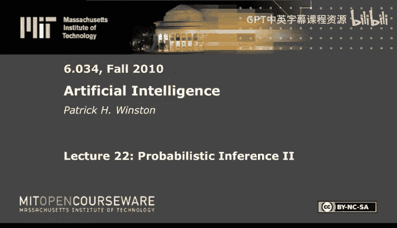
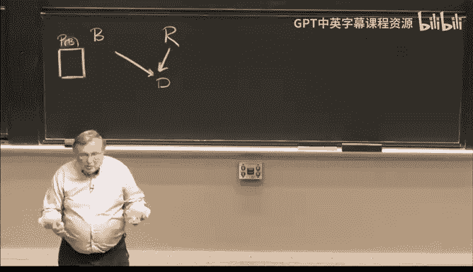
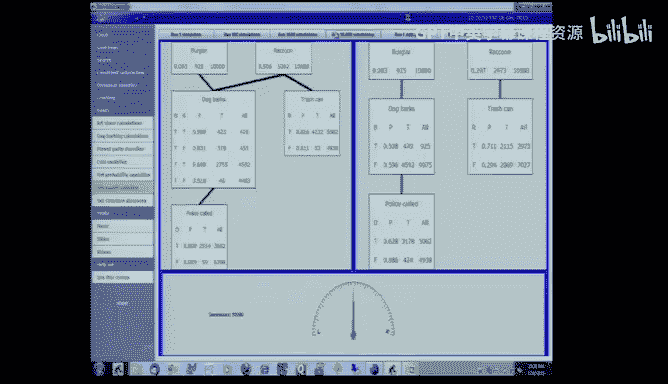
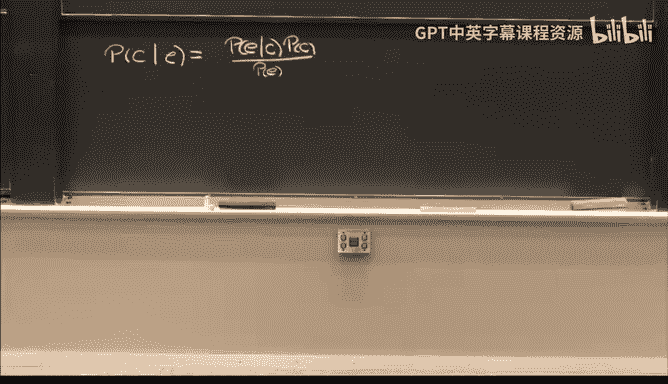
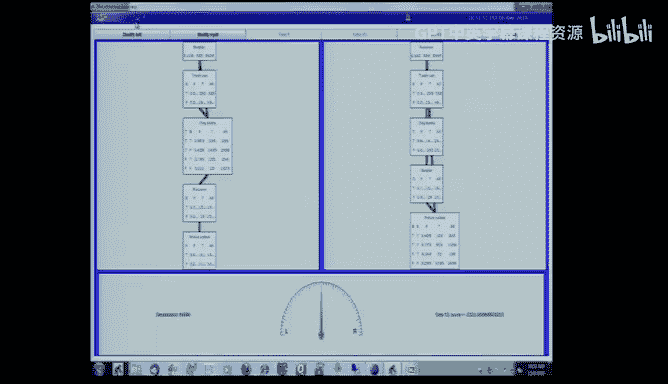

# 《人工智能｜6.034 Artificial Intelligence, Fall 2010》中英字幕 - P22：[22]22. Probabilistic Inference II.zh_en - GPT中英字幕课程资源 - BV14fqSB2ECY

I was in Washington for most of the week， prospecting for gold。

Another byproduct of that was that I forgot to arrange a substitute for Bob Bwick。

For the Thursday recitations， I shall probably go to hell for this。In any event。

We have many explanations， none of them good。But today we'll try to get back on track and you'll learn something fun。

In particular。You'll learn how a graduate student of mine， Mark Philson。

Together with a summer Europe student。Bret Van Zudin， what of you？

Managed to pull off a tour of force and recognize in these two descriptions。

The pattern that we humans commonly call revenge。It was discovered。

The system didn't have a name for it， of course。They just knew that there was a pattern there and sat waiting for us to give a name to it。

 that's where we're going to end up。It it'll be a bit of a journey before we get there because we got to go through all that stuff on the outline。

And in particular， we want to start off by a little tiny bit of review because some of the stuff we did last time went by pretty fast。

In particular， you may remember。They had this wonderful joint probability table which tells us all we want to know。

All we want to know we can decide what the probability of the police being called is。

 given the this and the that and all that sort of stuff by clicking the appropriate boxes。

The trouble is。Gee， there are only three variables there。And when there are lots of variables。

 it gets pretty hard to make up those numbers or to even collect them。

So we're driven to an alternative and we got to that alternative。

Just at the end of the show a week ago。And we got to the point where we were。Defining。

These inference nets， sometimes called bayes nets。And the one we worked with。Look like this。

There's a burglar， a raccoon， the possibility of a dog barking。

 the police being called and a trash can being overturned。So more variables than that。

 those that only has three， this has got five。But we're able to do some magic with this because we。

 us humans， when we define， when we draw this graph。

 we're making an assertion about how things depend or don't depend on one another。In particular。

 there's something to write down。And memorize to the point where it rolls off your tongue。

And that is that any variable in this graph is said by me。To be independent of any other nondesant。

 given its parents。Independent of any non descendent。Given its parents。

So that means that the probability of the dog barking， given its parents。Doesn't depend on tea。

The trash can being overturned because the intuition is。

All of the causality is flowing through the parents。

And can't get to this variable D without going through the parents。

So that is an asserted property of the nets that we draw。

 and we tend to draw them in a way that reflects causality， so it tends to make sense。So， somehow。

This thing。This thing is going to be。We're going to use this thing instead of that thing。But wait。

 we may need that thing in order to do all the computations we want to perform。

So we need to be able to show that we can get to that thing。By doing calculations on this thing。So。

What to do？Well， we're going to use the chain rule。

 and remember that the chain rule came to us by way of the basic axioms of probability。

 plus the definition， plus a little colored shock。So we got to the point last time where。

We sort of believe this， it's a really magical thing。

 it says that the probability of all this stuff happening together。

Is given as the product of a bunch of conditional probabilities。

And the conditional probabilities in this product are arranged such that this first guy depends on everybody else。

The second guy doesn't depend on the first guy， but depends on everything else。

So that list of dependencies get smaller and smaller。

 as you go down here until it depends only on one thing， there's no conditional at all。

So that's going to come to our rescue because it enables us to go from。

Calculations in to that whole table。But first， I have to show you a little bit more slowly。

How that comes to be。AndWhat I'm going to do before I think about probability is I'm going to make a linear list。

OfAll of these variables。And the way I'm going to make it is I'm going to chew away at those variables from the bottom。

And taking advantage of a very important property。Of these nets， and that is there are no loops。

You can't follow the arrows。In any way， it says that you get back to yourself。

So there's always going to be a bottom。So what I'm going to do is I'm going to say， well。

 there are two bottoms here。 Theres C And T。 So I have a choice。 I'm going to choose C。

So I' pretend that I'm going to take that off。And pretend that it's not there。Anymore。

 then I'm going to take this guy， that's now a bottom because there's nothing below it。

 I've already taken C out， so we'll take that out next。And now， I've got。This guy。

 this guy and this guy， this guy no longer has anything below it。 so I can list it next。

Now over here， I've got raccoon and trash can， but trash can。Trash can is at the bottom。

 so I've got to take it next。Because I'm working from the bottom up。

I want to ensure that there are no descendants before me in this list。So finally， I get to raccoon。

So the way I've constructed this list like so ensures that this list arranges the elements so that for any particular element。

 none of its descendants appear to its left。Right。And now that's the magical order that I want to use for which I want to use the chain rule。

So now I can write。I can take。C， to be my variable n。

 And I can say that the chain rule says that the joint probability of all these variables， PMM， D， B。

T and R。The probability of any particular combination of those things is equal to the probability of C given everybody else。

Next in line is D。Given everybody else。Next in line is T。Next line is B。Given everybody else。Yes。

And next in line is。Tea， given everybody else。And finally， just R。

So this combination of things has a probability that's given by this chain rule expression。啊。

But first of all， none of those expressions condition any of the variables on anything other than non descendants。

Right。That's just because of the way I arrange some variables。

And I can always do that because there are no loops， I can always chew away at the bottom。

That ensures that whenever I write a variable， it's going to be condition on stuff other than its descendants。

So all of these variables in any of these conditional probabilities are non descendants。Oh wait。

When I drew this diagram。I asserted that no variable。Depends on any nondesendant given its parents。

So if I know the parents of a variable。I know that the variable is independent of all other nondescendants。

Now I can start scratching stuff out。Well， let's see， I know that C。

For my diagram has only one parent D。So given its parent。It's independent of all other nondesants。

So I can scratch them out。D has two parents B andR。But given that。

 I can scratch out any other non dependent， nondescent。B is conditional on TNR， but B has no parents。

 so it actually is independent of those two guys。The trash can， yeah。

 that's dependent on R and R over here， the final thing in the chain， that's just a probability。

So now I have a way of calculating any entry in that table because any entry in that table is going to be some combination of values for all of those variables。

完了。So anything I can do with the table。I can do in principle with this little network。ok。

But now the question is， I've got some probabilities I'm going to have to figure out here。

 so let me draw slightly a different version of it。So up here， we've got our priori probability of B。

No， I。Probability of B。Down here with a dog。I got a bigger table because I got a probabilities that depend on the values of his parents。

 the probability of。Dog barking depends on the condition of the parents， nothing else。

So let's see， I've got to have a column for B， I've got to have a column for the raccoon。

 the burglar and the raccoon。And there are a bunch of possibilities for those guys。

But once I get those， then I'll be able to calculate the probability of dog barking。

So there are two of these variables， so there are four combinations。There's TT。There's TR。RRT。And。

Well， what am I doing？W up。t force。False true and false false。

So what I really want to do is I want to calculate all of these probabilities to give the probability of the dog on the condition of the burglar and the raccoon。

Similarly， I want to calculate the probability of be happening doesn't depend on anything else。

So I don't know what to do。Well， what I'm going to actually do is I'm going to do the same thing I had to do up there。

I'm going to keep track of。I'm going to try bunch， I'm going to get myself together a bunch of data。

 Maybe I do a bunch of experiments。 Maybe somebody hands it to me， but I'm going to use that data。

To construct a bunch of tallies。Whi are going to end up giving me the probabilities for all of those things。

So I don't know， let's see， how should we start？Step one， find color cha， step two。

I'm going to extend these tables a little bit so I can keep track of the tallies。

So this is going to be all the ones that end up in a particular row。

 And these are going to be the ones for which。Dog is true。Similarly。

 I'm going to extend this guy up here。In order to keep track of some tallies。

This is going to be the ones for which B is。True。And this one will be all。So that's my setup。

 and now suppose that my first experiment comes roaring in and it's alts。So， I have。T， T， T。

 that's my first experimental result， my first data item。So let's see。

The arrangement here is burglar， raccoon dog， so burglar。Ass it true。

 and there's one tall count in there。Likewise， the T T。

 that's the burglar and raccoon that brings me down to this first row。

So that gives me one tally in there and dog is true， so that gives me a tick mark on that one。

All right， you're with me so far， and now let's expose that next thing happens to be all false。Well。

 burglar is false， but there is one experiment。Everybody's false。

 So we come down here to false false。And that's the row we're going to work on。

 we get a tally in there， so you put one in here。No， because that's false。Dog is false。

 that that's what state element says。So that's cool， maybe one more， let's suppose we have TTF。Well。

 in that case。Do I have a tick mark here？Andm tick mark here because the burglary element is true。

Then we have Tt that brings us to the first row again。So we get a tick mark there。But dog is false。

 so no tick mark there。That's how it works。I suppose you'd like to see a demonstration。Right。

 and always likes see demonstration。So here's what it actually looks like。So on the left。

You see the network as we've constructed it with a bunch of probabilities there。

And what I'm going to do now is I'm going to start simulating away so as to accumulate tick marks。

 telling marks， and see what kinds of probabilities that they indicate for the table。

I happen to be using a process for which。The model on the left is a correct reflection。

So there's one simulation。Oh， so the dog barking， let's see the burglar is false。

 the raccoon is true， I get one tick mark， so the probability there is one。Of course。

 I'm not going to。Just leave it go with one， I want to put a whole bunch of stuff in there。

 so I'll just run a bunch more simulations。Note that I don't even have an entry at all yet for TF here。

That's because I haven't run enough data。So let's let me clear it instead of doing it one at a time。

 let me run 100 simulations， see it's still not too good because it says this TT probability is true。

 just is because I'm feeding your data right and I'm keeping track of what the data elements tell me about how frequently a particular combination appears yes。

ItsLike doing one simulation。When I'm doing one simulation。

 I'm just keeping track of that combination in each of these tables。

Because it's going to tell me something about the probabilities that I want reflected in those tables。

 So it's pretty easy to see when I go up here to burglar。You know if I have a lot of data elements。

 they're all going to tell me something about the burglar as well as the other variables。

 So if I just look at that burglar thing， the fraction of time that it turns out true over all the data elements is going to be its probability。

So now when I go down to the joint tables。I can still get these probability numbers。

 but now they're condition on a particular condition of its parents。

So that's that's how I get these probabilities。 So I didn't do too well here because that T T combination gave me an excessively high probability。

 So maybe 100。Simulations isn't enough， let's run 10，000。So without that much data running through。

 the probabilities I get， let's see， I've got 893 here instead of 0。9-807 instead of 0。

8-607 instead of 0。6， and that one's dead on at 0。01。So if I run enough of these simulations。

 I get a pretty good idea what the probabilities ought to be， given that I've got a correct model。

Okay， so that takes care of that one， and of course I didn't draw the other things in here。

 but by extension， you can see how those were work。Oh。But you know what。

 I think I will put a little probability of raccoon table in here。

Because the next thing I want to do is I want to go the other way。

 this is recording tallies from some process that I can develop a model。

 but once I've got these probabilities， of course，Then I can start to simulate。

What the model would do。All， how would I do that？Well。Do I or I do I want to use the same table。

 I think just to keep things sanitary， what I'll do is I'll go over here and do it again， here's B。

 it's got a probability of B。Here's our。Here's a table probability of R。That comes down。

Into a joint table。Our dog， and it's got four elements。

Depending on the burglar condition and the raccooning condition， we get a probability of dog。

And now imagine these have all been filled in。So what do I want to do if I want to simulate this system generating some combination of values for all the variables。

Well， I do with the opposite of what I did when I was working around with this chain rule。

 showing that I could go from the table to those probabilities。Now I've got the probabilities。

 I'm going to go the other direction。Instead of chewing away from the bottom。

 Im want to chew away from the top because when I go into the top and chew away。

 everything I need to know to do a coin flip is there。So in particular。When I go up in here。

 I've got the probability of burglar now。So I'm going to use that probability to flip a coin。And say。

 it produces a tea。So that takes care of this guy。 and I can now scratch it off since it's no longer in consideration。

 It's no longer a top variable。So now I go over to raccoon， I do the same thing。

 I take this probability， I do a flip。And say it produces an F。Whatever its probability is。

 I flip a bias coin， and that's what I happen to get。But now having dealt with these two guys。

That uncovers this dog thing。And now Ive got enough information because I've done everything above to make a calculation for whether the dog is going to be barking or not。

But wait， I have to know。So I've got a T and a T and a T and an F and an F and a T and an F and an F。

 because I have to select the right row。So I know that B is T， and I know that R is F。

 so that takes me into the table。In the second row。So now I get this probability。I flip。

I flipped that coin。And I get some result， say tea。

Well I could do that with all the other two variables。

 And I've got myself an experimental trial that is produced in accordance with the probabilities in the table。

Okay。Of course。Of course。Yeah， in fact。How do they get those numbers？Actually。

 what I did is I used the model on the left。To generate the samples that were used to compute the probabilities in the right。

So you've seen that， you've seen a demonstration。Of this already。Now， of course。I don't know。

All of this sort of depends on having everything right。I've written a thing。

To write it one more time。Burglar， raccoon。然后。Call the police。Trash can， but somebody else might say。

 oh， you got it all wrong。 This is the way it really looks like。

The dog doesn't care about the raccoon or tall。So that's the correct model。Now。

 when I do a simulation， I could fill in the tables in either model， right？

I'm sure you'd like to see a demonstration。So let me show you a demonstration of that。

So there are the two tables， and I can run 10，000 simulation I nose guys too。And look。

 the guy on the left is pretty good reflection of the probabilities。

In a model I use to produce the data。But the guy on the right doesn know any better。

 it just fills in its own tables too。So。What to do？

I say this one's the right model and you say that one's the right model。Who's right。Well。

 maybe we'll never know。The guy on the left will get rich in the stock market and the guy on the right will go broke。

It'll be nice if we can figure out who's right。So would you like to see how to figure out who's right？

Yeah， so what we're going to do is we're going to look at naive Bayesian inference。

And that's our next cho。So here's how it works。We know from the definition of conditional probability。

We know that the probability of A， given B。Is equal to the probability of A and B。

Divided by the probability。OfB。Right， equal to by definition。So that means that the probability of A。

 given B。Times the probability of B， I'm just multiplying it out， is equal to that joint probability。

Oh， but by symmetrymetry。There's no harm in saying I can go。

 I can turn that around and say that the probability of B， given a。

Times the probability of B is also equal to that joint probability， right？

I've just expanded in a different and symmetric way。If I got it right。A， B on B， B A on A。

 Thank you who is complaining， good work。That would have been。The major League disaster。

But now having written that， I can forget about the middle。

Because all I' really interested in is how I've turned the probabilities around in that conditional。

Why would I care about doing that， by the way？We're now talking about the work of the Reverend Bays。

Because we can rewrite this yet again as the probability of a。Givenive and B。Is equal to。

The probability of B given a times the probability of a divided by the probability of B。That's just。

Elementary algebra。But now I'm going to do something magical。

I'm going to say I've got a classification problem。I want to know which disease you have。

That's a classification problem。 Maybe you've got the swine flu。Maybe you've got。Indigestion。

 who knows？But I get all these symptoms。I get all these pieces of evidence。You've got a fever。

 You're throwing。 well， let's not go too much detail there。

 But what I'm going to do is I'm going to say， well， let's suppose。That A。Is equal to a class。

That I'm interested in， the disease you've got and B is equal to the evidence。The symptoms I observe。

完了。I may have a pretty hard time figuring out what the probability of the class is。

 given the evidence。But figuring out the probability evidence given the class might not be so hard。

Let me get another board in play and show you what I mean。

By plugguging class and evidence into's rule。What I get is。The probability of some class。

Given the evidence。Is equal to the probability of evidence。Given the class。

Times the probability of the class。Divided by probability of the evidence。

Now you've got going to let that sink to you a little bit。

Suppose I've got several classes that I'm trying to decide between。

I'm trying to select the best out of that batch of classes。Well， I've got the evidence。

 and if I know the probability of the evidence given each of those classes。

And if I know the a priori， the initial probability of the class。And I'm done。

Because I got the two elements in the numerator。Why am I done？

Because the denominator is the same for all the classes。It's just the probability of the evidence。

And then I could just sum everything up， I know it adds to one anyway。So that's cool。

 but sometimes there's evidence。Actually， there's not more than one piece of evidence。

Let's say that there's some class， some I， and we're trying to figure out if that's the correct class。

So we got C sub I there and C sub I there， and suppose that that evidence is actually a bunch of pieces of evidence。

So it could be E1。He。And。Oops。A premature right bracket。

All that evidence given the class I times the probability of the class I。

Over some denominator that we don't care about。Because it's going to be the same for everybody。

So I'll just write that as D。Now， what if these pieces of evidence are all independent？Given a class。

So if you have the swine flu， the probability you have a fever is independent of the probability you're going to throw up。

是。Then can we write this another way？An easier way， sure。Because when things are independent。

The joint probability is equal to the product is equal to the product of the individual probabilities。

 So that is to say it's easier to see it if you write it down。 And if you just say it。

 this probability here。From these two elements here is equal to the probability of E1 condition on C sub I。

Times the probability。V2。P on C sub I。All the way down to the probability of EN initially C sub I。

Divided by。Some denominator we don't care about。See what what I'm trying to do is I'm going。

 I'm going to go through this for all the C and see which one's the biggest。

This is the probability of。Yeah就。Right here。高便区。Yeah， yeah， thanks。あか。嗯。

ICan't write and think at the same time， thanks。Okay。

 so I've just figure out which one of these is the biggest。 And I've identified the class。

Now you say to me， well， I would like to see an example。收。I don't know。

 Does anyone have any spare change？Mgg a quarter。This is not because of our。

Inantest my low raises here at MIT， I just need it for a demonstration。And you need two coins。

Don't forget to get these back。 I tend to be。 Now， suppose these two coins are not exactly the same。

One of these points is a legitimate。Highly prized American Qua。The other one is a fake。

And with this one， the probability of heads， let us say， is 0。8。Instead of 。5。So I mix these all up。

And I pick one。And I start flipping it。And I get ahead。And then I flip it again。And I get a tail。

Which coin did I pick？Well， we're going to use this stuff to figure it out。Here's what happens。

Before I forget。Thank you very much。So what we've done is we've selected these things from my hands and I can't draw hands so I'll draw a little of cup here and there are two coin in here。

 and we're going to pick one and one has a probability of head。Of equal to 0。8。

And this one has a probability of a head。Of 0。5。So here's the draw， I pick one。

 each has a probability of 0。5。This one is the one with 0。8 is the probability of head。

 and this one is one with the probability 0。5 is a head。Okay。So now。

Suppose the first flip as it was is tea。Well， that's piece of evidence。That's here。

 probably evidence given to class。Well， in the case of having drawn this biased coin。

The probability of。Of coming up。With with a tail， let's say ahead。Just make my numbers a easier。

 The probability of coming out there with a head is equal to。8。

Given that it's up here in this choice。The probability， given that you have a fair coin is。0。5。

So now。If we take。That's the。Next coin。And take it to be a tail。Then the probability of this guy。

Given that evidence is 0。2。And the probability of this guy， given that evidence， it's a fair coin。

 so it doesn't care。 still point5。So now what's the probability of this class？Given this evidence。

It's the product of 0。5 times 0。8 times 0。2。And what's the probability of this guy？It's 0。5 times 0。

5 times 0。5。Divided by a denominator， which is the same in both cases。

So let's forget about this early 0。5 here because it's the same in both cases。

And we just multiply those numbers together， that gives us 0。8 times 0。2， what's that， 0。16？

And this guy， 0。51 1。5， that's 0。25。So it looks awful lot like with this combination。

That I've picked the coin as fair。One more flip。So let's flip it again and suppose we can come up with a head。

That puts a 0。8 in here。And a 0。5 in here。And when you multiply those out。That's point。1。2。

5 and this。Is 0。128， so it's about equal。So you see how that works？喂。

So we're using the coin flips as evidence to figure out which class is involved。Okay。

 so why I don't know。 youd probably like to see a demonstration of this， too， right。

 But you say to me。Go。Just two kinds of coins， that's not very interesting。

 let's try five kinds of coins。So what I'm going to show you is how the probabilities for all these coins are five of them color coded。

 how the probabilities vary with a series of flips。Let's suppose I've got head， the gray line。

 by the way， is the number of heads or the fraction of heads。

 so that's going to be one because I'm just doing heads， hope you see that black line rising。

Shooting up like a rocket。 That's the probability that the。

That's the coin in which it only shows heads， probably if head is one。

And I'm flipping a whole bunch of heads here。In't that cool。

 now what happens if I suddenly put in a tail？By the way， you'll note down here on the extreme left。

The the initial probability of the p equals 0 coin was 0。1。As soon as I flipped ahead。

 that went to zero and we'll never get off zero， right？

That makes sense because if the probability you'll get ahead is one。

 you should never see a tail if you ever do， that isn't in your coin。What happens now if I？

Interrupt this series of heads and produce a tail。我想。

And black one will go to zero is what else happens。By the way， the blue one。

Is the one with the highest probability of being ahead。Well look。Booom， the blue one shot up。

Not going up slowly， it shot up。And now the preponderance of evidence with all those heads is that I've。

Flip the coin with a bias of 。5 towards heads。So let's clear this。Pick any probability you want， 0。

25，5 and so on， I don't know， let's pick 0。25 since we've been at the upper end。So orange is 0。

25 and sure enough， the probability that I've selected the 0。

5 coin is going up and up and up and up after a little original irregularity。

 the law of large numbers is setting in and the probability that I've got that 0。

25 coin in play is pretty close to  one。All right， so that's cool。Now you say to me。

 that's awfully nice， but stop， awfully nice， but not very。Not very。Real world is。

So let me give you another problem。 It's well known that you are with high probability of the same political persuasion as your parents。

So if I wanted to figure out which party。A parent belongs to， I could look at the party。

That their children belong to。Right？So it's just like flipping coins。

The particular coin I have chosen corresponds to the parent。

The individual flips correspond to the political party。That the child belongs to。

So let's get up a little bit- by the way， I wrote all this stuff over the weekend。

 so who knows if any of'll work， but let's see。Part parentent party class， there it is。

 Democrats and Republicans。And now the prior for being a Republican I've given here is 0。5。

But I don't know this is a little bit democratic state。Let's adjust that down a little bit。

That might you know somewhere and near might be about right。

 but that's just the sake of a classroom illustration， go down here。

So now the meter is showing the prior probability， because that's the only thing in the formula so far。

 I've got no evidence。So now let's suppose that child number one is a Republican。Back to neutral。

So I've got a low probability that the parent priority probability of the parent。As a Republican。

And a child who's a Republican， I noticed that 02 and 0。8， the conditional is 0。8 and the prior is 0。

2， that's why it comes out to balance each other， right？So now if we had another Republican in there。

It goes way up if I have a democratic child， it goes back down。

 if I have an equal balance between children， then it goes way back down because of that prior probability being low。

So if I make that high。And even though the children are balanced。

 I'm still have a high probability of being a Republican。Now let's see if I take that slider there。

 the conditional probability and drive it。To the left here， let me make that equal again。

And let's make that。One thing I don't know， what am I doing now？If I make the probability。Less than 。

5， what's that mean？That means you're so at your parents and you want to belong to a different party。

O。All right， so now what's next？Oh， gosh。What's next？This is what's next。What's next to somewhere？

Yeah， this is what's next。This here， weve got two models。Remember。

 I said we wanted to decide between them？Can we use that Bayesian hack to do that too？Sure。

 because we got these two models。We've got the probabilities in them。So now I can take my data。

And calculate the probability of the left model， given the data and the probability of the right model。

 given the data， multiply that time。 say are priority probabilities， which well assume are equal。

And then I can do a model selection deal。Much in defiance of what I was hinting up before。

So let's try that。Whoa。They are my two models。Yes， there they are。

We've already trained them up with and they've got their probabilities。

Now what we're going to do is we're going to use the original model to simulate the data。

 So what we're going to do is we're going to simulate draws， simulate events。

Simulate combinations of all the variables using。A model that looks like the one on the left。

 that is the one on the left， except for the slight differences and probabilities okay？

Then we're going to do this Bayesian thing and see where the meter goes。So I'll run one data point。

Oops went the wrong way。Makes me nervous。 I just finished this at 915。 Maybe there's a bug。Oops。

 two data points swings to the left。Three swings back to the right， of course， that's not much data。

So let's put some more data in。Yeah， boom， there it goes， let's try that again， that was cool。So。

 let's run。Thousands simulations。And one data point。

Wobbles around a little bit and goes flat over to the left because that is the model that reflects the one that the data is generated from。

So now we've got Bayesian classification， except now the classification has gone one step more and it becomes structure discovery。

 We've got two choices of structure。And we can use this Bayesian thing to decide which of the two structures is best。

大哥。Well， it's only cool if you could do what？So， if you had。Two choices。

 you can select between them and pick the best one。But there。Gosh， for this number of variables。

There are a whole lot of different。Networks。That satisfy the no looping criteria。

And don't have very many parents。It's an awful lot of them。 In fact。

 if you restrict this network to two parents， there are probably thousands and thousands of possible structures。

So do I try them all？Probably not as too much work when you get 30 variables or something like that。

So what do you do， We know what to do， right， We're almost veterans at 6034。 We have to search。

So what we do is we take the loser and we modify it。And then we modify it again。

 and we keep modifying it。Until。We dropped dead。Or we get something that we're happy with。

So let's see what happens if we change this problem a little bit and do structure discovery。

 we're starting out with nothing linked。And we're going to just start running this guy。

So what's going to happen is that the good guy will prevail and the bad guy will be a copy of the good guy perturbed in some way。

 so it's a random search。You'll notice that score， that's too small for you to read that all these things are too small read。

 let me make it a little bigger。Too small to read， but that number on the right there is not the product of the probabilities actually。

It's the sum of the logarithms of the probabilities。They go together， right？

And the reason you use this instead of the probabilities is because these numbers get so small。

That with a 32 bit machine you eventually lose。So use the log of the probabilities rather than the product of the probabilities。

 you use some of the logs instead of the product of the probabilities。And eventually。

 you hope that this thing converges on the correct interpretation。But you know what。

 this thing is so flat as a space and so large。And so， telephone poll like。That you have to。

That is full of local maxima。 So what this program is doing is every once in a while。

I think with probability 1 and 10， I forgot what parameters I use Every once in a while。

 it'll do a total radical。Rearrangement of the structures， in other words， it's a random restart。

It keeps track of the best guy so far and every once in a while does a totally random restart in its effort to search this space。

So that's how you go from probablybabilistic inference to structure discovery。Now。

 when is this stuff actually useful？Well， I hinted the medical diagnosis， right？

That's a situation where you've got some symptoms and you want to know what the disease is。

So as soon as you use the key word diagnosis。You've got a problem for which this stuff is a candidate。

So what other the kinds of diagnosis problems are there， Well， you might be lying to me。

So I can put a lie detector on you and each of those variables that are measured by the lie detector are an independent indication of whether you're telling the truth or not。

 so it'sian is this kind of Bayesian discovery thing， Bayesian naive Bayesian classification。

What other kinds of problems with？Speak to the issue of diagnosis。 Well。

 would like to know how well you know the material。So we can use quizzes as pieces of evidence。

Thank God we don't use exactly a naive Bayesian classifier because then we wouldn't be able to do that combination。

We have to use a slightly more complex。Well you can think of was a slightly more complex Bayesianette to do that particular kind of diagnosis。

You might have a spacecraft with all kinds or an airplane or other pieces of equipment with all sorts of symptoms。

 you're trying to figure out what to do next， what the cause is。

 so using the evidence to go backward to the cause。

So maybe you've got some program that doesn't work。Happens with me a lot。

So I use the evidence from the symptoms of the misbehavior to figure out where。

What the most probable cause is。But now to conclude the day。

 last time there weren't any powerful ideas， but if you consider if you take the combination of the last lecture and this lecture to be。

A。Candidy for Gold Star ideas， these are the ones I'd like to leave you with。

What got here is the Bayesian stuff， all these probabilistic calculations are the right thing to do。

They're the right way to work when you don't know anything。

Which we make it sound like are not very useful because you think you always but in fact。

 there are a lot of situations where you either can't know everything。

 don't have time to know everything or don't want to take the effort to know everything。

So in medical diagnosis， all you got is these symptoms。

You can't go in there and figure out in a more precise way exactly what's wrong。

 so use the symptoms to determine what the cause is and in all those other kinds of cases that I mentioned。

But now what other kinds of structure discovery are there？Well。

 the kind of structure discovered that I hinted at in the beginning will be the subject that we'll begin with during our next and sadly。

Final conversation here in 10250 on Wednesday。It will feature not only a discussion of how this stuff can be used to discover patterns and stories。

But we'll also talk about what's on the final。What kind of thing you can do next？

That sort of thing to finish off the subject， and that's the end of the story for today。

