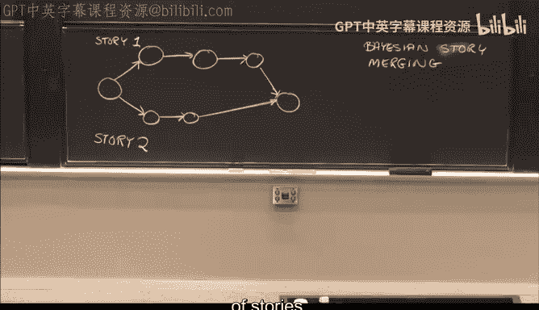
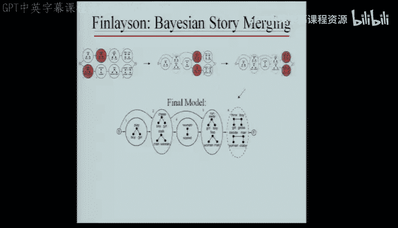
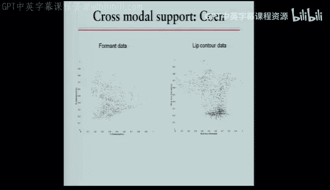
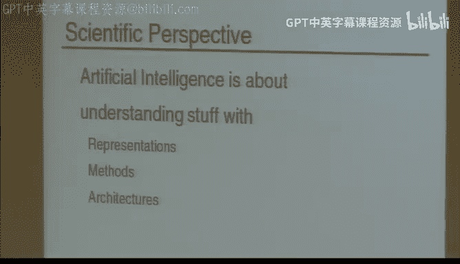
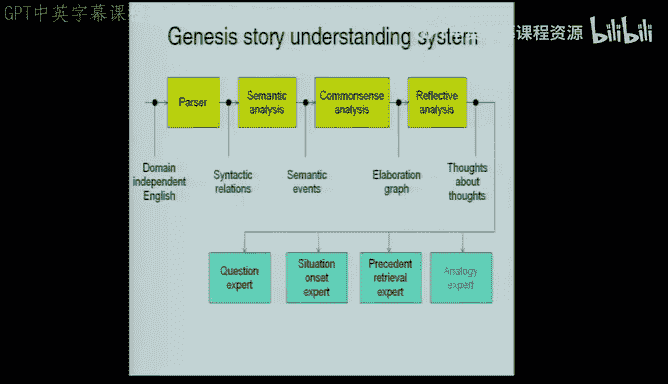
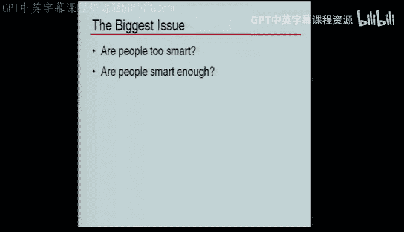
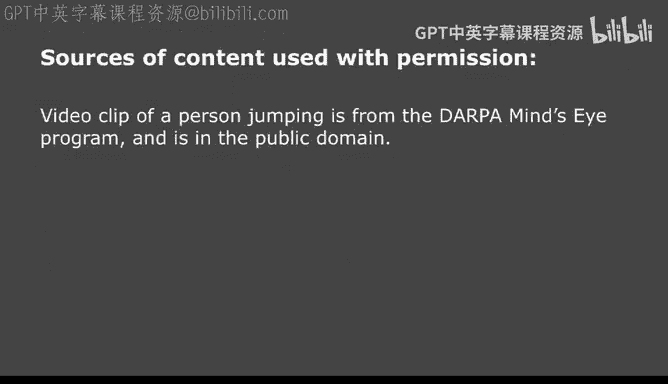

# 《人工智能｜6.034 Artificial Intelligence, Fall 2010》中英字幕 - P23：[23]23. Model Merging, Cross-Modal Coupling, Course Summary.zh_en - GPT中英字幕课程资源 - BV14fqSB2ECY

Well， don't stop， shoot。I guess we've got to stop。 I will soon go into withdrawal symptoms last about six weeks。

But on the other hand， we all are beginning to develop a sort of。Tired and desperate look。

 and perhaps it's a good thing to get the semester behind us。And go into solstice hibernation。Anyway。

 there's a lot to do today， I want to wrap up a couple of things。

 talk about what's next and maybe get into some big issues， perhaps a little Genesis demo。

 that sort of thing。So here's what we're going to do first。

Last time I talked about this whole idea of structure discovery。

 and really the whole reason I cracked and started talking about Bayesian methods is because of the potential utility of taking that idea one step further and finding structure in situations where you might not otherwise find it。

It's still an open question about whether that's the best way to think about it， but here it goes。

Imagine you've got a couple of stories。And these circles represent the events in the story。

I know what you like to get out of these stories is some kind of。Fite state。

Graph that describes the collection of stories。

So you might discover， for example。That these two events。Are quite similar。And these two events。

Are quite similar。So you might use that as a basis for speculating that maybe be a more compact way of representing the stuff in the story。

Would look like。This。Where。This one。Let's see this one goes with this one。

This one goes with this one and there's a possibility of another state in between。

So that's the notion of Bayesian。Story emerging。And now I'd like to show you a little bit more convincing demonstration of that。

Here's how it goes。So there are the two stories， this is just a classroom demonstration， no big deal。

But you can see there's a sort of parallel structure in there。

So this is the work of a graduate student， Mark Philinlayson。ho。

Process those stories to produce those kinds of events。

And those kinds of events that get assembled into two storygraphs。And the question is。

 is this the most probable？Way of explaining that corpus of stories， and of course， the answer is no。

If you merge。Some things。Like Cha and stock。Then you get a simpler graph。

 one that is more probable in the same sense that we discussed last time。Then you can merge。

 run and flee because there are similar kinds of events。And finally， you've got think and decide。

 boom。There is your。Storygraph。And this is the same idea taken several levels higher that produced the capacity to discover in these two stories。

The concept of revenge， as promised at the beginning of our last discussion。

So sometimes the Bayesian stuff is the right thing to do， especially if you don't know anything。

 but sometimes you do know stuff and when you do no stuff。

It's possible you can do something very much more efficient。

 this sort of thing takes clouds of computers to process。

But we learn a lot of stuff and of course of our development that we don't use a cloud of computers to figure out。

We learn how to。Associate。The gestures of our mouth。With the sounds that we make， for example。

So I want to spend a minute or two talking about some work that。

Someday will be the subject of a couple of lectures， I think。But it's the question of how to。

Use multiple modalities。And。Correspondence is between them。

To sort out both of the contributing modalities that sounds complicated， let me show you an example。

This is the example ofzebra Finch， and it's。It's showing you the result of a program written by Michael Cohen。

 now a professor at the University of Wisconsin。So the zebra finch the male zebra finch learns to sing a nice mating song from its daddy。

And this is what one suchzebra finch sounds like。Nice， don't you think？

And here is what was learned by a program that uses no probabilistic stuff at all。

 rather the notion of crossmodal coupling。You tell the difference？

It's not known of this particular song。Turns on a female zebrafininch。But to the untrained。Youumaner。

They sure sound a whole lot of light。So how does that work？Here's how that works。Well。

 I'm not going to show you how that works， what I'm going to show you is how the classroom example works。

 the first chapter example in Cohen's PhD thesis。Here's what happens when we talk。

 we produce a Fourier transform。That moves along with our speech。 And if we say a vowel。

 like you get a fairly constant Fourier spectrum。And you can say， well。

 where are the peaks in that 4ier spectrum， and how do they correspond to the appearance of my mouth when I say the vowel？

So here's how that works。So here's the 4A spectrum。Of a particular vow， and when you smooth that。

Those peaks are called forms。And so we're just going to keep track of the first and second formatment。

But when I say those things， I also can form an ellipse around my mouth when I say them。

And when I form an ellipse around my mouth when I say them。That gives me the second modality。

So the question is， is there a way of associating？The gestures that produce the sound with the sound itself。

Well， there's the human data conveniently provided by a variety of sources。

 including Michael Cohen's wife who produced the lipContour data on the right。

So that's all marked up in color coded according to the particular vowels in English。

 I guess there are 10 of them。So we humans all learn that， but guess what。

 we don't learn it from this。Because。We don't get the way it work with any marked up data。

 we learn it from that。Somehow we're exposed to the natural world and we dig the vowel sounds out。

It's a。Fantastic， how we do that。

But we do have crossmodal coupling data， and maybe that's got something to do with it。

So here is a particular cluster of sounds。And what I want to know is can I merge any of these two clusters to form a bigger cluster with a corresponding meaning？

So what I can do is I can say， well。I can watch these- I know what the lip form is。

When a particular sound is made。So I have these correspondences， maybe they're。

Are four of those like， so"，And may the same guy。Projects a couple of times。Ento that。

And the question is， can this guy？Be combined with any of these guys。 And the answer is yes。

 if they're close together on one side。Maybe that suggests you how to cluster them on the other side。

But there's a question about what close means。So let's suppose that we also look at how。These guys。

 these other two guys project and suppose this guy projects twice up here。And。Once over here。

And this guy down here just projects like crazy。En that time。Which are closer。These two。

Were these two？Well， my diagram is getting a little closer。

 but if he paid attention when I was drawing it， you would see that this guy。

Projects in proportion to that guy。So if we take each of these projections as the components of a vector。

Then those two vectors are in the same direction。And the cosine between them is zero。

So these are the two。That are closest together。From that the perspective of that kind of metric。

 and those guys are the ones。Who can combined。Would I see the demonstration。Yeah。

 here's a demonstration based on Cohen's work。So here we have two sides。

You could think of one side as being。Vel sounds， and the other side is big。

Liip contours or something， but you don't see anything in the diagram so far about how these things ought to be sorted out into groups。

So if I just take one step。What I discover is that those two guys。Haved the same projection pattern。

As each other。So if I take another step。I do the same thing on the other side and。In the third step。

 the two areas that were。Formerally combined now form a super area。

 and they're seen to project in the same way as the blue area。So using this kind of projection idea。

 I can gradually build up an understanding of how those regions go together。

And I discovered in this contrived example。That there's a vertical arrangement on the right side that corresponds to horizontal arrangement on the left side。

Maybe you say to me， I like to see something a little bit more like。Theyll look contour data。

I'm just stepping through here until I get something I kind of like。Oh， that sounds good。

That seems good。So there's a correspondence here， this is all made up data。Gaausian。

 Gaussians of various shapes and， and orientations。

Let's see what happens when I run the clustering algorithm on that。

Something definite was learned in every step。We find the correspondence between。

The pink region on the right and the pink region on the left。

 in some cases where the regions are rather blurred together。

 the other side is the one that helps the system figure out how things are organized。

So I say this as an example of something I think is very important。 Numb one。

 it's possible to discover regularity。Without being obsessively concerned with basices improbability。

And also。That there's very likely a whole lot of this going on in human intelligence。

When we emerge and begin to examine and explore the world around us。

 we're presented with a lot of unlabeled data that we've got to make sense of。

And I believe that this kind of crossmodal coupling idea is。Very much likely。

 very likely to be bound up in our understanding of that world that's presented to us， it's fast。

 it's direct， it doesn't take thousands of data points， it just happens。And it happens effortlessly。

 and this isn't built in。IfThis isn't determined to be built in。

 you can come back to MIT in 15 years and put me in jail， so I think this is really the way it works。

So there it is， there's a couple of things to have wrapped up， and now next thing I want to do。

And for the rest of our last time together in this format is talk to you about a variety of things and I'll depart from my usual practice and move to some slides so Dave。

 do we have the center screen please。So first a brief review of where we've been and where we've come。

I think in the very first class， I talked about what artificial intelligence was。

And I talked about how you could view it from either an engineering perspective or a scientific perspective。

 I'm on the scientific perspective side， and I think。I have nothing against applications。

 but I think we'll be able to make much。More sophisticated and wonderful applications。

 if we have not only the engineering perspective about building stuff。

But also the scientific perspective about understanding the stuff to begin with。

So both perspectives are important， and in this case you can。

Say that they all involve representations， methods and architectures Dave。I've changed my mind。

 could you also give me the sidescreen so I can see it too？

So that's that what's next， the business perspective， which we talked about on Thanksgiving。

 the important idea being that。The knee jerk expectation that the commercial value of something is in replacing people is something that is。

Not sensible in the first instance and demonstrated to be unlikely and untrue in the second instance。

 the thing that turns people on from the point of view of applications is not replacing people but making new revenue。

 making new capability。And that it once licenses you to not have something done exclusively by a computer but something that can be done in partnership with a person。

So all of the important applications。Of artificial intelligence。

Involve people and computers working in tandem with each doing what they do best。

Not with replacing people。So， that's that。Here's what AI does that makes AI different from the rest of the fields。

That attempt to contribute to an understanding of intelligence。

We have the benefit of having a language for procedures。We have all of the metaphors that we。

That we are the custodians of in consequences of knowing about programming。

We have a metaphor of garbage collection。We can talk about all sorts of things with programming metaphors。

That are unavailable to people in other fields that are interested in psychology。

We have a way to make models because we can write programs。 And when we write programs。

 there's no question of sweeping things under the rug。 We have to work out the details。

And once we've done all that， then we have opportunities to experiment that are beyond the。

Ability to experiment in most other fields。Oh， magnificent experiments are done these days in developmental psychology and all the rest of all the other branches of psychology。

 including MRI studies that probe into your brain and see how it's consuming sugar。

But it's very difficult to alate or take away some piece of your knowledge and see how you work without it。

I can take the line drawing program that we talked about and say。

 how will it do if it doesn't know anything about fork junctions。And we can determine an answer。

But I can't reach into Sebastian's head hair with a surgical procedure and take out his knowledge of fork junctions。

 it just can't be done。And finally， another reason why we're different is because we can put upper bounds on how much knowledge is needed in order to perform a certain kind of task。

These days with bulldos or computing， the question is that most often ask is， how can you？

Get billions of things off the web， and use them。We。

 I especially sometimes ask the opposite question， which is how little knowledge can you have and still understand the story。

 that's what's interesting to me。So there's a methodological slide that talks to the question of how you do artificial intelligence in particular。

And I suppose science in general， engineering in general。

There's a great tendency in this field to fall in up with particular methods。

 and we've had people who have devoted entire careers to neural nets。Genetic algorithms。

Baianfallability。And that's mechanism envy， and a better way in my judgment is to say what is the problem。

 scientific method， what's the problem and then bring the right machinery to bear on the problem rather than looking for things to do with a particular kind of machinery。

So this is the methodology。The first articulated in a forcecful way by David Marr。

You want to start with the confidence you're trying to understand？

Then bring a representation to bear on it。A representation that exposes the constraints and regularities because without those。

 you can't make models and without those。Models， you can't understand it， explain it。

 predict it or control it。So it seems to make sense from a kind of MIT。

A modelel centered point of view。And only when you've got all that straight。

 do you start working on your methods and implement an experiment。Go that， go around that loop。So。

 that's。All I want to say by way of review， I suppose I want to take a minute or two and just remind you of what's on the final。

 and there's nothing to remind because you all know what's on the final already。

We have four sections corresponding to four exams。Then we'll have a fifth and final question that will be everything else。

All that stuff you slept through。Will be featured there。

 as well as a little problem on the amazing inference。

We didn't we rearranged the subject mostly so I could write the demonstrations。

So some of the Bayesian stuff didn't come before the fourth quiz， therefore the Bayesian stuff。

That you see on those previous quizzes is likely to be harder than the stuff that we'll ask on the final because you haven't had as much experience with it as people did last year。

I've got a few icons on there to remind me to tell you a few things。As always。

 open everything except for computers。You can wear a costume。

You can do anything you like as long as it doesn't disturb your neighbor。Within reason。Well。

 I guess if it doesn't disturb your neighbor， it is within reasons。

 so maybe that's all I need to say。We will， I forgot， I'm not sure where we' were going to be。

 but it's certainly the case that historically there are no visible clocks。

So we soon run out of all of our cell phones， wristwatches and other timepieces as we hand them out。

 so it pays remember to bring some kind of。Of timepiece。

 because we won't be able to convey the time very well。And finally， I see a little calculator there。

I don't recall any examine where you actually needed a calculator。

 but it's sort of a security blanket to have one。People sometimes see a problem and think， oh my God。

 what am I going to do， I left my calculator at home。So as to avoid that anxiety。

 you might want to bring one。Even though you won't eat it。So， that's the final。

I'm sure they know questions。Other， Ja。Everybody will do well。Two shots， that whole thing。Now。

 what do， what to do next， Supp this subject has turning you on。

 There are a variety of things that you should think be thinking about doing next semester。

 And I wanted to review just a few of those。One of them is Marvin Minsky's the subject Society of mind。

It's very different from this class。There are no prepared lectures。The Mar doesn't rehearse。

He doesn't think about what he's going to say in advance。

It it's like this except it's just a conversation with Marvin。

So many people find themselves bored stiff for two lectures out of three。

 but then in the third lecture。Marvervin will say something that you'll think about for a year or for the rest of your life。

 that's what happens to me， I'm board stiffiff two out of three times then the third lecture he says something and I think about it for at least a year。

And maybe permanently。So it's an opportunity to see。One of MIT's true geniuses。Think out loud。

So it's the experience that you don't want to miss because that's what you come here for is to see the geniuses think out loud。

Speaking of geniuses and there's Bob Berwick and he heroically is doing two subjects。In the spring。

Both of which I'd take， if I could。One is his subject on language understanding。

And the reason I take that is because I believe that language is at the center of any explanation of our intelligence。

So that's the subject I would be， I suppose， most inclined to take if I were you。Well， maybe Minskys。

 it's hard to say。 incidentally， very heroically， Bob is also teaching a course on how evolution works。

How it really works， insof far as we know how it really works。As well。

 so both of those will be offered。In the spring， I don't know how he does it。I't know how he does。

 too。All at the same time。 Of course there are lots of places where you can go to school and the faculty will be teaching five courses at the same time。

 I just think they're crazy or something， I don't know how that works。Jerry Sussman。

We'll be teaching his large scale symbolic system subject。That's sometimes。

Oh I forgot what he wasn't able to call it。Something that wasn't politically correct about programming for people who。

So really， really like the program。It's a spdid course on how to build really big systems。

 And we use the ideas in that subject。In our research system。

 because it's the only way understanding how that works is the only way that you can build systems that are too big to be built。

I may say a word about that a little later。So those are my favorite three slash four picks。

But there's lots of other stuff， too many things to cover。The media lab。

 brain and cognitive psychology。 There's tons of stuff out there。 And I would only mention that。

Courses that have those three names on them are bound to be good。

These are colleagues that I think have an important perspective， not necessarily one I agree with。

 but an important perspective that you should understand。Richards Tara Bavinsonha。

And now we come to my Supreme course， the human intelligence Enterpri。It's 6xxx。

 not because there's anything pornographic about it。For a long time， I couldn't remember its number。

So I developed the habit of referring to it at 6xxx， and it seems to have stuck。

I's what that's about。Yeah， that might be interesting。 Its it's taught like a humanities course。

 though， no lectures。I just talk。And all of the Ts or veterans of that class if you want to know if you should。

Do it， there several you have several resources， you can talk to them。Or I don't know。

 You can look at the sorts of things we talk about。

Here are some things we talk about by way of packaging。Yeah。

 I can hear a little tittering there because people have discovered the last element。

 some people take the whole subject because they want to be present for that unit。

We talk about all those kinds of things。We look to see what the common elements are in all those kinds of packaging problems of the sort that you will face over and over again when you become an adult。

 no matter what you do。If you become a business person。An entrepreneur。A military officer。

A scientist or an engineer。That packaging stuff will often make the difference between whether you succeed or don't。

And then that's the second way you can figure out whether you want to take the subject， the content。

 the TAs， and then of course you can always appeal to the Under guide。And that's why。

It's very rare for someone to take6 XX， who hasn't been at this final lecture。

Because they read the underground Guide。Here is an element。

It appeared in the underground guy a few years back。There are no exams。

But there is a tradition of hacking the underground guide。

So this is another example of something that appeared。😀Yeah。😊。

So it all came about because early in the teaching of6X XX。

 I was whining to the students about the fact that I've been at my team for a long time since I was a freshman。

 and I still have yet to have any person I report to say anything about my teaching。Good， bad。

 and different。WellYou know， nothing。Not a word。So the students decided that it would be interesting to see if they could say something sufficiently outrageous to force a conversation between the department chairman and me。

And so far， they've been totally unsuccessful。And I've tried everything。

Winston shows up late if he shows up at all。啊。Good instructor。

 but constantly sipping from a brown paper bag。All kinds of stuff。But there it is。 It's。

 it's a lot of fun。 It's a little oversubscribe。 So we have to have a lottery and there's about 50% chances so on and so forth。

 but。😊，Many of you will find it a good thing to do。Oh yeah。

 and now I also want to remind myself that there is a IE event it's become kind of MIT tradition。

 it's the how to speakak lecture that I give this year it'll be on January 28th。In 6120。

6120 holds about。120 people。And about 250 show up。So if you want to go to that lecture。

 you should shop 15 minutes early。 That's a little secret just between。Me and 6034 students。

It's about packaging too， it's a one lecture version of6XxX。

 but it's very nonlinear because one thing that you pick up from that one hour may make the difference between you getting the job and some other slug getting the job。

So it's one of those sorts of things that。Can make a big difference in a short period of time。

You may sleep through 50 minutes of the 55 minutes in that lecture and stay awake for that one magical five minutes when。

You learn something about when to tell a joke。Or how to open a lecture。

 or how to conclude one or a job talk or a sales presentation or anything。

 and that will make it worthwhile for you。And then of course， there's the possibility of Europe。

 anybody who's doing Europe with me is likely to be interested in what I've recently come to call a strong story hypothesis。

Something that we've talked about from time to time。Yeah， that's what that's what makes us humans。

 And that's not what they are。 They are autans or chimpanzees， even though the DNA that we share is。

It goes up and down at one point it was 96%， then it went to '98。Now I think it's back down to 97。

But whatever we are， it's not because of a huge massive difference in DNA between us and our cousins。

So in my group， we build a Genis system modestly called。And that's what it looks like。

And it has in it all the sorts of things that we've talked about from time to time in 6034。

And it's about to move into areas that are especially interesting。

Can you detect the onset of a possible disaster before it happens to intervene？

Can you retrieve precedence based on higher level concepts？Things of that sort。

Would you like to see a demonstration？

Okay， so you've seen a little bit of this before， in fact， I'm not even sure。

What exactly I've already shown you， but let me just get over there to see what goes on here。

What I'm going to do right now is I'm just going to read。Read about Macbeth。Short price of the plot。

 not the whole thing， of course， just a few sentences about the plot。

Right now what it's doing is it's absorbing the English and translating into a sort of internal language。

sortr of universal internal language it's all about。Trajectories and transitions。

Social relationships and all that。So it's being read there by two。Two different persona。

Each of those personas has a different educational background。

 you might say they might represent different cultures。

So eventually they build up graphs like that and everything in white is stuff that's explicit in the story。

 and everything that's in gray is stuff that's been inferred。By the system。

So there are several layers of understanding， one is what's there explicitly。

Another thing that's there is stuff that's readily inferred。

And because these persona have different educational backgrounds， you might say。They see the。Killing。

OfMbeth at the end of the play。In a different light from one another。

One sees it as an act of insane violence， and the other sees it as a consequence of。A revenge。

So once you've got that capability， you can do all sorts of things， for example。

 you can ask questions。So let me arrange to ask， by the way， this is a live demonstration。

 I'm thrilled to pieces that it actually worked so far。Let's see why did。那。咩。So。K。张粉。

You all know why， right？Don can。Yeah， you're right。

 he didn't actually do that on a common sense level， neither drive Jack nor Mr。

 Hyde have an opinion on a reflective level， neither drive Jack nor Mr。

 Hyde have an opinion that's because it didn't happen。So we call these two persona， Dr。

 Jekyll and Mr。 Hyde。And you're going to complain right away about the spelling of Jell， aren't you？

 Well， that's because with this spelling， it's the。

Speech generator makes it sound a little bit more like what we say Jekyll。

But what really happened is that McDuff killed Macbeth。On a common sense level。

 it looks like Doctor General thinks McDuff kills Macbeth because McDuff isn't insane。

 It looks like Mr。 Hyde thinks McDuff kills Macbeth because Macbeth angers McDuff On a reflective level。

 it looks like Doctor General thinks McDuff kills Macbeth is part of act of insane violence。

It looks like Mred Hyde thinks McDuff kills Macbeth is part of acts of mistake。

 be rectorory and revenge。You're not cool。 I bet you get an A if you just had that in eighth grade。

But once you've got this ability to understand the story from multiple points of view。

 you begin to think of all kinds of wonderful things you can do。For example， you can have Dr。 Jekyll。

Negotiate with Mr。 Hyde， because Dr。 Jekyll will be able to understand Mr。 Hydes。Point of view。

 and demonstrate Mr。 Hyde， that he。Thinks that point of view is legitimate。Or Dr。

 Jekyll can teach Mr。 Hyde the subject matter of a new domain。Or。Dr。

 Jekyll can watch what's happening in Mr。 High's mind and avert disaster before it happens。

So let me just show you another situation here。I want to turn on the onset detector and read another little snippet this one is about。

我 should来就。We'll do the Russian Estonian cyber War。It's reading background knowledge right now。

But pretty soon in the upper left hand corner as it begins to read the story。

 you'll see it spotting the onset。Potential revenge operations or potential periodic victories and show that their foundations begin to emerge in giving the system an opportunity。

To to intervene。So there you can see all of the things that it thinks might happen。

Not all of them do happen， but some of them do。And you'll note incidentally that this is another case of Dr。

 Jekyll and Mr。 Hyde having different cultural perspective， perspectives， one's an ally of Russia。

 one's an ally of Estonia， one sees it as unwarranted revenge。

 and the other sees it as teaching a lesson。So I don't know。What else we got here？I president recall。

A long time ago， we talked about doing information retrieval based on vectors of keyword counts。

That's cool， but not this cool， this is doing on vectors of concepts that appear in the stories such as revenge。

 even though the word revenge does me appear anywhere。

So because we're able to understand the story on multiple levels。

 we can use those higher levels that don't involve the words in the story at all。

To drive the retrieval process。So all of that is a consequence of a variety of things。

 one of which is the。The specialists that translated the English into an internal language。

And it's also incidentally， I mentioned it a little before。

 and it's also a consequence of our use of Jerry Sussman's propagator architecture。

So a student comes into our group and we says we want to do something， we say， okay。

 here's how the system is organized。It's like a bunch of boxes that are wired together。

So you get a box and we'll tell you what the inputs are going to look like。

 and we'll tell you what we want on the outputs。 and if you don't like the inputs， just ignore them。

And if we don't like your outputs， we'll just ignore that so nobody can screw up anything because they have a very circumscribed。

P of the system to work with。So I can say， for example， the president。W did。Iraq， we move。So。

Democracy。And beinggo lost。Starts of propagation through that network。

All of this would be unconvincing， in my view， if it weren't eventually connected to perception。

 because if it's not eventually connected with perception， it's yet another system。

That demonstrates how smart it can seem to be without actually knowing anything。

So another half of what we do is an early stage attempt to connect the language stuff with things that are going on in the world。

So we say imagine a jumping action and there is a jumping action。

 it's part of a test suite developed by the Defense Research projectss Agency to drive what they call the Mind's Eye program。

 which was developed largely as a consequence of work done here at MIT。

 focused on the idea that if we're going to understand the nature of intelligence。

 we have to understand how。

Language is coupled into our perceptual systems and how those perceptual systems can answer questions posed to them by the language system。

So。That's a little demo of the Genesis system， here are the issues that we're trying to explore nothing too serious。

 just the nature of what。Is extraordinarily fundamental to any explanation of human thinking。

Now you might all this might turn you on and you say to me， well， you' sick and tired of MIT。

 you'd like to go somewhere else for graduate school， so now I've demonstrated what we do here。

 one of the many things we do here， I'll talk a little bit about other places you can go。

 this is a sort of MIT centric view of the world。It represents all of the places you could go when I was a kid。

啊。But while I've got this Pco diagram on here， I just sort of testimony MIT Arrrogance， I remember。

storyory often told by my colleague， Peter Soivitch。

He says that when he came to a job interview from Caltech MIT。

He was sitting here for three days and nobody spoke to him。Eventually said I got to do something。

 he walked up to a graduate student and said， hi， my name is Peter Soloitch， I'm from Calteek。

And the graduate student said， Caltech sucks and walked away。Anyway。

 we've populated all these places now that you see here and more。

 this is just a list I scratched up this morning and I'm sure I've forgotten many that are。

That have equal right to be on this list。But in the end。

 which one you go to depends on who you want to apprentice yourself to。

Because the graduate school is an apprenticeship。And that means if you go to a place with just one person。

 it's okay if that's the person you want to apprentice yourself to。

Each of these places has a different focus because they have different people。

So you need to find out if there's somebody at any of these places。

 it doesn't matter if it's AI or some other field。Theoretical physics。

 you got to find out if there's somebody at that place you want to apprentice yourself to。

 so those site visits are really important。And I would like to also stress that when you make your application。

To graduate school， it's very different from it applying to an undergraduate school。

Because they don't care whether their school is good for you。あの。They only care about one thing。

Whether you're good for their school。So don't get confused and talk about how it's a wonderful fit for you because what they're interested is whether you're going to contribute to their research program。

Oh， I should say that if you're applying artificial intelligence。

 that means you don't say I'm interested。In all aspects of thinking。You need to be focused。

There's another reason why you don't say that you're interested in all aspects of thinking。

 and that is the defect theory of AI career selection。It seems to be the case。

 strange though it may seem that people in artificial intelligence often do specializedize their research on things that they don't do very well themselves。

So people who study language are the exception of Bob Burric。

Often have trouble getting out a coherent sentence。And people who do hand eye coordination。

Are the sources of spill our coffee？So。😔，Don't say you want to。Study all of thinking because。

Most extreme case of this though， is。If you don't mind， I'll tell you a story about extreme caseness。

 we had a visitor from Japan in the old artificial intelligence lab many years ago， came for a year。

 let's call him Yoshiyaki just to pick a name。Yoshiyaki spent a year at the artificial intelligence La。

 and he left his wife in Japan。And the reason was she was pregnant。And at that time。

 you could not get into a visa to the United States unless you had a smallpox vaccination。

And because she was pregnant， she didn't want to get a smallpox vaccination because there's a danger small danger to the fetus if you get a smallpox vaccination while you're pregnant。

 so she stayed back there。Sa Yohiyaki let us call him。

 it was a day before he was to get on the airplane to go home。

 I walked into his office and his desk was covered with pictures of his wife。By the way， Yoshiyaki。

 I should tell you， is a computer vision guy。Interested in object recognition。

So you might suspect he has some problem， so he's looking at these pictures， I thought， oh my God。

 this is the tender moment he's anticipating his return to Japan and reunion with his wife。

So I muttered something to that effect。Now he looked at me like I was a king of the fools。

And he said， it's not a question of tendertterness。

I'm afraid I won't recognize her at the Tokyo Airport。So I said， Yohiyaki。How can this be。

 you study computer vision， you study object recognition， this is your wife。

How can you think he wouldn't recognize her at the Tokyo airportport？

And then he looks at me and God is my witness， he says，  they all look alike。Well。

 now as we come close to the end， one of the big questions， is it useful， of course it's useful。

 it's part of the toolkit now of everybody who claims to be a computer scientist。

What are the powerful ideas and these things Well， here are。Here's the most powerful， powerful idea。

 there's the idea of powerful idea。And here are a few of my favorites。No surprises there。

 that's just Winston's picks。But there's one more I would like to add。

 and that is all great ideas are simple。A lot of times we at MIT confuse value with complexity。

 and many of the things that were the simplest in this subject are actually the most powerful。

So be careful about。Confusing simplicity。Withhi triviality。

Thinking that something can't be important unless it's complicated and deeply mathematical。

 It's usually the intuition that's powerful。 And the mathematics is the butressing element。

Sometimes people argue that real intelligence is possible。

 one of the most common arguments is well what if we had a room？

And you're in the room and you're asked to translate some Chinese documents。

 You've got a bunch of books。And in the end， you can do the translation。

 but you cannot be said to understand Chinese。This is an argument of。California。

Berkeley phosopher named Crl。So the trouble is it's also true- well， the argument is you know。

 if the books aren't intelligent， they're just ink on a page and the person is just a computer。

It's just a processor， it doesn't actually have no anything。

So since it can't be in either the person or the books， it can't be。And that just forgets that。

There's a magic that comes about when a running program。

When a process executes in time over knowledge that it continually contributes to。

So the reductionist arguments are among the many that have been。

Inefffectctuaally opposedd to argue that artificial intelligence is impossible。

But that bears longer discussion。Let me just bring up the biggest issue in my mind which is。

It's not the question of whether。We humans are too smart to me to have our intelligence duplicated or excelled in a computer。

 It's a question of whether we're smart enough to pull it off。I once had a。

Pedra K。Now it's illegal to have a pet raccoon， but this one was an orphan。

It's a mother had been hit by a car or something。Friend of mine brought the raccoon to me knowing I kind of like animals。

And I have to say I kept the raccoon for a year， and at that point she wanted to go out and be on her own。

So I have this raccoon and this raccoon is smarter than any dog I've ever had。Within a day。

 she learned how to pry the refrigerator door open。

So I spent that whole year taping the refrigerator door shut every time。

And then we played jokes on each other。虚微的。She wouldn't eat hot dogs。

 and I wanted to eat hot dogs desperately because they're cheap and easy to serve。

All she would eat was cook chicken wings。We need hot dogs。 So one day I said， well。

 I'm going to play a trick on her。 I took a chicken bone。

 I stuck it in the middle of a hot dog and put it in a garbage can， and she went for it。

 her jeans took over， and she went for it， and she was happy with hot dogs ever after。

She wouldn't let me read。Crawl up underneath。The book。Interfer and maybe。

She to always want to suck on my thumb， which turned blue eventually， You'd be amazed at how。

How much a raccoon can suck is' just extremely powerful。The best parts were which he would。

So bike riding with me。I put on a heavy sweater because they have a pretty good grip。

 I put on a heavy sweater。Round herself on my back and kind of look out over my shoulder。

 stop traffic from miles around。So she was really smart。

 but the interesting thing is that at no point。Did I ever presume that that raccoon was smart enough to build a machine that was as smart as a raccoon？

So when we think that we can， it involves a certain element of hubris。

That may or may not be justified。Well， there it is， just a couple more things to do。One of which is。

You should understand。That。天军。And Kenny， when youon and Martin and Glebe。

Are doing a lot of stuff that's outside their job description。All these。

All of these quiz review deals that they've arranged are not in their job description。

 I didn't ask him to do it。 That's all just plain old professionalism。

So they've been wonderful to work with that I just like to。Iffer them a round of applause。

And of course， Bob and Randy and Mark have done fabulous stuff as well。And we of the staff。The Ts。

Mark。Bob and Randy have nothing else to do except。wish you good hunting。On the final。

And a good long winter solstice hibernation period after that。And that is the end of the story。

 and we hope you live happily ever after。

