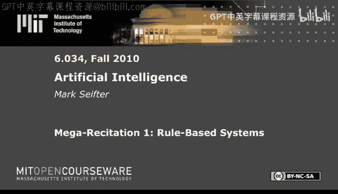
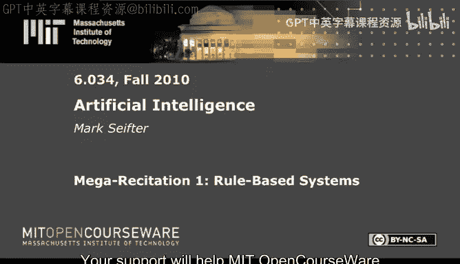

# 《人工智能｜6.034 Artificial Intelligence, Fall 2010》中英字幕 - P24：[24]Mega-R1. Rule-Based Systems.zh_en - GPT中英字幕课程资源 - BV14fqSB2ECY

The following content is provided under a creative Commons license。

 Your support will help M I T Open Coware continue to offer high quality educational resources for free。

To make a donation or view additional materials from hundreds of M T courses。

 visit M I T OpenCware at O C W dot M I Tt E D U。

Hi， everyone。 a few of you may know me from my tutorial。 but if you don't， I am Mark Sifster。

 I'm the senior T A here at 6，0，3，4。 And these Friday mega recitations are gonna be a little bit different than any of the other things in the class。

 Alright， so what is mega recitation。😊，Mega recitation is in this lecture stall room。

 but I hope to make it more like a recitation or a tutorial by unfortunately， for some of you。

 perhaps calling on you guys to participate during the mega recitation。

 As we attempt to work with some of the material that Patrick has sort of given us the big picture for in the lectures。

 And if you've gone to recitation so far， you may have received a little bit of enrichment into how the algorithms work。

 Well here in mega recitation， we're going to figure out how you can work the algorithms。

 And that's very important because in this class。Being able to work the algorithms by hand。

In some of these examples I put up here， or like Patrick sometimes does in lectures to teach you the algorithms。

 is is a crucial way of demonstrating that you understand。How the algorithms work。

 And we use it on a quiz。 The way we use it on the quiz is we， Well this is an old quiz problem。

 It's from last year， it tripped up a lot of people。 So we're gonna go over it today。

 I'm gonna tell you all the tricks that tripped up a lot of people in addition to emphasizing tricks that I've picked up over the gos。

 has it been three years of teeing this course before so that you will not fall prey to any of these tricks。

Hopefully， I say hopefully， because some of these tricks I talked about at mega recitation last year and people still got tricked by them。

 I guess maybe some people didn't come to mega recitation or they were just very tricky tricks。

 So be sure to come to mega recitation。 Pay attention to the， pay attention to the tricks。

 Pay attention to how these things are solved。 ask questions if you're not sure。

And when we get done the hour together， I'm hoping that everyone's gonna do really well on the rules part of the of the first quiz。

 So without further ado， if there are no questions on that。

 which I don't think there probably will be。 Let's move on to the problem at hand。

 As some of you may have noticed it is a Harry Potterbased problem。

 One of our Ts last year was big Harry Potter fan。So what we have here are a series of rules。

And a series of assertions。Now， if you happen to be real go getter and have already looked at all the past quizzes online。

 and you may have already seen this problem。And if you really， really have attention to detail。

 you may notice something a little bit different in the way I wrote it as compared to the way it was written online。

 In fact， you may， if you have a lot of attention to detail。

 but you're not really in on scheme or Lisp， you may think that my。

 the way I wrote it is much easier to understand。And in case you can't understand the other way。

 And in case one of the T As decides to write it in a list like way again， let me explain。

If you look at one of my rules， say if x is ambitious and x is a squib， then x has a bad term。

 That's rule 0 up at the top。That's written in sort of what we call infi notation。 It's easy。

 It's simple。 All the operators are in the order you would expect，2 plus 3 equals 5。

There's another kind of notation that is sometimes used on previous quizzes。

 And by sometimes a good number of times， actually。

 I'm not sure why we still use it that way because of the fact that the classes moved on to Python。

 but we do sometimes。 And that's called prefix notation。 in prefix notation。

 the operator comes first。 So， for instance， plus2，3。Eals 5。The plus comes first。

 The function data comes first。 In this case， the function is plus。

So if we were writing this in prefix notation， In fact， the way I received it， when I， it said。

 if and X is ambitious， X is a squib， then x has a bad term。 The and went first。

 and there was a parentheses which included everything that was scoped under the and。

Does anyone have any questions about prefix notation in case it comes up。Just remember。

If things start being written in a really weird way with lots and lots and lots of parentheses。

Whatevers outside of the parentheses， whether it be plus or and or。

Is an operator that acts on the things that are inside。 However， we're not gonna deal with that now。

 because I think the most important thing is to understand the rules and the less important thing is to understand prefix notation。

 And you can do a problem at home that's written in prefix notation to test yourself on that。

 So what rules do we have here。 We've got rules 0 through 5。 For some reason。

They are labeled with P's。 They are often labeled with either P's or Rs。

 The sort of secret on why theyre labeled with P's is that one year。

 somebody labeled them with P's for like proposition or something like that。

 And then other Ts looked at that test and sometimes also labeled it with P's。 And it sort of。

Down the line， continue to be labeled with P's and sometimes with R's。

 So these P's are the six rules。 The first rule is if x is ambitious and x is a squib。

 then X has a bad term。So what's the deal with these question mark X's。

The question mark before an X or perhaps a Y down here indicate that there is a variable waiting to be bound。

We're not assuming there's a Harry Potter character named X。 And only if that question mark Xs。

 the mystery character。 only if mystery X character has is ambitious， can they。

 can that person possibly have a bad term， What we're seeing is any character in the Harry Potter universe or not in the Harry Potter universe。

 maybe a rhinoceros can fit into that X。So， for instance。

 if a rhinoceros is ambitious and a rhinoceros is a squib， then a rhinoceros has a bad term。

That rule is saying for any X。This is true。 And it's very important how we treat the question mark X。

how we bind question mark X， when we do both back training and forward traininging。

 I'll get back to that because some people made some very， very。

Small mistakes that really messed up a lot of their For and backward training last year。

 It was actually very tricky。 Jeremy， the T A who wrote this was， was very clever。

 and it makes it a really great case study for you guys。 Alright， so rule1。😊。

If X lives in Griffinoror Tower， then X is a protagonist。 By the way， for conciseness。

 I'm going to be using G T for Griffinoror Tower when I write these later on。

 and I'll use S D E for Sther and Dunngeon。Speaking of which rule 2。

 if X lives in slither and dungeon， then。X is a villain， X is ambitious。

 why are there two things here？Well， after the if we have what we call the antecedent。

 that's something that needs to be true in order for this rule to match。After the then。

 we have what is called the consequence。 And in this case， there are two consequence。

 Anyone who lives in slither and Dunngeons is automatically a villain and also ambitious。

So you can sort of think of there being sort of an end there for。

For the purposes of both of those assertions would be added to the knowledge base。 Rule 3。

 if x is a protagonist or x is a villain and。X is ambitious， Then X studies a lot。By the way。

 the scope is for the the scope for this。Just to be sure that we're clear is。This。So。

We need them to be a protagonist or a villain。 And no matter what， they have to be ambitious。Rule 4。

 if X studies a lot， N X is a protagonist， X becomes Hermii's friend。And rule 5。

 if x snobs Y and X lives in Griffindor Tower and Y lives in slither and Dunngeon。

 then X has a bad term。So those are our six rules that we can use to understand Jeremy's world of the Harry Potter universe。

And we also start off with four assertions。Let me not underestimate the value of always looking to the assertions。

 It's one of my white star ideas that are up here on the board。 Let me see。 No， not It's perfect。

 Always check the assertions before using a rule。 This really trick people up last year。

 And you'll see why， because we're doing last year's problem。嗯。

Our four assertions that we start with， assertion 0， Milliccent Liz and slither and Dunngeon。

Assertion 1， Millicent is ambitious。 Asserion1 is what trick people up。

 So remember that Millisson is ambitious。 Assion2， Shamus lives in Griffin D'ter and assertion 3。

 Shamusns Millicent。So those are our four assertions that we've already started with。Now。

 the two things we're going to have to do。A backward chaining and forward chaining。Now。

 when you guys learn these two backwardcker traininging and forward chaining。

Raise your hand if you thought forward chaining was harder than backward chaining。HaI knew it。

 I can prove whatever point I want because no one wants to raise their hand because I also think backward chaining is harder than forward chain。

 Raise your hand。 If you think backward chaining is harder than forward chaining。First of all。

 we have a good number of people。 Second all。 since no one wants to raise their hand。

 I could just ask it the other way。 That's a pro tip。 if you're ever with a large group of people。

 you can prove any point you want by asking the other direction。 no one will raise their hand， so。

I agree that backward training is harder than forward chain。

 And I disagree with Patrick that we're going to get out of here early。

 So let's start with backward chain first so that we make sure that we spend the bulk of our time with it。

 forward chaining。Well， you know， you just go through you go through pretty methodically and add new rules。

 backward chaining， you have to draw this crazy tree。

 There's a lot of places to get lost in the middle of the road。 So let's do some backward chaining。

 And to do that， I'll do it over here on the left side。So when we're doing backward chaining。

 we have to remember a few things that are written directly on the quiz。

 so you're not gonna to have to worry about that， but they're still pretty important。

 So actually I'll write on here first。I'm going to read them off。So when working on a hypothesis。

 the backward chainer tries to find a matching assertion in the list of assertions first。😡。

If no matching insertion is found， the backward chainer will try to find a rule。

With a matching consequent， a rule that has something in the then。

That can prove the assertion I trying to figure out。 So， for instance。

 if I was doing backward training on。Shame is snugs Millicant。What happens？

 I'm immediately done because there's an assertion assertion 3 that says Sha snoug' Millicent。

 I've proved it。 I'm done。 I'm happy we can leave。 We can go home。 Unfortunately。

 that's not what thequiz asked to do。😊，Well， let's say that instead， we were supposed to say。

 I don't know， Shamus is a protagonist。Well， then wed wind up looking to here。

And we would look at the fact that rule 1。Can prove that someone is a protagonist。

And we'd recurse and try to prove whatever is in the antecedent of rule 1， which is， O， Well。

 does he live in Griffindor Dower。Asserion2， he does。So that's some really quick。

 And if that was too fast， don't worry we're going to go step by step with the actual problem。

 but I just wanted to give two really easy problems really quickly how it's going to do it。

 Let's go step by step with a real problem。 Let's keep in mind。

 the backward Chaer never adds new assertions to a list of assertions。And if you have a tie break。

You always order based on rule order first， P 02， P 5。 And if you can try it， if you。

 the rule same rule matches with more than one thing in your list of assertions。

 then you tie based on the order of the assertions。Okay。Very important。

 disambiguation and tie breaking are big place to get messed up。So。

We're going to try to prove that Millicent becomes her mindies' friend， alright。And so。

I'm going to abbreviate some of the things， but not not for the very first line。So。Miillicant。

Becomes。Her Minese friend。We start drawing a gold tree。Now。

 you guys are going to learn exactly what these mean。Very soon， in fact， next lecture。But for now。

 trust me when I say these gold trees are depth first。

And Ill explain what that means because some people have messed themselves up and spent more time than they needed to by treating the gold tree in a different way。

Now， Melson becomes her minds friend。Let's pretend that we're the backward chainer。

 We're trying to prove that this is true or disprove and say， well。

 it's definitely not true with what we have。 So let's see。I'm now gonna make you guys help。

And people in the back think they won't be called on often like to call people in the back。

 What do you think is the first thing we should do， Very first thing。Yes， look for magic insertion。

 excellent。Do we have a matching search in， everyone？No， we don't。

 That would be the world's easiest quiz problem。 We do not have a matching insertion。 Great。

 So since we don't have a matching insertion， what now。啊，A to look at。That's right。

 And do you see any rule that could prove that Melisa becomes term my friend？That's right。

 you can see in P4 x， which can be anybody， anyone is capable of being her minds friend。Great。

 so P4 is our。Rule of the hour。So we're going to use P4。And when we use P4。

To prove that Millisit becomes hermi's friend。We're gonna have to add something or another to the gold tree。

 So let's see。 what do we have to add to the gold tree。That's right。 Does everyone see that。

 in order for her to become her mind'ies friend， by Rule4。

 I have to see if she studies a lot and is a protagonist question。So when you work at。M first at。

Okay， that's a very good question。You're going get screwed up if you look at the antecedent in backward training first。

 it's backwards， partially for a reason。 You need to look at the con。 Now， why is that， Well。

 let's say there is a rule， Rule 6 that said。If X becomes Hermione's friend。

 then Hermione feeds X polyju potion。Or something like that。

Will that rule help us in back chain to figure out if Millisent becomes hermanese friend。

Some people are shaking their head， but think about， well， that will be able to prove it。 No， now。

 if they do become her mind friend。 we wan to do some for traininging。

 we'll figure out they're gonna transmute into some kind of other thing because of the poly。

 But it's not gonna help us do the one thing we wanted back， which is to prove that thing on the top。

 So we actually need to look for something that has our current goal in its consequent。

 Then we add on the antecedents as。People I've asked so far。 Sorry。

 I don't know your names like Patrick have correctly given me every time， which is excellent， so。

Notice also that she didn't say X studies a lot needs to be added to the gu tree。

 She said Millicent studies a lot。Oh another question， great。It's obvious。

 but after putting the rule forward in there， should we first check the assertions？

Check all the assert that our conditions are forward rules the question is。

 once we put rule 4 in there， should we check to see if those antecedents of rule 4 are already in the assertions before checking other rules。

 The answer， You're not only correct， Sir， you're exactly one step ahead。

 So I'm gonna assume I called on you for the very next thing。

 That's exactly what we do once we draw it onto the tree，'。

 you're exactly on the way for the questioner。Perfect， so all right， great。So again。

 we're putting up Millicent studies a lot。 Millicin is a protagonist。 We're not putting up X。

Some people did that。 And， of course， it's an and node， as we heard， we need them both to be true。

 or we're not gonna be able to continue onward。 So we have， I'm gonna use M for Milliccent。

 Milliccent studies a lot。Also over here。我。Millicson is a protagonist。Great。

And we've already heard that we need to search in the assertions。😡，Before we go into any rules for。

What we're looking for next， The question is， what are we looking for next and in what order。

 This is where that thing I told you about depth search is crucial。

 We are going to look here on the left node。 And if it has any children。

 if we have to keep going down， we are not gonna to look here yet。Alright。

 there's a few reasons for that。 one of which is that we're lazy。 The evaluation。

 if you learned about it is also， if you learn about lazy evaluation is also lazy。

 And if we can disprove this study' a lot branch， we don't have to do any work with the protagonist branch。

 we're done。 We're out of here。And it's， and it's， it's a， it's a loss。 Alright。

 so we're going to move down the studies a lot branchn。 And we already heard from the audience。

 We need to look to see。If it's in the assertions， everyone who studies a lot。

 Millicence studies a lot in the assertions。No， it's not， all right， well done。

Now we're going to get to that question that I had before about the antecedent or the con because study a lot is here in the antecedent of rule 4。

 but we're not going be able to use rule 4 here。 in fact。

 that's how we got here in the first place so。Question is。let's see the question is。

 do we have a role that matches in the in the consequent that matches Mill studies a lot。Yep。

 that's right， P3。troversity。That's right。 So P3 is， gives Mill to studies a lot。 And so therefore。

 what will we add to the gu tree。We both。It is Millicson either a protagonist or a villain。

 and he's ambitious she turns out to be a girl。Alright， so that's exactly right。

 We heard that we need to add we need to add an and node。

But which also has an or node at the bottom of it because this is a little bit of a complicated rule。

 So we have an add node。So we have an end node。 And the first thing on the end node is Millicent is。

A protagonist。Or militant。Is a villain。And the second thing on the end node is Millicant is ambitious。

Well， actually， that is the second thing on the end note。 I hope that's what I said。All right。

 the second thing on the Endn is Mill is ambitious， great。O。So。Here's our handy little tree。Now。

 this is where it's important， as I said， we're doing a depth first search。😡。

We're going down along the left branch。 So where do you think we're going to go next on this tree。啊。

哪会。That's in good guess， you didn't say we' were trying to prove them as a protectist on the right branch。

 which is a very common state， where do you think？You should go down you see through the consequence score。

But。Which one of the two millson is a protagonist do we want to look at？Yeah， down left。

 that's right。So you guys will learned up for search on Monday。

 at which point it'll become much clearer what I'm saying， but yeah。

 you always follow the left branch。As far down as you can。

Then you take the right branch of that same branch that you followed。 Allright， great。

 So we're going to try to find that Millicson is a protagonist。 Where， what do we do first。Everyone。

 yes， is it in there？No， it's not。 okay。Therefore， we're going to try to find a rule as as we heard about。

Weather Millistson is a protagonist。 So all the way in the back。All the way that。

 but is there a rule that matches？is in its consequent that Mill is a protagonist。There is。Okay。

 well， let's give it a try， which one？B thats right。

 So therefore we have to add what to our goal tree。Right what's on that leaf？Yeah。

 no siblings and gr top perfectly so our new thing that we're searching for。Is。Pretend this connects。

Actually， I guess it does connect。 We're looking for M Liz。In Griffindor Tower。Great， all right。

 And since it's step first， that's where we're going next。 Great， we're on a roll。😊。

What do we do first？Do we have that insertions？Some people say yes， but the answer is no。

 we have in fact shameness living in Griffin Durre。Most of you said， no， you're right。

 the majority rules。We don't have any the assertions。 However。

 do we have a rule with that in the conequ。No， so what do we do？はい、そうだ。

People are saying different things that are all correct， backtrack， you say， go to the next。

 we can't prove it， all correct。Put a big X。This isn't true。 Now we look up we're on an or node。

 so we're not done yet because。Either of those can be true。Great， so now we go back up， backtrack。

 Millson is a villain， great。What do we do first？Check insertions is is in there No it's not don't worry we're getting to want where it will be where about 40% of 30 to 40% of the class last points very。

 very soon so we see that Millistent is a villain。And it's not the assertions， therefore。

Is there any role that has that in its consent？We're looking for a adolescent is a villain。it。

 All right， I will move it down slightly a little bit off kilter when I put in the parentheses around the end。

 hold on。There you go。O。はいです？Then they study lot。 All right。

 we're trying to prove that she's a villain， though。 So do we have any with that in the consequ。

That way anything that will prove that she's a villain if we fire off that rule。

I want to give her a little bit of help？See that now。 It had two。 So it was a little bit harder。 Now。

 some people ask， what about that ambitious thing， Can we like add that to the tree or something， No。

 the back chainer is single minded， focused and stupid。

Even though it's later going to need to prove that she's ambitious， it doesn't care。

 it just sees the villain there， villain， oh， that's great， as long as we've got the antecedent。

 we're going to be happy。This is actually an important point， not in this particular problem。

 but in some other problem。 So by using P2。We're obviously going to have the antecedent。

Xx lives in Sther and Dunngeon。 When X here is Millicant。 So a Millicant lives in Sther and dungeon。

All right， so what's the first thing we do when we see this new assertion？We checked the assertions。

 is it in there？Yes， that's not where everyone lost points， but yes， it is in there。钱。

This order node is happy。Now we move up to the endode withson is ambitious。 So Mill is ambitious。

 What do we do now。他9S4。食区嚟贴钱。like I don't know how to fight。Do you have that nonsense。

The is not necessary to let。To let us use rule 2。 Yeah Actually， no，s， it's the question is。

Do we need， the， do we need the X is ambitious to be in our list of assertions in order to use P2。

 For instance， if we didn't have the assertion that Mel said is ambitious。

 would P2 have a problem firing。Asertion is no。So it's it's it's a very interesting question。

 It's sort of what actually I was trying to， what I was trying to mention earlier when I said it's single minded。

 It's focus。 It doesn't care about the other one because you might say， well， wait a minute。

 P P2 could never have actually fired if it didn't have both of its consequence。 But in fact。

 the backward chainer doesn't care。All that the backward chainer is looking to do is to prove。

Whether it's to prove whether or not there is a possibility that Millicent might be a villain。

 It's not signed to say， oh， all of the results of， of。

 of some certain rules are making Milliccent a villain and all the other things that are there。

 like ambitious are in the database。 It's not the for generation。 It actually doesn't care。

 This sometimes leads to unnecessary computation， but it's very simple and it's very simple to code。

 So it， it often will probably speed you up in the long run。 like if there's， for instance。

100 things in the then and you only care about one of them。

It would be a waste almost to add those 99。 There was a follow up over here somewhere。其都系复我。全厕拖。不代理な。

えそ。审判。You can try。 However， then at that point， every time you check the assertions。

 you'd be attempting to check those 99。 Also， you might not have used those rules。 The question is。

 could you make a hash table with all of the 100 things that were in the consequence。

 And then after having made that hash table since you were already walking through those anyway when you were checking it。

 You could add those to the assertions， The problem is that you might not necessarily want。

Although with the backward chamber， you might not necessarily want to think that all of those things in the。

 the con are necessarily true。However， it can， you might not care about them。

 And then you have to make an order and computation every time you check that list of assertions in the upper left。

In nexting to particular is more。但是。you don't know what assertions there are。

 You have to check the entire list of assertions in the upper left every time you get to a new node in the gold tree。

 So each one is order  one。 But I'm not saying to find a specific assertion is order is order n。

 I'm saying every time you make a new node in the goal tree。

 you have to check all of the assertions you've added。 do that anyway。我事。Yeah， the four。

 But let's say that there were 10000 consequence of P2。

 You would have to check 10000 instead of  four。 if you added them。

 if you added them all after proving P2 was true on the gold tree。 Also。

 another important note is that you might not use every branch of the gold tree。

 if there's like an ore that's up higher。 And you wind up using a different branch in which case you probably have to make a separate hash table for every sub branchch that you have。

 And then remember which hash tables were updated based on which sub branchch and then the sub branch die。

 It's probably more effort than it's worth。 you could。It's an certainly an interesting question。

 It's great question for for debate and recitation。 And also， I'm happy to talk about it later。

 I think that someone who very intelligently made hash tables and thought thought the problem through。

 As Patrick said， more knowledge can mean a better actually， maybe he hasn't said。

 more knowledge can mean a better search because we haven't done that lecturester yet， but。😊。

IYou're talking about implementation decision and using hasht might well be a good way to do this。

The problem is that we're presuming some things about how the rules are firing and what binding they're firing that depend on the order of the assertions in the table。

そ。ash table would lose the order and we would be agree。That's true。 That's true。

 But I'm thinking like if someone wanted to make that implementation is like do some research in rulesbased systems。

 it's possible you can increase the running speed in this class。

 we are not as not completely as focused on the on the fastest algorithms。

 but I still think that that's a cool thing to try。 Que from people in the crowd。Thank you that。

I thingThat's a good idea because it's a little extra enrichment thing。

 it's not anything you would possibly need to know for thequiz。😡，So。SoSo it。

If it became like you're using this dense statement， because you want the villa。😊。

Along with using this， you get access ambitious'm to。After that。

 another then statement that you also see saysS is not ambitious， so how would you resolve？

So the question is， let's say you used rule 2 somewhere in the tree to get that X as a villain。

Which then says that X is ambitious。 Then later， you have X is not ambitious。Somewhere， some。

 somewhere in one of the other roles that you then later need。 How is that， the question is。

 how do you resolve that， What does it do， Well， first of all。Okay， so first of all， interestingly。

 if it says x is not ambitious。Lially like that， and I'm not being pedantic here。

 this is one of the tricks someone played in a previous quiz。

You can have that and X is ambitious both in the list because it's a dumb rulesbased system。

 It doesn't know that you can't have both of those on the list。

 So if you have a positive assertion in a consequence， X is not ambitious in a consequence。

 X is not ambitious， it'll be happy to add， Millson is not ambitious。

 And while Mill ambitious is already there。Because it's stupid。 Now， if it had delete。

 Millicson as ambitious in the consequent and deleted something that was previously there。That。

That would be an interesting problem， it could cause mistakes。

Your backche would probably make the mistake of allowing this， however。

 this is exactly why we do not， I believe， as a policy do not have delete statements on the quizzes。

😡，At least previous quizzes did not have them， except for in a hypothetical of what happens if we had a delete statement here。

 I don't think we've ever made people work things through with the delete。Deelete would。

Would possibly cause some issues。 Que in the back。 So just to check this were doing backward chaining。

 actually add assertion assertions in backward chain to the assertion table。 It's dumb。

 It just keep the system is done。 I think it's a dumb idea to do this。

 It's actually pretty fast to do it this way。 But the system is dumb。

 so the question is you add assertions or you don't add assertions you do not。

 you simply go through checking all the things in your goal tree until the goal tree is either proven or disproven。

 Then you are out of here。 Allright， So cool so far， everyone。Good questions from everyone。

 These are all questions that are things that often trip people up。 So our next thing。

 Milson is ambitious。 We sort of the cat is out of the bag because theres a question mentioning that there is an assertion that says that。

 But I direct you guys to our favorite rule， rule 2。

 Shouldn't we use rule 2 to prove that Milson is ambitious。😊，TheQuest is， the answer is。

 if you wan to lose four points or however many points， then yes。

 But if you don't want to lose points， then this is already correct by。

This is already correct by virtue of assertion one。

So I guess I should write also that this over here， Millson studies a lot。

Rule is this rule is rule 4。Wait a minute， that's rule four which studies a lot in protagonist down here to prove that she studies a lot is rule three。

And then at the bottom here， we have。We have what rules here。 We have， the protagonist rule。

 which is one and the villain rule， which is 2。This is correct， virtue of a0。Okay， great。

 so we've proved this whole end node。 We know that Millicson studies a lot。

 But now we're gonna have to go a little bit more quickly based on time。

 And so I will do the remaining things。 Anyone who has not been called on is off the hook。

 but that doesn't mean not to pay attention because there's some interesting stuff still to come。

 So Millicson is a protagonist。 Well， good news， everyone。

 there's one other reason that I can do this。 And that's that you've already told me what I need to do。

 Millicson is a protagonist， you use rule1。 Yeah， rule 1。😊。

And check if she lives in Griffin Dort now will it do it again？Yes， it will。 It hasn't cacheed that。

 It's already tried that。Now， a hasht notwithstanding， Caching something you've already tried。

 may a good idea with backward chaining， but we do not do that in this class。

 That's an implementation detail it's another idea of something you can do。

 We don't cache things that we've already tried。 We try them again damn it and when we try it again。

 maybe it'll work this time。 No， it it never works this time。😡，This fails。 This end node fails。

 The whole thing fails。 They're not friends at all Theyre。Bitter enemies。

Millicant does not become Hermi friend。So now they ask us a few questions which are pretty easy to answer based on the ordeal we've just been through。

 So determine the minimum number of additional assertions that we would need to add from Millicent to become Hermione's friend。

But you're not allowed to add an assertion that matches a consequence of a rule。

You can only add an assertion that you can， In other words。

 you can't add an assertion that will prove some other rules。

 you have to add an assertion that directly。 Yeah， just， that's basically the the。

 the rule here because there's a lot of choices。But he wanted one particular answer。

 And so can anyone think of an assertion that doesn't match any consequence of any rule that will make her be Hermi's friend。

A lot of people say Millicant Lu Griffindor。 That's correct。 So part 3。

 your solution to part 2 causes an uncommon situation。 What is the uncommon situation。

And what should you do to the list of assertions to solve this problem。

Does anyone know what the uncomfortable situation would be if we added the she livess in Griffindor Hand is raised up here。

 What is your answer。That's true。 She lives in Grindor and Slither， so how would you fix that？Yes。

 you could take out so in front of the assertions。And say that she only lived in Griffindor。

 A lot of people gave the。Answer to this question， which is a perfectly reasonable thing to do in a gold based system。

 They said， well， we can add a rule that says that if you live in X and you。

If you live in X and y is different than X， then you can't live in Y。The problem with that。

 among other things， is that we ask for a way to change the assertions and not the rules。

 And you gave us a way to change the assertions。 That's the right answer。 Great， so。There was an。

 there was another backward chain problem。 This is 2009， quiz 1， and。

I will I will leave it off for the moment。 You guys should take a look at it。

 in particular with variable binding， because remember。

 you always have to bind the variable that's relevant to you that that doesn't mean that you always have to bind all of the variables。

 For instance， let's say that we wanted to prove that Millicent has a bad term， which。

 as it turns out， is what we want to prove in the other backward chain very quickly and without doing the problem。

 Can anyone can anyone who who thinks are very clever backward chain。

 Tell me exactly what things would be added to the to the goal tree to prove that Millicent has a bad term。

 raiseise your hand。 I won't I won't pick out a victim because I'm asking this to happen pretty quickly。

No one。哎。You could add the three and see that to rule to rule5。

 which specifically for anyone for variable Y。 And so you just have to show that there's at least one person who matches。

 So can you just sort of read out， what would the first thing say with the snogs。

X sugs sorry Millicant snugs。Anyone， yeah， No sugs why。 That's crucial。

 Some people did a lot of different things。 Some people put shamemus in already。 You can't do that。

 The system's stupid。 It doesn't know that the person is shameous。 Also。

 some people said it worked because， look， they'renunging each other。 but it's the wrong。

 It's the wrong snouggle direction up there。嗯。because we have shame is snogging Millicant dot Mill snogging shame。

 But yes， exactly。 it would be Millant snugs Y Millant Lun Griffin Dot， Y lives in S and Dunngegeon。

 So let's give forward chaining all the attention it deserves。About8 minutes。

Which will be more than enough。Okay， we've still got all these rules。

 We've still got all these assertions Instead of doing that horrible， backward chaining。 Oh。

 it's not that horrible， but we'll do forward chaining。 It'll be really easy。

 We'll just add new assertions as they go。 Remember the tie break order。Rules in order from 0 to 5。

 And if the same rule could trigger， could fire off with multiple different assertions。

 we'll use the assertions in order from 0 to 3 so。Let's see。We don't have much time， but。

With our four assertions， let's see what rules possibly could match。😡，With our four assertions。 Well。

 I'll figure out for you。 Do we have an assertion about an ambitious person。 Yes。

 but they're not a squib， So not rule 0。 Do we have someone who lives in Griffindor。

 We absolutely do。 Rule 1 is matches。 Do we have someone who lives in s。 We do Rule 2 matches。

 Do we have a protagonist or a villain。 We don't have any protagonist surveillance。

 Rule 3 is not gonna match because it's， it's in an end。 Do we have someone who studies a lot。

 We do not have someone who studies a lot。 Rule 4 is not gonna match。 Do we have some snogging。

 We do have some sgging。 So Rule 1，2 and 5 match。 So。And for matching， we have run， two and five。

 Everyone， which one wins the tie right between  one， two and five？One。

 because it comes first numerically， which one is rule  one if X lives in Griffindor Towerre。

 the only binding for X is Seamus， Seamus lives in Griffindor Towerre， we're firing off Rule1。😡，So。

 new assertions。The first assertion that well add is。Shams is a protagonist。Grape。Now。

There's one other thing and it's the main thing I wanted to tell you about in Ford Chaney。

About our old friend Wo1， now that we've done this， does Wo1 still match。

An assertion in the database。Yes。😊，It does。 But what's gonna stop us from constantly doing rule one every time because it constant numerically before the other rules。

What stops us there is part of our implementation。 and it's a very important part that people sometimes forget。

 So what I like to call the no impotent rules， implementation detail。 That is。

 if it rules completely，1100% impotent， it would do absolutely nothing。Then you don not fire it。

 you go to the next one。That's pretty important。 Let's say that you possibly had a delete。

 which you won't have on the quiz。That means that if the thing to delete is missing， it's impotent。

 If the thing to delete is there， it's not impotent because you can delete。

 Let's say you have 500000 things that you're gonna add to your assertions。

499999 are already in your database。 One of them is missing。 Is it an impotent rule。 No， it's not。

 You have to fire it anyway。 You can't be like， oh， it's mostly impotent rule。 No， you have to。

 you have to fire off the rule。 if it will do anything。Right now。

 rule 1 won't do anything because we've already added Shamus as a protagonist。

 So what rules match down。 Well， Shamus becoming a protagonist is nice and all。

 but he's not ambitious， So we still don't match rule 3。 We still rat rules 1，2 and 5。

 And as I basically just got finished telling you， the one that we're going to fire off now is。2。

 that's right。 So will 2。Is if X in S and dungeon， our only binding for that is Millicent。

And that will show that she's a villain and she is ambitious。 So what assertions will we add。

Micson is a villain and people stopped。 That's right。 Good job， everyone。 You。

 You remember that Millon is already ambitious。From rule from assertion one。

 So we don't have to add them both。 A lot of people did。 They were wrong， so。Micson is a villain。

 The other part of that role doesn't do anything but it's not an impotent role because one of the things is not on that。

 Great， So what at， what what rules match now， Well， as it turns out。

 now that Millicison is a villain and ambitious， we match rule 3 as well。 So we match 1，2，3 and 5。

 what rule are we gonna fire everyone。Three， because one and two are impotent rules。Well。

 fire rule three。 Well， Millicson is a villain， she's also ambitious， she's our only match for three。

Therefore， what assertion do we add？Nelson studies a lot。 That's right。Great。

 so Nelson studies a lot。 However， she's not a protagonist。 We still don't match rule4。Oh， well。

 well， we figured that out already ourselves from backward chaining that we were never going to match that。

So what matches， It's still 1，2，3， and 5， See as 1，2， and3 are impotent。 The only match is。快。

And so the only match we care about， the only one we're going to fire is5。And the result。

 let's see X snugs Y。 That's seamus suggs Milliccent。 X lives in Griffindor。 That's Seamus。

 Y lives in Sther。 That's Milliccent。 So what do we add。Sams has a bad term。Simple， painless。

It works out。 We're done， and we got 100 on this quiz。

Hopefully you guys will too question the question is if you have a new assertion which matches a rule。

 but it's really high number， it's all the way down at the bottom of the rules。

 but it's new and it has new stuff Should we do that first maybe because it's new。😡，Oh。

 you mean that has a lower number， a lower number。Okay， so the question is， if a rule。

 let's say that rule 3 made Milisia squib。Then yes。

 you'd immediately not only match zero with zero would immediately fire because it's numerically it comes first you'll see that on some of the other old quizzes and you may see that in tutorial if you guys want to do some more practice problems in tutorials your TAs will have that available as one opportunity in tutorial but yeah that's exactly right it happened that it went in order this time。

 but it will definitely hop anywhere it can in order to get to the lowest numbered assertion。😡。

