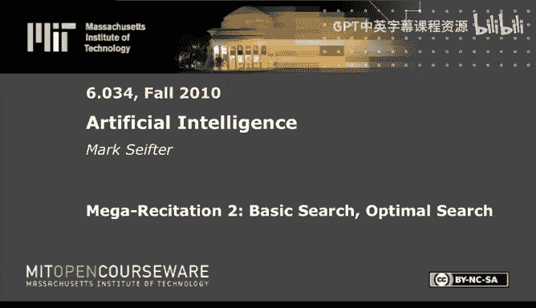
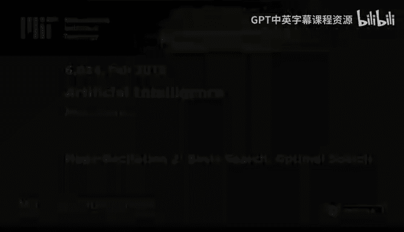
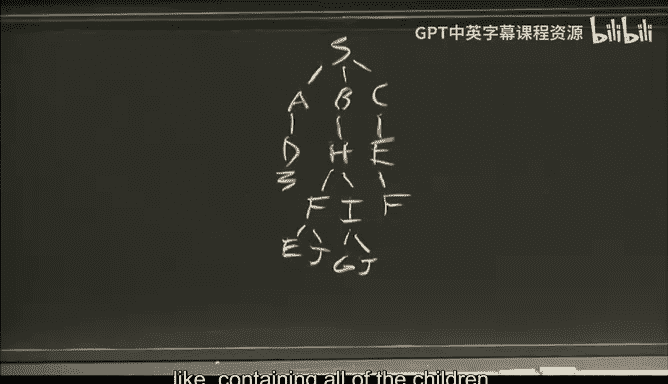
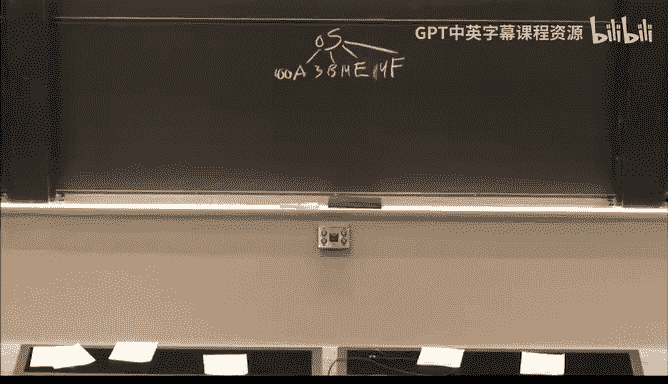
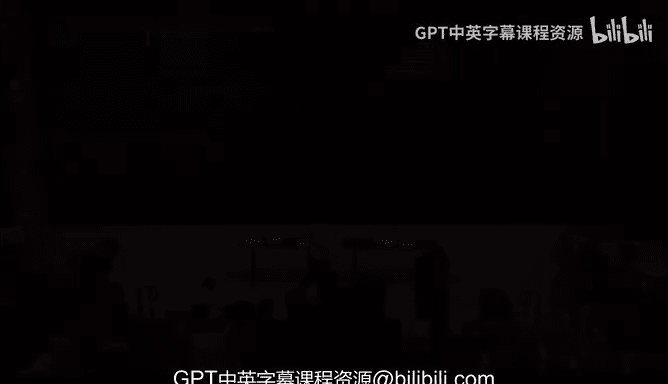

# 《人工智能｜6.034 Artificial Intelligence, Fall 2010》中英字幕 - P25：[25]Mega-R2. Basic Search, Optimal Search.zh_en - GPT中英字幕课程资源 - BV14fqSB2ECY

The following content is provided under a creative Commons license。

 Your support will help M I T Open Coware continue to offer high quality educational resources for free。

To make a donation or view additional materials from hundreds of M I T courses。

 visit M I T Opencourseware at O C W dot M I T dot E D U。

 This week's problem is from the 2008 quiz 1 on search。

 is motivated by the search of evil overlord Mark Vader， who is shopping for a new evil stronghold。

He starts from his current stronghold， which is S， the depth first search star。Now。

 the depth first search star has the following qualities。 It has a small。

 thermal exhaust pipe weakness。It has the quality of that's no moon。

But it does not have a race of enslaved minions or a secret escape route or sharks with laser beams。

Now， when I originally wrote this problem in 2008， there was another quality。 It was very important。

 that was a giant laser， and it did have that property， as did Dr。 Evil's Bo base。

 But that was removed to make it easier to solve。 So we're gonna solve it without the。

 without the giant laser that we can just have the sharks with laser beams。So。

Mark Vader has gone to Okbar's emporium of new evil strongholds， which are listed on the left。

And he's trying to figure out。The best way to get from his current stronghold to his goal stronghold。

 the 6，0，3 fortress， which has the admable qualities of no small thermal exhaust pipe weakness。

 And it still has， that's no moon。 It has a race of enslaved minions and a secret escape route and sharks with laser beams。

 which said it's got everything you would want and no weakness。 However， he can only move。

Between fortresses that have exactly one difference。Fortunately。

 Mark remembers how to perform the search techniques he learned in 6，0，3，4 from his mentor。

 Emperor Patrick T。😊，So。We've got several fortresses here。 We've got the De first search star。

 We've also got Shile Goul。Which has the qualities。

 basically of that's snow moon and none of the other qualities。

 Do godore here has got the exhaust pipe weakness somehow， despite being sore on stronghold。

 It's not a moon。 And it has those enslaved millions。 I guess the orcharster enslaved。

 Moonraker here only has exhaust pipe weakness。 So it's， it's not very good。

 But James Bond didn't need to。Deal with stuff。 Zeal underwater Palace has。

 that's no moon and a secret escape route。 Xermi's lunarco has an exhaust pipe weakness and a race of enslaved minions。

 whalers of the moon ride has the exhaust pipe weakness。

 race of enslaved minions and sharks with laser beams。6 to3 forress we've already been over。

 Atlantis has all qualities except for a secret escape route。

 Willy Wus factory has some of everything。😊，It is， after all。

 Willieons factory highlight the race of enslaved minions the Upa Us。 And Doctor。

 Evi's moon base is only missing。 That's no moon because it is a moon because it's a moon base。So。

If you got all the references that were used in making those fortresses， I'm sorry。

 There's nothing I can do for you。What was。Now， Mark， being a clever evil overlord。

 realizes that he can produce a graph of the exploration choices。

With edges joining strongholds it differ by just one feature。 So although this is a graph here。

 as Patrick often says， and you get to hear again right now， search is about choice。

 not just about maps。 So we're not moving around anywhere in the real world。

 But we certainly are going to move around this graph to pick between these many stronghold choices。

 How can we decide where to travel Well， we're about to find out。

 So we've got this lovely graph right here。😊，And now we're going to get to do depth first search。

On the graph。Now， there's a lot of ways to do search。And you've seen Patrick do it。

 You may have seen some people do it in recitation。

 And I'm gonna offer you guys a unique opportunity to see me do search in one of several ways。

 or possibly more。😊，I have the tried and true method。

 You have the Q or agenda or whatever you want to call it。 You keep track of it at every level。

 You make damn sure that everything you're doing is right。 It takes a long time。

 and you get the answer right。Or there's one where you only work with the gold tree and you draw it really fast。

 And you might make a mistake， but it's gonna to solve it more quickly。

 So who would rather see the reliable but slower approach。

Whod rather see the faster but less reliable approach。 All right。

 Monte Carlo people here rather than Las Vegas， if you don't know what that is。

 you'll learn it in an algorithms class。 Alright， then there's a third approach that I probably won't show you unless there's overwhelming favor for it。

 That is the approach that is manly fast and will solve depth for search in no time at all。

 but is very likely to make mistakes。That is this approach that I use when solving depth for search。

 I've used it enough times I don't make mistakes that often， but even I still do。

 So does anyone want to see that one。Okay， not that many people。 Well， it doesn't take much time。

 but I'm just afraid if I show it to you that you'll be like， that's the only way to do it so。

We'll sit up for later if we have more time。 it essentially。

If people are interested involves just using your chalk or finger to trace through the tree really fast and figure out what it's doing by。

Drawing little tiny lines， it is very fast， but it's not very accurate。

And you have shown basically no work if you get it wrong。 So shame on you。Okay。Well。

 let's do the somewhat faster way when we don't draw out the entire agenda。

And then people who were the almost nobody who raised their hand for that way can check it out in tutorial the way that you do it using the agenda。

 So let's do it using the goal trade。 So it's a bit faster that way。

 So we're going to start starting at S， the start note and going to G， the goal node。

 That's a standard notation。 But make sure that when you're taking the test， you check to make sure。

Where the start note is， where the goal note is。It's pretty， pretty much。

 an asshole move to have a genome that isn't gold known。 But sometimes there won't be an S node。

 That's a pretty good clue that something else is the start node。Now。

 there's a few little white star ideas that we have or silver star ideas for search。

 One is lexxiography。 What is lexxiography。 Who cares， well。

The most famous lexxicographer I know of is Samuel Johnson， who wrote a really famous dictionary。

 And the only reason we care about it in this class is because you'll always see the instructions break ties in leographic order。

 And then you might be like， wow， that's。😊，Really rather a wordy word or a cescopedelion word or whatever really long word you want to use to describe the word Lex graphic。

 What the heck does it mean， Basically， it means alphabetical order。

Like you would do in a dictionary。So， for instance。In alphabetical order， A comes from B。

 So you can go to A before B。 Now， even beyond that point。

 there are several ways to do leconographic tie break。

And it's not always consistent between algorithms how you would do electricityographic tie re。

In the most recent time that Patrick was kind of randomly talking to the staff。

 He made it clear that the way he would like us to do it。 and therefore。

 the way we'd like you to do it is to tie based on the very latest nodes at the end。

 So you might say that's not really likeographic。 Would't S A B come before S G A in the dictionary。

嗯。And my answer my， my answer to you is， yes， it would。Yes， yes， it definitely would。However。That is。

 that， that is apparently what we're doing according to the last thing that Patrick said。

 and we will keep you updated if he decides to go back to dictionary order。So。

That's lexographic leography。 You might be wondering what the picture here is。 Well。

 this is our friend， Orura Boris。 Long has it been a symbol in alchemy of infinity， eternity。

 or maybe， you know。😊，诶呃。Sort of infinite energy engine， turning iron into gold。 But today。

 unfortunately， the orura bars is endangered species because。No biting your own tail in 6034。

 A lot of people mess up from this。 It's an honest mistake。I mean。

 we've gotten some emails from staff members who couldn't solve one of the problems because they forgot about this。

 So it's okay， if you forget， But try your best to remember。

 nobody buding your own tell is the only smart thing our system does。

 So remember last week when we were talking about rules。

 And we were saying that the rule system is not a smart creature doesn't know that there's there's difference between or sorry doesn't know that not Polly is dead should be the same as Poly is not dead or something like that。

 It's too dumb to figure that out。 Well， this system is also dumb。

 But one thing it knows is that Patrick really hates if the same node appears twice。

Within the same path。 And it will destroy that immediately before even adding it to the queue。

 It's gone。 It's not considered。 It's out of there。 So very important。Sad oruraorrus。

 nobody in your own tell。Alright， so now I've gotten through that。

 let's actually solve the problem with some depth first search。How will we do that。

 Well we're not gonna use the Q at popular demand， We're going to use gold tree。

 So we'll start at node S。What are our choices at node S？Well。I'm gonna force you guys to help。

 So it won't be quite as fast， but itll be fun。 So what are our interested know S。😊，You。一。

There would be。Not quite。 And this is something I like about this problem。 You got most of them。

 Do you see that there might be another choice。Everyone， yeah， see。

 This is a big problem that has happened on a few different quiz problems where there's a tree that you could。

 where there's sort of a grid that looks like a tree or graph that looks like a tree where people aren't as willing to go up as they already go down。

 You can see it on some of the other press previousz problems， too。

Make sure that you check the connectivity and also note that unless otherwise specified。

 and I don't think we've really done this much the。

Little connecting edges in our graphs are bidirectional。

 You'll see a big arrow and probably instructions written at least 8 font sizes higher than all the rest of them and bold。

 if if we're gonna do something different for this quiz。 It happens that they do it sometimes。 Well。

 I just saying me citation。 we never do this。 And then on the quiz， they do it。

 But it will be in giant bold letters。 which also leads me to another Silver star idea that I forgot to tell you guys last week。

 So I hope people didn't ditch out on me like， oh， Mar boring。

 we won't come next week and then missed this one， because it just came to my mind。

 That is read the instructions。Its a very important thing for the quizzes。

 And I Patrick will in a later lecture， tell you guys， ask why five times。

 and he'll explain why that's a gold star idea。 My parallel to this is read the instructions five times。

 maybe not5， maybe 3 or 4， but at least 3。Read the instructions。Read them again。

 Then read them a third time。 only paying attention to whatever is bold and8 sizes larger than all the other ones。

 because there's gonna be something there。 this's that size。

 And it's gonna be the one thing that everyone misses。 So make sure you're not everyone。

 And you read the instructions a lot of times。 But anyway， So yeah， we've got it right。

 S goes to A B and C。O。We're looking at A， B and C's possibilities。

 Everyone But help me make the lessographic tie right。 Where do we go。Ay， that's right。爱。Actually。

 you know， I'll call on you guys for， I'll call on you guys for other ones。

 But depth first service is pretty simple。 We can have everyone do it together。 A， everyone。

 A only leads to。That's right， Y doesn't lead to S as well？No biting your own tail。 Everyone's right。

 Good job， everyone。 Allright， S leads to， S leads to these three。 You go to A， go to D up that end。

Backtrack。😡，Okay， when we backtrack， we had backtrack up to A。 There's no other children。

 We backtrack up to S。 Where we go now， B， it's the next one alphabetically。 Alright。

 B can't go to S。 So it only goes to。Yes， one more at H， we can go to。FR I， that's right。

 You guys get it this Step first search is easy。 Alright， so， but we choose。F， that's right。

 One more F we can go to。E and J。That's right。 We'll choose。E， when we're at E， we can go to。We， we。

 we can go to C。 It's not on this particular path。 People are correct when they say C。

 When we go to C， we can go to。Nowhere， we're dead， backtrack， we backtrack， we can't do anything E。

 we go to F now。I forgot to tell you guys， But this is an important note。

 someones gonna get this wrong。 It's gonna to be one of you。Look around you all through the room。

 At least one of you is going to do this。So now I'm going to tell you not to do this。

 And then hopefully that will still be true， but for the fewer people。

When I went to D and then I backtracked and I went to S， how many times did I backtrack。What。😡。

I backtracked once。 This would have been more obvious if we were doing the really slow boring agenda A or Q way。

 because when we got to S A D。And we expanded it， and there was nothing left。

We throw it off the top of the queue and go to the next thing on the queue。

 And it turns out the next thing on the queue is S B。That step was only taken once。

It since we're using the gold tree， which is faster， it looked like we did two。 but we didn't。

 And if you use the Q， you'll see that because it'll go S。 and then we spend that S A， S， B， S C。

 Okay， we spent S A， S A D， S B， S C， We spent S A D。 it's dead。 S， B， S C， one backrack。

 We're back at S B。 So so far， weve done two， not4。See I mean。

 it's pretty intuitive to say that you did two there。

It turns out you didn't because of the algorithm， the algorithm that's backing what lets us do this goal tree search。

So make， try to make sure you're not the one who says two。 and we and I， on the other hand。

 will try to。Make sure that we don't take off too many points if you do。

Like how much it chains any fact is just con certain。It is always going to be considered one step。

It's possible to backt two times in a row。 Like if， if B didn't go to anything instead of going to H。

 then we might backtrack twice before we got to S， C。Generally， any time you draw a swizzle。

 if you're like me and you draw swizzle， I suggest the swizzles， They're very nice little things。

 But if any time you draw a swizzle on your graph， youve backtracked once。You could even write B。

 T next to the swizzle and go back and count those or even just count the swizzles at the end。

 you've got it。 You got the answer because they often ask， how many times have you backtracked。

Alright， so good questions， everyone。 So anyway， we backtrack from C。 nothing E。 We go back。

 we were at F。 So were at S B H F。 We go to J。 It's the only choice at J we can only go to。😊。

And at I， we can only go to。And we win。It's not an optimal search。

 So as soon as we see anything with the G on the Q， boom winner。Allright， and we're done。 We did it。

 That wasn't too bad。For those of you who are vaguely interested in seeing how I would do it。

 the really super fast way goes something like this。 right， ABC A comes first。Only D backtrack。I。

 B comes first， H， F comes first， EC， C， nothing backtrack。We came that way at J， I G。

So that's the really fast way to do depth research。 Don't do that， kids。We don't like， well。

 maybe you can。If you get it right， we're not going take off， We're not gonna take off points。

 usually。 General， when we say draw the gold tree below， it's to sign partial credit。 However。

 we are pretty strict about that。 if anything is wrong。I separate maybe like， okay。

 you write everything exactly right。 And forget G at the end。

 If anything that's not completely understandable is wrong， you will probably lose all of the points。

 And it' will be a lot of points。 if you don't draw the gu tree。 So man， I will emphasize。

Going the gu tree is a good idea。All right， so now let's do a breath first search。

Before we do the breakfast search on this tree。I will tell you guys that there is also a fast way to do the breakfast search。

Which is less risky， and it really depends on how nice they are about what they ask for。In this case。

 the breadth search first search question asks， what path does Mark find using Bth first search rather than saying。

 what node does he expand in order or anything like that， That is important。

 If that question is asked you， there is a trick that will let you solve it very， very quickly。

 In fact， faster than the depth first search， you can solve it by inspection in about 30 seconds。

 Does anyone know what the answer is。 What path did you find。That's correct。 So the answer is。

On this graph answers。ピH。SB H， I G， that's the answer you would have of your five points。

Did people see that。 And it doesn't always work。 So we're gonna actually solve it。

 But does everyone see that sometimes you can get away with not doing it because breakfast search is guaranteed to give you the path。

 as we heard correctly， with the least number of jumps。

 And if there are more than one that tie with the least number of jumps。

 you can just le graphically figure it out。 in this case， with actual dictionary order。

But SBH I G is the only one。Let's do an actual breakfast search。

 though so we can feel better about ourselves。Okay， so。You've got S and S goes to。

 as we saw before ABC。A。That doesn't have to go quite so high。Alright， as we saw before。

 S goes to ABC。And you already told me that A goes to D。 And you told me that B goes to H。

But what does C go to？E， that's right。Now you can see we're expanding it level by level。

 left to right。All right， so SD。Where does SD go to？SAD goes to nowhere。 It's dead。S B， H。 Now， wait。

 you might say， wait a minute。 Patrick said that we're using this weird dictionary order where E is at the end that comes before age。

 That's our tie break order。 But it turns out that best research and depth research don't sort。

In any way， the it's very important。 they don't sort the paths that are currently on the queue。

 So you're going to just left to right， left to right， left to right。 And only at each node。

 you're gonna break ties in Le graphic order。 Alright， So S， B， H， H goes to， as we already know。

 F and I。E， we think we already know， but we don't quite because this is E coming from the other direction。

 E， This time goes to。F， that's right。 Well， actually， you guys do already know it。 Alright， great。

 Now we come over here。 H F goes to， as we already know， Ian Zang。I goes to。

 as we don't already know， H I goes to。G and J， that's right。

And as it turns out by an implementation detail， we're done。😡，Question， does it not exp of at all。

 Now， this is an implementation detail。 It's perfectly sane。

And reasonable to make a depth to press first search that likes to finish its entire level that it's working on。

 However， in our implementation， and we would have seen this if we had been pedantic and drawn out the entire queue。

 It's another reason why drawing out the entire queue is， as I said， more reliable。

 in our implementation， since it's not an optimal search。 As moment anywhere on the queue。

 you add something with a G at the end， you finish。😊。

And because of the fact that the way breadth research does is mojo is that it adds everything to the end of the queue。

That's how it does it level by level， right， It adds it to the end of the Q instead of the front。

 Well， then you， you'll add it to the end of the Q， and then you will have it on the Q with the G。

 So you won't have to do as C E F。Another question。そ。你该。that's a good question， so。The question was。

So for the breath search， there was no backtracking。 D D die。

 Why didn't we be backtrack or something。The answer to that one is breath， for breakfast search。

 backtracking doesn't really。It isn't really a thing like it is for depth first search。 Why， Well。

 because breath first search， we're sending our infinite monkeys down every path。In depth research。

 we're really focused in now。 We're like， we want to get there。 We want to get thereooh this way。

 this way， this way， this way。 And we might have gone the wrong way。 And then we hit a dead end。

 We're like， oh， crap。 and we go backwards。 But for， for breath of research。

 we really are like an evil overlord。 And you， we're like Mark Vader saying like storm troopers go every direction。

 And then from there， go every other direction。 And so even though yes， when we got to D。

 some of the stormtroopers hit a dead end and probably like it was reflective and they shot it and hit themselves or something like that。

Meanwhile， the stormtroopers we sent to B And C are still fine so we don't need to backtrack。Yeah。

 there are other troops going down the tree in every direction。 Where in the depth for search。

 we only sent， we were like， there are definitely no droids on this escape pod。

 sendend everyone this straight direction。 and we only sent them to A And V。

 And then so we had to backtrack because we had a dead end。 Does that make sense， Another question。

So the question is， in this breath research， did laographic order ever come into play。

 The answer is yes in a very subtle and sneaky way， which is I wrote E before J。

 F before I and G before J。If I was not using electroxographic order。

 it might have been reasonable to write， for instance。

 when I was expectinging I to write J before G because J was higher up on the tree or something like that。

 But the only way it came into play is that I wrote them left to write in alphabetic order every time。

 And I wrote ABC。Another question。嗯回。とげ。And we would have visited F again。 That's correct。

 The question is， F is listed twice。 So if we hadn't reached the goal node。

 let's say that down there after I is Z and after Z is the goal node。

 then we we have visited F again。 the answer is yes， I said。

 this is the approach that those your troops every possible way theres stormtroopers going from E to F and there stormtroopers going for H to F then they're going everywhere。

 Now there is a way to cut down on this。 you could do search with an extended list。

 if you did do breakfast search with an extended list。

 that would be sort of equivalent to after as soon as you expand one node。

 know as soon as storm you send stormtroopers out of I to look at G and J。

 one of them stays at I And if other stormtroopers come to I and they're like， oh。

 we want to see what's past I is like no， no， no， we've already sent troops past I。

 we've got this go back home it's okay there are no rebels here but it might be Han Solo dress up is the stormtroopers as we'll see in the next problem where our ascended list screws us over But for this problem。

You see what I mean with an extended list， we could avoid this because the extended list basically says once I've expanded and searched past here。

 don't do it again。 But if you don't have one， Yeah， you'll do F twice。 In fact。

 didn't we do something twice here。Oh， it turns out we didn't， but we， we easily could have。

 We almost did E twice。 We almost did。We almost did F twice。 It turns out we didn't。

 but we could have。Another question。没说的。Reation of。十た？うスペあだと。我者。这逼。

soThat's a very good question that provokes a minor change The question is。When you expand SBHI。

Is S B， H I G before S B， H I J because of lexographic ordering， are they both at it the same time。

 The answer is simultaneous。 When you do the expansion。

 you instantly receive a say a list maybe or whatever data structure you like containing all of the children。

 and they all go get appended to the queue at once in order。

So you will receive all of them。 Like， I suppose you could create some kind of search problem where you have like an adversary node。

 like a wampus or you're hunting a wampus。 And if you。

 you don't want to add the exact wampus to your search tree or you lose。

 you only want to add the one next to the Wampus。I don't know。 I'm making this up。 And unfortunately。

 you would have to add all the。 you have to add all the children at once。 You。

 our current algorithm does not add one at a time。All right， so we've done a breath for search。

 great。 now we're going to do some optimal search。That is going to require me to draw a slightly different graph。

I will draw it on。What is the left of the bottom here。

And then we'll solve it on what is left of the bottom here。 So， all right。

 Mar has his new stronghold， and he wants to invade parallel universes。Now he's going to。

 he's programmed his evil supercomputer to find the shortest path of jumps from his starting universe to the goal universe G。

He is also。It takes a certain amount of energy to move from universe to universe based on the differing factors between those universes。

 like maybe in one universe。A butterfly didn't flap its wings in China， Where in the other universe。

 there's a sentient repts rule the earth。And so he his march supercomputer has tried to create a heuristic value that determines how different the universes are to guess sort of how much energy is' going to take to get from his start universe S to his goal universe G。

 Given that he's ats， he' is currently his armies are at a particular universe。 In other words， okay。

 it's not a Euclidean search。 But damn it， we're going to have a heuristic distance to the goal。

 and we're going to have a graph with distances。 So let's see what it looks like。😊，All right。

And down here is G。So this otherwise， this unassumed heart shape hides an evil invasion force， so。

Let's see the distance here is 100。 The distance here is 3，4。The distance here is4。

Distance here is 50。50。14。4。16。16。Oh， sorry， these are connected。30。And Td。

The heuristic values are zero at the start node。50 at B。60 at a。55 at C。50 a D。56 at E。50 at F。

Zero at G， because it's the goal mode。39 at H， I'll draw the little H smaller。And 0 at I。Well。

 after all， I goes right to G。 It can be 0。 It'll be great。 Okay， so。😊，Now， this time。

 Mark is trying to conserve the energy of his parallel universe jumper。

 That understandably takes a lot of energy。 So he needs to find。

 he needs to program in the shortest number of universe jumps that will get him to the goal。 He。

 he's not interested and he doesn't mean the least number of jumping means the least amount of energy on these edges。

 He's not interested in conquer in getting to this new world and not having enough energy left to blast the crap out of it。

 So we need to find the shortest path。 So first， Mark programs a simple branch and bound search。

He adds it an extended list to his branch and bound just to make it a little bit faster。 As usual。

 he breaks ties of equal length in lexographic order。So。

Let's list the node that Mar's computer adds to the extended list in order。😡。

Distances are shown next to the edges。 ignorere the number and parentheses。 For now。

 they are heuristics， and we're not using them。So that brings me to another point that I'd like to drive home before we go for the home stretch and solve these problems。

What the heck is the difference between branch and bound and a star。Okay。

 I like to liken it to the following。 I probably should have， I'll make this a Silverstar idea。Okay。

 the silver star I get is pizza。It doesn't really look like pizza， but that's the overstar idea。

 Braning bound is a cheese pizza。It's simple if you order it for a large group event of college students that will eat it and things will be okay。

Now， a star search is some kind of meat lovers or sume。 maybe a meat lover's pizza。

 It's got all these extra toppings。 A lot of people are really gonna like it。 It might be better。

 But then you've got a vegetarian and everything screwed up。😊，So。Basically， branching。

 A star is just branching bound with some extra toppings added on。 In this case。

 one of the toppings is an extended list， extended list。

 which we'll see keeps track of where we where we've passed through and already exp out。

 and it never goes back。 The other topping that we we're gonna add is a heuristic。

 Heuristic tells us about how far we think we have left until we're at the end。

 So we don't go through really short paths that go completely in the wrong direction。哎。

Between the two of those， we get our supreme pizza。 But sometimes as we'll see， they。

 they sort of mess each other up。So， you know， one of the top this doesn't go well with the other one。

 Maybe a lot someone doesn't like Hawaiian。 They think that the。

The ham doesn't go well with the pineapple anyway。So。

Let's do a branch and bound that just has an extended list。

Maybe we've got some green peppers on this pizza。 This is gonna be safe。Alright。

 so we're gonna list the notes acid extended list。 And the way we're gonna do that is， well。

 you guys said you like gold tree more than  Q。 So let's start with a gold tree。So， we've got。S。

 and as we already know， S goes well。As the only path。Our current length at S is 0。

 That's the lowest of all of our lengths on the tree， because it's the only length。

 So we go to A B and C。Okay， so what is the everyone。 It may be hard to see。

 So the length of S A is 100。The length of SB is。エビ。嗯。Yeah。Oh， you're right。 It's a different tree。

 I was doing A B and C from the other tree。 Thank you， friends， for correcting my foolishness。

And the length of S B is 3。 It is a different tree。

 I was trying to save work that wound up creating more because someones going to。Be confused by this。

 So the length of A， B， E and F are 1003，14 and 14。 Which one do we choose， Lexi graphicallys 8。

 We choose that one， right。F is gonna be 14。 That's a one， sorry。We。Oh， it's four。

I wrote this problem。 I should know it。 You're right。 F F is 4。 My apologies once more。

 That's what I get， alright。 I'm gonna stand over here from now on when I write over there。

Okay， so which one of these are we going to choose， Even with the four， we're going to choose。B。

 that's right。 Le graphic B damn。 It's only for tie Ras。 We want the shortest path。

 Our special thing with branch bound is， we take the currently shortest path， whatever it is， great。

😊，So we spend beat fortunately。 And I'm pretty sure I've got this correct this time。 Oh， wait。

 I've got an even better idea。I'll just take this little handhe with me。

 And then I don't have to look at that at all。 Okay， so once we spend B， B goes to D。

Our path length from B to D is 4。 So we will be right next to the little G here。Seven， that's right。

 We add them all together。I'm gonna ask you guys again the next time we do this with the heuristics。

 which is gonna be the next part of the problem。 And someone's gonna give me the wrong answer next time。

 So stay tuned for that。 Alright， so we've got SD。 We've got all of these。 Where we go next。😊，F。

 that's right， because currently4 is the shortest because you guys corrected me correctly。

 So SF4 is the shortest。 F only goes to H。And what are we right next to the age？20， that's right。

16 plus 4，20。 Allright， Where's our current shortest。It's the D SBD。 All right。

 so S BD D only goes to I。And weve got a 57， oh。I want to get， Wait a minute。57。

 I think wait a minute。 I want to get this problem right。

 So we better actually write the extended list， better at we。

 because that's the only thing they're asking us for。 So first， we extended S。 then we extended B。

Then， we extended F。Then we extended D。Alright， so far， so good。 And I have the answer key。

 So I know we're doing it right。Okay， what are we doing next？E， that's right， So extend E。

E goes to H。And when E goes to 8， we've got a length of 30。Alright， who's our winner now。Which age。

SF8， that's right。 S FH is length 20。Oh yeah， of course， I should write an E in here。

 I always forget to do that。 S F H is 9 20， So we will extend H。

 And I'm gonna write it here preemptively。Alright， when we extend H over here， H only goes to I。

With length 50。Great， what's the next shortest。The next shortest is the other age。 However。

 will we expand it。You guess that， because I always asked that question in that way。

 You knew the answer was no， why don't we expand it。It's already on the extended list。 That's right。

 So since it's already on the extended extended list， This one dies a horrible death。

 I like writing an X through it instead of writing a swizzle at the bottom。

You can do whatever you want。 Allright， it's gone。 It's not a choice。 What's the next best one。S FH。

 I， That's right。 That goes to G。And the length is 60， and we've extended I。All right so。Question is。

 are we done。The people who say no， I like you， you're smart。

 You realize that just because the G is on there， that we can't end。 How are the people who said yes。

 you're either。Olivious or really， really smart。 And I'm going choose to assume you're all really。

 really smart。Because the really， really smart people said， okay， yes。

 we're not quite done just because we added a G。 we still have to check to make sure there are no length of shorter path。

 but look， the only one with the shorter path。Is I， which is already on the extended list。

 So actually we are done， double trim。😡，We've got it。 So these are the paths we extended in order。

 And our final path is， everyone。That's right。SFhiIG。I claim that is the correct path。However。

 Mark is frustrated by Braren and Brown speed。 I don't know。 I wasn't that frustrated。

 It seemed pretty good， but Mark is frustrated by Braren and Brown speed。

 So he reprograms his computer to use a star。Mark counts the number of subspace anomalies between each universe and the goal and uses this count as the heuristic for A star。

 These numbers are in parentheses。 Hopefully you can read them。Yes， oh， we've got a question。

Right here。推せ的にて。So why是拿一个。That's a very good question。 And the answer is very simple answer。

You guys straight me， No， but I should have been able to figure out。 It does go to C And D。

The correct tree， which we wouldn't have lost points for having the incorrect tree here because we did get the correct answer。

Yes， the， the reason why is that same reason that very first time I asked someone something he didn't remember the sea。

 It's easy to forget to go up the tree。It does actually have a C And D。 However。

 they are horrendous paths。 They are 100 and 100。On their， on their path length and。

 so it doesn't matter。 But you were correct。 official answer we had up there is wrong。Good question。

 Where the question is， would the D get added to the children。 After all。

 it's already an extended list。 The answer is we search for and remove and kill all of the attempts to extend something's already on the expanded list at the time we try to expand it。

 The time we try to expand it is only when it's on the front of the queue because it's the currently shortest path。

 So that means they get added， It's just that when it comes time to expand it。

 it will get crossed off no matter what。Turns out it escaped execution because of the fact that we never expended it。

So H should go to E as well is the question。 The answer is， yes， H should go to E as well。

A lot slipped past me this time。 H should go to E as well with a length of。36， and it dies there。

This one will actually be checked。 so it actually does make a difference if we ask。

 how many times was a node executed due to not going on the to already being on the extended list。

Very good， very good notice。 It should be on there。 We'll get it right， next time。Alright， everyone。

 So I'm working together with you。 I made the mistake too easy one to make。 It can。

 It can mess you up。 It didn't this time。 We're gonna get it right up， question。😊，Please。Yes。

 she in your。And you know the number and it's shorter than anything else。extended g。

So the question is， do you exist， Do you actually extend G， Do should。

 should we even put G in the extended list。 The answer is。

The answer to that question is it is a matter of taste。😡，And in the questions where we。

 in my opinion， rather foolishly as how many nodes were extended rather than asking you to write them out。

 we generally accept the answer where you didn't extend or where you did extend G。

 It's an implementation detail。 You can either have a failafe that as soon as it sees G at the beginning of the list says we're out。

 we're not going to extend。 we're done， we win or fail safe that when you're about to extend something and you do go into the extension process and it sees that ends in G that it wins。

 So it is a matter of taste。 If you kind of like to watch your。

 your little guy doing the search win and have an S and G。

 you can put it on if you don't you can not put it on。

 We won't take off points for whether or not it has a G at the end。 because clearly。

 if you did all the other crazy stuff correct。Well， you could have written in a G if you wanted to。

 I think， unless like there's someone who misss the problem right at the end is like， oh。

 who cares about G。 Oh， no， it's stuck。 It's a dead end we lose。

But that would be probably pretty rare。 Allright， so let's solve the， the a star。

 So I'm not gonna make the same mistake twice。 We go from S to A， B， E， F。And S， by the way。

 had a value of 0。 Allright， what is the value at a。Well。I think it's 160。The question is。

 how do we calculate this， Well， it's the path that weve traveled so far。

 plus the heuristic value at the final node。All， this is why someone's gonna give me the wrong answer at B。

 D。 But let's see。 So we have 160 here。Okay， so S B， we've got a， what is the heuristic value here。

 We've got 3 for the path and 50 for the the heuristic。 So it's 53。All， S E， what have we got here？

 We've got 14 for the path，56 for the heuristic。 So it's 70。All right， SF。We've got4 for the path。

50 for the heurt，54。Okay， who's our winner。It's B again， barely， but it is the winner。

Extended list up here。 S B， Allright， B， as we saw， goes only to D。

What is the what is the value that I should write here。Okay。

 I am happy I heard all the things that I expected to hear。 I heard the correct answer， which is 57。

 I also heard someone say 107。 So why is it 57 and not 107。😊，Someone does it this way。 Every time。

 do not add up all the heuristics along the way。 I'll try to explain to why you would never want to do that。

 The heuristic value at any given node says。Given that I'm here。

 how much work do I think I have left to get to the end。Alright， it's sort of like。

 let's guess the last few nodes in the path that we haven't done out yet。

 So you can see what it would be bad to add that every。

 add that for every node in your list because then you're you're double counting all the last nodes。

 So add the path so far to the very final heuristic。 That's 3 plus 4 plus the 50' with D is 57。

 So our current winner then。😊，Is。54 with F， just same as last time， F goes to H。

And what's our total value at age。20 plus， that's a 39， 59。So who wins now？D with 57。

But we extended F， yes，Alright， so D was 57。 Allright。

 so D was not one of the ones that I tricked myself with。 D only goes to I。What's our value at I。

I think our value is 57 because I has a heuristic of 0。Yes， I has a heuristic of 0。 I value I is 57。

Okay， and I extended D。 Who's the winner now。I， okay， so I is the winner with I as the winner。

 we extend on it。 Our I goes to。C， D， Haha， good call。

 Whoever back there figured out my secret error before， C D and G。C H and G， Oh， you're right。

 we already went to D， aha C H and G， you're correct。Everyone see that C， H and G， Absol right。

I goes to C H and G。 So the path to C H And G is is is a hard path。

 We've got to see we got whether we have 57 plus 50 is 127。Oh，本 by way。C G and H。

 we've got to do it in electroographic order。 So 127 to C to G， we have 67。And to H， we have。87。Okay。

 so who wins now？H， H was 59。 That's right。81 59。And as we already know。

 because it was the winner last time， H with 59 goes to I。Which has， I believe， 50。Well。

 it still gets added。 Remember， we're only gonna kill it when it gets extended。

 So who's the shortest？ So youre step ahead， whoever asked me the question， Who's the shortest。

Its also goes to E， absolutelysly right。All right， H also goes to E。

I was getting ahead of myself here。 H also goes to E with a length of extra 16。

 So we've got a 20 plus 16 is 36 plus 56 is 92。All right， that's good。So who's the shirtest？

I as a short， do we extend it？No， it's on the extended list。All right， who's the shortest now？

It's hard to read about the shortest of this 67 on the G。 So we're done。 We win。 Our path is S， B。

 D I G。 Yay， for a star， gets the right answer， right， no。Unfortunately not。 So what happened here。

 Why did we not get the right answer， Be as specific as possible。

What are people saying about heuristics？All right people are saying the heuristic must be consistent。

That is both correct and specific。 So I applaud you too easy to say the heurst was unmissible。

 It actually was completely admissible， everywhere。

So that leads us into our very last point for the day。

What the hell are these heuristic consistency and amissibility things and why do I care？ Well。

 the reason why you care is manyfold， one of which is that it's almost guaranteed to be on the quiz。

 But what are they Admissibility is a check at every point to make sure you're heuristic at that point。

 which is supposed to be an estimate of how much work you have left to do is always an underestimate or an accurate estimate。

 It can never be an overest。 Why not， Well Patrick showed you with his mostly correct example on in lecture。

 if it's an overest， it's never going expand that note because it's gonna think， you know。

 if you write 1 million as a heuristic， it's gonna think it needs to do 1 million after it's done going that way。

 It's not gonna want to go that way， Allright。So it's always got to be an underestimate or an equal estimate。

 But let's say that you at the quiz and you forget， Mark told me this you didn't bring any notes。

 you're just having a brain freeze you， oh， no， is it supposed an overest or an underestimate。

 I can't remember which one。 How can I figure out。 How can I figure it out。

 I propose you the following calm soothing mantra slash sutra that will help protect you。

 Think to yourself of the following question。Does we know that A star sometimes messed up with the heuristic。

 Does branching bound always get it right。Yes， what heuristic values does B and bound add everywhere。

0， right， It has no here to get essentially add 0。 Is it 0 an overest or an underest。

An underestimate。 Therefore， since bound always worse。 the one you're looking for is underestimate。

 And I know from when I was taking the class， I always had a moment where I had to spend like two minutes convincing myself。

 okay， I'm going for underestimate， not overest， This will help。

 It will take fewer than two minutes to do that。 So what is consistency。

 consistency is a little bit stronger of a claim。 When you claim that a graph is consistent。

 What you're saying is between any two nodes or to do it more simply between any two adjacent nodes。

 The distance between the heuristics is less。Than the distance between the nodes。 In other words。

 it's sort of like admissibility is sort of like consistency between every node and G。

 whereas consistency is consistency between every node and every other node。 Allright。

 In is a stronger client。 Any graph that's consistent is always admissible。

 Any graph that is inadmissible is always inconsistent。That's the country positive question。そのますなり。

Equal to is still okay。Equal 2 is always okay。 That's great。 It's a perfect estimate。

 But never greater。 Now， if a graph is inconsistent。 Will you lose。 Will you lose。

 Why is it called admissible then if you can if it's sometimes not admissible。 The answer is。

 why do Why do we lose。 the answer is the extended list。 And you see that here。

 If a graph is admissible。 you will always get the right answer and you always get the right answer unless you use an extended list because you're checking from every node to the goal node and you're sure that your estimates are right。

 But if estimates within nodes aren't correct， you might go through them out of order and that violate your assumption that you made when you decide to use the extended list that you would always go through the sort of the subgraphs in order。

 this graph is very expertly crafted to do that to you because I might as well be sort of a bottleneck goal node and I has an inconsistency。

 There's a few other inconsistencies in this graph。 But they don't do anything to you。 In fact。

 even admissibility sometimes don't mess you up。 So you can't just say blindly。 It's admissible。

 So it will never work。 It might work。 It turns out the only inconsistency that。

tters here is not the inconsistency between， say， S and and F。 that doesn't turn out to matters。

 The inconsistency between some of these nodes， including I and H， specifically， so。

Have a good weekend， comment in on Monday and Tuesday at to tutorial。

 ask about the Q method or other methods， ask about anything that's niling in your brain。

 but hopefully you guys have got this， you're going to do fine。😡。

