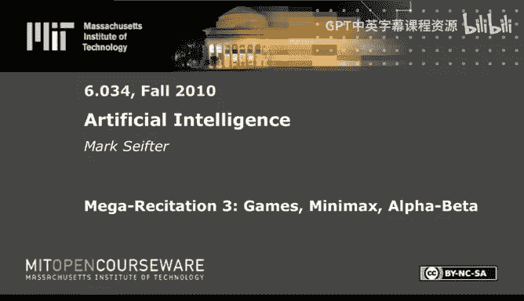
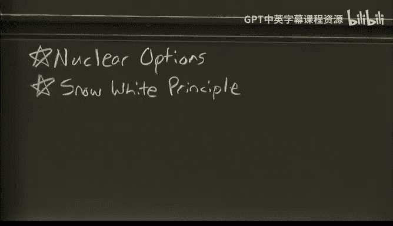
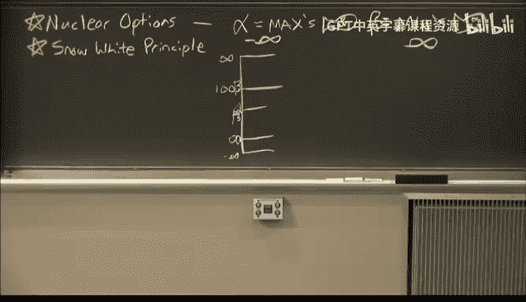
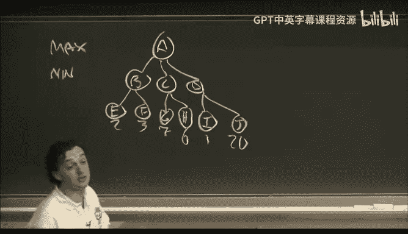
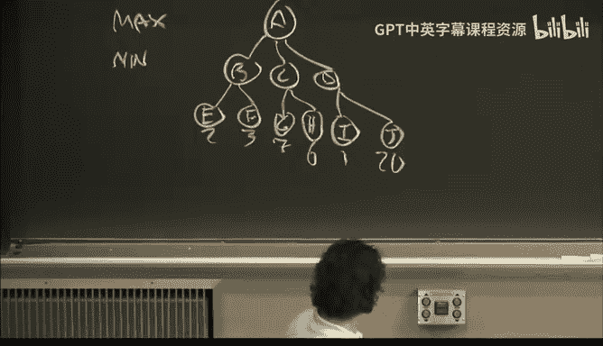
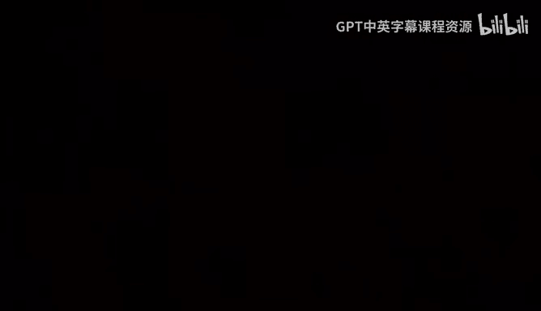

# 《人工智能｜6.034 Artificial Intelligence, Fall 2010》中英字幕 - P26：[26]Mega-R3. Games, Minimax, Alpha-Beta.zh_en - GPT中英字幕课程资源 - BV14fqSB2ECY

The following content is provided under a creative Commons license。

 Your support will help M I T Open Coware continue to offer high quality educational resources for free。

To make a donation or view additional materials from hundreds of MI T courses。

 visit M T OpenCourseware at O C W。t M I Tt E Du。

Today， we're going to be talking about games。And。I know you guys， as well as I hope I do。

The main thing that you guys want to talk about with games is how to do that alpha beta thing。

 because it's pretty confusing and。It's easy to get lost in a corner or something。

 whereas doing the regular minim。In my experience， most of the three4 students can do that。

 and they do it right pretty much all the time。 However。

 we're going to focus on all the different components of games。

And I put up two provocative silver star ideas up on the board， which will come into play here。

 The Snow White principle is a new name and has never been revealed until today because I made up the name recently。

So you will be the first people to hear it and decide if it works better than the。

 the term grandfather clause for the thing that I'm trying to describe， because most grandfathers。

Don't eat their children。嗯。😊，Here we've got a beautiful game tree。It has nodes。From a through R。

This is our standard game tree from 603，4。We've got a maximizer up at the top who's trying to get the highest score possible。

 The minimizer is。Her opponent and the minimizer is trying to get it to the lowest score possible。

And it's really unclear who wins or loses at each point。

 They're just trying to get it to the highest or the lowest score。All right， so let's do a refresher。

 Hopefully like the quiz didn't put people into such panic modes that they forgot Monday's lecture。

 So let's make sure that we can do regular mini Max algorithm。

On this tree and figure out the mini max value at a。So let's see how that works。

Al so as you guys remember， the game search when you're using regular mini Maxs is essentially a depth first search。

😡，And at each level， it it chooses between all the children， whichever value that the parent wants。

 So here at F， it would choose the maximum of K and L， for instance。

 But that's getting ahead of ourselves because it's a depth first search。

 So we best start at the top。 I'll help you guys out for a while。 So we're doing A。

 We need the maximum of B， C D， depth first search。 We go to B。

We're looking for the minimum of E and F。So having looked at E。Our current minimum。

Of E And F is just2。For the moment。 So this is gonna be less than or equal to 2。Alright。

 then we go down to F， which is a maximizer。 and its children are K and L。

 So now I'm gonna to start making you guys do stuff。 So what do you think。

 What is gonna be the value， mini max value at F。The mini mag value， mini mag value at F。

 What will that be。Wouldt be the minimum。So that level is a maximizer。 Maxim max F is a maximizer。

K and L themselves are minimizers， but they're pretty impotent minimizers because they don't get to choose。

 They just have to do K L。 So the value is the minimize value is 3。 And yet。

 the path it would like to go is K。 So we'll say that the mini value here is 3。 It's， in fact。

 exactly equal to 3。Alright， so if this is 3 and this is 2。Then everyone。

 we know that the value of B is。I hear 3 and 2。 Which one is it。2， that's right。

So the value here is 2， great。 Let's go down into this branch。

So C is gonna be the minimum of G and 6， but we don't see that yet because we're doing a depth for research。

 It's gonna be the minimum of G。 Now we need the maximum of M and N。 We're gonna need the minimum。

 M is the minimum of Q And R。 So let's switch sides。 The minimum of Q And R is。Let's see。

 That's right。 It's one。 So M has a value of one。 But I'm gonna stay over here because M has a value of one knowing that。

 then we know that G has a value of That's right。7 is higher than1。 And since G is a 7。

 we now know going up to C that C has a value of。Yes， C has a value of 6。

 That's the minimum of 6 and 7。 So now I'm going to go back down because we've done one of the other subes。

 This is a 6。Alright， great。 Now we're going go down to D。 Hopefully it won't be too bad。

These things usually aren't terrible because they're made to be pruned a lot in alpha beta。

 So let's see in D， we go to the I。 and that's just a one。We go down to J。 and let's see。

 what's the mini value of J。That's right。20 is the maximum of 20 and 2。 Great。

 So what's the minimum maximum value of D。Everyone said it one。 Allright， so what's the next value A。

6 is right。6 is higher than 2。 It's higher than one。 Our value is 6， and our path is everyone， a。C，8。

 That's it。G。Is everyone good with minim。I know that usually a lot of people are。

 There's usually a few people who aren't。 So if you're one of the people who would like some clarifications on minimax。

 raise their hand， there's probably a few other people who would like some， too。Okay。

And that's whatever values are not。going down the tree and then just look at they're trying to find whatever values you get。

 you， our general， the question was when you go to do the minim。And let's say you got E was 2。

 And you know that B is gonna be less than or equal to 2。 But you don't know F yet。 The question is。

 do you go down the tree， find the value at F and then go back up。 The answer is yes， by default。

 we use a depth for search hover in non alphapha beta version。

 Just regular minimax turns out it probably doesn't matter what you do。

I suggest doing a depth first search to get yourself in the mindset of alpha beta because order is very。

 very important in alpha beta。 So， but here， like， I don't know。

 You could do some weird bottom up search or whatever， whatever you want。

 It's gonna give you the right answer。 unless it ask what order they evaluated。 But here's a hint。

 The order they're evaluated in。In is depth for search orders。 So without even doing anything， E， K。

 L， Q， R， N， H I，O P are the order of static evaluation in in this tree。わり。

So the question is we nodes like M and G， we don't have to put values next to。 technicalnically。

 if we were doing this very formally and we couldn't remember。

 and I wasn't up there among the people。 we could。 we would put one there。 So at M。

 we would put a one。But people remembered that。 So we didn't do it。 But then a G， we would put a 7。

 So if we were writing it out very formally， we would have a one and a 7。And if this D。

 we would have a one。 And then at the A， we would put a6。And then that's， that's the answer。Also。

 we'd even put things like less than or greater than partway along the way。 However。

 I believe that our alpha beta search is going to definitely fulfill everyone's quota of pedentically putting lots of numbers next to nodes on on a game tree。

 And so once you've done alpha beta。 if you can do it correctly， you'll think mini Maxax。 Oh。

 those were the days。 it's gonna be easy because alpha beta is a little bit more complicated。😊。

There's a lot of things that treat people up here for Al beta， however。

 I will erase some of these numbers for the moment。 They're still right。But。

We do it a little differently。 So what the alpha beta and beta add to this formula。 Well。

 this is sort of a winning formula。 for it's not because it takes too long。

 but it's a very nice formula， U is the maximizer， say， I try to think， if I do this。

 what's he gonna do。 And then if he does that， what's I'm gonna do。

 And then what what is he gonna do， if I do that， etc cea， etc cetera。

 all the way to the bottom with alpha and beta， we add in what I like to call nuclear options。I。

 I like in this game a maximizer minimizer， you can think of it as like the Cold War。

 the Peloponnesian War， except the Peloponnesian war didn't have nukes。 So probably the Cold War。

 And， you know， in the Cold War。Or any situation where you're up against an adversary who actually this doesn't really work as well for the Col War。

 But in any situation where're up here against an adversary whose only goal in life is to destroy you。

You always want to find out what the best thing you can possibly do is， you know。

 if they hit that button and send nukes in from Cuba or if they send fighter pilots or whatever is going on。

 So the idea of alpha and beta is that they are numbers that represent。The faila， the worst case。

 because obviously in the Cold War， sending nukes was not a good plan。But presumably。

 us sending nukes would be better than just being attacked and killed。

So the alpha and beta represent the worst possible outcome you would be willing to accept for your side。

 because right now， you know you're guaranteed to be able to you're guaranteed to be able to force the conflict。

To that point， or better。So the alpha is the nuclear option， the faila of the maximizer。Alright。

 nuclear options。Alpha。Is maximizer's nuclear option。And beta is the minimizers。Nuclear option。

So we asked ourselves and people who were paying attention to that lecture or wrote stuff down know the answer already。

 What could we possibly set to start off before we explore the tree and find anything。

 What will we set as our nuclear option as our sort of faila。 We can always fall back on this number。

So， I mean， you could set 0。 You could try to set you know。

 some low number for the maximizer because if you set a high number for the maximizer as it's failsafe。

 it's gonna be really snooty and just say， oh， I won't take this path。 I already have a fail safefe。

 that's better than all these paths。 If you set like 100。You have no treat。Our default。

 usually in 60，3，4， is to set negative infinity for alpha or negative some very large number。

 If you're doing it in your lab。So if we set negative infinity。

I the default for alpha that negativefin is basically。Maximizer loses。

 So the maximizer goes in thinking， oh my God。 if I don't look at this gate tree。

 I automatically lose， he's willing to take the first path possibly presented。

And that's why negativefin is a good default for alpha。

 Anyone have a good idea what a good default for beta is， or just remember。Positive infinity。

 That's right。 because the minimizer comes in。 And she's like， oh， crap。

 The maximizer automatically wins。 If I don't look this don't look at this node here。

 That makes sure the maximizer and the minimizer both are willing to look at the first path they see every time。

 because like， look on this tree。 if 10 was alpha。 The maximizer would just reject out of hand。

 everything except for P。 And then we wouldn't have a tree。

 The maximizer would lose because he would be like， this ch game is very interesting。 However。

 I have another option and they throw over the table。

That's 10 for me because you have to pick up the pieces I don't own this set。😡，I don't know。

 So that is why we set negative infinity and positive infinity is the defaults for alpha and beta。

So how do alpha and beta propagate it， what do they do。The main purpose of alpha and beta is that。

 as we said， alpha， let's say we have some chart of values。 Al， which starts at negative infinity。

Is the worst that the maximizer is ready willing to accept。

 because they know they can get that much or better。

 It starts out that's the worst thing you can have。 So it's not a problem。

 Infinity is the highest that the minimizer is willing to accept。That's beta。

As you go along the minimizer receives， oh， look at that， I can guarantee that at best。

 the maximizer gets0 100。 Ha ha beta is now 100。 maximizeim receives， Oh， yeah。 Well。

 I can guarantee you can get at the lowest you can get me to go to is 0， so。😊，It's going be 0。

 And it keeps going on until maybe at 6。Note， not drawn to scale。 Maybe at 6， the ex said， ha ha。

You can't make me go lower than 6。 And the mini says， aha， you can't make me go higher than 6。

And then 6 is the answer。If you ever get to a point where。

If you ever get to a point where beta gets lower than alpha， or alpha gets lower than beta。

Then you just say， screw this。 I'm not even gonna look at the I'm not even gonna look at the remaining stuff。

 I'm gonna just prune now and go somewhere else。 that's less pointless than this。

 because if the alpha gets higher than the beta。 What that's saying is the maximize says， oh man。

 Look at this minimizer， the lowest， you can make me go is one is say，50。

 and the minimizer says that's strange because。

The highest that you can make me go is 40。 So somethings generally。

 something's generally amiss there。 It usually means that one of the two of them doesn't even want to be exploring that branch at all。

 So you， you prune at that point。Alright， so given that that's what we're looking for。

 how do we move the alphas and betas throughout the tree， There's a few different ways to draw them。

 and some of them， I consider to be very busy。Probably in rest and tutorial。

 you will see a way that's busier and has more numbers。😡，Technically。

 every node has both an alpha and a beta。 However， the one that that node is paying attention to is the alpha。

 if it's a maximizer and the beta， if it's a minimizer。So I generally， for my purposes。

 only draw the alpha out for the maximizer and only draw the beta out for the minimizer。 Very rarely。

 But it happens。 they will sometimes ask you， what's the beta of this node。

 which is a maximizer node。 So it's good to know how it's derived。

 But I think that it wastes your time to write it out。 That's my opinion， We'll see how it goes。

 So the way that it works is this the way that alpha and beta works is the snow white principle。

 So does everyone know this story of snow white。So， you know， there's a beautiful princess。

 There's an evil queen stepmother， Mi mirror on the wall who's the firstest of them all finds out that that it's the the stepdaughter。

 So much like in the real world in Snow White， the step daughter， the Snow White。

 had the beauty of her parents。 She inherited those。 However， much like in the real world。

 maybe or perhaps not。 The stepmother had an even better plan。

 she hired a hunter to to sort of hunt Snow White， pull out Snow White's heart and feed it to her so that she could gain Snow White's beauty for herself。

😊，How many people knew that version of the story。A few people。

 That's the original version of the story。 Disney didn't put that in。

 The hunter then brought the heart of a deer， which I think in Disney。

 the hunter did kill a deer arbitrarily， but it was not explained that that's why he was doing it。

 So in alphapha beta， it's just like that。By which I mean。

 you start by inheriting the alpha and beta of your parents。

 But if you see something that you like amongst your children。You take it for yourself。

The Snow white principle。 So let's see how that goes。 Well。

 I told you guys that the default alpha was。Negative infinity。 so here alpha is negative infinity。

And I told you that default beta was。Positive infinity。 We're doing a depth first search here。

All right， beta is infinity。All right。We come here to E。 Now， we could put an alpha。

 but I never put some。 I never put an alpha or a beta for one of the terminal nodes because it can't really do anything。

 It just， you know， it's just2。So as we go down， we take the alpha beta for our parents。

 But as we go up to a parent， if the parent likes what it sees in the child， it takes it instead。

 So I ask you all the question， would the minimizer prefer this two that it sees from its child or its own infinity for a beta。

It likes the two。 That's absolutely right， so。2。Allright， great。So now we go down to F。

 What is F's alpha。Who says， Who says negative infinity。two。No one。 Oh， you guys are， you guys are。

 You guys are good。 It's negative infinity。 Technically， it also will have a beta of two。

 but we're ignoring the beta and the alphas that have been progressing downward from the parents。

Negative infinity。 That's why I called it the grandfather clause before。

 because you would often look up to your grandparent to， to see what your default number is。

So we got it an alpha of negative infinity。 We then go down to the K。 It's a static evaluation。

 And now I'm gonna start calling up people individually。 So hopefully。

 people paid attention to the mob who were always correct。 Alright， so we go down to K。

And we see a 3， F is a maximizer node。 So what does F do now。yes， which is alpha the 3， great。

Alright， so that's already， that's already quite good。 It switches out the three。 It's very happy。

 It's got a three here。😊，That's a nice。 That's a nice value。So。What does it do？我's see。

What does it do at L。the next one。 Its going decay K。 went back up to F。 got first search。

 The next one would be L， right。here。Well， technically， F could take L。

 could take L's value of 0 if it like it better than 3。But it's a maximizer。

 So what doesn it want to take that。Okay， that technically would be correct， but I'm sorry。

 I burdened you with a trick question。In fact。We don't look at all at all。Does everyone see that？

I'll explain the alpha at F has reached 3， but the beta at B is 2。So B looks down and says。

 wait a minute。 If I go down to F， my enemy's nuclear option。 My enemiess the worst it can be for。

 you know， the best it can be for me is3。 F F is trumpeting it around。 I was thinking of， you know。

 eating is hard or whatever， but I didn't want to。 but it's gonna be3。 It's gonna be3 or higher down。

 down there at F。There's no way I want that。 I already have my own。

 I already have my own default escape plan。 And that's too。

 That is gonna be better than whatever comes out of that horrible F。 So screw it。

And we never look it out。Does everyone get that？ That is the main principle of alpha beta pruning。

You if you see an alpha， it's higher than the beta above it。 As they said， you know。

 if alpha goes up above the beta or if you see a beta and there's like， if there's a beta down。Here。

 and it's lower than the alpha above it。Prune， stop doing that。The and the question is， who prunes。

 Who decides that you don't look at L。 The the person who is thinking not to look at L is always up higher by at least two levels。

 So up here， B is saying， I don't want to look at L because F is already so terrible for me that it' just beyond belief。

 It's gonna be if。If this is 100， it might be 100。 if this is， even if it's lower。

 I'm still gonna get a 3。There's a sanity check that I've written or that I that sort of came up with just in case you're not sure that you can skip it because on a lot of these tests。

 we ask you， which ones do you evaluate， Which ones do you skip， right， So or we just say。

 which ones do you evaluate， and you don't write the ones that you skip。

 Here's my sanity test to see if you can skip it。Ask yourself。😡。

If that node contain that I'm about to skip contained a negative infinity or some arbitrarily small number。

 negative infinity being the minimizer wins。Would it change anything。Now that I've answered that。

 if it contain a positive infinity。Would it change anything？If the answer is no， both times。

Then you're definitely correct in pruning it。 So look at that 0。 If it was a negative infinity。

 minimizer wins， what would happen。Maximizer would say， I'm not touching that with a 10 ft pole。

 choosing3。 The minimizer would say， oh， screw that。 I'll take E。

Let's say it was a positive infinity。 The maximize would say， Eureka， Holyly grail。 I win。

 minimizer would say， yeah， if I'm a moron and go down to F and then we go to E and take2。

 So no matter what was there。😊，Minimize the reluctant to eat。And you could say， well。

 what if it was exactly 2， But still， the maximizer would choose K。 and the minimizer would go to E。

 So theres no reason to go down there。 We can just prune it off right now。Does everyone agree。

Everyone see what I'm talking about here。 Great。 So we're now done because with this branch。

 because beta is 2。 So now we're up at old grand Pappy A。

 and he has an alpha of negativegan infinity。 Everyone， why， what will he do。😊，He'll take the two。

 It's better than negative infinity for him。 It's not wonderful。

 but surely anything is better than an automatic loss。Alright， now our highest node is a2。

 So let's keep that in mind for our alpha。Okay， so let's go over here。 Let's see。

 So what will be the value at C， What will be the beta value。嗯。呃个呢是没法。To Gep。I'm not at G yet。

 I'm actually just starting the middle branch。 So I'm going to see and what's going to be starting data before I before I go down。

Infinity， that's right。 Deult value。Is easier than it seemed。 Allright， So， yes。

 beta is equal to infinity。This should be better erased。 I think it's confusing people。 Great， Okay。

 so beta is equal to infinity at C。 what is gonna now we go down depth first search to G。

 What's gonna be our alpha at G。fin it would seem so， however， Take a look up at our at the。

 you know， great grand Ppi A。 It seems to have changed to 2。😊，So this time， it's2。

 Why is it too instead of negative infinity， Why can we let a be subnoxious and not start with saying。

 oh， I automatically lose。 Well， A knows that no matter how awful things get in that middle branch。

He could just say， screw the whole middle branch。 I'm going to be。

 That's something that that the minimizer can't do。

 And we have to start an affinity for the minimizer。 But the maximizer can。

 because he has the choice at the top。 Does everyone see that， He can just say， oh。

 I'm not even going to C。 Yes， shows you。 I'm going to a taking the two。 So therefore。

 alpha is actually2。Egie。Alright， great。 So we've got an alpha that's 2 A G。

 We're gonna go down to M。 It's a minimizer。 Alright， what's gonna be our beta value at M。😊。

Or which is the beta default， minus or positive infinity， where the minimizer？Positive infinity。

 That's right。 M is going to be a positive infinity for beta again。 It picks it up from C。Great。

Now we get to some actual values。Okay。So we are at some actual values。 We are at Q。

 So what's going to， what's going to happen in M when M C is the Q is one。What is this。Well。

 it's beta， it says infinity， I'm sorry。 it's hard to read。 Beta is infinity it。That's right。

 So beta is gonna be。 They're gonna put beta to one because it sees Q， great。Alright。

 so my next question is， let's see。 My next question is， what's going happen at R。아 you。Very smart。

 you've detected my trap。 The question is， does it look at art。 The answer is。No。

 it doesn't look at art。 Why doesn it look at art。 Does everyone see。Yeah。

 alpha is now greater than the beta below it。 Beta has gotten lower than alpha。

 This is the same thing I was talking about before when we figured out that the alpha here was 2。

 The maximizer says。Wait a minute。 if I， if recognize G says， if I go to M。

 the best I'm getting out of this set one， because if this is negative infinity。

 hell minimizer will choose if this is positive infinity， he'll choose one。

 best I'm gonna get out of here is one。If that's the case。

 I might as well have just going to be and not even gone to C。 So I'm not gonna go to M。

 I'll go to N， maybe， maybe end's better。Doess everyone see that。Great。So。

Let's say that the maximizer does go to end。 So what's going to happen with this alpha。right。

 going to be 7，7 is better than two， and the maximizer has control to get to that 7。

 at least if it gets to G。Alright， now the minimizer at C， will help do everyone this time。

 The minimizer at C seat that 7。 What does the minimizer do。还有吗。So it sees the 7。

 What does it do to its theta。It takes the7 better than infinity anyway。And yeah， then it checks H。

 And everyone， again， what happens at H。Takes the6。 It's lower than 7。Alright。

 now we'll go back to having people do it on their own。 Well all the way back to the top。

 What does A do when it sees the 6 coming out of C。6， That's right。Alpha equals 6。Great。😊。

Homestr people， homestr， so。The minimizer everyone has a beta of。Infinity。

 and if I wasn't a static node， it would have an alpha of 6， but it is a static node。

 So it just has a value of one。So since it has a value 1， everyone， the beta becomes。1。

 and what next， everyone。Prune， that's right。Why prune？ Well， this time。It's a himself。

 who can prunude。 A says， well， darn， if I go to D。

 I'm gonna get one or something even worse than one。Might as well take my 6 while I have it。

Prune all the rest， all the way down。Everyone see that。 Everyone cool with that。It's not too bad。

 If you take it one step at a time。We did it。 Our answer。 our question is。

 which nodes are evaluated in order。Our answer is， everyone， E。케이。Q。Nhi。Okay， not so obvious。

 I guess few people followed me， but it is a E， K， Q， N H I。 It just step first order。

 And we prune some of them away。Great。So， that is alpha beta。

Any questions about that before I give some questions about progressive deepening。Alright。

 we've got a bunch。 So first question。order of to evaluated。Even notes like Ed。C andThe question is。

 when asked for the order of evaluation， are we include excluding FBC and D。

 The answer is we're talking about here， static evaluation。

 The static evaluator is a very important and interesting function。

 And I'll get back to something a few students have asked me about the static evaluator later and try to explain what it is。

 It's basically the thing that pops out those numbers at the bottom of the leaves。 So when we ask。

 what is the order of node that we're statically evaluated。 We mean leaves only。

That's a good question。 Any other questions。 Let's see。 There was one up here before， but it's gone。

 it been the same one question。 So a similar question。

 you say static node that this means the leaf node the leaf nodes。 That's right。 The question is。

 just static nodes being the leaf nodes。 The answer is yes。That evaluation is when youre。

Have a static note。St evaluation is when you get that number， the static node， Let me explain。

 unless someone else has a another question about alpha beta。

 Let me explain static values because I was about to do that。 There is a question about Alpha beta。

 I'll come back to both of yours after I answer this。

I know you were mentioned a storyy through score earlier。And a little bit of view。

 when you say if you're looking at one node chart and you're saying like either grab the value from the grand pan or grab it。

So it always starts。 the question is， what is the Snow White principle， How does it work。

 Every node always starts off with taking the value of the same type alpha beta from its grandparent。

 It always starts that way。Now， you say why the grandparent wouldn't take it from the parent。

 It actually does， But I'm not drawing out the alphas at all the minimizer levels So they don't do anything。

 They just， they're only even there to pass them down。So all the values pass down， down， down， down。

 down to begin。 every value every node， In fact， starts starts off with its。

 with its grandparents with its parents values。 Okay。

 But then when the node sees a child that's completely done evaluating， It's finished， like。

 let's say you can， it can't be in the process when when let's say C when C is completely it sees that G is completely done with all of its sub branchesches and iss ready to return a value as if it or if if it's just a static evaluation。

 then it's automatically completely done， right， because it has no children。😊，Right。

 a static value like K of three is all automatically completely done。 It's got a3。 Similarlyly。

 when we came back to G after going to n and we knew that the value was 7， that was completely done。

 the value is definitely 7。 there was no other possibilities。 right at the Yes。

 So once you're done with all the children of G。 then G comes up and says guess what。

 guess what guys， So technically before that， you would have said that like G's alpha is greater than or equal to1。

 And then when we said when we looked at Q。 And then we looked at and we say it's equal exactly to 7 we' done here。

 And then at that point， you know when it's fresh and ripe。

 it has all of its highest value or its best value。

 That's when the parent can its heart and gain that value itself。 So that's when C says。

 for instance， C says， oh man， I I have an infinity。 Thats I really like that 7 better。

 And it take the 7。 But then it saw 8。 and said， oh man， that's a 6。 That's even better than 7。

 So it took the 6。 alpha 7。So alpha takes 6 because C is a minimizer。 C took the 7 from G。

 But then right after that， C saw H and took the 6。Because6 is even lower。Then 7。

 And then alpha took the6 because 6 was higher than 2。 So it's not gonna look like below the。

But yeah， the problem is that the maximizer doesn't have control there。

 The minimizers got control at C。 and the minimizer is gonna make sure it's as low as possible。

 The maximizer at A， His only control is or her only control is the ability to send our way to B or C or D。

 Or at least And then at that point， at C， the minimizer gets to choose if we go to G or H。

 It's never gonna choose G because G is higher than H。Alright， awesome。 I there another question。

 Alright， let's go back to static evaluations。 When I first took this class。😊。

I had some weird thoughts about static evaluations。 I heard some students ask me this。

 I almost got a question about it onto one of the tests。

 but it was edited to some other weird question that was M to the B to the D -1 or something like that the last minute。

 So I'm gonna pose you guys the actual question that would have been on one of the older tests。

 which is the following。 I had a student who came to be and said， you knowt。

 when we do this alpha beta pruning and all this other stuff。

 We're trying to assume that we're really saving that much time by， you know。

 getting rid of a few static evaluations。 In fact， when we do progressive deepening。

 we're always just counting how many static evaluations we have to do。 And he said。

 I look at these static evaluations。 And there's just a three there。

 It takes no time to do the static evaluation。 It's on it's on the board。

 it takes much longer to do the alpha beta。 It's faster by far to not do alpha beta。

 So I tried to explain to that student。 I said， okay。

 we need to be clear about what static evaluations are。 you guys get it easy。

 We put these numbers on the board。A static evaluation。 Let's say you're playing a game like。Chess。

The static evaluation takes a long time。 When I was in 6，1。

70 Java death lab that the class that used to exist。

 We had a program called antiChes where I used my 6，0，3，4 skills to write the AI。

 and the static evaluator took a long time。 And we were timed。

 So getting the static evaluator faster， That was the most important thing。

 Why does it take a long time。 Well， the static evaluator is an evaluationval of the board position。

 The state of the game in a snapshot of time。😊，And that's not as easy as just saying， oh。

 here's the answer， because in chess。First of all， not only did I have to look at how many pieces I had。

 what areas that you know， that I controlled Also what was an antiCh， but that's notwithstanding。

 Let's pretend it's regular chest。 I also had to look if it was in regular chest。

 and I still had to do this anti chest。 If my king was in check。

 And what that meant is I had to look at all of my opponents moves。

 possible moves to see if any of them could take my king。 because for you。

 in regular chest is's illegal to put your king into check。 So you better not even allow that move。

 And regardless， getting into checkmate is negative infinity for you。

 So it takes a really long time to do set of evaluations， at least good ones。

 usually you want to avoid them because they're not just some number on the page。

 they are some function， you wrote that does a very careful analysis of the state of the game and says I'm going to heurically guess that my value is pi。

 And then or some other number。 And then rates that compared to other states。

 Does that make sense to everyone。So the answer to the question。

 the hypothetical question that might have been on the old test to when the person said。

 I've got this a great idea where we do tons of static evaluation。

 You don't have to do this long alpha beta is。Don't do that。

 The static evaluations actually take a long time。Does that clear it up for people who asked me before about static water's aesthetic evaluation。

 Why are the leaf nodes called static。Basically， and if you might ask why are some of these static。

 just arbitrarily， the answer is when you're running out of time to expand deeper and you just need to stop that stage of the game。

 Maybe it's just getting too hairy。 Maybe it's spreading out too much。

 You have some heuristic that says this is where I stop for now。It's a heuristic guess。Of the value。

 It's kind of like those heuristic values in the search tree。

 That's a guess of how much work you have left to get to the goal here。 you say， well。

 I wish I could go deeper， but I just don't have the time。 So here's what I think。

 how I think I'm doing at this level。 It's not always right。

And that's gonna lead us into the answer to one of the questions about progressive deepening。

 So I'll put up the core aggressive deepening question really quickly， so。The question is this。😡。

Suppose that， let me see this is a maximizer。 Yes， suppose that。

We do progressive deepening on the the tree that is only two levels deep。

 What is progressive deepening in a nutshell， if you don't remember from the lecture。

 the idea is this。It doesn't take in this tree， it doesn't work。

 But in trees that actually branch like2 to the end。

 it doesn't take that much time to do like some of the top levels first。

 and then move on to the bottom levels， just do them 1 at a time。

 So let's say we only did it up through J。 We only did the top  two levels of the tree。

 We'd like to reorder the tree so that alpha beta can prune as much as it possibly can。

 at least we hope， Allright， So let's pretend that we had a psychic awesome genius friend who told us that the static values when we went up to two levels。

 remember when we go to two levels， F G and J have to get a static value， right。

 because we're not going down。 We do a static evaluation， They get the exact correct numbers 3。

7 and 20。Genius， brilliant。 Allright。 So if that happens， how is the best。

 what is the best way that we could reorder that tree。 Oh， yeah， Yeah， yeah。

 So it's ABC D with values of 2，3，7，6，1，20 up。I'll draw that。This is the non reored tree。Let's see。

 So it's 2，3。7even。six。1。20， so what's the best way to reorder？Well， first of all。

 does anyone remember what Patrick said when he talked about progressive deepening。Usually。

 no one does。 So don't worry about it。The best way to， because at that time， you guys didn't think。

 oh， I have to do this for the quiz。 You were just thinking， oh， man。

 we've already heard alphabet and all this other stuff。 And this is just a small fact。

 But it's a very important fact。 And now， you know， you have to do it for the quiz。

 So you're probably gonna remember it。The way you do it is you try to guess and you say which one of these is going to be a winner。

 whichever one I think is going to be a winner at that level。I put first。Why is that the case？

Something interesting you may have noticed here。Whenever you have a winner。

Like the middle node or whenever you have， whatever is the current best for your alpha。

 you sort of have to explore out a lot of that area。Like， for instance。

 the left node was our current best at two。 The middle branch was our current best。

 at that time was 6。 It was the total best。 We had to explore a good number of nodes。

 But on the right， we just said， oh， there's one。 We're done。 We cut everything off。In other words。

 the branch that turns out to be the one that you take。

 you have to do a pretty good amount of exploration to prove that it's the right one。

 Where if it's the wrong one， you can sometimes with just one node， say， this is wrong， done。

So therefore， if the one that turns out to be the eventual winner is first of all。

 then it's really easy to reject all the other branches。

 Do people see that sort of conceptually a little bit that if you get the best node right away。

 you can just reject all the wrong ones pretty quickly。That's our goal。 So how can we quote。

 get the right one， the best one right away。 Well， here's how we do it。Let's say we're at B。

 Which one is the minimizer likely to pick， assuming that our heuristic is good and that these guesses are pretty much close to the truth。

 It turns out they're perfect。 So this is good to work。

 So which one will the minimizer pick if it has to choose between E and F， do we think。

E， perfect。 Which one will pick between G and H。8， which one will pick between I N J。

Okay， so what we're saying is we think it's going to pick E。😡，We think it's going to pick H。

We think it's going to hit I。 So first of all， we should put E before F X before G and I before J。

 because we think it's going to pick those first。Those are are our best ones to invalidate a poor branch。

 So now between 2，6 and  one， which is what we think we're going to get。

Which one do we think the maximizer is going take。6， then if it couldn't take 6。

 what would be its next best choice。Two， then one， that's just our order， simple as that。

Couldn't be anything easier that involves really complex trees。

 a huge number of numbers and reordering those trees。So。See。You guys told me CB， oh was sorry D。

You told me CBD， I think。 Yeah， that was the ones the maximizer likes。

 and then the ones the minimizer likes you told me was。H。And before G， because H is smaller than G。

You guys told me E before F？And you guys told me， I before Jay。And you guys would be correct。

 in all regards。We have 6，7，2，3，1，20。All the minimizers choose from smallest to highest。

 The maximizer chooses from highest to lowest。Of the one that minimizes will take。And if we did that。

 you can see we would probably save some time。Let's see how much time。

 Let's say we looked at H first。Well if we looked at H first。😡。

We would still have actually had to look at Q and N。 However， we would not have had to look at K。

Do people see why if we already knew this branch was 6， As soon as we saw two for the beta here。

2 is less than 6， we could have pruned。We still would have had to look at I over here because you have to look at at least one thing in the new subredge。

And it actually only would have saved us one node。Oops。So it winds up that in total。

 how many nodes would we have evaluated if we did， if we did that little scheme of reordering。 Well。

 we normally had to do 6， right， E， K， Q， H， Q， N， H I。How many do we evaluate if we do this。

 this progressive deepening scheme， How many times do we run the static evaluator， which， of course。

 you know， the static evaluator takes a long time。Anyone have a guess？I told you。

 the only one we don't evaluate is K。You raise your hand。 I won't。

 I won't make anyone to give this one。So I said the only one we save on is K。 So we still do E， Q。

 H N H， and I over here。There's two possible answers that I will accept。

 So you have a higher chance of guessing it， anyone。Does everyone agree that we did6 before。

 If we didn't do any progressive deepening， we just， you know， did E， K， Q， N， HI。

And now we're not doing K。Okay， people are saying 5。 Alright， good。 That's not the right answer。

 but at least shows that you can do taking away the one。 We did at least5 over here。

 There's two possible answers， though， because look over there。

 in order to do the progressive deepening， we had to do those static evaluations。Right。So。

 we either did。We either did all those static evaluations and these five static A， K， Q and H I。

 these five static evaluations。 So we didn't do the K。Or。

 or we might have saved ourselves because maybe we were smart and decided to cash the static values when we were going down the tree。

 It in implementation detail tell that on this test when we asked that question， we didn't say。

 But I mean by cache is when we did it here。 and saw that E was a two。 And then here， oh。

 we have to do the static value at E。 if we were smart。

 we might have made a little hash table or something and put down 2。

 So we didn't have to do a static evaluation at E。 And if that happened。

 while we saved E H and I and we do three fewer。Does everyone see that， However。

 that's still more than 6。 So it didn't save us time。 So you might say oh。

 progressive deepening is a waste of time。 but it's not because this is a very， very small。

 not very branchy tree that was made so that you guys could easily to alpha beta and take the quiz。

 and it wouldn't be bad。 If this tree was actually branching double， even double at each level。

 It would have what like 16 nodes down here at the bottom。

 Then you would want to be doing that progressive deepening。

 So now I ask you a conceptual riddle question is's not really that much of a riddle。

 But we see if anyone wants to answer again。 I won't call on you for this。 Its。

According to this test， a student named Steve says， okay。

 I know I have to pay to do the progressive deepening here。

But let's ignore that because it's small in a large tree， right， It's not going to take that much。

Let's ignore the cost of the progressive deepening and only look at how much we do here。

 He says when it comes to performing the alpha beta on the final level。

 I'm guaranteed to always prune at least as well or better。

 If I rearrange the nodes based on the best result from progressive deepening。Do you agree。

Can I repeat it。 Okay， the question is， ignoring the cost that we pay progressively deepening here。

 Just forget about it At the final step in the final iteration， question is。

 am I guaranteed to do at least as well or better in my alphabeta pruning when I reorder based on the best level of based on the best order for progressive deepening here。

 Certainly we did。But the question is， is Steve guaranteed。Answer。喂住声。

That's the answer and the why which we asked to explain the answer we got is that doesn't that depend on the heuristic。

 perfectlyf correct。 The answer is， no， we're not guaranteed and it depends on the heuristic。

 So if we were guaranteed。That would mean our heuristic was godlike， like this heuristic。

 If our your heuristic already tells you the correct answer， no matter what， don't do game search。

 Just go to the， the empty， the chessboard， put all the pieces in the front rows。

And run the static evaluator on that。 And it'll say， oh。

 it looks like with this game not started that white is stupid。 So black will win in 15 turns。

 And then you're done。 and you don't do a search。We know that our heuristic is flawed in some way。

 It could be very flawed if it's flawed so badly that it tells us a very bad result of what's actually going to happen。

 even though we think the minimizer is going go to H， maybe it's wrong by a lot。 and it goes to G。

 It could take us even worse path that make us take longer question。I a heuristic。

 How could you catch the value。The question is， how can you cache the values if it's a heuristic。

 So you don't have to recalculate them later。 The answer is。

It wouldn't help if there weren't these weird multi levelvel things where we stop at E some for some reason。

 even though it goes down to five levels， the way you could cache it is it is a heuristic， but it's。

Consistent， and I don't mean consistent from search。 I mean。

 it's a consistent heuristic in in the state， gamestate E is。

 let's say that's the state where I moved out my night as the maximize minimizer said。

 you're doing the night opening really。 and then did counterattack。

No matter how we get to E or where we go to get to E， that's always going be state E。

 It's always going to have the same juuristic value。

It's not like some guy who like goes around and just randomly pulls a number out of a hat for some。

 we're gonna have some value that gives us points based on state E。

 and it's gonna be the same Anytime we go to state E。Does that make sense？ It is a heuristic。

 but it's always going to give the same value at E， no matter how you got to E。

But it could be really bad。 In fact， you might consider a heuristic。 that's the opposite of correct。

 It always tells us the worst move。 It claims it's the best。

 That's the heuristic that the minimizer program did to our computer。 Perhaps In that case。

 when we do progressive deepening and we reorder， we probably get the worst pruning possible。

 So we may not， but we may。 So in that case， you're not guaranteed hope that's given a a few clues in tutorial。

 you guys are gonna see some more interesting problems that go into a few other details。

 I at least plan on doing E's interesting game problem from last year。

 which ask a bunch of ask a bunch of。vary things that are a little bit different from these。

 So it should be， it should be a lot of fun， hopefully， or at least useful to do the next quiz。

 So have a great weekend。 Don't stress out too much about the quiz。😊。

