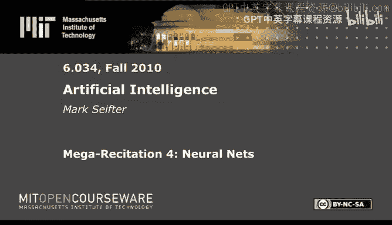
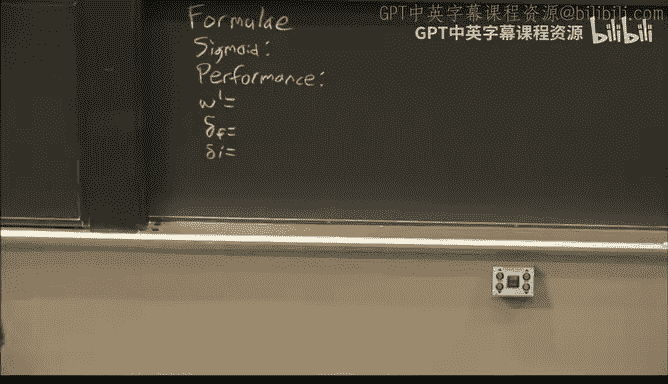
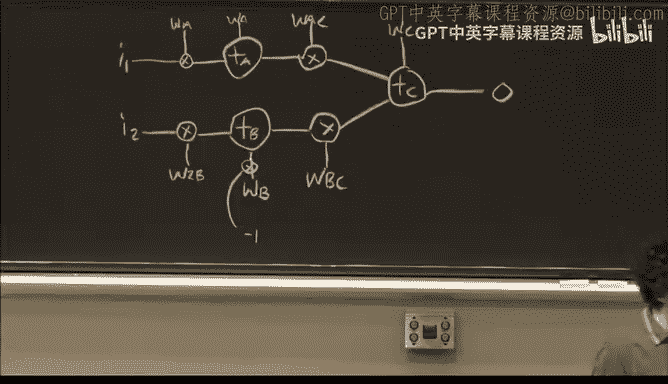
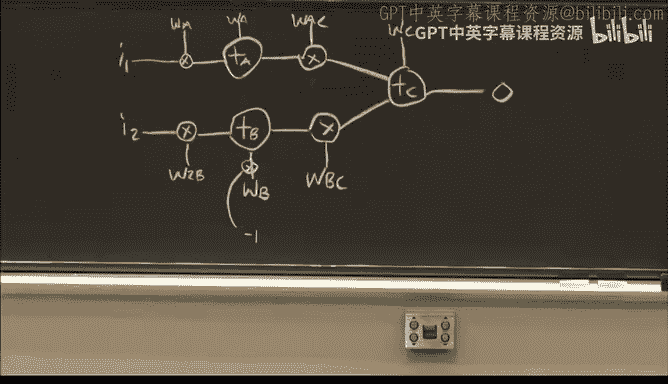
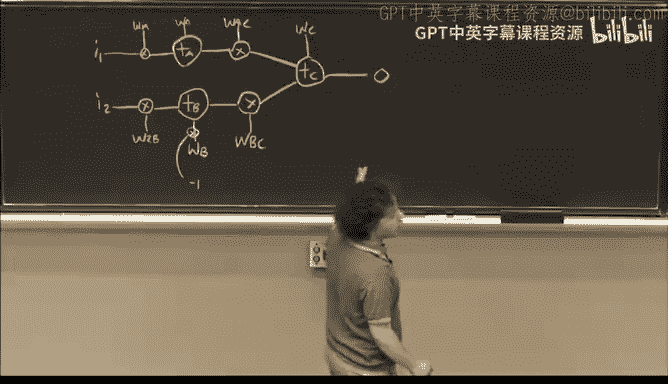
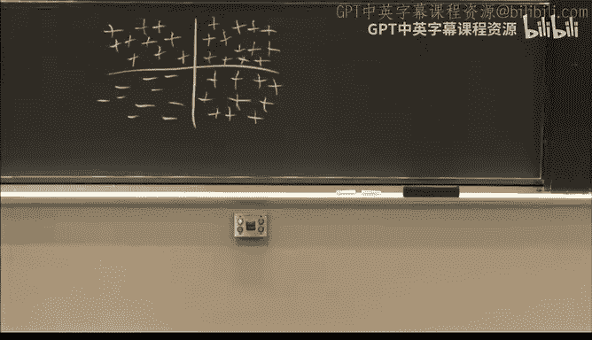

# 《人工智能｜6.034 Artificial Intelligence, Fall 2010》中英字幕 - P27：[27]Mega-R4. Neural Nets.zh_en - GPT中英字幕课程资源 - BV14fqSB2ECY

The following content is provided under a creative Commons license。

 Your support will help M T Open Coware continue to offer high quality educational resources for free。

To make a donation or view additional materials from hundreds of M T courses。

 visit M T OpenCourseware at O C W。t M I Tt Eduu。

Today， we are introducing。An exciting new pledge in 6，0，3，4。

 Anyone who has already looked at any of the neural net problems will have easily been able to see that even though Patrick only has them back up to 2006 now。

 there still are。😊，Well out of four tests， perhaps two or three different ways that the neural nets were drawn。

 Our exciting new pledge is we are going to draw them in a particular way this year。😊，And。😊。

I will show you which way， assuming that this works。Yes。

We were going to draw them like the way on the right。

The one on the left is the same as the one on the right。At first。

 not having any had me explained the difference between the two of them。

 you might think you want the one on the left， but you really want the one on the right。

 and I'll explain why。The 2007 quiz was drawn roughly similarly to this。 Also。

 if you somehow wind up in tutorial or somewhere else doing one of the older quizzes。

 a lot of them were drawn exactly like this。In this representation。

 one thing I really don't like is that the inputs are called x's and the outputs are called Ys， but。

Like。There's two x's。 So the inputs are not X and y。

 and then they often correspond to axes of a graph。 And then people get confused。

Additional issues that many people have are the fact that the summation and the multiplication with the weight is implied。

 the weights are written on the edges where outputs and inputs go。

 and the summation of the two inputs into the node are also implied。But， take a look here。

This is the same net。😡，These these Ws here would be the Ws that are。

These Ws here would be the Ws that are written into。Onto these lines are here。Actually。

 the better way to draw it would be。Like。Anothertter way to draw it would be like， so。

Since each of these can have their own W。Which is different。So each of the Ws that are down here。😡。

Are being explicitly sent to a multiplier， whereas here。

 you just had to remember to multiply the weight by the input that was coming by。

 Here you see an input comes to a multiplier。 You multiply by the weight。

Then once you've multiplied all the inputs， by the weight， you send them through a sum。

Thats the sigma is just a sum。 You sum them， add them all up together。

 send the result of that into the sigmoid function。 Our old buddy 1 over one plus E them negative。

Whatever our input was。With a wait for an offset。And then we send the result of that into more multipliers with more weights。

 more sums， more soids。So this is how it's going to look like on the quiz。

And this is a conversion guide。From version。You know。9 beta into version 1。0。 So if you see。

Something that looks like this on one of the old quizzes that you're doing。

 See if you can convert it and then solve the problem。 Chances are， if you can convert it。

 you're probably going to do fine。So。We'll start off not only with this conversion guide， but also。

Yeah， I'll leave that up here。 Also， we're gonna， I'm gonna work out the formula for you guys one more time。

 The， these are all the formula。That you're going to need on the quiz。

 And then we're going to decide what will change in the formula if。

And this is a very likely if there seems to be a good amount of times that this happens。

 If the the sigmoid function in those neurons up there was ever changed into some other kind of function。

 it's changed to a plus already。 and the problem we're about to do。

 People change it all the time into some bizarrezaarro function。 I've seen arc tangent， I think。

So here we go。Let's look at the formula。 First all sigmoid。 Well， our old buddy sigmoid。

 I just said it a moment ago。 Sigmoid is one over one plus E to the minus x。

Also fun fact about sigmoid。The derivative of sigmoid。Of sigma。Is。Itself。

The derivative of sigmoid is。Let's say that the sigmoid will just turn sigmoid into like the letter。

 say why。Yhy is the result， right？ So if you say y equals。1 over 1 plus e to the negative x。

Then the derivative of sigmoid is y。Times 1 minus y。You。

 you can also write out the whole nasty thing。 It's 1 over one plus E to negative x times 11 over one plus E to the negative x。

It's a nice property of sigmoid， it's going to be important for us。In the very near future。

 and that future begins now。So now the performance function。

 this is the function we use to tell our neural nets when they inevitably act up and give us really。

😊，Crappy results。 At first， we tell them how just how wrong they are。With our performance function。

The performance function can be any sane function that。

That gives you a better score where better can be decided as lower or higher if you feel like it。

 but gives you a better score if your answers are closer to the answer you're looking for。However。

 in this case。We have。With a very sneaky， for very sneaky reason。Chosen performance function to be。

One half。D， which is the desired output。😡，Minus o， the actual output squared。So。We want a small。

 well， it's negative。So we want a small negative or a 0。That would mean we performed well。

So why this？Well。The main reason is。DDX of performance。Is。The two comes down。

 the O is the variable that we're actually d。 So maybe I should say DDO。嗯。That negative comes out。

 we get a simple。Do you mind yourself。And yeah， we're using derivatives here。So。Not those are fine。

 These are two assumptions。 They could be changed during the test。

 We're gonna to figure out what happens if we change them。 If we change the performance。

 if we change the sigmoid。That is， if we change the sigma into some other function。

 what's gonna happen to the next three functions， which are basically the only things that you need to know to do back propagation。

So let's look at them。 First， W prime。 This is the formula for a new weight。

After one step of that propagation， a new weight in any of these positions that you can see up here this on this。

Beautiful neural net。 that W， all each of the Ws will have to change step by step。 That's， in fact。

 how you do the hill climbing neural net。 You change the weights。Incrementally。

 you step a little bit in the direction towards giving you your desired results until eventually。

 you hope you have an intelligent neural net。And maybe you have many different training samples that you running on in a cycle。

 hoping that you don't overfit to your one sample on a computer。 but on the test。

 we probably will not do that。 So let's take a look at how you calculate the weights for the next level。

 given that you have the weights for the current level， so。First things first， new weight， weight。

 prime equals starts with the old weight。 That has to go there because otherwise。

 we're just going jump off somewhere at random。 We want to make a little step in some direction。

 So we want to start where we are with the weight。And then， we're going to add。3 things。

 So if we're talking about the weight between。上爱。And some J。

Here are some examples of the names of weights。So this is W1 I。

 That's the weight between1 and A so this is W1 A。 It's the weight between1 and a。This is W 2 B。

 which is the way between 2 and B。Makes sense。Well， it may sense so far。 but what， what。

 what if it's just called WB。Then it's the way between these W's that only have one letter we'll get to later。

 They're the bias。 They're the offset。They are always attached to a negative one。

 So you can pretty much treat。You can pretty much treat there as being a。Like a。

TheN one here that is then fed into a multiplier with this WB， if you like。

This is implied to be that。 All of the offsets are implied to be that。So。W plus sum alpha。

Why is it Greek letter， Where does it come from， Well， How do we calculate it？ Well。

 alpha is just some。Val told to you on the quiz。 You'll find it somewhere。

 There's no way you're gonna have to calculate alpha。

 You might be asked to try to give a say in alpha， but probably not。

 Al is supposed to give it the size of our little steps that we take when we're doing hill climbing。

 very large alpha， take a huge step。 very small alpha。 take tentative steps。

 So alpha is just there to change basically to change this answer in make to make the new value either very close to W or very far from W。

 depending on our taste。 So plus alpha times。I。So， I is。The value coming in。

Yeah I is the value coming into the， into the node。We're changing the weight here。

 So I is the I is the value， for instance， I sub 1 here。I IA would be the value。At WAC。

 I would be the valuecom output of node A at WBC， I would be the output of node B。

 I is sometimes specifically labeled as I I is the input coming in to meet that weight at the multiplier。

And then it's multiplied by。Delta J。Where Delta is the delta that belongs to these neural net nodes。

 What is the deelta you say。Funding， you may ask is a strange Greek letter。

 It sort of comes from the fact that we're doing some partial derivatives and stuff。

 But the main way you're going to figure out what the deltas are are these two formulas that I have not written in yet。

So hold off on trying to figure out what the delta is。Until， well， right now。

 I'm about to tell you what the delta is。 So the delta is basically。Think of the deelta as。

Using partial derivatives to figure out which way you're going to step when you're doing hill climbing because。

 you know， when you're doing hill climbing， you look around， you figure out， okay。

 this is the direction of the highest increase and then you step off in that direction。

So the deltas are sort of telling you which way to step with the weights。

And the way they do that is by taking the partial derivative。Of basically。

 you tried to figure out how the weight that you're currently looking at。

Is contributing to the performance of the net， contributing to either the good performance of the net or the bad performance of the net。

So。When you' when you're dealing with like。When you're dealing with the weights like WBC and WAC that pretty much directly feed into the end of the net。

They feed into the last node。 It then comes out。 It's the output。 Okay， then that's。

 that's pretty easy。 You can tell exactly how much those weights and the values coming from them are contributing to the end。

And we do that by。

First。We do that by essentially。 we remember the partial derivative。So。Partial derivative here。Is。

In fact fact， the way that the final weights are contributing to the performance is just a performance function。

 partial derivative。Well I've already figured out the derivative here， it's just d minus oh。

This is for。This is for sort of final weights， the weights in the， in the last level。 T minus0。

 it's that we're not done yet because were， when we do derivatives， remember the chain rule。

To get from the end。To these weight。We pass through， well it should be a sigmoid here it's not。

 we're going to pretend pretend it is for the moment， we pass through a sigmoid。😡。

And since we pass through the sigmoid， we have better take the derivative of the sigmoid function。

 That is。Y times 1 minus y。 But what is y， What is the output of this s。It's all。

So that's also multiplied by。Oh， times for myself。However， there is a， let me see。 Let me see， yes。

Sorry， I'm carefully studying the shape to make sure my g nomenclature is exactly right for a new g nomenclature。

 which。So new and brave that we're going doing it that we only knew for sure we were going to do it on Wednesday。

So we have d minus O times。O times 1 minus。So。You say that's fine。 that can get us， you know。

 these ways here， even this WC， how are we going to get the how we going to get the deltas for the。

 the Dltas for the new。The delta are the new weights here。Oh， I realize。Yeah， yeah， I got it。

 So the deelta。 This is， by the way， this is the deelta at C。

 How is neuron C contributing to the output while it's directly contributing to the output。

 And it's got a sigmoid in it。 It doesn't really。 But we're pretending it does for now。

 D minus0 times O times1 minus O。 What about an inner node， node B， node A。

 What are we gonna have to do。 Well， the way they contribute to the output is that they contribute to node C。

So we can do this problem recursively。So let's do it recursively。 First of all。

 as you probably figured out， all of them are going to have an O times 1 minus O factor in from the chain roll because they're all sigmoids。

 Well pretending that they're all sigmoids。So。We actually have a dearth of good problems that are actually sigmoid on。

On the web right now， there's only 2007。But。Here's O times 1 minus0。

 So what are we going to do for the rest of it， How does it contribute to our final result？ Well。

 it contributes to our final results recursively。So we're talking about deelta I， I as an inner。

It's sort of an inner node。 It's not， It's not a final node。 It's somewhere along the way， so。

Some over J。Of。W。Going from I to J。At times。Delta J。Now， some overall J， J， such that I leads to J。

I need to have a direct path into J。So if I in this instance was a。Everyone。

The only possible J in this would be。C， that's right。 We would not sum over B as one of the J。

 because I does not lead to。To B， or A does not lead to B。 A only leads to C。 Also。

 note that C does not lead to B here。 That's going backwards。

So you just to figure out which J you're looking at， look directly forwards at the next one。

So if there is another D here or something like that， A does not go to D。 A goes to C。

 You only look at the next， you look at the next level of children， and you sum over all of those。

All of those children。The weight between them multiplied by the child's deelta。 That makes sense。

 right， because the way we affect if the child's deelta is the way the child affects the output。

Calling these children for a moment。 if the， then if this， this one directly affects the output。

 then the way this one affects it is。You use the it affects it because it affects this。

 but it's also multiplied by this weight。 So， in fact。For instance。

 if the weight between A and C was0。Then a doesn't affect the output at all。😡，Right。

 because its weight is 0。 And when we do this problem， we go。This times 0。

 and then we try to add it in there。 It doesn't affect anything。 If its weight is very high。

 it's going to really dominate。 It's going to really dominate at C。

And that is taken into account here and then multiply by the delta for the right node。So。

I posese the following question。 And since I spent a lot of time with formulae and not that many time。

 that much time starting on the problem， I will not call on someone at random。

 but rather take a volunteer。 if no one volunteers， I'll eventually tell you。

 which is we've got some nice formula for on the bottom3。If we change the sigmoid function。

 what has to change？😡，That's right， the only thing that changes。In this craz as problem right here。

 which by the way， changes the signaligoid functions into adders。

Is that we take all of the O times 1 minus0。In Delta F and Delta I equation。

 and we change it to the new derivative， we then do the exact same thing that we would have done。

 correct， And on a similar note， if we change the performance function。

 how many of these equations at all have to change。Oh on the bottom three。Yeah， that's right。

 Just one， just deellta F， Take the D minus O， make it the new derivative and the new performance function。

And in fact， Delta I doesn't change at all。Does everyone see that because it is very common for something to be replaced？

I think three of the four quizzes that we have replaced in some changed something in some way。

All right， let's go。 We're going to do。2008 quiz because it has a part at the end that screwed up everyone。

 And so let's make sure we get to that part。 That's gonna be the part that you probably care about the most at this point。

 So these are all adders instead of sigmoids。That means that。

They simply add up everything as normal for a normal neural net。

 And then there's no sigmoid threshold。 They just give some kind of value question。

 Yeah So we're about。As then multiplier things， we don't count those。They are not neural net nodes。

That is one of the reasons why。One of the reasons why that other form that you can see over there is elegant。

 It only has the actual nodes on it。 It's very compact。

 It's one of the forms we've used in previous tests。 The question is。

 do those multipliers come as a nodes。嗯。However。By not putting in the multipliers。

 we feel it sometimes confuses people of explicitness。

 The ones that are nodes will always have a label like a or here。 You see。

 there's a sigmoid in an L1。The multipliers。Are there for your convenience to remind you to multiply。

 And also those， if you look those sigmas that are over there。

 you're there for your convenience to remind you to add。But， in fact。

 the only thing that counts as a node in the neural net。 And that's a very good question。

 is usually the sigmoids。 here it's the adders。We've essentially taken out the signaloid。

 These adders are the oh， here's the way to tell if it's got a threshold weight associated with it。

Then it's one of the actual nodes。A threshold weight。

 I guess the multipliers look like they have a weight。

 but this is just the weight that's being multiplied in。

To this is a witness being multiplied in with the input。 But if it has a threshold weight。

 just like W， A， W， B。 Oh， I promised I would tell you guys the difference between the two weights。

 So let's do that very quickly。The kinds of weights that that say。

 W2 B or W1 A are a weight that comes between。Input 1 and A or between A and C。

 They're meant to be multiplying the input by this weight。And then eventually， that's added together。

 the threshold widths。They they just have a like W， B， W， A， WC。

 they are essentially to decide the threshold for a success or a failure， for a one or a 0。

Or anything in between at any of the given nodes。 So the idea is maybe you。

 at some node want to have a really high cutoff。 You have to have a very high value coming in or else it a 0。

 So you put a high threshold。 The weight is multiplied by negative one。 and in fact。In fact。

 the threshold weight， one could consider if you wanted to that the threshold weight times negative one was also added in at that sum instead of putting it on the same location as the node。

 if that works better for you when you're converting it， you can also think of it that way。

 because the threshold weight is essentially multipied by negative one and added in it that same sum over there。

😡，So that is another way to do it。There's a lot of ways to visualize these neural nets。

 Just make sure you have a way that makes sense to you and that you can tell pretty much whatever we write as long as it looks vaguely like that。

 how to get it in your mind into the representation that works for you because once you have the representation right for you。

 you're more than halfway to solving these guys。 They aren't that bad。 They just look nasty。

 They don't bite。 Okay， so these are just adders。So if it's just an adder。

 then that means that if we take all the we take all the X inputs coming in。

 let's do X and Y for the moment。 so we can figure out the derivative。Then what comes out after。

 after we just add up the X， What comes out， Y equals。X， right， We're just adding it up。

adding up all the input。 We're not doing anything to it。 Y equals X is what this node does。

Do people see that， so the derivative is just。1。So that's pretty easy because the first problem says。

What is the new？Formula， Delta F。So I'll just tell you， you guys probably figured it out。

O times 1 minus0。Because we replaced D minus O with one。Okay， make sense so far。

 Please ask questions along the way because I'm not going to be asking you guys。

 I'll do it myself question。好诶。That's a good question。 The reason is because I did the wrong thing。

 So see。It's good that you guys are asking questions。

It actually should be replacing O times 1 minus0 with one。 The answer is Delta F equals D minus O。收页。

Perhaps I did it to trick you。 No， I actually messed up。 But yes， please ask questions along the way。

 Again， I don't。 I don't have time to call on you guys at random to figure out if you guys are following along。

 So I'll do it myself。 We're replacing the O times 110 with1 because of the fact that the sigoid is gone。

 and we get just deelta f equals D minus cell。So。Great。

 we we now want to know what the equation is for Delta I at the node A， so Delta a。Well。

 let's take a look。The O times1 minus was always gone。 Now， we just have the sum over J。

 which is what you guys already told me is only C。

Of WAC times Delta C。 And we know that Delta C is d minus O。

 So the answer is Delta A is just WAC times D minus O。That time， I got it right。

I see the answer here， though it's written in a very different format from the old quiz。

Any questions on that？Well， that's part A that we finished out of C。 Let's go to part B。

 Part B is doing one step of back propagation。 There's almost always going to be one of these in here。

 so。The first thing in as is to figure out what the output O is。For this normal net。

 if all weights are initially one， except that this guy right here is negative 。5。

All the other ones start off as one。So let's do a step。 Oh， what， let's see what are the inputs。

 The inputs are also all one。The desired output is also one。And in fact。

 the rate constant alpha is also one。This is the only thing that isn't one， folks。

 So let's see what happens。One times 1 is one。Then this is negative 1 times 1 is negative 1。

 That's 0。The exact same thing happens here because it's symmetrical。 So these are both0。

0 times 1 is 0。0 times 1 is 0。Then this is negative 1 times negative 05 is positive 。5。

 So 0 plus 0 plus positive 。5。 The output is positive 。5。Does everyone see that。If not。

You can convince yourself that is positive 。5。 That would be a good exercise for you running through one forward run。

 The output is definitely positive 。5。 first time around。 Okay。

 now we have to do one step of back propagation。😊，To do that。

 let's calculate all the delta so that we can calculate all the new weights， the new weight primes。

 So Delta C。That's easy。 You guys can tell me what Delta C is。

 We figured out what the new Delta C is gonna to be。 It's a simple addition or subtraction problem。

 Everyone， Delta C is。Po。5，1 half， yes。哎。And we know that Dta A and Delta B are just W。😡。

A times Delta C and WBC times deelta C。 So they are。Also one half because all the weights were one。

Easy street。 Okay， we've got all the detas are one half and all a few of the weights are one。

 So let's figure out what the new weights are， so。奥看。New WAC。Okay。So。Yeah， so let's see。

 what's gonna be the new WAC。 So the new WAC is going to be old W so old WAC C。

 which is one because all of them are one， except for WC plus the rate concept。

 which is one times the input coming in here。 But remember that was 0。So actually。

 it's just going to be the same as the old WAC。And since it。

 this is a symmetrical problem between B and A at the moment， this is gonna be the same。Alright。

 some things are gonna change， though。 What about WC， That was the one that was actually not one。

Okay， so new WC。WC， remember。The I for WC， the the the I that we use in this equation is always negative one because it's a threshold。

 So we have the old WC， which is negative 。5 plus 1。Times。Plus1 times negative one。Times Delta C。

 which is one half。 So we have negative 。5 plus negative 。5。Equals negative one。W1 A。忙。

We've got W1A starts as one。Then。We also know that we're。

W1 A is going to be equal to one plus one times the input， which is one。Times delta of a。

 which is one half。 so 1。5。And since it's symmetrical between A and B。Then。W2B。Theres also 1。5。

And then。Finally， W A and WB， the offsets here。王。😮，They start at one plus 1 times negative 1 times 0。

5。 so they're both。Eone。W， that's right。That's right， because。Negative one is their I。

Negative1 times 12 plus。Positive order is just one half。 That's one full step。

Maybe it might easier than you might be used to seeing。

 but there's a full step And it asks what's going be the output after one step of back propagation。

 while we can take a look。So we have one times the new W1 A， which is 1。5。 We've got 1。5。

Then the new W A is just 059-。5。 That's a one coming into an adder。

 We've got another one coming in here because it'ssymmetrical。 So one and1，1 times WAC is one。

1 times WB C is one。 So we have two ones coming in here。 They're added。 That's2。

 Then this has become negative  one。 In fact， at this point。

So negative  one times negative  one that's 3， and the output is。对。All right， cool。

 we've now finished part B， which is worth over half of everything。 Oh no， we've not。 One more thing。

These are adders。 They're not sigmoids。

What if we train this entire neural net to try to learn this data so that it can sort of draw a line on the graph or draw some lines or do some kind of learning to separate off the minuses from all the pluses。

You've seen maybe， and if not you're about to in a second because it asks you to do this in detail。

 that neural nets can usually draw one line on the graph for each of the sort of nodes in the net because each of the nodes has some kind of threshold and you can do some logic between them like ans and oruras。

😡，So what do you guys think thisnet is going draw If anyone could volunteer。

 I'm not going to ask anyone to give this answer。Now， okay。

 this is a little bit tricky because usually if you had this many nodes。

 you could easily draw like a box and box off then minuses from the pluses， however。It draws this。

 and it asks， what is the error， the error Oh yeah， it even tells you the error is one8 because。

Why these are all adders。 You can't actually do anything logical because this entire net boils down to just one node because it just adds up every time and it never takes a threshold at any point。

😡，So you， you can't turn it into logical ones and zeroes because。It's basically。

 it's not digital at all。 It's analog。 It's giving us some very high number。

 So it all goess on to one cutoff。 And that's the best one。 The one that I drew right here。Okay。

Did that not make sense to you。 That's okay。 This problem is much harder。

 And putting the both on the same quiz was a bit， was a bit brutal。

 But by the time you're done with this， you will understand what a neural net can do or not。

 I've put these in simplified form because of the fact that we don't care about their values or anything like that。

 but inside of these little circles as a sigmoid。 the multipliers and the summers are implied just so that。

I think in the， in the simplified form when we're not actually doing back propagation。

 it's easier to view it and see how many nodes there are。

 For the same reason you ask your question about how many there are。

 So all of those big circles are a node。 And in those node is a sigmoid now， not those crazy adders。

We have the following problem。 We have to try to match each of ABC， D EF to1，2，3，4。

5 stations using each of them only once。 That's important because of the fact that some of the more powerful networks in here can do a lot of these。

😡，So it's like， yes， the powerful networks could do some of the easier problems here。

 but we want to match each net to a problem it can do。

 And there is exactly one mapping that will map that is one to one。

 and Mas exactly uses all six of the nets to solve all six of these problems here。

So some of you may be looking at like， what， how am I going to solve these problems。

 I gave away a hint before， which is that。Each node in the neural net。

 each sigmoid node can usually draw one line。On the， it can draw one line into the picture。

The line could be diagonal if that node receives both of the inputs， which here I1 and I2。

 you see there's an I1 and an I 2 axis， like X and a Y axis。

 The node has to be horizontal or vertical。 if them sorry。

 the line has to be horizontal or vertical if the node only receives。What are the inputs。

And then if you have a deeper level， these。These secondary level nodes can sort of do a logical can do some kind of booyan thing like and or or of the first two。

Which can help you out。All right， and so let's try to figure it out。So right off the bat。

 And I hope that people will help call call this out because I know we。

 we don't have enough time that I can force you guys to all get it right off the batt。

 Which one of these looks like is the easiest one。6， that's great。6 is definitely the easiest one。

 It's a single line。 So this is just how I would have solved this problem is find the easiest one。

 Now， which of these is the crapapppiiest net。😊，A， A is the crapapppiiest net。 In fact。

 there is no way in hell that A is going to be able to get any of these， except for6。

So let's right off the bat say that 6 is a。All right， six is a。That's a。

 we don't have to worry about A。Okay， cool。 Now， let's look at some other ones that are very interesting。

All the rest of these draw two lines Well， these three draw two lines。 These three draw three lines。

 They draw triangle。So despite the fact that this C is a very powerful neural net， indeed。

With three whole levels here of sigmoids。It looks like there's only two nets in our little stable nets that are equipped to handle number one in 2。

And those aren't。E and F， because E and F have three nodes at the first level。

 they can draw three lines。And then they can do something logical about those lines。 like。

 for instance， baby， if it's inside all of those lines。There's a way to do that， You just。Basically。

 you can give negative and positive weights， as you so choose to make sure that it's under certain ones above other ones。

 and then make the threshold such that it has to follow all three of your rules。收。Between E and F。

 which one should be2 and which one should be one。Anyone see， well， let's look at2 and one。

 Which one of these is easier to do between2 and one。Two， it's got a horizontal and a vertical。

 one has all 3D diagonal。And which one of these is a weaker net between ANF？

F F has one node that can only do a horizontal and one node that can only do a vertical line。

So which one is African going to have to do。2。And E does one。Good job guys。 Good job， guys。

 you got this。So now let's look at the last three。Number three is definitely the hardest。

 It's an exor。Those of you who played around with。Double2 kind of stuff， or even just logic。

Probably know that there is no way。To， to make a sort of simple linear combination of。

In one level of logic。To create an Xor Xor is very difficult to create。

 There are some interesting problems involving trying to trying to teach an Xor into a neural net。

 is the neural net is simple enough it just not gonna be able to get the Xor because of the fact that you can tell it。

 okay， I want this one to be high。 and this one to be low。 That's fine。

 You can say these both have to be high。 That's fine。 But it's hard to say， like。

It's pretty much impossible to say this one or this one。

 but not the other because of need to be high in a single node because of the fact that if you just just play with it。

 you'll see you need to set a threshold somewhere。 And it's。

 and it's not going to be able to distinguish between if the threshold is set such that the or is gonna work。

 the whole or is gonna work。 It's going to accept when both of them are positive as well。

 So how are gonna to do an Xor。 We need more logic。

 We need to use some combinations of ends and ors in a two level way。 And to do that。

 We need the deepest neural that we have。 There's only one that's capable of that。 And that is。

It's C。 So there are many different ways to do it。 Let's think of a possibility。

I want and I2 draw these two lines or say not I want inside2。 These two， let's call these 1，2，3，4。

5 of node 1 and node 2。 drawaw these two lines。I'll just sort of draw it here for you guys。

Then maybe node three。😡，Gives value to， yeah， let me say node 3 can give value to。Perhaps。

Let's see Note 3 can give value to everything that is。Oh， I mean， there。

 there there are a lot of possibilities here。 Note 3 could give value to。Everything that is。Up here。

Actually， why don' what no think could give value to everything except for this bottom part。And then。

Notode4。Could give value to， say。Oh， no， doesn't do it yet。 There's a few， there's。

 there's a few different ways to do as you played around。 The key。

 the key idea is that node 3 and node 4 can give value to some combination of and or or not。

And then node 5 can give value based on， based on being above or below a certain threshold combination of 3 and 4。

 You can build an XO out of the logic gates。I will。

 I will ponder on that in the back burner for a moment as we continue onward。 But clearly。

 C has to do number 3。Okay， now we're left with 4 and 5。

 I think intrinsically 5 looks like it may be more complicated than4 because of the fact that it it needs to do both different directions instead of two of the same direction。

 However， there's And so however， just the idea of the one with the fewer lines being the simpler one may not get us through here。

 And there's a reason why。 look what we have left to use。 We have to use D or B。

What is the property of the two lines that D can draw？D being the simpler one。

1 horizontal and one vertical。 That's right。 So even though it may look simpler to just have two horizontal lines。

 it actually requires B。 B is the only one that can draw two horizontal lines because D has to draw one horizontal and one vertical。

 So that leaves us with B on this。De on this。And excellent， we have a question。

 I would have thought it would be impossible we had no questions。

 or maybe I just explained this the best I ever have question。All right， so the question is。

 I don't understand why B has to be two horizontal lines。 The answer is， it doesn't。

B can be anything， but D can't be two horizontal lines。And so by process of elimination， it's B。晚上。

Well， take a look at D， right， So D has three nodes。One， two， three。

Notode1 and node2 can just draw a line anywhere they want involving the inputs they receive。

 What input does node1 receive。😡，Which inputs go to node1？Only I。

 so it can only make a cutoff based on i1。So therefore。

 it can only draw by making a cutoff above or below a certain point。 I1。

 It can only draw vertical line。 No 2 can only draw a horizontal line because it can only make a cutoff based on where it is in I2。

Therefore， they can't both draw a horizontal。 That's why this is the trickiest part， this last part。

 because B is more powerful。 B does not only have to do two horizontal lines。

 It can do two lines two diagonal lines。 It can do anything at once。

 It just happens that it's stuck doing this somewhat easier problem because of the fact it's the only one left that has the power to do it。

So， let's see。We've done， we're done， and we have ace this part of the quiz that like no one got。

 Well not no。 but very few people got when we put it on in 2008。 The only thing we have left to ask。

Is。Let me see。 The， Yeah， the only thing we have left to ask is。What are we going to do here。

For this。Alright， let's see。For the Xor。Let's see if I can do this Xor。So。Okay。How about this one。

Ready， I'm an idiot。 This is the easiest way。 Number one draws this line。

 Number  two draws this line， numberumber 3。Ands the line， the two lines。

 numberumber3 says only if both of them are true， will I accept number 4。Nots the two lines。

And number five ors between three and 4。Thank you， no， it's not that hard。I just completely blank。

 theres， because there's another way that a lot of people like to do it that involves drawing in a lot of lines。

 And then making the cuff be too。 but I can't remember it at the moment。

 Are there any other questions， because I be。I think that if you have a question now。

 like four other people have it and just aren't raising their hands。

 So ask any questions about this drawing thing question。Why do we do this drawing thing。

 That Thats a very good question。The answer is so that you can see what kinds of nets you might need to use in these simple problems to to answer these simple problems so that if you know。

Athena forbid， you have to draw use a neural net in in a job somewhere to do some actual learning。

 And you see some sort of quality about the problem。 you know not to make a net that's too simple。

 For instance， and you wouldn't want a net that's more complex than it has to be so that you can sort of see what the nets do at each level and and more visibly understand。

 I think a lot of the people who drew problems like this。 Just want make sure people know， Oh， yeah。

 it's not just these numbers that were mindlessly back propagating from the other part of the problem to make them higher or lower。

 This is what we're doing at each level。 This is what we're this is the space that we're looking at。

 Each node is performing logic on the steps before。

 So that if you actually have to use the neural net later on。Down the road， well。

 then you'll be able to。You'll be able to figure out what your nets going to need to look like。

 You'll be able to figure out what it's doing， at least as well as you can figure out what it's doing for a neural net。

 since it often will start getting out these really crazy numbers。

 You'll have all sorts of nodes like a real neural net that's being used nowadays。

 there' will be tons of nodes。 and you'll just see the numbers fluctuating walled in。

 and suddenly it's going to start working or not。That's a good question。 Any other questions。

 We still have a few minutes。Not many， but a few， any other questions on any of this stuff question。

O开。Use to learn。I can like。O。You're confused why the machine is learned by the pictures on the right。

Oh， okay， machine does not have to learn by drawing pictures and calling them in。

 Let me give you some real applications。 My friend at University of Maryland recently actually used neural nets because yeah he actually did because of the fact that he was doing a a gameplay competition where the game was not known when you were designing your AI。

 It had to be able to there was some very elegant general game solver thing that you had to be able to hook up into。

 And then they made up the rules and you had a little bit of time and then it started。

 So some of the AIs what they did was they trained once they found out what the rules were on their own with the rules。

 in his case， he had a neural net because it was so generic You just have a web of random random goop。

 He thought it could learn anything。 And then he never did tell me how it went。

 It probably didn't go well。 But maybe it did it basically tried tried to learn some things about the rules。

 of the。😊，People who were more principled game players actually tried to find out fundamental properties of the space of the rules by testing a few different things so that they could。

 you know， more knowledge is less search so that they could do less search when the actual game playing came on。

 And then when the actual game playing came on， pretty much everyone。

Did some kind of gametreebased stuff。 He telling me that a lot of Monte Carlobased gamet stuff that is this very nondeterministic is what they're doing nowadays。

 rather than our more deterministic alpha beta， although he said it converges to alpha beta if you give it enough time。

 That's what he told me But that's someone I know who is using neural nets。

 I've also in a cognitive science class I took saw neural nets that tried to attach like qualities to objects by having just these huge。

 huge number of nodes in levels in between。 And then eventually it was like a duct flies。

 And're like how is it doing this again， I'm not sure。 But it is。

 So the basic idea is that one of the main reasons neural net were used so much back in the day is the people on many different sides of this problem。

 cognitive science， AI， whatever。 we're all seeing， wait a minute。

 there's networks of neurons and they can do stuff。 And we're seeing in different places。

 And when you see it in so many different places at once must be a genius idea that's going revolution。

Everything。 And so then everyone started using them to try to connect all of these things together。

 which I think is a noble endeavor。 But unfortunately， people just stopped using it。

 It didn't work as they wanted。 It turned out that figuring out how our neurons worked in our head was not the way to solve all AI hard problems at once。

And they fall into disfavor that still use for some reasons like some reasons like that。

 So we wouldn't use it just to draw these pictures。

 The reason why we have these pictures is because we give you simple net that you can work out by hand on the quiz。

 Any net that was really used nowadays would make would make you。

 your head explode if we tried to make you do something with it on the quiz It would just be horrible looking。

 So I think that's a good question。If there's no other questions or even if there are because we have to head out。

 if there's any other questions， you can see me as I'm walking up。

