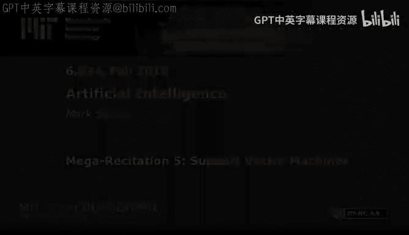
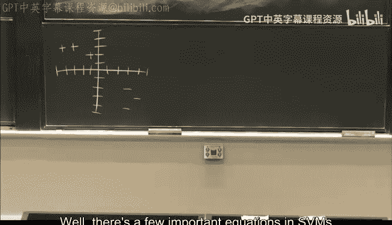
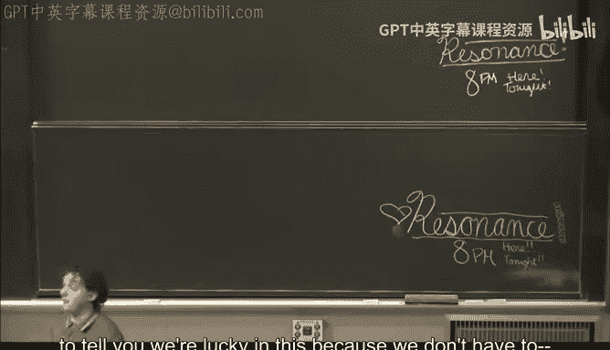
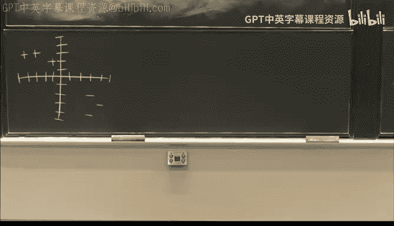
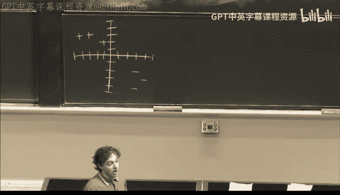
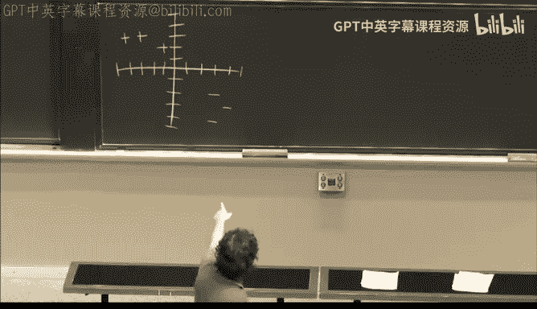
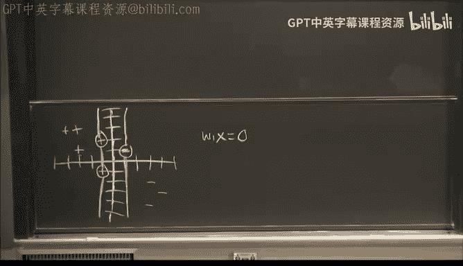

# 《人工智能｜6.034 Artificial Intelligence, Fall 2010》中英字幕 - P28：[28]Mega-R5. Support Vector Machines.zh_en - GPT中英字幕课程资源 - BV14fqSB2ECY

The following content is provided under a creative Commons license。

 Your support will help M I T Open Coware continue to offer high quality educational resources for free。

To make a donation or view additional materials from hundreds of MI T courses。

 visit M T OpenCourseware at O C W。t M I Tt E Du。

Hope everyone had a great。Veterans Day break yesterday， spending it， of course。

 as I checked my test onion， spending it mostly doing your opera research or P sets。

 But at least one person got to watch TV。 So at least one person got to have a real break。

 And that's something truly amazing and special。 so。😊，Now， we're going talk about S VMs。

 They're pretty much the hardest thing in 6，04。However， in recent。In recent years。

 a few shortcuts have popped up that will sometimes allow you to solve the question。

 depending on what they're asking for without solving some vast， ugly set of equations with the vast。

 ugly number of unknowns。 So I'm going show that to you guys。

 I'm also going to try to explain all the alphabet soup that's in neural nets and what all the letters stand for。

 because。It took me a few times going through going through the SVMs。

 It took me a few times going through SVMs to actually find out for sure what all those letters stood for。

 And if you guys figured out first try， that's gonna be great。 And you guys will be just fine。😊，So。

Let's take a look at the problem that's perhaps most optimized for using some of the shortcuts to solving it and not putting up all of the equations。

Then I will， because I am， not because I'm sadistic， but because I'm being nice。

 I will force you with me to solve some of the things they didn't ask for us to solve so that you can see that we can't get away with everything without doing some of the harder stuff。

And， of course， definitely ask questions as always。 But this time， even more so。You guys。

 well if you were looking around， you saw nobody in this entire lecture hall raised their hand that theyre already set and ready and no SVM。

 so if you have a question， maybe everybody else does so。Let's go。You'll start right here。As always。

 pretend that I can draw。 And therefore， all the plus and minuses are only on integer coordinates。

So we are asked in this problem to circle the support vectors。

Draw the edges of the street and then the dotted line in the middle that separates them。

 the separator。As a dashed line。And then to give W and B。So what are WNB？Well。

 there's a few important equations。In。

In SVMs that we really hope。 And I'm gonna tell you， we're lucky in this because we don't have to。

 but we really hope that we don't have to use because they provide a huge number of variables。

So one of those crucial equations is that for a plus support vector。W vector dot X。Plus。

 the plus support vector。Plus B。Equs1。W dot x minus plus B。It was -1 and。W dot。That dotted line。

 I don't know。 We'll call it dot， dot， dot plus B。Equals0。So what does this mean。

 there are a lot of vectors。Well， I mean， we're usually in two dimensional space。

 that we can basically just say that there's two components of this W vector W 1 and W2。

 And there' are just two coefficients and a linear equation。 So to get for instance。

 what we're interested in finding this dot dot dot line。 we'll just call that X with nothing on it。

 actually， maybe that will be easier。 This。As equivalent to saying。W1。X1 plus。W2， x2 plus B equals0。

Where x 1 is this and X 2 is this。 We would possibly call them X and y。

 So one way to think about it is， you know。W1 we call a A X plus。Call W2 B， BY。Oh， don't call。

About A X plus C， Y plus B。Equals。I'll put this on parentheses。

 This is basically an equation like this， or。You know。Y equals。嗯。Negative A over C X。

Mine is B over C。Is basically y equals n x plus B。Does everyone see that this thing that we're looking for。

 this W dot x plus B equals 0。Is a question of relying on。In Cartesian coordinates。

 it just looks uglier。Normally， when we were doing all this solving for W and B。

 we would have to put in equations with the tons of equations。

 plug in all of the support vectors in there。 And we'd have to use。These little devils called alphas。

 which Als essentially， if it wasn't clear in the lecture。

 which it usually isn't completely clear to everyone， wasn't clear to me， completely alphas。

 the way I like to think about them， the alphas in this problem is they are the weight of how significant any particular point on the graph is。

Towards creating the boundary。The higher the alpha is。

The more that that point narrows in the boundary， the lower the alpha is。

 the less that that point narrows in the boundary， the wider the road can be。

And if that point doesn't do anything， if that point is irrelevant and could be removed and wouldn't affect the boundary。

 the alpha is everyone。Zero， well， that was one person， but。You can suffice for everyone。

 The alpha is 0。 And that means if it's not a support vector。

 if it's not one of the vectors on the boundary lines。It will always have an alpha of0。

Because it doesn't affect。So。Keeping that in mind， there's a few fun and important equations about alphas that we'll need if we're solving many equations for many unknowns。

 which hopefully we won't have to deal。Some over。The positive alphas equals the sum over the。

 the alphas are the negative points。This is true over all the points。

 But since all of the alphas are0， except for the support vectors。

 it also means the alphas of the positive support vectors are equal to the alphas of the negative support vectors。

Additionally。Ourre all buddy， the W vector。Is equal to the sum over the。

All I that are plus vectors of。W， I alpha I minus。I'm over J， minus vectors of。WJ， alphapha J。Now。

 all of these equations can be used in a bloody mess to figure out the answer to what we're trying to find。

 which is。Circle the。 Well， actually， they can't be used to circle the support vectors and draw the draw the dotted line。

 But once we do that， all of these equations can be used in a bloody mess to give us the the next thing that we want。

 which is W and B。嗯。So。Fortunately， there's another way to get W And B。

If you guys really want at the at the end of the hour。

 we can also try to get try to drive W and B using the many equations and many unknowns。

 But it's a bit painful。 We'll try to do it the cool way， so。Let's start off。

 This is the one we're looking at。 We need to find where the support vectors are。So。

First thing we need to do is simply eye it。 Fortunately， on the test。

 there will always be ones that you can eye if you're supposed to circle to support vectors。There's。

 obviously。Some number of plus and some number of minuses， I say， obviously， but maybe not。

 but hopefully， obviously， and we'll find out because I'm gonna call them random people。

 So give me a positive support vector。

Which plus sign of the three you know to be recorded？The one all way over。 Yeah。

 that plus size of positive support factor。 That's good。All right， excellent。

 give me a negative support vector there。😊，打官。那。no， problem。 Give me an name super perfect。Oh。

 I was about to ask you， what's a support vector？That is a good question question is what is a supported vector？

How many other people will admit to having this question？You' are not alone。Okay。Before I go on。

 I'm going to assume guys， make sure I'm correct。 Monday was just being sure so I can tailor based on this。

 Monday was the support vector machine lecture。But it was also very difficult to follow。

 That's what I， that's what I usually expect。 So what is the support vector， Well。

 all these positive minuses。If we were， if we were me and we I guess， yeah。

 if we were me and I was describing this problem， the one that we work out in class。

 I would call them points because they're on the graph， they're points。Their data points。

I would but however。In more difficult versions of this problem that have n dimensions。

 where n is some ridiculous number of dimensions that you're never gonna graph， like， say。You know。

 some of the research I'm doing now， I could use support vector machines on some of these articles that I'm reading about cyber events to try to figure out if there's a real event or if it's just someone complaining about how we're really vulnerable or something like that。

 and no event actually happens。 So the reason why they call these guys vectors is when you're not able to graph them on a contion plane。

 there's still this long， you know， vector of many different dimensions。

Right now， though， these points represent the vectors。

It's very simple。 It's easier to view them this way。 But for instance， that plus at negative 12。

Represents the fact that there's a vector。Going in the direction of negative 1。

2 with a magnitude such that。It reaches negative 1， too。

So all these points are just the point representation in vector。

 You probably in any class that worked with vectors。

 saw this saw vectors being represented as points question。啊，Yes。

The question is always with respect to the origin answers is canonically when directors are represented as points。

 yes， it's always with respect to the origin。So that's the basic idea is that all these points are vectors。

So what are support vectors， Well， we could call them support points for this case。

 But the reason we call them support vectors is， again。

 in the generalized case that you might be doing in the real world with real AI。

 you're gonna have a giant vector。 It's not just gonna be points on a graph。Well， usually， so。

The support vectors， the support points， We found one of them correctly。 It's this guy。

 They're going to be the ones。That。Again， they don't have an alpha 0。

 They're the ones that bind in the， as Patrick calls it the road， the boundary lines。

They're going to be on the edge of plus， whichever direction we draw。

 This plus is the edge of the plus region。If we made this the edge of the plus region and everything on this side。

 plus everything on this side is minus， we'd be screwed because there's two pluses on the。

 on the other side of that。Generally， when trying to find support vectors。

 you do something a little bit similar to。My crazy method of。

Doing nearest neighbors and try to find a plus my。Excuse me。

 A plus minus pair that's close to each other。Sometimes， though， it' is not just two points。

Because sometimes if you try to draw the simple minded thing。

 which is sort of the perpendicular bisector of the two points。

 you get screwed because there's another point in your way。So now that I've given away a clue。

 let's go。 And hopefully that made sense to you guys。

 The support vectors are the ones on the edges that are just barely a plus for sure。

 but barely mind for sure。 Let's go back。 Can you give me a negative support vector。嗯。

The one on the top left。Yes。And does anyone think that there's a third support vector Well。

 let's simple minddedly try the thing that remember。

 support vectors always attempt to have the widest possible space between the pluses and the minuses that they can。

 So let's simple mindedly try to do the perpendicular bisector and see if it。

 see if it screws us over。So when we simple mindedly do the perpendicular bise， it goes through。

Like here。Like this。And it's just fine。So these are the only two support vectors。

And there's our divider line。So。We're on the home stretch， but we have to find W And B in olden days。

We would find W and B by plugging in W dot the plus support vector plus B equals1。 Oh。

 that's very crucial。 These W dot plus X plus x minus are only true。

 equaling  one or negative1 are only true for support vectors。It's always true that W dot。

 any positive point。Plus， B will be some positive number。But it won't always be。

 It won't always be one， in fact。It will always be the greater than one up over here。

 It will always be less than negative one down over there。So。In olden days， we would plug in。

Negative 1，2 into this equation。 We plug in3， negative 2 into this equation。

 We plug in alpha plus equals alpha minus the sums。 And since there's only one plus1 minus。

 we know that they were equal。 And then we fidget around with this W equation。 However。

 there is a better way to do it。😊，And so let's use this cheap strategy to solve。

 to solve this version of the SVM。 Here's how， first。

And I know I didn't draw these completely straight。 Sorry， but can anyone。

By looking at the fact that this is3 negative 2， and this is negative 1，2。

 can anyone tell me what the equation if you can do y equals x X plus B。

 Can anyone tell me what the equation of that dotted line is supposed to be if I was good at drawing。

People say y equal wass x minus1。And I say yes， Y goes -1。 So therefore。

 the pluses would be y is greater than or equal to x x -1。 Indeed。

 So we've already seen that W dot x plus B like somehow can be converted into this form。😊，Right。

 so therefore， if we have y equals x -1， then we know。

That we have in W1 that we know that we have W dot X plus B equals 0。 Let's do that here。

So we know that W1。W1。X1。We didn't even call it X and Y。 I think it'll be fine。

No one will come after us， W2 Y。Plus， B equals0。But we also know that y equals x minus1。

 which means that。If y equals x -1， then that means that according to this thing that we have over here。

Then。Negative。W1 over W2。Equals。So we know that negative W1 over W2。

And we have negative negative B over W2。So y equals x -1。

And if we solve this equation to make it look like this， we would have y equals。Negative W1 over W2。

Minus B over W2。So we know that in some way， shape or form。That。

We know that Nick that then therefore W1 over W2 is some scalar multiple。Of。Min-1。

And we know that B over W2。Is， in fact， some scar multiple of positive one。

 Sar multiple scar multiple。 Well， why is it a scar multiple。

 Why isn't it just going to be negative one or positive one because。Just because in this equation。

 we can multiply the entire equation by any number。And it'll still have the same boundary line。

You guys see that if， if， you know， if。Oh there's an X here。If we multipied everything。

Since it's all divided by W2， if we double W2， but also W， double B and W1。

It would be the exact same pleasure。 Do you guys agree？So there's， in fact。

 infinitely many possible equations。 and you say， well， great Mark。

 youve figured out what form it is。So you figured out that。W1 over W2。Equals。嗯。

Some sc are multiple of negative ones。 So it's negative one times。What's everyone's favorite letter。

K， negative one times k。And we figured out that B over W2。Is。

I guess we can just do negative K is positive K。 But what's K， How are we gonna figure it out？ Well。

 it's a good question。 I will tell you how。Ill assert the following fact as true without proof。

Then I will not prove it。嗯。One over the magnitude of W， which is this vector here with W1 and W2。

Equals。This。Where this is that line I just drew the line from here to this point。

1 over the magnitude of W equals this。Therefore， since1 over the magnitude of w equals this。😡。

And this equals， I believe， two root 2， because we're going。Over2， down to pythagagoning theorem。

2 or 2。So therefore。Flip everything over。 magnitude of W equals one over two root 2。

 So therefore for magnitude of W equals root 2 over 4。But why are we okay。Well。

How do we calculate the magnitude of W， Do people know， in general， magnitudes of vectors。Generally。

 for。These vectors， we do it by think the square root of the sum of the components squared。

So the square root of w1 squared。Plus， wq squared。Equals root two over4， but that's not all。

That's not all we say， because we know from this。Over here。That the ratio of W1 and W2 is。Yeah， the。

 the ratio of。The the ratio of W1 and W2。Is going to be actually， sorry。I shouldn't put a K here。

I realize I probably should have been confusing you guys a lot。 W1 over W2 is just negative1。

 B over W2 is just one。 That's just a fact。There's no K。

 The K is to determine what W1 and W 2 is W1 and W2 R。

 So W 1 equals like negative K and W 2 equals positive K。 And then B equals also positive K。

By the way， here's the question for you。Could I have put the K， the negative sign on a different。

 I could put the negative sign on W 2 and B instead of on W1。So many people said yes。

 that's a very smart answer， actually no。Because of the fact that the pluses are on the negative x axis。

It's just a little trick I picked up when one of them is negative in the other one。

 is it follow the pluses。So we know that W1 is negative K。 W 2 is positive K， and B is positive K。

 W1 over W 2 is negative 1。 B over W2 is positive 1。 So what do we know about the ratio of W1 and W2。

😊，It's equal to negative 1， and that means that when we square it， w1 squared equals W2 squared。😡。

So therefore， this is a square root of。2 w1 squared， which equals。We're2 W1。Orevalently。Well。

 actually。No， it doesn't equal root 2 W1 because W1 is actually negative， so。It， we， you know。

 it's negative of 2 W。 when it doesn't matter。 The point is。That， if that equals。Mo to over4。

 then W1 is。Everyone。Negative  one4， B。 And if W1 is negative one4， everything else falls into place。

 What W 2 and B， everyone。Positive one force， we got it。 We're done with this part of the problem。

 However， bonus。Let's calculate the alphas， which they didn't ask you to calculate。 Actually。

 you know what。We'll do the alphas if we have enough time since they didn't actually ask you to calculate them。

 However， my recommendation is， since there's only one alpha plus and one alpha minus。

 they must be equal from this equation since the sum of the alpha plus equals to the sum of the alpha minus。

And so therefore， sum of the W sorry W equals the sum of W。Sorry， this should be an X。Of course。

 there's not a million ws in this equation。 The sum of the points。

 the positive data points times their alphas， minus the negative data points times their alphas。

 So we're looking at here。Negative one quarter， one quarter。Equals what have we got here。

 Positive point negative 1，2。 So we've got alpha。Plus， or alpha of that point， negative 1，2。

Minus alpha of that minus point。 And what is that， It's 3 negative2。3， negative two。

So if both of the alphas， which are equal were one， we'd have negative 4。 we'd have negative 4，4。

 but we want negative one quarter， one quarter。 So actually， both of the alphas are。1，16th。

And that's the answer。We'll do that more in depth if we have time， but we won't。

 So let's do number two。So let's go into faster mode。 numberumber  two， very similar to number one。

In many ways， but as you can see， one of the main things is they added an extra minus sign at2 negative one。

So I think we can all agree。That this will still be。Our plus， actually。

 they added another plus sign there， too。 So maybe this plus sign is a sport vector。But it's not。

 This plus sign is a support vector。 What do you guys think about the new negative sign。

 Will it become the support vector since it is like strictly closer to the pluses。Yep， you're right。

Okay。So。This is a very beautiful division， because if I drew this correctly， which I didn't。

 But if we pretend that I did， then the dotted line is。😊，Ii equals x。Okay。

 so with the dotted line of y equals x。Then we know that just like we did up here， we know that。

If y equals x plus 0， we know that， first of all。B equals 0。Second of all， we knew that。

We've got just if y equals x， then we know that negative W1 over W2。Equals one。

The plus are still on the left and up。 So we know that W1 is some negative number。

 negative K W2 is some positive number K。Great， how are we gonna figure it out。Well。

 let's call that this D for distance or whatever you want to call it。N over w equals D。

D in this case， is not to root 2。Can everyone tell what D is here。It's actually。

So it goes over2 and1。 So it should be。1 and a half route 2， since this with distance。

 which is twice as much， goes over 3 and 3， which is3 root2。 So it's one and a half route2。

I don't like putting inimbels in something。 So we'll say that。2 over magnitude of W equals 2D equals。

3 route2。So， therefore。Right， Pyth 1，2，3，1，2，3，3 were2。 So therefore， magnitude of W。Equals。

Let's see switch them over。 We should get root 2 over  three。And if magnitude of W is root to over3。

 we can do our same trick from before。Square root2， W2 squared。Equals root over  three。

And this is just root2 times W2 equals root2 over 3。 So therefore， W2 is。One third， and W1 is。

Negative 1 third， bingo， we've got W1。 we've got W2。We know that B was 0 because obviously， it's 0。

 It's y equals x， and we're done。That was fast。 The alphas might have taken longer。 Actually。

 the alphas on this one are more of a pain in the ass than anywhere else。

 because let's take a look at this one。 if you can see it。We've added in yet some new points。

 We've got this point up here and this point down there。So I think pretty clearly。

 this plus and minus are the closest to each other。

 But what happens if we take the perpendicular bisector between these two and do like this。

This plus is in the middle。 So we're going to have to。 So therefore。

 this plus is gonna have to also be support vector， so。We can't just draw this line。

We have to include this。 What's our best division。Vertical lines， that's right， vertical lines。

Just so。And that means that the equation of our， the equation of our boundary， the dotted line here。

Why access？So the equation of the boundary of the y axis， then b equals 0， and hell W2 equals 0。

So the only thing that is not。W2 equals 0。So W2 equals 0， B equals 0。

 but W1 is not equal to 0 because。It's just the equation of the Y axis。

So we therefore note that the equation is just。W1 times x。Equals zero。So if w1 times x equals 0。

 and we know that that just means essentially that x is going to be some K。

 it's also going to be negative because of the fact that the pluss are still on the left。

Then we're going out have to figure out what that K is。 We'll use our old trick。By this point， old。

 hopefully，1 over magnitude W equals D。 This time， D is just one。So therefore。

 magnitude of W equals 1。There's only one component in W， so therefore W1 is。-1。

 because the plus are on the left。People see that Not too bad。 This one's easy to calculate a W。

 but it's not as easy to get all of the alphas。 But let's move on to a new and even more fun。

Maybe not question。Which is this guy。 as you can see， this is a this valve， maybe not。

 This is a one dimensional vector。These vectors only have a single dimension。

 so it just looks like a number line here。That dimension varies from。

 It looks like negative 9 to positive 9。It just has one component。

 You don't have to worry about any of these crazy magnitudes with two components。

 just everything has a single component。 However， it's obvious that a linear basis line is going to completely screw us up here since。

Lines at this point are just like gump。 All these are pluses， All these are minuses。 Well。

 that great。 That doesn't get them all。 So how are we gonna do it。Well。

 we're going to use what is usually perhaps the hardest thing in SVMs， but in this case。

 it's not too going to be too bad for us， we're going to use a kernel。Now。

Based on how little I understood kernels the first time I took this class。

 I'm guessing that you guys would like to have some explanation on these kernels。

You probably saw them。 You remember the kernels from Patrick's lecture vaguely。 Theyre like this p。

 And then there's this K。 and then they get really complicated。 Okay， so here's how the kernel works。

 The basic idea is this。And I'll write it。Over here。Oh， wow， there's more stuff。 Okay。

 I'll right right here。 The basic idea is this。 We're taking the normal space。Which is， you know。

 this number line， or it could be any kind of normal space。 And we're going to take a vector。

We're going put it into it。Function called Phi。And phi of vector X brings x into some new dimension。

Phi or p， if you like it better is usually a nasty piece of work and something that you never ever want to look at。

 Sometimes it's not too bad。 Phi is the function that brings it into the new dimension。Okay。

And when you brought the data into a new dimension。

 sometimes you can just cut a straight line in that dimension， and you'll just be happy。However。

Something that was noted。把。The very， very smart inventor of support vector machines。

Is that you don't actually need to work with function phi。

 even if phi is an absolutely horrible monstrosity。

Because of the fact that you never need to know what the vector X。

 what all these vectors X actually are in the new space， at least not directly。

 in none of these equations up here。 Do we ever use X by itself。However。

 we do use X being dot product with something else。So he figures out a very sneaky and excellent。

Shortcut。Okay， so。Oh， I shouldn't use X Y and XTL use。X and Z。So if you have two vectors， X and Z。

 which are in a regular space， you put them into this function called the kernel。Then。

It will tell you。5 x。Dotted with 5 Z。And if you have that， you don't need five。

Does everyone see that？ Does everyone see why we don't need Phi。 Look at all these equations up here。

 We never look at acts by itself。In these， in these vector equations， at least。Now。

 calculating alphas， Yeah， that gets a little little fuzzy。

 But in the vector but in the vector equations， also， you， yeah， you may ask， like。

 why would you do this， You can't calculate the alphas。 It turns out that。Actually。

Although for these very simple linear problems， human minds cannot calculate the alphas。 In fact。

 you。Running a very complicated quadratic optimization。 In fact， finding out the best Als is。

The thing that you he climb on when you're doing SMs in the real world。 you say， allright。

 I'll run my my algorithm on。 I know there's only one peak， which is very。

 very good cause it's quadratic optimization。 Let me figure out the alphas。 So， in fact。

 it doesn't matter that you can't do use these alpha equations to figure out the alphas。

 if you've gone into if you only know the chrom function not the P function because。Normally。

 the computer figures out the alphas for you with quad optimization optimizationization。

 Just in these simple problems， we know you can calculate the alphas。So we have the kernel。

 which replaces the dot， basically gives us the dot product of the things in the new space。

 So being that as it may， I'll give you the kernel here。 I'd like you to give me the P。😊。

So a kernelel for someone got an idea whose name was Susan Q Random student。 Apparently。

 she got an idea that if we had a kernel。For。X and Z， actually， they're not vectors， I guess。

 they're just single component。And the kernel equals。Cosine pi over 4。X。Times。Posine power of 4。Z。

Plus。Sign。P over four x。Pa， sign。I over for。Z。So that is the new dot product， cosine power4 x。Oh。

 wait， sorry， I put one of the。Disease not inside the parentheses。 That was still of me。So。

Cosine of the quantity pi of 4 x。Times cosine of quantity pi over 4 Z plus sine of the quantity pi over 4 x plus sine of the quantity pi over4 Z。

 So's the new dot product。 So that begs the question。 in this one， this is an easy one。

 so we can calculate the5。What is？Phi of x。We're actually。Taking it from one dimension。

 And we may be playing around with it a lot to get this。 This thing is become a new dot product。

It replaces dot product。 remember that the dot product for scalers would have just been multiplying the two numbers together。

 So it actually makes it a little bit more complicated。 Does anyone think they know the P。Oh。

 we've got one， what do you think？that the% Senate。You need to become effective， food dimensionional。

Absolutely。That's exactly correct。How would you solved this on the actual quiz if you're not。

Our brave volunteer。 Well， that K， if you squint at it， not very much， actually。

Its pretty much a dot product between。Cosine P of 4s and sine P of 4s。 I mean， look at it。

 Dot product is just， remember， if the dot product of x and Z vectors is x1。Is X1， Z1 plus x 2， Z2。

 So that basically is x1， Z1 plus x 2， Z2。Oh， this should have been eight times。Yeah。

 this should been in times。Sorry， there's a plus there。 Anyone who missed it because of that My bad。

 That should have been the times there should have been times up there。

 The plus only plus is it's cosine P over 4 x， cosine P over 4 z plus sine p over 4 x times sine p over 4 z。

 So， yeah， it's basically the dot product between cosine P 4 x and sine P over 4 x， bininggo。

All right， last thing。And then we， well， we're not dialing it because we're gonna maybe ask some questions。

 And then we're gonna see if we can calculate those alphas。 But last thing。

 let's graph in this new dimension all the points。 So obviously， cosines and s。

 So we're gonna get results between1 and -1， let's see。 maybe I can graph it。嗯。

Did I write on all of these？Wait。Maybe this one。Nope， people drew weird stick figures there。Okay。

A yeah， this one's kind of messy， but we'll do it on this。Okay， so we've got。

This is one negative  one，1 half， negative or1 half negative 1 half。1N  one， negative1， half，1 half。

 okay。Given that， let's telegraph all of these points on this number line into this。New。

 brave new dimension by using their cosineine P of4 so。All right， great。

 so let's do the pluses first。What about the plus x 0 is cosine 0， sine 0。 So what is that。That's 1。

0。 That's right。In fact。The 8 and the -8 are also that。Times 3。

 the8 and the minus8 are also that because then it's just two pi and minus2 pi。

 which well cosine and signine are periodic。Okay， great。 What about the one， Well。

 that's cosine power 4， sine power 4。 What's that。Yeah， it's a root two over2， root over2。

 So it's something like here， we'll say。And， in fact。The 9 and。

The 9 and the negative 7 are also that。So there's three of these too。Okay。

 what about the negative one， That's cosine negative pi over 4， ssine pi over 4。That's right。

 The x value is。Positive root2 over 2。 And the y value is negative。 So， and again。

 there's three of them。Alright， great。 Now let's do the minuses。 There's the minus at 3。

Which is also the same as the mindset negative 7， the mindset 3 is cosine 3 pi over 4。

 sine 3 pi over 4， which one is that？So that's in the second， yeah。

 that's going to be the second quadrant， we're going to have the cosine is going to be negative。

 but the sine is going to be positive。And so we get three points here。 And as you may have predicted。

 the other one， the five pi over4 is in the third quadrant。We got three points here。

What are the support vectors。还是。か。I understand。不约。Com ofities of plus the first and fifth quarant。

But aquaint far my board。这 forward maybe the。Oh， you're right， There's only two。对吧。

There's two negatives here， and there's two negatives here。 Good call。 doesn't change the problem。

In fact， if we just graph more points， there might have been more。

 but there is a very subtle and important distinction。 There are two negatives。But otherwise， yeah。

 these are graphed correctly。 Does anyone see where the support vectors are。

So the top two the mice and plus we'll try to do the perpendicular bisector， let's see it。That works。

 But guess what。 These guys are on the same line。 So we'd better circle them。

So it's actually the question is， what isn't the support vector， Only this， only those the question。

是我你翻圈下面。This proved that actually， you just showed that those land on the same line said you really didn't need like the cosine term minusine term。

 you've done all this with just the cosine。All right， the question is。

 to know we've done this in one dimension， all you do is do only the cosine。

 So if we did only the cosine，Then they would have still been divided easily divisible。

 The answer is， absolutely， we could have。However， the question did not。

 because Susan Q randomom student decided to do coside inside。But， yes。If we had said you。

654 student， find a p that will work for this。You could have found a phi that was just cosine。

 and would have been easier。However， it's important to be able to work with what somebody else gives you。

 in this case， they gave you， they gave you that transformation， which， yeah。

 it was a wful with an extra dimension。 You didn't need the sign。Because you didn't need the Y axis。

 really here。You just needed the X。Does everyone see this。How this works。

Can maybe transform dimensions。 The main hardest part is they'll usually give you a K and ask for a phi or give you a P and ask for a K。

 But it's not too bad。 Just remember， if they give you a Phi， do a dot product with it。

 And if they give you a Phi， that's just one component。

Dot product of one component is just multiplying it together。 Easy enough。 So they give you a K。

 treat it as a dot product and try to reverse engineer。

 It's usually something like this that's easy to reverse engineer。

I really haven't seen it where it's not。 So it may looks it may。

 it often looks like the scariest problem， but it's usually not too bad to go between P's and Ks。

 Does anyone have any questions on anything that we did。It's part my machine。

But what is什么tuition behind孩 the？We solve it and figure out numbers in patients like what is it relationship？

The question is， what is intuition， what is W？W is the dividing line。

 It's the drop dead dividing line。 When I say the drop dead dividing line。

 you like those big bold solid lines over there。 Those are your pretty certain lines。

 Everything passed that was a minus And your in your training is that everything passed the plus the big bold line there was a plus in your training set。

 But the dotted line is the one you're really gonna use in the test data。In the test data。

 when push comes to shove， you might get something that's inside of that gutter。 And if it's on the。

 say of that one up there， If it's on the up left side of that dotted line。

 you're going to call it a plus。So that dotted line is your decision boundary。😡，And that is。

That is basically the idea。 And， in fact， the way that the algorithm would do it on the computer is it would quadraically optimize the alphas。

 which messes around with the dotted line。 And by quadraicallyimizing the alpha alphas。

 You see how the alphas add up to a W。 It just checks it around。 And eventually it finds oh。

 making the alpha of this one0 makes makes it better optimization。

 You're trying to get the widest possible road， it would eventually come out to this。

 This is trivial for a human to eyeball。 But some real problems with 200 data points that have to get one or two of them wrong classified and you may be using a quadratic kernel or something like that。

 you can't do that。 You just cant Well， maybe you can， in which case。

You should be getting a MacArthur fellowship or something like that， but。The computer can't。

 And the basic idea is when it comes down to it， it figures out the alphas that give it the。

 the best W for widest road。 And the W is your decision boundary。Good question。

 Any other questions about our old friend， SBM， I have a question for you。 after seeing this。

 and let's pretend that they only ask you to saw for Ws Bs， you know， these kind of kernels and Ps。

 which are the typical things。 How many people now think that you can go through and work at SBM problem。

😊，Allright， we've got， we've got a few。 We've got a happy few band of brothers。

 maybe eight people raising their hand there。 That's good。

 How many people know what a support vector is now。That's really good。Because。

If that's all you learn from today's magnet， it's still good。😡，It really is。 I'm telling you。

 I had to take two classes on this and then T it before I really， really understood it。So。

You guys are ahead of me。All right， take care。 Have a great weekend。

 and we'll see you for boosting and vampires next week。😊。

