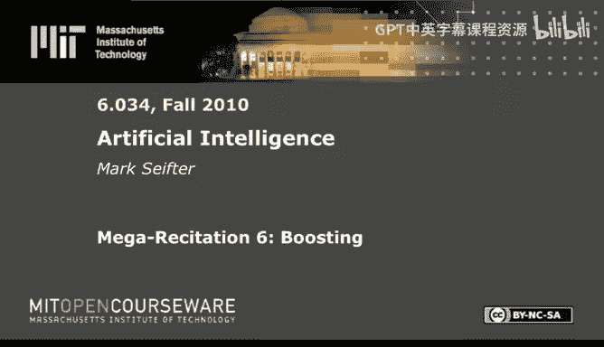
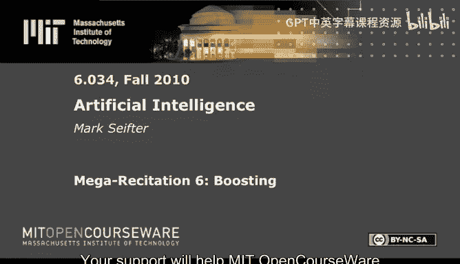
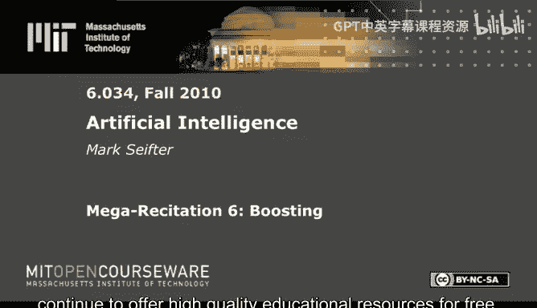

# 《人工智能｜6.034 Artificial Intelligence, Fall 2010》中英字幕 - P29：[29]Mega-R6. Boosting.zh_en - GPT中英字幕课程资源 - BV14fqSB2ECY

The following content is provided under a creative Commons license。

 Your support will help M I T Open Coware continue to offer high quality educational resources for free。

To make a donation or view additional materials from hundreds of MI T courses。

 visit M T OpenCourseware at O C W。t M I Tt E Du。

Good morning， everyone。Today we're going to talk about boosting。But thing is pretty awesome。

 and it's not as easy as it's not as hard as it might seem。 It's actually pretty easy。😊。

As long as you do it， right。So let's take a look at this boosting problem There's really mainly just like with ID trees。

 you may have noticed there's like the ID tree problem where there's a graph and all of the tests are X and Y axis tests on that graph。

 and then there's the ID tree problem where there are a lot of。Crazy。

 different classifiers about sort of characteristics that are discrete。 And then all of the。

Sort of I D tree stumps， if you will， are built out of those discrete qualities。

 This is an example of a boosting problem of the， of the second type with a bunch of discrete qualities like evil。

 emmo transforms sparkly， and it has a numerical quality number of romantic interests。

So it's one of basically the two kinds of boosting pumps you might see。 Another is is the。

To access Cartesian problem。 A good example of that is the hours of sleep versus coffee problem。

Which。I， for one， am planning on doing a tutorial on Monday。So that you guys sort of。

Get a sense of both types of problem。 This one looks big。 I think it looks， I mean。

 it has 10 different vampires or non vampires to classify。

It has a whole bunch of possible classifiers， but。If you do it right， you can do it fast。

 so here's the prompt for the problem。Let's see。After graduating MIT。

 you get a job working for Van Helsing and Summers， a famous vampire hunting consulting agency。

Gabriel Van Helsing， one of the two founders， once attended several 6034 lectures as a guest。

 and he remembers Professor Winston's Vare Identification tree lecture。

 He assign you the task of creating a superior classifier for vampires by using boosting on the following data。

So。We've got the I D number， which we can use to just write things out in shorthand。

 We've got the name of several vampires and non vampires。

 Then you see whether they're a vampire or not。 That's whether their classification is like a plus or a minus for。

 for the quality vampire after that。There's。A bunch of possible ways to classify whether they're a vampire or not。

 there's whether or not they're evil， whether or not they're emo。

 whether or not they transform and whether or not they're sparkly。

As well as the number of romantic interests that they have。So， for instance， on the one hand。

 you have Dracula， who's evil， but he's not emmo。 He can transform into a bat or。A， a co of mist。

 He not， he does not sparkle， and he has five romantic interests。

 Those three vampire chicks at the beginning， Wilhelmina Murray and Lucy Westendra。

 So on the other hand， you have like。Squaal Leonhart， who's the protagonist of Final Fasy 8。

 is extremely emmo and doesn't have any of the other characteristics。And he's not a vampire。However。

 he's a nice counter example for a possible role that all emmo people are vampires because he's very。

 very emo and he's not a vampire。 So how will we go about tackling this problem with boosting， Well。

 there's a whole bunch of different classifiers。 And if you think this is all of them。Like evil， emo。

 transform sparkly romantic interests， and true is actually only half of them。

 The other half are the opposite versions。But we'll ignore them for now。So if you look at these。

 you can probably figure out what they mean。 E equals just means of vampire is what we're saying here。

 except maybe true。 You might be saying， why is there one that just says true。

 The one that just says true says that everybody is a vampire。You might think， oh， that sucks。

 but it's not that bad since7 of the 10 samples are vampires， the key。Crucial thing about boosting。

Is that for any possible classifier， like classifying on the evil dimension。

Which actually sounds like some kind of weird place that you go in a comic book。

 But classifying on the emo dimension or whatever， as long as it's not a 50，50 split。Of the data。

You're guaranteed to get to be able to use it。In some way， for boosting。If it's a 50，50 split。

 it's like flipping a coin。So it's useless because if you say， okay。

 if you had some other thing like gender equals male or female， and let's say that was 50，50。

 It's not。 But let's say it was 50，50 between vampire and non vampirere。 It's a useless classifier。

 because。It would be just the same as Philip and coin。 You get no information。 Now， you might say。

 wait a minute， what about classifiers that get worse than 50，50。What about them？

Might not they be even worse than a 5050 classifier。

 I would claim that classifier that gets less than 5050 is still better than a classifier that gets exactly a 5050 split。

Is there a question？It。Cl fires。答为。やってい。啊。So the question is， in the I D treee example。

 you might use 5050 classifiers in later rounds if， for instance。呃。

There's a 5050 classifier except for that most of the things off of that side have been already removed。

Let's say there's 20 data points， and there's a classifier that splits it 10 and 10。

 splits it 10 and 10， and it it gets half plus half minus on both sides。

But all of the pluses from the right side have been removed by some other classifier。

 You might use it。 That's true。 But in boosting， you'll never use something that's a 50。

50 classifier。 So youll never use something that has exactly a 5050 chance of being correct。

Because if it has a 5050 chance of being correct， it's useless。 And if it has a 50，50。If it has a 50。

50 chance， no， sorry， let me， let me specify again。 you'll never use something that has a the 50，50。

That has a 5050 chance of giving you the right answer， given the weights。That's very， very important。

 and that may be what your question was getting at。As I'm about to show you。

 and as Patrick told you in the lecture， in later rounds of boosting。

 you changed the weights of each of the 10 data points。 At first。

 you start with all the weights being one10th。The weights have to add up to one。 In this case。

 you never ever choose a classifier that gets five of them right and five of them wrong。

 In later rounds， you'll never ever choose a classifier that gets half of the weight。Wrong。

 exactly half of the weight wrong。 but half of the weight may not be half of the data points。

 So it's possible to choose a classifier that that gets half of the data points wrong If it doesn't get half of the weight wrong。

 And that's similar to an I D trace when you've already gotten things right before。

 because you'll see that the weight is gonna go to the ones you got wrong。 So。

I'm not saying that you should throw out right away anything that gets five of the points wrong。

 Hell， you shouldn't even throw out right away something that gets7 of the points wrong。

 It's possible possible that you can get 7 of the points wrong。

 while getting less than half of the weight wrong。 If those other three points are really。

 really annoying to get right。 And we'll see that later on。 But for insight。

 at every step along the way。 We're willing to choose。

 We're willing to choose any classifier that doesn't get 50，50。However。

We want to choose the classifier that gets the most of the weight right。 By most of the weight。

 at first， we mean most of the points right。 Later， we will mean， But exactly what I said。

 most of the weight。 And if you don't understand that。It's sometimes hard to get it right away。

When Patrick just lectures through it and introduces a new concept。 If you don't understand that。

 you'll see what I mean when we go through， alright。So my。

 my point I was making before is what about things that get。Less than half of the weight right。 Well。

 those are always okay because you can just flip them around， use their inverse。

 and that gets more than half of the weight right。It's sort of like。Yeah。

 it's sort of like my girlfriend always tells me that she is more than 50% likely to choose the wrong direction when you're trying to go between two places。

 which I'm kind of skeptical of I said if that's really true。

 then we can just go wherever you didn't say it to go and we'll be more likely to go the right way so you're actually really good at finding the place that we want to go and then she's like。

 no， that won't work because then Ill I'll know that you're gonna do that and I'll say I'll double say the wrong way and then you'll go the wrong way again。

 but。That notwithstanding， you can， you can see you can apply the same concept to boosting。

 And that's why underneath of this， I have all the opposite versions of all these tests。

 So what should we be doing to。To solve this problem more quickly。 First。

 let's figure out which data points are misclassified by each of these classifiers。 In other words。

 if we say all the evil things are vampires and all the all the non evil things are not vampires。

 what do we get wrong And if we do that for every classifier。 then that only get faster。

 later on because later on， we're gonna to go through classifiers。

 And we're gonna have to add up the ones they got wrong。 So this chart over here is gonna be。

Extremely useful。 And on the test that this appeared in。

 they even made you feel it it to help yourself out。

 So let's see if we said that all the evil equals， Yes are vampires and all the evil equals know are not vampires。

Then I'll do the first one for you。So。We get all of the non vampires correct because they are all evil。

 evils no。 But unfortunately， we get。We get Angel， Edward Cuen， Saya Oinasshi。

 and List de leadinging Court wrong because they are vampires。And their evil equals now。Apparently。

 Let is iffy， but I never， I never read those books。 And the Wikipedia article said that in the end。

 he wasn't that evil， so。There we go。 El equals yes， misclassifies 2，3，4， and 5。All right。

So let's try email equals Jeest。 I'll have someone else do it， so。To see if you guys got it。

 So if we say that all the emmo people are vampires， all the non emmo people are not vampires。

 what do we get wrong。1，6，7，9。 That's exactly right and fast， good。We get 1，6，7 and 9 wrong，1。

6 and 7 are wrong， because they are not emo， but their vampire is9 is wrong because squall is Eo。

 and he's not a vampire。Good， okay， what if we said that exactly the transforming characters are vampires and the ones that do not transform are not vampires。

 Which ones we get wrong。算吃这真在吃。So which was when we got on if you said it transforms Japer vampires and t ons no we're not vampires？

We definitely get it wrong because she's not by。about it's actually on there。いや。Yeah二。Yes， exactly。

 oh yeah oh man， you didn't see the chartt， you were just like，mm。If you saw on the left。

 you're just like， hm， which of these are transforming characters， okay， that's pretty hardcore。

But yeah，3，4，5， and 8。 No， no， It's definitely given to you。 That would be the worst test ever for。

 for international students。 if you don't know these 10 characters that Mark found as vampires。

 you lose。Alright， so what about that Sparly equals Yes is a vampire。 And if it's not sparkly。

 it's not a vampire， this is not， this is guaranteed not to go， well。

 what do you think it's gonna get wrong。Yes， Park Eagles yes are the only vampire pets。1。嗯。嗯。一。

And yes， that's right， it gets one， two， four， five， six， seven eight long that's pretty awful。

But Dan it， it gets Edward Colin right， and he's hard to get correct。

Due to the fact that he's not really much like a vampire。

 he's more of a superhero who says he's a vampire。 Okay， so next。

 number of romantic interests greater than two。 So if they have more than two romantic interests。

 they're a vampire and otherwise， they're not a vampire。 So which ones would those get wrong。

 Would that get wrong。Just three intent， that's right。Because seriouslycy had。Odysseus。

 she had Teleachus。 Actually， she had that guy。 She turned into a woodpecker。

 She had that other guy who was a seaguard who caused her to turn Sililla into the9 headed thing。

 And probably at least one other person。 So seriously， it gets wrong。

 And it also gets Edward Col wrong because he only has one。So，3 and 10。

You can tell I thought about this problem when I was writing it up。 I wrote this one。 Allright。

 number of romantic interests greater than4。 So it's a little bit different this time。

 Now you have to have at least four romantic interests or actually greater than4。

 but there aren't none exactly4 to be classified as a vampire。

 Which ones do you think is gonna get wrong，3。😊，有。It is going to get 3，4 and 10 wrong。Becauseuse。

 now。You run into the fact that。Sya has that blonde Chevalier guy， Haji and Kai。

 So the last of the positive ones， because I I claim I can derive all the negative ones if you guys give me the positive ones。

 The last of the positive ones is everybody's a vampire。 Who does that get wrong。😊，Yes。😊，O。Now。

 I can derive all the negative ones from this。Without a sweat， evil equals no。 Well， it's 1，6，7，8，9。

10。Without looking at the chart。Raise your hand if you don't see why raise your hand if you see why it's 1。

6，7，8，9，10 without looking at the chart。Raise your hand if you don't。Nobody， okay， wait， one hand。

 Okay， I saw another one back there too Later。 They were just more tentative。 Okay。

 it's the complement of。A， because a is evil equals just as a vampire。 It gets 2，3，4， and 5 wrongg。

 So therefore， evil equals no as a vampire is gonna guarantee to get all the opposite ones。Yeah。

 we're looking here， but we're not looking at the big chart there。Oh， yeah。

 if you can't look at anything， then you're screwed。

Unless youve all not only are you as hardco as this guy， but you've also memorized the numbers。

All right， so Eo equals no is going be 2，3，4，5。8id。10。Transforms equals no is 1，2。6，7，9，10。

Spark equals， no， is。3，9。10。We're meant to interest us less than two is everything step 3 and 10，1，2。

4，5，6，7，8，9。1，2，5，6，7，8，9。 And then finally， everything with 8。9 and 10。 So 1，2，3，4，5，6，7。right。

 so when we've started off， we know what everything gets wrong。

 I then make a bold claim because there is， there are n of these， which is 14。

I make the claim that there are only six that in your wildest dreams you would ever possibly even consider using ever。

And the rest you would never ever use question。 Yeah a question。よし。That's true。

That works well to use there or 2 or 4， but it should have been ned with a less than or equal。

 I'm copying off of the quiz。But， yes。I noticed that this morning when I was putting myself through my past。

 I'm like， there's not less than equal to wait a minute and then oh， wait。

It doesn't have any twos or fours。 Actually， I don't remember writing them all as5s and3s。

 It's possible that somebody else in the post editing process changed them all to be about the same number and then change the list that are equal to to be less confusing。

 It's possible I had seriously it 4。 And there was an equal to somewhere。 And they were like。

 forget it。 because I can't think of the fifth romantic interest for her。So， yes， normally。

 you would have to negate it with an equal to sign。

 but there happen to not be any things that are equal to 4 or2 here。

 So they get away with it this time。But。Good practice。 It's good practice。

 So I'm climbing that our wallest dreams we'd only ever want to use six of these ever。

 And the other8， forget it。😊，So。不's see。I will call on people at random to the first people。

 obviously getting it really easy to tell me which of these you think that you might ever want to use。

 Give me one you might ever want to use。Y E， of course， maybe the best one。 Yes。

 that's one that you might ever want to use。I'll circle。The ones that you might ever want to use。E。

 it only gets3 10 wrong。 That's amazing。 It's like the best cause fire。 Okay。

 so give me another one that you might ever want to use。😊，F， let's see， F， as it is great。

 it only gets doing wrong。Do people agree that you would ever want to use F？Everyone saying， no。

 why not。It's like E except worse， is guaranteed at every step。

 no matter what the weights are to gather a worse accuracy than E。😡。

It is definitely good If E wasn't around， it would be one of our best classifiedifiers of all。

 But actually， F is not one of the six。This is why I wrote。

 had them write on the test that there were 6， because people might not have found all 6。

Because people who did figure out not to include alphabete not have figured out to include some of the ones you want to include。

 so。Why you can't use that， okay。So we start off with one10th weight for all of our data points。

 But let's say during our time of boosting that all 10 of the data points have now different weights。

 So we'll call whatever the weight of 3 is， which you're going get wrong。

 You want to minimize the error， right， So that weight of3， which goes into the error of E， is X。

 The weight of 10 can be y。 So if you get， if you're thinking of choosing 3。

 you know your if you're thinking of choosing E， your error is x plus y。

If you're thinking of choosing F， your error is x plus y plus Z， which Z is the error of4。

 And since you're never gonna have a negative wage， X plus y plus Z is always greater than x plus y3。

That's a yes。 You would， You would probably choose something about the three and the 10 that didn't get the three in the 10 wrong。

 but you would certainly never choose F ever。Because it's always worse than E。 In fact。

 this is exactly the process that will allow you to find the correct 6。And by will， I mean 10。

 And by 10， I mean， let's see if you guys get it。 Give me another one of the six that you might keep。

K is the claim sparkly。 Okay， K， I'm going to say， well lose for the same reason as F。It's 3，9 in 10。

 It's essentially similar to 3，4 and 10。So， oh， by the way。

 we should not be only going for the ones with the fewest with the fewest incorrect。

Where you need to be going for ones that do not have something that is strictly better。 In this case。

3 in 10 wrong is strictly better than getting 3，9 in 10 wrong。Question。

You're going to stay transformed， you're going to be correct。

Transformence is one of the ones we need。 C，3，4，5， and 8。 There's nothing down here。

It gets fewer than those wrong。Like there's nothing that gets us 3，4，5 wrong， for instance。

There's no， yeah， there's no way to get 3，4。Wrong without without getting either 10 wrong or 5 and 8 wrong。

What。Why not G， why not， why not G， let's include G2。We need 6。 No， I just said give me any。

 and someone gave me the easiest one E question。Why not B， B looks great， I love B， Let's include B。

Does someone else want to give another one that they want to include？A， why not A， Sure， I mean。

 it's hard to see down here because there might be something better on the bottom， but yeah。

 there's not。 So let's include A Why not。 A。 I love A。 A is great。Okay。So， that is now。

That is now five， there's one more that we need。It is by far the hardest one。To find。

Find me one more that there's nothing better than it。

 There's nothing that has a strict subset of the same ones wrong。What。Okay。

 why would you choose that you've already doesn't sit， let's say eight was a real problem for you。

And you were just getting， let's say that 3，4， and 5， they weren't that bad。 They weren't that bad。

 They weren't that bad。 Okay， you got them wrong here with transforms you chose C。

 But some time later，8 was just by far your issue。Alright，3，4 and 5 and 8，3，4。

 and 5 were much smaller weights than 8。 And then after you got them you got 3，4，5 and 8 wrong，3，4。

 and 5 were still not that bad。 And 8， you still was a high number。

 And then some time later down the line。 You're looking at things。 And you're saying， you know what。

 I really don't want to get 8 wrong again。 But I， I don't mind if I get 3，4 and 5 wrong。

 Maybe I'll get it wrong with  two， which I've never gotten wrong yet。 Actually。

 none of the ones we circle here get two wrong。 So it's probably not that bad to get two wrong。

 So that's why because it also， it doesn't get 8 wrong。 If a was 2，3，4，5，8， youd never take it。

If you see it what， I mean， oh， did someone raise their hand， did someone find it。Okay。same reason。K。

 because when we chose after。answer the。南印在公地的路。But it's strictly worse。对。第一。Again。

 and then we could have chosen3，9 and 10。But you should always choose because310 is getting only three 10 longs better than getting doing that in10 long any universe。

预赔。You see I mean？It might not be that much worse。 It might be only a little bit worse to choose K。

 but it's always worse。So question。Okay。I sorry。Okay。

 that's a insight What are you thinking about I'm to。You're trying to justify D。It is huge。

 it gets more than half of them wrong， but you know what， it gets three right， you know what。

 it gets10 right。And unlike our other things that get three and 10， right， which is B。

 also gets nine， right。D is the last classifier。 You got it。

 It is hard to choose one that has seven of them wrong。 But D is the last one you might pick。

 Theres it turns out there's nothing better than this for classifying。Correctly。

 those annoying data points of Edward Cuen and Sall and also seriously， who's not that annoying。

 But she tends to be a problem when romance is concerned， so。These are the six that we might use。

 We can now ignore the rest of them forever， or at least until someone reuse this problem or something like that。

 But we can ignore everything except AB， C， D E G。 In fact， why did I even bring that up。

 all the ones we want on the front。 I'll bring it back down。

Then I'll cross this off with reckless abandon。That even broke off a busy my chalk。 Now。

 these are the ones we're actually thinking about using。There is a chart over here。😡。

Already prepared to do some boosting with these six classifiers， alright。So let's give it a try。Now。

 remember， in boosting， we always try to choose whichever classifier is the least error。

 is there a question？Yes。More slowly， what that。O。You want to take。Every classifier， you。

 you generally want to take classifiers。 So I'll tell you what lets you cross off a classifier。

 That may be a better way to do it。 You can cross off a classifier as useless if if。And by the way。

 this is only useful if you can do it faster than just wasting your time looking at all of them。

 because if you can't cost cross off some of them is useless。

 Usually in the test they won't make you， you can just waste your time and have 14 instead of 6 possibilities every step of the boosting。

 but。Take a look at this1，1，2，3，4，5，6，7。 Then see。 do you have anything here that has a strict subset of these wrong。

 Oh look，2，3，4，5 is a strict subset。 This can be crossed off 1，2，5，6，7，8，9。

 anything that's a strict subset。Yes，1，6，7，9。 so it can be crossed up 1，2，4，5，6，7，8，9。Let's see。1，6。

7，9 is a strict subset，3，9，10，3，10 is a strict subset，1，6，7，9 is strict subset，3，4，5。

8 is a strict subset， as is 2，3，4，5，1，6，7，9 is a strict subset。 And up here，3，4，10，3。

10 is a strict subset， But the others don't have one。 Even 1，2，4，5，6，7，8。So you look， in general。

 you want to keep them。 You want to keep every classifier you might use。

 The only ones you'll never use are ones that there's something else that's just better always by having a strict subset of them wrong。

Hopefully that was more clear， it's tricky some out。

Very few people realized were're brave enough to take sparkly， even when it got7 things wrong。

 So let's start out some boosting。This wasn't boosting。 This was setting yourself up。

 that it was setting yourself up with the knowledge of how boosting works。 less knowledge。

 less search。 Now we only have to search6 things。 I mean， more knowledge， less search。

 not less knowledge， less search， so。We start off with all ways being equal。

 And since there's 10 data points， all 10 of the data points are weighted 1，10。Okay。

 we're now weight all of them equally。Since we're running all of them equally。

 when we want to find the classifier that gets the least error。

 we just want to find the one that gets the fewest points wrong。 Which one is that。

 That's our friend E， the first one that people realized was a good one。

So we're going to choose classifier E。😡，What's our error？It's just the sum of the ones we get wrong。

So what's our error this time。It's one fifth。We got  points3 and 10 wrong。

 They both have a weight of  one10th，110th plus 110th is  one fifth。So I'll put one fifth， and alpha。

Alpha is sort of a vote that will be used at the very end to sort of aggregate our classifier。

 Alpha is one half natural log of one minus the error over the error。 However。

 I have a little trick for you。It's not that impressive of a trick， but it's a little fun。

 So since error， it is one。sorry not alpha。Alpha is one half natural log of1 minus error over error。

If error is in the form。If error is1 over x。Then alpha is one half natural log of x -1。

That just follows from the math。 It's a little shortcut。If error is in the form of one over x。

 then it's just want to have natural log of x -1， which means since this is in the form of1， fifth。

 everyone alpha is。1 half Elen 4。Okay，1 half L in4。

 So now we come to the part in boosting that many people consider to be the hardest part。

 And I'm gonna show you how to do it more easily。 This is that part where we try to make all the ones we got right。

 Weve changed their weights to be one half and all the ones we got wrong。

 We changed their weights to be one2。 Here is my automated process。

 It's called the numerator stays the same method。 Here's how it works。😊，Here's our 10 data points。

 Their current weight is one10th。All them。We're about to reweight them for the next step。So。

You agree they're all one1。 They're equal to start off。Step  one。Erase the denominators。

Screw factions。 I don't like them。There's division multiplication。 It's a paint。

 I just want to add whole numbers。 That's what we're going to do。 So which ones do we get wrong。

3 in 1。 circle those。All right。Add the numbers in the circles， and multiply by two。

What does that give you？Four， that's the new denominator。You always multiply by two。

Add the numbers not in the circles。 multiply by two。 What does that give you。16。

 that's the new denominator。A final crucial step so that we can do this again next round。😡。

It is by far the most mathematically complicated thing here。

 because we have to actually do something with fractions。

 but it's not too bad is we then change everything to be with the same denominator。

 So the one fourth become。F6th。Alright， I can also uncircle these for next。 I hit them。

The that button。All right。哎。New weights。1，16th，1，16th，4，16th。1，16th，1，16th，1，16th，1，16th。1，16th。

416th。Note the weights add up to one， the ones you got wrong add up to one half。

 the ones you got right add up to one2， you're happy。😡，Now that you get 4。

16th of an error for getting 3 wrong，4，16th of an error for getting 10 wrong， take a look at these6。

 I'm not gonna call on someone just whoevers good at。

 whoever's good at math and can add these up more quickly。 Just 3 and 10 counts 4。

 All the other count is 1。 Add them up。 Tell me which one's the latest。 What did you say。You go B。

 It doesn't get three wrong。 That sounds pretty good to me。Does everyone else like be as well。

I like it。 I mean， of our ones that don't get 3 wrong or 10 wrong。

 we're only looking at B and D And D just has D has 7。 B has 4。😊，So B is the best。 B gets 4。

16 Its wrong。 Does everyone see that。Cause even getting one of  three or 10 wrong is as bad as all the ones that B gets wrong。

 because of the new weights。So cool， let's choose B。 That's right。 And I sort of gave it away。

What's the error that B has。 It has four of the four wrong， each of which are worth 1，16。

 The error is。What4，16th or one fourth？Whichever is your favorite。Which means that the alpha is。

1 half Allen 3。Binggo， final round。 Okay， what do we get wrong， We got 1，6，7， and 9 wrong。Oh yeah。

 we can erase。Denominators。All right。What are the numbers in the circles summed up multiplied by two。

That's8， one/ eighth。And what about the numbers not in a circle， summed up multiplied by two。

That's right，24。Which means I'm gonna have to change all the numbers in the circle to。3，24。

 except I guess I don't， because this is the last round。 But if I was going to do another round。

 let's prepare， in case we were。Change all these to 3，24s。Besides。

 it makes it easier to calculate which one is the best classifier because you can just use the numerators and sort of add them up。

 So while I'm writing that up， you guys figure out which one you like for classifier。

And call it out to me when I'm done。3，24th，1，24th，4，24th。1，24th，124th。3，24th。3，24th。1，24th。324， Wait。

 I'm off by one here。Three， one， four。It's because W1 is not assigned to anything， so W2 is reallyW。

Aha， you're right。W1 is not assigned to any anything。 So W W2 is really W1。嗯。Yeah。Yes， that's true。

Okay， well， you get it。H， so what is the best is。You got it because it's right here。See。

 the process is so foolproof。 even a fool like me can get it right while they have the chart wrong。

Alright， so what's the best classifier。You say C， I say that scene pretty reasonable all。

 it only gets leave four， five and eight wrong， does anyone else get a different answer？

Someone else gets A， I like a。 Who said a。A lot of people said， hey， well， let's figure it out。So a。

 a gets 1，5，6，7。C gets 4，5，6，7。 They are， in fact， equal。

Tie break goes to the lower letter because that's what we said。In fact， I didn't tell you。

 but that's what we said， question。We're deciding which bus are to use？所为。

Ignore all the previous rounds。 The question is， do you only look at the current weights when determining the classifier or do you look at the previous rounds as well。

 You got to ignore the previous rounds， Trust me， they will be used later in the vote But it's sort of like tainting the jury a little bit to use the previous rounds when you're doing the current round because you want to start fresh with these new weights to get a new classifier。

 And then later everyone will get to make their vote。 So you only do it based on the current weights。

No， although the way it's taken into consideration is when it's wrong， it's going to increase。快し。

Reuse with us。The question is， could you theoretically use a classicifier answer， you absolutely can。

 when that happens， it essentially gets extra weight because you use it again， but you can never。

 ever use it twice in a row。Here's why。 Let's say that we wanted to use。

 which was one we used last over there B。 Let's say we wanted to use B again。 What is it give us。50。

50。If we want to use B and then B 3，6，9，12， wrongg， always guaranteed to give you 50，50。

 which is the only is the only way that you can be sure you'll never use it。 In fact。

 that's by design。 You could reuse it， but never not twice in a row。

 it could be used later on down the stream and it will be used because if you do 7 rounds。

 One of them has to be reused。It just gives more weight to whichever one is reduced。 But， yes。

 A wins against C。 C was a perfectly good answer as well， question。What AO。Okay， if you could reuse。

 why didn't you pick E。E gets 8 out of 24 wrongg。 It's one worse than A And C。

That's the only reason Next step well probably use a。 sorry， Well Next step we'll probably use E。

 frankly， although maybe not， because we picked we still we got three wrong on a。 But。

 but pretty soon， we would use E again， because E is pretty awesome。😊，But anyway， here we use a。

 And we said we got 7，24s wrong。 Oh， man， we can't use my little shortcut。 So the answer。

 it has to be 177s or one half natural log of 177s。O。So。There we go。Now， we have to ask。

 what is the final classifier？Of that we created from all these things。

 all we do is we sum up all of the classifiers we chose。And we multiply them times their weight。

 alpha。one half。Ellen， four times。E， whether or not E returns true。喂。Plus。One half on and3 times B。

Plus， one half L and 177 times a。Is our final classifier where E returns a plus one。

 if it's a vampire， if E thinks it's a vampire and a -1， if E thinks it's not same for B and A。哎。

And then we take the sine of this。 And I don't mean sine and cosine。 I mean。

 just isn't positive or negative。Okay。So the question is now on the on the exam is how many of the 10 data points we get right if we use this。

Let's give it a look See E is， So we have romantic interest greater than 2。We have Eo， yes。

 and we have evil yes。 So， oh my gosh。Loarithms， they。Sometimes annoying。

 Do we have to actually add them up。 I claim we don't。

Here's a nice special case of having three logarithms on the board。One of two things is true。

 Either one of those three logarithms is so large。That is bigger than the other two combined。

In which case， if that one returns a positive or a negative。

It's just positive or negative because that one's so big。Or it's not one is not that large。

 And in which case， any two can dominate the other one。

 And so just is an equivalent to a majority vote。 So I I I can never have to add them when there's only three。

 You guys see what I mean， Like， let's say one of them was one half log of a billion。

 and the others were one half log of3 and one half log of 4。 Obviously。

 whatever the one half log of a billion says， which is multipied by one half log of a billion is。

 it's just gonna be that。 And the others will be ignored。However。

 if it's not the case that one of them is larger than the other two combined。

 then it's a simple vote between the three because any two can outvote the other one if they work together。

 And in this case， let's see，177s is not quite3。 However， log of 4。

It's certainly not better than log of 3 plus log of 177s。

 It's not even log of 4 is equal to log of 2 plus log of 2。 And these are both bigger than log of 2。

That's rules of log。 log 4 equal was log of2，2 squared。 And you can take the two out。

 So these are not big enough that one of them is bigger than the other two combined。

 So it's just gonna be a simple vote。 So let's go through Dracula。 Okay。

 He's got tons of his little vs。 He's not emo。 So that gets it。 E gets it right。 He's not emmo。

 So that gets it wrong。 But he is evil。 That gets it right。 Two out of three vote。 he's a vampire。

 correct。Next， angel， okay。Well， he was in a long runninging series。

 He's got plenty of romantic interests。 So that gets it right。He is certainly emo。

 that gets it right。 And even though he's not evil，2 out of three says he's a vampire。 So correct。

Next， Edward Collin， well。Twilight， here we come。 Let's see。 He only has one romantic interest。

 so that gets it wrong。 Okay， He's emo， so that gets it right， but he's not evil。 So too wrong。

 So Edward's not a vampire， according to our final classifier。 but he is。

 So we got one of the data points wrong。 You guys see that because two out of three of our classifiers here said that he was not a vampire。

All right， let's see， sayya。Well， she has more than two romanticing interests。And she's emo。

 So even though she's not evil， we get it right。Okay， let's see。 Let， he is。

Also has many love interests。 I E and is not evil。 So you get it right。Okay。

 Bianca is evil with many love interests。Even though she's not email two out of three。

 you get it right。Alright， Carmilla， Micalla Kernstein is basically exactly the same as Bianca with the number of romantic interests fixed the way it is。

 So she will always do the same thing that Bianca does。 It's why 6 and 7 always travel together。

 So we get it right。 Saor Moon is supposed to be not a vampire。

 So her number of love interests say that she's not a vampire because she only has one。

 The fact that she's not evil and not immo says that actually， she's perfectly not a vampire。

 They all agree。 and that's correct。😊，Squaall has only one love interest Renoah， and he is not evil。

 both of which say he's not a vampire， but he is emo， but 2 out of3 say he's not a vampire。

 we get it correct。 And seriously， despite her many romantic interests。

 which says she might be a vampire is neither evil nor emo and is not a vampire。

 So we got everything right except Edward Colen， perhaps says more about Stephanie Myers' writing than about our boosting。

All right， final question。Wesley Wyndham Price， a fellow consultant。

 has noticed a few correlations between some of the classifiers you used。

 He suggests using a new set of weak classifiers consisting of a pair of your original classifiers。

 such as the a pair of your classifiers that are logically ended and or together。 For instance。

 two of the new classifiers would be email equals yes or evil equals yes。

Or sparkly equals no and transforms equals yes。 So the know that would cut out cellular moon from the transformence cloud。

He believes that you'll be able to classify large vampire data sets larger than this one anyway。

 more quickly with fewer rounds of boosting using his system。

 Do you agree or disagree with Wesley explain your arguments。So this was， you know。

 the tough concept question。 Does anyone have just an instinctual thing other than like。

 oh man to Wesley， he must be wrong。有。Few rounds of boosting。Because you have more classifier。

 but you'll have to search through more class。That is a rare full point answer。

Very few people realized that Wesley was partially right。

 They either said something about him being completely wrong。

 which was wrong or said he was completely right。 Yes。

 it will use fewer rounds of boosting because of the fact that you can， essentially。

 one of the things boosting already does is sort of。

Gets things to vote together in an end to like fashion。

 So it itll use approximately half the number of rounds of boosting by being able to combine into two。

 But there's a lot of ans and ors。 There's， In fact， N choose 2， where N is the number of vampires。

And since using half the number of rounds， but taking and choose two time for each round is not last time。

 So that's exactly correct。 Not that many people got full credit on on that one because sometimes they were seduced by Wesley's idea or they just feel like。

 it's Wesley， He's wrong or some or just some other funny answer。嗯。

Any questions about boosting question？他们你や。How do you know the question is。

 How do you know how many rounds of boosting to do， The answer is。So on the quiz。

 it tells you that you have three in real life， you。Kind of。

 you might want to just kind of keep it running until it converges。That's one possibility。

 Keep it running until it converges to an answer and it doesn't do anything anymore。

 Patrick has a little widget on the 674 website。 I think it lets you pl down some data points and run boosting on them。

 And you can see that eventually， it converges。 the boosting converges to an answer。

 and it doesn't change。The basically the， not the classifiers you picked， of course， or the widths。

 But what converges is which ones of your data set you get correct。

Because he does his in twodial space rather than like this。

 and he shows you the lines the boosting his drawing between classification and colors things in green and red or something like that and eventually converges where the lines are and which ones is getting right。

 generally converges to getting everything correct。And when that happens， then you can stop。

But that's a good question。 And it's not always that easy in the real world。

 You have to sometimes just say this is enough for me。 I've given it a number of rounds。

 and that's much more than the number of classifiers。 So maybe it won't get anything better。

