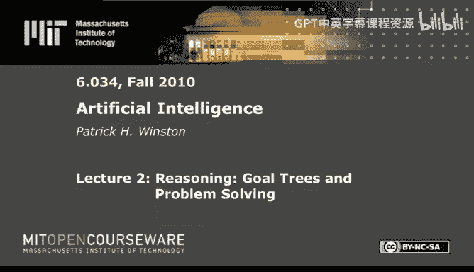
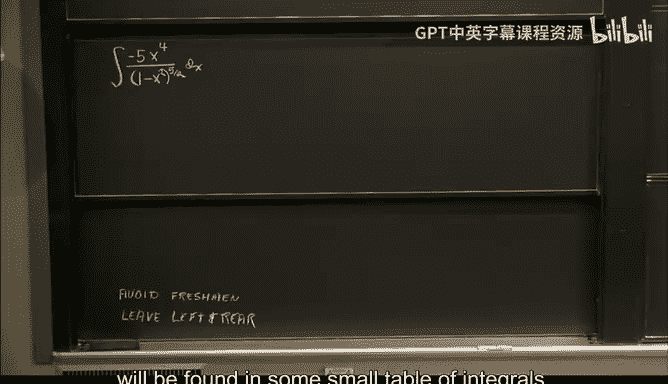
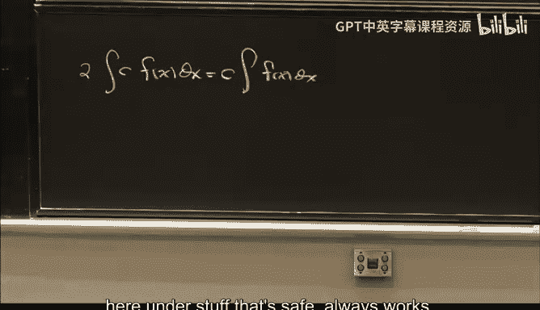
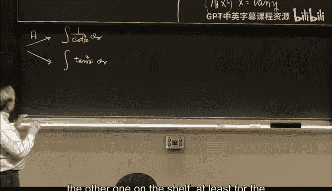

# 《人工智能｜6.034 Artificial Intelligence, Fall 2010》中英字幕 - P2：[02]2. Reasoning_ Goal Trees and Problem Solving.zh_en - GPT中英字幕课程资源 - BV14fqSB2ECY

That's what we're going to talk about today's goals。So just by way of a little warmup exercise。

 I'd like you to look at that integration problem over there。Go on this too。This one has disappeared。

So the question is。Can you do it in your head？Probably not。The question is。

If a program can do that is a program in any sense of the word intelligent。

That's a background task I'd like you to work on。As I talk today。 So today。

 we're going to be modeling a little bit of human problem solving。

 The kind that is required when you do symbolic integration。 Now， you all learned how to do that。

You may not be able to do that particular problem anymore。

 but you all learned how to integrate in high school or 801 or something 1801 or something like that。

The question is， how did you do it and is the problem solving technique that we are trying to model by building a program that does symbolic integration。

 Is that a common kind of。Is that a common kind of description of what people do when they solve problems。

So the answer to the question is， yes， the kind of problem solving you'll see today is like。

 generate and test， which you saw last time。It's a very common kind of problem solving that we all engage in。

 we all engage in it。Without thinking about it， without having a name for it。

But once we get a name for it， we'll get power over it。And they willll be able to deploy it。

 and it' will become a skill。We'll not just witness it。 will not just understand it。

 We'll use it instinctively as a skill。So there you are。 You've got that problem。

 There's your problem。 And what do you do to solve it。I don't know。Look it up in a table。

 You'll never find it in a table because of that minus sign and that 5。

So you're going to have to do something better than that。

So what you're gonna do is what you always do when you see a problem like that。 You try to make。

 you try to apply a transform and make it into a different problem that's easier to solve。

 And eventually， what you hope is。That you'll simplify it sufficiently that the pieces that you've simplified to will be found in some small table of integrals。

So how long is this table。Not the case。 I we're going to look at a table with 388 elements。

 because this is not， this is not a big table of integrals。

 This is what a freshman might have in a freshman's head。Appputtain course and integral calculus。

One of the interesting questions is how many elements have to be in that table to get an A in the course。

We're interested in how much knowledge is involved。 It's one of the。

 it's one of the elements of catechism that I've listed over there that will be part of the gold Star ideas sweet of the day。

So wed like to take that problem。And find a way to make it into another problem。

That's more likely or closer to being found in the table。So what we're going to do is very simple。

 graphically， we're going to take the problem we're given。And convert it into another problem。

It's simpler。And we're going to give that process a name。

 and we're going to call it problem reduction。And so in the world of integral calculus。

There are all sorts of simple methods， simple transformations we can try that will take a hard problem and make it into an easier problem。

And some of these transformations are extremely simple。And always safe。Some of them are just， well。

 let's try it and see what happens。 But some of them are safe。

 And I'd like to make a short list of safe transformations right now。

Now I'm going to be going into some detail。And that detail will be grungy。And the question is。

 why do I do it？ And its educational philosophy is why I do it。So here's the educational philosophy。

At one level， you want to have a skill。But if you're going to have a skill。

 you have to understand it。So if're gonna to have a skill。

 you're gonna have to understand it one level down。 if you're going to understand it。

 you have to have witnessed it。On a level， lower than that。So I'm not going to going to talk about。

The idea of problem reduction because if I were just going to do that。Then we could all go home now。

So I'm going to show you。A particular example of it。 So you understand it better。

 And I'm gonna show you the detail at an even lower level than that。

 So you'll witness the stuff that makes it possible to understand the stuff that makes it possible to build a skill。

So that's why I'm going through the grandy detail。So I don't know， let's see。

Maybe we can get some hints from that example。 but I wonder if somebody could volunteer a simple transformation that always is a good thing to do。

Yes，basian。Take the constants out。Soll make that number two。

And we'll say that the integral of C F of x。DX。Is equal to C times the integral。That's x， Dx。

Other suggestions， yes。What substitution， Tri substitution。 Now this is No， no， that's。

 that's for day two。 We don't do tri substitution here and the stuff that's safe， always works。

 Never any doubt。 There are simpler things。

These are the safe transformations。 What you're giving me is a heuristic transformation。

 Often as helpful doesn't necessarily always work。 We're going to divide our transformations into those two categories。

So I need a safe one。Al。The architects are sitting over there。Divided not only by。Nationality。

 but by course。さのレ。Yeah， some of that some。What's missing， What's number one。

You're probably thinking it's already there。Because you've given me the transformation that involves a constant。

And you can think of minus1 as a constant。But whether you need it a separate transformation or not。

 of course， depends on how you represent the knowledge。And all of this knowledge。

 all of this whole thing is， was written in。Was written in an early form of Lisp。As a consequence。

The way in which  was represented is different from the way -1 is represented。

So we need one more transformation。Rather， Jims Leal needed one more transformation when he wrote his famous integration program。

And that was that if you have the integral of minus f of x。That's equal to minus the integral。Of x。

So that almost completes our safe transformation set。 There's one more that I'm going to supply you。

 because I don't think you'd guess it。 Why should you。 It's number 4。 There are more than this。

This is a sample， and these are the ones we're going to need。

In order to solve that problem by way of illustration。

So the fourth one is that if you have the integral of P of x。Over Q of x。Then you divide。

If you can wait reach way back into high school and figure out how to divide polynomials。

But if the degree of the numerator is greater than the degree of the denominator。

Then it's a knee jerk， always win， you must do it， divide it out。So this then forms the core。

Of an integration program thatll integrate。Almost nothing。But actually。

 almost nothing is integralable anyway。 So it's a good head start。

So let's see how we would put this into some kind of procedure。Some kind of framework。

For deploying the knowledge that we're beginning to develop。What we're going to do is。Apply。Oh。Safe。

Transforms。That's our first step。Then we're going to look in the table。

And then we're going to do a test to see if we're done。And if we are。We report success。

But we're not likely to get done with just that stuff。But you know what。

 there was one transformation up here， which breaks my little diagram。Which one is it？

It's the third one， right？Because this picture。Does not reflect what happens when you apply number 3。

Because it breaks the problem up， not into just one problem， but into a whole bunch。

So we have to extend our。Graphical。Our graphical device for talking about this by a little bit and show what is called an andote。

So we've got a program。Core。We've got a table of integrals。 We've got a few transformations。

We've got an architecture， a way of putting that stuff together。

And now we can try it out on our sample problem。So let's have a go at that。Let's see this one。

Immediately， transforms into。5 x to the fourth over1 minus x squared。To the5。Haves Dx。And that。

 in turn， immediately transforms into the integral。Of x to the fourth， over one minus x squared。

To the five halves。D X。This program， by the way， is a dawn age program。

 This was written by a nearly blind and subsequently completely blind graduate student by the name of James Sgel。

In 1960， a long time ago。The reason I give it to you today is because it is。Because by describing it。

 I'm giving you a one lecture course in artificial intelligence。

He anticipated so much of the subsequent 20 years that talking about his program。

Which is possible in one day， it is a miniature introduction to the whole field。Soleal。

As he was doing this on an antique computer。Almost no memory， almost no speed。

Only slightly faster than。Mice running around on the treadmill。

He was able to write a program that did extremely well when benchmarked against freshmen。And the way。

Where you benchmark against freshmen， of course， is you give it an examination drawn from the previous。

MIT finals for four or five years， the hardest problems。

 and this was the hardest problem that it solved。So at this point with what we've got so far。

 we would be stuck。We have no transformation that can take us。Further。So we need something else。

And what we need by way of something else。There's some transformations that we will describe as。

I don't know， perhaps we'll call them heuristic transformations。

A funny word meaning a method that often works isn't guaranteed to work。

 it's not an algorithm in the usual sense that we talk about algorithms， but rather it's an attempt。

So these things I'm going to talk about now are。Sometimes useful， not always useful。

 sometimes take it into a blind alley， don't always work。

But you can't get an A in calculus without knowing some of it。

So you said some kind of tri substitution， so here is some kind of tri substitution。call this。

Eistic transformation A。You have a function。Sineex。Cosine x。Tangent of x。Cotangent of x。C count of x。

And cosecant of x。And we all know from high school trigonometry that we can rewrite that。As。

A function。Sineex。And cosine X。Or。We can rewrite that as。A function of tangent。Of x and coecant of x。

Or we can rewrite that as。Functional cotangent。Of x and the C gap。Of X。

So that's a transformation from triggonometric form into another trigometric form。

It's not always a good idea， sometimes it helps。Well， that's just part one。

Of our suite of euristic transformations。1。There are。

Others that we need to have in our repertoire in order to solve the problem。One of them。

Ass a family of transformations， which I'll show you only one， it goes like this。

If you have the integral。Of a function。The tangent。Next。Then you can rewrite that as。

The integral of a function。Of why。Over1 plus y squared。DY。

So that's a transformation from a trigoometric form。Into a polynomial form。

So it gets rid of all that trigonometric garbage we don't want to deal with。

And there's a whole family of things like that， just as there is a family of transformations like so。

 but this is enough to give you flavor。Now there's a C that we need as well。And that's going to be。

Your proper knee jerk reaction， you see something of the form1 minus x squared。

What do you do when you see that？Was that Ronna？せ。Well wait a second。

 you could do that if there's another thing you can do。Preally， you got something you could suggest。

Where is our Hungarian？Our turk， our young turk。Yeah我。Iね。Well， let's see。

 cosine squared plussine square rootd was one。嗯。So what's that decision here。

So it suggest that we make a transformation。系包。X呢个。Sign。Why。

So Cilla doesn't actually have to remember that anymore because going forward。

 she will never have to integrate anything。Personally in her life， she can just simulate the program。

Okay。So these go from polynomial form back in the trigonometric form。

So you have three of these heuristic transformations。We've got four safe transformations。

Let's see if we can make any progress on our integration problem。Okay。

 so keeping track of what we've been using。This is。Safe transformation number one。

This is safe transformation number two。What do we do next。

 We decided there were no more safe transformations that apply。

But now you can look at our euristic transformations。And behold。We see。把这。

applying C transformation C suggests that we do x equals the sine y。And now we get the integral。

Of sign。To the fourth y。Over cosine。The fourth y。对外。Right。All good。 I see some confused， worried。

 concerned looks。Maybe I've made a mistake。Perhaps I should use notes。Well， no， wait a minute。

For those of you who have a concerned look。Remember that。If x equals a sine y and dx。

Is equal to cosine y。DY， that's why it's cosine to the fourth， not cosine to the fifth。As you were。

 perhaps。Thinking it might be。So now we made some progress。Let me look at this。We say。

 are there any safe transformations that apply， the answer is no。

Now we look for heuristic transformation that might apply。And I said， what do you see， which one？

What's。She said something unintelligible over she probably said， is it this？

Looks like a pattern that might match with the aurrisistic transformation。哎， right。

Because we have a function in which the variable is buried universally in sine or cosines or tangents or cotents or sequences or co sequences。

And we know we can rewrite that in one of three ways。It's already written。

As a function of sine and cosine。But we can also rewrite that in terms of tangent and coec。

Or coat tangent and Sekin。So when we do that。You can go this way。I you can get the integral。

One over the coat tangent。Of x， Ex。That's G2 up there， no， that's G3 up there。

Or we can do it now on this path and get the integral。Of tangangent。Of X， Dx。And of course。

 those are both to the fourth。But know what， I've broken my little graphical diagram again。

 where did it go， it's disappeared。Yeah there it is， how have I broken it？Because。

With transformation。A。I've introduced a possibility。

That a particular problem can be transformed in more than one kind of problem， any of which。

Will be the solution to my problem？So so far I've got an an node。

 but now I've got to introduce an or node。Because now we have an example of something can be solved one of two different ways we don't care which one of this。

Now you'll notice if there's already some confusion here because how can you tell difference between be an N note an or note？

So， the Univers convention。And you draw an arc over the end noteses。And that makes it look like an A。

 so it's easy to remember。So those are an nodes and now。We have the method of problem reduction。

And this is sometimes called a problem reduction tree。Sometimes it's called an and or tree。

And sometimes it's called the gold tree。Because this tree of problems。

Hes a tree that shows how our goals are all related to one another。

These's are items for your vocabulary that are all synonymous， problem reduction tree and or tree。

 gu tree， all the same thing。Now you have a name for it， you've got some power over it。

So we'll get a situation like this。Unlike the previous situation。

Which we suggested might come up and。Transformation A。Let's see， we got 1，2， C。And this one is a。

It's an or node， which one of these problems are we working on？Well Sgel。

 who considered himself to be modeling the intelligence of a freshman。

Moodeelling something that after all， you have to be。Pretty smart to do， right？I mean。

 most people don't know how to do integration。Everybody at MIT knows how to do integration。

You would think that somebody therefore that knows how to do integration is pretty smart。

What would a smart person do when faced with his choice？Well， a smart person would say。

 whichch of these two problems is easier？So how do you think you might determine which of two or many algebraic expressions is the easiest。

To integrate。不是。And不没。没有。Yeah。I would you feel it？必要。Which one I feel of the tent。Yeah。

 but I wonder how we can make a little bit more precise in this idea of simplicity。啊。

The other term has a suggestion。I have a suggestion。And so you said。Idea of simplicity。

 so then I realized that what I was about to suggest。ませけど。Clarifies simplicity。

Whichever one we've had。Chaes withor。Yeah， if there was something here with the hyperbolic tangent。

 you might say， well， stay away from that。系嘢咧。To which one of those。

 the easier transformation we explain in the next step。

Which world you might do a little looking at and see which kind of thing would be next to you。

 I don't know。系到时你。第二个他要。どござ。所咁 think我 something something is in。that but this is tangible to report。

 so that's not。There you。I choose them on that to reciprocal。喂。

Its because when people see one I like， oh man。Yeah。Yeah， we're on the right track， Claire。

On an extremely simple level， I chooseever one。そ。A few symbols in it now arere ridiggate somewhere because you can measure that。

 right， the little program。在个。W bread there you are。

I would say I mean every other American version can sort be written。All上 go together by。Well。

I heard it perhaps others didn't， but what Brett said is to he suggested is that we should measure the depth of functional composition。

So the number of symbols may not matter because if you had x plus x plus x plus x to100 out to 100。

That would not be hard to integrate。But if you've got something that's really deep。

 deeply nest there a lot of functional composition， that could be a problem。And that's， in fact。

 what Slal decided to use after trying several alternatives。

So if we measure the depth of functional composition。This is the winner。

And we put the other one on the shelf， at least for the moment。

And now we have tangent to the fourth X， Dx， do any of the safe transformation supply？

啊。Which of the you know something has to apply， otherwise it wouldn't be up here as an example。

 so what are the heuristic transformations supply Elliot？电费干吧，老费贷看。They P airplane。Okay， so B says。

It is in fact a function of the tangent。And when we do that。

 we've got to make a substitution that y is equal to attention。So that means that this becomes。

The integral。Of why。To the fourth。Overumber one plus。Yhy squared。And that's by transformation B。

And the transformation is why。Equals tangent。Of x。Tentent， I guess I've。

lost track of the fact that I've already transformed a why but。Relabel it doesn't matter。All right。

 so that's progress， maybe。But。Don't see this in any of the euristic transformations。

 what do I do now？I didn't have to look into US transformations because one of the safe transformations applies。

Because this thing is a。Raxual function。And the degree of the numerator。

 it's greater than the degree the denominator。So I have to divide。And when I divide， and that。

 by the way， is number four。I get what， is anybody good at high school algebra。

 can help me out with that？I I swear my to plus negative to what this West。

Exactly minus squared minus-1 plus。1 over one plus y squared。I think。Now what。

Now we're really getting close to getting through this。Because that。These are sum。

And virtue the fact that it's a sum。That divides into three pieces。

And the top piece is the integral of y squared。The middle piece is the integral of minus1 and the bottom piece is the integral of 1 over1 plus y squared。

DY， in all cases。Gosh， if I looked this up， I found it。Right。That's up there。

 that's number B or letter B。怎在不在啊。This one I can transform again by virtue of one。

And now I get the interval。Of DY。That's in there。That's me as well。And this one。I don't know。

And I better keep track of what I'm doing here， this is an endn， so I've got to do all of those。

 I can't get up on that last thing。And that end transformation is transformation number three。

So this is in the table， this is in the table。We still have this to do。But that's。See。

Earistic transformation C， we have one plus。Y squared then with a transformation。C with。Why。

That's why squared。Y equals。Tangent。Of Z。Then we get to the integral of Dz。

And that's in the table and we're done。So now we。Solve the problem。

 it's the hardest problem that appeared in that half decade on MIT 1801 finals。

This is exactly the problem was given。Except that it started here。

I put the other two pieces on just illustrate a couple of the transformations。But that's。

A problem that is solved。And now that we've seen in the example， we can finish up。

What we talked about a little bit ago， having to do with the。Architecture of this thing。So far。

 all we've done is talk about the safe transformations， but now we know that if we're not done。

We need to find a problem to work on。Using that depth of functional composition business。

And then after that。We apply。Euristic transformation。And the way Lago designed his program is。

He found just one problem to work on， did one transformation， then went back around a loop。

Because these heuristic transformation is a little harder to apply than the safe ones。

So I've given you an accurate portrayal of what this program did， except for one thing。

Which I would like now to go back and patch up。And that thing is over here。嗯。You know。

 what to do with？Something like。This。Well， we got to that。In a board that's disappeared。

 but when we tried to deal with this， we had to find a heuristic transformation。

And when we decided to work on this， it must have been the case that this was the simplest problem at the leaf node。

 at a leaf node that has not yet been solved。So what's the functional composition depth of this？

It's three。Back over here， we have something that has a depth of functional composition of two。

So when the program actually ran on this particular problem。

It stopped a few inches short of the finish line。And went back and screwed around with another problem for a little bit before it gave up。

And came back here。So it's always looking across the whole tree， the leaves of the tree。

 whenever it has to find a place to work on with the euristic transformation。

 it happened to look at all the leaves of the tree that had not yet been dealt with。

Tried to find the easiest one， and that could involve a lot of backing up and starting over on a branch of the tree that had previously ignored a small detail。

 not a particularly important one。Now， where are we。 We've got the。We got that guy there。

 we got our complete。Architecture。We've got our solves problem。

And now we can start reflecting on what we've done。We can say， for example。

 how good an integration program is this？And the answer is， it was pretty good。

This machine that Sgo is using。Machine it was over in building 26。

 and we were so proud of it that was behind glass and you could go there and watch the tape spin。

 It was really a delight， 32K of memory。😊，That's 32 k of memory。

It's amazing that he was able to do anything with a machine of that size。Let's see。Yes。

 here's a clean one。Well嗯。Can't do board geometry and talk at the same time。

We can now ask some questions。About how well the program performed it was given。

56 of the hardest problems。 and it got 54 right。What happened when it didn't get the other two？Well。

 you might be right if you said it all， it probably ran out of memory since it had 32K， but in fact。

 it just was lacking two transformations。That were needed in order to solve the whole entire set of。

Final quiz problems。So it。When a program fails is often the most interesting question you can ask。

This is an exception。 This failed for uninteresting reasons on two of the 56 problems that it was given to。

Now your next question you can say is。What is the depth？Of the tree， in the maximal case。

And the answer is， it' that case we just worked out。And since Ive once again lost the whole tree。

 I'll tell you that the step was seven when you take off that minus5。So in the worst case。

 this thing had to go down seven levels。That's the worst case。

 the more interesting question is what was the average depth？And that was。Approximately 3。

And now we're beginning to say something。Not only about Sgel's model of how a freshman works。

But we're beginning to say something about the nature of the domain。

In the domain of calculus problems。Inteeggrable expressions that are given to freshmen in that domain。

 the average depth。Of。Problem reduction needed to solve the problem three。

That says not very complicated。If we were 10， you'd say， wow， how can anybody ever do those problems？

If it were five， you'd say， well。Only people destin be math professors are going to get anything right。

But three， us mortals can do a pretty good job。Another question of even greater interest is how many？

Rrananches were unused。Here here's a branch that turned out to be unused。Didn't pursue that。

And so you might say， well。Maybe there are a lot of unused branches。

 maybe you have to be pretty smart about your。Your method for determining what problem to work on。

 because otherwise you'll go down a lot of rat holes。And guess what。

 Here's another statement about the domain。In the domain。

Of problems that freshmen can work on a final。The number of unused branches。Hes about one。

So that means this tree kind of keeps itself together and doesn't run down to a very large， bushy。

 useless tree。So this means that the depth of functional composition。Which Brett suggested as it。

Technique for're recognizing the right problem to work on。ItWas a choice that didn't actually matter。

Because the tree doesn't。Grow deep， it doesn't grow broad。

 it doesn't matter what you use to decide what to work on， because in the worst case。

 you'll just generate a couple of extra。Useless nodes， but they very quickly run to run to dead ends。

 And you don't have to do anything more women。So now the next thing we need to do is back even further away from this program。

And ask ourselves some questions。About the nature of what we've been doing。

 and that brings me to the things I've got on that upper right hand board。

One of those things is a catechism having to do with knowledge。

And what we've done informally as we went through this program was we've asked questions such as。

What kind of knowledge is involved in doing this？Well， knowledge about transformation。

Knowledge about how gold trees work and when we're done with a problem。

Knowledge about what things don't need to be transformed because you can look them up in a table。

That's the kind of knowledge that is involved in doing 1801。And if you do 180 circuit theory。

60 circuit theory or 60 Maxwell's equations， it's the same thing。

 You have to ask questions of this sort。About the nature of the knowledge involved。

 And question number one is always， what kind of knowledge is involved。 I it Koffs laws。

 Maxwell's equations， What is it。The next question is， how is the knowledge represented？

And our answers here are， well all of this stuff ultimately was represented in listsp best expressions。

Some of the knowledge was recorded in a table of S expressions that show what transformations there are。

There was a similar table of integrals。Knowledge about gold trees was。Embbedded in a procedure。

 so it was procedurally represented。And so for each of the categories of knowledge。

 there's a way it gets represented。How is it used？Straightforward。

 transformations are used to make the problem simpler。

 the table is used to trim off and completely to serve as the bottom of the tree。

Those are the ways in which the knowledge is used。And。Then there's a question， of course。

 of how much knowledge is required。Something that' useful to know'。If it's late at night。

 you have two finals the next day and you're not sure which course you should study。

So how much knowledge might you suppose was actually in this program？I've shown you a glimpse of。

The kind of knowledge thats involved in the program I've answered a little bit of question 5。

 what exactly。But how much knowledge was involved， you might be surprised by the answer。First of all。

 the table of integrals。I've listed only three things there。

There are lots of other things you can think of， like integral v to the x is e to the x。

But in the end。What Lego found as a table of only 26 elements was enough to solve all of these problems。

How about the。Transforms here the safe ones。Not 12。How about the heuristic ones？About 12。

So just a little few bits of pieces of knowledge here and there are sufficient to do everything you need to do in order to do the integration problems on a calculus final。

 that was a surprise。Another surprise of a similar kind， also about knowledge。

 is that the relationship between the method。To be used and the characteristics of the problem was almost a diagonal table。

That means that you could in this domain。Make the right transformation almost all the time if you're a little bit smart and never back up。

That was an observation made by。Joel Moses， who became subsequently our provost here at MIT for a while。

 and he wrote a program that could solve anything， even it would beat the most dedicated mathematicians at integration。

And if's the sentences are in MATLb today。But this is how it all works。

 and now you can write one of these things yourself， partly because you now have this catechism。

This is the kind of stuff you should ask anytime you're dealing with a new domain。

 it will make you smarter。And this is， of course， meta knowledge， this is knowledge about knowledge。

So this tired aphorism。Isn't quite what we are going to complete ourselves with。

 We're going to say that knowledge。About knowledge。Is where the real power is。

Now there's one final thing that this program does for us。

It tells us something about our appreciation of what it means to be intelligent。

 You know that in the beginning of this hour。I ask you to think about whether。

A program that could do symbolic integration。Would be in any way。W should be considered。

 to any degree， intelligent。And I'm imagining。That even in the day in these days of Mattlab and whatnot。

 many of you said， well， yes。Kearn how to do that at MIT or lateton high school， so it must be smart。

But now that we've completed this discussion。I also expect。

That your feeling of intelligence in this program is somewhat diminished。

Because what happens is that when we understand how something works。

 its intelligence seems to vanish。 And you've seen this in your friends， right？They solve some- well。

 no， they solve some problem。They seem super smart。

 then they tell you how they did it and they don't seem so smart anymore。So， let me conclude the。

Let's conclude our discussion today with a little story， I was once a long time ago。

I was talking with a student who said。Computers cannot be intelligent。And I said， okay。

Maybe you're right， but let me show you this program。

So I showed the integration program working on problems like this。And after。

I showed them a couple of those examples says， well， all right。

 I guess maybe they can be intelligent。'm learning how to do that， it's not always easy。

Then I made a fatal mistake。I said， let me show you how it works。

And we spent an hour going through it like this。And at the end of that time。

 he turned to me and said。I take it back， it's not intelligent， after all。

 it does integration the same way I do。

