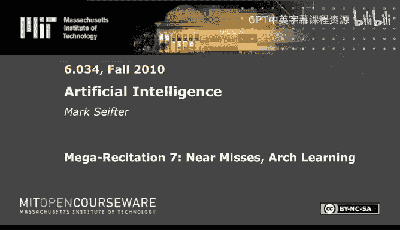
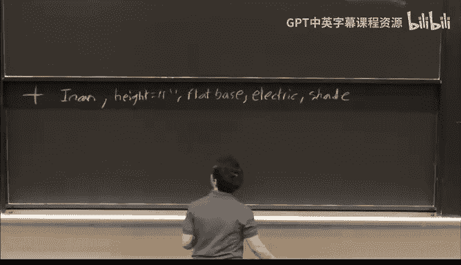

# 《人工智能｜6.034 Artificial Intelligence, Fall 2010》中英字幕 - P30：[30]Mega-R7. Near Misses, Arch Learning.zh_en - GPT中英字幕课程资源 - BV14fqSB2ECY

The following content is provided under a creative Commons license。

 Your support will help M T Open Coware continue to offer high quality educational resources for free。

To make a donation or view additional materials from hundreds of M T courses。

 visit M T OpenCourseware at O C W。t M I Tt Eduu。

Here we have a near mis learninging tree。 It's a little bit different， but a little bit similar。

 We've got different types of。 we're trying to learn about different light sources。

 So well we're sort about luent lamps， flashlights， all sorts of things。

 So these guys can have types of support， a base or wires。The base can be flat， clamped or have legs。

 The legs can be flat bottomed or wheeled。 The light source can be incandescent。

 fluorescent or sodium vapor， and the energy source that powers it can be electric， battery。

 oil or gas。So there's also some other things， but these are the trees。

That we might be climbing up with the climb tree here stick。

Our starting model is we have an incandescent bulb， the height is equal to 24 inches exactly。

 They have a flat base， There's electricity to power it， and it has a shade。So our。

 our starting model。Its basically。Like a table lamp that you set on the table。 It's got， you know。

 the shade over top of it。 you know， the standard roomroom table lamp is our starting model。

 So recall in in arch learning， which is what we are。Using here。

 there are several heuristics that we might want to use。Let's see。Well， the heuristics are。嗯。

Let's see， we've got。We require link。Forbi link。We've got climb tree。Extends that。Close interval。And。

We also have。We also have drop link， forgot about that one。

 that's sort of with the links so I can put it here。Okay， so。

If you want to do well on these questions， if they appear on the final。First of all。

 you better know what those six heuristics do。So。Basically。Require Li。Is a。

Heuristic it goes into your model and it as a requirement where before your model just didn't care。

So let's say there was something about color for your light， for your lamp's base or for the lamp。

 And right now， it doesn't care about color at all。

 But let's say that you wound up having an example that was。For instance。

 blue or white or whatever these colors are and。It's it and it wound up it wound up getting that blue was okay for a。

For。In its model wound up getting okay， blue and white or okay。 And then it， or actually， no。

 an even more basic example。 Let's say that it just kept getting blue lamps。As examples。

 and all of them were blue。 And it just didn't care about the fact that they were blue。

 but they didn' turn out to be blue。And then eventually。

 it found a red one that was exactly the same as its model， but the red one was a near miss。

Then it might require blue， which was。Already an acceptable， permissible thing in his model。

 but it could be required。Now， another thing you can do is forbid。 Some people ask me。

 why would you bother saying forbid red， say if you could already just require blue？

Like together they they cover the same ground。 The answer is because this system。

 this arts learning system。 remember， Patrick's doctoral thesis， is an old system。

 this is very because it was builted on old systems and because also it's generally a good idea。

 it was very parsimonious。If let's say you had a set of colors， red， blue， yellow， green， pink。

 purple， orange。And。You found that only orange was giving you problems。

 You could try to to require that it be in， in。Or you could even use extend set make a giant set of red。

 blue， yellow， green， purple， orange， but sorry purple pink， but not orange。

 but if you just forbid orange， you've just saved a whole bunch of space。

Particularly if there's a large possible series of set。

 you want to have the ability to forbid because it needs to have the smallest bottle that it can that covers all of its samples。

So。We also have climb tree。 Clmb tree takes。One of the elements in our model and moves up the tree 1 level。

To be， you know， so let's say we only， we said only incandescent lights are good。

 but we found that fluorescent lights are also good。 Whoop， we move up to light source Cl tree。😊。

Extend set。We don't have any sets here， but let's go back to red， blue， orange yellowello。

Extend set is when we say only red is good as an example。

 but we see another positive example that's yellow。 So they say， okay， I'll extend the set。

 red and yellow are both good。All right。Clloose interval。

 Close interval is really obvious when you need to use it。

 because not only is it only used for intervals like height equals 24 inches or some kind of numbers。

 but it is the only thing you can use for for when height equals some kind of numbers。

 Close interval will let you fuss around with the intervals and say， oh， well。

 I guess one with a 20"20" height is okay， too， So well make the whole interval 20 to 24 inches is good because it doesn't make any sense for be like 20 is good 24 is good。

 but nothing in between is good。 No， those are awful。

 So that close interval covers the entire interval。 Last but not least is drop link。嗯。

The thing about droplink。Is that drop link is is again。

 only really used due to the fact that the system wants to be as parsimonious as possible with its model。

 Drop link is， let's say that you have a。Color， and you're like， okay， only red is acceptable。

 And then you see a blue one。 It's okay。 And let's say red， blue， and yellow， your only colors。

 Only red and blue is acceptable。 wait a minute。 No。

 we could just say that only yellow is not acceptable or something like that。 right。

 but then you see yellow as a positive example。Actually。

 you can't even switch to the yellow being not acceptable because you've only seen positive red and blue。

 So you say only red and blue are acceptable。Quson。if we had seen anycandesant， flu usa is it。

You can climb treat to light source。We don see one that sodium vapor says street。

Do we have to go back down the tree or do we just have a that havebid question is we fluorescent to light source？

When we see studying vapor， what do we do， the answer is our system， unlike with lattice learning。

In arch learning， our system is memoryless of its previous examples。

 It's incapable of going back down the tree。 And so if you go see incandescent fluorescent climb to light source。

 your only recourse， if you see that sodium vapor doesn't work， is to forbid link Sodium vapor。

 That's a good question。 It shows good understanding of how we work。

 So drop link is you see red and blue， they both are okay， you don't know about yellow。

 So you can't just switch that to a forbid link to yellow。 But then you see yellow is also okay。😊。

What do you do。You can drop the link altogether together。 saveve yourself space。 You don't。

 if all the colors that you have in the entire world are fine。

 you can just not have part of your model be the color and just say any color is fine。

 Color must not be really part of what defines a lamp。And Id say it's not。 I mean。

 it's what defines a tacky lamp， I guess， but it's not what defines a lamp。So I mean。

 that might be why color isn't here to begin with。 So to make yourselve do better on this。

 more knowledge equals less search。 Let's have more knowledge。

There's only some of these are used to generalize to make our model more accepting of。

 of new examples。 And those are ones we would use after we've seen a positive hit。Sort of generalize。

 learn more things in the model。 Some of these are used to specialize and make our model refine it。

 Make our model more specific。 You'd only use those after you saw near myth。

 So let's actually separate those that way you guys will never make the mistake of using one of these in the wrong situation and more knowledge。

 less search and less search means faster quiz time。 So require link。

 What you guys think is that a specializer or generalizer。Specializer， that's right。

 We'd only use it when we saw a near miss。Forbilink， specializer or generalizer。Specializer。

 we'd only need forbid something if we saw a miss。Climb trees， specializer or generalizer。

Generalize it。 That's right。 We'd only climb up to a more generic thing in the tree if we saw a positive example。

 extend set。Generalizer， we'd only extend to the things in our set。 We saw a positive example。

 close interval。That's a generalizer。 We'd only make the interval bigger。If we saw。

A if we saw a positive example， someone asks， what do you do if you have like 10 to 30。

And then you find a negative example in 20。It's pretty。

 it's generally pretty annoying for the system to have to deal with that。

 There's a variety of things you could do based on your implementation。 I've never seen us ask it in。

 in a quiz。But one thing you could do is for bidd 20。

 exactly just 20 and just just have a little hole at at exactly 20。So then droplet。

 specializer or generalizer。Generalizeizer， this one's an easy one to mess up if you don't understand the system because dropping。

 you think， oh， getting rid of something， that's special。 And actually no。

 you're generalizing the entire area saying we can forget about it because they're all good。Allright。

 so given that， we are set to do this problem。Hey， we have a pretty reasonable amount of time。

 considering that we don't have to do S。 It's great。 So our first example is。😊。

A sortr of one of those stand reading lights that you sort of have it on the stand and you can like adjust the little light bulb up or down。

 It is an。It's an incandescent bulb。It is a height。诶。11 inches。And it's got a flat base。Is electric。

It's got a shade。And it's a hit。It's a hit， a positive example， plus。It's good。 So right away。

 we know that we can only use the s's or the G's。The Gs， we can only use the Gs because it's a hit。

 So we're not going to be requiring。 We're not going to be forbidding today。

 We're going to be happy and using a generalizer， so。I'll help do the first one。

 You guys will help me do the next one， Or someone can say we didn't cover this。

 and I'll do all of them。 but I'll do the first one， and we'll stop。

 But so we've got an inquicent light。 That's the same as our model。

We， we've got a height of 11 inches oh。 Our model only covers 24。 Fl paste。

 That's the same as our model， electricitylectity， Sam as our model， shade， same as our model。

 So I say the only difference is the height。 I say we need to close the interval。😊，Close interval。

And I say that our model is。Model。Is same as before， except for that。系。E is an element of。11 to 24。哎。

Simple enough。I picked the easy one for myself。Next one。So。This one is。Going to be a A。Yeah。

 this one is going to be the picture here didn't turn out。

 but it's basically a lamp that doesn't have a shade。

 It just sort of has the light sort of shining shining on you。 So it is a positive example。It's。

Incandescent。Height equals 11。5。Ft base。And electricity。爱 so。First of all。

 which kind would we use specializing or generalizing？Generalizing and particularly。

Anyone want to take a look at our model， which is the starting model。

 except for that the height can go 11 to 24。W heuristic do we even need to use here？All right。

 so people are all saying droplink。Guess， that's right。Someone said extend set。 Well。

 I suppose we could extend the set to shade or not shade， but that's everything。

 So drop link is the answer。 We can drop the shade shade or not shade or not。This is still。

Pretty much a lamb。So that's correct， we drop link。So， the model。All right。

 there's been enough changes to it。 that I think I'll write it out again。 The model is incandescent。

Incandescent。Height equals。Or an element from 11 to 24。And flat base and electricity。Good。十。关系。や。

So the question we're adding the model based on the order of the examples is this slide。

There's like the same thing。So the same thing。Except for。

Itcept for that there's one that's the same with no shades and is is a。

 is a near miss or something so that you need to， or， or I'm sorry， you're saying。

 what if there's one that has a shade now。That's a near miss。

 And so it would probablyably try to forbid link shades。That's sort of the question。 or you're right。

 The system is。That's an inconsistency in the data。 The system is very fragile。

 It's very fragile to ordering， in particular。And。I mean。

 you'd be surprised how awesome this this does， considering that it was made in like the 60s。Like。

 it's pretty impressive stuff， but iss old。 We're not saying that this is a way that you should do all of your learning nowadays because it has some serious issues。

But it's， it's old， but it's pretty damn good for what it did。

 A newer style of this kind of learning made by me and another friend who's now working at Google is lattice learning。

 which has its own share of issues， one of which is that since it's trying to act like a little kid at first。

 it tries to clean that everything is okay until you show it some good negative examples。

But very particularly one way it gets around this problem is it's not memoryless。 It， in fact。

 stores all of the examples it's ever seen and compares and contrasts them to what it sees in the new in the new example。

 And this allows it to say something like， let's tell you trying to teach it what can fly in lattice learning。

 you say， all right， while Blue Jay can fly。 It's like， and then if you ask it， can a cow fly。 Sure。

 cow jumped over the moon， everything can fly。 So that's its problem。 if you say。

 actually that was a nurse do rhymeic cow cannot， in fact， fly。 It will then say only birds can fly。

😊，Because it remembers that the Blue Jay can fly。And then you can eventually say， well。

 actually bats can fly。 fruit bat can fly。 okay， so chiopters can fly and birds can fly but that's it。

 And you can give it some other examples， but。There are other styles of learning。

 You're absolutely right。 In fact， if there's a multiple choice asking you about like the strengths and weaknesses of arch learning。

 one of the weaknesses， it's very vulnerable to ordering of what you teach it。

 it can learn but think about it。 if our first example was one that's exactly the same as this。

 but with a with a shade and it was a miss， the system would just yell at you。

 Like you're kind of being an asshole to it to give it two things that are inconsistent。

 you might say in the real world that happens。 Well， arch learning。

Not great with real world messy data。 It just， it goes ballistic。 It's very OCD。

 It wants everything to match up。 If it gets two things that are inconsistent。

 it'll just yell at you。 It's like， you're wrong。 This this can't be true because you said it's okay with the shade。

So that's a very good question， another question。他最胞だ。等于。Then个 morning。And it's a near miss。

 it's not a near miss。 The question have several of two different things in the model。

 And it's a near miss。 And I'm sorry to cut you off。 based on timing。

 I'm just going to say whatever you said afterwards doesn't apply due to the fact at that point。

 it's not a near miss。 It's very important。 It's only a near miss if there's only one change。

 Otherwise， it's just a miss。 And if it's a miss with more than one change。

 youre probably going say how you know what to change。

 The answer is you can't change anything because any of them could have been what was wrong。

 That's why for a hit， oh， it can have as many differences as you want。

 You'll just generalize them all for a miss， it can only have one thing different。 In fact。

 there might be one here that's not a near miss and you just say， oh， we don't do anything。

 We'll keep going。 we might see it if we have time。 So question。Orordering is。第三就。

thingAnd you encounter a item which has。呃。But is mentioned but if the ordering were different。

 such that would be accountable。Like， do you ever return back to that？So the question is。

 let's say you how nonmed this。Can you hold onto to it and use it later when it would be a near miss。

 This a notepe。If we're going here for a system that doesn't remember things。

You can put in some clutchs。 That definitely makes it smarter。 It uses alls data。

 But we went Patrick in the 60s making this up Str for elegance。 And the elegant solution is。

 let's just be memoryless completely。 The idea being， well。

 little babies don't can't tell you every experience they had with playing with blogs with an arch。

 So let's remember nothing。😊，With lattice learning。

 our idea is that people sort of somewhere in the subconscious maybe do store all the examples。

 or at least a lot more than you give them credit for。 So why not store them。 But with arch learning。

 It's little babies can't tell you。 Oh， yeah， there's that one time I played with a block or I played with a lamp。

 And it didn't have a shade。 And so it wasn't a lamp or something like that。

 They're not gonna to be able to store it。 They're not gonna be able to save it for later。 It really。

 really sort of in the style of Tring， who believed the human would be a teacher to a computer。

 arch learning， really。Focus is on the fact that the human is a kind and good teacher who offers examples that are exactly appropriate at the time。

And that puts a lot of pressure on you as the trainer of a an arch learning system。 Good questions。

 all， let's continue working this guy out。 So the next example is。嗯。

Basically another one of these scan lamps， it's got a light shining down， which is fluorescent。

It looks like this。It's fluorescent。Height equals 13 inches。Flat base。Electric。Shaade。Okay。And yeah。

 as I put here， it's a hit。So。As you guys have told me countless times。

 so I believe that you remember， we're going to generalize for the hit。So。What should we do here？

So some people are staying extend set。The people who are saying climb tree are correct。

Why do we concentrate instead sense set because of the fact that。It's a tree。 said， and。

It is more parsimonious to climb the tree than it is to treat it as a set and extend the set。

Seets don't have a hierarchy。 It's just like red come blue come yellow or shade come not shade。

Whenever you have a tree， it's a fact that it's more parsimonious to just climb it than it is to treat it as a certain extent。

 even though you could do that， I suppose and。Arts learning， it's parsimonious， It's elegant。

 It's simple。 And the elegant thing to do just climb up。 So， yes， we're going to climb up the tree。😊。

So our model is same as last time。😡，Sas last time， except that this time it has a light source instead of。

It has light stores instead of saying incandescent， It just climbed out to light source。 Sure。

 all right。So the next one is pretty cool， it's another one of those fluorescent shine down lamps。

 but in space it has like a tripod with three legs and those legs all have wheels。So。

It is also a hit。So， it is。Fluorescent。Height equals。14。Andches。Wheeld legs。And electric。So。

Obviously， we're generalizing what heresistic we use this time。Climb tree again。 That's right。

 We're gonna climb from flat base。To base support itself。Because wheeled legs and flat base。

Base support is an ancestor of both。So。Our model is the same as before。

But this point has changed enough that I might as well write it out。So we'll say that it is。

Light source。系。Between。11， 24 inches。Bace support。Some sort of support。And electric。Awesome， now。

H on， parody？No， back up you。There we go。That down there， don't get confused。

 that down there is our most recent model。We now have。哦。Oops。He he。Okay。

 I actually missed one of the examples。However， we were actually completely correct， which gives way。

Quite a lot。 We had。A miss。Incandescent bulb。Back in the old days。

 when incandescent was the only kind of light we had。はい。Equals。60 inches。

Flat back in the old days when flat was the only one we had。Electric。Back in the old days。

 when we had electric， and we also have shade after we've dropped the length for shade。

 So we know that shade or not shade are both okay。十。The question is。What do we do。First of all。

 do we specialize or generalize with this miss。So obviously we're only going to be able to require our for bidd。

So。Standardly， traditionally， the answer would be nothing。However。

 we accepted as sayingane the possibility that you might。Put a require onto the height。

 Some students did that， like， say。Oh gosh， that's， that's a hard set，11 to 24。

 but that's not what you would normally do。 So just to show that we tried to understand that there might be multiple ideas in a weird situation。

 We did get accept that that one time。 But generally。

 there's not anything you have to do this the system at the time。 And still now said 11 to 24。

This is spookly exactly the correct place where this example would go。

 But you don't have to do anything to the model。 You don't have to use any heuristics。 Okay。

 so last step。The question is， oh， your question。Like if we did it in this particular quarter。

We have it next。O。It only the first。5万。での。No， if you first by a lot。

 it actually would be an air if we did not， it would be an air。😊，No incandescent in。

Different than light source。 Height is different than heightight。 Fl is different than base support。

So it would differ by a huge number and it would not be there here's a question。

Even though on the tree incandescent is a child is a。A child branching off with light source。

If we instead encountered a because our current model says like source comma what？

Instead we got a native thing that said。Lorescence， again。

 would that be considered not an near miss because fluorcent differ from what source？啊。

So the question is， would it not be considered a near miss？If you had。

 say fluorescent and rather than light source， because fluorescent differs from light source。

So the answer there is。Since's memoryless， it doesn't know that。Well sure。 it is memoryless。

 It doesn't know that fluorescent used to be a positive example before。 Unfortunately。

 let's say we did have an example that was fluorescent height is an element of 11 to 24 base support electric。

 Like actually， let's say we have on the sodium vapor height is 13。Sodium vapor heightight is 13。

 base support。 For some reason， it was。 It was called base support and electric。 That's possible。

 right， We haven't seen a positive that sodium vapor。 Let's say that sodium vapor was not allowed。

If we don't say that that's in near mist and then forbidling sodium vapor。

 how are we ever going to get rid of soium vapor。Unfortunately， because of that， we lose some。

 we lose some amount of expressiveness。 Its is actually。

You what you're saying is very logical and makes sense that you would want to have the ability to say。

 okay， this is a subset， this should be okay。 But unfortunately。

 because of the fact we climb the tree， even when we haven't seen a positive example for all things in the bottom on that tree。

 we actually lose that ability。 It's a trade off。 It's it is。Most certainly。

 a weakness of arch learning that you have pointed out here。 Lat learning fixes that。

 but it has its own， it has its own problems。So you're right that you'd want to be able to do that。

 but you can't because it's memoryless。 So last but not least。

Which model would we present in order to teach？😡，The system right now from its final system that a lamp requires a base support。

 so we need to be require link for the base support， so really fast。😡。

Incandescent bulb with a height of six of flat base in electricity。Would that do it。

 incandescent ball with the height of eight and a battery。Incandescent ball with a height of 12。

 wire support and electricity， oh yeah， by the way， this will have to be amiss to teach require。😡。

Fluorescent bulb height of 21 clamp base in electricity or incandescent bulb height of 12 flat bottomed legs in electricity。

So did anyone pick that out over the fast minutes of me saying it because Saway is gonna want to come in and question or answer。

嗯。It's more to have business this， because。Yes， so I know it was fast you can look throughquiz 2007 final because Sa is gonna come in a minute。

 but it would be a miss on the one that was correct on everything except for it was a wire support then the question you have is wait a minute it says incandescent ball that is now a subset of light source you have his question again the answer to that is。

嗯。They must have decide， they must have decided here that that was okay。 But on the other hand。

 how would it learn studying vapor if that， if that wasn't decided to be okay。

 That's gonna to have to be an implementation detail， so。

One thing you can do is try to treat subsets as okay in the logical way because questions may do that。

 and then I guess you've lost the ability to forbid， say sodium vapor。

So you have to lose one or the other。 I think you're definitely okay to ask Ts or someone who's proctoring if a situation like that comes up。

 which implementation detail is chosen， because you could choose either when you're running arch learning。

