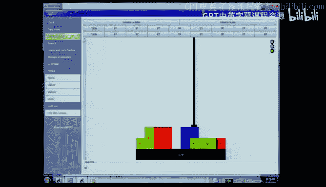
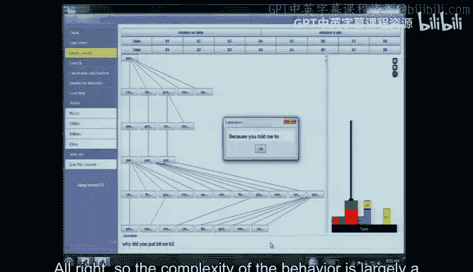
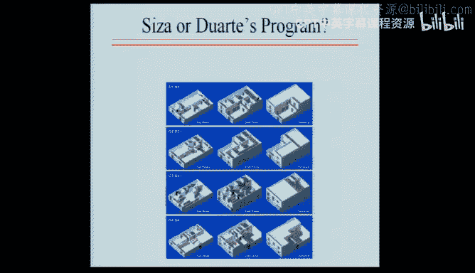
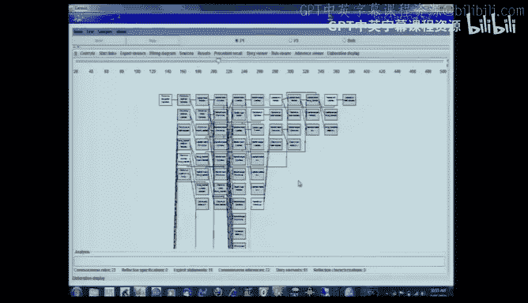
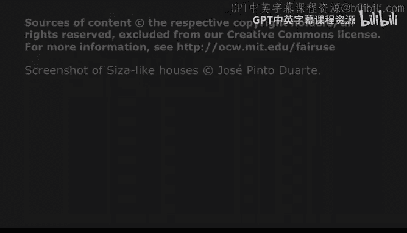

# 《人工智能｜6.034 Artificial Intelligence, Fall 2010》中英字幕 - P3：[03]3. Reasoning_ Goal Trees and Rule-Based Expert Systems.zh_en - GPT中英字幕课程资源 - BV14fqSB2ECY

Ladies and gentlemen， the Engines D song。Back in the day， I've drunk quite a lot to that song。

 and as drinking songs go， it's not bad。I caution you， however。

 before playing this song in the presence of small children。Audition at first。

 some of the verses are sufficiently gross as to make a sailor go beyond blushing。

It's an interesting song because there are an infinite number of verses。

Here's the mathematical proof。Suppose there were a finite number of verses。

Then there would be a last verse。And if there were a last verse。

 then some drunk alumni would compose a new one。Therefore， there is no last first。

 the size is not finite。An infinite number of verses。I play it for you today because I'm an engineer。

 I like to build stuff。I build stuff out of wood， I build stuff out of metal。

 I build stuff out of rocks， and I especially like the write programs。I don't know， sometimes。

People come to me and say I'm majoring in computer science， but I don't like the right programs。

 I've always been mystified by that。I mean， if you want to show how tough you are， you can。

Go bungee jumping or drive a nail through your hand or something like that instead。

But I've written quite a few programs for demonstrating stuff in。In this subject。

They're all written in Java principally because I can therefore make them available to you and to the rest of the world by way of Web start。

A fewew weeks ago， I was monkeynking around with the system。Broke the version on the server。

 and within 15 minutes， I got an email from somebody。

The depths of Anatolia complaining about it and asking me to bring it back up。

This particular program is patterned after。An early AI classic。

And it was the business end of a program written by Terry Winterrad。

Who became and is a professor of computer science at Stanford University。

Which is on the West Coast for these three。On the strength of his work on the natural language front end of this program。

But the natural language part is not what makes it of interest。For us today， it's more of the。

Other kinds of stuff。Let's pile these things up。Now I'm going to ask to do something maybe put。

But B2。On top of B7。Not bad， about B6 on B3。This programs。Kind of clever。Let me do one more。

 let's put B7 on B2。Okay， now let's see maybe B5 on B2。Well， before。On B3 first， maybe。No。

 I must have。Click the wrong button。Now。 okay， let's put that。Let's put B4。On B1。啊。

My mouse keeps getting out of control。Now， let's put B1 on B2。

 This is an example I'm actually going to work out on the board。So。I see。

My touchpa accidentally got activated being1。On B2。Now let's ask a question。Okay。好。Okay。した？

Had enough with that。Let's see， why did you put， why did you want to get read？Of before。Okay， on。

🎼那个那个。So's what happens when you use software you write yourself？Why。Did you want to。

Clear the top of a2。Did I do that。Why did。Clear the top B1。Okay。

Well， it's haunting me， yeah， so the drinking song is easily offended， I guess。

But I won't develop that scenario again， what I wanted to show you is that this program。

Looks like it's kind of smart， and it somehow can answer questions about its own behavior。

 You you ever written a program that's answered questions about its own behavior。Probably not。

 would you like to learn how to do that？So by the end of the hour。

 you'll be able to write this program and many more like it。

That know how to answer questions about their own behavior。

 there have been tens of thousands of such programs written。

 but only by people who know this stuff I'm going to tell you about right now okay。

So what I want to do is I want to start by taking this program apart on the board and talking to you about the modules。

 the subroutines that it contains。So here it is。The first thing we need to think about。

Here are some blocks。What has to happen？If I'm going to put the bottom block on the larger block。

Well， first of all， I have to find space for it。Then I have to grasp the lower block。

 then I have to move it， and I have to ungrasp it。So those are four。

Things I need to do in order to achieve what I want to do。So therefore。

 I know that the put on method。It has four pieces， it has to find space。On the target block。

It has to grasp。The block that has been commanded to move。Then it has to move。

And then it has to ungra。But taking hints from some of the questions that it did answer。

Before I got haunted by the music。Taking our cue from that。

 we know that in order to grasp something in this particular world。

 you can't have anything on top of it。So grasp therefore may call clear top。In order to get stuff。

Off from the target object。And that may happen in an iterative blue because there may be several things on top。

And how do you get rid of stuff well by calling and get rid of？

And that may go around the loop several times。And then。The way you get rid of stuff。

Thiss by calling put on。So that gives us recursion and it's from the recursion that we get a lot of the apparent complexity of the program' of behavior when it solves a problem。

Now， in order to find space， you also have to call get rid of。

So that's where I meant to put this other iterative loop， not down here， clear top。

 it's got the iterative loop inside of it。So that's the structure of the program。

 it's extremely simple。And you might say to me， well。

 how can you get such apparently complex looking behavior out of such a simple program or a legitimate question？

But before we tackle that one head on。I'd like to do a simulation of this program on a very simple blocks problem。

And it's the one。I almost showed you， but it goes like this。Here's B1。

We'll call this Bx because I forgotten its name。Here's byY。And here's B2。And the task is to put。

B1 on B2。And according to our。System diagram that results in four calls to subroutines。

We have to find space。We have to grasp。A one。We have to move。And then we ungras。Now。

 the way we grasp something is the first thing we have to do is。Clear off at top。啊。

Some grass recall clear top。And clear top， in turn， calls get rid of。And let me see。

 let me keep track of these， this is clearing the top of B2 B1。And this is getting rid of Bx。

And the way we get rid of Bx is by putting。The x。On the table。And then。That in turn。

Cause us calls to another fine space， another grasp， another move， another ungraed。

So that's a little trace of the program as it works on this simple problem。

So how does it go about answering the questions that I demonstrated to you a moment ago？

You must do that by using this trace。So， how。For example。Does it answer the question？

Why did you get rid of BX？Masa， what do you think？How can I answer that question？上。

It goes up one level and reports what it sees。So it says and said in the demonstration。

 I got rid of BX because I was trying to clear the top of B1。So if I were to say。

 why did you clear the top of B1？It would say because I was trying to grasp it。However to say。

 why did you grasp B1， I would say because I was putting B1 on B2。If I say， why did you put B1 on B2？

He would say slavishly， because you told me to。Okay， so that's how it deals with why questions。

How about。How questions？Timothy， what do you think about that one？

How would it go about answering a question about how you did something？连发。Yeah。

 I would think about what I was trying to accomplish Yeah， but how would I do that。

 how would the program do that？We know that answering why question makes it go up one level。

How does it answer how question？Sebastian。You go down one level。So。

He start off all the way up here with a put on。We will say， oh， I did these four things。

 you say whyhy did you grasp B one， and we'll say because I was trying to clear its top。

 why did you clear its top because I was trying to get rid of it？

Why were we trying to get rid of it because I was trying to put them on the table？

So that's how it answers how questions。By going down in this tree in this trace of program action。

So as to see how things are put together。What are these things that are being put together？

What's the word I've been avoiding so as to bring this to a crescendo？what are these objectives？

These things it wants to do， their goals。So this thing。Is leaving a trace。Which is a gold tree。

Does that sound familiar？Three days ago， we talked about gold trees in connection with integration。

So this thing is building a gold tree， also known as an andor tree。So this must be an an tree。

And if this is an entry， are there any end notes？Sure， there's one right there。So。

Do you think then that you can answer questions about your own behavior as long as you build an and tree？

Sure。Does this mean that the integration program could answer questions about its own behavior？Sure。

Because they both build gold trees and whatever you've got a gold tree。

 you can answer certain kinds of questions about your own behavior。So， let me see。If， in fact。

 that's if it really does build。Itself。A gold tree as it solves problems。So this time we'll put B6。

On B3。This time。We'll watch it develop its culturally。

So in contrast to the simple example I was working on the board。

This gets to be a pretty complicated goal tree。But I can still answer questions about behavior。

 for example， I could say。Why did you put。B6 on B3。Did you told me to。哎。

So the complexity of the behavior is largely a consequence。

 not of the complexity of the program in this particular case。

 but the building of this giant gold tree is a consequence of the complexity of the problem。

And this our brings us early on to one of the gold star ideas of today。

And this gold star idea goes back to a lecture。Given in the。Late 60s by Herb Simon。

 who was the first Nobel laureate in the Su Nobel Prize for Economics。Is that right， Bob。

 was he the first， he was the first winner of the Nobel Prize， Su Nobel Prize in economics？

And in this lecture， which was a titled Science as the Artial。He said， imagine that you're looking。

On a beach。At the path of an ant。And he said， well， you know。

 the path of the ant looks extremely complicated。 and you're tempted to think the ant is some kind of。

I'm genius or。Ma ant， but in fact， when you take a closer look。What you discover。

Is that there are a bunch of pebbles。On the beach and all the hand is doing。

Is avoiding those pebbles on its way home。So the complexity of the behavior， said Simon。

 is a consequence of the complexity of the environment， not the complexity of the program。

So that's the metaphor of Simon's aunt。And what it says is that the。Complexity of the behavior。

Is the max。Of the complexity。Of the program。And the complexity of the environment。

So that's something we'll see many times during the rest of the semester， Com behavior。

 simple program， you think it's going to be complicated。

 turns out to be simple because the problem has the complexity。Not not the program。

So that brings us to checkbox 3。 in today's talk， there's a little bit of a seame here。

 because now I want to。Stop talking about。Goal centered programming and start talking about。

Rule based expert systems。The rule based expert systems。We're developed。In a burst of。

Enthusiasm about the prospects for commercial applications of artificial intelligence。

In the mid-1980s。And at that time， it was supposed。Lengthy articles are written。

That you could account for useful aspects of human intelligence。

By writing all the knowledge in the form of simple rules。So if this is true。Then that's true。

If you want to achieve this， then do that。But all the knowledge had to be encapsulated in the form of simple rules。

So what might you want to do with this， all sorts of things， thousands of these systems were written。

 as I indicated before。But here's an example， I'm going to work out an the example having to do with identification。

And this example is patterned off。Of a classic program。Strangely。

 also written at Stanford called Mycin。It was developed to diagnose bacterial infections of the blood。

So you come in， you've got some horrible disease。And the doctor gets curious about what antibiotic would be perfect for your disease and starts asking you a lot of questions。

So。I'm going to deal with that because that world has all kinds of unpronounceable terms like bacteriooids and anaerobic and stuff like that。

 so it's completely analogous to talk about identifying animals in a little zoo。Sort of a small。

Talent type of zoo。So I'm going to suggest that we write down our piece of paper。

 all the things we can observe about an animal。And then we'll try to figure out what the animal is。

So I don't know what can we start with？Has hair。Then there are some characteristics。

Of a following form has clause。Sharp teeth。And forward pointing eyes。

And these are all characteristics of carnivores。We happen to have forward pointing eyes too。

 but that's more because we used to swing around the trees a lot and we needed the stereo vision。

 and we don't have the claws on the sharp teeth to go with it。Anyhow。

 those are typically characteristics of carnivores as is eating meat。

And this particular little animal we're looking at has also got spots。And it's very fast。What is it？

Oh well， everybody says it's a cheetah， let's see how program would figure that out。Well。

 a program might say， let's see if it has hair。Then rule1。Says that that means it must be a mammal。

We can imagine another rule that says if you have sharp claws。Sharp teeth and forward pointing eyes。

 then you're a carnivore。And I'm using sort of。Hardware notation here， that's an an gate， right？

So that means that we have to have all of these characteristics before we will conclude。

That the animal is a carnivore。Now this animal has been also observed to eat meat。

So that means we've got extra evidence。That the animal is carnivorous。And now。

Because the animal is a mammal。And the carnivore。And has spots。And it's very fast。

And the animal is a cheetah。And I hope all of our African students agree that that must be a cheetah。

 it's a small zoo。 I mean， a big zoo who knows what it is iss probably got some unpronounceable name。

 there are there possibilities。 But for our small zoo， that will do。 So we have now。

Written down in the form of these an gates。Several rules are one。R2。

And there needs to be an end gate here。That's R3 and R 4。All of which are indicated。

Although what's indicator of this animal is a cheetah。

So we built ourselves a little rule- based expert system we can recognize exactly one animal。

 but you can imagine filling out the system with other rules so you could recognize giraffes and penguins and all the other sorts of things to find a small zoo。

So when you have a system like this that works， as I've indicated。And what we're going to call that。

We're going to give that a special name。And we're going to call out a。Forward。Chining。

Rule based because it uses rules。Expert。System。And we're going to put expert。And parentheses。

 because when these things were developed。For marketing reasons。

 they call them expert systems instead of novice systems。

But are they really experts in a human sense， not really， because they have these knee jerk rules？

They're not equipped with anything you might want to call common sense。

They don't have an ability to deal with previous cases like we do when we go to medical school。

So they really ought to be called rule based novice systems because they reason like noviceism on the basis of rules。

But the tradition is to call them rule based expert systems and this one。Works forward。

From the facts we give it。To the conclusion off on the right。

 that's why it's a forward chaining system。Okay。Can this system answer questions about its own behavior？

Wadra， what do you think？关。Because it looks like a gold trade， right？This is in fact the of adulter。

Because each of these rules。They require。Several things to be true is creating an endnote。

And each of these situations here where you have multiple reasons for believing the thing is a carnivore。

 that's creating an or note。And we already know that you can answer questions about your own behavior if you leave behind the trace of a gold train。

そのかです。If I say to it。Why were you interested in the animal's clots？

Because I was trying to see if it was a carnivore。How did you know that the animal is a mammal。

Because it has hair。Why did you think it was a cheetah？Because it's a mammal， a carnivore。

 has cottons them very fast。So by working forward and backward in this gu tree。

 this too can answer questions about its own behavior。

So now you know how going forward you can write programs that answer。Questions about their behavior。

Either you write the subroutine so that each one is wrapped around a goal。

 so you've got goal centered programming。Where you build a so called expert system using rules。

And in which case， it's easy to make it leave behind a trace of a gold tree。

 which makes it possible to answer questions about its own behavior just as this Blobro program did。

But now a little more vocabulary。I'm going to。Save time by erasing all of these things that I previously drew by way of connections。

And I'm going to。Approach this zoo。In a little different way。I'm going to not ask any questions。

About the animal。Instead， I'm going to say。Mommy， is this thing I'm looking at at cheetah。

And how would Mommy go about figuring it out？In her head， she would say， well， I don't know。

If it's going to be a cheetah。And it must be the case that it's a carnivore。And it must be the case。

And it has spots。And it must be the case that it's very fast。So so far。

 what we've established is that if it's going to be a cheetah。

 it has to have the four characteristics。That Mommy finds behind this rule are four。

So instead of working forward from facts。What I'm going to do is work。Backward。From a hypothesis。

So here the hypothesis is this thing is a cheetah。How do I go about showing whether that's true or not？

Well， I haven't done anything so far because。All I know is is it cheat if all of these things are true。

 but are they true？Well， to find out if it's a mammal， I can use rule1。And if I know。

 I can determine that the animal has hair。Then that part of it is taken care of。

And I can similarly work my way back through carnivore。I saying， well， it's a carnivore。

If it has claws。Sharp teeth and forward pointing eyes。And inasmuch as the animal in question does。

Then I'm through， I know it's a carnivore， I don't have to go through and show that it's a carnivore another way。

 so I'll never actually ask questions about whether it eats meat。Finally。

 the final two conditions are met by just an inspection。Of the animal， that is to say。

 it's in the database。 I don't have to use any rules to determine that the animal。Has spots。

 and it's very fast。So now I've got everything in place to say that it's a cheetah because it's a carnivore。

 because it has close， sharp teeth and forward pointing eyes。

And all the rest of the stuff is similarly determined by going backwards。Backwards。

 from the hypothesis。Toward the facts。Instead of from the facts forward to the conclusions。

So going building a system that works like that， I have a backward。A backward chaining。

Rural based expert system。But there's a very important characteristic of this system in both backward and forward mode。

And that is that this thing is a deduction system。That's because it's working with facts。

To produce new facts。And when you have a deduction system， you can never take anything away。

But these rule based systems are also used in another mode where it's possible to take something away。

 See in fact world， the deduction world， you're talking about proving things。

And once you prove something is true。YouIt can't be false if it is。

 you've got a contradiction in your system。But if you think of this as a programming language。

 if you think of using rules as a programming language。

 then you can think of arranging it so that these rules。Add or subtract from a database。

Let me show you an example of。Assist couple of systems。First of all。

 since I've talked about the myas system。Let me show you。An example of a mice and dialogue。

 that's a mice and dialogue。And you can see the。Appearance of where you have to go to medical school to learn？

And here's a typical mice and rule， just like the rules for doing zoo analysis。

 only a more complicated domain。But here's another example of a system that was written。

 not in the '80s， but just a couple of years ago。By a student in the。

Architecture Department PhD thesis， he was interested in the architecture of a Portuguese architect named Caesza。

And Caesar has done a lot of mass housing stuff。And Caesar has the idea that you ought to be able to design your own house。

And so。Jse Duarte， a Portuguese student in this PhD student in architecture。

 wrote a rule based system。

That was capable of designing Ca like houses。In response to the requirements and recommendations and desires of the people who are going to occupy the houses。

So the most compelling part of this exercise was that Doarte。Took some of the designs of the program。

Mix them up with some of the designs of Caesar。And put them in front of Caesar and said。

 which ones did you do？And Caesar couldn't tell。So somehow the real based system that was built using this kind of technology。

Was sufficient to confuse even the expert that they were patterned after。

But this program is a little complicated， it too has its own specialized lingo。

So I'm not going to talk about it in detail， but rather talk instead about an analogous problem。

And that is a problem that everyone has faced at one point or another。

And that is the problem of putting groceries in a bag at a grocery store。It's the same thing， right？

Instead of putting rooms in a house。You're putting groceries in a bag。And there must be some rules。

About how to do that。In fact， maybe some of you have been。Professional grocery store bagggers。

Ariels a grocery's professional bugger。Which one。Yeah， what is your name？没事。Okay。

 we've got two professional grocery store bagggarers。

And I'm going to be now simulating a highly paid knowledge engineer。

Desirous of building a program that knows how to bag groceries。So I'm going to visit your site。

Market basket。And I'm going to ask Lisa。Now fearful of losing her job。

 if she would tell me about how she bagss grocs。So could you suggest a rule？嗯。

Large items of the mom you see， that's why I'm a highly paid knowledge engineer because I translate what she said。

And an if general， So if large， then bottom on now。So how about you， Arriiel。

 have you got a suggestion？是。Not how to be versus。我 thank。If small， then on top。Lia。

 if you got anything else you can tell me？Those put make heavy things in the same bag。

 so if heavy greater than three， then no bag or something like that。

Is that all we're going to be able， does anybody else want to volunteer， Sil。

 have you they bag groceries and so they don't have grocery bagggers。Yeah everybody's professional。

It's our source to the testament。So those。No twist on the。That's good tomato。

Now there's a very different thing about squishies and tomatoes because tomato is specific and squishy isn't。

One tendency of MIT students， of course， is that we all tend to generalize。

I once knew a professor in a Sloan school who seemed real smart。And。Then I figured out what he did。

If I were to say， I'm thinking about a red apple。They'd sit back and say， oh。

 I see you're contemplating colored fruit today， just taking it up one level of abstraction。

Man of genius。 he also was able to talk for an hour after he drew a triangle on the board。

 amazing people。 Anyhow。 Where were we。 Oh yes， bagging groceries。So we're making some progress。

 but not as much as I would like。 And so in order to really make progress。On tasks like this。

 you have to exercise， you have to know about some principles of knowledge engineering。

So principle number one， which I've listed over here。As part of a gold star idea。

His deal with specific cases。So while you're at the site。

 if all you do is talk to the experts like Lisa and Ariel。

All you're going to get is vague generalities because they won't think of everything。

So what you do is you say， well， let me watch you on the line。

And then you'll see that they have to have some way of dealing with the milk。

And they will see that they have to have some way of dealing with the potato chips。

 Nobody mentioned potato chips。Except insofar as they might be squishy。确是。

I don't have a definition for squishy， no one talked about the Macmaroni。

And no one talked about the motor oil， this is a convenience store。

Probably don't want that the same bag with the meat。And then no one talked about canned stuff。

 Here's a can of olives。So by looking at specific cases。

 you will elicit from people knowledge that they otherwise would not have thought to give you。Okay。

That's a knowledge engineering rule number one。And within a very few minutes。

 you'll have all three knowledge engineering rules and be prepared to be a highly paid knowledge engineer。

Euristic， let's call these heuristicsuristic number one specific cases。

 Heuristic number two is ask questions about things that appear to be the same。

 but are actually handled differently so。Some bird's eye， frozen peas。And here。Some。

Fresh cut sweet peas。And to me。A person who's never touched a grocery bag in my life。

 maybe I'm from Mars。I can't tell the difference， they're both pes。

But I observe that the experts are handling these objects differently。So I say。

 why did you handle those peas differently from those peass and what do they say？

One's canned and one's frozen。So what happens？Fhinggo， I've got some new words in my vocabulary。

And those new vocabulary words are going to give me power over the domain because I can now use those words in my rules。

 and I can write rules like if frozen。Then put them all together。And a little plastic bag。 Actually。

 that's too complicated。 But that's what we end up doing。 right。

 Why do we put them all together in a little plastic bag。我车。Well， there are two explanations。

There's the MIT explanation。We know that temperature flow is equal to the fourth power。

 the temperature difference and the surface area and all that kind of stuff。

 we want to get them all together at a ball sphere。

The normal explanation is that they're going to melt anyway。

 so they might as well not get everything else wet。Right。くる。So that's heuristic number two。

And actually， there's the heuristic number  three that I just want to relate to you for the first time because I。

I've been dealing with it a lot over this past summer。

 your number three is you build a system and you see when it cracks。

And when it cracks is when you don't have one of the rules you need in order to execute。

In order to get the program to execute as you wanted to execute。

So if I were to write a grocery store bagging program and have it bag some groceries， again。

 eventually it would either make a mistake or come to a grinding hall in bingo。

 I know that there's a risking rule。Isn't that what happens when you do a problem set？

And you hit an impasse。You're performing an experiment on yourself。

And you're discovering that you don't have the whole program。In fact。

I've listed this as a gold star idea having to do with engineering yourself because all of these things that you can do for knowledge engineering are things that you can do when you learn a new subject yourself。

 because essentially you're making yourself into an expert system when you're learning circuit theory or electromagnetism or something of that sort。

You're saying to yourself， well， let's look at some specific cases。Well。

 what are the vocabulary items here that tell me why this problem is different from that problem。 Oh。

 this is a cylinder instead of a sphere。Or you're working the problem set and discover you can't work a problem and you need to get another。

Another chunk of knowledge that makes it possible for you to do it。So this sort of thing。

 which you think of and primarily as a mechanism heuristics for doing knowledge engineering are also mechanisms。

For making yourself smarter。So that concludes what I want to talk with you about today。

 but the bottom line is that if you build a role based expert system。

 it can answer questions about its own behavior。If you build a program that's centered on goals。

 it can answer questions about its own behavior， if you build an integration program。

 it can answer questions about its own behavior， and if you want to build one of these systems and you need to extract knowledge for an expert。

 you need to approach it with these kinds of heuristics because the expert won't think what to tell you unless you elicit that information by specific cases by asking questions about differences and by ultimately doing some experiments to see where your program is cracked。

So that。Really concludes what I had to say except。I want to ask the question。

Is this all we need to know about human intelligence。

 Can these things be are these things really smart？And the traditional answer is。No。

 they're not really smart because they're intelligence。Thiss a sort of thin veneer。

And when you try to get underneath it。They tend to as written， they tend to crack。For example。

 we talked about a rule。We could talk about a rule that knows that you should put the potato chips。

On the top of the bag。对。A program that knows that would have no idea why you would want to put potato chips on top of the bag。

It wouldn't know that if you put them on the bottom of the bag。They'll get crushed。

And I wouldn't know that。If they get crushed， the customer will get angry because people don't like me。

Crush potato chips。So that's what I mean when I say the knowledge of these things tends to be a veneer。

So the micein program during debugging。Once prescribed a barrel of penicillin to be administered to a patient for his disease。

They don't know。They don't have any common sense。So the question then becomes。Well， I don't know。

Does role based rules have anything to do？With common sense。

And I'm becoming a little bit agnostic on that subject。Because。There are certain indications。

 there are certain situations in which。Rules could be said to play a role in our ordinary understanding of things。

Would you like to see a demonstration？What I'm going to show you when a clipse bootss up。Well。

Before I make any promises， let me see if I'm actually connected to the web。MIT， good。MIT。Yesed。

 yeah。soundss good。Okay， I just tested the system and I've seen that it is actually connected to the web。

Now I'm going to adjust some systems options here。We'll get rid of the text box。

And we'll get rid of this or changes its scale a little bit。

 And then what I'm going to do is I'm going to read a little。Synopsis of the Macbeth thought。

Now you're MIT students， I'm sure you're all classical educated and very familiar with Shakespearean plots。

So I'm going to read one。I'm to read a version of a make best plot。And it's gonna。Go along like this。

 It's basically reading a rule base so far。And pretty soon。It's going to get beyond the rule base。

And start reading the makebeth's story。And there it is， it's read the Macbeth story。

 let me show you what the Macbeth story looks like as it's actually retained by the system。

 that's it。 you can read that。Okay， you run out of time because the machines already finished。

 It takes about five seconds to read the story。 Now， as you look at this little synopsis of makebe。

 there are a couple of things to note。For one thing， it says that Duncan is murdered， Duncan。

 I hope this doesn't bother you。Duncan is murdered by Macbeth。

 but at no time does it say that Duncan is dead？But you know Duncan's dead because he was murdered。

If murdered， then dead。So if you look a little further down， what you see is that。Make death kills。

 make Beth， fourth line up from the bottom。Why didt makebeth？Why did McDuff kill McNuff？

Doesn't say why in the story， but you have no trouble。Figuring out this because。

He got angry and when you get angry。You don't necessarily kill somebody， but it's possible。

So now that you see what's in the story， let me take you back to this display。

 that's what we call an elaboration graph。And when I blow it up。

 you can see that there's some familiar looking things in there。For example。

 up here in the left hand corner。Mcbeth murders Duncan right over there。

And over here ats MacDth Hills， Macbeth。And if you look at what。Is a consequence of that。

It looks like there must be a rule that says if you murder somebody， you harm them。

And if you murder somebody， then they're dead。And one reason why you might kill somebody is because they angered you。

And if you go the other way， one consequence of killing somebody is that you harm them and that they get and they die。

 too。And if you harm somebody， they get angry。And their state goes negative。

So that suggests that there are some things that we have in our heads that are very compiled and very strangely not very rule like in their character。

Now to close， I'm just going to read Hamlet。The Hamlet demonstration is much like the Macbeth one。

 in fact， Hamlet and Macbeth are very alike in their plot。

But there's one thing that's well illustrated by our particular capturing of Hamlet here。

And that is that you'll note that the ratio of gray stuff to white stuff is considerable。

The great stuff。Is stuff。That has been deduced by rules。

And the reason there's so much brave stuff in this Hamlet story is because everybody's related to everybody else。

 so when you kill anybody， you irritate everybody else。So look at that， a few white things。

 those are the things that are explicit in the story and lots of gray stuff。

So what this is suggesting is that when we tell a story。

It's mostly a matter of controlled hallucination。I know what rules are in your head。

So I can take advantage of that in telling the story and not have to tell you anything I'm sure you're going to know。

And so that's why we've discovered that storytelling is largely a matter of just controlling how you're going along。

 a kind of controlled hallucination。

