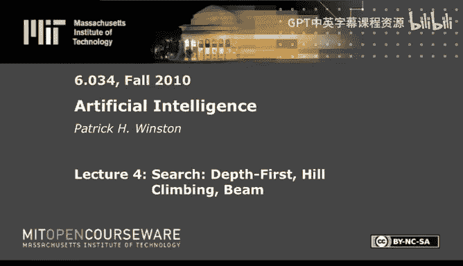
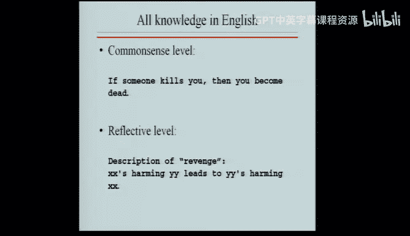
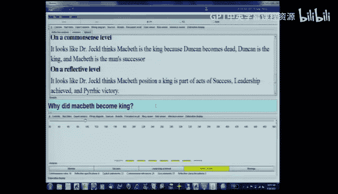

# 《人工智能｜6.034 Artificial Intelligence, Fall 2010》中英字幕 - P4：[04]4. Search_ Depth-First, Hill Climbing, Beam.zh_en - GPT中英字幕课程资源 - BV14fqSB2ECY

Today we're going to talk about search。 I know you're going to turn blue with another lecture on search。

Those of you are taking computer science subjects。You've probably seen it in 6，01。

 You'll see it again， a theory course。 So we're gonna do something。

 We're going to do it for a little different purpose。 I want you to develop some intuition。

About how various kinds of search work。And I want to talk a little bit about。

Search as a model of what goes on in our heads。And toward the end， if there's time。

 I'd like to do a demonstration for you of something never before demonstrated to a 603，4 class。

 because。It was only completed last spring and some finishing touches were added by me this morning。

Always dangerous， but we'll see what happens。So there's Cambridge。You all recognize it， of course。

You might want to get from some starting position S。To some goal position G。See Ohio cab。

And hope for the best。So here's what might happen。Not too hot。

 let's move the search position over starting position over here。

I've had cab drivers like this in New York。But it's not a very good path， it's the path of a thief。

 let's change the way that the search is done。ToThat of a beginner。An honest beginner。Not too bad。

Now， let's have a look at how the search would happen。

If the cab driver was a PhD in physics now after his third postdoc。These are not actually traversed。

 These are just things that the。That where I was thinking about。

 and that is the very best of all possible paths。So the thief does a horrible job。

 the beginner does a pretty good job， but not an optimal job， this is the optimal job。

That's produced by the。PHD in physics after his third postdoc。

So would you like to understand how those all work， the answer of course， is yes。So啊。

I going to talk to you about。Procedures that are different from the way that you solve this。

 just solve this problem。I imagine that if I said， can you please find a path from S to G。You would。

 within a few seconds find a pretty good path， not the optimalal one， but a pretty good one。

Using your eyes。And we're not going to tell you about how that works because we don't know how that works。

But we do know that。Problem solving with our eyes is an important part of our total intelligence and we'll never have a complete theory of human intelligence until we can understand the contributions of the human visual system to solving everyday problems。

 like finding a pretty good path in that map。But last。

 we can't talk about that because we don't know how to do it。We're working on it。

 but we don't know how to do it。So I'm not going to use Cambridge in my illustrations as too much。

 too much there to work through in in an hour。 So we're going to use this map over here。

 which has been designed to illustrate a few important points。

So you too you find a path through that graph pretty easily with your eyes。

But our programs don't have eyes， and they don't have visually grounded algorithms。

 So they're going to have to do something else。 And the very first kind of search we want to talk about is called the British Museum approach。

 This is a slur against at least the British Museum， if not the entire nations。

 because the way you do a British Museum search is you find every possible path。

So it will be helpful to have a diagram of all possible paths on the board。

 So we're going to start with a British Museum search。

And from the starting position for the starting position。From the starting position。

 it's clear that you can go from S to either A or B。And already， there's an important quiz point。

 Whenever we have these kinds of problems on a quiz， we ask you to develop the。

Tree associated with a search。In leical order。 So the。

The nodes there under S are listed alphabetically。Just， just to have an orderly way of doing it。

So from A， we can go either。B or D。And another convention of the subject。

 another thing you have to keep in mind in quizzes is that we don't have these searches bite their own tail。

So I could have said that if I'm at。Hey， I can also go back to S。But no path is ever allowed to。

 to bite itself， to bite itself， to go around and enter。

And get back to a place that's already on the path。Now， if I go on to B first。

 that means that I could go here from。From B， I can go to either A or C。

This is getting fat pretty fast， but let's see SAB。The only place I can go is C and then to E。SAD。

 without biting my own tail and going going back to A， the only place I can go is G。SBA。

I can only go to D。And then， to G。And finally， SBC， I can only go to E。

So that is the complete set of paths， as produced by。Any program that you want feel。

You'd like to write that finds all possible paths。I haven't been very precise about how to do that。

Because you don't have to be。Can't save much work by being clever because you have to find everything。

So that's the British Museum。Expansion of the tree。So what have I done。

 I've been playing around with a map。 I showed you an example of a map。 And pretty soon。

 you're going to think that search。Is about maps。So before going， even another tiny step。

I want to emphasize that。Search is not equal to maps。Search is about choice。

And I happen to illustrate these searches with maps because they are particularly cogent。

But search is not about maps。 It's about the choices you make when you're trying to make decisions。

So these are choice。 These things I'm going to be talking to you about today are choices you make when you explore the map。

That you can make other kinds of choices when you're exploring other kinds of things。 and in fact。

At the end if there's time， I'll show you how you do searches when you're solving problems in a humanities class。

 right？So that's the British Museum algorithm。 Search is not about maps。 Our first gold star idea。

 search is about choice。But for our illustration， search is about maps。

 So the first kind of search we want to talk about。It's real。Its depth first search。

And the idea of depth first search is that you。Parll ahead in a single mighty way。So。From S。

Your choices are a。Or B。And you always go down the left branch by convention。So from S， we go to a。

From A， we have two choices。 we can go to either B。You can go to either， yes， B。Or D。

Following our electrical convention。After that， we can go to sea。And after that。

 we can go to E and too bad for us。We're stuck。What we're going to do， we've got into a dead end。

 all is lost。But of course， all isn't lost because we have the choice of backing up。

To the place where we last made a decision。And choosing another branch。So that process is called。

Variously， backup or backtracking。So at this point， we would say， a， dead end。

 the first place we find when we back up the tree where we made a choice is when we chose B and dead instead of D。

So we can go back up there and take the other route。SSAD now goes to G， and we're done。

So we're going to make a little table here of things that we can embellish our basic searches with。

 and one of the things we can embellish our basic searches with is this backtracking idea。

NowBacktracking is not relevant for the British Museum algorithm because you've got to find everything。

You can't quit when you found one path。But you'd always want to use backtracking with depth first search because you may plunge on down and miss the path that gets to the goal。

Now， you might ask me。Hiss backtracking， therefore always part of depth first search。

And you can read textbooks that do it either way。Count on it if we give you a search problem on a quiz。

 we'll tell you whether or not your search is supposed to use backtracking and we consider it to be an optional thing。

It'd be pretty stupid not to use this optional thing when you're doing depth for search。

But we'll separate these ideas out and call it an optional add on。So that's step first search。

 very simple。Now， the companion I mean， the natural companion to depth first search will be breadth first search。

Red。First。And the way it works is you。Build up this tree level by level。And at some point。

 when you scan across a level， you'll find that you've completed the path that goes to the goal。

So level by level。S can go to either A or B。A can go either to B。Or D and B can go to either A or C。

So you see what we're doing， we're going level by level。

And we haven't hit a level with a goal at it yet， so we've got to keep going。

Note that we're building up quite a bit of stuff here。 quite a lot of。

There's quite a lot of growth in the size of the path set that we're keeping in mind。

At the next level， we have B going to C。D going to G。A going to D and C going to E。

And now when we scan across。We do hit G， so we found a path with B first search just as we found a path with depth first search。

Now you might say， well， why don't use quit when you hit G implementation detail？

We'll talk about a sample implementation， you can write it any way you want。

 but now that we know what these searches are。Let's speed things up a little bit here。

And do a couple of searches。They now have names。So the first type will be depth first。Bom。

That's the one that produces the thief path。And then we could also do a breath first search。

 which we haven't tried yet。What do you suppose is going to happen？This is going to be fast， slow。

 produce a good path， produce a bad path， I don't know， let's try it。I had to speed it up， you see。

 because it's doing an awful lot of search。It's generating an awful lot of paths。Finally。

 you got a pat。Is it the best path I don't think so。

 but we're not going to talk about optimal paths today we're just going to talk about。

Pretty good paths， heuristic paths。Well， let's move the starting position here in the middle if you think B for search is going to be stupid。

I think it's going to be pretty stupid， let's see what happens。It search is a lot to the left。

 which you would never do with your eye。Let me slow that down just to demonstrate。

It fires a shorter path because it's right there in the middle。But it spends a lot of its time。

Looking off to the left is pretty stupid。that's how it works。

So now that we've got two examples of searches on the table。

 Id like to just write a little flowchar for how the search might work。Because if I do that。

 then it'll be easier for us to see what kind of small difference there are between the implementations of these various searches。

So what we're going to do is we're going going to develop。A waiting list， a queue， a line。

Whatever you like， let's call a Q， I're going to develop a queue of paths that are under consideration。

So， the。First step in our algorithm will be to initialize。Our Q。

And I think what I'll do is I'll simulate。De first search。On this problem， like up there on the left。

 using this algorithm。So I need to have some way of representing my paths。

And what I'm want to do is I'm going to betray my heritage as a list programmers because I'm just going to put these up as if they were list S expressions。

So to begin with， I just have one path。And it has only one node in it。Yes。That's the whole path。

So the next thing I I do after I initialize the queue is I。Extend。First。配呀。On the queue。Okay。

 so when I extend S， I get two paths。I get S goes to a。And I get S。张时被。

So I take the first one off the front of the queue。

 and I put back the two that are produced by extending that path。Now。

 after I've extended the first path on the queue， I have to。Put those extended paths。

Onto the queue I I in here， there's an explicit step where I've checked to see if I。

 if that first path is a winner。If it's not， I extend it。

And I have to put those paths onto the queue。So I'll say that what I do is I N queue。E。Now。

 I've done one step in this。 Let me do another step。 I'm going to take this first path off。

I'm going to extend that path。And where do I put these new paths on the queue？

If I'm doing depth first search。Well。I want to work with the paths that I've just generated。

 I'm taking this plunge down deep into the search tree。

So since I want to keep going down into the stuff that I've just generated。

Where then do I want to put these new paths at the end of the queue。

Don don't think so because it's going to be a long time getting there。

 I'm going to put them under front of the cube。So。For depth first search。

I want to put them on in the front of the queue。And that's why S。诶。B goes here。And SD。And then。

That's SB。So SB is still there。 That's still a valid possibility。

 But now I've stuck two paths in front of it。 Both of the ones I generated by taking。

A path off the front of the queue， discovering that it doesn't go to the goal。

 Exing it and putting those back on a cube。So I might as well complete this illustration here。

While I'm at it。I take the SB off。As a。你。And I can go only there to see。But， of course， I keep S。

And SB。On the queue。So now I take the front off the queue again。And they get S， A， B， C， E。

And not to forget SD。NSB。I take the first one off the queue。Doesn't go to the goal。

I try to extend it， but there's nothing there。 I've got reached a dead end。So in this operation。

 all I'm doing is taking the front one off the queue and shortening the queue。We're almost home。

 now I take SD off the queue。And I get SA， D， G。And of course， I still have S。

But now the next time I visit the situation。I discover。B didn't step here in that first step。

 I discover a path that D actually does get to the goal and I'm done。So each time around。

I initialized the queue。 I check to see if I'm done。 If not， I extend。

 I take the extensions and put them somewhere on the queue， and then。I go back in。And in here。

 there's a。Ved tests， which checks to see if we're done。

So that's how the depth search algorithm works。And now would we have to start all over again if we did B first search？

No， same algorithm。All the code we've got needs one line replaced。One line changed。

What do I have to do different in order to get a breadth first search out of this instead of a depth first search？

大a。And why do I put it on the cube， she says change it。Put it on the back。So was breath first search。

All I have to do is put it on the back。认可。Now。If we were content with a inefficient。Search。

And didn't care much about how good our path was would be done if we could go home。Well。

 we are a little concerned about the efficiency of our search。And we would like a pretty good path。

 so we're going to have to stick around for a little while。Now， you may have noticed。

Up there in that development of the。Breath firstt search。That the algorithm。Hes incredibly stupid。

Why is the algorithm incredibly stupid？Guy， what do you think？

It certainly can't tell whether it's getting closer or further away from the goal。

 and we're going to deal with that in a minute。But it's even stupider than that。

Why is it stupid the same twice。said it's extending paths that go to the same node more than once。

Let's see what Dll is talking about。Down here。It extends A。But it's already extended A up there。

Down here it extends a path it goes to B。And it's already extended the path that goes to be。

Over here。It extends it。It looks at a path。It could extend a path that went through C。

 but it's already got a path that goes through C。So all of these paths。Are duplicated。

 and we're still going through them。So that's incredibly stupid。

So what we're going to do is we're going to amend our algorithm just a little bit。

And we're not going to extend the first path on the Q， or rather， yeah。

 we're not going to extend the first path on the Q。Unless。Final。Noode。Never。Before。Extended。

So what we're going to do is we're going to look to see if we've got this path and we're going to extend it。

 and it's got a final node。 If we've ever extended the path that goes to that final node。

And it was a final load on that path， and we're not going to do it again。So we got to keep a list。

Of places。That have already been， that have already been the last piece of a path that was extended。

I forgot that， so a'll lot more to say it because。It's the last node we care about if a path。

Termininateates in a note。And if some other path previously terminated in that note and got extended。

 then we're not going to do it again， because it's a waste of time。はい。

Now let's see if this actually helps。Yeah， I use extended list， let's see。Well， ge。

We got that place in the center there。 Let's just repeat the previous search。Wow。

 thinking a long time。I notice that it did。You put 103 paths back on the cube。

Now let's add the filter。And try again。A lot less。So we'll speed this up。

And we'll start way over here。 and you remember how tedious that search was？

And now we'll repeat it with this list， movement where it is。

That's all because we didn't do that silly thing of going back through the node。

 a final node that's already been gone through。I so you would never not want to do this。

And we better list this as another option。Doesn't help with the British Museum algorithm because nothing helps with the British Museum algorithm。

 does it help with depth first， yes， does it help with breath first， yes。

Do we do backtracking with breath first？No， because we're looking。backtracking can't do is any good。

Okay， so we're， we're almost home， except that。That search that started in the middle is still pretty stupid。

Both the breath first version。And the depth first version。They're going off to the left。

And we would never do that with our eyes， in any case。

So the next thing we want to do is we want to have ourselves a slightly more informed search by taking into consideration。

Whether we seem to be getting anywhere。So in general。

 it's a good thing to get closer to where we want to go。So in general。

 if we've got a choice of going to a node that's close to the goal or a node that's not so close to the goal。

 we'll always want to go to the one that's close to the goal。

And as soon as we add that to what we're doing。We have another kind of search。

Which goes by the name of Hill climbing。And it's just like depth for a search。

 except that instead of using lexical order to break ties。

 we're going to break ties according to which node is closer to the goal。All right。Now。

 I went to some trouble to talk to you about this in list and having gone to that trouble。

 I'm now going to ignore it。Not because it isn't a good idea。

 but because trying to keep track of everything in the example kind of gets confused。

 And the example won't work out right in a small example and all that。 So put the。

 put the inqueing thing aside。Hless aside and think said just about the value。

Of going in the direction is getting us closer to the goal。So in the hill climbing search。

 just like a depth first search， we have a。And B， and we've still got a list of lexaically underneath the parent node。

Now， which one is closer to the goal？Now， this time， B is closer to the goal than a。

So instead of following the depth first course， which would take us down through A。

 we're going to go to the one that's closest。Which goes through B， and B can either go to A。Or C。はい。

Yeah， sure。 B is six units away from the goal， and a is about 7 plus。Not drawing exactly the scale。

 use the numbers， not your eyes。So。Now where are we a symmetric。

 so A and C are both equally far from the goal。So now we're going to use the life school order to break the tie。

So now from S。B a。We'll go to D。And now which is closest to the goal？

Well it's the only choice we have， so now we have no choice but to go down to the goal。So。

 that's the。That's the hill climbing way of doing the search。

 And notice at this time there's no backtracking。Sos a little bit， it's not the optimal path。

 it's not the best path， at least there's no backtracking， but that's not always true。

 that's just an artifact of this particular example。

So do you think hill climbing would produce faster search？I think so。

So let's see what happens when we add these things one at a time。First， let's turn off。Our in list。

Our extended list， I。It turned off our extended list， and we're going to do depth first again。

 just for the sake of comparison。Prods a very roundabout path with 48 inqueuings。

Now let's switch over to hill climbing。And what do you think it would produce a straighter path？

Fewer inqueuings。嗯m。You wouldn't not want to do that with you。If you've got some kind of heuristic。

That tells you that you're getting close to the goal， you should use it。Now。

 it's easy to modify my example over there。So that getting close to the goal gets you trapped in a blind alley on E。

 that's easy to do。But that's just artifact fact of the example， in general。

 you want to go along the path that gets you closer to the goal。So that's 23。 I don't know。

 let's see if using the extended this filter does any good。Yeah， still 23。So in that particular case。

 the inqueuing list。The the extension list didn't actually do us any good because we're kind of driving so directly toward the goal。

O。So as that's that。 now let's say， is there any analog to。Well。

 we might say that this is yet another choice。Or you had another。

Way of distinguishing these searches。And that is。Is it an informed search？

Is it making use of any kind of heuristic information？Certainly a British museum is not。

 depth is not， breadth is not。And now let's consider what we got for， for hill climate。

 Would we want to use backtracking sure。What do we want to use in in list， sure。

And it is informed because it's taking advantage of this extra information may not be in your problem。

 Its often case you've got this information in a map。Your problem may not have any you。

Measurement of distance to the goal， which case you can't do it， but if you've got it。

 you should use it。Oh yeah， now there's one more， and I've already kind of given it away by having it on my chart。

It's called beam search。 and just as hill climbing。There's an analog of。Death first search。

 beam beam search is， is a complement addition of and informing heuristic to breath first search。

So what you do is you start off just like breath first search。But you say， I'm going to limit。

The number of paths I'm going to consider at any level。To some small fixed number。Like in this case。

 how about two？So I'm going to say that I have a the width。Of two。For my beam search。Otherwise。

 I proceed just like。Brereadfor search， B， D， A G。And now I've got that stupid thing where I'm duplicating my nose because I'm forgetting about the in list。

But to illustrate beam search， what I'm going to do now is I'm going to take all these paths I've got at the second level。

 and I'm only going to keep the best， too。 That's my beam width。

And the best two are the two that get closest to the goal。So those four。BC A and D。

 which two get closest to the goal。B And D。So these guys。I trimmed off。

I' onlyly keeping two at every level。So now going down from B and D， I have at the next level。

C and G。 And now I found the goal。 So I'm done。We could do that here too。We can choose a beam search。

Not man。Oh， but it really， let's see， let's try this thing from the middle。

 Let's slow my speed down a little bit。Now we're going to see anything going off to the left。

Like we did with ordinary breath first search。No。Because it's smart。

 it doesn't say I want to go to a place that's further away from my goal。哎。So now let's see。

 maybe we can go back to our algorithm now and talk about that in queuing mechanism。

And talk about hill climbing。Can I use the same basic search mechanism。

 just change that one line again， yes？How do I add the new path to the queue this time？Well。

 it's very much like hill climbing， right， so I want to add him to the front。

But with one little flourish， what's the flourish， Christian， what do you think？

Remember I want to use my euristic information， so I not only add them to the front。

 but amongst the ones I'm adding to the front， what do I do？

Check the distance and how do you arrange them？Yeah， so you just。

You can put the minimum first if you like。 but let's sort them。 we' sort them。

 That'll keep everything straight。So how climbinging is。First。Is front？Sort it。And finally。

 how about beam， what do we do with beamM search to add them to the queue？Well。

 it doesn't matter where we add them。Because all we're going to do is we're going to keep the。

That you best。So with beam。We'll just abbreviate that by saying。Keep。WR。はい。

So now you have some of the basic searches in your toolkit。

 there's one more that's sometimes talked about。See， weve got depth。Treath， best， and beam。

 one more is best。That's for search。It's a variant we。When we go on there's a variant where you say。

 I've got this tree。It's got a bunch of paths that terminate in leaves。

Let me just always work on the leaf node that's closest to the goal。

So it can kind of skip around a little bit from one place to another， because as it pursues one path。

 it may not do very well。 And some other path quite distant in the tree will become the best one。

We've actually seen the instance of that。And the integration program。

It's capable of skipping all over the place because it's always taking the easiest problem。

In the search tree， in the andor tree working on that， that's best for search。Now。

 you can do these sorts of things in continuous spaces， too。

And you've done the mathematics of that in 1802 or something。But in continuous spaces。

 hill climbing sometimes leads to problems or doesn't do very well。

What kind of a problem can you encounter？In a continuous space with。With hill climbing。Well。

How would you do hill climbing in a continuous space， let's say we're。In the mountains。

And a big foggus come up。We're trying to get to the top of the hill before we freeze to death。

And we take a few steps north， a few steps east。West and south， using our compass。

And we checked to see which direction seems to be doing the best job of getting us。Moving upward。

And that's that's our hill climbing approach， right， We have explored four。

Directionions we can go and pick the best one。And from there we pick four， try all those。

 pick the best one and the way we go， we've got ourselves a hill climbing algorithm。

 what's wrong with it？But what can be wrong with it， sometimes it works just fine。钥匙。

It might get stuck on a local maximum。So problem number。

Problem letter A is that if this is your space。May look like that and you make it。

Stuck on a local maximum。Is there any other kind of problem that can come up？

Well it all depends on what the space is like， here's a problem where the space has local maximum。

Now， a lot of people have been killed on Mount Washington。

When the fall comes up and they do freeze to death。Why。Hell climate， freezes at this。

Is that hill climbing fails them and they can't get to the top to the Ranger station。

And the reason is that there are large lawns on the shoulders of Mount Washington quite flat。

So it's the telephone pole problem。So that space。Looks like this。Oh。

 this isn't what Mount Washington looks like， but it's。It's the telephone pole problem。

 so when you're wandering around here。The idea of trying a few directions。

Ping the one that's best doesn't help any because it's flat。

So that can be a problem with hill climate。Now， there's one more problem with hill climbing that most people don't know about。

But it works like this。This is a particularly acute problem in high dimensional space and I'll illustrate it here just in two。

 and I'm going to switch from a regular kind of view to a contour map。So my contour map。

Is going to betray the presence。Of a sharp bridge。Along the 45 degree line。

And now you see how you can get in trouble there。You get in trouble because if you take a step in each direction。

Every direction takes you downhill and you think you're at the top。So I suppose。

You're right here and you go north。That south overtour that takes you down over a contour line。

you go south。That also takes you down over contour lines， likewise， going west and east。

 all appear to be taking you down。 whereas， in fact， you're climbing a rid that's。

That contour line is the highest that I've shown。So sometimes you can get fooled， not stuck。

 but fooled into thinking you're at the top when you're actually not。Now， is this？This is。

This is a model of something。 This subject is about modeling。Intelligence， and this is a kind of。

Algothm you frequently need in order to build an intelligence system。

But do we have any kind of search happening in our heads？

Or this some if we're going to model what goes on inside our heads， do we have to model any kind of？

Searching。In order to do the kinds of things that we。We humans do。I suppose so。

 anytime we make a plan， we're actually evaluating a bunch of choices and seeing how they work。

Let me see if I can illustrate it another way。So this is a system that I。

Show you a little bit of last time。And shoot， I might as well。Review one or two things here。

I showed you I make Beth's story， this is a story I showed you。

And if you had this in a humanities class， the simplest questions that you might be asked is。

Why did McDuff kill Mcbeth down there at the bottom？That demonstrate。

The answering of questions last time are just the development of the graph。I can't remember。

 but we'll do it again anyway。So this is somewhat stylized English。Just so， you know。

It doesn't have to be stylized English。 This is English that's。

Made available to the Genesis system by way of something called a story workbench。

There's no free lunch， either you can use your human resources to rewrite the plot in third grade English。

Or you can use your human resources to take a more natural adult type version of the story and decorate it with annotations that make it possible to absorb it。

So just this summer in a miracle of summer Europe， Brett Vanzi， one of you。

Connected these two systems together so we can now work with stories that are expressed in pretty natural English。

Everything in our system is expressed in English。Including common sense knowledge。

 like if somebody kills you you're dead。But more importantly for today's illustration。

 that reflective level of knowledge。That knowledge about what revenge is。

So here you are you're in the humanities class and someone says， what's really going on in the story。

 not the details of who kills whom， but is there a prrhic victory？Does somebody have a success。

 Is there an act of revenge， right， These are all kinds of things you might。

We ask about in some kind of humanities class。So let me fire up the Genesis system。

Pray for internet connectivity。Launched the system on a read of that Macbeth story that I showed you just a moment ago。

At the moment， it's absorbing information about background knowledge and about reflective level knowledge and all of that sort of thing。

It's building itself this thing we call an elaboration graph， not quite there yet。

 it's still reading background knowledge。Now it's reading Macbeth。

 it's building its little elaboration graph。Same thing you saw last time， except。Except not quite。

See that stuff down at the bottom。Those are higher level concepts that it's managed to find in the make best story。

So it's found a revenge。How did they do that？It searched。It had a description of what a revenge is。

And I look to see if that pattern。Was exhibited in the elaboration graph。

So in a combination of things that were said explicitly and things that were produced by N jerkrk if then rules。

 the elaboration graph was sufficiently instantiated that the revenge pattern could be found。

that's interesting， Peric victory is a little harder。You'd probably get an A if you said， oh。

 there's a periodic victory in here。Yeah， there it is。

So blow that up a little bit so you can see what it is。You know what per victory is？It's something。

 it's a situation where。Everything seems to be gone good at first。And then not so hot。

Sobeth wants to be king。Down here。And eventually that leads to becoming king。

 but two bad for Macbeth because eventually he gets killed in consequence。

 so it's a purerrhic victory。All that produced by search programs are looking through this graph。Now。

 once you've got the capability of doing that， of course， then。

You can find all sorts of things and you can report them in English， but more interestingly。

 you can answer questions。I did， Mac。It cares not a hoot about capitalization。

On a common sense level， it looks like Dr。 General thinks McDuff kills Macbeth because Macbeth Ans McDuff on a reflective level。

 it looks like Dr。 General thinks McDuff killed Macbeth is part of act of mistake。

 be victory and revenge。Pretty courty speech output。 But you see the point。

 How do they get the stuff on the。Common sense level。

Same way all of those programs at Bill Goldrees report。Answers the questions。

It's just looking locally around in the connections in the gu tree。

How do they get the stuff on the reflective level by reporting on the searches？

That produced information。It does that by looking for。Higher level。Thoughts about its own thoughts。

And reporting in which of those higher level thoughts， the incident。And ask about actually occurs。

So let's see， just for fun。We might be interested in why Macbeth。Murdered。It okay。

 wouldn't this be handy if you hadn't actually read the play and here it is。

 you' got to write that paper。On a common sense level。

 it looks like I'll follow a plug on that because that's just annoying wants to。Yeah， pretty good。

Mcbeth wants to be king and Duncan is the king。So let's see why did it makebe become king？奥 yeah。Oh。

 I won't answer the question unless I spell it right。O。

That wouldn't。 I wouldn't be able to show that to you until last spring。 And in fact。

 I wouldn't have been able to show you this today until。Last week with a tweet this morning。

 because we've just now connected the speech output， the language outputs of Boris Cas。

Parture system， which is running and reverse in order to generate that English。

 So that's something that has never before been seen by any ice， but me。

And so that will conclude what we have to do today。

