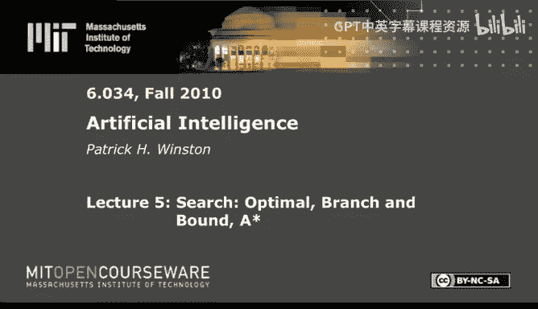
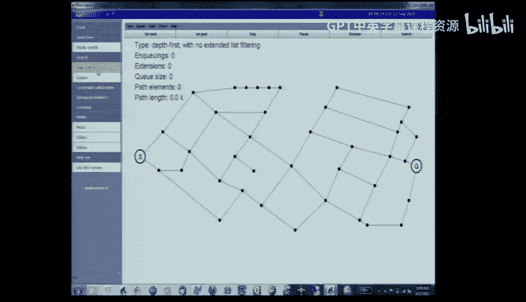
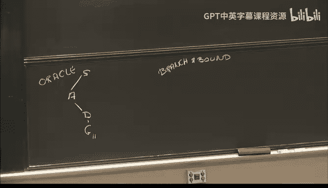
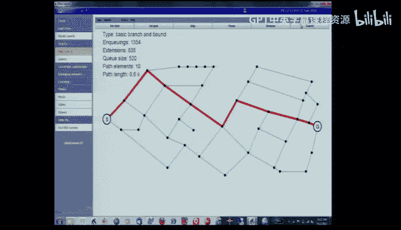
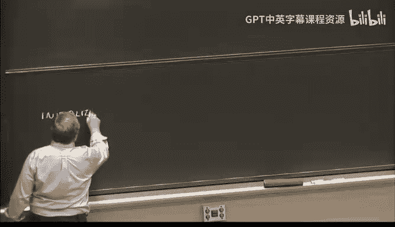
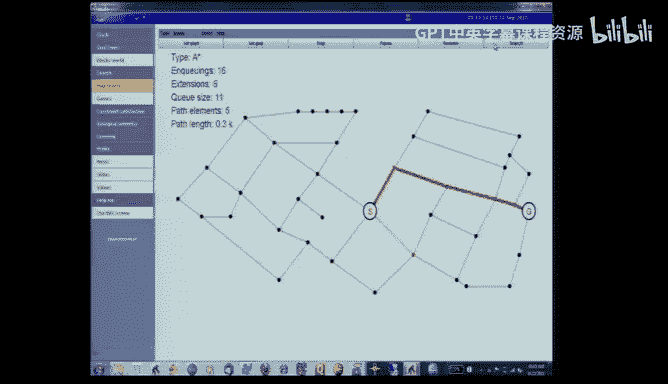

# 《人工智能｜6.034 Artificial Intelligence, Fall 2010》中英字幕 - P5：[05]5. Search_ Optimal, Branch and Bound, A_.zh_en - GPT中英字幕课程资源 - BV14fqSB2ECY

It's written about Route 66， which was used to be the main highway between Chicago。

 Illinois and Los Angeles， California。Very famous highway。

 because anybody who wanted to go cross country always took Route 66 because it was。

The shortest way to go。And the question is， how do you find the shortest path？Not just。

Any old path or a good path。 How do you find the very shortest path。

 And that'll be the subject that we're going to discuss today， But Ro 66。Oh， I lament its passing。

 but it's been largely replaced by the interstate highway system that was created by President Eisenhower。

 guess why？Let's see。 maybe the Rozi people know。You know why。

Eisenhower created the interstate highway system。Well， in public affairs， of course。There's always。

A distinction to be made between the explanation and the reason。The explanation was。

Well moving nuclear weapons across the country， let's put it in slightly more benign terms。

 Eisenhower had observed that the German army。Was able to move its troops rapidly。

 even though we bombed their。Railroads into oblivion。Because of their autoudubon。So。

 Eisenhower conceived that。If therere everver invasion in the United States， we， too。

 would want to be able to move our forces around on a highway system。 And consequence of that。

 we have。A pretty good highway system， a pretty awful railroad system， interesting。

I'm a beneficiary of that in a funny way， because I'm from East Pere， Illinois。

 and I was surrounded by the factories of Caterpillar Traor Company。

Which made all the tractors that built all of those roads。So my high school spent money like water。

From that huge tax base of all those factories。Anyway。

 today we want to find the very best path instead of just a good path。And。Like last time。

Will deal with both a。Both an example。That we can set our program to work on。By the way。

 you find the shortest path between S and G。Would you like to bet your life on the shortest path between S and G？

Probably not with your eye， you can find a good path。But you can't find the best possible path。Today。

 what we're doing is probably not modeling any obvious property of what we have inside our heads。

But being able to find the best path。Its part of the skill set that anybody who's had a course in artificial intelligence would be expected to have。

So we're going to look at it， even though it's not like many of the things we do。

 a model of something that's probably going on in your head。

So we're going to use both this example from Cambridge and our Blackboard example。

But let's see we have to have。 We have to caution ourselves， right， Tanya is。It search about maps。No。

 it's about what？

Starts with the sea。 and it。Next letter is H and it ends up being choice。

 so we're talking about choice。Not about maps， even though our examples are drawn from maps。

Because they're convenient and they're visual， and it helps understand the concepts behind the algorithms I'm talking about。

So let's start off by looking at our classroom example。And I did something today that I。

Neglected to do last time。 And let's talk to you about what I meant by a heuristic distance。

 It's those pink lines that I just drew on， on the map。

We're talking about the distance as the crow would fly between two places。

 even though there's no road that goes between those two places。So in general。

 and we discussed last time。In general， it's best to get yourself into a place that's close as the crow flies to your goal。

And， of course， that's a heuristic。 And it can get you in trouble because it。It's not always true。

 It would appear that being at node E。Is a good place to be because it's not very far from G。

But in that particular case， designed to illustrate the point。

Being close is actually not a good thing because it's， it's a dead end。But in general。

 it's a good thing to be close。When we talked last time about hill climbing and beam search。

Being close was the objective of those kinds of searches。

 And at one point in a Bea Church illustration， we had C，A and D。

We had paths terminating in all four of those nodes as candidates for the next round of search。

And we decided on the basis of these airline distances to keep D and B and reject A and C because they're further away as the crow flies。

Now， repeat this， even though many of you have had this fixed already in your tutorials。

 because we're going to need this concept of euristic distance。Today。And I wanted to be sure that。

That point has been clarified。So， now。With a smaller map， I imagine it can do。By eye。

A determination of what the shortest path is。 What is it， why not。Can you help me out with that？SAG。

 and if you add up those distances。The distance is 11 along that path that goes。From S。First to A。

 and then to D， and then from D to G。So w to search that that is the best path。

 And we're going to treat wana as an oracle。Because we're going to follow in our initial attempt to understand these algorithms。

A very important principle of problem solving。 And that is that if you want to solve a problem。

 the easiest way is usually to ask somebody who knows the answer。Or Google。

 which also probably knows the answer。So weve in this particular case。

 we believe that Juna knows the answer。 And she said that the shortest path is S D G。

And its path length is 11。But we don't trust her。Because we're applying to the same medical school。

 and she may be trying to screw it。哎。So we want to be very cautious about accepting her answer until we've checked it to make sure that。

She hasn't attempted to delute us。So how would we go about doing that well。

One way to do that is to check to be sure that all other possible paths that we could develop end up being for sure。

Longer than the one that Juna has told us about。So she's told us about。S a。D。G。

 and it has a total path length of 11。And now what I'm going to do is I'm just going to develop the rest of the。

 of this tree like diagram， more or less in a。But what I'm going to do is I'm actually not going to do it in a British museum a random way。

What I'm going to do is I'm always going to look at the choice。

That corresponds to the shortest path that can be extended。

So the shortest path that can be extended。Is this one right here？

The one that just has the starting node in it， and I could have gone this other way to be。

And if I go that other way to B， then the path length along that side is5。And likewise。

 I could have gone to if I look at the path that terminates an A。

 that that has a past length of three。So now I've got two choices， A and B。

I've got choices that extend beyond those two places。

 So I'm always going to extend the one that has the shorter， the shorter length。So in this case。

 that would be the path that goes from S to A。So if I go from S to A， I don't have to go to D。

 I can also go to B。And if I go to B， then the accumulated pathway。He accumulated path like this。

S A B， that's seven。And， notice。I know that we're talking now about the。

 the accumulated path length that we've traveled so far。

Last time we were talking a lot about distances to the goal。

Erisistic estimates of how far we are from the goal。Now， we're doing exactly the opposite。

 We're not considering how far we've got to go。 We're only thinking about how far we've gone so far。

So now， repeating these steps again， I've got 7 and 5。

 So I'll go over and consider the choices that go from through the。B node on the path， S， B。

 And that gives me S B。A and SBC。And what are those pathways， Well， let's see SBA。Would be9。

An SBC would be 9。And now the shortest path is this one over here。So I extend that。

 and I go for S AB。Ss A B， the only place I can go is C that adds another four。So that's 11。

 and what do I know about that path？I don't have to take that any further， right？

Because the distance I've gone on， that path already is equal to the path length that Juana has told me gets me to the goal。

So it would be foolhardy to carry on because presuming that these links are all non negative。

I can't do any better。And I can't even do as well unless I've got a length that has zero length。

So now that I have that idea， I can quickly finish up by saying， well。

 let me consider these two paths。 S B A can only go to D。And if I go to D， that adds3， i plus3 is 12。

Nothing else can happen there because that's 12 and I've got a path of the goal that's 11。C。

 I can only go to E。It's a dead end， but I don't have to think about that because I know that the accumulated distance。

Along this path。Its6 plus9， that's 15。So all of these。

Need not be extended any further because their length accumulated so far is equal to or less than the length of the goal。

So I've checked the oracle。And all those who applying in the same medical school。

Wner has told me the truth。So now， unfortunately， one is not always around。

And I don't always have an oracle。So， Im going not。

We'm going to have to have some way of finding the shortest path。

Without that oracle that I they can check against。And。Let's see， what can I do。没变要更。

Maybe I can do the same thing I just did。Always extend the shortest path so far and hope that I run into the goal at some point。

And then I have to ask myself the question， how much extra work did I need to do when I don't have the oracle。

But let's just try it and see what happens。I don't have that path。 start with。 So I just have S。

 its distance is 0。I can go either to A。Or B， if I go to A， I've got a distance of three here。

 I've got a distance of five。I'll extend the path that goes essay。That can either go to B or D。

Only only the B or D is me。7even， that way， SD gives me 6。

So looking across all of these and extending the shortest path so far takes me back over to S。B。

So I extend those。SB takes me to A。Or C。And those， in turn。

 have total accumulated path lengths of 9 and 9。Now the shortest one is SAD， you see the pattern。

 now let's see。I haven't found。The goal yet。So I can ask myself the question。

 is any of the work that I have done so far wasted？No。

 because all of the paths that I've got so far are shorter than。The path of the goal。

 because the goal hasn't shown up。So when I do my oracle checking after I found the goal。

None of that work is going to be wasted。So in the end， I don't actually need the oracle。

I can just develop。This graph by extending the shortest path so far。

Until I hit the goal and then do perhaps a little remaining checking to make sure that all the other paths extend。

With a length that's greater than the path of the goal。So if those words are confusing。

 let's carry on with the algorithm。 I think itll be clear。So let's see。 we've got the 7。

6 and 2 nines。 We're going to extend the one that's6。That gets us to the goal， boom， we've got it。

And we've got a path length of 11。But note that we can't quit。Because。

We have to be sure that all other paths are longer than 11。

So now we have to carry on with the same algorithm that we started with。

 the Oracle checking algorithm。And when we do that。

We look for the shortest path so far that has not been extended， that's B。S， A B。Goes to C。That's 11。

So we're done there。A goes to。D， that adds three， that's 12。C goes to E。I' add six， that's 15。

 and sure enough。We down。O。然后一。Doesn it know that there isn't a chance that you could have a zero distance。

感制？不。The question is， does it know that there's no？0。Distance length that's coming up。

 That's an implementation detail。 This guarantees you find。

A path that's as short as any that you possibly find。

 But there might be others if there are zero length links， as long as there are non negative links。

We're safe we've got a shortest path。So that was easy。

 and now we can repeat the exercise with our more complicated map of Cambridge。First of all。

 let's do depth first just to recall what that looks like。That is certainly not a short path。So。

 let's try。This idea which by the way， bears the label branch and bound。

Let's try Bran and bound on the same map。And there it goes。

Each of those little flickers is trying another path。So you can see it's working， its guts out。

To find that shortest path。It's almost there，It's almost a pathological case。

Where it's almost doing British Museum。there has finally found the shortest path。

Now there's some things we can ask about that， but first of all， before I ask anything about it。

 I'd like to get the flowchar up on a board because we're going to decorate that flow chart a little bit as we go。

So the first thing we do is initialize Q。

Then we're going to test。First。Path on the queue。Then we might be happy because we might be done。

 we might have a shortest path to the goal。 Actually， that's not quite true。 I it We have to be。

 we can't really quit until that short， every other path is it。Well now， that's interesting。

Do we if we've taken the。First， if the first element on the queue gets us all the way to the goal。

 and we've sorted our queue by path length。Are we through as soon as that。First。

Element on the Q gets us to the goal。Yeah， because every other path must have been sorted you know。

 sorted beyond it and therefore can be can' offer us a shorter path of the goal。

So if the first path is a path of the goal， we're done。Not last， it usually isn't。

 so we'll extend first path。We're going to put all those extensions back on the queue。

 and then we're going to sort them。So that's pretty much the same as we did last time。

We're always going to。Put the elements back on the queue。

 I'm going look at the first element on the queue and see if it's a winner。 If it is， we're done。

 if it's not， we're going to extend it。And then。Go back in here。And try again。Well， sort of。

 but we noted that this did an awful lot of work。Because we look at those statistics up there。

They put 1354 paths onto the queue。 That's the inqueuing part。And then。

It extended 835 paths that had come to the front of the queue。Now， I'd like to give you an aside。

Because it's easy to get confused about and queuing。And extending。

In all of the searches we did last time。It would have been perfectly reasonable to keep a list of all of the pads that we had put onto the queue。

And inqueuing list。And never put a path on the。And never add a path to our queue if it terminates in a node。

That some other path。Termininates in that has already gone the， gone onto the queue。

What I said last time is let us keep track of the things that have been extended。

And not extend them again。So you can either keep track of the nodes that have been。

Extend it and not extend them again， or look at the nodes that it passess with nodes that terminate blah。

 blah， blah and been put on the cue， the acuted ones， and not put things back on the queue again。

And I think last time I may have put a column in there that said in queued。It should have been。

Extended。Even though in queueed work last time， only extended works this time。

Because we want to be sure that anything we extend is a short path。So the the， the the。

And cute idea doesn't work at all for these optimal paths。

So now I want to come back over here off the sidebar and say that we're keeping track of all of the nodes。

All of the paths that end in。Notes unless they have already been extended。

Beyond that particular place。So we need to decorate our。Algorithm here and say。Test first path。

And extend the first path。If。Not。Already。Extended。Because you can see that in the example I had so far。

 we did that same silliness that we talked about last time。We extended paths that。Went through a。

More than once。Like so， would it ever make sense to extend this path？Now。

 because we've already extended a path that got there with less distance。

Whatever makes sense to extend this path。Now， because we've already extended another。

Pathic gets to be by a shorter distance。So if we keep an extended list。We can add that。

To branch and bound to our advantage。So let's see how that would actually work on the classroom example in thenblell do Cambridge。

 so this is branch and bound plus an extended list。And I do mean extended。Not an acutecu list。

 and list while work here。So let's see， I start off the same way as I did before。

 S goes to either A or B。That's a length of three， that's a length of five。

 So I extend A that goes to either B or D。But B is as if it wasn't there at all。Oh， sorry， hang on。

E goes there， and those paths are seven and six。And now I look around on the board。And I say。

 what is the shortest path so far， And it's B。 So I extend that to get to a。And C。

 with path lengths of 9 and 9。And what's the shortest one next， it's D。And that goes to G。

 and the path length is 11。 And what's the short shortest one。On the board。

 the one that has to be extended next。 That's this one that gets to be。

 But I've already extended a path that gets to be。So I don't actually do that extension。

So I've saved some work。But I've got to go over here and do these two now。 But wait， wait。

 I've already extended B。 I've already extended A， so I don't have to do that one either。

The only one I have to do is the one that goes to C。

 and that goes then to E with a path length of 15， and I'm done。

So if you compare this one with the previous one， you can see that there might be vast areas of this tree that are pruned away and don't have to be examined at all。

So now just for the sake of illustrating that， I would like to keep track of just one of those statistics。

The number of extensions。So for this particular example， case1， the number of extensions。Was 835。

Why don't you see if you can kind of guess to yourself what it would be if I use this concept of an extended list。

See， I'm not going to extend anything I've already extended because it's guaranteed to have a longer path length than something that already got to that same place。

So it makes no sense to do it。So let me change the type to branch and bound。With an extended list。

And I'm going to turn the speed down a little bit so we can watch it。Might take the rest of the hour。

 who knows？Still doing a lot of work， still examining a lot of paths。But look at that。Instead of。

835 extensions。It only did 38。So that's a pretty substantial savings and you would never not want to do that。

So note that that's a layering on top of branch and bound， that's not a different algorithm。

 it's an adjustment， an improvement to the algorithm and makes it more efficient。

So this whole thing is based then on。On what I call the deadad horse principle。

 as soon as we figure out that a。Path that goes to a particular place can't possibly。

Be the winning path， we get rid of it and don't bother extending it。It's a dead worst principle。But。

If we look at this example。What's the shortest possible length of a path that's already gone from S to B。

嗯。我也 think参与。Well， first of all， it can't be less than five because we've already gone that distance。

So when I say， what's the shortest length of any path there could possibly be that goes are S toB？

We know it's at least five。LikeCan we say something more about it？

Especially when we look at these airline distances。Note that this is airline distance is 6。

 and that's a little more than 7， and that's a little more than7。So what do you think？

So it's gone from S to B。 and the question is what's the shortest？P。

That could possibly be that has started out going from S to be。1， right。Because we can't have apath。

Shorter than the airline distance。If there were a straight line road from B to G。

 its length would be6， but there isn't。So that gives us a kind of lower bound on the。

Distance that we have along that path。So we're using the accumulated distance。Plus。

 the airline distance to give us a lower bound on the path that we started off on from that goes from S to B。

Once again， let's solidify this a little bit by。Simulating the search。Saing how it turns out。Now。

 just as I did last time， I'm going to forget that I've got an extended list。

So I don't want to carry both those things around with me at the same time。

So we'll forget that we grab the extended list， and we'll bring all those back together a little later。

So we're going to forget what we just did there， and instead we're just going to use this concept of an airline distance。

And see what happens。So。As before we start with a starting node， we have two choices， as always。

 we can go to A or B。And the accumulated distance， if we go to a is3。

And the accumulated distance if we go to B is5。But now we're going to add in the airline distances。

So the airline distance from A to G is a little more than seven。What us。10 plus。

The airline distance from B to G is exactly6。So that gives us 11。

And following the procedure we've been been using already so far。

 we're going to extend the path that seems to have the shortest potential。 Now。

 it's the shortest potential distance from S to G。So that must be this one here。So from A， we can go。

To B or D。The accumulated distance SAB is7。The airline distance is 6， so that's equal to 11。那。

By standard arithmetic 13。The distance SD。That is six。Plus a little more than seven。that oops。

 that's what the accumulate distance is。S A D is3 plus。3 plus3 is 6， right。What。Maybe be fine。はい。

So the airline distance in this case is the same as the actual distance。

 so the accumulateumd distance is6， the actual distance is5， so that's equal to 11。All right。

So now I've got two11s on the board。And simulating what we would ask you to do on a quiz。

 we don't know which of those is going to be better， they've got a tie score。

 so what we're going to do is we're going to choose the one that's lexically releasedd。

 so B is comes before D， so we'll expand B。And that can go to either。A or C。

And we have to calculate the。Best possible distance， it goes along those paths。

The accumulated distance， S， B A S。TheA is9。So that's nine plus7 plus， that's 16 plus。

This has an accumulated distance of9， also plus 7 plus， also 16 plus。Oh。

 well now let's see things are shaping up pretty well because。This one has the lowest score so far。

We extend that to G。And now the accumulated distance is 11。The airline distance is 0， so that's 11。

 and that's smaller than everybody else。So， weve got it。To now， compare。This one。

With our branch and bound。Graph， and you see， once again。That we've done considerably less work。

And that in many practical cases， means that instead of taking。

More than the remaining lifetime of the universe to complete the calculation。

 it can happen in a few seconds。But let's see how it works on the example。So I'm not going to use。

The extended list， I'm just going to use this。Idea of using the。

A lower bound on the distance remaining， the airline distance。And see what happens。So this time。

 the number of extensions is 70。So it didn't do quite as well as working alone。

 as the extended list did， working alone。 So we immediately conclude。那对于。

Extended list is more useful than using one of these lower bound heuristics。 By the way。

 this is called an immissible heuristic。So if a estimate of the remaining distance is a lower bound on the actual distance is less than the lower sorry。

If the heuristic estimate is less guaranteed to be less than the actual distance。

 that's called an admissible heuristic。Amissible because you can use it for this kind of purpose。

So it looks like。The extendedend list is a more useful idea。An amissible idea， right？

What do you think about that， Bradret， am I hacking， am I joking？Why am I judging prematurely。

 what do you think it might depend on？たです。Well，Breus said something unintelligible that I can't think how to repeat。

 What he meant to say though， was that。In these cases。

 it almost always depends on the problem itself。If you change。

 they probably may get a different result。So why don't we change the problem and see if we get a different result。

 So instead of starting on the extreme left。Let's start in the middle and see what happens。

So I'll readjust my starting position to be right there。Hos， that's it。Brong and desperate。

And we might as well start by getting our baseline that branch and bound without anything。

And for that one。Maybe we'll speed it up a little bit。So that gives us 57 extensions。

It's an easier problem。So let's try it with。The admissible heuristic。Oh。That went too fast。Wow。

 still pretty fast， six extensions。What do you think this number is going to be？

Closer to 6 or closer to 57。Etter than6， worse than6。Well， let's think。

What we're going to do is we're going to just not repeat any movements through the same note again。

But it's not going to do something very important for us。

 it's not going to keep us out of the left side。Because it has no idea of the remaining distance but airline distance to the goal。

 so let's see if that's true。Well， sure is， look at that。

It is foolishly spending a lot of its time doing something we would never do。

 nameing looking over there on the left side。So this time the number of extensions is 35。

So in case two。The admissible heuristic does very much better in case1。

The extension thing does much better， but wait a minute。

 would we ever not want to use both at the same time？No。

 would never We wouldn't use want to use just one of these， right。

 They both seem to have the possibility of doing a lot of good。

So maybe if we put them in harnesss together。Look'll at something that's even better。

And when we do that。Say here the extended list。Is a layer on top of branch and bound。

 The admissible heuristic is another layer on top of branch and bound。 If we put those together。

We get something called A star。So A star is just。Branch and bound， plus an extended list。

 plus an admissible heuristic。So let's go back to our original problem and try a star on that。

We're running this at a pretty slow speed because we're expecting it to be a whole lot more efficient than the original branch and down。

 Sure enough it is。 The number of extensions is 27。So那个对。

A lot better than either of those working independently。

Now we can stick the thing in the center and see what happens then。Oh thanks。

So in this particular case。The extended list didn't actually help us because our admissible heuristic was channeling us so tightly toward the goal。

 didn't matter。So it all depends on the nature of the space that you're trying to explore。By the way。

You now have the whole works， right， So what you want to do is。

You you want to extend the first path and sort。But not just by accumulated distance。So。by。

Accumulated distance。Plus。Admissible， heuristic。But where are the theoreticians。

 you must be complaining。So it's expensive。Do we need to actually sort， do we actually need to sort？

No， we don't actually need to sort， what do we need to do？

We just need to keep track of what's the minimum。So we don't need to actually do that sort。

And unnecessary。Computation。So instead we can test。Not the first path， but the shortest path。

And now you have it。 now you have the whole of A start。And now you can go home。

 but I don't think you should because I'm about to show you a。That there's an idea of imdmissibility。

Actually leads to certain screwcases that we're very fond of asking about on exams。All right。

 so it turns out that the admissible heuristic。In certain circumstances can get you into trouble。

 it doesn't look like it could。Because logically， nothing I've said seems strange or questionable。

But that's because I've been working with a map。And it turns out that if you work with a map。

 then amissibility is a perfectly sound way of doing。An optimal search。But Travis。

 is search just about maps， No， search is not just about maps。

 so we may have non Euclidean arrangements。That will cause us trouble。

 So I'd like to illustrate that with the following example。

It's not going to be a large map or a large graph。As。And go up here to A。We're down here to be。

Then they emerge at sea。And then they go out here to the G G。And the actual distances are one。1。1。

And 10， and over here we'll make that 100。So it's a kind of oddly constructed math。

But it's there because we need a pathological case to illustrate the idea。

Now that's the actual distances， and if we did。Branch and bound with an extended list。

 everything would work just fine。But we're not， we're going to use it admissible heuristic。

And we're going to say that this guy has an estimated distance to the goal of 100。

 this guy is zero and this guy is zero。Now zero is always an underestimate。

Of the actual distance to the goal， right， So I'm always free to use 0。Is that 100， okay？Yeah。

 because the， the actual distance is 101。 So it's less than the actual distance。 So it's。

So it's okay as an admissible heuristic。So these numbers that I put up here are。Together。

 constitute an admissible， heuristic set of estimates to the goal。So， now。Let's just simulate A star。

And see what happens。So first of all， you start with us。And that can either go to A。完毕。

The actual distance is one。Plus， an estimate on the remaining distance that gives us 100。ItsPlus 100。

 that's equal to 101。If we go to B instead， the actual distance is 1 plus the heuristics distance is 0。

 so that's equal to one。Okay， good， so now we know that we always extend the shortest path so far。

Did I goof this or are you asking a question？嗯。Yeah， it's the actual， when I say actual。

 it's the actual dis you've travel。So， so if I go from S to A。

The actual distance I've traveled is one。Oh my mind like。

So now I'm taking the sum of the actual distance plus the estimated distance to go。手拿开。继续把。So this是。

This is not a map。She was asking if the map has to be geometrically accurate。See。

 this could be a model of something that's not a map。

And so I'm free to put any numbers on those links that I want。Including the estimates。

 as long as are underestimates of the。This is along the links。

So this tells me that my estimated distance here so far is one， so I'll surely go down here to see。

And if I go to C， then my ad distances。11。And my estimate of the remaining distance is zero。

So that's a total of 11。So now I'm following my heuristic again and saying， what's the shortest？

What's the shortest path on a basis of the accumulated distance？Plus， the estimated distance。Here。

 the accumulated distance plus the at distance is 101。Here it's only 11。

 so plainly I extend this guy。And that gets me to the goal。And the total distance。

The total accumulated distance is now 111 plus。Z equals 111。And that's not the shortest path。

 The wait， I still have to do my checking， right， I have to extend A。And when I extend A， I get to B。

And now when I get to beef that way， my accumd distance is too。Plus， my oh sorry， SA。

My accumulated distance is 2， my estimated distance is 0。 So that's equal to 2。

 So I'm okay because I'm still going to extend this guy， right。Wrong。I've already extended that guy。

So I'm hose， I'm won find the shortest path because that I'm going to stop there。

And I'm going to stop there because this is an admissible heuristic and that's not good enough unless it's a map。

It's not good enough in this particular case， because this is not GMmetric。

 This cannot be done as a map on a plane。So that's a situation where。

What I've talked to you about so far works with Bran and Bo。

Works with branching bound plus an extended list， but doesn't work when we added an imdmissible heuristic。

So if we're going to do this in general， we need something。Stronger than immissibility。

 which works only on maps。And so， the flourish。That I'll tell you about here in the last few seconds of today's lecture。

Is to add。A refinement。As follows， so far， we've got admissibility。

And if we want to write this down in a kind of mathematical notation。

We can say that it's admissible at the estimated distance。Between any node X and the goal。

It's less than or equal to。The actual distance between x。And the goal。

That's definition of amissibility as long as the district does that， it's admissible。

And A star works if it's a map。But for that kind of situation where it's not a map。

 we need a stronger condition。Which is called consistency。

And what that says is that the distance between。X and the goal。

Minus the distance between some other node and the goal y。Take the absolute value of that。

 that has to be less than or equal to the actual distance between x and y。

So does this heuristic satisfy the consistency condition？Well， let's see。

Here the guess is 100 here at0， so the absolute difference is 100。

But the actual distance is only two。So it satisfies amissibility。

 but it doesn't satisfy consistency and it doesn't work。So you can almost be guaranteed。

 it willll give you a situation。Where if you use。诶。Admissible heuristic， you'll lose。

And if you use a consistent eistic， you'll still win。系。So how could we bring this back into the fold。

 Well we can't use that heuristic， it's no good。But if this euristic estimate of the goal were two。

They would be okay because then it would still be。It would still be admissible。

 but it would also be consistent。系。So the bottom line is that you now know something you didn't know when you started out。

Two lectures ago， you I' know how mappquests and all of its descendants work。

Now you can find an optimal path as well as a heuristically good path。

 you see that if you don't do anything other than branch and bound， it can be extremely expensive。

And you can even invent pathological cases where it's exponential。And the distance to the goal。

So because it can be so computationally horrible， you want to use every advantage you can。

 which generally involves using an extended list。As well as no laptops place it still holds。

 no smoking， no drinking， and no laptops。So you， you can use。So you use all the muscles you can。

 and those muscles include using an extended list and。

And an admissible or consistent heuristic depending on the circumstances。

And so I think we'll conclude there since our time is up and Elella。

 you can ask a question after class， why don't you come up and ask now？

