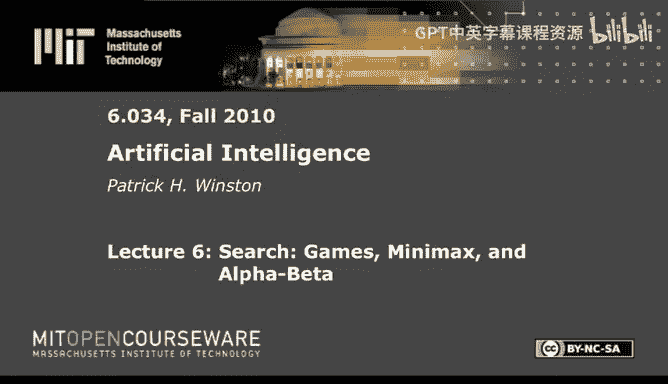
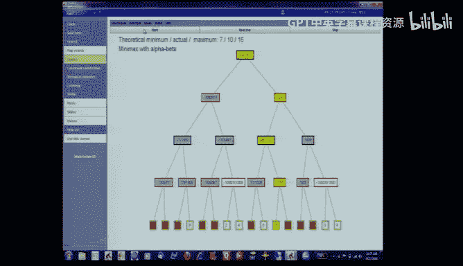

# 《人工智能｜6.034 Artificial Intelligence, Fall 2010》中英字幕 - P6：[06]6. Search_ Games, Minimax, and Alpha-Beta.zh_en - GPT中英字幕课程资源 - BV14fqSB2ECY

It was about 9 Christian3 when a noted philosopher here at MIT。N Hubert Res。Gt Drright has。

Weor the paper。About 1963。In which he alleged had a heading title，Computers Can't play chess。

Of course， he was subsequently invited over to the artificial intelligencetelligence Laboratory to play the Greenblt chess machine。

 and of course he lost。Whereupon。Seymour Pt wrote a rebuttal to Drvis's famous paper。

And which had a subject heading， Dreyyfus can't play chess either。But in a strange sense。

 Dreyfus might have been right and would have been right if he were to have said。

Computers can't play chess the way humans play chess yet。In any case， around about 1968， chessma。

Name David Levy， be。Noted founder of artificial intelligence John McCarthy that no computer would beat the world champion within10 years。

And five years later， McCarthy gave up。Because it had already become clear that no computer would。

Win in a way that McCarthy wanted it to win， that is to say by playing chess。

 the way humans play chess。But then 20 years after that in 1997。Deep Blue beat the world champion。

And chs suddenly became uninteresting。But we're going to talk about games today， because。

There are elements of gameplay that do model some of the things that go on in our head。

And if they don't model things that go on in our head， they do model some kind of intelligence。

And if we're to have a general understanding of what intelligence is all about。

 we have to understand that kind of intelligence， too。

So we'll start off by talking about various ways that we might design a computer program to play a game like chess。

 and we'll conclude by talking a little bit about。What deep blue adds to the。

Adds the next other than tremendous speed。So that's our agenda。By the end of the hour。

 you'll understand and be able to write your own deep blue if you feel like it。First。

 we want to talk about how it might be possible for。A computer to play chess。

 let's talk about several approaches that might be possible。Approach number one is that the。

Machine might make a description of the board， same way a human would。Talk about paw structure。

 king safety， whether it's a good time to castle， that sort of thing。 So it would be analysis。

And perhaps some strategy。Mixed up with some tactics。And all that would get mixed up。And finally。

 result。And some kind of move。So if this is the game board。To move。

 the next thing to do would be determined by some process like that and trouble is。

No one knows how to do it。And so in that sense， Drfus is right。

 none of the gameplay programs today know how to incorporate any of that kind of stuff。

So since nobody knows how to do that， we can't talk about it so we can talk about other ways though that we might try。

 for example， we could have if then rules。How would that work that would work this way。

 You look at the board represented by this note here。And you say， well， if。

If it's possible to move the queen pawn forward by one， then do that。

So it doesn't do any evaluation of the board。Try anything， it just says。

 let me look at the board and select to move on that basis。

So that would be a way of approaching that。A game situation like this。Here's the situation。

Here are the possible moves。 and one is selected on the basis of an if then rule like so。

And nobody can make a very strong chess player that works like that， Curly enough。

 someone has made a pretty good checkers playing program that works like that。

Checks to see what moves are available on the board。Rans them。Picks the highest one that's available。

But in general， that's not a very good approach， it's not very powerful， you couldn't make it。Well。

 when I say couldn't means I can't think of any way that you could make a strong chestplain program that way。

So the third way to do this is to。Look。A had。And evaluate。what that means is you look ahead like so。

 you see all the possible consequences and moves and you say which of these board situations is best for me。

So that would be an approach that comes in here like so and says。

Which one of those three situations is best？And to do that。

 we have to have some way of evaluating the situation， deciding which of those is best。

Now I want to do a little brief aside。Because I want to talk about the mechanisms that are popularly used to do that at kind of evaluation。

In the end， there are lots of features of the chess board。 Let's call F1。F2 and so on。

And we might form some function of those features。And that overall is called the static value。

So it's static because you're not exploring any consequences of what might happen。

 you're just looking at the board as it is， checking a king's safety， checking the paw structure。

 each of those produces a number， feeds into this function， outcomes a value。

 and that is a value of the board seen from your perspective。Now， normally。

This function G is reduced to a linear。套到没有？So in the end。

 the most popular kind of way of forming a static value is to take F1。

 multiply at times some constant C1， add C2。Multiply times F 2。And that is a linear。Scoring。跑完到没有？

So we could use that function to produce numbers from each of these things and then pick the highest number。

 and that would be a way of playing the game。Actually。

 a scoring polynomial is a little bit more than we need because all we really need is a method that looks at those three boards and says。

 I like this one best。It doesn't have to rank them， it doesn't have to give them numbers。

 all it has to do is say which one it likes best。So one way of doing that is to use a linear scoring polynomial。

 but it's not the only way of doing that。So that's number two and number three。

But now what else might we do？Well， if we reflect back on some of the searches we talked about。

 what's the base case against which everything else is compared？

What's the way of doing search that doesn't require any intelligence， just brute force？

We could use the British Museum algorithm and simply evaluate the entire。Tree of possibilities。

 I move， you move， I move， you move all the way down to。All the way down to what？Maybe100。5if0 moves。

 He would do 50 things。 I do 50 things。So before we can decide if that's a good idea or not。

We probably ought to。ItDevelops some vocabulary。So， consider。This。Threere of moves。

There'll be some number。Of choices considered at each level。And there'll be some number of levels。

So the standard language for this is to call this the branching factor。And in this particular case。

 B is equal to three。This is the depth。Of the tree。 and in this case， D is2。

So now that produces a certain number of terminal or leaf nodes。How many of those are there？Well。

 that's a pretty simple computation， right， it's just B to the D， right， Christopher， B to the D。So。

 if you have。Da to the D at this level， you have one。B to the deal at this level， you have B。

B to the D at this level， you have。B squared。So B to the D。In this particular case。There's not。

So now we can use this vocabulary that we've developed to talk about whether it's reasonable to just do the British Museum algorithm be done with it。

Forget about chess and go home。Well， let's see it's about。It's pretty deep down there。

If we think about chess。And we think about a standard game， which each person does 50 things。

That gives a D of about 100。And if you think about the branching factor in chest it's。

Gener may presume to be， depending on the stage of the game and so on and so forth， it varies。

 but it might average around 14 or 15。If it were just 10， that would be 10 to the  hundreds， right？

But it's a little more than that because the branching factor is more than 10。So in the end。

 it looks like according to Claude Shannon。There are about 10。So the 120th leaf node down there。

And if youre going to do a British Museum treatment of this tree。

 you'd have to do 10 to the 120th static evaluations。Down there at the bottom。

If you're going to see which one of the moves is best at the top。So is that a reasonable number。

 you know， it didn't used to seem。It didn't use to seem practicable。It used to seem impossible。

But now we've got cloud computing， everything。 And maybe we could actually do that。Right。

What do you think， Manasseh？Can you do that。Get the computers going in the cloud？You're not sure？

Should we work it out？Let's work it out。 I need some help。

 especially from any of you who are studying cosmology。

So we'll start with how many atoms are there in the universe。Punteers。Tend to the。No， no， no。

 10 to the 38th has been offered that's way too low。Last time I looked it was about 10 to the 80th。

Adams in the universe。The next thing I'd like to know is how many seconds are there in a year？

It's a good number to have and you memorized。And that number is approximately。Pi。

Times 10 to the seventh。Okay。So how many nanoseconds in a second？That gives us 10 to the knife。

At last， how many years are there in the history of the universe？啊啊。稍意。

She offers something on the order of 10 billion。Maybe 14 billion。

 we's say 10 billion to make our calculation simple。So that's 10 to the 10th years。

So if we add all that up， 80， 90 plus 16， that's。10 to the 106。Here's 10 to the 106th。

Nseconds in the history of the universe， multiply times the number of atoms in the universe。

 so if all of the atoms in the universe。We're doing static evaluations at nanosecond speeds。

Since the beginning of the big Bang。Would still be 14 orders of magnitude short。嗯。

So it'd be pretty good cloud。Harness together lots of universes。

So the British Museum algorithm is not going to work。No good。

So what we're going to have to do is we're going to have to put some things together and hope for the best。

So the fifth way is the way we're actually going to do it。

 and what we're going to do is we're going to。Look， I had。Not just one level， but as far as possible。

So we consider。Not only the situation that we've developed here。

 but we'll try to push that out as far as we can and look at these。

Look at the static values of the leaf nodes down here and somehow use that as a way of playing the game。

So that is number。5， number 4 is going all the way down there。 And this， in the end。

There's all that we can do。This idea is。Multiply invented。Most notably by Claude Shannon。And。

Also by Alan Tring。Who I found out from a friend of mine。Spent a lot of lunchtime conversations。

 they spent a lot of lunchtime conversations talking with each other about how a computer might。

Play chess。And against the future when there were would be computers。So Donald Mickey。

Alan Turing also invented this over lunch while they were taking some time off from cracking the German codes。

Well， what is the method？I want to illustrate the method with the simplest possible tree。

 so we're going to have a branching factor of  two， not 14， and we're going to have a depth of two。

 not something highly serious。So here's the game tree。

And there are going to be some numbers down here at the bottom。

And these are going to be the value of the board from the perspective of the player at the top。

And let us say that the player of the top would like to drive the play as much as possible toward the big numbers。

So we're going to call that player the maximizing player。He would like to get over here to the eight。

Because that's the biggest number。There's another player， whose opponent。

 which we'll call the minimizing player。And he's hoping that the number that the play will go down to the board situation that's as small as possible。

 because his view is the opposite of the maximizing player。All right， hence the name minimax。

But how does it work， Do you see which way the play is going to go？

How would you decide which way the play is going to go？Well， it's not obvious at a glance。

Do you see which way it's going to go？It's not obvious at a glance。

 but if we do more than a glance if we。Look at the situation from the perspective of the minimizing player here at the middle level。

 it's pretty clear that if the minimizing player finds himself in that situation。

He's got to choose to go that way。And so， the value of。This situation。

From the perspective of the minimizing player。There's two。They'd never go over there to the seventh。

Similarly， if the minimizing player is over here。With a choice between going toward a one or toward an eight。

 he'll obviously go toward a one。And so the value of that。

Board situation from the perspective of minimizing players want。

So now we've taken the scores down here at the bottom of the tree， and we back them up one level。

And you see how we can just keep doing this。Now the maximizing player can see that he goes to the left。

He gets a score of  two。 He goes to the right。 He only gets a score of one。

 So he's going to go to the left。And so overall then， the maximizing player is going to have a two。

As the perceived value of that situation there at the top。So that's the minimax algorithms。

 Very simple。 You go down to the bottom of the tree， you compute static values。

You back them up level by level。And then you decide where to go。And in this particular situation。

The maximizer goes to the left and the minimizer goes to the left too， so the play ends up here。

Far short of the8。That the maximizer wanted and less than the one that the minimizer wanted。

 But this is an adversarial game。 You're competing with each other。

 So you don't expect to get what you want。All right。So maybe well see if we can make that work。

There's a game treat， you see how it goes？SoLet's see if the system can figure it out。

So there it goes crawling its way through the tree。This is a branching factor of two。

 just like our sample， but now four levels。You can see it's got quite a lot of work to do two。

Two two of the fourthest。One， two， three， fours。To the fourth。16 static evaluations to do。

So it found the answer， but it's a lot of work， we could get a new tree。And restart it。

 maybe speed it up。It goes down that way。Get a new tree。Those are just random numbers。

 so each time it's going to find a different path through the tree。

According to the numbers that it's generated。Now， 16 isn't bad。

 but if you get down there around 10 levels deep and your branching factor is 14。

 while we know those numbers get pretty awful， pretty bad because the number of static evaluations due down there at the bottom goes as B to the D。

That's exponential。And time has shown。If you get down about seven or eight levels， you're a jerk。

If you get down about 15 or 16 levels， you beat the world champion。

So you'd like to get as far down in the tree as possible because。

When you get as far down into the tree as possible， what happens is that these crude measures。

Of board quality。Begin to clarify。And in fact， when you get far enough。

 the only thing that really counts is peace count。One of those features。So if you get far enough。

Peace count， a few other things will give you a pretty good idea what to do if you get farer。

Be'geing far enough can be a problem， so we want to do everything we can to get as far as possible。

I want to plot every trick we can find to get as far as possible。Now。

 you remember when we talked about。Rranch bound。We knew that there were some things we could do that would cut off whole portions of the search tree。

And so what we' like to do is find something analogous to this world of games that will cut off whole portions of the search tree。

 so we don't have to look at those static values。So what I want to do is I want to come back and redo this thing。

But this time， I'm going to compute the static values one at a time。

I've got the same structure in the tree。And just as before。

 I want to assume that the top player wants to go toward the maximum values and the next player wants to go toward the minimum values。

 but none of the static values have been computed yet。So I better start computing them。

That's the first one I find too。Now， as soon as I see that too。

 as soon as the minimizer sees that too， the minimizer knows that the value of this node can't be any greater than two。

 because they'll always choose to go down this way if this branch produces a bigger number。

So we can say that the minimizer is assured already。That a score there will be less than two。

 equal to or less than two。So now we go over and compute the next number。There's a seven。

 now I know it's exactly equal to because I'll never go down toward seven。

As soon as the minimizer says equal to two， the maximizer says， okay。

 I can do equal to or greater than two。All right。1。Minimizer says equal to or less than one。Now what。

Prepare those two numbers。The maximizer knows if he goes down here， he can't do better than one。

And he already knows if he goes over here。He can get it too。So it's as if。

This branch doesn't even exist。Because this the maximizer would never choose to go down there。

And so you have to see that because this is the important essence of the notion。

Of the alpha beta algorithm， which is a layering on top of minimax that cuts off large sections of the search tree。

So one more time。We've developed the situation so we know that the maximizer。

It's a two going down to the left。And he sees that if he goes down to the right。

 he can't do better than one。 So he says to himself。It's as if that branch doesn't exist。

And the overall score is 2， and it doesn't matter what that pathetic value is。

It can be eight as it was。It can be plus 1000。It doesn't matter， it can be minus1000。

Or it could be plus infinity。By minus infinity， it doesn't matter。Because the maximizer。

We'll always go the other way。So that's the alpha beta algorithm。

Can you guess why it's called the alpha beta algorithm？Well because in the algorithm。

 there are two parameters alpha and beta。So it's important to understand alpha beta is not an alternative to mini Maxs。

It's minim with a flourish。And something layered on top。

Like we layered things on top of branch and bound to make it more efficient。

We layer our stuff on top of mini Maxs to make it more efficient。And you say to me， well。

 that's a pretty easy example in this。 So let's try a little bit more complex one。

Just to see if I could do it without screwing up。All right。

The reason I do one this complex is not just to show how tough I am in front of a large audience。

 but rather there are certain points of interest that only occur in a tree of depth4 or greater。

That's the reason for this example。But work with me let's see if we can work our way through it。

What I'm going to do is all。I'll circle the numbers that we actually have to compute。

So we actually have to compute  eight。And as soon as we do that。

 the minimizer knows that that node is going to have a score of equal to or less than eight without looking at anything else。

Then he looks at seven。So that's equal to seven because the minimizer will clearly go to the right。

As soon as that is determined， then the maximizer knows that the score here is equal to or greater than eight。

Now we evaluate the three。The minimizer knows equal to or less than three。Oh sorry， minimize your7。

Okay， now what happens？Well，' see the maximizer gets a seven going that way。

 can't do better than three going that way， so we got another one of these cutoff situations。

It's as if this branch doesn't even exist。So this static evaluation need not be made。

And now we know that that's not merely equal to a greater than seven， but exactly equal to seven。

 and we can push that number back up。So that becomes equal to a less than seven。Okay， with me so far。

Let's get over the other side of the tree as quickly as possible。

 So there's a nine equal to or less than9。eight。Equal to eight， push the8 up。

Equal to or greater than。8ight。So the minimizer can go down this way and get a7。

 will certainly never go that way where the maximizer can get an eight。So once again。

 we've got to cut off。And it's as if this branch didn't exist。

And that means that these static evaluations don't have to be made。And this value is now exactly7。

But there's，'s one more thing to note here。 And that is that not only do we not have to make these static evaluations down here。

But we don't even have to generate these moves。So we save two ways。

 both on static evaluation and our move generation。So this is a real winner。

 this alpha beta thingme because it saves an enormous amount of computation。Well。

 we're on the way now， the maximizer up here is guaranteed equal to or greater than7。

 Does anybody found the winning move yet？Is it to the left？I don't know。

 we better keep going because。We don't want to trust any oracles。So let's see。 there's a one。

 we've calculated that the minimizer can be guaranteed equal to or less than one at that particular point。

You know think about that for a while。At the top， the maximizer nose can go left。And get a7。

The minimizer， if the play ever gets here。可能是。's going to drive the situation to a board number that's one。

So the question is， would the maximizer ever permit that to happen？And the answer is surely not。

So over here in the development of this side of the tree。

 we're always comparing numbers at adjacent levels in the tree。

But here's a situation where we're comparing numbers that are separated from each other in the tree。

 and we've still concluded that no further examination of this node makes any sense at all。

This is called deep cutoff。And that means that this whole branch here。Might as well not exist。

And we won't have to compute that static guy。All right。So it looks， I mean。

 you have this stare of disbelief， which is perfectly normal。

 I have to reconnce myself every time that this actually works。

But when you think your way through it， it is clear。

That these computations that I've xed out don't have to be made。

So let's carry on and see if we can complete this equal to or less than eight。Equal to8。Equal to8。

 because the other branch doesn't even exist equal to or less than。8ight。

And we compare these two numbers do we keep going？Yes。

 we keep going because maybe the maximizer can go to the right and actually get to that eight。

So we have to go over here， keep working away， there's a nine， equal to or less than9。

 another9 equal to9， push that number up， equal to or greater than。9。

Let's say minimizer gets an eight going this way。Maximized was insured of getting a9 going that way。

 So once again， we've got a cutoff situation。 It's as if this doesn't exist。

Those static evaluations are not made。This move generation is not made。And computation is saved。

All right。So let's see if we can。Do better on this very example by using this alpha beta idea。

I'll slow it down a little bit。Well change the search type to mini Maxax with alpha beta。

We see two numbers on each of those nodes now。 guess what they're called。 We already know， right。

 They're alpha beta。 So what's going to happen is the algorithm proceeds through the tree is that those numbers are going to shrink wrap themselves around the situation。

So we'll start that up。So two static evaluations were not made。Let's try a new tree。

Two different ones were not made。A new tree。Yet， still， again， two different ones not made。

 Let's see what happens when we use the。Classroom example， the one I did up there。

 let's make sure that I didn't screw it up。Slow that down to one。Few。

Same answer。So you probably didn't realize it at the start， who could。 And in fact。

 the play goes down that way over this way， down that way， and ultimately to the eight。

Which is not the biggest number， and it's not the smallest number。

 It's the compromised number that it's arrived at in virtue of the fact that this is an adversarial situation。

So you say to me how much energy， how much work do you actually save by doing this？Well。It。

Is the case that in the optimal situation， if everything is ordered right？

If God has come down and arranged your tree in just the right way。

Then the approximate amount of work you need to do。

The approximate number of static evaluations performed is approximately equal to 2。Times。Can be。

To the D over two。We don't care about this too， we care a whole lot about that too。

So that's the amount of work that's done。ItIt's be。To the D over 2， instead of B to the D。

What' does that mean， suppose that without this idea， I could go down seven levels？

How far can I go down with this idea？14 levels。So it's the difference between a jerk and a world champion。

So that， however， is only in the optimal case when God has arranged things just right。

But in practical situations， practical game situations， appears to be the case experimentally。

That the actual number is close to this approximation for optimal arrangements。

So you never not want to use alpha beta。Saavs an amazing amount of time。

You can look at it another way。Suppose you go down to the same number of levels。

How much less work do you have to do？Well， quite the square root is much， right？

So's another way of looking at how it works。So we could go home at this point except for one problem。

 and that is that we pretended that the branching factor is always the same。But in fact。

 the branching factor will vary with。The game state and will vary with a game。

So you can calculate how much computing you can do in two minutes or however much time you have for an average move。

And then you can say， how deep can I go and you won't know for sure， because it depends on the game。

So in the early days of game playing programs。The gameplay program left a lot of computation on the table because it would make a decision in three seconds。

And it might have made a much different move if it was all the computation it had available。

Alternatively， it might be grinding away， and after two minutes was consumed， it had no move。And。

Just did something random。So that's not very good。But that's what early gameplay programs did because no one knew how deep they could go。

So let's have a look at the situation here and say， well。Here's a game tree。It's a binary grain tree。

 that's level zero， that's level1， this is level D minus1， and this is level D。So down here。

You have situation looks like this， and I've left all the game tree out in between。

So how many leaf nodes are there down here？B to the D， right， Oh。

 I'm going to forget about alpha beta for a moment。

 as we did when we looked at some of those optimal searches。

 We're going to add these things one at a time。So forget about alpha beta。

 assume we're just doing straight minims。In that case。

 we would have to calculate all these static values down here at the bottom， and there are B。

To the D of those。How many are there at this next level up？Well， that must be B。So the D minus1。

How many fewer nodes are there at the second or the last。

 the penultimate level relative to the final level？Well，1 over B， right？

So if I'm concerned about not getting all the way through。These calculations at the D level。

I can give myself an insurance policy。By calculating out what the answer would be if I only went down to the D minus D minus1 level。

All right， see how you get that insurance policy？It only costs me。

 let's say the branching factor is 10。How much does that insurance policy cost me？

10% of my computation。Because I can do this calculation and have a move in hand。

Here at level D -1 for only one10th amount of the computation that's required to figure out what I would do if I would go all the way down to the death level。

Okay， is that clear？So this idea is extremely。Important in its general form。

 but we haven't quite got there yet because。What if the branching factor turns out to be really big and we can't get through this level either。

What should we do to make sure that we still have a good move？Right。

 we can do it at the B minus2 level。So that would be。Up here。And at that level。

 the amount of computation would be B to the D minus2。So now we've added a 10% plus 10% of that。And。

Our knee jerk is beginning to form， right？What are we going to do in the end to make sure that no matter what we've got to move？

what's that， Christopher？Start from the very first level and give ourselves an insurance policy for every level we try to calculate。

But that might be real constantly。So we better figure out if this is going to be too big of an expense to bear。

So let's see if we do what Christopher suggests。And the amount of computation we needed in our insurance policy is going to be equal to。

One， we're going to do it up here at this level two， even though we don't need it。

 just make everything work out easy。1 plus B。That's getting our insurance policy down here at this first level。

And we're going to add b squared。All the way down to B。To the D minus1。

So that's how much we're going to spend getting an insurance policy at every level。I wish some them。

High school algebra， right？Let let's just do it for fun。Oh，Unfortunate choice of variable names。 B。

 S is equal to。We're going to multiply all those by B。O。Now。

 we'll subtract the first one for the second one。Which tells us that。The amount of。

Calculation needed for insurance policy is equal to B to the D。Minus1 over B。in-1。

Is that a big number？We could do a little algebra on that and say that。B to the D is a huge number。

 so that minus1 doesn't count。And B is probably 10 to 15。 So B minus-1 is。Essentially， equal to B。

So that's approximately equal to。B to the D -1。So with an approximation factored in。

 the amount it takes us to amount of computation need to do insurance policy at every level。

 it's not much different from the amount of computation needs to get insurance policy at just one level than theultimate one。

So this idea is called progressive deepening。And now we can visit our Gold Star idea list and see how these things match up with that。

First of all， the dead horse principle comes to the forum when we talk about alpha beta because we note with alpha beta that we can get rid of a whole lot of the tree and not do static evaluation。

 not even do move generation。That's the dead horse we don't want to be。

 There's no point in doing that calculation because it can't figure into the answer。The。

Development of the progressive deepening。Idea。I like to think of in terms of the martial arts principle。

 we're using the enemy's characteristics against them because of this exponential blowup。

 we have exactly the right characteristics to have a move available at every level as an insurance policy against not being through the next level。

And finally。This whole idea of progressive deepening can be viewed as a primary example of what we'd like to call anytime algorithms that always have an answer ready to go as soon as an answer is demanded。

So as soon as that clock runs out at two minutes。Some answer is available。

 It'll be the best one that the system can compute in the time available。

 given the characteristics of the game tree as it's developed so far。

So there are other kinds of anytime algorithms。 This is an example of one。So， that's how。

All game playing programs work。Miinni maxax plus alpha beta， plus progressive deepening。

Christopher is。Alpha beted a alternative to minimax。 No， it's not。

There's something you layer on top of minimax。 Does alphabeta give you a different answer from minimax。

Let's see everybody shake their head one way or the other。

It does not give you an answer different from any Max。 That's right。

 It gives you exactly the same answer， not a different answer。 It's a speedup。

It's not an approximation， it's a speed up， it cuts off lots of the tree。

Dead horse principle at work。 Okay， you got a question， Christer？For one of progressively computing。

Almost keep a temporary value。All each over the tree and then。Oh， excellent suggestion。

Christten is just。I think if I can jump ahead a couple of steps。

 I think Christopher has reinvented a very important idea。Progressive deepening。

Not only ensures that you get a better answer。Progressive D not only assures you have an answer at any time。

 it actually improves the performance of alpha beta when you layer alpha beta on top of it。

Because these values that are calculated。At intermediate parts of the tree。

Are used to reorder the nose under the tree so as to give you maximum alpha beta cut。

I think that's what you've said，opher。 But if it isn't， we'll talk about your idea after class。

So this is what every game playing program does， so how is deep blue different？Not much。So Deep blue。

 as of 1997， did about 200 million static evaluations per second。And I went down。

Using alpha beta went down about 14， 15， 16 levels。So deep blue。Theres Min Maxax。Plus， alpha beta。

Plus， progressive deepening。Plus， a whole lot of parallel computing。Plus。An opening book。First。

Special purpose stuff for the end game。Plus， perhaps the most important thing。

Uneven tree development。So far， we've pretended that the tree always goes out in an even way to a fixed level。

But there's no particular reason why that has to be so。Some。

Some situation down at the bottom of the tree。Maybe particularly dynamic。In the very next movie。

 you might be able to capture the opponent's queen。So in circumstances like that。

 you want to blow out a little extra search。So eventually you get to the idea that there's no particular reason to have the search go down to a fixed level。

 but instead you can develop the tree in a way that gives you the most confidence that your backed up numbers are correct。

And so that's the most important。Extra flourish is added by deep blue when it beat Kaperrov in 1997。

And now we can come back and say， well， you understand deep blue。

 but is this a model of anything that goes on in our own heads？Is this a model of any kind of。

Human intelligence， or is it a different kind of intelligence？And the answer is mixed， right。

 because。We are often in situations where we are playing again。

We're competing with another manufacturer。 We have to think what the other manufacturer will do in response to what we do and down several levels。

On the other hand， is going down 14 levels what human chess players do when they win the world championship。

It doesn't seem even to them like that's even a remote possibility。

They have to do something different because they don't have that kind of computational horsepower。

This is doing computation。In the same way that a bulldozer processes gravel。

It's substituting raw power for sophistication。So when a human test master plays the game。

They have a great deal of ches knowledge in their head and they recognize patterns。

There are famous experiments， by the way， that demonstrate this in the following way。

Show a chessboard to a chess master and ask them to memorize it。

They're very good at that as long as it's a legitimate chess port。 if the pieces are placed randomly。

 they're no good at it at all。So it's very clear that theyve developed a repertoire of chess knowledge that makes it possible for them to recognize situations and play the game much more like number one up there。

So deep blue is manifesting some kind of intelligence， but it's not our intelligence。

 It's bulldos our intelligence。So it's important to understand that kind of intelligence， too。

But it's not necessarily the same kind of intelligence that we have on our own head。

So that concludes what we're going to do today， and as you know on Wednesday we have a celebration of learning。

Yeah。😊，Which is familiar to if you' take a 3091。And therefore， we'll see you on Wednesday。All of you。

 I imagine。

