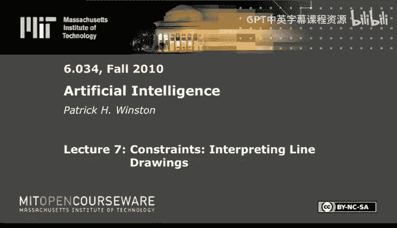
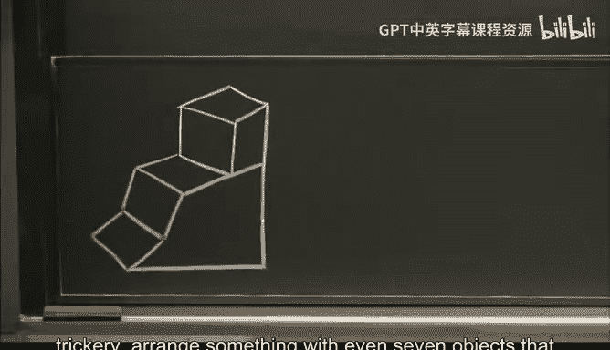
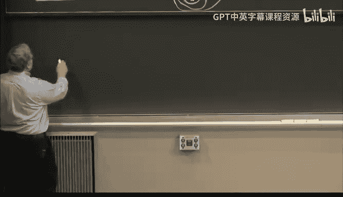
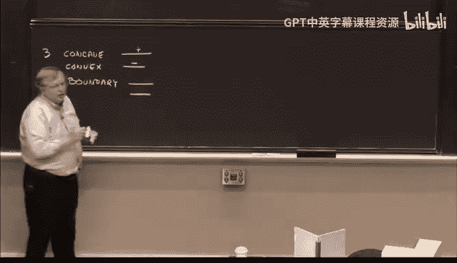
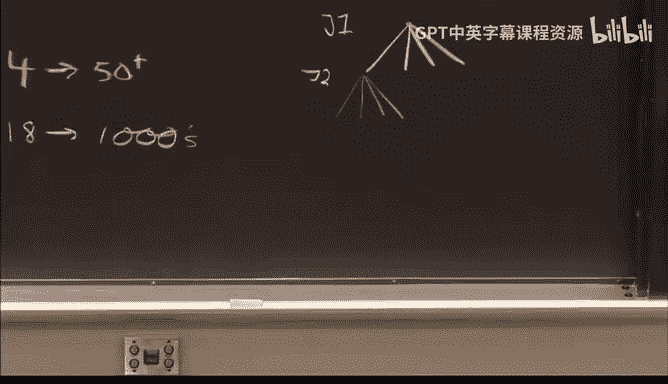
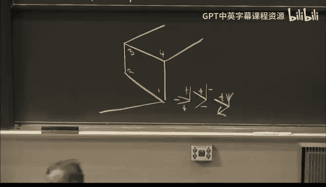
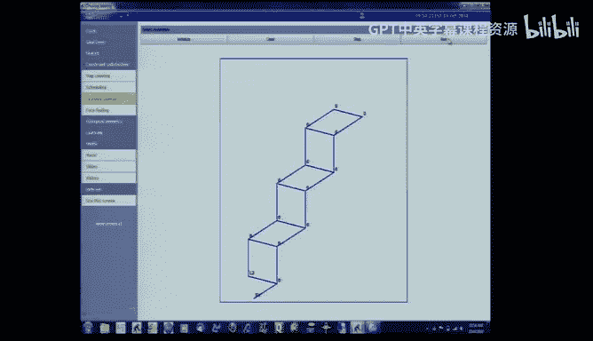

# 《人工智能｜6.034 Artificial Intelligence, Fall 2010》中英字幕 - P7：[07]7. Constraints_ Interpreting Line Drawings.zh_en - GPT中英字幕课程资源 - BV14fqSB2ECY

Many of you， maybe most of you will never have to work another search problem by hand in your natural life。

Others will want to take another run run out on the final。

I've been much criticized for this way of doing grading in the class。

 but the way I look at it is that。The relationship between students and instructors ought to be less adversarial than it used to be in the good old days when I was a student。

I especially remember a examination that we took， all of us took on Raleigh scattering， that was 803。

 I think， and back in the old days we had to take four physics courses， not just two。

 and we had to take four math courses， not just two back in the days when，Well。

 I was going to say men were men， but most of us were men in those days。

 I think we only had 20 women in our class。Anyway， we had a quiz on Raleigh's scattering。

And I thought， well， this is pretty hard。I got my quiz back。26。I thought， well， I've been found out。

I'm going to flunk out。My father will make me go to law school。I'll never attract anyone to marry。

Horrible things will happen。Then the instructor announced class average was 18。

 I was two standard deviations above that。They gave us the same exam two weeks later。

 and accounts vary， some people say that the class average went down。Anyway。

 today we're going to study some stuff。We're going to study some stuff that will make it possible if you understand how。

You can do that computation in just a couple of seconds。

 even with the delays introduced by the redrawing。Now， this particular program。I'm not real sure。

 and I don't have a proof， but I think it will take more than the lifetime of the universe to find a to find a legitimate coloring of the continental in the United States。

But by the end of the next class， you'll see how to do that liquidly split in just a couple of seconds。

 even with the red displayplay delays。Now we could， of course。Do this in two ways。

One way is I could start off by saying， let's see be a constraint satisfaction problem and just give you the result。

And anybody can do that， That's great。 and you need to learn some stuff that way。

But there are some things that you need to learn， I think， a different way。

 and that different way involves my telling you the story of how it all came to be。

This is a new field pretty much and therefore I know most of the people in it and I know all of the people who did the work that I'm going to tell you about today。

 and I'm going to tell you a little bit about the struggle for coming up with the ideas that。

LED to the。Later one of the most powerful。One of the most powerful methods you'll learn about in the subject。

It all has to do。Originally with an attempt to make a computer capable of seeing。

And everybody said to themselves， well， let's start with seeing simple things like children's blocks。

And so Aolfo Guzman， a graduate student of Marvin Minskys， was charged。With a summer project。

 which led to his PhD thesis of writing a program that could look at a line drawing and determine how many objects are in the line drawing。

So， for example。There。Behind my outline。Is a line drive。And you know， instantly。

Or you believe instantly that there are two objects there？

Even though in some deep sense it's ambiguous， there are all sorts of ways that you could。

Through trickery， arrange something with even seven objects that look that way but。

Most people would say there are two objects。So Guzman said about the problem of figuring out how to do that。

 And then his work was followed up by Dave Huffman， and his work was followed up by Dave Walttz。

 And his work was followed up by Gene Freuder， who's not listed there quite yet。

And I want to tell you a little bit of story how that all happened。So Gusman。Took a lot of pictures。

 He went to Boston Baby， the precursor to toys R U。Purchased a large block set。

On a government contract。And。To went about the business of taking a lot of pictures of them to sort of get a feel for the domain。

And eventually， he decided that he could build a program that could determine that there are two objects here by using the lines as。

As quant of evidence。About which。Faces belong together in an object。

So he said after studying these for a long time that these drawings tend to have a lot of arrowero type junctions and a lot of fork type junctions。

And when you see an arrow， it's a little bit of evidence that the objects on either side of the shaft are the same the face on either side of the shaft along the same object。

And over here。With a fork type junction， it suggests that the pair wise。

Three pairs of faces seem to belong to the same object。So。With that idea。

 he could come back to a drawing like this and start decorating it with these so- called links。

 these quant of evidence。That faces belong to the same object。And if I've done it right。

 you get something that looks like cell。It's a little hard to。

 to see what's going on on the drawing itself。 So let me number these。

Now I have it easier to deal with picture。There are。Two links between。One and two and one in three。

One length between 2 and 3。One between two and four， two here。To here。And one each from all of these。

So Gubin produces this evidence for how the problem ought to be solved。

 and then he begins to think about various ways of using the evidence。

So he could and did decide that one link。Is enough。To。

Presume that the faces belong to the same object。 And you can see that that's a little bit too liberal。

Because that says that the whole thing is just one object。So Guzman rejected the one length theory。

And went to the two lane theory。And the two link theory says， oh， well， let's see。

If we insist the two links， be there before we are willing to。Decide that it's the same object。

 And these。Three faces are pulled together into one object。

These three are pulled together into one object。But a last seven doesn't share two linkss with anything。

 So it's left dangling out there。So plainly， the two length theory is too conservative。So that。

As you would soon discover， in any UO project would lead you to the third theory。

 which is two length。Repeated。So now that we' form these super regions。We can come back and say。

 we'll merge superreg if they're connected together by。Two or more lakes。

So nothing new happens up here。This super regiongion is joined at 7 by more than。

W two or more linkss。So it pulls everything together like so。So that worked fine。 Well。

 it didn't work fine。 There were lots of examples of situations where it didn't work nonsensical in situations that were considered nonsensical by us humans because they just didn't。

It didn seem silly the kind of conclusions that it reached。So。

When Guzman presented his work in his PhD thesis defense。It' said， and who knows if it's true。

 but it said that Marvin Minsky thought it was great work and we should make him a professor。

It happens that Dave Huffman was also on the committee and said that it was ad hoc and the thesis should be rejected。

So we had two polar opposites of impressions there。 Dave Huffman， by the way。

 you've heard that name before， I imagine。It's the guy who invented Hufflin coding。

As a term paper in an information theory course taught by Bob Fno， he got an A， they say。

So Huffman didn't like it。 He thought it was a little bit too ad hoc。 It was too heuristic。

 It didn't take advantage of anything we might know about physics。And so people began to say， well。

 why does it work and when does it not work？And that's just about the best question you can answer in a situation like this。

And。By playing with some more of Goosemann's pictures and reflecting on them。

 it turned out that it worked because the world is full of。

3 face junctions。Or let me say three things for Texas because they're out there in the world。

We'll reserve the wordjunction for something else。And three phase vertexes。

Generally project into either an arrow。Or a fork。So thisman's whole program worked on the。Week。

 backward。Conclusion。That if you see one of those， it probably came from one of these。

 So this is in the drawing that's in the world。So by a process it's neither deduction nor induction。

 but rather abduction。You see one of those guys and you say， well。

 they often come from three faced vertexes in the world。 so if you see one。

 it probably came from a three faced vertex in the world， that's abduction。So， what's a。

Huffman saw all that being a mathematician。He began to think about how one might develop a different and better theory。

But we have to。Recognize that all of this work。Started off。With the efforts of Guzman。

 who was an experimentalist。And Huffman。Was a mathematician。So， naturally。

They approached the problem differently。So Huffman says。

I'm not going to concern myself too much with the actual problem that Guoseman was trying to solve。

 Rather I'm going to work in a very simple world。Which I can deal with mathematically。

So he decided that he was going to work in a world which had several characteristics。

Characteristic number one was that the world would be presented in general position。That is a say。

No screwcases。 So if you see a cube， that's going to look like this。And it's not going to look like。

This。So that's out and this is in， and the idea here is that that's not general position because if you perturb your point of view a little bit。

 you'll change those T junctions into forks scenario arrows。

So we don't how to deal with those kinds of weird。Kins of cases。So that's presumption number one。

Presumption number two。Is that we're going to be dealing with a world that's trihedral。

That means all vertexes out there are going to be formed from three planes。

So we're going to have the intersection of three plants。

So how many kinds of junctions can you see if the world is composed that way is the。Question that。

Huffman set himself upon。The next assumption。Was it there're going to be？4 kinds of lines。 You see。

 Gooseman only recognize two kinds of lines， Line that have a link and lines that don't have a link。

 and they don't have very much to do with the physical world。So Huffman says。

 I want to get the constraint out of the physical world。

 So I'm going to deal with four kinds of lines。Concave。Convex。And boundary。All right。

So each of those kinds of lines is going to be。Is going to have its own notation。

 We'll call the convex lines， plus。The concave lines minus and the boundary lines are going to get an arrow on them depending on which side。

Of the object。You which side you would see the object if you walk along the direction of this little arrow。

Let me。said something in。Yeah， sorry。 Thank you。So concave convex and boundary。

 thank you this down here。That's a concave line， and that would get a minus label。Oh， I don't know。

These lines you're seeing here。If there were stuff behind them instead of me。

 then all of those would be convex lines。Many times you see a boundary line， for example。

 now you don't see both sides of that line down here at the bottom， so that's a boundary line。

 and the arrow would point in that direction so as to keep the stuff of the object on the right as you walk along at kind of mathematical convention。

So three kinds of lines， four kinds of labels。 And there are some things left out。That's because。

Huffman wanted to keep his problems simple， something he can manage by hand， what's left out。

 cracks are left out， shadows are left out。There to do there's presumption that there's nothing of interest here with respect to that。

So let's have a little vocabulary before I。Before I go on， and I'll try to stick to it。

 but there's the stuff out there that that consists of vertexas。And edges。And over here。

 on the blackboard， we'll have junctions。And lines。And I'll try to stick the vocabulary。 All right。

 Yes， Christopher， say there were four types of lines。 Yeah， there are four kinds of The question。

 didn't I say there were four kinds of lines。 There are three lines of lines。

 but since we can label a boundary line in either direction。 we have four labels， okay。

Itpends on which side of the。Object this stuff is on。 and that will be clear， clearer。

 I think as I do an example。So，1，2。Three assumptions， a little bit of vocabulary。

So we have the possibility of making a complete catalog。This is so simple。

 we have the possibility of making a complete catalog of all the ways that lines can come together to form a junction。

With respect to these four labels。Go first you might say， oh my God。That will take。A couple of years。

But maybe it won't take a couple of years and in the end。To。Perhaps you're surprised。You discover。

That there are only 18 ways to arrange the labels around a junction in this world。

 everything else is excluded。If you have something that's not in the set we're going to produce now。

 it can't be built。With。Tryhed over over Texas。So I've listed up there。Six Ls。5 forks。F Ts。

And three arrows。Let's see if I can figure out。Why there are those 18 and nothing else。Well。

If we have face three vertexes coming together， that means there are eight ocins， right。

And the stuff of the object may fill 1，2，3，4，5，6，7， or all8 octas。Now， of course。

 if you fill all eightoctins， there's no junction， so we don't consider that case。

If we don't fill any of theocs， there's no junction。

 so there's no vertex so we don't consider that case。

But if just one of the eight octains is filled with stuff。

 then we can look at it from any of the seven remaining octas。So right now。

You're looking at it from one of the seven remaining octens， and if I'm not mistaken。

 you're going to see a fork style junction there， right？

And you're going to see a for style junction in which all of the edges are。K。Thanks。An。

 an unfortunate selection of names because the linguists tell me that we index all of our words by the first phoneme and those have the same first phoneme。

 so they're easily confused。So here's a for style junction。

 and we know that one way that's legitimate。For the lines that come in is with four pluses。

Now that's not the only way you can see that， and here's another way。There's an al file junction。

 right， and both of those are boundary lines。And we want to draw the。

Boundary line indicators on there so that。If we walk along the arrows。

 the stuff of the object would be on the right。So I suppose to make it easier for me to do my drawing。

 I should look at it this way。And then I would say， well， that has to be。

An legitimate way of labeling a junction。Are there any more？Well， there are seven altogether。

 but many of them are the same。There is one more that's a little different， though。

 I can hold this guy up like so。And if I'm holding it the right angle for you。

 you see an arrow style junction， right， Two boundaries， and a barb is convex。So， in this particular。

Okay， so I've got that。I've got that， and I've got a plus there。

And that's all there happened to be for the oneoctant filled with stuff case。

I happen to be able to reverse this though， and here's the seven ocns filled case， right？

So that tells us that it's possible to have。A vertex out there in a space。

That when reduced to a junction on the board， deserves three minus labels because all of these that you're seeing now are concave。

So， another。Fork style。Junction looks like so。And since there's only oneocta to look at from。

That completes our analysis of the seven Okins filled case。

Now we have a couple other possibilities here， we might have five as filled with stuff。So。

 that means。There are three options that we can look from。

So let's suppose that these little chalk pieces are little people。And they're looking at this。

Junction down there。Where this white object is fused with a table。

I'm fusing it over the table because I want to consider it to be one object。

 We can view it from the three objects indicated by those three little chalk pieces。

And ask ourselves， well， in the event that we look at it from those three places， what do we see。

 And if we look at it from from the perspective of the。piecece of purple chalk。

 I have to walk around to be sure looks like an arrow junction。With two concaves and a convex。

I get there right？没有。So I'm looking at it from this perspective， it's an arrow。

 this is convex and these two are concave because I fuse the paper box with a table。

Looking at it from the perspective of this blue guy。

 let me rotate it so you can have a better understanding of the blue guy。

 It looks like a concave line and a boundary。So it's an L。And this one is a boundary。

 And that's concave。 And by a kind of symmetry。We're also going to get that one from the other side。

 the third of the three octas。Well， we're off running， but we still have。An awful lot to go。 And we。

 we could。 we could manage to deal with it by thinking。About this object once again。But instead of。

Instead of。This situation out here to turn it around and look at this vertex。

 think about the junctions that it can produce， I think I'll do that for you because you really have to play with this and move it around a little bit to see how things are going to look。

So let me think about how that's going to work out。I know that one of the possibilities。

Is going to look like cell。I might as well not hide that from you。

 it's going to be what happens when there's a little man looking up at the junction。

And this one's going to be minus。And now we've got two more that are just like that。And look like so。

And you say， oops。You say，A't those just the rotational variant of each other。

 and the answer is sure？I write them all down because if you get。The forkile junction in space。

 there are three different ways it can be labeled， depending on which of the lines you put the minus label on。

So that takes care of that。 And then there's one more of these for style junctions。

 and that's plus plus minus that derives from this case。

And there appeared to be three more of these L style junctions and they look like。Let's see plus。

And plus， I'm having to think this through as I go。And then。And that's it。Well， what about to tease。

 Well， in this world， the only way you can get a T is if some object is obscuring another object。

 and if an object is obscuring a line， it can be any line at all。

So that's why the four remaining ones are easy beyond description to label。And of course the。

Ccross pieces of the tea are all boundary lines with the obscuring object on the right。Now。

 let's see。 we've taken care now of the 1，3，5。And seven object ocins filled cases， what about two。

 four， and six？Well， it turns out you can have。Vertexes that are made that way， too。

 but they will have more than three faces。 They have six faces。 They'll be like what happens。When。

An object comes together at a point like so。Like that。

You can play with it a little bit and see that if you have two。

 four or six objects filled with stuff， there are more than three faces。

 so we're going to ignore those。So our constraint is going to be a little more。

A little more severe than。It would be suggested by the terminology Huffman uses they're going to be trihedral all right。

 but they're also going to be three faces。So we went to a lot of work there。

 But what have we discovered， We discovered in this world， this is a complete 100%。 Nothing excluded。

 Nothing else can be there。 catalog of all possible ways that junctions can have。

Line labels arranged around them。There's nothing else in this world。

So that's a very powerful constraint。So now let's see what we can do with it。

This example is usually more fun when the red Sox are doing better， but。

They're not it yet we'll use it anyway。 We're going to start with an object that looks like home plate。

And now I ask you the question。Can you build one of those？I don't know， let's give it a shot。

We're going to assume that this object is hanging， floating in space。 So therefore。

 all of these lines around the boundary。Our boundary lines， like so。Now that gets us off to a good。

 This's just hanging in space， Kris， all right， you look confused。

 It's just hanging in space so all the liness around the edges are。Places where you see only one。

Side has stuff on its own。So。That enables us to just quickly run around the periphery and put arrow labels on all those outside lines。

Now， we have a lot of arrowero style junctions on the boundary。 That's commonly the case。

So we can run over to our catalog of all possible labels。And we see that if we have an arrow。

With boundaries on its barbs， there's only one of those。

So I know instantly that there must be a plus on the shaft。

So we can come back here and take all of these arrows here and label them with plus lines on their shafts。

And a line can't change its nature along its length。So if it's a plus line on one end。

 it's going to be a plus line on the other end。哎。So what else can we do here is in the deep inside is a forkt junction。

 It's got concave markers， conite， convex markers on both of those two lines。

So we go over to our catalog and say， what can we say about it。

 given that there are pluses on two of its lines。Look。

 that means that the third one has to be a plus as well。And now we're done。

 we've labeled everything except。それです。What about that guy？

There's an L style junction with pluses on both of its two lines。Is there one of those in my catalog？

No。Therefore。I haven't passed a necessary condition for constructability in the world that I've made。

You can't make it， you can't construct it。So， Huffman's。Ideas give us a way of testing something。

To see if it's not possible for it to be。In this world。If it passes the test。

 does that mean it's possible？No， it's a necessary but not sufficient condition。On this one。

Weho call our occupation。On this one， maybe it will help if we put in another line。For example。

 we could put in a line like so， you feel better about it now。I don't know。 let's see。

This has to be a plus for the same argument we used。On several other arrows before， that gives us a。

Arero style junction here with a plus on everything。Is there such a junction label？让。We lose。

It doesn't help， you think you can make it， but you can't。I think。

Actually constructeded as a 3D object。You think you can construct it， is it 3G？

He thinks you can construct it as a 3D object。Let me show you the next example， Chris。

Consider this example。因为看。Your intuition is yes， so let's label it。I've already lost。

We just boost that up a little bit to make the situation more clear。So already。

 I've got myself in a situation where I can't label that。But you feel like you can make it。

 So what's wrong。What's wrong is what Elliot？Scured work。That we haveな。Ba now。打多啊。

Putting a little interpretation on what Elliot has said。If you look at this situation back here。

你 get呢。4 faced junction there。So you can make it， but not with three faces。

So some of these look like you can make it。That they can't be labeled because you need more than。For。

Faces at a junction。 And we can carry that idea back here。 if you can make this okay。

 but this junction， you got two in the back and two here。 So it has four faces。细埋啲啊。All right， so。

That's。That's。That's Goosemann's contribution。That's Huffman's contribution。

 Huffman was a mathematician， but we wanted to build robots back in those days。

 And neither one of these guys solved the problem of dealing with natural objects with shadows with cracks。

With more than trihedral for Texas in space and what to do about that。Well， that was a problem。

And another graduate student。David Walttz set about to solve。So， Walttz。Decided。

That he would not be content。Unless he。Added cracks。Shadows。Non trihedral ver Texasexas。啊。Yeah。

 non trihedral over Texas。And。Stter Texas and light。These considerations led to Waltz。To go from。

Four labels。To 50 plus。Because he had to pack a lot of information into each of the labels that he put on a line。

 what kind of light was on the right， what kind of light was on the left， maybe it's a crack。

 maybe it's a crack that all sorts of considerations。

Here we had 18 ways that lines can come together around junctions。That went to。

Thousands of junctions in Waltz's world。So here's Guzman。He writes a program that sort of works。

Down below， we have Huffman。Huffman， who has。A theory， but solves the wrong problem。 So here's。

 here comes Wall said he's trying to solve the right problem with with a satisfying。

Theory that has a generalizable principle。So when we get all through with this。

 we'll talk about criteria for success and we'll conclude that to have a really successful thing。

 you need a problem to start with。You need a method that works。

 and you have to show that it works because of some principle。So Guzman had the problem。

And something that worked。Huffman had a method which worked on the wrong problem。

 and it's left a wtz to bring it all together。So Walt does all of this work。

 and now he has instead of 18。Labels， he has thousands， instead of。4 line labels。

 he has more than 50。So naturally， it becomes difficult to work these by hand。

We were able to work those examples with。And those Huffman examples by hand。

 we started with labeling everything on the boundary and worked our way and there's no particular method there。

 which is easy to work out the puzzle。But poor Wals， he didn't have that luxury。

So he might have in a typical scene， He might have tens or even hundreds of junctions to the label。

And no easy way of dealing with it， so he naturally writes himself。A depth first search program。So。

 here is。Vertex。Or rather junction number one。There are many choices。

For which label can be used on it。And for each of those choices。

Whatever he's decided junction number two is has its own suite of possibilities。

 and so it becomes a simple depth for search problem， right？

So in actuality， soon as soon as Walttz， he was my office mate at the time。

 I could tell you this for a fact。As soon as he wrote this program。

 he kept looking over at the computer， they were big in those days， they all had lights。

 so you looked over the computer to see if the lights were still blinking。

Because he'd start this first search program up and nothing would happen。

He thought the computer had crashed。Nothing happened。Why did nothing happen？

Because the search space is exponential and much too big。

For an ordinary computer or maybe even an ordinary universe。So， Walsh has to。Do something else。

He has to come up with a new method for using all of these labels。

After about a year and a half's worth of hard work with lots of paper on his desk and little blocks。

After a year and a half of hard work， getting all these。

Js and labels figured out he then has to come up with a method for figuring out how to use them。

And so we don't know whether to think his biggest contribution was that label set or his method。

 and probably both deserve about equal billing。Oh， I don't know how to explain what Walttz did。Well。

 one way is to do an example。And I think I will hazard an example。啊，给了。Let's see。

 Let me find some space。 I think I'm reduced to going over here， but that'll be convenient since the。

Line labels are here。Here's my example。And you say。

 how can I give you just partial a part of a picture？ Well。

 I can you can assume them looking at at this through a window。

 So the edge of the window form boundary lines， and they exert no constraint whatsoever on what's behind them。

So this is a legitimate drawing to have to think about。By the way。

 is this ambiguous or do you get a firm sense that there's a unique interpretation of all those lines？

I think there's a unique interpretation of all those lines。

What what I'm going to do is I'm actually going to solve this problem using Huffman's labels。

But Waltz's method， because I can't simulate on the blackboard something with。

 with 50 line types and thousands of line junctions。 So I'm going to use。

Huffman set to demonstrate Walsh's algorithm。So Walsh's algorithm involves starting out。By plopping。

On some junction。All of the possible things that can all of the possible labels that the answer has to be drawn from。

 so let me number these in the order that we're going to visit them。So， and so far。

 I've just put down the。Three， for。Options that are residentant on that first junction。

And I have to take note of exactly what they do with the lines。That come out of the junction。

So let's say， I'll just copy them down。 One possibility is this one。Another possibility is this one。

And another possibility is。Plus， plus minus oops， I've got plus plus， no， that's right。

 So that right so far， all I've done is copy the junction labelings from my library。

And at this point。Waltz's algorithm says there's nothing else to do but go on to junction number two。

And unfortunately， sadly。There are lots。Of labelings。That have to be considered。

Onjunction number two， six of them。One， two， three， four， five， six。So one of them looks like that。

Another one looks like that。One of them is plus hair， arrow N。Another one is plus hair。Errow out。

Another one is。Minus here。Ararrow down。And minus here arrow up， I think I've copied those all right。

But now， having copied those down， Wals's algorithm looks around at the neighboring junctions and says。

 are any of the things that I just placed on junction 2？

Disallowed but what I've already placed on a neighboring junction。So it looks over here。

In step number two。And it sees。That these three arrows require the line that joins junctions 1 and 2 to be either。

Minus。Or plus。Right。So of the six possibilities， I can only keep the ones that are likewise content to put a plus on that line that joins the two。

So that means。That the influence。Flowing。From junction 1 eliminates that one， eliminates that one。

Eliminates that one and eliminates that one。So half of them are gone。

All of the ones that try to put a boundary line on that。Lying between one and2 or disallow。はい。Now。

 likewise， we could say， well of the remaining ones， do they restrict what I can do at junction 1。

So let's see here's a minus。And here's a plus。 so both of those。

All of these possibilities over here are still alive。So now， continuing on。

We have to see what we can do at junction three。These are arrow labels again。

 so we have to copy exactly the same label set as we had before。

And now we look down in junction 2 and say， what does that tell me about the three that I've just placed？

If we look。Up from junction 2， to see what kind of constraints it puts on here。

 we have this one alive。And this one a lot， I guess we've eliminated four of the six。

So we have these two alive， and they both put。Boundary lines。

 I think I must have had this boundary line wrong， right？No， that's right。Oh yes， I see。Plus。

This one goes。Hang on a second。You've let me do something wrong。So， plus。Is out。

And I must be one that goes up this minus。It up。Oh， yes。I'm too hasty。

Uncertain about what I was doing。So， let's see。This guy has a boundary going down。

 and this guy has a boundary going up。All of the others have been eliminated。

So that means that something that tries to put a concave line there is gone。

And something that tries to put a plus line there is gone。So the influence。

Flowing up in this direction in the third step eliminates that guy and eliminates that guy leaving only this guy。

ButNow， the thing I was worried about is you have to also at this point。

 go down to2 and see if there's any further constraint on what can be what can survive down there based on what has happened over here at junction 3。

Now let's see。This one goes up， which is compatible with the survivor。But this one goes down。

 which is not compatible with the survivor。So when I bring this down in step three。

 this guy is eliminated。So now I'm down to just one interpretation。For。

What can be going on at vertex number two and one interpretation for。Proertex number three。Now。

 let's see。 this can propagate。 So now that I've made a change on vertex number 2。

 I have to also see if that。Causes a change at vertex number one， so it's propagating through。

And now I can see that the only possibility here is a minus。

The label is' coming down from our survivor， so that eliminates these two。Few。

It's hard to do this by hand， but I've got three of the four things labeled。

And even with just three of the four labeled， I'm down to a single interpretation for all of the junctions and the lines between them。

So there's one left。We have to deal with that forkwork tax。

 we better deal with it because for all we know this is not a legal drawing in this world。We have。

Five fork pers is to place。But you know what， I don't have to draw much here because I know that this is forced to be a plus now and this is forced to be a plus now。

 and there's only one fork vertex with any pluses on it at all。So now I can come through and say。

 well， the only possible survivor is this one。These are gone。

And now I have an interpretation for all of the。Jnctions。And I see that the winners are this one。

And this one。And this one。And this one。So I've got a unique interpretation， this line is convex。

 this one is concave， this is a boundary， that's a boundary， and this line is convex。

 and that's convex。Now， that's a lot of work， so I better check and make sure I got it right。

You'd like to see this demonstrated and make sure I haven't made a mistake， I'm sure that， right？呵。

Let's see。あれ。So each of the places where a line is obscured has。4 possibilities labeled E。

 The arrow junctions are labeled A， the forks。 There are five of them at the fork junction 5。

 So let's just step through here。And see what happens， boom， I' got it。I did do it， right。对。哦。

So let's try some more。What do you think will happen with this one， unique solution？It stopped。

Blug on my program。Unthinkable。What's happened？It is genuinely ambiguous。It can be。

Something hanging down from the ceiling， or it could be。

Something that we can think of as a step going up from left to right。

Let's look at something more complicated。Do you think it'll work？

Not enough constraint for us to figure that one out。 It's equally ambiguous。

 but a little bit larger example。What about this one。You have it。

 the stuff is creeping up from the lower left up to the upper right。Yeah， bingo， it worked。

 it's unambiguous。It's variation of the same thing we had before， but let me just for fun。

 take these two lines out。What do you think will happen now？Seems to be doing just fine。

Until it hits the upper right hand corner and discovers it can't label stuff。

So it propagates back down and what looked okay on the lower left。

There's no good after all。These results are kind of consistent with what we humans do when we look at these kinds of things。

 So it's very likely that we， in our heads， do have some constrained propagation apparatus that we use in vision。

By putting that aside， we can think about other kinds of intelligence different from human that might use this kind of mechanism to solve problems and involve a lot of constraint and finding a solution。

So here we saw the constrained propagation activity at work and line drawing analysis。

 but next time what we're going to do is we're going to see it at work in map coloring and who cares about map coloring。

People who do scheduling because that turns out to be the same problem。

