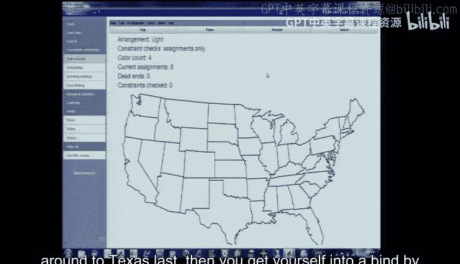
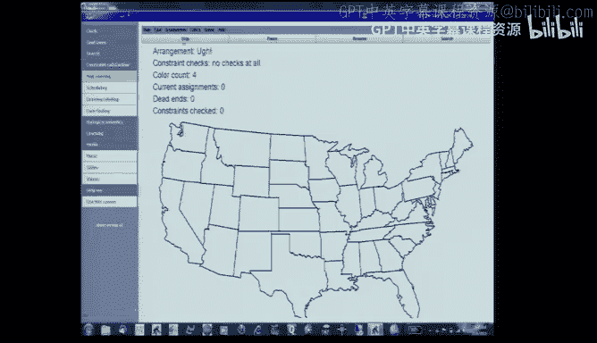
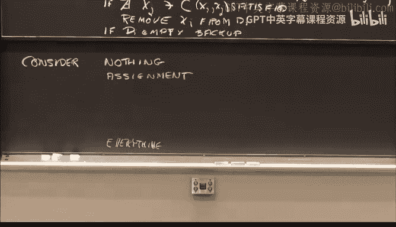
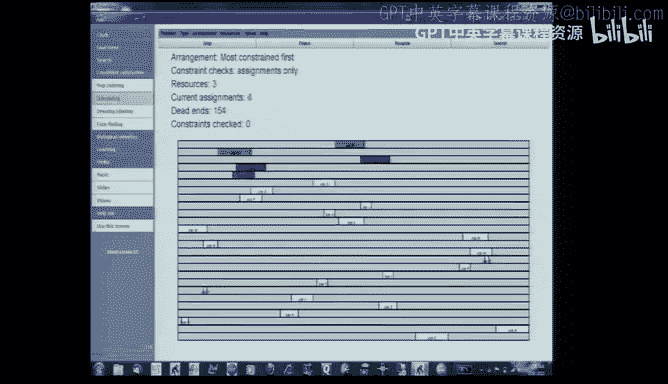

# 《人工智能｜6.034 Artificial Intelligence, Fall 2010》中英字幕 - P8：[08]8. Constraints_ Search, Domain Reduction.zh_en - GPT中英字幕课程资源 - BV14fqSB2ECY

It's too bad in a way that we can't paint everything black because this map coloring problem sure would be a lot easier。

So I don't know what we're going to do about that。Well， how long is this going to take。

 maybe we should here's what we're going to do， we're going to wait till either all the laptops are closed or this program terminates。

Whichever comes first。So how long is this going to take， I actually don't know。

 I think it'll take more than the lifetime of the universe， but I'm not sure。

 so let's take a little look at a slightly easier map coloring problem。

We'll stop this one and change the map to something I call Simplicia。There's 26 states。

 one for each letter in the alphabet。And what we're going to do is we're going to do a depth first search for a suitable coloring of this map。

We're going to go in order， A， B，C， D E。And as I've suggested here。At each level。

 we're going to rotate the color choices so we don't overuse any one color。

So if we launch this particular search， this depth first attempt to color this map。There it goes。

 and maybe we should wait until it terminates。Or maybe we just let it run。

 and it'll terminate perhaps sometime within the lecture。

Or maybe we should just let it run over the weekend。Or。

How long do you think would have to wait if we want to come back and watch it terminate？

roughlyly 30 frame a second on calculating it all in my head， I don't want to bet my life on it。

 but I think about 5000 years。And if we want to use as many states as there are。In the United States。

 in this demonstration。You get up to numbers like。10 to the 17th years。17th， 18， 16。

 I'm not exactly sure I did a rough calculation。And of course， you could do some parallels into that。

 And it's not bad as chest where you need all the atoms in the universe。

 you still can't do it and things like that。 acting as computers。 But still， it's pretty horrendous。

 And the problem， the problem is， well， the problem is。

The problem is illustrated by this diagram I put in back of me。If。You do a depth first search。

And you have a problem like Texas。If you label， if you assign a color to Arizona， Oklahoma。

 Arkansas and Louisiana first， and then wait around to do Texas last。

Then you get yourself into a bind。

By your fourth choice that you don't discover until your 48th choice。

So what happens then is that you start developing this tree like this。

 you get to those states surrounding Texas。Texas is the last state。

Assign a color and there's nothing left for it。And that problem was there on the fourth choice and you don't discover it until your 50th choice。

So you develop a horrendous， impossible search。So you simply can't do it that way。But now。

 not to worry， we now come equipped with the idea of constrained propagation。

So we could just take a country with four states like this， each can be labeled red， green， blue。

 and yellow。So just like in a case of line drawings。

 will'll pile up all the possible things that the。Value can be red， green， blue， and yellow， red。

 green， blue， and yellow， red， green， blue， and yellow， and we start up constraint propagation。

So we say for the upper left hand corner state。Is there any reason to believe that R is impossible？

Well， we look at our neighbors and see what kind of constraint flows in from them。

 And sure this guy can be green and this guy can be blue。 They don't have to be red。 So there's no。

Nothing that rules out red。And there's nothing that ruless out blue。

 and there's nothing that ruless out yellow。And there's nothing that rolls out green。

So constraint propagation just sits there。With his finger up， its nose， doing nothing。

So it doesn't look like we can use either。Death first search。Or constraint propagation。

So we could just。Give up and cry。 But maybe there's some other approach that will help。

 So let me actually work the Texas problem。So with apologies to。Houston。And Tyler。

Here's the map of Texas。There we are， and here's roughly speaking， Arizona is over here somewhere。

And we've got Oklahoma in and。Ol Bill Clinton's state， Arkansas。

 and then Louisiana sticks out there a little bit。So there's our map of。

OfThat a particular part of the country。So we got Arizona here。Oklahoma here。Arkansas here。

And Louisiana here。And Texas here。And we have elected to assign colors to these states in that order。

 so this is one， two， three。4。And we're going to do that。

We're going to rotate our color choices just so we don't overuse any one color。

But we're going to also have a look at Texas as we go around。

 because Texas is a state that borders on the states that we're choosing colors for。

So the only possible colors that Texas could be are red。Green。Blue。And yellow。

So as we make our choices around here， we'll say that。I don't know。

 we don't have to adhere to any particular style， we can say that Arizona is going to get colored red。

That's going to rule out our over here for Texas because no adjacent states can have the same color。

Then we go over to Oklahoma and we're rotating our color choices， so we'll say that can be green。

And that's fine because it's consistent with the red here。

 but it rolls out the possibility that Texas can be green。And then we go over here to Arkansas。Red。

 green。ble。😔，That's fine， that's consistent with the green on Oklahoma。

 but if we look at its neighbors， we know that Texas is forever forbidden to be blue now。

So now we go over to Louisiana， and remember we're rotating our color choices because we don't want to overuse them。

So this means that the first choice we're going to make here for Louisiana is yellow。

And that's fine because it's consistent with Arkansas。

 but it's not so fine because it's now ruled out the last possibility for Texas。

So even though Texas is going to be the 50th 4 48th state that we color。

We're going to say at this point， there's no need in going on。

 but better back up because there's nothing left for Texas when we get around to coloring it。So。

 that means that。This yellow is ruled out here。This yellow reappears。

We select the next color in line for Louisiana， which happens to be red。

And now that's consistent with this yellow that's still left for Texas。

 and it's also consistent with the blue that's up here for Arkansas。So that's cool。

 I wonder if maybe we can make an algorithm out of that。And solve problems like this。

 you see sort of the intuition of what we're doing。

We're actually using the martial arts principle again because the whole problem is that local constraints。

Undiscovered local constraints are causing downstream problems。So we're going to use the enemies。

Power is against them， and we're going to look at those local constraints as we go and make sure they're not going to get us downstream。

 not going to get us later on。So now I'm going to look like I'm getting a little formal。

But I'm just getting a little bit more formal because I want to have a language， have some language。

That I can use to describe what's going on， so it's clear what the choices are。So to start off with。

 we're going to have to have some vocabulary。So let's start off our vocabulary here。

We're going to have a notion of a variable。呃V。And that's something that can have an assignment。Yeah。

 just。You know。Yeah， there's nothing complicated about that and a value。AV x。Is something that can。

Be an assignment。A little bit circular， but we're all computer scientists， you know what I mean。

So the next thing is a little slightly less obvious and that's a notion of a domain。D。

 and that's going to be a bag。Of values。Okay， so one more thing， a constraint。

That's a constraint C is a limit。On。Oh， in our examples， it's mostly going to be pairs of variables。

 pairs of variable values， but in general， it could be variable values。

So if we go back here to Texas， we could say， okay。

 how does that vocabulary drape itself over that configuration。

 and the answer is the states have the role of variables。The colors had the role of。Values。

And the domains are the remaining color possibilities that we can still use on a particular state。

 and the constraint in this case is the simple map coloring constraint that no states that share a boundary can have the same color。

So states are variables， colors are values。 Doomains are bags of colors and constraints。

 There's only one。Jason states can't have the same color。So that's how it fits with this vocabulary。

So now what did I actually do here， Well， what I actually did here。

 I'm going to now formalize a little bit by writing it down in pseudocode。So here we are。

 we're going to。Have a look at what we did here with our intuition。

 and we're going to reduce it to a procedure。And here's the procedure。Remember。

 we're doing depth first search on this stuff。 I did a depth first search。

 We're going to do a depth first search。And for each。Y。First。Search assignment。Okay， so here I am。

 I'm labeling Arizona and then Oklahoma and then Arkansas and then Louisiana。

 when I give each one of those a label， a color。I'm going to do this procedure Every time I make one of those assignments。

 the last one was。The last one that caused trouble was coloring Louisiana yellow。

 each time I put one of those colors down， each time I make an assignment。

 I'm going to do this procedure。 So for each step first search assignment。

For each。Variable。V considered。No， I don't know what I mean by you don't know what I mean by considered。

 but when I put a label when I put a。A value。 It chose something as a color for Louisiana。

I thought about Texas。So I was considering the variable Texas when I made the assignment for Louisiana。

Now， I want to be a little bit vague about what I mean by consider right now because there are lots of choices about how much stuff you actually consider。

So let me just say consider， and then we'll open that up and talk about the options in a moment。

So for each variable V considered。For。Let's call that variable V sub I。For each。

XM I for each value in。The domain。Of that variable。

Or consider each of the things that's still surviving。For each of those。For。Each。Constraint。C。

 that's between x sub I。And some x sub J。Where。X sub J is an element of the domain of J。Oh。

 that sounds awfully fancy， but that it says in the case of Texas up there。

Whenever I consider one of the values that's still remaining as a choice for Texas。

I want to consider all of the constraints between that variable and the adjacent value and the adjacent states。

And I want to be sure。Did anything I leave in the domain？

Is okay for some selection in the other states。Some remaining choices in the other states。

So that's why we're getting pretty nested here。We're doing depth first search。

We are considering the variables in a certain collection of variables for each one of those。

 we're considering all of the values that still remain in the domains of those variables。

 and then for each of those values， we're checking to see if it satisfies some constraint。

 satisfies the constraint that are placed upon it。So for each of these constraints。If。

There does not exist。And x sub J。Such that。The constraint between x sub I and x of J。Is satisfied。

Well， if in that adjacent place， there's no nothing that is consistent with。A value。

 then weve got to get rid of it。If that's true， if there does not exist some value in an adjacent variable。

Such that that constraint is satisfy， we're hose， we've got to get rid of that value。

So we're going to remove。X sub I。From。对是吧。Okay， now that's fine。

 That's sort of what I did with Texas。 as soon as I plop down a value for Louisiana。I said， well。

 what are the possible values in Texas， red， green， blue， and yellow， let's consider red。

Let's consider the constraints between Texas and all the adjacent states。

 One of those constraints says it can't be the same color as Arizona。

 the only color I've got available for Arizona since I've already made the assignment is red。

 red is not consistent with red， so I've got to get rid of it。So it looks complicated。

 but it's just intuition。So what do we do if we get to a situation where the domain is empty？

That means whenever we get around to making an assignment to it， there won't be anything left。

So if that ever happens。If the domain ever becomes empty。Then what do we do？We got to back up。系。

So the intuition is clear， this is the algorithm。 The algorithm， when you work through it。

 think about it， whether it makes sense and what not， how it fits with Texas。 Yeah， it sure does。

 All we're doing。Is we're making these depth first assignments and in the neighborhood of those depth first assignments。

 we're looking around to see if the values that are possible include something。

 And if they don't include anything， we know we made。An irrevocable blunder， and we have to back up。

So that's the essence of the idea。Now， how well does it work？ Well， it depends on。

A little bit depends on what we choose for considered。There are lots of choices for what we consider。

So let me enumerate some of those choices and then we'll work it out on we'll have a look and see what they do。

Oh， I guess。One possibility is consider nothing。Let's try it out。

So our type of search is going to be no checks。What do you think is going to happen？

We're not even checking the assignment。Well， that's pretty fast， unfortunately。

 since we haven't even checked the most recent assignment， we get lots of places where there。

States that are adjacent to each other that have the same color。That's no good。

So another thing we can do。Its。Consider everything。

That's no good because that would say as soon as we color our first state。

 we check to make sure that every all 47 other states can be colored。

That seems like overdoing it a little bit。But in any case， at least we want to check。The assignment。

So if we go back here and check the assignment。

And see what happens。Let's see type of assignment assignments only。Boom， all that geeez， that's。

 that's what I got in trouble before。 This is the thing it's gonna to run。For a。

17 billion years at nanosecond something like that。Well。

 it's only a billion years if you're running at that nanosecond speed。

 so I guess maybe you could do that。Have a fast computer。

 but this isn't going to work because of our unfortunate choice of Texas as the。

As the last state to be considered。And the unfortunate coloring of the four surrounding states right up front。

And our unfortunate decision to rotate the colors so as to avoid overdoing any one color。

So this doesn't work， but you know， we went to the trouble of working out the business with。

With Texas by hand using the domain reduction algorithm。

Better make a note that this is the domain reduction algorithm。

And what we're going to do is we're going to check the neighbors of the assignments。

Just like we did here， we checked Texas each time we made one of those four choices because it's a neighbor of all of the choices of the states that we made。

So one thing to do is check neighbors。So this is one， two， three， let's see what happens。

Check neighbors only。No。Shoot， I don't know， it's okay with Texas， right？

Because it didn't color the states around Texas。With all of water color choices。

But it's still getting in trouble in other places。Like states like Missouri， Kentucky， Virginia。

 Tennessee， states with lots of boundaries。So I don't know whether this has going to， oh， there。

 it finally worked。W did a lot went through a lot of effort， though。

I don't know if for the sake of comparison， we might make a note that it ran into。9，139 dead ends。So。

 but it did do some good。 It didn't take。A length of time longer than the remaining part of the universe。

But if it's a good idea to check the neighbors。If we make a change to the neighbors。

What might that suggest that we do？In addition。Well。

 it might suggest that we make a change to a neighbor， that we check its neighbors too。

Make sure they're all right。So another choice。Is to propagate。

So propagate through variables with reduced domains。Let's see how that works。哦，我没。嗯。

Must have made a mistake let's try that again。Oh， maybe we better slow it down。

All that gray stuff is showing the limit of the propagation。M， so。See at for a second。

40 is about 10 seconds。不om。Not bad， zero dead ends。And it was a lot faster。

 I didn't happen to notice how many constraints were checked and the other thing。

 I think it was around 20，000 or so。This is a lot less。So this looks like a good idea。

But why do they label it number five， because there's something between this and number three？

So number four。Is。Through V with D。Reduced。To one value。

So we're not going to propagate through all of the variables who have their domains shrunk a little bit。

 we're only going to propagate through those that have the greater shrinkage all the way down to a single value。

All right， so let's see how that might work。Anybody want to place any bets on this one？Let's see。

 we checked 2623 constraints last time。Let's see what happens this time。

You can see that the extent of the gray is less because it's not propagating so far。

And we breathly await the answer。me see we found our winner。This does。A couple of dead ends。

 but the number of constraints checked is less than1 thousand00。So in general。

 with problems like this， you have all of these choices for what you consider。

You don't want to consider nothing because then you're not honoring your constraints。

You'll certainly want to consider the things you just made assignments for because otherwise you'll。

Pre a constructive solution that violates a constraint。

You don't want to do everything because that's excessive work。And so these two- I sorry。

Checking the neighbors。Is a good idea， but it's always better in practice。

 in practice inevitably it the case that it's better to do some propagation through the things that you've changed。

How much propagation， it doesn't seem to do much good to propagate through things that are just changed。

 but it does seem to do some good to propagate through things that have changed and been reduced to a single value。

So as soon as you got a neighbor。Of some assignment you just made。

It has its domain reduced to a single value。 Then you check its neighbors， too。

 So you check the neighbors of the neighbors of the neighbors of the neighbors。On and on and on。

 as long as he found a domain。Being reduced and not only being reduced。

 but reduced to a single value。All right， so that's the domain reduction algorithm。

 and I guarantee we're going to give you a problem like that。

And I know you don't know how to work those problems yet。

Because this is a little bit abstract and to work these problems in the exam setting you need to。

K know a little bit about how to keep track of the variable values and remain in the domains and that sort of thing and you'll learn more about that in your recitations and in the mega recitation and tutorials。

So we could go home except that there are a few little flourishes to deal with here。

And those flourishes。Those are。Flourishes include some dirty。Filthy little secrets。For example。

 I've chosen as my classroom example to pick on Texas and arrange for this situation to be especially ugly。

So I could arrange the states in a different way。We have highly constrained states。

 that have a lot of bordering states around them。And we have other states like Maine。

Up there that has only borders on one other state。So。I don't know。What do you think？

Should we arrange the states in for our depth first search in the order of least constrained to most constrained or most constrained to least constraint。

In other words， should we start with？Missouri or Tennessee or Kentucky or something like that。

 or should we start with Maine？Very think。He have a 50% chance of getting it right despite cookingping a points。

He thinks we should start with the most constraint first。

Do we have a volunteer who wants to suggest that we start with the least constraint first？

Thats's the way I always work on stuff。 I' work on a book or something I have。500 things to fix。

 I'll always choose to work on the easiest stuff first so that I feel like I'm making the list a lot smaller。

Leave the hardest things to last。But we don't have any volunteers who want to bet on。On that idea。

 at least constraint first。Okay。Jason wants to suggest that we should work on lease constraint first。

 Well we have ground truth because we can just try it out。

And I guess we'll stick with our shrinking to one value thing here。

But we will reorder things so that we have the。Least constrained first。

So right away we got a color for Maine。Maybe we ought to speed this up a little bit。Okay。

 that's a good idea。 Jason suggested this。We only checked 1732 constraints， and we had 59 dead ends。

 So let's try the other way around。And we'll go back to four frames a second。

So we're working kind of from the middle of the country out with this one。

We're going to deal with Maine， I guess， last。没有。Which is better。Too bad。

 I think it looks like this is better。In fact， let's not be so aggressive with the use of constraint propagation。

 let's just check the assignments only。And if we go back to an arrangement where we have lease constrained first。

And we'll crank up the speed。Well， actually， we would have to crank it up pretty big because。

The states like Missouri， Tennessee， Kentucky， they're going to be like Texas。

And so we're kind of back to the length of the universe type problem here with the least constraint first and no use of constraints other than to check the。

The current assignment。So， let's stop that。and check the most constrained first assignments only。

I don't know how long was this going to take？That's the dirty little secret。

If we had arranged our states from most constrained to least constrainted。

 ordinary depth for a search with none of this stuff we talked about today， it would work just fine。

Right。So it's a little bit like games， do you use progressive deepening or do you use alpha beta and the answer is both？

YouUse everything you got to deal with the problems。Depending on the problem。

One or another of the things you incorporate into your approach will work just great if you're lucky。

So now I promise that this is not useful not only for people who want to color maps Scott。

 who wants to do that， we know it can be done with four colors。

 but it's also useful for doing all kinds of resource planning problems。

So I want to show you a resource planning problem and I want you to think about while I'm doing it。

 think about whether it's actually analogous to the map coloring problem， all right？

So here's the deal， you have just landed a summer job。With Jet Green。A new airline。And Jed Green is。

Is a low cost。No frills。Harding any maintenance type of airline。

And they want to fly mostly between Boston and New York。

 occasionally they want to fly to Los Angeles。And they're trying to get by with the smallest number of airplanes。

 so that's why we have a kind of resource allocation problem。Jack Green。

So I want to write down what their schedule looks like， they have one flight。F1。It goes from Boston。

To Los Angeles to JFK。Like so。It's an early in the day flight。Then they want to have another one， F2。

That flies from JFK。To Boston。And then they want to have another flight。A little later in the day。

That flies from Boston。The JFK。And a little later than that。

 they want to have another flight that goes from。JFK。To Boston， theyre。

 they're going start off mostly as a shuttle airline in the beginning。 So that's F1， F 2。F3。And F4。

 and they have a fifth flight， F5 that goes from Boston to Los Angeles。 that takes a long time。

So it looks like this on the schedule。 Of course， we have time going that way。So that's Boston。

To LAX。Now your job is to determine if they can fly the schedule。With four aircraft。

And naturally you don't want to overuse any one aircraft because you like to have kind of even wear on them right。

 so as you make your choices， you'll rotate the aircraft。So you'll assign this one to A1。

Aircraft number one， this one will be A2。This one will be A3。And this one will be a 4。And oops。

 there's no aircraft left for。The flight to Los Angeles was only I up for。So it's obvious， right。

 this is 100%。Exactly the map coloring problem， even down to the four choices。

Because you have the constraint， the no single physical aircraft。Can fly。

On5 2 flights at the same time， just like no two adjacent states can be colored the same。

So there's a no same。No same time constraint。Like so。

So if you were assigning flight aircraft to these flights， youd get down to F4， the fourth flight。

 and you'd say， well。Let's see。This guy down here can be A1， A2， A3， or A4。

 but if I choose A4 for that fourth flight， then there'll be nothing left in its domain。So。

You have thus。Set the problem up。To be identical to the map coloring problem。

 and of course you can enrich it with other kinds of constraints。So for example， you might have。

 this is a not same time constraint。And these。I mean。

 this is at JFK and it flies out of JFK so maybe you can use those。

 maybe you can use the same aircraft for those， but not if they're right up against each other because you have a minimum ground time rule。

So there's a minimum ground time constraint here。And there's a minimum ground time constraint here。

And there's a minimum ground time constraint here。And if these aren't the same city。

 then you've got to allow enough time for them to fly between the two cities that are involved。

So the constraints can get a little bit more complicated， but the idea is the same。So you say to me。

 I don't trust you， show me， okay。So let me show you。Oh， by the way。

 there's one more way to make this map coloring problem easier， right？

Let's see the arrangement is going to be alphabetical， the type is going to be assignments only。

And we know that's a loser。But not if we。You use a whole lot of colors。

So it was the use of four colors that got us into trouble。Oh， that's an aside。

 but it will be coming back in a moment or two scheduling。Here's that problem。嗯。

 you could almost see it working just like the map coloring thing。But that's maybe too easy。

Let's do this one。See， this is just like is like simplicityimplicia。

 we've kind of got a goofy arrangement here that's guaranteed to lose at the bottom because of choices made at the top。

But that's okay， we can stop this and we can do。We could change to Czech neighbors only。And boom。

 there it goes。All right。Or alternatively， let me see if I can do it this way。

 most constrained first type will be assignments only。不。That worked fine too。

So you might choose to have a slightly harder problem，' like this。And we can。Search away。Actually。

 I don't know if this will complete or not， it's a randomly generated example。But。

 you know you're going to lose your summer job if you can't figure out whether you can do this or not。

 so what are you going to do？Ellott， you got any thoughts about how are you're going to save your job？

So here's the question you've been asked。How many。Airplanes does jet green need。And you decide， well。

 four seemed to work before， so we'll try four here and you're not sure if it's going to terminate or not。

 I mean， in your lifetime， let alone in your summer job。Hellliot， let me give you a hint。

Look at the outline。Now lie it up here on the board。The last item。Now， what' does that mean？How。

 what's the maximum number of airplanes we're going to need？supposeuppose we've got。5 flights。

What's the maximum number of airplanes whatever need？fi。

What's the minimum number of airplanes will need？Wan。

So let's try it with a small number of airplanes and a large number of airplanes。So， that。

Showed us very fast that we can't do it with one airplane。That showed us very fast。

We could do it with 10 airplanes。Volunteer。What are we going to do to find the actual number as fast as possible and at least give our boss a reasonable answer。

Even if not necessarily， the exact number very fast。But it's easy， right。

 we're going to start up here with one computer。And we're going to start down here with another computer。

And see what happens。So let's see if we can do it with not。Let's see if we can do it with。8ight。

Let's see if we can do it with。Seven， these take almost zero time， right。

 because they're under constraint。Ohow， that's good，7， let's try six。Actually， let's try too。

It loses fast。Let's try three。I don't know， maybe if you let it run long enough three will work。

I doubt it。While we're at it though， we might as well go back here and try it with six。

 remember seven worked real fast。Oh， she's six， so that was six， right？Yeah。

 so let's try it with five。Okay， so it runs real fast with five， it terminates real quick with two。

So we've got three and four left。So we can tell our boss。IAnytime algorithm。

That you're not real sure， but you know it's going to be either three or four。

And then you got two computers， you can let both run and see if either one terminate。

So you have three and four， my guess is that three will eventually give up。But of course。

 there's another little problem here。 we haven't used the most constrained first。If we did that。

 we might be able to do it even faster。 actually， I don't think I can make that switch without getting another random assignment。

Let's see what happens。Maybe so。Oh I already had most contrain first， okay。

So it didn't help to actually switch and I think I've got a new schedule to work here so that's the end of the story you can do good resource allocation if you do several things all at once number one。

 you always want to use most constraint first number two you want to propagate through domains reduced to a single algorithm and number three。

 if you really trying to figure out what the minimum number of resources needed is。

 you do this under over business and you can quickly converge on a narrow range where the search is taking a long time and be sure。

That it lies within that narrow range because when you over resource。

 it's fast and fast to complete and when you under resource， it's fast to terminate。

And so you can just squeeze it right down into a very small range。 And that is the end of the story。

 Enjoy your holiday on Monday。 We'll have two classes next week。On we and Friday。As advertised。

