# 《人工智能｜6.034 Artificial Intelligence, Fall 2010》中英字幕 - P9：[09]9. Constraints_ Visual Object Recognition.zh_en - GPT中英字幕课程资源 - BV14fqSB2ECY

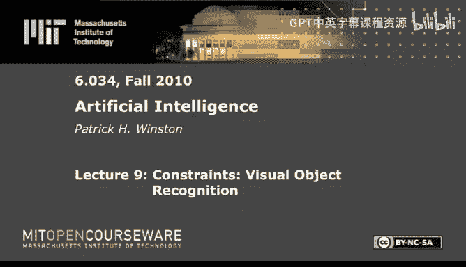

You know， it's unfortunate that politics has become so serious。Back when you were a little。

 it was a lot more fun， you could make fun of politicians。There's a politician。

 some of you may recognize。But it's convenient to be able to vary what this particular politician looks like。

For example， we can。Go from cookie Bar。To radical。We can go from Superwoman。To Bmba。Socialite。

 I like put socialite into this。There she is。Or we can move the slider over the other way。

Get the bag lady。Alert。leep。Sad。Happy。How does that work？

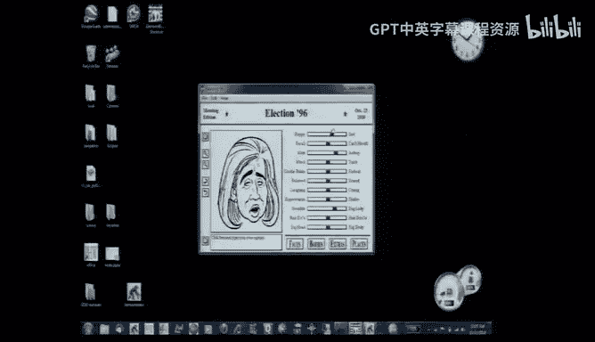

I don't know， but I bet by the end of this hour， you'll know how that works。 And not only that。

 you'll understand something about。

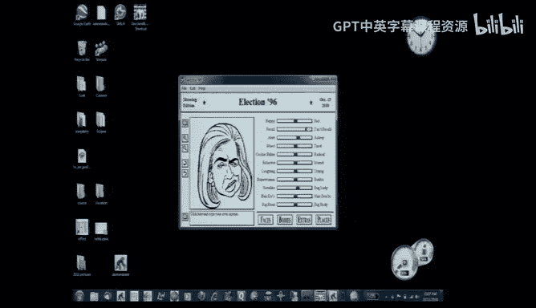

What it takes to recognize faces。It turns out that some theories of face recognition。

Are based on the same principles that this。That this program is based on。

But you can kind of guess what's happening here。There are several many stored images。

 and when I move those sliders， it's interpolating amongst them。So that's how that works。

But the main subject of today is this matter of recognizing objects， Fas could be the objects。

 but they don't have to be。 this could be an object that you might want to recognize。

And I want to talk to you a little bit about the history of this problem and where it stands today。

 still not solved。But it's an interesting exercise to see how the attempts at solution have evolved slowly over the past 30 years。

 so slowly， in fact， that I think，If someone told me how long it would take to get to where we are 30 years ago。

 I think I would have hung myself。But。Things do move slowly。

 and it's important to see how slowly they move because。

They will continue to move slowly in the future， and you have to understand that that's the way things work sometimes。

So to start this all off， we have to go back to the ideas of the legendary David Marr who dropped dead from leukemia in about 1980。

I say the gospel， according to Mar， because he was such a。

A powerful and central figure that almost anything he said was believed by a large collection of devotees。

But Mara。Articulated in a set of ideas about how computer vision would work that started off by suggesting that。

With the input from the camera。You form a kind of。You look for edges。And you find edge fragments and。

Normally， they wouldn't be even as。Even as。Well drawn as I've done them。Now。

 or as badly drawn as I've done them now。 But the first step then in visual recognition would be to form this edge based description of what's out there in the world。

And Mark， I call that the primal sketch。

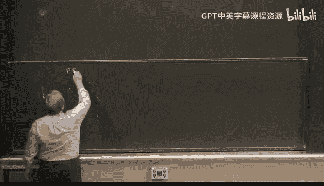

And from the primal sketch， the next step was to decorate the primal sketch。With some vectors。

 some surface normals。Showing where the。Faces on the object were oriented。

He called that the2 and half D sketch。Why is it 2 and half D， Well， it's。

 it's sort of 2D in the sense that it's still camera centric in it's。

It's a way of presenting information， but at the same time it attempts to say something about the three dimensional or arrangement of the faces。

So the speculation was that you couldn't get to where you wanted to go in one step。

 so you needed several steps to get from the image to something that you could recognize。

And the third step was to。Convert through primal， they two and a half to sketch into generalized cylinders。

And the idea is this， if you have a regular cylinder。You can think of it as a。

Circular area moving along in accent like so。So that's a description of a cylinder。

A circular area moving along an axis。 you can get a different kind of cylinder。

If you go along the same axis。But you allow the size of the circle to change as you go。 So。

 for example， if you were to describe。A wine bottle。

There would be a function of distance along the axis that would shrink the the circle appropriately to match the。

Dimenssions of a wine bottle。A fine burgundy I perceive。 in any case， this one。

Once converted into a generalized cylinder。When masked against the library of such descriptions。

 results。In recognition。Great theory based on the idea that you start off by looking at edges and you end up in several steps of transformation。

Producing something that you can look， you can look up in a library of descriptions。Great idea。

Trouble is。No one could make it work。It was too hard to do this。It was too hard to do that。

And the generalized cylinders produced， if any。Where two coarse。

 you couldn't tell the difference between a Ford a Chevvallet or between a Volkswagen and a Cadillac because they're just two coarse。

So although it was a great idea based on the idea that you have to。

Due recognition in several transformations of representational apparatus just didn't work。

So much later， maybe 15 years later or so。We get to the next part of our story。

Which is the alignment theories， most notably the one produced by Shimon Oman， one of Mar's students。

So the alignment theory of recognition。Is based on a very strange and exotic idea。

It doesn't seem strange and exotic， too。Mechanical engineers for a while because they're used to mechanical drugs。

 But here's the strange and miraculous idea。 Imagineine this object。You take three pictures of it。

You can reconstruct any view of that object。Now， I have to be a little bit careful about how I say that。

First of all， some of the vertexes。Are not visible in the views that you have。 So， of course。

 you can't do anything with those。So let's say that we have a transparent object where you can see all the vertexes。

If you have three pictures of that。You can reconstruct。Any view of that object？

Now I have to be a little careful about how I say that， because it's not true。

What's true is you can produce any view of that in orthographic projection。

So if you're close enough to the object that you get perspective， it doesn't work。

 but for the most part。You can neglect perspective after you get about two and a half times as far away as the object is big。

And you can presume that you've got orthographic projection。So that's a strange and exotic idea。 So。

 but how can you make a recognition theory out of that。 So let me show you。

Here's one drawing of the object， I need two more。Oh， let's see， let's have this one。

And maybe one that's tilted up a little bit。It it's important that these pictures not be。Not be。

Just rotations in one axis because they wouldn't form what you might think of as a kind of basis set。

So there are three pictures we'll call them A B and C。And then we want a fourth picture。

Which will look like this。It doesn't have to be too precise。And we'll call that。

The unknown and what we really want to know is if the unknown。Is。The same object。

That these three pictures were made from。So let me begin with an assertion。

I'll need four colors of chlk to make this assertion。

What I want to do is I want to pick a particular place on the object like this one。

And maybe the same place on this object over here， those are corresponding places， right？

So I can now write an equation。That the ex coordinate of that unknown object。Is equal to。Oh。

 I don't know， Al x of a。Plus alpha plus beta， I mean， x to B。Plus Yama x。

Subed plus some constant talk。Well， of course， that's obviously true because I'm letting you take those alpha beta。

 gamma and ta and make them anything you want。So although that's conspicuously， obviously true。

 it's not interesting。So let me take another point。

And of course I can write the same equation down for this purple point。And now that I'm on a roll。

And having a great deal of fun with this。I can take this point。I make a blue equation。And you know。

 I'm destined to do it。So I've got one more color， I might as well use it。

Let's just make sure I've got something that works here。That's this one， that's this one。

I hope I've got these correspond subsponences， right？I got one off。Which， which color。Okay。

 so this one goes with this one， goes with this one， but is that what wrong？Oh， oh， of course。

 it's wrong。Excuse me。Goes down here。哎。And then this one is off as well。

I wouldn't get a very good recognition scheme if I can't get those correspondences， right？Which is。

One of the lessons of today。Okay， now I've got them right， and now that equation is correct。

 I think I've got this one right。Already， so now I can just write that down。

 I'm on a roll I'm just copying this。So those are a bunch of equations。

And now the astonishing part is。That。I can choose。Alpha。A的。听见吗？难差。To be all the same。That is。

 there's one set of alpha beta gamma and tau。That works。For all four points。

So you look at that puzzled， and that's okay to be puzzled because I certainly haven't proven it and I'm asserting it。

But right away， there's something interesting about this。

 And that is that the relationship between the points on the unknown object and the points。

And the stored library。of images。Are related linearly。

That's true because it's on the graphic projection。Linenially related。

 so I can generate the points in some fourth object。From the points in three sample objects。

With linear operations， Christopher， is that the ex coordinate of。It's the X coordinate。

 each of those， Christopher asked about the X coordinates， each of these x coordinates。

Are meant to be color coded。 It gets a little complicated with the notation and stuff。

 So that's the reason I'm color kind of color encoding the coordinates。 So that so the orange。X of U。

Is the x coordinate of that particular point。No， not in 3D space in the image。Yeah。

That's a 2D projection of an orthographic projection。So we're looking at drawings。

And those coordinates over there are the two dimensional coordinates in the drawing。

Just as if we were on your retina。Yeahあ。不是太。真。So he askeds about curve surfaces。

 and the answer is that you have to find corresponding points on the object。

So if you have a totally curved service and you can't identify any corresponding points you lose。

But if you consider our faces， there are some obvious points， even though our faces are not。

Ma any means flat like these objects， we have the tip of our nose and the center of our eyeballs and so on。

So if that's true。What does that mean about recovering alpha beta， gama and Tau。Can we find them？

Notlan what do you think？How do we go about finding them。

 You're nodding your head in the right direction。Split it as four equations and four nodes。

 four linear equations and four nodes， so obviously you can solve for alpha beta。Yama and T。

 if you know that these equations are correct。So how does that help us with recognition？

It helps us with recognition because we can take another point。Let me say the square point here。

And this。Corresponding。Square point here。And this is corresponding。Square point here。

 and what can we do with those three points now？We've got alpha beta and gamma and tau so we can predict where it's going to be in the fourth image。

So we can predict that that square point。Is going to be。Right there。And if it isn't。

We are highly suspicious about whether this object is the kind of object we think it is。

So you look at me in disbelief， you'd like me to demonstrate this， I imagine。Ok。

Let me see if I can demonstrate this。So I'm going to do this aified in a slightly simplified version。

 I'm only going to allow rotation。roAround the vertical axis。And just so you know， I'm not cheating。

 there's a little slider here that rotates that third object。Let's see why are there just two？

Two known objects and one unknown well， that's because I've restricted the motion to rotation around the vertical axis in some translation。

So now that I've spun that around a little bit。Let me pick some corresponding points。Os。

What's happened？

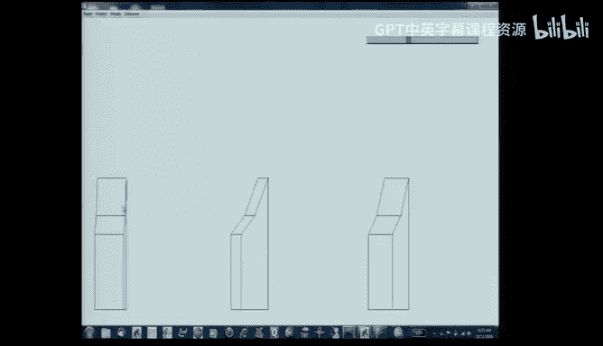

Well， let me run that by again。

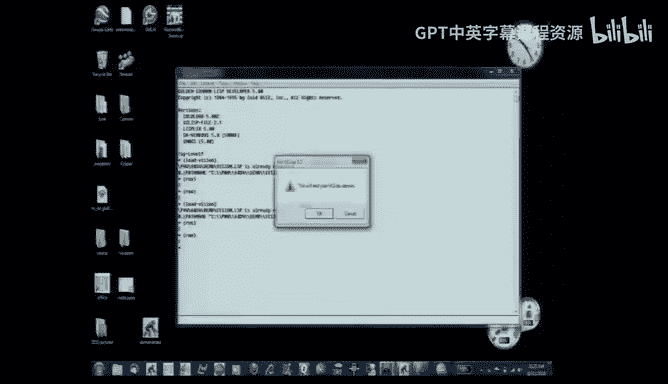

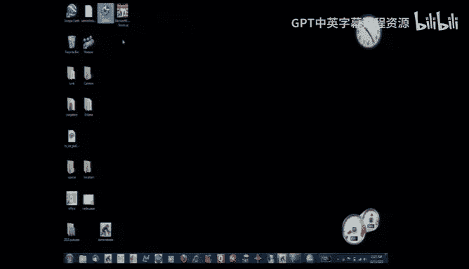

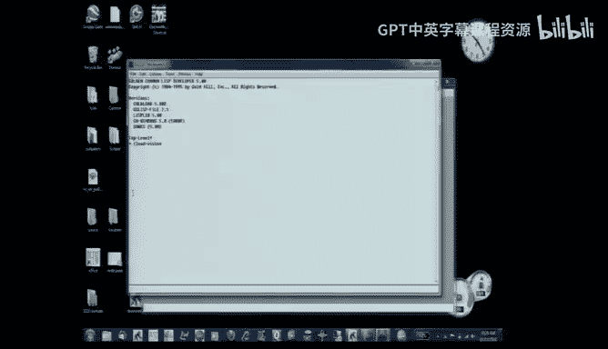

Okay， so there's one point I've selected from the model objects and the corresponding point over here on the unknown is right there。

 I'm going to be a little off， but that's okay。So let me pick that one。

And then that corresponds to this one。Chrisishna， would you like to specify a point so that people no。

 I'm no， I'm not cheating？Pick a point。Pick a point， Krisna。So right。Right。This one。Opes。

 I've got to pick it out the model first。Now I'll pick it over here。Boom。

 so all the points are where they're supposed to be。まこ。Well。

 it's suppose that the unknown is something else。This is a carefully selected object， because。

The points are all the correct positions vertically。

 but they're not necessarily the correct positions in the other two dimensions。

So let me pick up this point。At this point。At this point。At this point。And Krishna。

 have you picked this point？So let me pick this point。So if it thinks that the。I know。

Is one of these obelisk objects。Then we would expect to see all of the corresponding points correctly identified。

But boom。All the points are off。So it seems to work in this particular example。

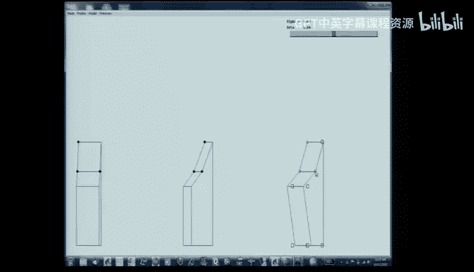

Find the alpha and beta。Using two images。And I predict the locations of the other points。

And I determine whether those positions are correct， and if they are correct。

 they have a pretty good idea that I have in fact， identified the object on the right as either an novelisk or an organ。

Depending on which of the model choices and the。Unknown choices I've selected。So啊。

The thing I have left to do is to demonstrate that what I said about this is true。

So I'm going to actually demonstrate that what I said about this is true using the configuration in this demonstration because it's much too hard for me to remember。

Mattrix transformations for generalized rotation around in three dimensions。

So here's how it's going to work。The Z axis is going up that way。Or。

It's going to be pointing toward you。And what I'm going to do is I'm going to rotate around this axis。

And what I want to do is I want to find out how the x coordinate in the image of the points move as I do that rotation。

So。Here's the x axis。This is the coordinate that you can see。Here is the Y axis。That's in depth。

 so you can't tell how far away it is。And the z axis， X， Y。

 Z axis must be pointing out that way toward you。So now I'm going to consider just a single point。

On the object and see what happens to it。So。I'm going to。I'm going to say to myself。

 let's put it in some kind of standard。 Let's put the object in some kind of standard position。

 I don't care what it is， but it could be just random just spinning around。

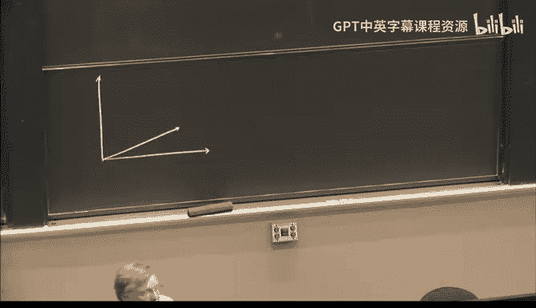

Some position。We'll call that the standard position S。And that means that the。Ex coordinate。

Of the standard position。Its x sub S。And a Y coordinate。Of the standard position is。Why is the best？

And now I'm going to rotate the object three times。Once to form the A picture。

 once to form the B picture and once to form the C picture。 And you can make those choices。

 I don't don't have to depend。 Those can be anything， right。So， let's say that the。

A picture is out here。So that's the a picture。The V picture is out here。

And the unknown is up that way。And so。What I want to know。Depends on these vectors。

 we'll call that theta of a。And this is status sub B。Oops， yeah， that's status to be。And this one。

Is theta subun。So I would like to know。How。啊。X。Sub a。Depends on。X sub S and Y subs。

And I can never remember how to do that because I can never remember the transformation equations for rotation。

 so I have to figure it out every time。And this is no exception。

 So what I'm going to say is that this vector that goes out to S consists of two pieces。

There's the X part。And the why part。And I know that I can rotate this vector by alphas sub a。

By rotating this vector and rotating that vector and adding up the results， right？

So if I rotate this vector by alpha sub a。Then the contribution of that。To the X coordinate。Of A。

Is going to be。Given by the。抽算。Of theus sub a multiplied by x sub S。

So you can just exaggerate that motion say well， if I pitch it up that way。

 then the projection down on the x axis is going to be this length of the vector times the cosine of the angle。

All right。Now there's also going to be a dependence。On。Y sub S。

 Let's figure out what that's going to be。 I've got this vector here。

 and I'm going to rotate it by theta sub a as well。

 If I rotate that by theta sub a and see what the projection is on the x axis。

That's going to be given by the sign of the angle， but it's actually it's going a wrong way。

 so you have to subtract it off。So that's how I don't have to remember what the signs are in these equations。

Well， that was good， and now I can now them off from running I can do what I did before it makes it easy to give the lecture because this is going to be x to B is equal to x sub S times the cosine。

Of theta sub B。Minus y sub s。Times the cosine。Of theta， hope， you're letting me make mistakes。Shan。

This is。I can generally tell by all the troubled looks， but there should be some shouting as well。

 that's the sign and that's the sign。And one more time。X sub u is equal to。X sub S times the cosine。

Of theta subbu。Minus y is the S times the sign。Of theta sub U， and I forgot to be up there。

So there are some equations and we don't know what we're doing。

 we're just going to stare around them a while and see if they sing us a song。

So let's see if they sing us the song。What about。X sub A and X sub B。

These are things that we see in the image， these are things that we can measure。

What about all those cosines and sines and theta A's and theta B's？Oh we have no idea what they are。

 but one thing is clear。There。True for all of the points on the object。

Because when we rotate the object around by angle theta。We're rotating all of the points the same。

 but through the same angle， right。So with respect to any particular。You of the object。

Here we are in the standard position。Here we are in position A。

The vectors to all of the points on the object are rotated by the same angle。

When we go from the standard position to the A position。So that means that for all of the。

All of the images in this particular rendering with a particular rotation by theta A， theta B。

 and theta U。Those are constants。Now remember， this is for a particular theta A。

 a particular theta B， and a particular theta u。As long as we're talking about all of the points for each of those rotations。

Those angles and cosines are going to be the same。For all possible。

For all possible points on the object。Okay， so now。

We go back to our high school algebra experts and we say， look at these first two equations。

We can get rid of We can express。 We got two equations。 And what we can now conceive can screw to be。

2 unknown。What are the unknowns that are left， We can measure A and B。Whatever the cosines are。

 they're the same for all the pictures。So if we treat those as constants。

 then we can solve for x sub S and y sub S。喂。We can solve for x sub S and y sub S in terms of x sub A and y and x sub B。

 and a whole bunch of constants。But。I don't know。A whole bunch of constants。Let's see。

We can gather up all of those cosines and ratios signss and cosines and all that stuff。

And they all put them all together because they're all constants。And then we can do this。

 we can say x of u。Is equal to。Well， it's going to depend on x of a。An X to B。

And by the time we wash or manipulate or screw around with all of those cosides。

We can say that the multiplier for x of a is some constant alpha。

And the multiplier for x sub be is some constant beta。So that's not a slight of hand。

 that's just linear manipulation of those equations。And that's what we wanted to show。

That for orthographic projection， which this is， there's no perspective involved here。

 we're just taking the projection along the X axis。For that kind of projection。

 then we can demonstrate for this simplified situation。That that equation must hold。

Now I want to give you a few puzzles because it's something so simple。

 suppose I allow translation as well as rotation。What's going to happen？Yeah。

 you had a constant town， but what do we need to do in order to solve it？

Let mean just back to patients。我自己他一边。维也纳酸。I don't know tall， I don't know exus。

 and I don't know bicycle。So I need another equation， where do I get the other equation？

From another picture。That's why up there， I needed four points。

That covers a situation where I've got。Three degrees of rotation and translation Here I got by with just two pictures。

In this illustration， that would involve a translational element， so I needed three pictures。

 and this one got full rotation， so I needed four。So。Great idea。Works fine。Trouble is。

It doesn't work so fine on natural objects。 It works fine on things that are manufactured。

Because they all have identical dimensions。So if I made a million of these。In a factory。

I'd have no trouble recognizing them。All I have to do is take。3 pictures。

 recorded coordinates of some of the points。 and that'll be done。

Trouble is the natural world isn't like this。And。You aren't like this either。

I don't know if I'm trying to recognize faces。It's not that easy to do all this。First of all， it's。

 it's a little difficult to find。The exact point， the exactly corresponding points。

 I made I made a mistake in doing it myself。 And if the computer made a mistake。

 it would certainly make an error because it would be。

Using non corresponding points to make predictions， it would be way off。

But this is still in the tradition of working from local features in the objects。Toward recognition。

So， having。Having looked at that theory。We also find it a little wanting。 works great。

 in some circumstances。Doesn't seem to solve the whole recognition problem。Years pass。

Shimon Alman comes up with another theory。That's not so much based on。Edge fragments。

For the location of particular features。But rather。On。Coorrelation。Taking a picture of。

Say chna's face。Taking a picture of the whole class。And then。

Using that as a kind of correlation mask。Running it all over the picture of the class。

 seeing where it maximizes on。Now that's vague， I'll explain what I'm talking about with to correlation in a minute。

But it's basically saying。Do I have if I have a picture of Krisishna？Where do I find him。

 I'll find them in one place。ButYou know what？Christna doesn't look like anybody else。

So I might not find any other faces。And my objective is to find all the faces。

And maybe that idea won't work either。Or to take another example。Here's a dollar bill。

We haven't had raises in quite a while， so this is my last one。

It's got a picture of George Washington on it。And I can look all over the class。

 and if I use this as a face detector， I'd be sorely disappointed because I wouldn't find any faces。

Because thank God， nobody looks exactly like。George Washington。

 so the correlation wouldn't work very well。So that idea is a loser。But wait a minute。

 I don't have to look for the whole face。I could just look for。ball for eyes。

 and then I could look for noses。And maybe mouth and maybe I have a library of。

10 different eyes and 10 different noses and 10 different mouths。Would that idea work？

Probably not so well。 The trouble with that one is I'd find eyeballs in every doorknob。

There's just not enough stuff there too。To give me a reliable correlation。

So let's make this a little more concrete by drawing some pictures。Halloween is approaching。So。

Here's the face。All right。Here's another face。So those might be faces in my prerecorded library of function faces。

Now along comes this face。What's going to happen？Well。I don't know， let's try to get another face。

I don't know， it could be a pretty weird public face， I suppose。

 but I mean it to be something that doesn't look very much like a face。So， if I'm doing。

A complete correlation with either of these faces in my library。

 neither one will match this one very well。喂。If I'm looking for fine features like eyes。

Then I've got。These eyes。Everywhere。So it doesn't help very much。So you can see where I'm going。

 and you can reinvent。Almonds， great idea。我りず。We don't look for big features like whole faces。

We now' look for small features， like individual eyes。We look for intermediate features。

Like two eyes in a nose or a mouth in a nose。So let me do that。Then we can say。Well。

Here are two eyes and a nose。Up， that's found in this one。And what about。对呀。

Combinmination of that nose and that mouth， oh， that's over here。

AndNeither of those features can be found in the third image in the fourth image。

So that's the Goldilocks principle。When you're doing this sort of thing you want things that are not too small。

 not too big。I've got thetilskin principle up there too， by the way。

 because I meant to mention that Mara was a genius at naming things。

And even though many of his theories have faded。He's still known for these names like primal sketch and to anactee sketchtch because he was such an artist at naming the concepts。

 he even got credit for a lot of stuff that he didn't do， not because he was deliberately trying to。

即话。To get it inappropriately， but just because he was so good at naming stuff。

 So he had the rumple stillkin principle back then， and now we have the goilocks principle。

 not too big。Not too small。That leaves us with the final question， which is。Okay， so if。

What we want to do is look for intermediate sized features。

How do we actually find them in a a sea of faces out there。 See， I might have a library。

 I might take 10 of you and record your eyes。Take another 10， record your mouths。

And they may be put together in a unique way for each of you out there。

 but it's likely that I'll find Juana's eyes somewhere else in a crowd。

And nickel's mouth somewhere else in the crowd。So how do we？In fact， go about finding them。

And I mentioned the term correlation a couple of times and now， let me make that concrete。

So let's consider a。A one dimensional face。That looks like this。It's just a signal。

And I'm going to consider a one dimensional image。And in that one dimensional image。

I've got a facsimile of the face。And the question is。

 what kind of algorithm can I use to determine the offset in the image where the face occurs？

And so you can see that one possibility is you just do an integral。啊。The signal in the face。

And the signal out here。Over the extent of the face and see how it multiplies out or to make it。

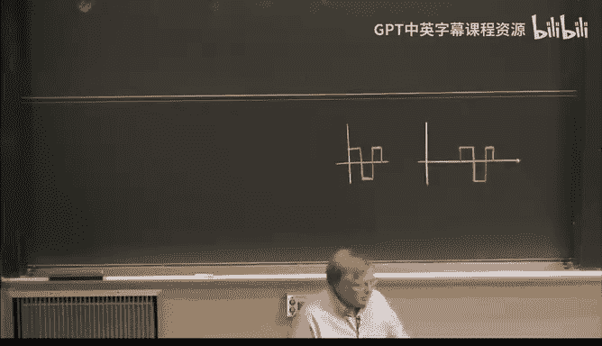

Less loyally and more MITish， let's say that what we're going to do is we're going to maximize。

Over some parameter x。The integral。Over x。Of some。Face。Which is a function of x。And the image G。

Which is。function of x。Minus that offset。So when T， when they offset T。Is equal to this offset。

Then we're essentially multiplying the thing by itself and integrating over the extent of the face。

And that gives you a very big number。If they're lined up。And a very small number， if they're not。

And it's even true。If we had。A whole lot of noise。To the images。But these are images。

 they're not one dimensional， but that's okay， it's easy enough to make a modification here were want to maximize over。

Translation parameters x and Y。And these are no longer functions of just x。

There are also functions of Y。放首。Allright， so that's， that's basically how it works。

 And we won' go into details about normalization and all that sort of thing。

 because that's the stuff of which。Other courses remain the custodians。

So would you like to see a demonstration？Okay。

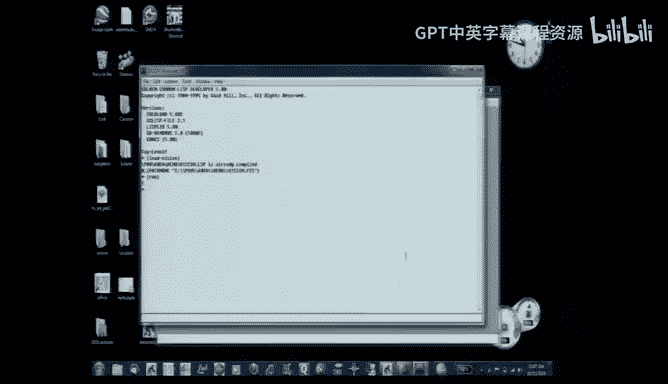

な？

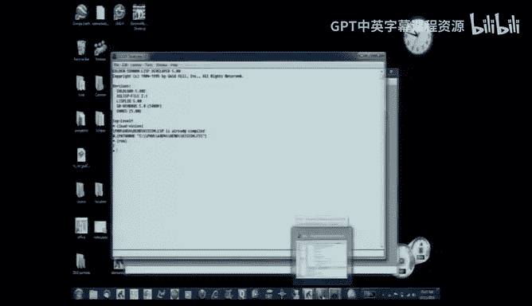

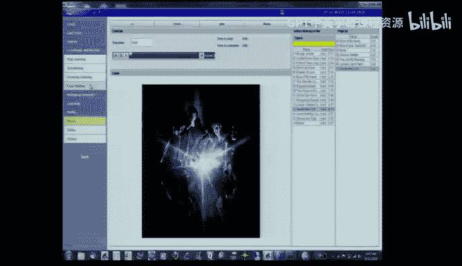

All right。Without realizing it， Nicola and Erica have loaned us their pictures。And they are embedded。

In that big field of noise。And it's pretty easy to pick out Eric and Nicola， right。

 because we are actually pretty good at picking。Faces out of these， out of these images。So。

Let's add some noise。It's a little harder now。What I'm going to do is I'm going to run this correlation program。

Over this whole image。Using Nicholas's face as a mask。

And seeing where the correlation peaks up in spite of all the noises in there。Booom， there he is。O。

I don't know if maybe we can find Erica too。I forgot where she was。I can't mindder。There she is。

Unfortunately the parameters aren't very good here， do you see that？

Let me get another version of this。

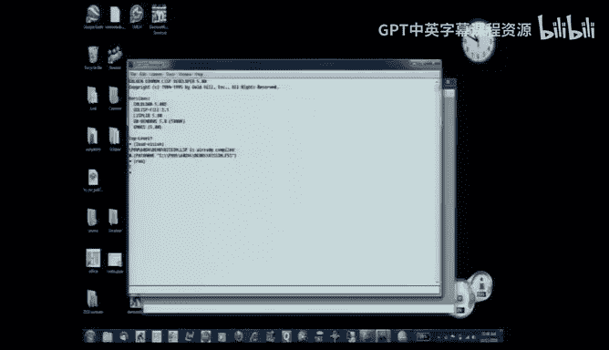

Just do some。So we do some real time programming。

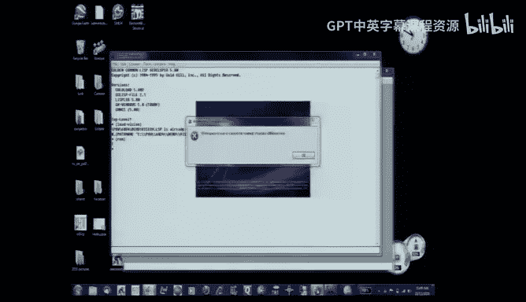

I've been trying to reset the parameters so that they come out so that the images。

 the demonstration comes out clearly up there。Let's see if this works a little better。Okay。

 so let's add some noise。And let's find Erica。There she is。ok。

There's some other things that look a little bit like Erica。

 but nothing looks quite exactly like Erica。So let's try Nicola's eyes。

So they stand out pretty clearly against the background。Let's see if we can fight Erica's eyes。

So they stand out pretty clearly against the background， notice that it also gets nickel's eyes。So。

Two eyes is an intermediate size constraint。It's loose enough that it will match more than one person。

But it's not so loose that it's as bad as looking for one eye。See， they're all over the place。So。

Two eyes and a nose， a mouth and a nose that would be even better as an intermediate feature。

But it doesn't matter what the best ones are because you can work that out experimentally。

So that's how correlation works， and it's just amazing how much noise you can add。

And they'll still pick out the right stuff。There's Nicola boom。Very clear。

I want to add some more noise。I don't know。I can see it。

 but that's because I'm a pretty good cororreator too。嗯。I don't know， let's add some more noise。

It's just how hard to get rid of it， I mean it's just amazing how well it picks it up。That's good。

 that's cool。Now， how could you， but the reason that this is 30 years and we're still not done is there are still some questions。

This is recognizing stuff。Straight on， how is it I can recognize you in the hall from the side。

 Nobody knows。One possibility is that you。Have the ability to make those transformations， if so。

 then that。Alignment theory has a role to play。Another theory is that， well。

 after I've seen you once， I can watch you turn your head and keep recording。

What you look like at all possible angles？That would work。Trouble is。Is there enough stuff in there。

 maybe we don't know？What would it take to break this mechanism？Well， I don't know。

 let's see if we can break the mechanism。嗯。Let's see if you can recognize some well known faces。

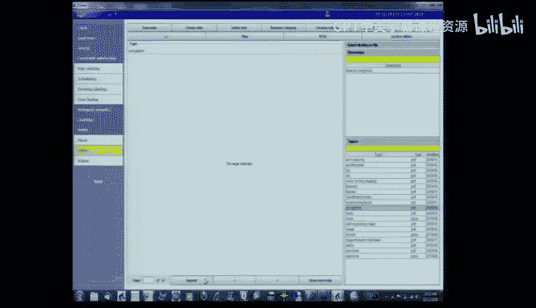

Who's that， quick？Oh， that's too easy。We'll see if we can make some harder ones。Ands Obama。

 who's this？Oh boy you'm really good at this， I Bush， how about this guy？Okay， now I've got it。

 some people are starting to turn their heads and that's not fair。That's not fair。

Because you see what's happened is that if this kind of pumpkin theory is correct。

Then when you turn the face upside down， you'll lose the correlation of those features that have vertical components。

 So if you have two eyes in a nose， they won't match two eyes in a nose when they're turned upside down。

Well， let's see， we'll try some more。是不是。Gorbachev， who said that， Leoned， where are you。

 Mr is Gorbachev， right， you can recognize him because of that little birth mark on his top of his head。

One more。Who's that's easy， right。That's Clinton。How about this one？

You see how insulting it is to be at MIT。That's me。And you didn't even know。Oh god。

So this suggests that it might be evidence for the correlation theory， but of course。

 turning the face upside down would。Make it very difficult to do alignment too。

 so it would break an alignment theory as well。Let me get that after class， and it was a mistaker。

Yeah。新国。If what would break the question， stretching？

TheEliot ask that stretching would break the correlation and the answer is。I think stretching in the。

Vertical dimension。Is worse than stretching in the horizontal dimension。

Because you get a certain amount of stretching in the horizontal dimension when you just turn your head。

By the way， since our faces are basically mounted on a cylinder。

This kind of transformation might actually work。That's a sidebar to be answered to your questioning。

But now you say， well， okay， so this is not completely solved， you can work this out。

 but if you really want to work something out。Let me tell you what the current questions are in computer vision。

People have worked for an awful long time in this recognition stuff。

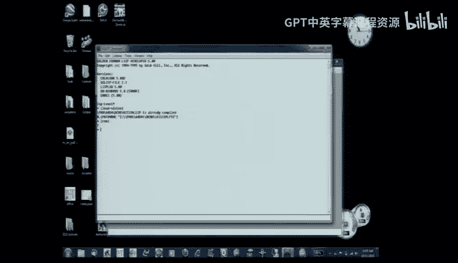

And to my mind， Ive neglected the more serious questions。

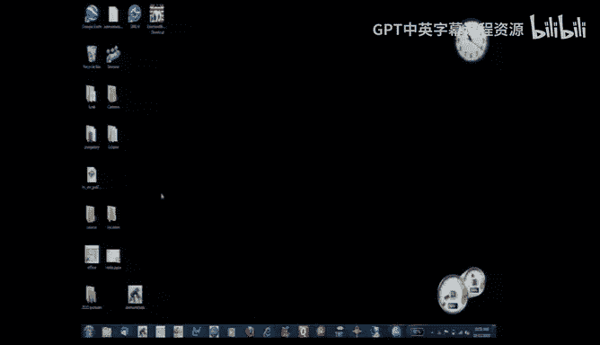

The more serious questions are how do you visually determine？What's happening？

If you could write a program that would reliably determine。

When these verbs are happening in your field of view， I will sign your PhD thesis tomorrow。

There are 48 of them there， and that is today's challenge。But since we're short on time。

 I want to skip over that and perform an experiment on you。I want you to tell me what I'm doing。

So the best single word to answer is。많了서。Okay， this is not a trick question。

A best single word answer， Christopher， what do you think？T。开始 her。Well， you。有。就是。What toasting。Okay。

 not a trick question。What's happened here？Best single word answer is。Which pair looked more alike？

So that cat is drinking and nobody has any trouble recognizing that， and I believe it's because。

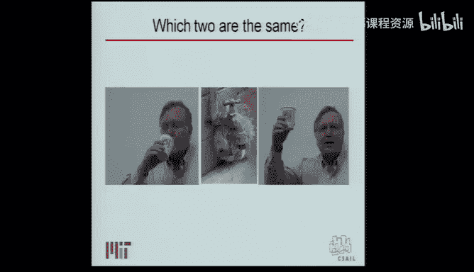

I believe it's because。You're telling a story。So our power of storytelling even reaches down into our visual apparatus。

 So the story here is that。Some animal。Has evidently had an urge to find something to drink。

And water is passing through that animal's mouth， that's the drinking story。

So even though they look enormously different visually。

 the stuff at the bottom of our vision system provides enough evidence。

For our story apparatus so that we can give the left one and the right one different labels and recognize the cat is drinking。

And that's the end of the story。

