# 《基础模型和生成式AI｜6.S087 Foundation Models & Generative AI 2024》中英字幕 - P1：6.S087_ Foundation Models & Generative AI. INTRODUCTION.zh_en - GPT中英字幕课程资源 - BV1YYWpzaE3q

Right， well， sorry we were a little bit late， but let's get started。

So welcome to the first lecture on the lecture series called Future AI， Foundation models and Gen AI。

This is actually the second year we hold this class so I started working on this course before the recent hyp and breakthroughs of strategyP and I really felt that we starting to see kind of a new approach to AI in the community that was really going to change things for real and I think we start to see that right now。

And really what I want to accomplish in this lecture series is to give you an understanding of why this is happening right now。

 what the underlying kind of change in perspective and also going beyond just kind of the tip of the iceberg which is strategy P。

 so I'm going to give you a deep but non-technical introduction to these subjects。诶。

And last year when I gave this course， we were excited about text to video and text image models。

 right I guess we still are， we were excited about super human robotics。

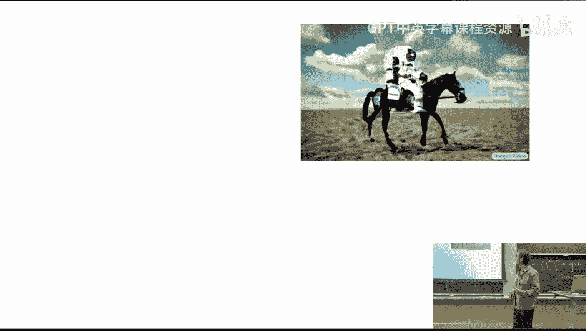

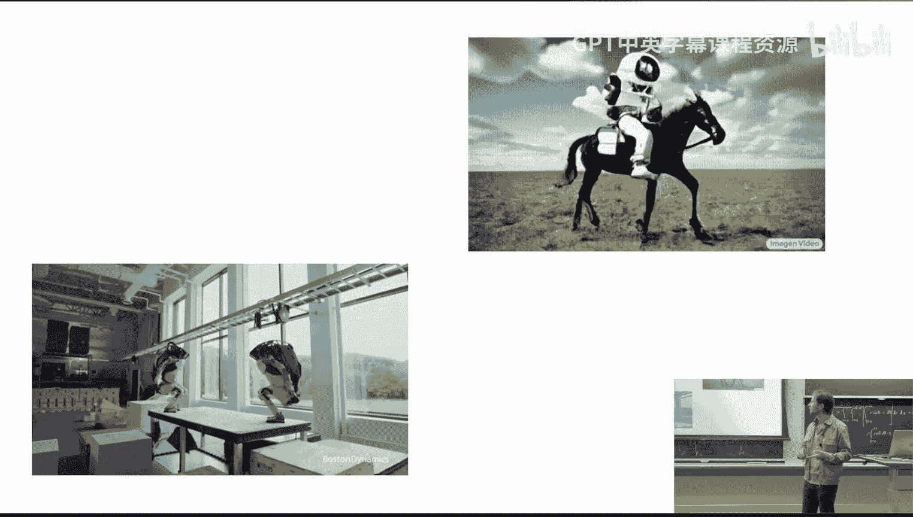

Self driving cars。And AI applied now to other domains as well， like genomics， et。And。And of course。

 a lot of these breakthroughs， even if they're in very different domains。

 they come back to this underlying technological achievement of foundation moregen AI and they're going to dive into。

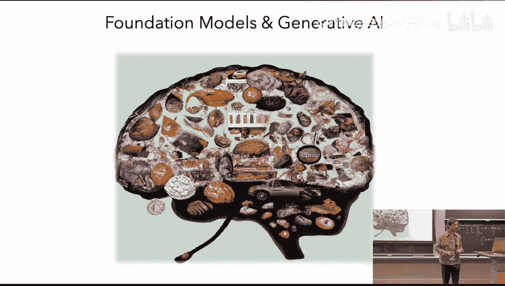

Last year we were excited about Cha GPT。So we could ask you to write an engaging introduction to Aya lecture if we ask the updated GP4。

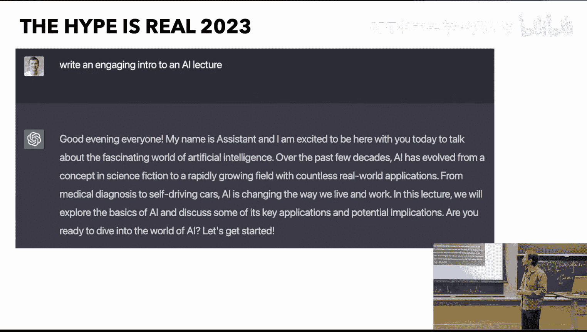

It does it produces more text， but maybe does a better job as well。

 Last year we asked it to produce a engaging artwork of artificial intelligence。

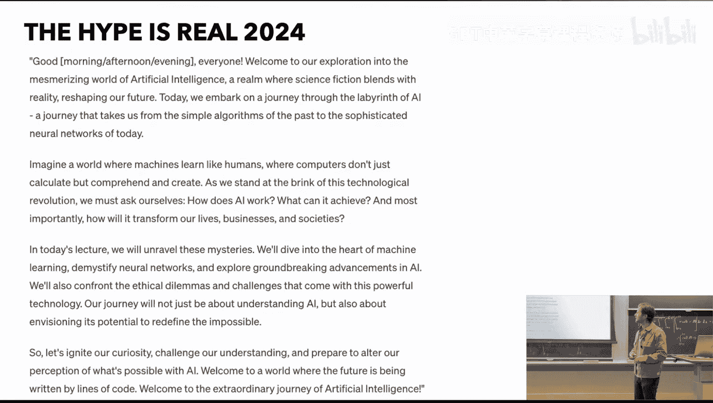

And now we are in the newest version， it also might be doing a better job。 It looks more involved。

 at least or is subjective， but。

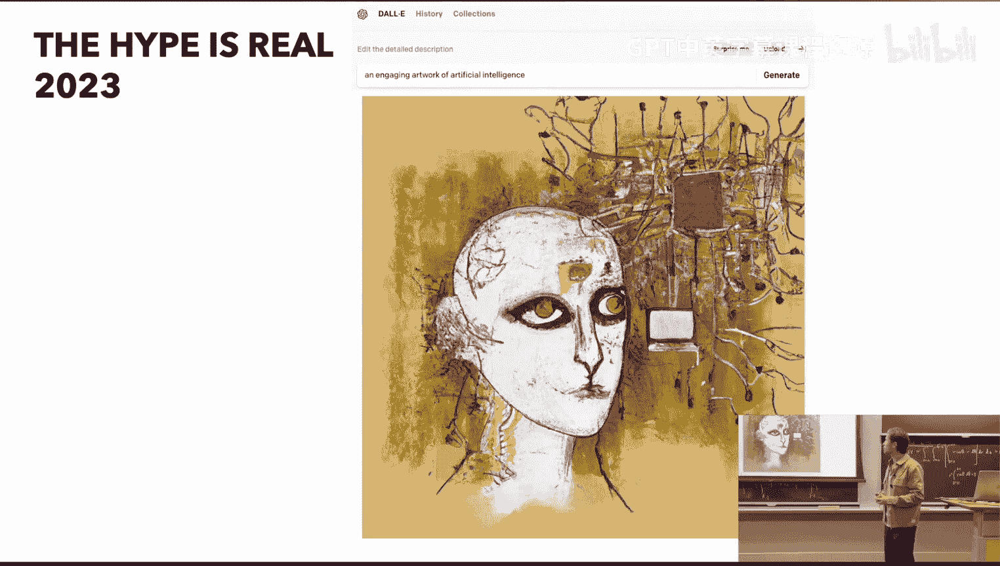

I think it's better。So if we were excited about these things in you know， early 2023。

 what's happened， right， what what's happened during this year， Well， a lot of things。Force。

 it's been a tremendous hype。 So there's been a lot of。You know， money pouring into these areas。

 we've had companies that are only you know a few weeks or months old reaching a $2 billion valuation。

 which is a team of five people and we've had excitement about autonomous agents that we' going to talk about doing this course as well。

 like DPT engineer is able to plan and even at in a more human like way in terms of intelligence。

 Nvidia that provides all the different deep use right that these models need have reached a huge valuation like the$1 trillion dollar club。

We've seen sweeping regulatory。Kind of acts and， and。Initiatives， right。

 both on the White House and European Union， for example。There's been a lot of drama in the AIspace。

 right OpenI， for example， the CEO and the company behind CheP。

 the CEO was ousted and then came back in， so maybe that transparency problem in AI doesn't only apply to the models but to the structures and companies behind them。

And also， you know， we're seeing kind of some hype and some winners in terms of this new AI all this。

 but also now some companies are actually losing users and usage， right stack overflow， for example。

 people saying that kind of it's being killed by an AI that's training its own data。

 which is kind of ironic。

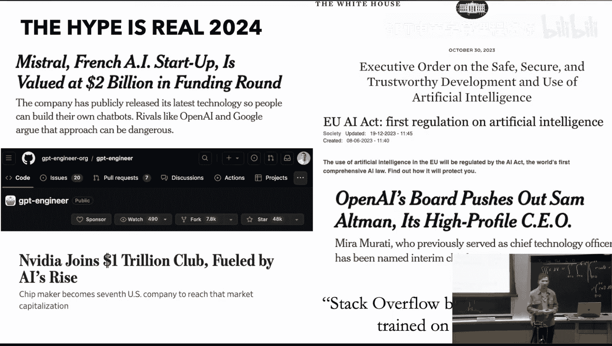

Of course， one of the big questions that remain is。

 have you reached artificial general intelligence yet？😊，Some people say we have。

 I think there's still quite a long way to go， but we're going to try to also explore a little bit。

 you know what can we actually mean with AI and how could we potentially reach it given the technology that we have right now and can we give some kind of very order of magnitude estimation to when we'll get there？

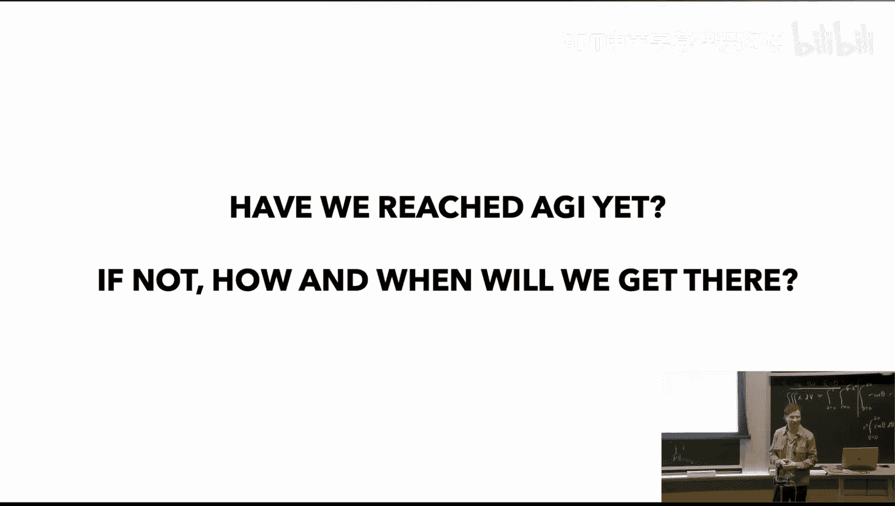

So I'm Richard， I was born in the land of Abbuacia， which is Sweden。

Before MIT I was at Stanford for seven years and I did research as well on AI and this stuff。

 I also start a company that does foundation models and AI in commercial settings I hope to bring in a little bit of those perspectives as well for the last four years almost now I think had almost four years I've been at MIT when I do research on Subpress learning and financial models and good stuff。

Okay， so quickly on this course schedule so。Today we'll give an introduction and kind of a history of AI from a higher perspective as well what's going on and giving some kind of intuition and then in the next lecture we'll dive much more into details about how these different algorithms work and how we arrive at these models that we use。

😊，After that， we'll do an in depth analysis of chattTP， like a case study。

 then we'll do a similar case study on image generation and stable diffusion。😊。

Then right and these four first lectures will be very similar to last year's offering。

 but then we're adding on Dar 23rd we're going to talk about kind of emerging foundation models right it's going to be a combination of stem existing out there。

 probably not one single model to rule them all so we're going to talk about that and especially how the looks in industry and corporate setting so Professor Mannos Kellys will come as well as inhesive expert on。

Theology and genomics， and then also Art T work， who's an MBA from MIT who will talk about autonomous agents。

And then we'll have a fun kind of。Or it's going to be a fun， hopefully fun lecture on AI and ethics。

 which is of course perhaps a little bit more fussy。

 but also bringing in regulations with kind of what's happening in terms of the institutions regulating AI and F that we' also have a panel with manlis and Artem。

😊。

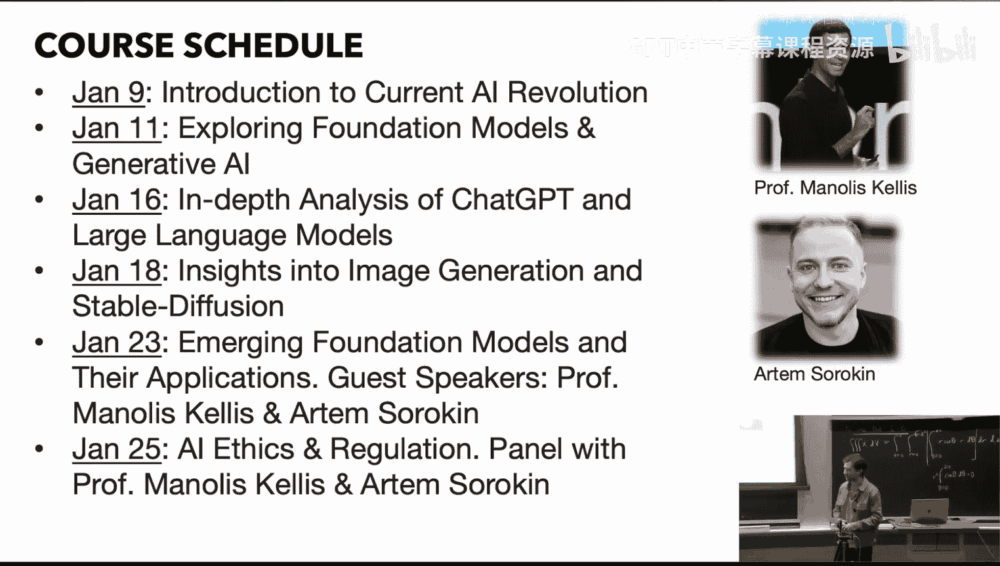

So should be fun。Allright， so what we'll cover well we'll cover all the buzzwords and your network supervised learning。

 representation onsupervised learning， reinforcement learning， Gen AI foundation models。

 self-superused learning， and we'll try to put together a lot of applications a lot of intuition because it really you should be nontechnical and I think as well I want to try to explain things in simple but true deep ways and I think if you're not able to explain something in a simple way we're actually not doing a good job explaining it so that's what we're going try to do at least。

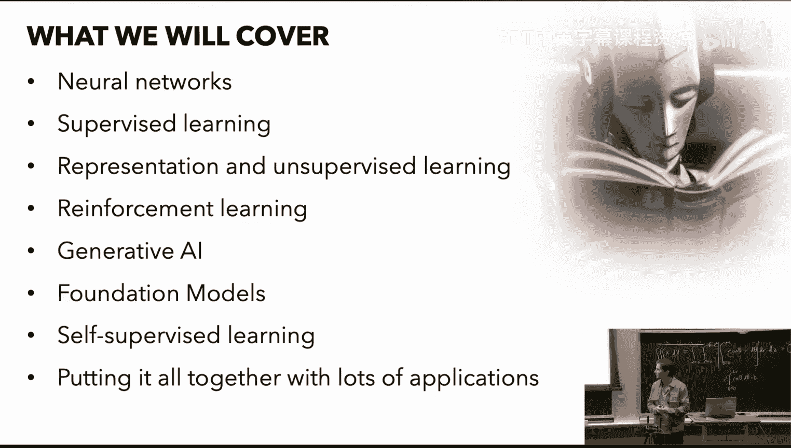

Today we're going to give you a short succinct answer to what is。

The secret sauce behind foundation multi AI。 And then when we've done that。

 we're going to ask how's the world structured because。

How we think the world is structured and really influences how we learn in the world。

 so we're going to kind of explore that from a more philosophical perspective and see how that actually leads us to foundation models and geneative AI。

😊，And then we at we'll cover two applications of how we can use this in both research and in business。

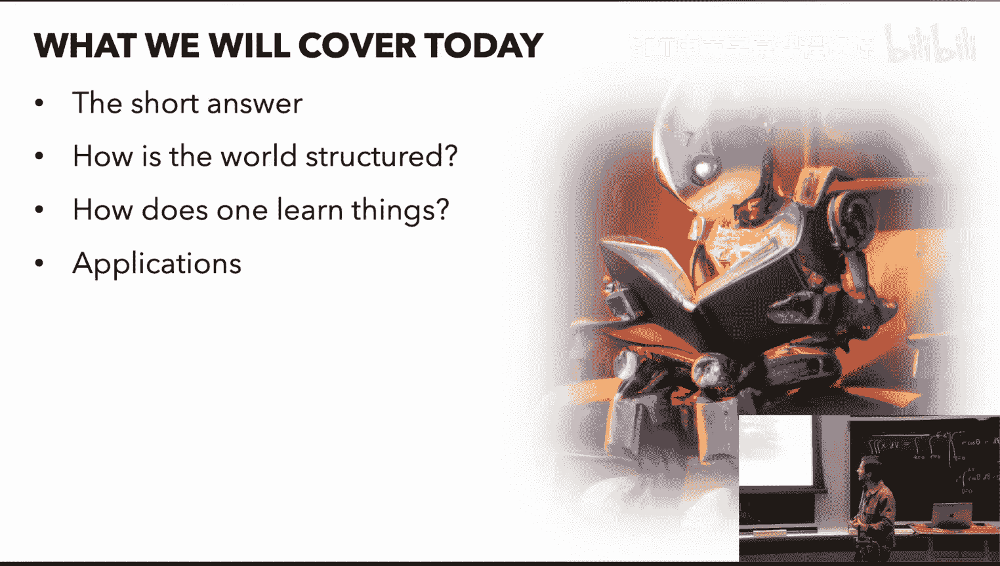

Again， right， we're going to try to use intuition examples and example from both science and business。

And hopefully you you'll understand why the hype actually is real， I said it's last year。

 but it is real， and maybe both understand what's actually just hype and what's the kind of more foundational aspect of it。

 right， what matters。😊。

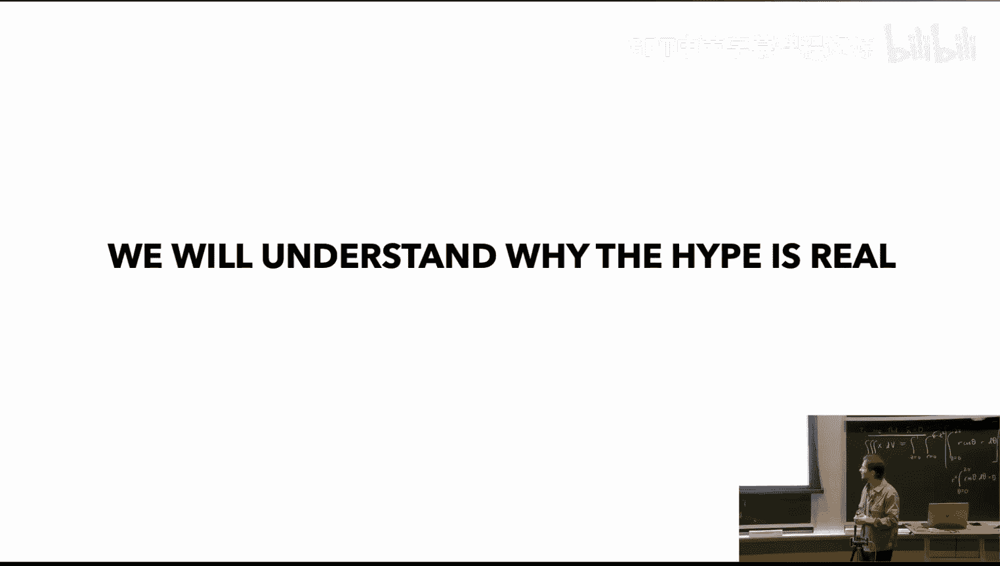

Okay。So， I think。In trying to。Understand and， and， you know， have a。In2 understanding of AI。

 it's good to use ourselves as a reference frame， right， we're human beings。

And I think one of the core questions that we can ask is well at some point right you're born。

 you're a blank slate baby， fairly useless， you grow up。

 you interact with the world and different stakeholders in the world and you acquire knowledge you become a fairly useful knowledgeable adult right in terms of AI and learning right one of the key questions is what happens in between you being a blank slate。

 fairly useless baby to you being a knowledgeable， useful adult it's one of the key questions and we're going to use ourselves with a reference frame here So let's consider a few candidates that might be responsible for giving us most of the knowledge that we have about the world。

Is it our parents？They debirth us， they raise us， they give us a lot of our core values。

 so they're definitely good candidates to consider。Is it perhaps our DNA and our genes？

They're responsible to giving us a lot of our physical characteristics。

 also most some of our personal characteristics。But maybe it's you know nurture versus nature is very flexible。

 people can come very different based on where they grow up and also maybe DNA works on a more generational scale。

 sometimes it's again a very delayed feedback loop here。

 It's not a lot of learning happening in a short term scale。Maybe it's academia， right。

 maybe it's teachers and professors and the educational system， it's supposed to be to educate us。

 it make us useful， learn different skills and also know learn how the world works， right？

So that's also a good candidate。And lastly， maybe it's more kind of our immediate environment and we maybe what's more important is our goals that we want to be loved。

 we want to be happy， we want to be successful， and by optimizing those objectives and goals。

 we learn about the environment in the process， you know we learn how the environment and if components and environments help or doesn't help us reach our goals and therefore we learn about it。

Okay， so we can split this apart a little bit more and high level perspective see how they correspond to different disciplines within AI。

Right so this parent， child， student teachership， that's supervised learning， there's supervision。

So here there is an human expert like a teacher or a parent that puts the world in order for you。

 it structure it， it labels it and puts it in a condensed format so you can learn from it。诶。

On other hand。This more delayed feedback right kind of evolutionary and you're interacting with the environment。

 optimizing some goals and those goals are what we're mostly focusing on right that's reinforcement learning。

And as iss delay gratification and you're optimizing this gold in an environment。

But it turns out actually that none of these approaches are responsible for giving you most of the knowledge that you have about the world。

😡，In fact， you can thank yourself for that because most things you know， you learn by yourself。

Sos is possible。

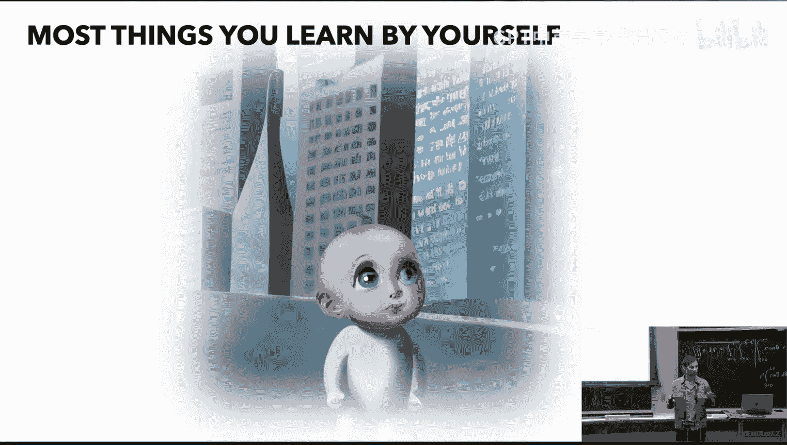

Well。It's possible by defining meaning by the company it keeps。

So in learning from observing the world。So let's take the example of a dog。

You actually don't learn what a dog is from your parents telling you or from your emotions guiding you。

 You learn what a dog is by observing dogs in different contexts and correlating and contrasting dogs through other concepts。

So a dog is something that's walked by an owner with a leash。

It's something that has an antagonistic relationship with cats。

 it's something that chases free space when those are prone and this kind of relational context is what allows us to understand what a dog is。

And as you learn what dogs are by correlating contrasting dogs with other concepts like cats。

 for example， you in turn learn what cats are， right this is where you get this relation understanding of different concepts。

诶。And even language can be learned this way because the word or named dog would be uttered more in context where dogs appear。

And if you think about it， if a， you know， a little child points at a dog and asks his parents like。

 hey， what's that？Like all the parent is really doing is giving some label and the child having the ability to generalize that label to old dogs shows how it has a very。

 very robust understanding of an entity already， a concert with a dog， just not a name yet， perhaps。

😡，But that entityett concept is gotten by just observing dogs。So， for example。

 let's take the cat and mouse here。So I think intuitive for ourselves when we hear cat and mouse。

 there's a strong correlation and we can understand the cat in terms of mouse and vice versa。

 right a cat is something that chases mice and my mouse something is being chased typically by a cat。

But when it when it comes to a mouse and a dog， I think that the relation is less strong and less obvious right but the relationship between a dog and a mouse is not completely clear in our kind of contextual understanding of the world。

So let's take this observation and fit it into this foundation geneative AI models that also have this similar understanding of meaning right so a lot of these I mean basically all the images you see in these lectures is produced by generative AI。

 so let's ask this geneative AI takes the image to generate a cat playing with a mouse。😊。

This makes sense based on how it's trained。 He understands and generates a mouse。 know。

 that's or a cat playing with a mouse and sometimes。

But if you ask instead to generate a dog playing with a mouse。

 it gets confused because it doesn't really make as much sense in a contextual relation understanding that this model has of the world。

 so it generates a mouse looking dog playing with a computer mouse。😡。

So this shows that like when the context is not clear， meaning is not clear。

And this is fundamental how this model and start to learn about the world and its also corresponds to how we think about it。

 probably when I said cat and mouse to you， like you immediately collapsed to a meaning space where it was obvious what a mouse was。

 you didn't even think about a computer mouse when I said cat and mouse because it just contextually made meaning clear for you。

😡，Okay， so。Basically， more relations。Lead to a better understanding of meaning。

You understanding what love is， for example， helps understand what a dog is because an owner loves his dog。

So， you know， why not train a huge model with a ton of parameters that's able to compress a lot of these different relations on as much data as possible to learn as many relations as possible？

😡，So you get the most precise understanding of all of these concepts involved。

 and then you use this model basically anywhere where any of these concepts appear。😡。

And that's exactly what a foundation model is rest upon。And someone also， you know。

 your brain is a prime example from kind of foundation model where you get a world you model and knowledge model of throughout the world。

 from just observing it and building these relational structures。

And this is also's you what's behind this current AR evolution that we're seeing。

 this is the building block that is fueling all of the different breakthroughs that we're seeing right now。

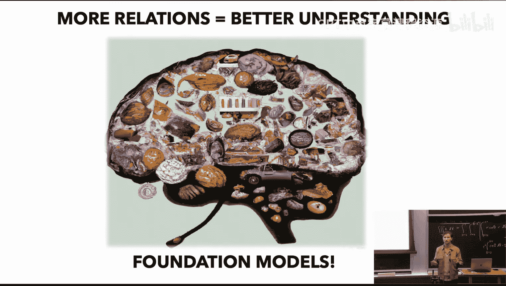

Okay， so this might sound kind of intuitive and make sense。😡。

But what did it take such a long time to get here？Well。

 this is what I think is quite useful to go on a little bit of philosophical digress。And。

And me provide a little bit of my。Theorial picture on how this happened and also it shared with other researchers。

 some of them。So I think this kind of rests a little bit on two kind of opposing perspectives about how the world is structured and how we learn in the world。

So I'm going to try to get a sense of this by giving some examples and contrast some stuff。

 So on one hand we have learning versus designing。We're designing is this you know like a clock work。

 we know how every piece works， we put them together， every piece has like a perfect role to play。

 we know what's going on and it's built for a specific blueprint and purpose in mind right that's how we design things。

😡，诶。On the other hand， learning is something that we perhaps not fully understand。

 we're not completely conscious about， it just happens。

 we just get better at something as we're exposed to the phenomena more and more and more and there's really no you know end goal in mind before we start learning right we just adapt and it's very very flexible and intuitive。

😡，And okay， similarly， we have chaos versus order， where order is kind of what exists on the scale of planetness or atoms where things behave according to beautiful simple per rule。

 like math， physics and beautiful theory right what chaos is perhaps you know the more unpredictable reality that we find ourselves as human beings right the animal world。

 the human world where things are unpredictable and。And chaotic。

 And one of the core questions here as well is that， well， you know。

 the chaos that we experience in our everyday life。😊。

Is that like is there some simple order behind all of that， if you just find that order。

 will all of our experience make sense， or is there perhaps a limit to the order of the world and how much equations actually can explain and you have to deal somehow with this chaotic world in another way。

😡，Similarly， we have this perspective of bottom up and top down。Right， in a。Top down organizations。

 there is a boss or some you know top person that's able to come up with a nice framework whereing should be done from the top just by analyzing data and then pushed that through throughout the organization to everybody involved somehow on the other end。

 a bottom of organization really，Then it's really necessary to have a lot of people at the bottom that interact price with customers and products and deals with all these different chaos that happens in all the particulars and there's no real simple top down decisions that can be made to make your business really work need to account for all the particulars and it really matters how you engage with a customer personal level it's not enough for the boss to come up with some time simple rules about to solve these things you need to deal with these chaos and also a lot of the wisdom in a bottom up organization comes from really listening to the people that are closest to and consumers。

Okay。So， I think。At least in the western world， we're about for quite a long time this。

Designing order top down perspective。 And I think this is kind of due to the ancient Greeks， right。

 So Socrates， for example， had this allegory of decay。

Where basically human beings are a very imperfect senses and a very kind of imperfect understanding of how the world really works and what's going on and they give this allegory of the cave where human beings are actually here on the lefthand side looking you know at the reflections of the cave So basically our experience of the world is so untrue and imperfect so we don't even get to experience the world firsthand we get to experience gods walking with depictions of real objects right and we don't get to see that those even we get to see the reflection of those depictions through you know a fire on the cave wall that's how distort that our view of realities and for Socrists like well we' have to accept that we have very distorted imperfect experience of the world we have to always strive to understand the real true world。

 the beautiful world of the gods which exist you know。Outside of the world， we get to experience。

So I think it did like for Socrates， a dog， for example。

 like there is a true perspective of perfect dog in this godly world that we should try to understand and all the variations that we seeing in the real world are just some kind of imperfection from our sense。

 and we should try to understand the true dog in this perfect absolute world。Soa。

 I think it makes sense because degrees this time， they were discovering mathematics。And in math。

 for example， there exists a perfect circle that。Oeyys very， very simple equations。

 But every time you take a perfect circle type to。Rereated in the real world， it's always off。

 it's always imperfect。 So like this， this kind of correspondence somehow influence Socrates thinking and also makes sense in this kind of mathematical perspective。

And I think this has been extremely fruitful for us， it's led to the kind of golden arrow of design。

We've had a scientific revolution and an industrial revolution， right， we've had modern math。

 physics and modern medicine， and we even went to the moon with is design way you know top down order way of thinking。

 so it's been extremely extremely good for us。😊，But。You know， assuming。

That this top down order design way of thinking is to be all of our existence。

 how can we not better at it？😡，We've had billions of years of evolution here on this earth。

 how come we not more like a computer or calculator if we can just try to find a simple mathematics and order behind the world and we're able to perfectly exist in it。

And I think this is。Kind of a strong indication that it actually is a。

Limit to what order can explain。Because and we're not like we're not intrinsically very good at logic and math。

😡，Because we don't live in a top down order world， we live actually in a bottom up world of chaos where math is not that useful。

Instead， in a bottom up world of chaos， what's useful is intuition， flexibility and speed。

The things that we actually are good at， right？😡，So in this order versus chaos perspective when it comes to our everyday interaction as human beings。

 you know besides the scale of planets or atoms， actually the world is chaotic and we cannot escape that fact。

 we have to deal with it， they won't be some just simple equations that explain everything for us that we can rely on。

 we have to deal with all these chaos， there is somehow unavoidable。

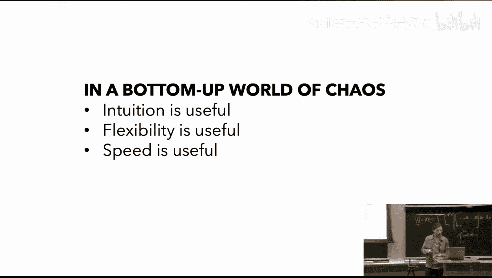

So what can we do， right， you just give up？So is there an instrument that can help us to contain and navigate all of this chaotic world that we find ourselves in？

Well， if we had billions of years of evolution if we didn't create a computer or calculator or nature didn't。

 then what did it create Well， it created the brain。

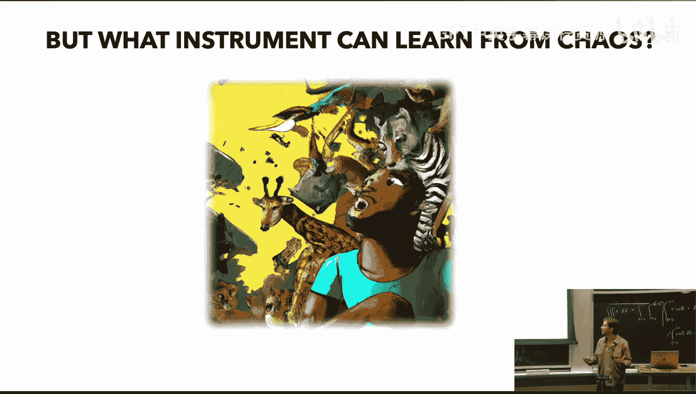

Which is our best tool of navigating and making sense and learning in a world of chaos。😡。

And then the neural network in artificial intelligence is just our best attempt of replicating the brain inside of a computer。

So it's very， very flexible and adaptive， it consists of a ton of kind of neurons or parameters。

And it's very， very simple computations， but done in a hurricane scale。

 and also it's extremely slow to train， but very， very adaptable and flexible and fast to execute when actually learn something。

Okay。So we now have accepted the rule as kotic and we have a tool that's able to still function and navigate in a chaotic rule。

 how do we use this？Well the thing is that these neural networks still exist inside of a computer right and a computer only speaks the language of code and math。

 so still there is a divide now where we have the real chaotic world and we have a computer side of machine。

 so we somehow have to go through the world of order and math to tell the brain inside of the computer what to optimize for what to focus on to use this brain for。

 we have to somehow describe this in a more exact way for it to be useful so we still have we can't still completely ignore the world of order。

So how can we define such objectives rigorously， and that's what we're going to try to go through right now。

So first thing we can do is to say that well we understand how the works work， world works。

 right we understand how things work and we have a lot of knowledge about the world。

 so why don't we just impart that knowledge onto computers。

 why don't we just structure the world in a way that makes sense for computer we label all of it and then we can feed that information to a computer so you can start learning from that。

😡，That's our first attempt， and that's supervised learning where we structure the world， we label it。

 and so computers can learn from us。😊，嗯。And， you know， pretty immediately we run into some problems。

 First off， of course， these scales with human labor， human experts and labels。 That's why， you know。

 you have these outsourcing centers， people label data constantly。

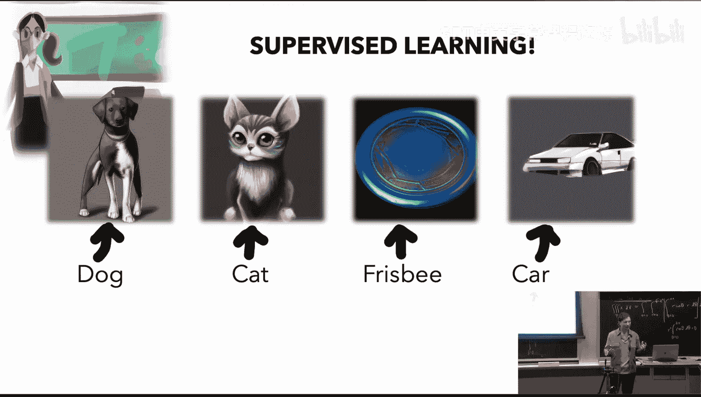

And can everything even be labeled like do are we that kind of selfcon about like are we that conscious about how things work like love。

 for example， can we label concepts like love， it's going probably going to be quite hard and we maybe overestimate our understanding of how things work and how we can isolate concepts。

And really， you know maybe things again， like love or other things are not very labelable and maybe things are not as categorical or like distinct。

 maybe the world is actually more continuous in a sense。

And only in the limit of unlimited number of labels to actually understand start to understand that the world is really structured right maybe you know maybe have set of labels and you learn from them。

 but you will always find these points in between where labels don't really explain what's going on for example here right you know is this a dog or a cat the left hand side I mean somehow at some points things get more and more close and reach a limit to how much we can label the world and then we just need more and more labels actually make sense of it。

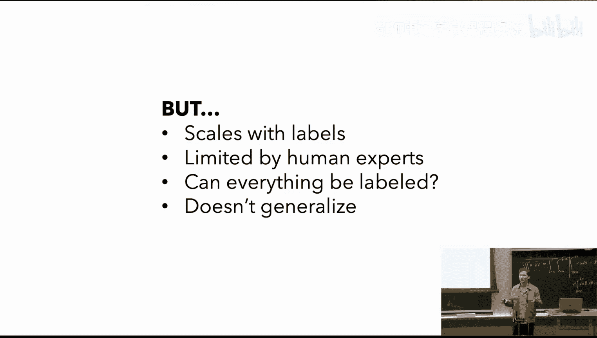

So because of this， somehow we see that the supervised learning doesn't by itself generalize well enough。

 it just doesn't work enough， it's too expensive in terms of having human people and expert label data。

 and doesn't generalize really well to you the diverse setting of the real world。ok。

So let's say now that we try to rely on ourselves defining things such in the world。

 and we do almost the opposite direction。

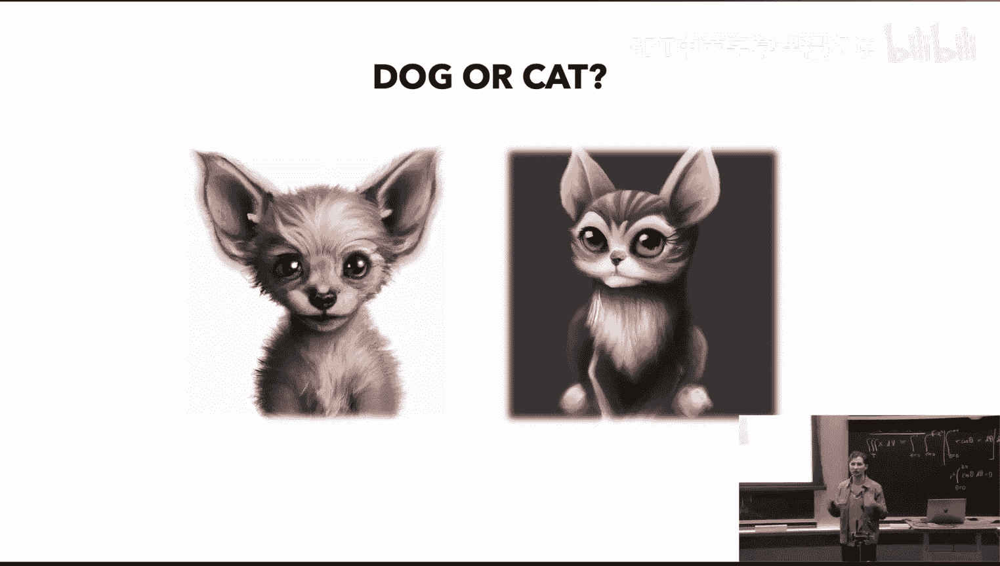

So we say that as human beings， we have goals， we have desires that we want to optimize。

 or know that we do optimize， and we hope that if we just importpart those goals and decides onto computer。

 it will learn about the world in the process。focus on the where you want to end up and the computer will have to figure out how to get there。

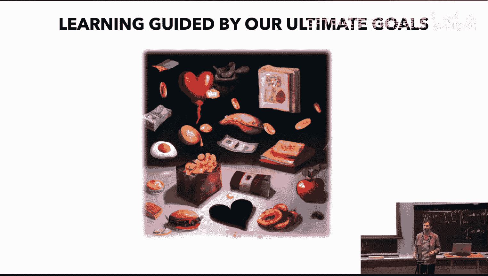

So this is reinforcement learning。

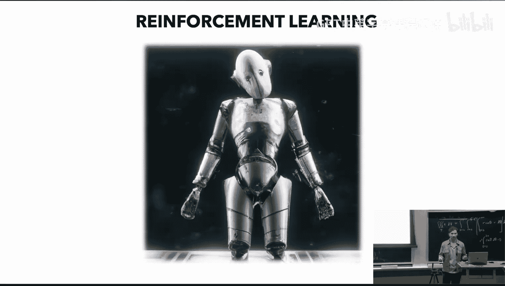

But I think， you know， if a good analogy for a blank slate computer is like a blank slate baby。

 I think it's very， very hard for us to even。Understand what it means to be a complete blank slate。

 I think a lot of our knowledge is so intuitive we just take it for granted。

 So what does actually mean for something to be a complete blank slate like having no understanding of how the world works at a starting point。

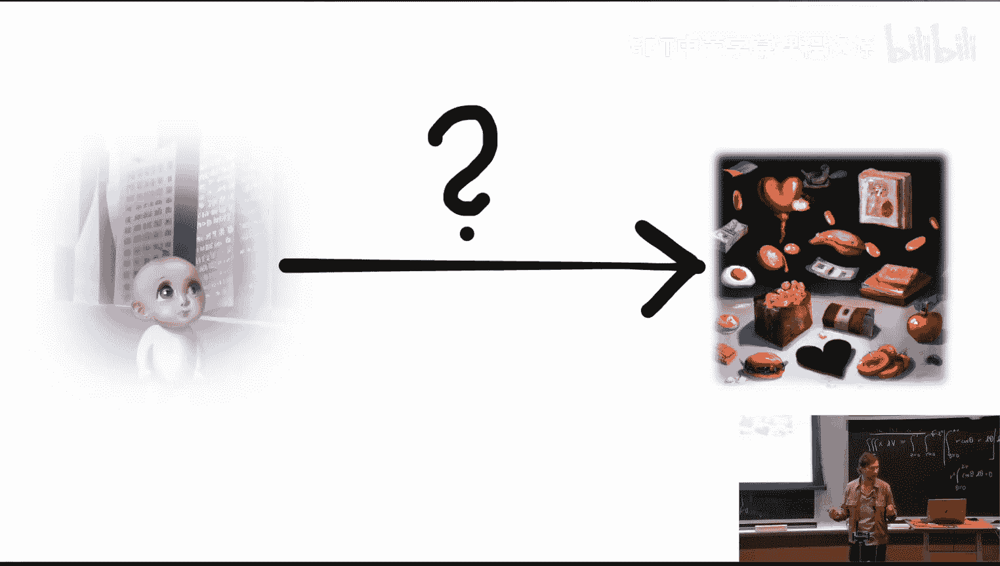

U so let's say， you know， you this， you know， you know， you're this blank slate。

 baby had no understanding about how the world works， on， you want to optimize certain goals。

maybe you want to optimize。Success or becoming rich first of all。

 there's a huge delay in the feedback right you do something。

 you won't immediately know if it's actually helping it or not。

 you have to wait a long time before you get a signal right it's very very know difficult to know what's working or not you need to keep at it for a long time before you see that it makes a difference right but even if you take something that's perhaps a little bit more immediate like trying to become less hungry。

's still some delay in terms of maybe minutes or something。

But let's say you try to reduce your hunger but you have no understanding of how the world works。

 you just randomly pick a concept that you're observing and you start to explore how that concept affects your ability to become less hungry。

 right to become full maybe that' you just start focusing on the moon and how the moon and the characters around the moon affects your ability to become less hungry you're going to spend so much time exploring complete nonsense that has basically no relations to your ability to become less hungry and you're going to die out of hunger way before you make any progress whatsoever。

So I think that's kind of hard to even understand， let's take the big example of a car。

 that's a complete black slate you want the car to learn how to drive to your home using reinforcement learning。

😊，I mean again， maybe starts exploring how the you moon affect its ability to reach home and it will make no progress but even if it starts focusing on things that are actually relevant by just sheer coincidence and it starts focusing on other drivers or other human beings in traffic right still we cannot afford the car to hit like a million human beings and crash a million times before it actually reaches home。

 get some signal and starts making some progress right it is too expensive and too risky in real life。

If you take。You know， imagineine putting a real baby in the driver's seat of a car， I mean。

 how many billions of years if this baby would live forever。

 how many billions of years would it take for this baby to just by Queensland reach home？I mean。

 it's got to take forever and then when he does that you say like， hey， good baby， awesome work。

 you know， here's your signal， now do it again。I mean。

 this is somehow how reinforment works when there's just a delayed feedback and this a blank slate。

And this， I mean， this works better in chss of something where there's an idolized set of rules and the state space is much smaller。

 but this kind of just blows up in real life。So what we need is a basic model of how the world works。

That we get from just observing the world because it's the only thing we can really afford。

Reforcement as we just said， its too dangerous， you'll die before you make any understanding of how the world works。

 and so it's too risky and too expensive it too slow and supervised learning is also too expensive because it relies on human experts to label the world and at end of fate it doesn't work because you cannot label the world。

Okay， again。 so what comes to rescue is this。You know。

 breakreakthrough behind foundation models called self supervised learning。

 where we learn from self supervision by just observing the world。

 and we define meaning by the company keeps， which allows us to learn from just observing。Okay。

So quick recap。诶。We talked about chaos versus order and we concluded that actually the world is chaotic。

 we cannot ignore that， we have to deal with that。The brain is the best tool that we have to learn and compress and navigate in a chaotic world。

 but we still have to define how this brain should interact with the world。

Supervised learning didn't work because it's too expensive and doesn't generalize like labeling the world。

 reinforcement learning is too dangerous and too slow。

 so that's why we end up with learning from observation and selfupvised learning。O。

So let's dive into some specific use cases of this。

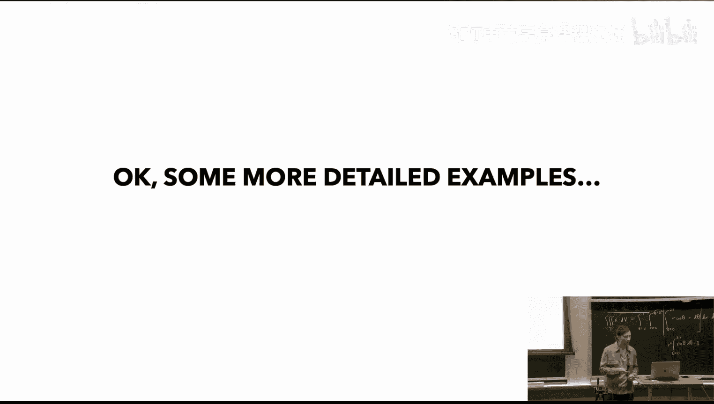

So here's a kind of a collection of different selfupvised learning algorithms and how they learn from data from just observing the data。

 well cover all of them in subsequent lectures what they over rely on is learning from data itself there's no need for human experts in the loops。

 it scales extremely well to unliven amount of data and then they use this very broad capabilities in a wide range of different tasks。

And in the。In this lecture， we'll just talk quickly about predicting the future and positive repairs。

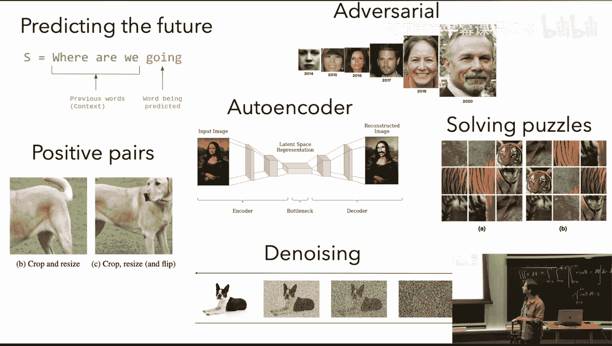

Okay， so this idea of learning by predicting the future based on the past。

Relies on this idea that in order to predict the future， like we need to understand the past。

So let's take an example of language model learning how learning from text data。

This is good because we have an unlimited limited basically amount of text data from the internet so we can just download a sequence of text。

 and then we can remove the last word and try to predict the last word based on previous words It is extremely simple to define and then we can let the butteuchot brain of a new network start doing this task。

And let's now assume that this new network or computer has become really。

 really good at predicting the next word based on previous words。 What does that actually imply。

 Does it What does it learn， Does it learn grammar。😊，Well。

 order to generate and predict grammar like you know gram grammar grammatically correct sentences。

 it has to understand grammar。 of course， I mean doesn't have to understand the meaning of words。

 I mean if the sentence that we give it is you know， the dog is。

Ne understand what adddjectitives that describes a dog， so alsounderstand the meaning of words。

Does then have to understand the difference between a informal social media post or a formal news article。

 well you know if it's right now being fed a informal Facebook post and he wants to complete that accurately。

 he understand what kind of language that corresponds to and vice versa， right？And similarly。

 like if people in the way people write changes based on their political beliefs。

 they also start needs to pick up their political beliefs based on how they write things， right。

 which should only gets kind of scary， but a really。

 really powerful model can start picking up those things that are so implicit because it's optimized to do this fairly simple task。

And again， if I ask it， you know， what's the capital of Stockm question。

 what's the capital of Sweden question mark right， And I give that sentence to the model and it has to。

Completed accurately and optimally as to give the correct answer， which is Stockholm。

So it also becomes very knowledgeable about the world in a bigger sense。And this is the core。

 you know， approach behind ChatP and why it works well and why it's so flexible in capabilities。

 right， and how such a simple objective can lead to extremely。You know。Broad sense of intelligence。

And。Again， you know similar things applies to real life。

 example like frames in real life or in a move or something， if a model is able to say that， okay。

 it sees a human being with a leash and a dog and in the next frame it sees a Frisbee。

 if it's able to predict and and say， well， probably the human being will throw the frisbee and the dog will run to catch it being able to do that。

Prediction to combining these object objects show that this model understands how these orbits relate to each other。

So it's extremely extremely flexible and powerful。

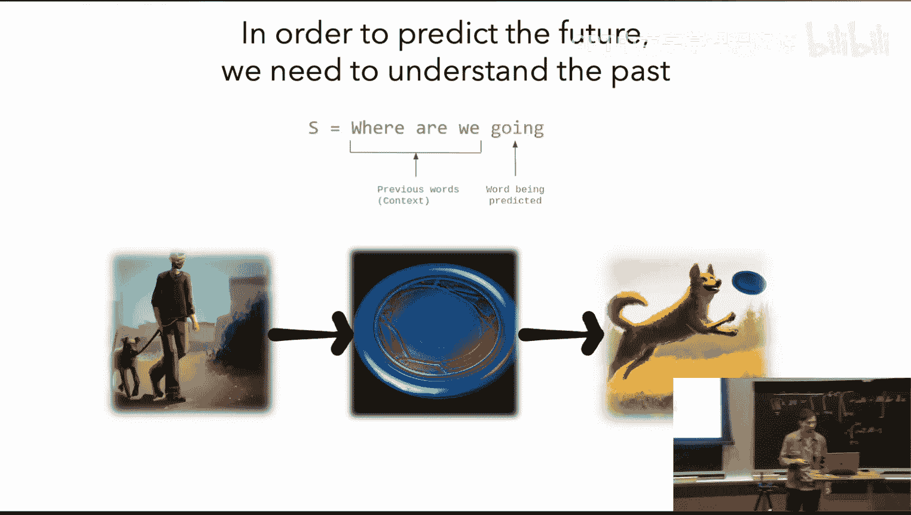

Okay， another approach that's very popular in vision is called positive para contrastive learning。

Here we learn oh here again， we can just say we say that we think that objects that appear in the same image are more related than objects that appear in different images。

So then we can just download a ton of images from online and we can just kind of randomly cropped images and push the crops from the same image close together and far away from crop's mother images。

And if we do this， we're gonna see like， well， okay。

 So a human being this on the left hand side right， the crop here with a human being， a leash。

 a dog iss going to push a dog kind of close， Re to a human being with a leash and a dog and a frisbee being pushed together somewhere because they're more related。

 Well， the really， really cool thing here is that it kind of rests on this assumptions as well that。

😊，That you don't even have to appear in the same context to be understood。

 It's like people that have similar friends or similar people。 So here， again， like， okay。

 the Frisbee and the human being in the leash don't appear in the same image， but they。

 they appear together with similar objects like a dog。 So somehow as well。

 it start it will start to capture relationship between these。

 which can be kind of more abstract and and more isolated。 more far away in some sense。

 but it still captures that in in a very robust sense。Okay， so let's apply this。

So we're going to talk from one example in science， another in business。Okay。

 so let's say we want to apply this new paradigm to genomics。

It's a good setting because we have a abundance of DNA based pair like it basically these text sequences that we get from sequencing people's genomes。

So what we've done， what we could do is that we could use our own human intelligence and look through this data and see like well。

 there seems to be this reoccurring sequences like genes， for example。

 that reappear and we could look at these evolutionary threes。

 how these things are being passed on etc， to build up a structure。

 start building features around parts of the genome and I use that for for example。

 protein structure prediction like start understand how the genes work or we can just kind of。

Rely on self Sufer learning and just try to predict the next DNA based parallel letter based on previous ones。

So let's say we train a huge model on our ton of DNA data just predict the next DNA based pair based on previous ones。

 like what does it learned in this process implicitly？

So if's able to do this really really well like again does it learn the meaning of genes and genes so genes are just reoccurring sequences so if it's oncere able to like complete this the genetictic sequence really really well。

 least understand like identify hey I'm inside of this gene right now and that's why I need to generate these new ladders right does' it need to understand this well implicitly if it's kind of completing the genome of a dog versus a cat yes if they differ it needs to because is it going to change how it thinks about predicting the next base pair。

😊，And it turns out it actually creates really， really good features that maybe。😊。

It takes an awesome time for human beings to actually understand exactly what they encode。

 but if you then use these features and you try another network to predict protein structure right what kind of protein structure this DNA will lead to。

 it works really， really well。😡，Okay， another example in the business case that I was involved in in my startup。

😊，Here。Let's say you， you come to a retail company and they want to understand their consumers and maybe do。

 you know， have a better assortment and give recognitions， etc cetera。 So typically。

 what they do is that they。Come in taking some consultants to start trying to define some use of profiles。

 right if it's young， single people or families with kids and try to build that up and kind of label people and consumers and they do a lot of questionnaire data and stuff where you ask customers like hey。

 who are you， you know what do you prefer such to build up some kind of knowledge structure？

So first off， right？There's a problem because every human being is unique。

 so every time you enforce on kind of user profiles。

 you typically lose a lot of actual understanding and performance of your models because they rely on very。

 very coar information and structure and also it's actually very。

 very hard to ask people what they want and how they work because they don't are not completely self-aware of what makes them make a certain decision and what they would prefer。

诶。And it takes also a lot of lot of work， like a lot of manual work to map up all these people。

 asking questions and questionnaires to start to build up this understanding of your consumers。

So what we can do instead is start to kind of look at the behavior of the customers and let the customers do the work for you by just acting your channels and tracking some of their interaction points。

So here， for example， right， we have on the top somebody buying a wine bottle。

 a cheese and some chocolate。 And if the mall is kind of good at understanding of predicting。

 for example， the next step of a consumer， it can say like you know in the bottom。

 we have a soda and a candy， it can perhaps start predicted that okay， the top person is。

An adult or something that has that wants to relax on a Friday night and the bottom is a child equivalent version。

 and then if it looks at some behavior of a family coming into the store。

 it can kind of recommend both maybe because if the family you know it has some both of these features。

嗯。And。the capabilities of these models when you're training them enough data becomes extremely sophisticated and it's very。

 very cheap to track data rather than building up all yourself from human work。

And also right some of what this eventually gets to is a more deep understanding of your consumers like your products and the customer trying how to interact。

 And if you're in retail， that's basically all of your business It's understanding your products and your customers and making the best combination。

So then if you start building up this understanding。

 it can use it in a broader sense across the company for business intelligence， etc ceter。

 so also by building a more deep and general intelligence make it more applicable role in the company instead of instead of approaching every problem in isolation。

 we doesn't scale that well。Okay， so summarize。We we started with a short answer to like what's the core fundamental change in perspective behind foundation multigen AI。

 right， learning from observation？We start to ask like how's the world structured。

 chaos versus order， top down versus bottom up， design versus learning。

 and we said there is a limit to order and design and new networks are a way to compressing and dealing with this chaos。

But as we define these different objectives， we still end up with solve Su learning and learning from observation as somehow at least we know now a viable option forward。

 we have to learn from unlabeled data directly and learn from observing rather than interacting because they can be too dangerous and expensive。

And then we also cover two applications， one in science， and one in business。

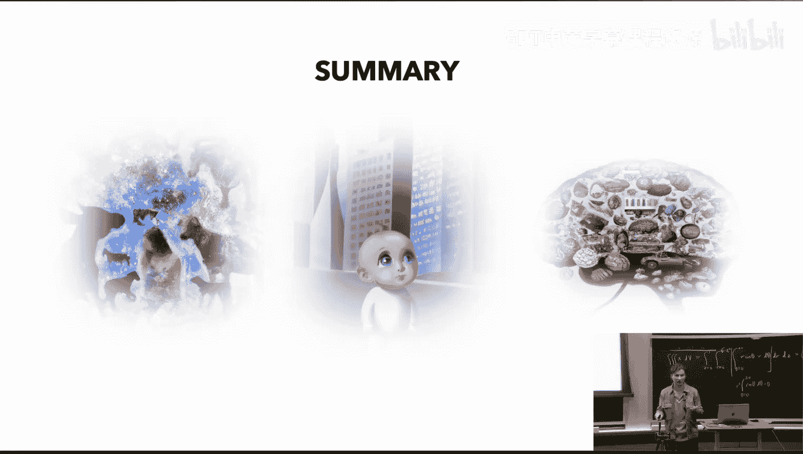

Okay， and I want to leave you with this picture， I think。😊。

The meaning is relational and also maybe ask yourselves like。

 do you have implicit self supervised learning algorithms going on in your own head。

 This is how you learn。If I would take this clicker， for example。

 and I would just drop it and it would float in there。I mean。

 you' probably be upset or even you know， surprised and upset that this is happening like almost subconsciously because you probably have this mental model in you had that's always starting to predict what's going to happen next based on previous action。

 right， And by doing that and slightly adjusting when you observe the world。

 you implicitly learn about the whole world in the process， right。

 you have these algorithms going on in your own head。Okay， next lecture， we will make this much。

 much more concrete， we'll go through different algorithms， and that should be very， very exciting。😊。

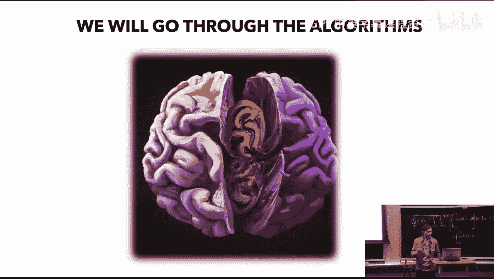

We also have a。Website， futureai。m。edu， where you can get all the updates and other good stuff。

So thank you super much and if you have any questions。Feel free to ask。Yeah。

 well at the intuition on the first two models that you set。

 but in the case of like to sell supervised models。With the guess。对对是被害子。

You got the intuition of the two first pre in the future and positive repair do you understand the intuition there a little bit？

But you didn't understand substitute was learning。That's self supers learning。

 These are those are two examples of self superpress learning。 So I mean， actually。

 the first time we offered this course， it was called foundation models and self superpresss learning。

 so。😊，Self super learning is how you train。Foundation models and Gen AI。

 right Foundation model Gen AI is the output。So those two examples are self super learning。

 so self super learning is a family of algorithms。But give you generative AI and foundation models。

Does that make sense？So actually， I think maybe yeah。

 point it out is important because self Sued learning is the。

Approach and how we train these models right and when we train them， we call them foundation models。

 so ChaP is trained using self supervised learning。So it gets a little bit technical。

 I mean if you had like Yo Laon， for example， he said like， oh。

 just call it soft super fastt learning， why call it foundation orbaI？😊，But then it's like， oh。

 let's call a foundation model because that more sounds better than what it is in there' some definition from Stanford that they use。

😊，But then the media is like， well， there'tative AI sounds cooler sometimes there terms as well that are different on based on the context。

 but all those two examples you understand are self-uppressed learning， that's examples of it。

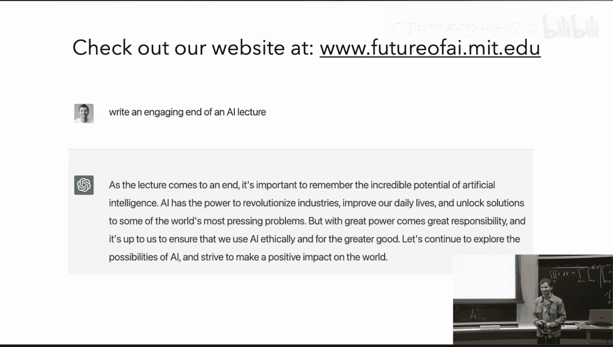