# 基础模型与生成式AI：1：引言与核心思想 🧠

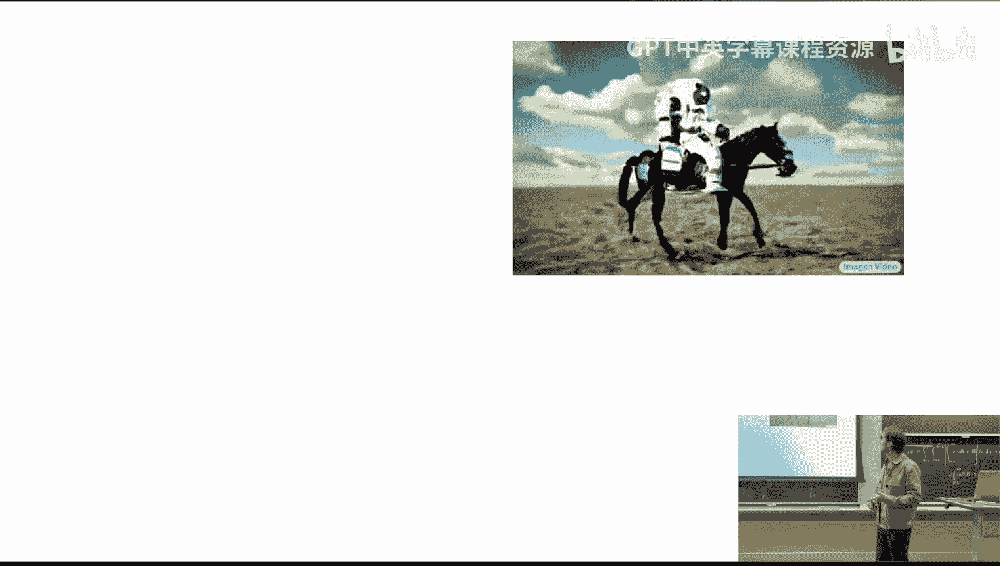

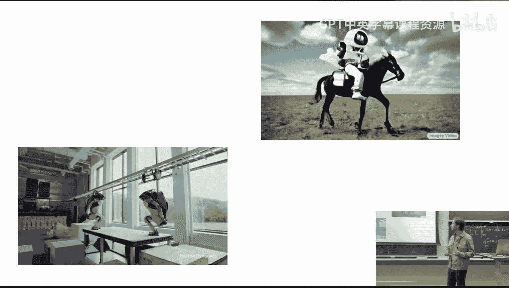

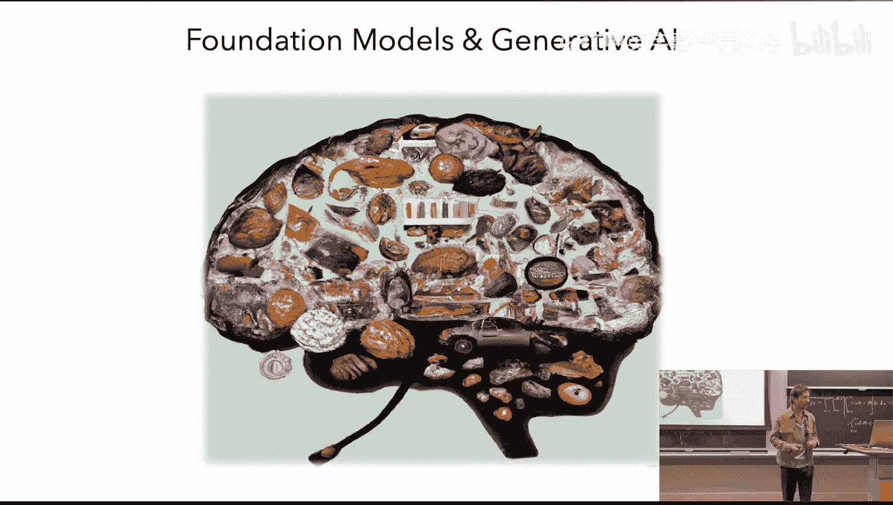

在本节课中，我们将要学习基础模型与生成式AI背后的核心思想。我们将探讨人工智能领域正在发生的根本性转变，理解为什么“从观察中学习”是当前技术突破的关键，并初步了解其背后的哲学思考。

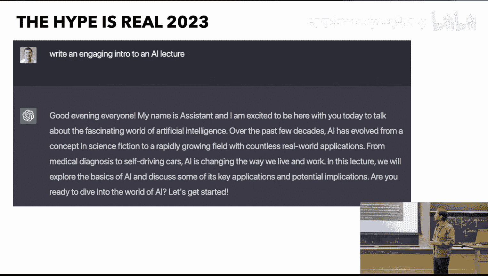

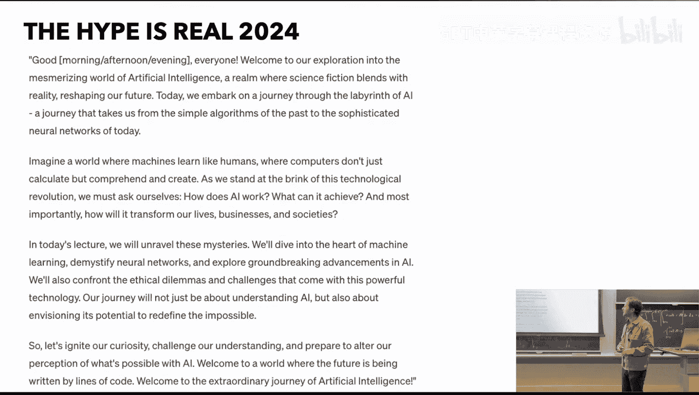

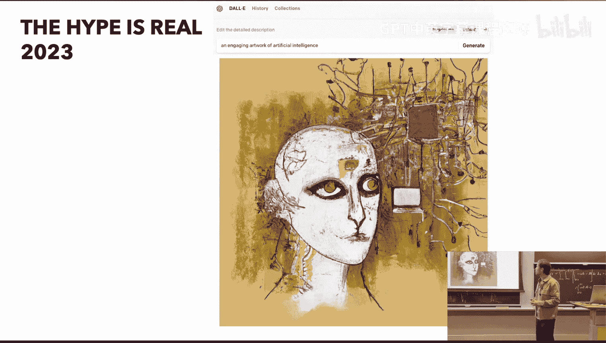

---

## 概述：从人类学习到AI学习

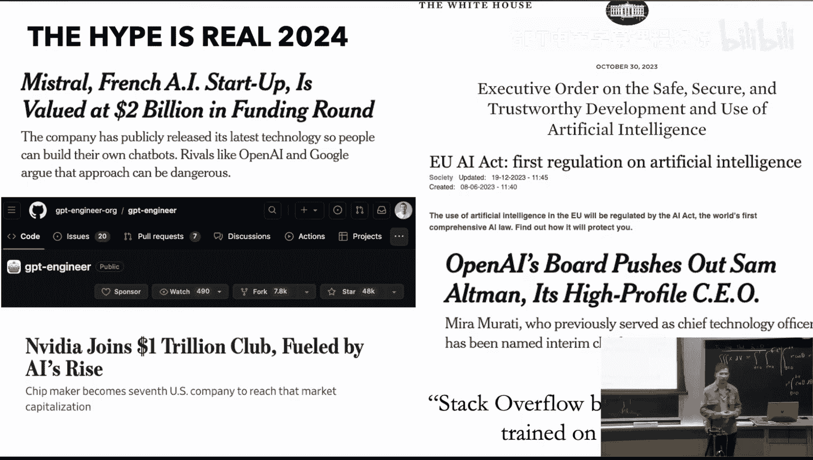

为了理解人工智能，我们可以将自身作为参照。一个核心问题是：一个一无所知的婴儿是如何成长为知识渊博、有用的成年人的？这个过程涉及多种学习方式，它们也对应着人工智能的不同分支。

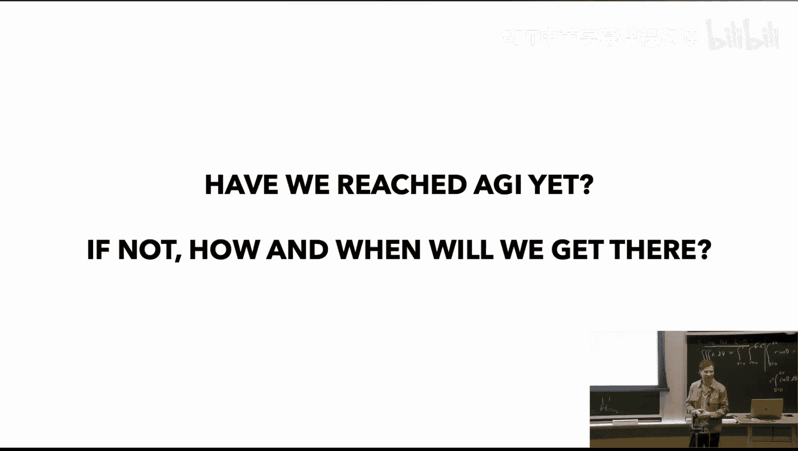

以下是几种可能为我们提供大部分知识的来源：

1.  **父母与老师**：这对应着**监督学习**。人类专家（如父母或老师）为我们整理、标记世界，让我们从结构化的信息中学习。
2.  **DNA与基因**：这涉及更长期的进化反馈，与**强化学习**中通过与环境互动、优化长期目标来学习的模式有相似之处。
3.  **目标与欲望**：我们通过追求目标（如被爱、成功）来了解环境，这也属于**强化学习**的范畴。

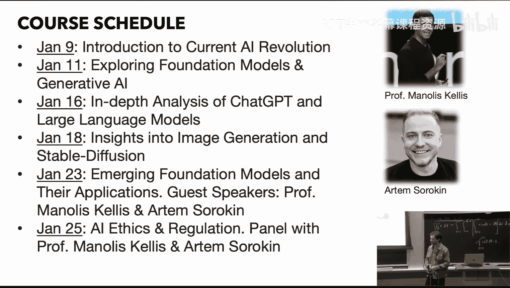

然而，事实证明，我们的大部分知识并非直接来自上述途径。实际上，我们最应该感谢的是**我们自己**。我们通过**自我观察**来学习。

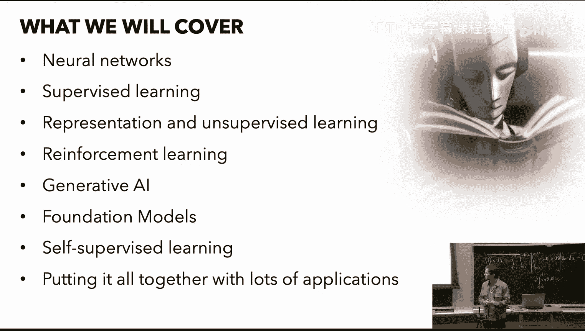

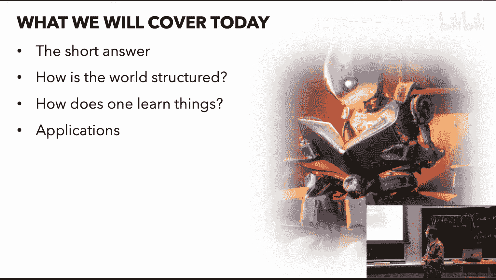

---

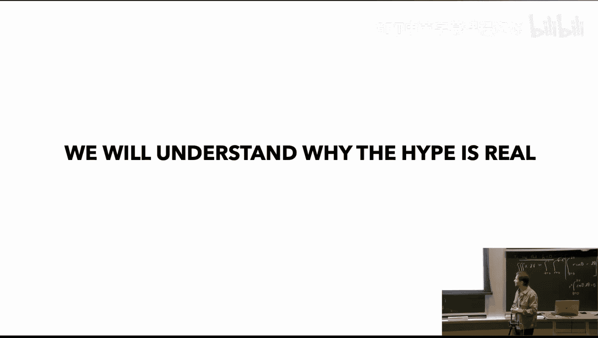

## 核心思想：意义存在于关系之中

我们通过观察事物所处的**上下文关系**来理解其含义。例如，我们并非通过父母告知来理解“狗”是什么，而是通过观察狗出现在不同场景中（如被主人用绳子牵着、与猫有对立关系、追逐飞盘）来构建这个概念。通过将“狗”与“猫”、“主人”等其他概念关联和对比，我们同时也在理解这些相关概念。

这种“意义存在于关系之中”的思想，正是基础模型学习的核心。模型通过在海量数据中捕捉无数概念之间的关联，来构建对世界的理解。

让我们用一个生成式AI的例子来说明。当模型被要求生成“猫和老鼠玩耍”的图片时，它能准确理解并生成，因为“猫”和“老鼠”在其训练数据中有着强烈的上下文关联。

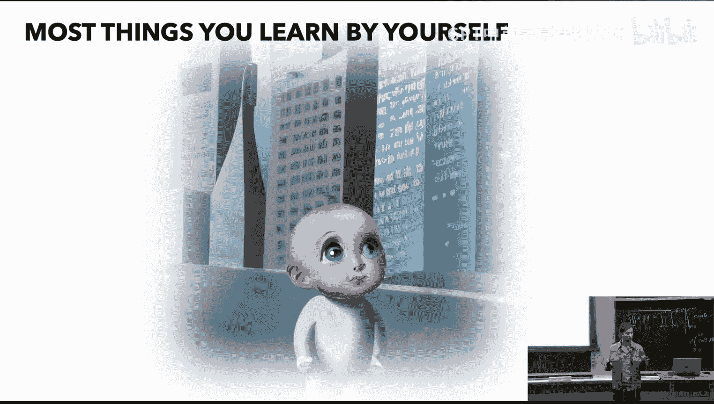

**代码示例：概念关联的直观理解**
```python
# 伪代码：模型对概念关联强度的理解
if context == “猫和老鼠”:
    generate_image(“cat_playing_with_mouse.png”)
elif context == “狗和老鼠”:
    # 关联较弱，模型可能产生混淆
    generate_image(“dog_with_computer_mouse.png”) # 可能生成“电脑鼠标”
```

当关联不明确时，意义也会变得模糊。这说明了上下文关系对于定义和理解概念至关重要。

---

## 哲学视角：秩序与混沌，设计与学习

上一节我们介绍了从观察中学习的核心思想。本节中，我们来看看这种思想背后的哲学基础，即我们如何看待世界的结构。

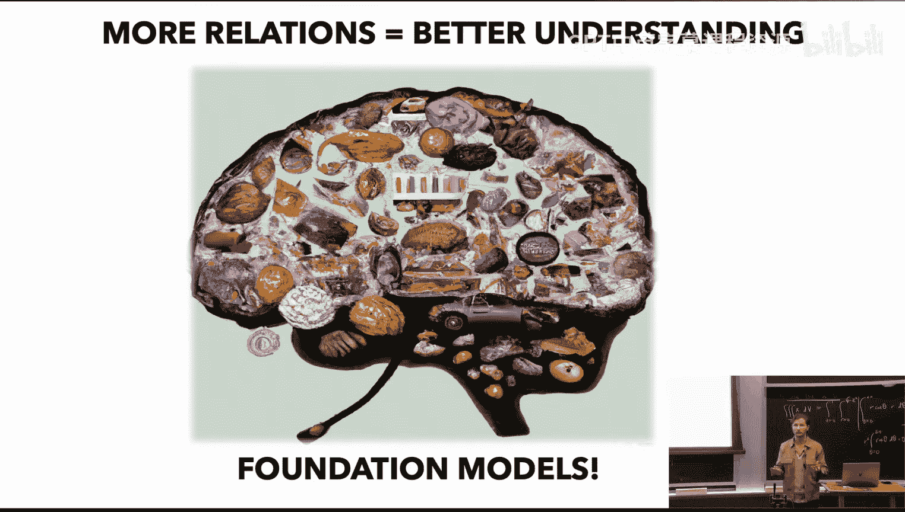

理解当前AI的突破，需要思考两种对立的视角：

1.  **设计与学习**：
    *   **设计**：如同制造钟表，我们了解每个部件，按蓝图组装，有明确的最终目的。这对应着**自上而下、秩序化**的思维方式。
    *   **学习**：这是一个我们未必完全理解的过程。我们通过不断接触现象而适应、进步，没有预设的终极目标，非常**灵活、自下而上**。

2.  **秩序与混沌**：
    *   **秩序**：存在于行星或原子尺度，遵循优美、简单的数学和物理规则。
    *   **混沌**：存在于我们日常的人类和动物世界，事物**不可预测、错综复杂**。

西方思想长期受古希腊哲学影响，倾向于追求完美的、秩序化的“理念世界”（如柏拉图的理论）。这种“设计-秩序-自上而下”的视角带来了科学革命和工业革命，成就斐然。

然而，如果世界本质上是秩序化的，为何经过数十亿年进化的人类，并不擅长纯粹的数学和逻辑？这暗示着**秩序有其解释的极限**。在我们日常生活的尺度上，世界本质上是**混沌**的。在混沌的世界里，有用的不是完美的公式，而是**直觉、灵活性和速度**——而这正是人类和大脑所擅长的。

因此，我们无法逃避世界的混沌性，必须找到能在混沌中导航的工具。这个工具就是**大脑**。而人工神经网络，正是我们在计算机中复制大脑功能的最佳尝试。它由大量简单的“神经元”（参数）组成，通过海量简单计算来获得极强的适应性和灵活性。

---

## 定义目标：从监督学习到自监督学习

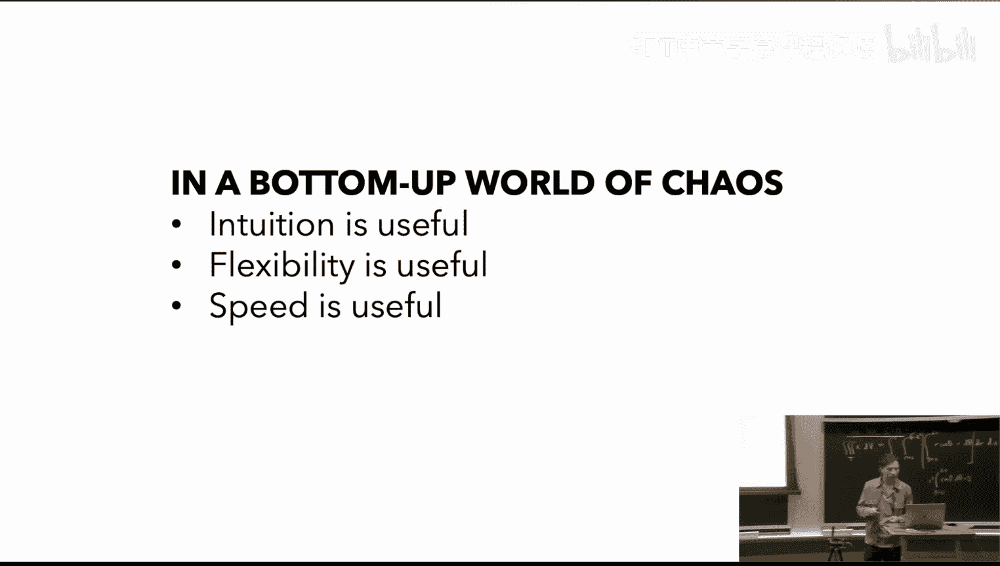

我们接受了世界的混沌性，并拥有了神经网络这个强大的工具。但如何让这个“电脑中的大脑”与世界互动呢？我们仍需用计算机能理解的语言（代码和数学）为其定义学习目标。

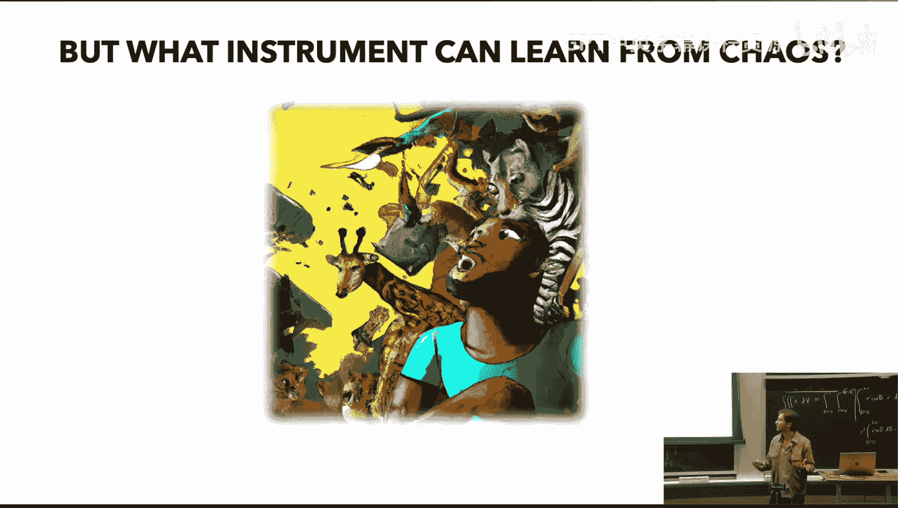

最初，我们尝试将人类对世界的理解“灌输”给计算机。

1.  **监督学习**：我们为世界的数据打上标签，让计算机从这些结构化的信息中学习。
    *   **问题**：这需要大量人力进行数据标注，成本高昂。并且，并非所有事物（如“爱”）都能被清晰标注。世界可能比我们想象的更连续、更复杂，有限的标签无法完美概括现实。

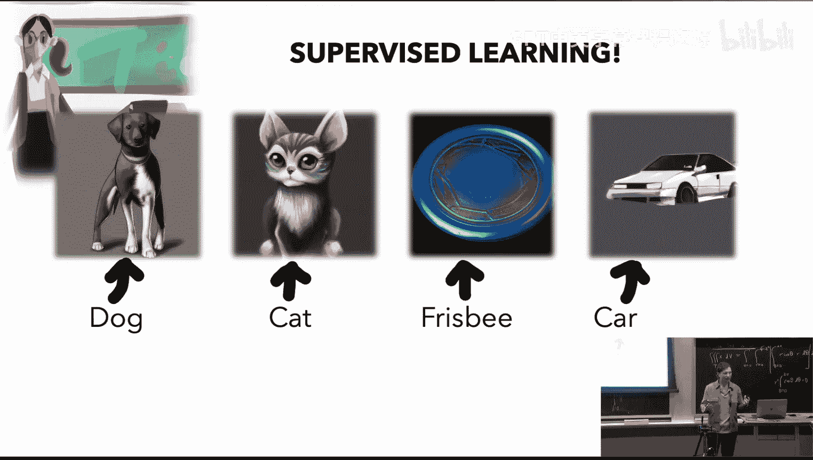

因此，监督学习本身**泛化能力不足**，且过于昂贵。

接着，我们尝试了相反的方向。

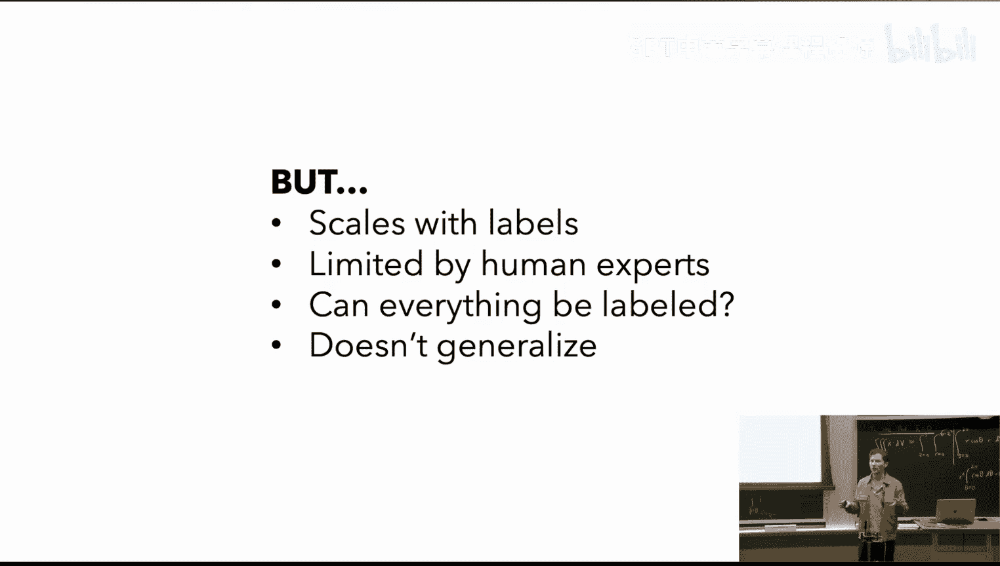

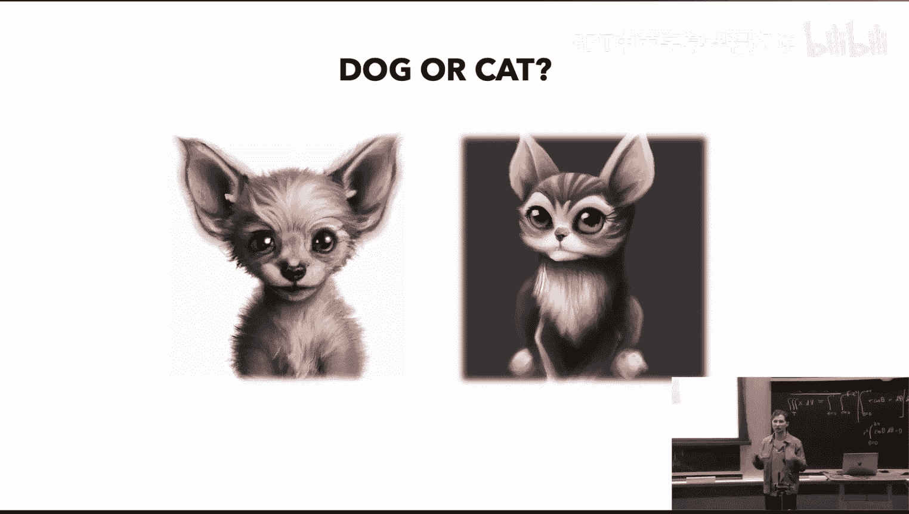

2.  **强化学习**：我们将人类的目标和欲望赋予计算机，希望它在优化这些目标的过程中了解世界。
    *   **问题**：对于一个对世界一无所知的“白板”智能体（如婴儿），它需要探索无数与目标无关的随机行为，反馈延迟巨大，学习过程**极其缓慢且危险**（例如，让一辆“白板”汽车通过试错学习安全驾驶是不可行的）。

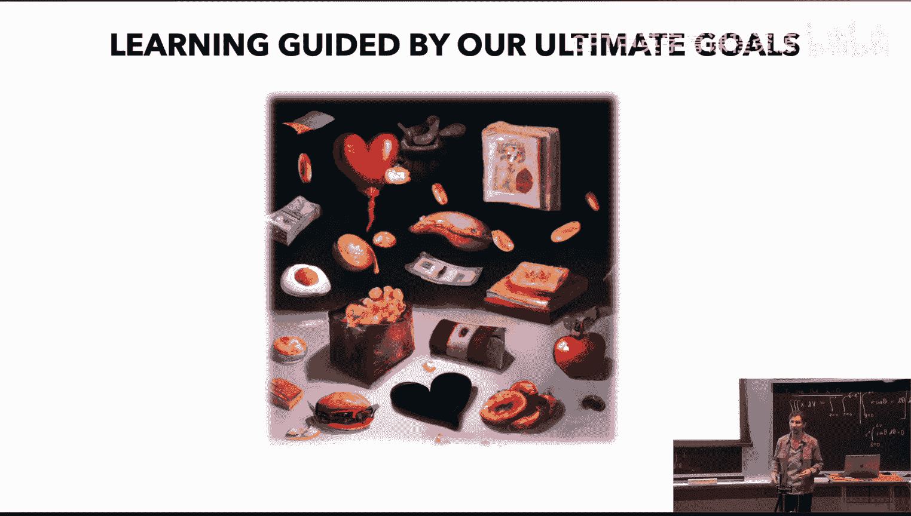

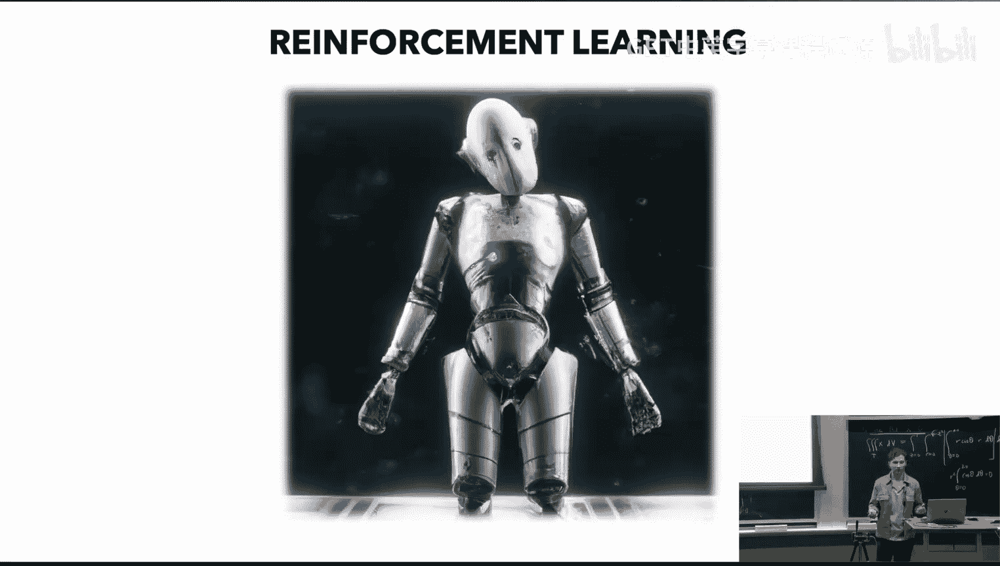

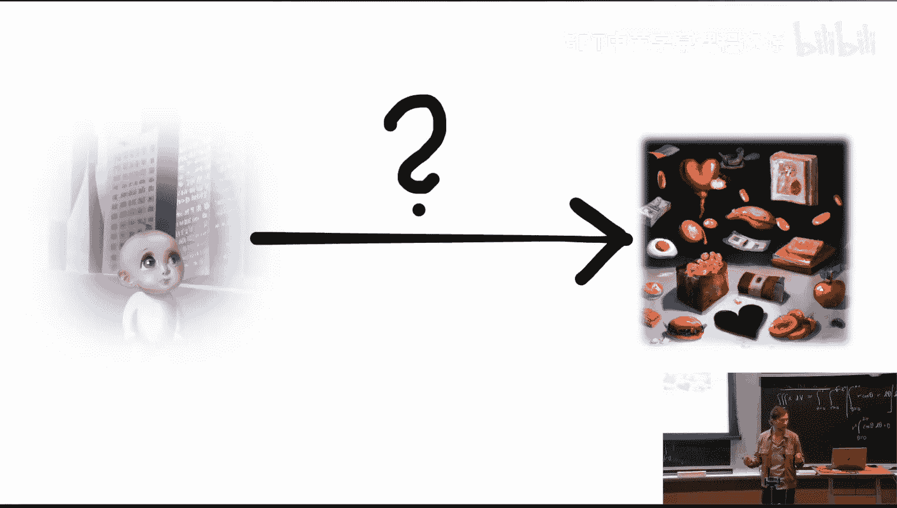

因此，强化学习在现实世界的复杂任务中**成本过高、风险太大**。

---

## 解决方案：自监督学习

那么，什么是可行的方法？我们需要一个通过**单纯观察**就能获得的世界基础模型。这就是**自监督学习**的突破。

**自监督学习**让我们能够通过观察数据本身来学习，无需人工标注。它定义“意义”的方式，正是我们之前讨论的“通过上下文关系”。这种方法可以扩展到几乎无限的数据量，并最终获得广泛的任务处理能力。

让我们快速了解两种常见的自监督学习思路：

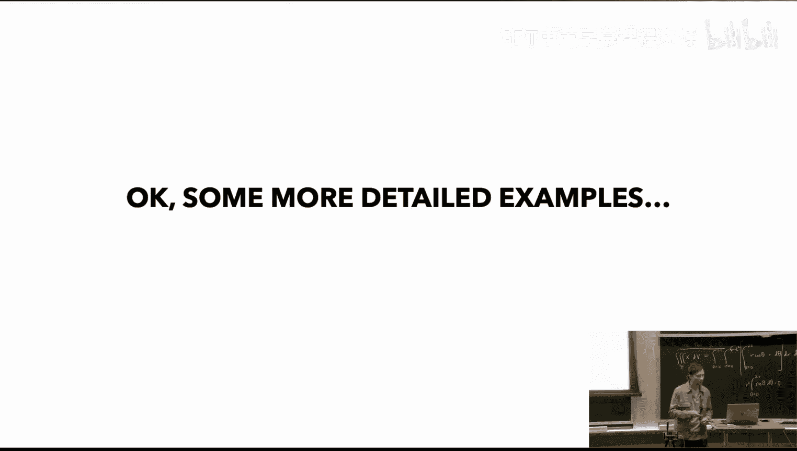

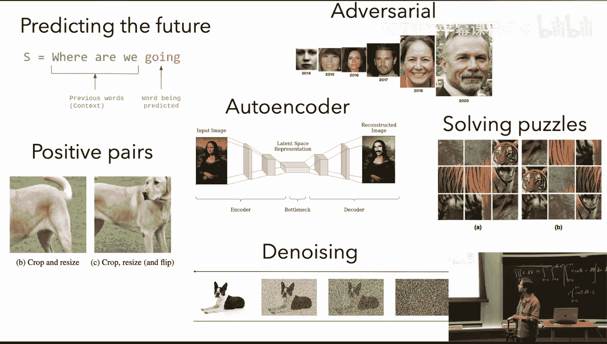

*   **预测未来**：通过预测序列中的下一个元素（如下一个词、下一帧视频）来学习。为了准确预测，模型必须理解上下文中的语法、语义、风格甚至隐含知识。
*   **对比学习**：通过拉近同一语境下数据样本的距离，推远不同语境下样本的距离来学习。例如，同一张图片的不同裁剪部分应该比不同图片的裁剪部分更相似。这能帮助模型学习到更抽象的概念关联。

---

## 应用案例：科学与商业

现在，我们将自监督学习的理念应用到具体领域。

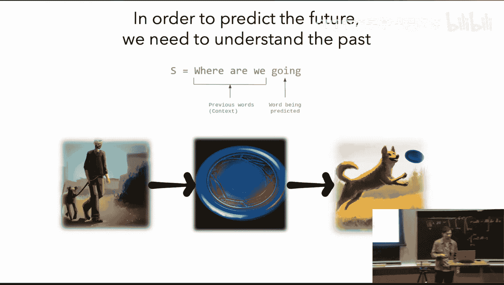

### 案例一：基因组学 🧬

在基因组学中，我们有海量的DNA碱基对序列数据（类似于文本）。

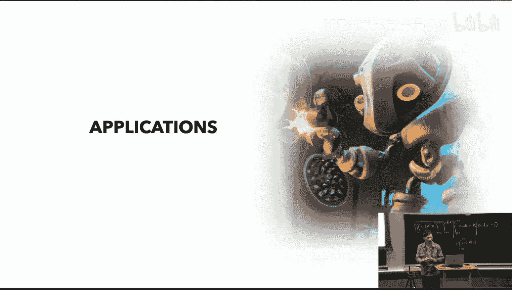

*   **传统方法**：依靠人类智慧识别重复序列（如基因），研究进化树，手动构建特征。
*   **自监督学习**：训练一个大型模型，仅根据前面的碱基对序列来**预测下一个碱基对**。为了出色地完成这个任务，模型必须隐式地理解基因结构、物种差异等复杂信息。由此产生的特征表示，可以极好地用于下游任务，如预测蛋白质结构。

### 案例二：零售商业 🛒

一家零售公司希望更好地理解客户以优化商品推荐。

*   **传统方法**：聘请顾问定义用户画像（如“年轻单身人士”、“有孩家庭”），通过问卷调查收集数据。这种方法**粗糙、费力**，且人们往往并不完全了解自己的偏好。
*   **自监督学习**：直接分析客户的行为数据（购买记录、浏览路径）。通过预测客户的“下一步”行为，模型可以自动发现深层的客户群体划分和产品关联。这种方法**成本低廉**，并能获得对客户和产品更深刻、更通用的理解，可应用于整个公司的商业智能分析。

---

## 总结与展望

本节课中我们一起学习了：

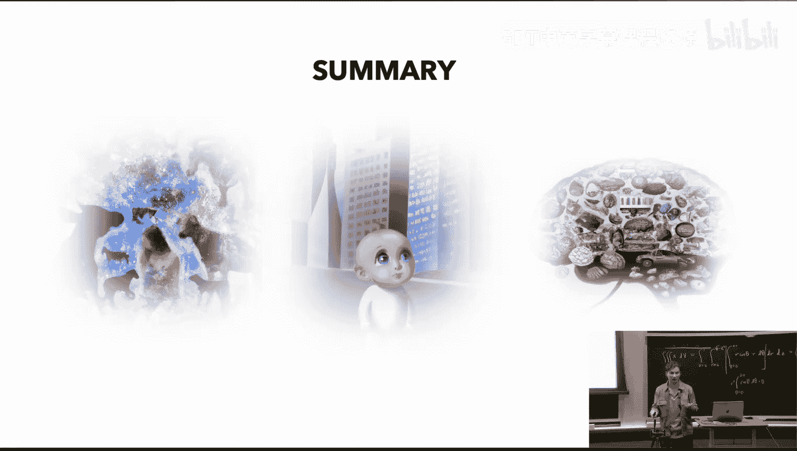

1.  **核心转变**：基础模型与生成式AI背后的核心是从“**观察中学习**”，通过数据内部的关联来理解世界。
2.  **哲学基础**：我们认识到日常世界本质上是**混沌**的，而神经网络是应对混沌、进行压缩和学习的强大工具。
3.  **学习路径**：监督学习（成本高、泛化差）和强化学习（风险大、速度慢）的局限性，将我们引向了**自监督学习**这条可行的道路。
4.  **应用实例**：我们看到了自监督学习在**基因组学**（预测DNA序列）和**零售商业**（理解客户行为）中的强大应用潜力。

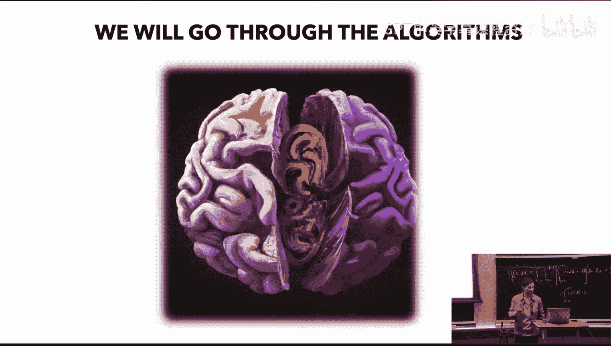

最后，请思考：你自己的大脑中是否也在运行着类似的自监督学习算法？当你看到一个物体下落却漂浮起来时，你会感到惊讶，这正是因为你内心有一个不断根据过往经验**预测未来**的心理模型。通过观察和微调这个模型，你就在学习理解整个世界。

下一讲，我们将使这些概念更加具体，深入探讨不同的算法细节，这将会非常令人兴奋。

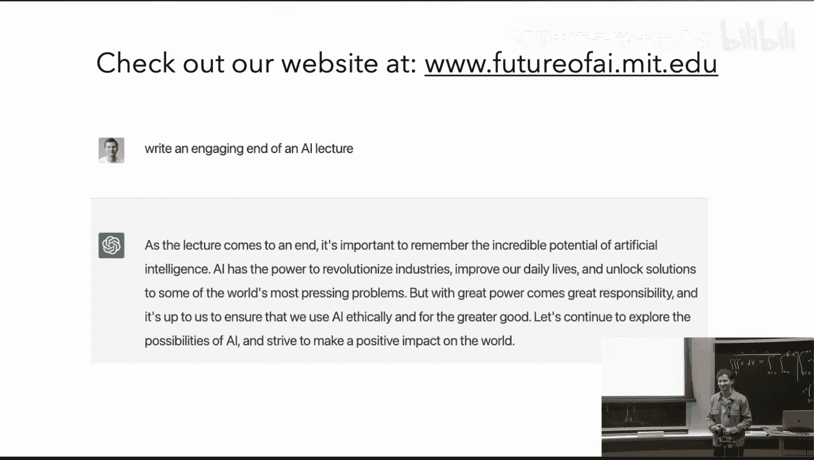

---
*课程网站：futureai.mit.edu*