# 《基础模型和生成式AI｜6.S087 Foundation Models & Generative AI 2024》中英字幕 - P2：6.S087_ Foundation Models & Generative AI. HOW IT WORKS.zh_en - GPT中英字幕课程资源 - BV1YYWpzaE3q

All right。Okay， welcome to the second lecture。On Fish Mo Den AI。This one should be a fun one。

 We're going to dive into all the different ways we train and arrive at these foundation models and Gen AI。

And。If you ask me， I think that this is kind of the key breakthroughs。

 And it's gonna to give you a wide understanding of what's going on。 I mean。

 some people focus more perhaps on。Certain engineering tricks that this happened in the last few years。

 but I think these are the conceptual breakthroughs。 So it's going to be exciting to talk about。

All right， so today we'll go through all different algorithms。

 meaning how we define objectives and goals for computers to interact with the world and data to learn from it。

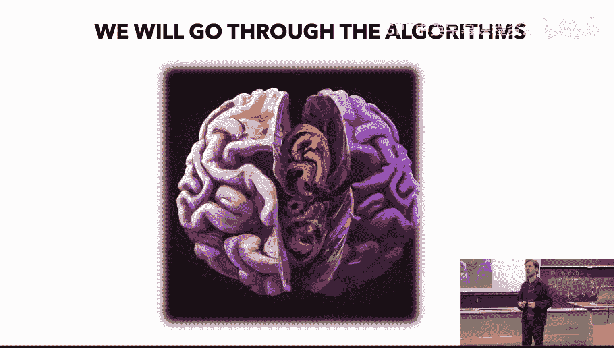

So， quickly， recap from。Last class， right， we provided a short succinct answer to what is foundation mall N AI。

And how you learn from observation and that meaning is contextual and relational。

That went we went on a little bit of a philosophical journey where we asked how's the world structured。

 right， somehow the world is very chaotic and we need to deal with that chaos because math won't save us。

 so that's where new networks and the new type of AI comes in and helps out and that if we want to learn from the world。

Like supervised learning when you learn from an expert doesn't scale well because you rely on human beings that to label the whole world。

 the whole world cannot be labeled， so it doesn't general well。

 And reinforcement learning also doesn't work because。It's too risky and too slow。

 If you have no starting point。 and we're gonna talk about this in this class。 Like if you have。

 if you have some starting point， you can do it。 But if you have no world model understanding of the world of whatsoever server。

 you cannot do reinforcement learning because you don't even know where to start。

 You'll make no progress and you'll unfortunately die way before you make any progress whatsoever。

 That's why。The technique behind foundation modelss and N AI， gene AI called selfsupvised learning。

 That's key。 right Some people call this unsupervised learning。

 the correct term is selfsupervised learning， but that's how we arrive with these。

 these technologies。O。Right， so we learn from no label data。 We learn from this data in general。

 which means it scales really well。 We just needed data。

 and then we can learn the structure from that。呃。All right。And again。

 we said how do you learn what our dog is， well you learn what our dog is from observing dogs in different contexts。

 you correlate and contrast dog do with other concepts like cats and then internal you also learn about cats。

 you get this very relational understanding of meaning and that's what we're leveraging here。

So today we're going to talk about these different approaches more in detail。

 we talk about natural language processing in language。

Basically the the what happened in the beginning and early days of natural language processing and then how we arrived at ChaDP type of technologies。

 And this includes causalsal language modeling， CLM and mass language modeling MLlM。

We'll talk about contrasted learning， which is very popular when it comes to vision and imagesus。

We'll talk about puzzles and games。The noise thing in diffusion also very popular in text image generation like stable diffusion。

 or encoders， GN， so Gen averarile networks， neural networks。

And then we'll talk about a little bit about generative approaches versus representation learning。

And then we'll talk also about autonomous agents a little bit。

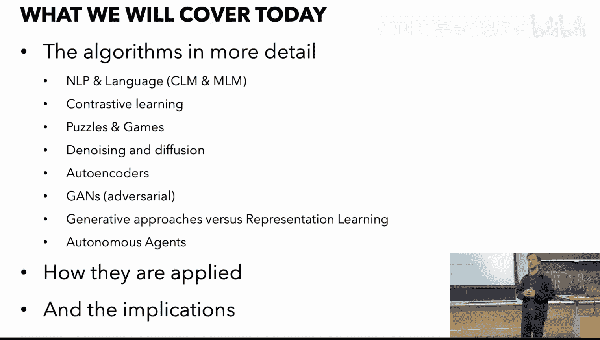

诶。Alright， so let's get started。So we're going to start with language。

 which is also basically where a lot of these。Cand of conceptual breakthroughs actually started。

So language language is a little bit special and that's what I'm going to argue as well actually the language is kind of special。

 it's manmade right we created it for some kind of purpose。

 we don't only communicate in terms of language we also think in terms of language and that might even be the more interesting important component of language is that we think in terms of it rather than that it allows us to talk other people and I think if we came across intelligent other life form。

😊。

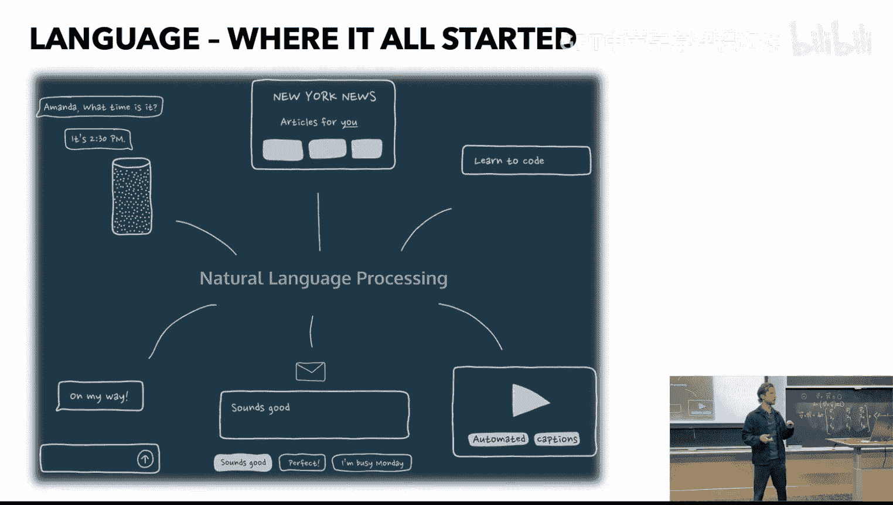

Even if they weren't able to communicate with each other。

 they would still have a language to able to think and plan， etc。

 and I'm going to talk about this later。And really。

 it's an efficient universal medium for transporting and verifying ideas。😊。

we'll try to make this more tangible later， but this also kind of hints at how we can use these large language models to understand language to create kind of autonomous agents and even more humanlike intelligence because a lot of this is hidden in language itself。

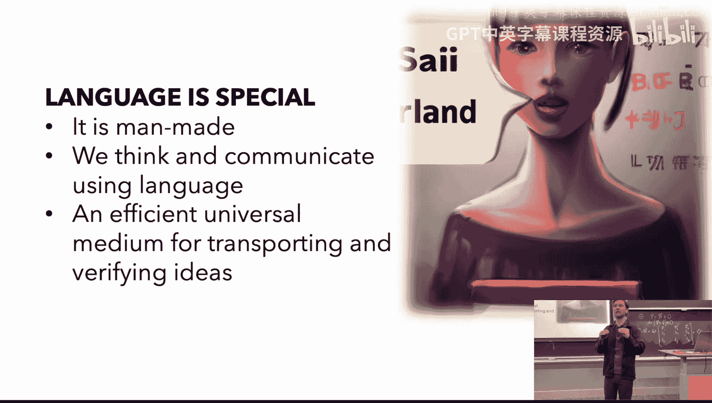

Okay， so。Now， it's several several years ago。 I'm getting old。

 But when I started off my career at Stanford12 years ago， I think it was。 Don't quote me on that。

 But then there was a specific。Research team data set and like model for each specific language task So you would have one research team one data set and one model that they were optimizing write an algorithm for translation and then you have a separate research team model and data set for question answering and then another you know isolated product and data and model and researchers around classification and prediction and。

 cetera right this is a kind of isolated efforts that people were optimizing specializing foreign building solutions and clicking data。

But you know， we start asking ourselves like， hey， is this actually good。

 are we spreading ourselves thin here， We're all working on solutions around language and understanding language。

You know this seems to be a very related task doesn't seem like human beings have separate brains for each of these different language tasks。

 so maybe there is some objective or some something in language that we can optimize for and learn they kind of get the underlying problem of understanding language and then we just see all all of these different tasks as just kind of downstream tasks that we use these big good language understanding brain to solve right but maybe we can optimize that instead。

😡，So that's what we start asking ourselves， right。And right， let's say we want to accomplish this。

 right， Let's say we want to optimize and learn some type of language。 How could this look like。

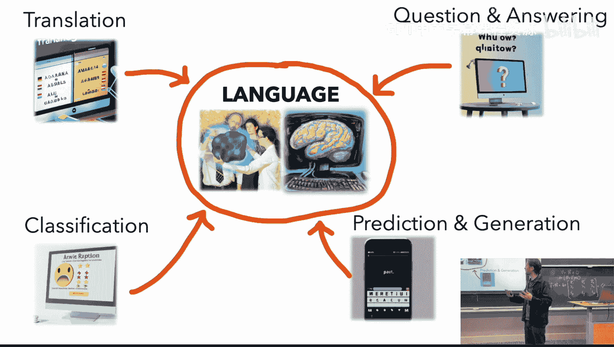

Well， somehow we want to be able to digest like our model AI model or our computer model right able to digest language and then put it on some kind of representation space or feature space right into some useful format and we can use that format and kind of send it to other tasks right so let's say you know let's say we have this type of AI model it's able to digest language can of encode its meaning right into some representation like numbers for example and that we can feed this to all design tasks right that's a really good starting point because if we're able to kind of feurize and represent language and we also get it the real meaning of the text。

 it's very very useful useful tool for these downstream tasks。So this would be nice to have us。

 what did people start working towards， basically fericcing and representation learning on language where。

😊，Sentus is a text that has similar meanings or map very close in this high dimensional meaning space。

 and that it's like a very， very nuanced graular way of absentent meaning。诶。Okay。

 so let's like focus a little bit on the meaning part here， which is very obtuse and and fussy。

 So how can we actually represent meaning in some， you know， how can we like how can we。

 if the mall is able to decipher meaning， how should represent meaning of words。

So let's say we have four words， cat， kitten， dog and puppy。 and let's just for。

Like teaching purposes also present images just to kind of show that these are nuanced concepts。

 right， we just focus on the words， but let's just add some images here just to see that these are new nuanced concepts。

And and clearly， you know， there is a strong relationship between cat and kitten because they belong to the same species。

Right， and also， it's clearly a strong relationship between dog and popupp p because it belongs to same species。

RightSo that's great。 That's a good starting point if we understand the relationship of these words。

 But， of course， it's actually much more nuanced than that because it's also a strong or like at least some relationship between kitten and popin that they're close in a sense to describe baby animals or cute baby animals while dog and cat perhaps you know pertain more to adults or growing up animals。

 So this also this nuance to meaning either we each represent。😊。

And if we were to try to represent the meaning of this words by just mapping them to a single digits。

 for example， computers love numbers and digits， but if we would map these words to single digits。

 we would have to pick should we represent that these things are close because they're in the same species or should we focus on what kind of age they correspond to。

So how we'll solve this is quite simple and we just say， well。

 we're going to map these words to actually a combination or an array of numbers right so it's a high dimensional vector it's called so we're able to represent you know a lot of nuance in the meaning of a word。

So， then we can let。For example， the first， I mean， now all of these digits are the same。

 but of course， in practice in real life， they will be different， right。

 because they these words are different or we could let the first position of this high dimensional vector correspond to this species right if they're the same number in this slot。

 they're from the same species and then we can let the third number， a percent age。

 So if they're similar in this spot， they're in a similar age in terms of what animal that it。

Corresponds to。Okay， so now we just kind of quickly。

concludedcluded that we need to represent the meaning of words using high dimensional vector because。

Meaning of a word is very high dimensional， it's nuanced。But actually。

 the meaning of a word is not the best perspective。

 because it's not the meaning of the word itself that we want to focus on。

 Let's take the example of riverbank versus financial bank。

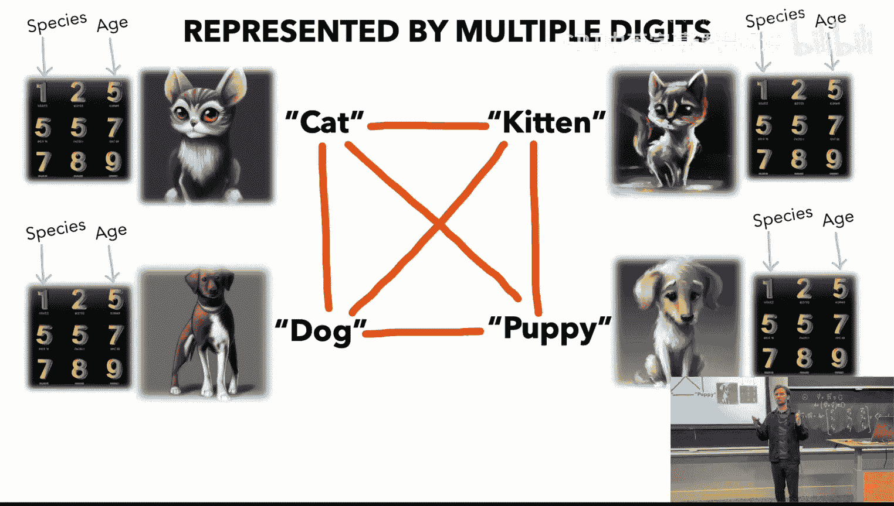

So here， bank is exactly the same word in the both context， but they mean very。

 very different thing depending on how they appear right together with other words。So really。

 like meaning of a word is very， very contextual and it depends on the other words that surrounds it。

So somehow we need to also take this into account， really learn， you know， to map。诶。

The meaning of text into useful vectors be to consider the whole text together somehow。And of course。

 like I mean， when people started working on this， there was word embeddings。

 like people started focusing on just mapping words to me it actually works quite well。

 but when you want to do the next level， you have to also consider the context and the whole scientist has like a contextual clue。

So we're going to also not learn to map you know， a word per vector。

 we're going to map any sequence of text to some meaning。

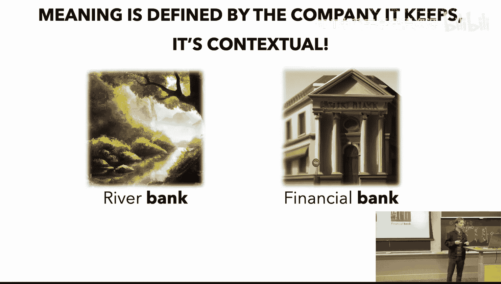

That's key here because we won't have that flexibility and that meaning is actually contextual。

 depending on the sentence。 things change and how it get， depending on other words。

 it appears together with。Okay。So we now know what we want to accomplish and we have these high dimensionional vectors as a tool。

How do we how do we learn contextual meaning？

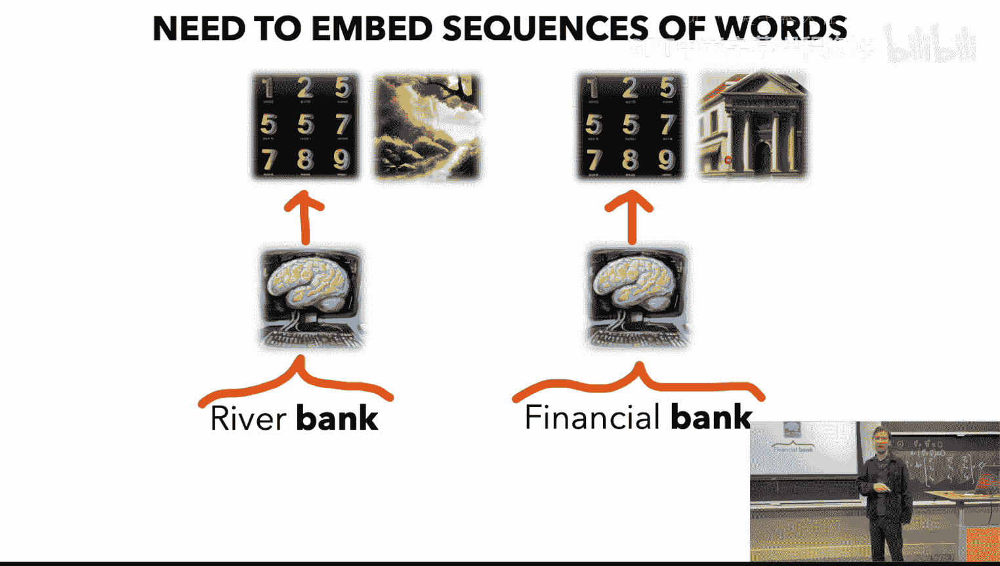

我。I mean we talked a little bit about this in the last course as well， but。

The fact that we just already kind of understand the meaning or like the meaning in language is so contextual also gives us the cu or the the guide of how we can learn from it。

And and。We're gonna think about kind of cocurnce of words and we're going to as talked about before。

 represent and learn meaning by defining meaning as as defined by the company it keeps。

 it's like self referential in that way， but that also it's very。

 very powerful because we just got to learn the meaning of words depending on how they appear together with other words and vice versa。

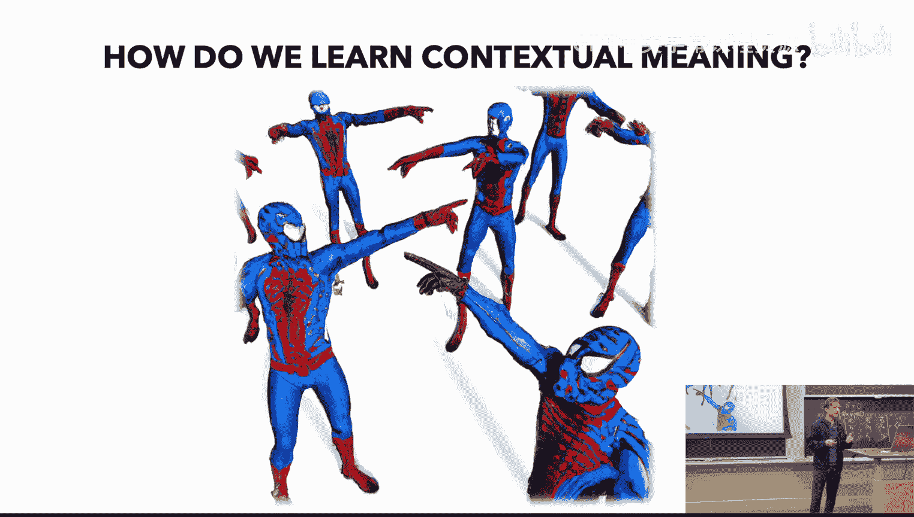

But its actually， it sounds kind of like circular logic， but it actually works really， really well。

 And this kind of shows that meaning is like meaning of language is defined by its use。

 There is no abstract dictionary reader that will work。 It's just defined by its use。

 and the meaning of language changes as the use of language changes。 We all know that， right。诶。Okay。

 so one thing we can do here that that works surprisingly well is to。

Take a sentence or some text from internet。 There's endless of supply。

And then we just randomly mask or beep a word in the sequence。 and then we train a model to。

An A model to。Predict what that masked word is。So it's very easy to build a script that downloads takes from a line。

 randomly picks a position。You know， removes that word to put a mask， you know there。

 and then you know you hide that from the computer so the computer only sees I went to the beep bank for a swim and then it has from the you know it has to derive from the surrounding word what that missing word is so it has to learn how to correlate the meaning of a word in its surrounding words。

Alright， and what does it mean， right？ Like， what does it mean if it's able to say that， you know。

 successfully learn to say that I went to the beep bank for a swim。 If it's able to predict river。

 it means it knows how to interpret bank in this context。

 right The queue or clue here of swim gives it away。

 And it also knows that then suddenly start to understand the meaning of text here because it's able to decipher this。

 And similarly， it says I went to the beep bank to deposit money。If it's able to predict financial。

 again， it also now know how to interpret its this sequence in this word of bank because it understands money and how they correspond to kind of financial bank rather than a river bank。

O。Fantastic， so we have like our first iteration where we're now gonna train this model on mass language modeling。

 So we're gonna take a lot of text from online。 We're gonna mass words and try to predict those mass words based on the surrounding words。

😊。

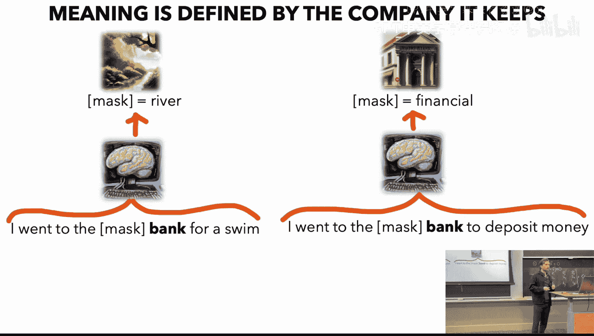

And this actually leads to really， really good feature representation of text and language。

So we get this model。 We run it on some text。 we get a feature that corresponds to the context。

 and now we can fit it into these different tasks that we care about。And this。

 I mean this was extremely revolutionary approach that changed language space forever。

 It works extremely extremely well right so suddenly now you can optimize a model that learns language in general and now it's like a starting point and representation that you can you build on top of right then you would have this know big model in the middle here that would represent and learn a meaning of language and you you can use this across all these tasks。

 but then you would train a small model on top of these features to just to correlate it to some kind of question answering or translation or sentiment sentiment analysis and completion So you would use this kind of features for a downstream task And yes。

 it's like not extremely clear how you get from these high dimensional vector and how you would define engineer all of these smaller computers and models to learn on top of it that's not clear and so it's still involves。

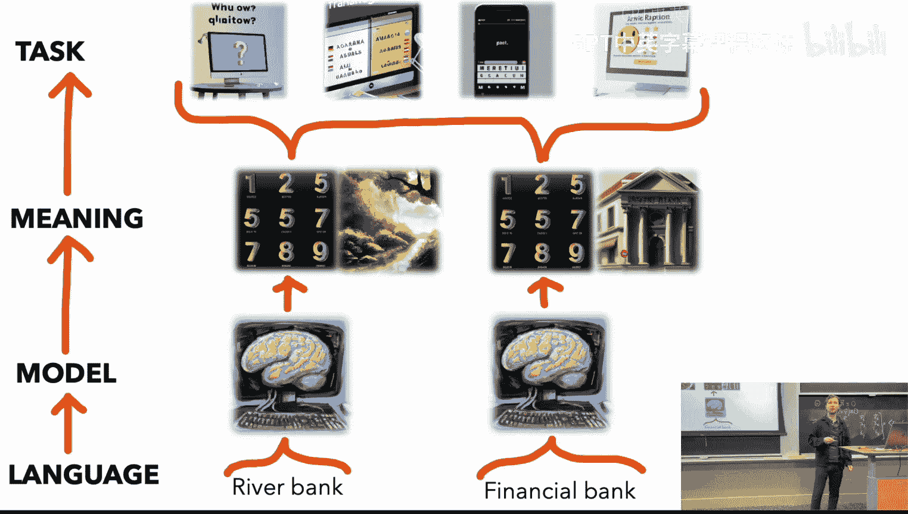

Some engineering and specific solutions for task。 but just that just the ability that you can now leverage this big model understands language on some high。

 you know。From some product， from some。Representation。

 learning in our approach gives you so much in terms of performance。Right。

 so now you can start optimizing these small tools get better and better andcus them across a wide array of tasks。

 which extremely extremely powerful。😊，Okay， so now also， you know。

 when we're trying to solve these problems。

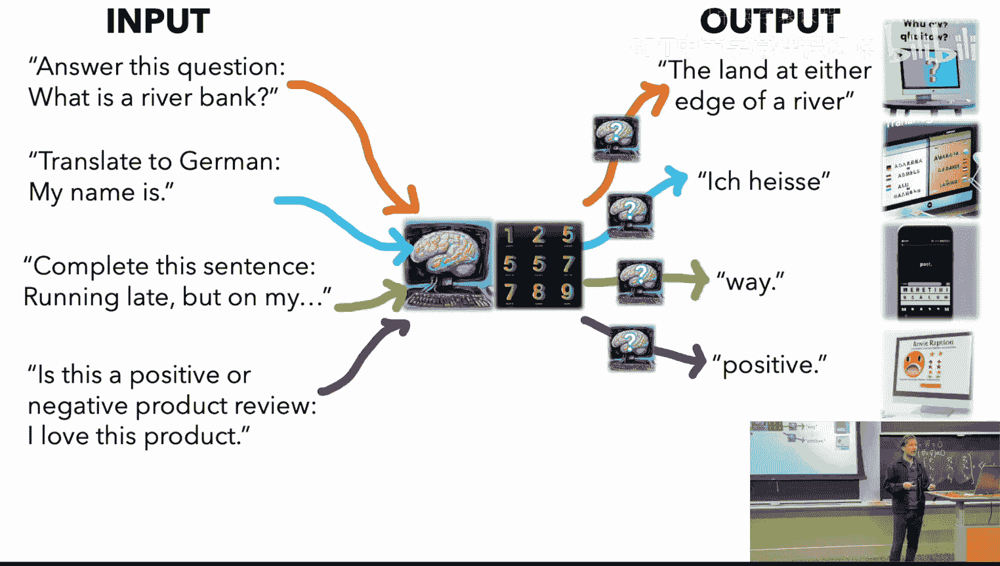

People started talking about pretraining versus downstream tasks， downstream task for fine tuning。

 So now when we take this model， and we use mass language modeling right to train it to get some general understanding of language。

 that's called pretraining。 So that's like how we train a model before we get to the specific down downstream task that we might actually care about in there So it's like two separate steps。

 You pret this model in some setting。 And then you keep training it or you train on top of it as fine tuning for the specific tasks that you want。

So let's say you get you know you do this mass language modeling on text and then you want to classify Amazon reviews as positive negatives right then you use this big model to create a feature for their Amazon review and then you train a small model on top of that just is to kind of learn if it's positive negative on some label data that you have but just about if you have this big model that understands language makes this fruitful and useful。

But okay， so。But again， so like you have the pre training。Which is， important。

 But what you actually do care about is the collection of downstream tasks。So in research。

 we make it a little bit more abstract because we were like， well。

 we don't know what downstream tasks you might be interested in。

 So we' gonna to kind of define a collection of them。 But in an applied setting。

 you typically know what downstream task you care about。And。So， I mean， but， but this definitely。

 even in research iss a set of downstream tests that are more popular because these are useful generally。

So what， what the focus is as well， then is to make the pretrain and the downstream tests。

Kind of as similar as possible， right， So they should they should somehow the preing should be as useful as possible for the downstream task you care about。

I mean， let's say and let's say you want to。You know， learn how to drive a car， for example。And。

 you know， somehow before you sit down in a car， you won't have the best possible observations and the best possible kind of games or whatever you you know。

 you do before you actually sit down in a car to learn as much as possible about driving a car before you sit down And that's exactly what we're focusing on when it comes to these things as well。

 we want to make the preing as useful as possible。 know， if you want to drive to drive a car。

 So maybe you sit down with some instructor or something or like， you know。

 you just observe somebody， you know， you actually sit in the car together with your your dad or something when it drive。

 right， that's more useful than than seeing something from afar。

And this is also related to simulation and reality， where we want somehow。

 if we cannot afford and we don't know exactly about the specific reality or situation。

 we're going to apply something， we want our simulations to be as close as possible。

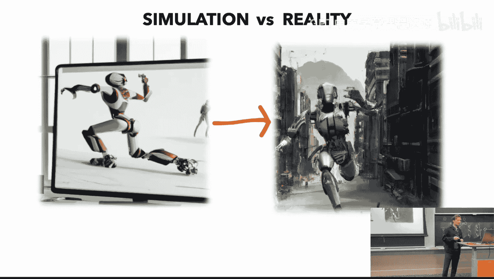

All right。So。Now we've， you know， and it's what we did。

 So now we've learned to embed text into these high dimensional vectors that encode meaning。

So this is great， but you know language in itself conveys meaning so why go into this high dimensional embedding space when we can just go from kind of text to text because language itself is very。

 very flexible you know when we look up a word for example。

 right we look up and we want to want to have a dictionary definition of it somehow to get more context around it。

So why not kind of start using language itself as a very flexible way of representing meaning or even expounding on the meaning of text？

So that's a little bit。 The next step what people start doing。

 and what we're gonna try to do is gonna we're gonna try to remove these high dimensionmenal vectors in the middle and turn them into text that。

 So here， for example， someone put some type of definition of riverbank to financial bank that takes the whole context together and then explains what it means with other words。

 right， It selfreental， but mean itself is selfreential， right， So we might not be losing out much。

Okay， and。This is also nice because as language is a very flexible， you know， way to encode things。

 we can also come encode all our tasks as just take to text。😊，Like we don't need to encode you know。

 positive or negative into zeros and ones， right， We can just encode as positive and negative as as words or as text。

So this is in the beginning， people would encode all these different tasks and the data into format that computers want。

But now we's going to encode that into text that they kind of make sense from a human perspective and。

If we now have text to text models， we we're not sad how we're going arrive at them。

 but if we have text to text models that。Digestted text and output text。

 at least then in terms of engineering， these are the same formats， right， So if we。

 if you take all our downstream tasks and we rewrite them as text to text， right， you can。

 you can rewrite any task as text to text， right you see here I mean。I mean， this is。You know。

 it may con yourself， it's very possible to take any task and then write in terms of text instead。

 So， you know， instead of saying， you know， answer this question， what is of a bank。

 right you just give the the answer in text if it's multiple choice， can just say， well。

 it's option a or something。 and if it test to German， if it just a text。

 completing is also just text and classification positive negative。

 write just output the actual description if it's positive or negative。

So now the nice thing is actually is text to text， and we can。Put all of our downstream task。

 whatever they might be in the same format。 So there might be additional training on some label data set around the specific task。

 but there will be no engineering in terms of going from a high dimensional vector to some specific output because now all the input and output is text to text。

 And that's， that's very nice because it also means it's gonna be easier for us to kind of。

Findine tune on a lot of tasks at the same time。 And I get the synergies across these tasks。

So this is what Google did with their model called T 5。 and it's also very， very successful。

 where basically this is where it is's like， okay， we're gonna define all the different tasks that people might care about and the benchmarks that exist in just text to text。

 And then also our model is trained to text to text。

 It's gonna be a smaller gap in terms of engineering。 and hopefully in terms of performance。😊。

How they arrived this model is very， very simple so on a high level they just basically now took some text they masked out multiple words in this text and then you just tried to predict so just predicting you know the specific word that was masked out they not predict and recreate the whole sentence right with those words filled in so instead of now being kind of a text to masked word prediction it's a masked text to the full text。

This is a very kind of a small conceptual change， but it requires some work to make it work in terms of engineering。

 But now you have a takest model and you can do this。Al right。So。诶。

There's basically two different things that we've been talking about that is basically one thing which is mass language modeling where we randomly take minus is very similar to the T5 approach to masking word rather and predicting the complete sentence。

 but mass language modeling is when you mask a word any at any point in the sentence or text and you try to predict that based on the surrounding words。

Cosal language modeling， on the other hand， is actually you only mask the very last word and you only try to predict the last word based on the previous words。

And we're going to talk about this when we， when we dive into the chatttP and transformer and how thistrain。

But。How this is trained and how you can optimize this， you know。

 mass language modeling versus coastal language modeling is that in mass language modeling。

 it's gonna be a little bit slower。 But the what you get in return is that， you know。

 when you try to。Pdict。The， the mass word of like， I went to the be bank for swim for mass language modeling。

Basically， each word as it tries to embed itself or be useful， is able to attend to all other words。

 right both in front of it and behind it。So I'm I'm telling you why， but that's how it works。

But in coastal language modeling， you know， Bank， as it embeds itself and makes itself useful to the bigger。

 bigger sentence， it can only look behind it， right， And this is how the transform is important。

 I'm going to tell you why this works this way。But this is a big difference and it turns out the course will be faster to train because you can make some engineering tricks to make it more paraissable。

But hopefully， you know， one of these should kind of make more sense to you right So if meaning is relational and contextual。

 you should be able to do better if you're able to correlate and understand what's in front of you as well as behind you。

 right somehow you have a larger context， which means that you have more context。

 which means you have a better understanding of meaning， and it's pretty cool， actually。

 So mass language modeling works better at almost everything。😊。

Besides one task right because how causalal language model is optimized and thats the only task that causalal language modeling works better at is predicting the next word based on previous word right generation。

 because it's optimized for that way and it can be trained in more data using less compute。But。

It turns out that that actually is a very， very good task to be good at。Why， well。

 because now we can just say like， well， all of these different tasks that are not text to text。

 isn't that just text completion now？😡，If we take some input prompt and then we start generating a word aend to start generating next word like incrementally right because we have a model now that can generate the next word based on previous words。

 we can just run this on its own output again and again and we can generate until some period to something until we're happy right it just takes completelices generation。

😡，So what's the most logical thing to follow， answer this question， what is a riverbank？I mean。

 the most logical completion of it， if it's good at it， is to actually give the answer， right。

 say for translate， you know， translate to German。 My name is。

 but the most logical completion of this in terms of generating next word based on previous words is actually to generate the correct translation。

Right this is true fors these different products。And this is exactly， I mean。

 it sounds perhaps crazy simple， or this is the breakthrough behind ChattP。

You just taken an extremely simple concept of predicting the next token or word based on previous ones to a tremendous scale。

 and it becomes a multitask over because all you need to do is just predict the next word based on previous words。

😡，RightSo you can ask what these things strategy to be solves it easily and for the people behind open。

 Yeah actually like I mean， it sounds， you know in hindsight， it sounds simple。

 and like how could do we see that but like that was a huge bet like who thought that if we take a simple language modeling of predicting the next word or based on previous words to a tremendous scale。

 that should we get kind of human level of intelligence they can solve any task that there was a very like but like you're crazy。

 but like no we're gonna try to spend like 1 hundred million dollars on computer just train and train and see what at some point you start kind of having these emergent abilities that are very human like And that's exactly what happened。

Okay。Awesome。😊，So to summarize a little bit our language language stuff。 again。

 the meaning is defined what the company it keeps。 and so we cannot't focus on a word by itself。

 It has to be as a sequence of words right because they affect each other。

 but also that's the cue that we can learn meaning by this selfreferential right。

 We just learn to predict a massed word based on its surrounding words。 So it's very。

 very nice in language we can learn from this observing it。First。

 we said we're gonna use high dimensional embedding spaces to。

Accurly or like sufficiently encode meaning because it's high dimensional and nuanced。

But then we said like oh， actually it be nice if we can align the pretraining to the downstream task even more。

 both in terms of engineering。 So you't need to go from like text to some high embedding space to some indicator variable or some number right now we can just go from text to text that's nice。

 And then even if we can just basically have the same objective in the pretraining and downstream task。

 meaning just to predict the next word based on previous words。

 it's even better right And for you know， if you just take and train a model to predict the next word based on previous words。

If I have enough data， it should solve all the tasks that we care about。 if it's able to do well。

 So we can almost start throwing away the downstream data。 We don't even care about it， right。

 we don't even know about the downstream task， because as long as you can。Describeib it in a prompt。

 It will work for you。 And it's exactly what ChaP is， right。

 It's just like you describe it with a prompt， some input， and it solves the task for you。Okay。

So let's now jump to other modalities like Vi， for example。 I mean。

 this is also what the people behind Cha P did to try to do the same thing for images。

 So you just take an image say like， hey， it's a sequence top to bottom left to right a pixel the time。

 you just start predicting it。

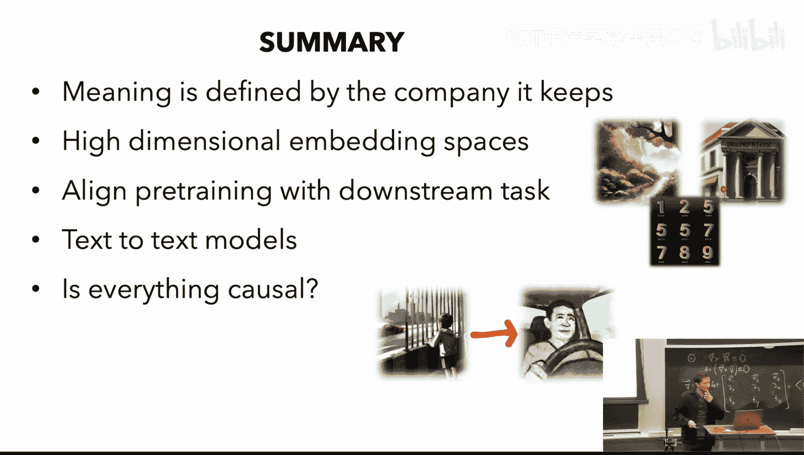

And if it's able to， you know， accurately or realistically complete an image based on previous ones。

 somehow misunder the concepts involved， right， Like， hey。

 am I completing a cat right now or is it a sidewalk or something， right。So this definitely kind of。

 I see， it works。 But that's not what people use because it's not given a state of the art results and it's not computational efficient。

Something people use in， especially when it comes to vision is this learning by contrasting or contrastive learning。

 So we talked a little bit about his last lecture。

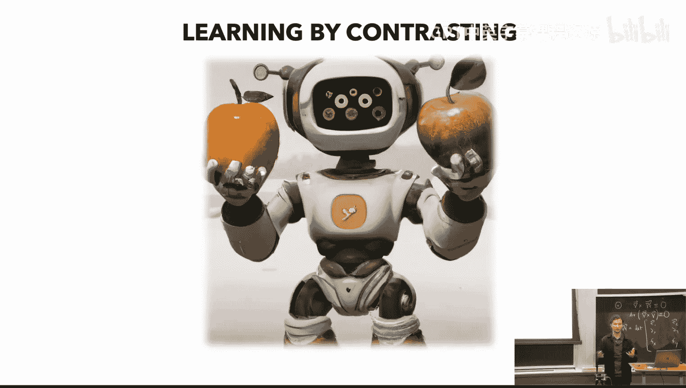

But it works with this idea of positive pairs and actually negative pairs。But the whole idea here。

 and I think it's actually something that's that's fundamental that we shouldn't take for granted。

 But the whole idea here is that we say， well， people take photos of things。

 and it's like natural images。And we're like， well， you know， we don't take random photos。

 We take photos of things， you know that。Are in the same environment， right？

 And maybe that we've even put together like， you know。

 like a soccer ball and a soccer goal or something。

 So we're gonna say that things that appear in the same image。Are on average。

 more related to each other than things that appear in different images。 On average， right。

 you can find edge cases。 this is not true at all。 But when you look statistically at like billions of images。

 that would be true that things， youest the fact if I take a photo here。

 somehow you guys have more have something more in common than you would have with people in a random image that I put from online。

 right， Youre old MI T somehow you're interested in this stuff。

 So that that makes sense statistically。Okay。So also。

 what we need to do because we need to be a little bit careful。 So let's say， you know。

 we just try to take， So we take an image， right， you know。

 you' had something in common because you're in the same image。 So we just cropped this image。

 We just had a computer make two K two different random crops。 Sometimes they might， you know。

 be overlapping。 Some they might capture wrong things， but again。Statistically。

 when you do this enough on enough data， it works。But you take an image。

 you take two different crops and you push them together so that the representation now。

 the high dimensional vectors this model creates of these of these two crops will be pushed together so they're closer right when they're from the same image。

 but of course it's a very simple solution to this because if we just take images we crop them and then we want the crops to be close together。

What if we map everything to just the same vector， then everything will be very very close right So again。

 it also kind of points out that everything is relative like similarities relative for for it to be similarity needs to be dissimilarity for this to be kind of something to be close also need to be a sense of something mean far away。

So what we need to do is I should to take this to not allow it to collapse。 be to say like， yes。

 I want these， you know， two crops from the same image to be mapped to you know vectors。

 high dimension obsession close each other， but far away from other images。

 I'm going to push you away from other images。 So I cannot collapse。

 So there is also a sense of distance。 I need to be close and far away。And。And again， right， like。

You can get also some type of。More kind of apps are relationships like things that don't appear in this like things don't need to appear in the same image ever to be close。

 right， you might have two different species of dog that never appear in the same image ever。

 but as long as they appear in with other shared concepts。

 right So if these two dogs appear with owners with leash， if they are appear with frisbeies。

 then they will still be closed in absentation。So it can kind of bridge that gap。Okay。

 so this done in practice。 Well， in practice， we turn this into a classification task， Basically。

 where we for each set of， you know， images that we in front of each other and crops。

 we feed the computer the。One crop。 And then we say， you know， hey， we have three other crops here。

 You need to classify or pick which one of these three ones is your past repair， right。

 Which one do you belong to。And which one， you know， don't you belong to。

 So it basically has to classify and retrieve the correct positive pattern。And here。

 it's quite simple， right， But you can only already see like somehow you needs to understand a little bit。

 you know， needsunderstand this image of a owner walking with a leash and retrieve the dog。 I mean。

 you can see the leash here。 But typically， you know it'， it's harder than this and say， like。

 you know， a dog is often is walking in a leash。 typically a cat is not。 So like， and I can do this。

 And then， you know， this is just。For crops in total， typically， you would have， you know。

10000 or something。 So it becomes even harder to pick up the right positive repair among 10。

 you know， among 10000 candidates。Okay， so this works really， really well。 Its， it， you know。

 gives us really good representation of images that we can use in a lot of different settings。

 So people use this a lot。😊，And also， of course， we can do this anywhere we're able to define positive and negative pairs。

 So it's very general right So if we take we can do the same thing basically for language modeling。

 where we take a sentence， we create the positive pairs by just kind of corrupting them or masking them and that they should be mapped still。

 that shouldn't destroy the meaning of the sentence。

 so they should be map close together and far away from this other random sentence to we my from a line or something。

So as long as we're able to have this kind of。Positive pairs， negative pairs。

 we can apply contrastive learning， which makes it very general as well。

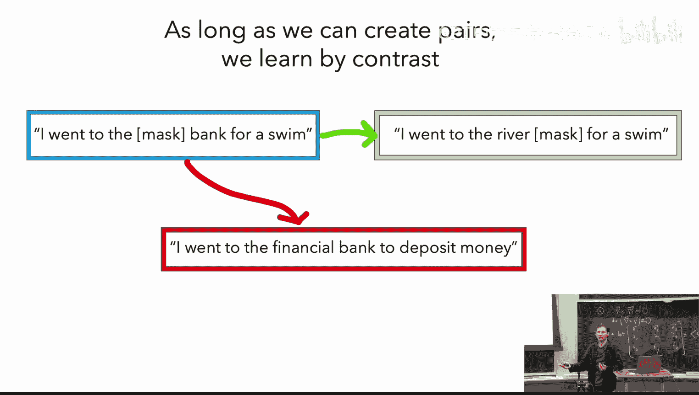

O。So now we're going to take a new perspective and not think as much in terms of you know defining meaning by the company it keeps and these kind of philosophical buzzwords。

 but we're going just going to say， were just going to play like the computer play games and say that。

 you know if the computer is able to solve these simple task。

 we think that it has to understand the concepts involved。

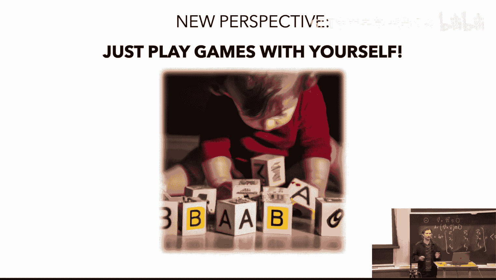

And， I mean， it is also。A perspective that's been very fruitful and it's a good way as well to think about how these models learn。

 you define some simple task that you can or game and you let the computers play by interacting the data and you start learning learning about it。

And yeah， so now meaning it's not defined by the company keeps， but how it helps you solve the task。

So I think one example of this is when you take a some text from a line。

You just scramble all the words and let the computer try to put them in the correct order again。

RightLike why would you do this， Well， it doesn't make maybe a ton of sense。

 but then you start thinking about it like， well， if you get a collection or a bag of word of his random words。

Like， how would you start thinking about putting him in a right order， right。

 You would have to think about the grammar。 You have to think about the meaning。

 what describes what and how to build up a story that makes sense。So let's say， you know。

 let's say you're able to take this and actually start putting in the right order。

 It means that you're leveraging your your understanding of language to do it。

 So somehow this task if， if， if done well requires language understanding in terms of it does。

 So you can train this on scale on on tons of text data and it starts doing a really。

 really good job。 In fact， it's able to put it in such good。

 you know in the right order so often and so accurately that these computers don't even need to have language in the right order。

 it can just get the all the。Words mumble together。

 and then it can implicitly put them in right order and use that， right so。

It kind of shows that the order of words are less important than the bag of words that appear somehow。

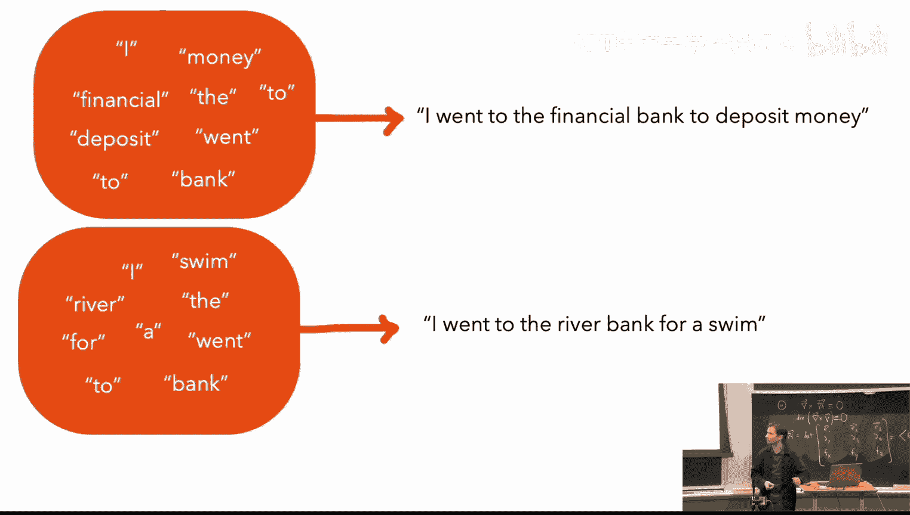

诶。Similarly， we can do the same for images， we can just take an image。

 we can create this kind of jigsaw puzzle where we create squares。

We shuffle those squares and then me let the computer try to predict the correct ordering of those squares。

 right？And， again。Yes， if you want to be able to put the eye in the right order and stuff you somehow you start understanding how a face is typically outlined right and if you have other concepts as well like you know what's the tail of a dog or where's the front stuff like that。

 So if you want to do this scan really well， you'll start to understand you know how visual concepts appear and you know you need to be able to understand them。

We can also do something a coa game of denoisy。And like again。

 it also kind of a common denominator is that we can get an image from online very cheaply， right。

 we can， we can create squares and and shuffle them very cheaply。 Like。

 it's no human being need need to be。 This a script only right， Similarlyly。

 you can take an image from online very cheaply。 You can have billions of them trillions。

 And then you can add noise。 like this this Gaussian noise here。 A computer can create noise very。

 very cheaply。 So you can take an image from online。 You can add some noise。 different levels， right。

 And then you can say like， you know。😊，You can train a computer to try to remove the noise。

 So the noiseing。诶。So right， somehow we can start seeing the contours and we can kind of jump to conclusion about what this picture probably is。

 and we can fill in the details。Right。And this iterative step of denoing is called diffusion。 right。

 So if you know the name stable diffusion， this is where it's from。

Right and probably when you think about it， as you try yourself here to kind of complete this sequence。

You're leveraging your understanding of images and ambition in general to do it。

 So this model actually learns you know how visual objects and images are constituted in how they work because it's able to solve this task。

And also notice that， you know， if you in incorporate sometimes this like pure random noise on the very left。

 but there's no image at all， it can basically start。

Conjecturing or making up images from pure noise。So suddenly as well。

 we have like a generator who can generate images from nothing。So here we changes on faces。

 we can just generate faces and sample any know different set of faces that we can use for commercials or something。

 I don't know。😊，诶。Okay， we also have something called a game of compression。Here we take some data。

 an image， for example， and we map it from a high dimensional object like， you know。

The pixels and the colors and stuff to just a few numbers， like let's say 32 numbers from like a few。

 maybe even a million pixel values and stuff to just 32 numbers。

 And then we try to have in the models to recreate it afterwards。

 So it has to push the data through this bottleneck and then recreate the image。

 the original image accurately。So it has to save only the most important numbers for it to be able to recreate the original image。

So like， does this work， Yeah， if you， if you have some good architecture。

 it works really well and it's able to accurately kind of compress the image and you can use this compression to solve tasks。

 right， because this summarized image in a very efficient way。And these are called order encoders。😡。

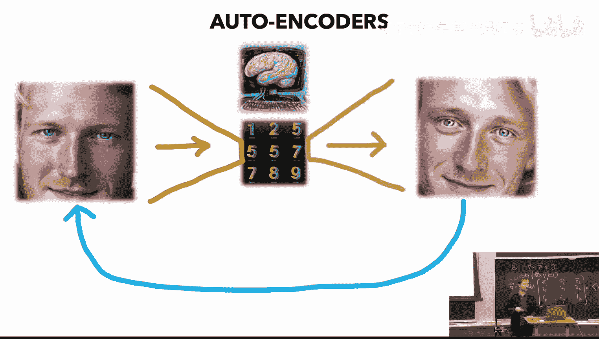

Okay， you can also play games against other people。

So here we have a model we can call the artist that tries to create realistic looking image faces。

 Alright， So what it will do is that you're gonna have a data set now of tons of faces， right。

 real faces you can get from some data setters online just download。😊，And then you're gonna like the。

 this model， the artist is to create a， you know， it's best attempt to creating a face。

Then you're going to feed this its attempt to create a face and an actual real face to a critic。

 which is another AMI model that's trained to distinguish between these two， right？So then you know。

 the critics is trained to distinguish between the real and the fake image and the artist is trained to fool the critic。

 because the artist wants the critic to be unsure， it wants to make its images look so realistic in terms of faces so the critic is unsure about whether actually it real or not。

And probably when you put yourself to draw， you draw something and then you look at them be like， oh。

 actually， does is look realistic or not。 Like what would mom say， And then you improve， right？

 And it's not the same thing， but by itself。 And this is called Gen adversarial training and and networks。

 It's。Quite unstable to train as you imagine right I mean。

 what if somebody gets very good at critiquing， you know it's almost hard to make any progress then because they're almost just too far ahead right So this needs to be somehow a fairly evil level playing field when you train this model so the input and output is on a similar level in terms of accuracy。

And。All right。Okay， so something that， you know， we've been talking about now in all these different approaches that we went through quite quickly。

Is both， you know some approaches that focus on embedding the data or like representing the data。

 type of representation learning and also generating data。

 Okay so these are still two slightly different concept right we want to embed some data to a embedding space where we can use those features for certain tasks right we want to compress the data basically so we can use it for image classification or for you know take classification of what have you。

And also， we have generation where we want to generate data based on some typically some sampling or some prompting。

 right， we want to say， like， hey。You， we won't have an image looked at this and when of people generate it。

And。A lot of times， actually a lot of the models that are really good at embedding things。You know。

 might not even focused on being trained on generating and like order encoders are trained on both embedding and generating might be much better at embedding than they are generating。

 So it's also a lot of tradeoffs where like， you know。

 you might only want to train and focus on the embedding aspects。

 You don't want to have basically twice the number of parameters in compute you don't care about generation And some methods1 might be better at one and worse at other。

 etcter。And so this is why this is the case， right？So。You know。

 something that we started to understand。 And I I'm not talking right now how you achieve this。

 but something that we， you know， in a research space and， and as well how these models are used。

 that would be nice to be able to map this to the same embedding space。

 like a shadding bedding embedding space mean that。😊，It maps equivalent meaning to the same vectors。

😡，And maybe it's less clear how it's nice if you just go from imist images。

 but now if you add other modalities， it's very nice if this embedding space is shared。

 you can just take your favorite em and you can your favorite generator it can go in between so you can like you know plug in a em for。

😊，Images and you can like accurately embed a face， and then you can you know plug in a generator in terms of language that understands the same embedding space。

 and then it can generate a corresponding language， the corresponding meaning in language。

 like caption， right， So like face of a man。 So you can capture images and vice versa。

 right you can I input an em for language and text。

 And then you can put in your generator for images。 and it can generate， you know， text image models。

So this is of course， very， very useful。 And as we add more modalities like audio and stuff。

 it becomes even more useful， right And somehow， you know， us as human beings。

 we're able to hear things， you know， we're able to read about them。 We're able to talk。

 see them like we definitely have a shared embedding space in our own head。 know。

 we can see things know different modalities， but we still know how to relate the meanings of those things。

 right， like just because we hear a dog， we don't see you there's not a completely separate embedding space And if we would see it。

 right， we still understand it's a dog and we generalize about the dog。😊，You know， depending like。

 no matter what， what kind of sense that we use， right， Because the embedding space is shared。

 it would be very， very inefficient if we have a separate embedding space for each each specific sense。

 right， we have to relearn what a dog is in terms of smell， right and recreate that。

 Some of we want to leverage the synergies。呃。

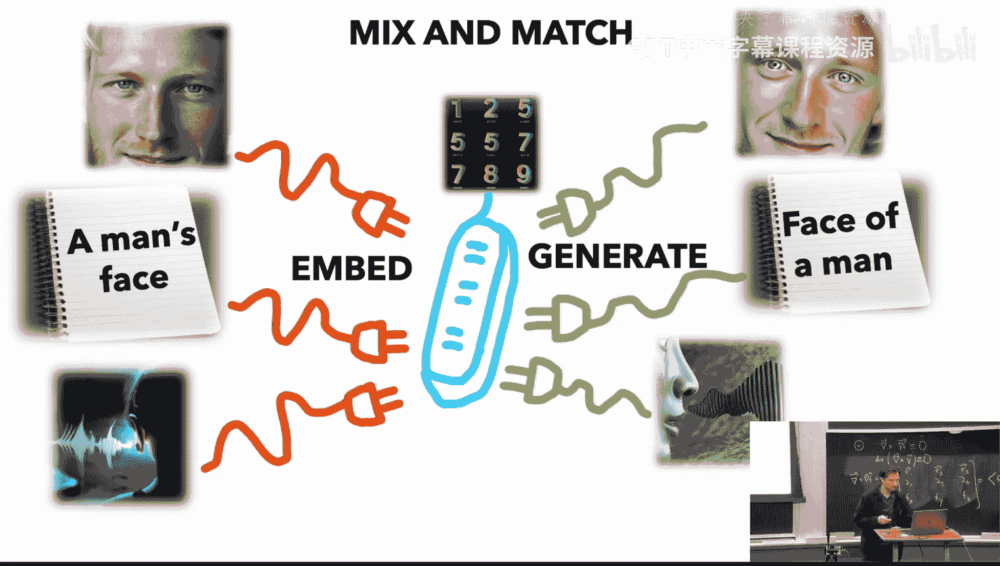

Alright， and it's not only useful when it comes to like different senses and modalities。

 This is also extreme uses in business。 So let's say you have。A model that's able to。You know。

 based on consumers' purchases in groceries， it's able to kind of create an embedding。

 like I use your profile by a high dimensionmensional vector of who you are based on your grocery habits。

 if I can embed that， But then if I generator dis to go from that embedding to generate fashion。

 you know items or or products， that's useful then I can say like， well， I know you know。

 I know your grocery habits， now I can recommend what you would buy in terms of fashion items， right。

 So I can go from knowing who you are and how grocery items corresponds to fashion items。

 I can cross sellll and sell more things to you， right and understand who you are at a deeper level。

 So it's like that's useful。😊。

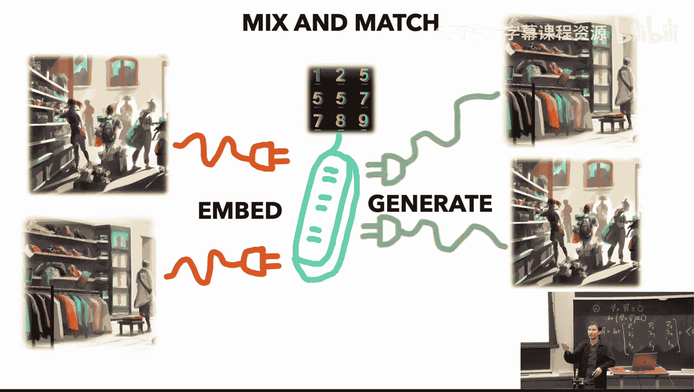

Okay， so I， I promise we would talk about the claim that。

Language is an efficient medium for communicating and verifying meaning， so。Like， okay。

 now we've still。YouTal about this embedding spaces a lot as high dimensional vectors of numbers。

But again， like， maybe we can give language a privileged position as just like， okay。

 we're going use language itself to be our universal emdding space。 right， So whatever it is。

 it' is audio， if it's images， right， or if it's text。

 we're gonna put this in a embedding space of text and language， right， language itself。诶。And。

 you know， why is this useful？I， maybe it's like it's good because we can peek behind the scenes and see what's going on a little bit as human beings because it generates text as some intermediate representation。

Like， yes， that's interesting useful。But that's not actually why it's that。

 why it's so useful and fundamental。And I think why it's useful is the same reason for why actually we think in terms of language。

 even if we we wouldn't be， even if we wouldn't talk or communicate， language is still a very。

 very useful medium。And that's because。Like our knowledge of language helps us to standardize knowledge。

 and it helps us to learn new things faster and we can improve。

 and we can ensure consistencying what we learn。So let me give you an example of this。 Al right。

 let's say we want to train a robot to solve task for us。

So we might want the robot you know to give give some description of the task。

 like make me a sandwich， and then we want to teach the robot to do this。

So how we did this initially and you how we would do this is that we would have a model， an AI。😊。

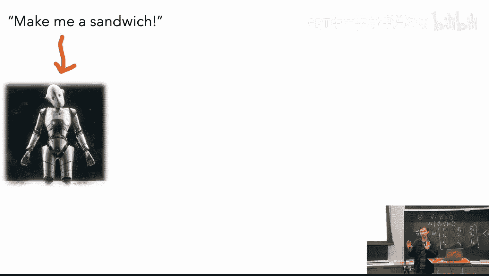

The maps this prompt， right， and some input to some high dimensional embedding space in terms of numbers。

 right， And then it maps less space to a set of actions。Right， so this， now this， you know。

 numbers that represents the task and the plans that needs to do。

 we we don't know exactly what's going on， but it represents in terms of digits。

 and then it has to execute that plan， right， So somehow it implicitly encodes like the steps involved and what it needs to do。

 etca。this is what we did in the beginning for robotics and people still do etc。

 But what if we don't map these to high dimensional vectors。

 what if we just map this to more language right So we map this prompt now make me a sandwich to like some kind of planan and break down。

 So it says I will go to the kitchen， take bread from the pantry。

 butter from the fridge and a knife from the drawer， then use the knife to put butter on the bread。

 Lastly， I will leave the kitchen with a sandwich to bring it back。Okay， great。 This makes sense。

 right， We can， we can look at it what it does。 And like， okay， this makes sense nice。😊。

But why would we do this？ Well， we said that reinforcement learning an electronic these robots is very。

 very hard。 If you have no understanding of how the world works。 So typically。

 you won't do very well， and it's very， very hard for you to solve。

 So let's say you're actually outputting something that doesn't make complete sense。

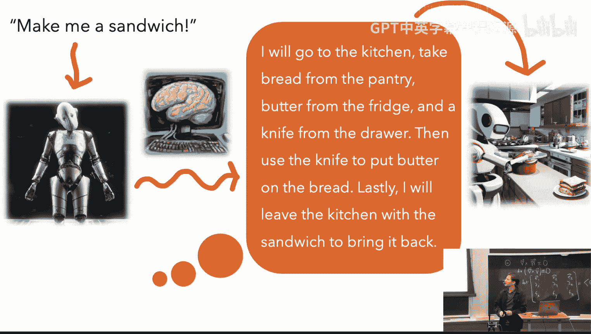

So let's say you're not doing a good job。 So now， you know， a bad model， this output。

 I will take butter from the fridge and a knife from the freezer。

 Like taking a knife from the freezer doesn't make sense to us。 Okay。

 then use the butter to put bread on the knife again， like。

Barding tip put on the knife doesn't make sense。 I mean， the right words are involved， but not。

 you know， they're not interacting in the right ways here。I will then go to restroom for bread。

Like who keeps spread in the restroom。 Probably a few people。 Lastly。

 I will leave the kitchen with the sandwich to bring it back。 like， okay。

 you were just in the restroom， but now you leave in the kitchen。 Like this plan doesn't make sense。

 Like， I don't even know need to know about the task。

 just me knowing language is like like this looks like it's gonna go wrong， right。

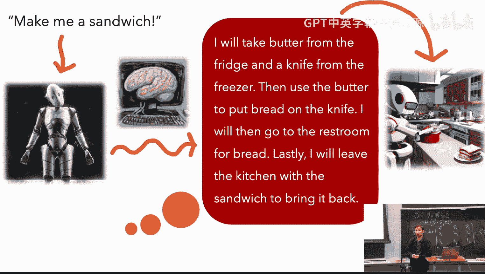

So this is what's very， very cool that we。Just by knowing language can verify and look at it and say like。

 well， this is not going to end well。 You need to correct yourself， right。

And if we're able to do that by just using your language， right。

 language modelss are able to do this。😡，So then they can look at this and be like， well。

 it is a great representation because I know language as efficient medium for verifying ideas right and correcting them so I can look at this now and be like。

 well， robot， I don't know how the world works clearly because you don't know how things work。

 I'm going to help you out and put this in better format。😊，Right so we can just ask P he。

 please correct his text， doesn't know what task involved， but it can。Make it much， much better。

 Maybe not perfect here， but just make it much， much better。

 Put in a way where it makes much more sense， right。

 so I will take butter from the fridge and knife from the drawer。

 then use the butter to spread the bread。 I will then go to the kitchen to make a sandwich。 Lastly。

 I will leave the kitchen with a sandwich。 to did。😊。

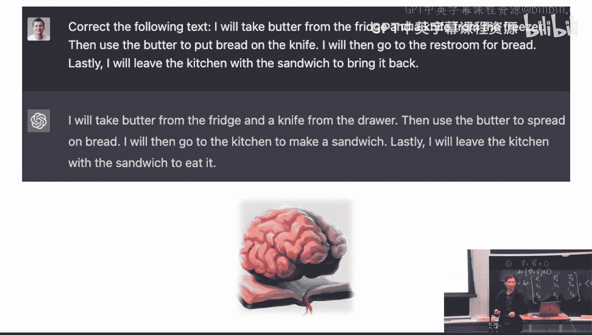

Right， so not only then。Is CP a revolution when it comes to just text task， right。

 it's also a revolution when it comes to robotics and other tasks because。😡。

Understanding language in this sense is extremely useful to make improvements in other areas， right。

 It allows us to make of shortcuts in our reasoning and thinking and also generalize other things to understand and no to this specific setting and do much better with much less data and in fact。

 for like reinforcement learning you know you need to have this world model to even start making any progress whatsoever because you might want to know that like hey。

 I'll put my knife into this human being right that's not a good plan if you know language like well。

 no， no， no， don't do that right don't you don't want to learn that by trial and error。

 you want to know they're ready。All right。

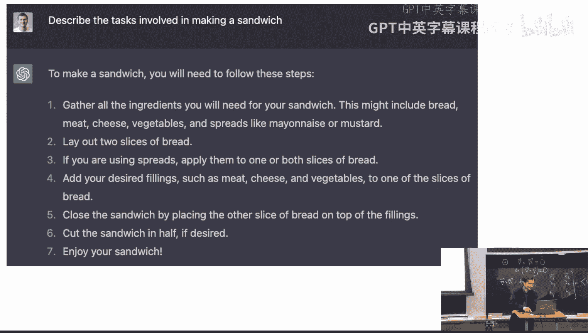

Okay， so this is actually extremely similar to how autonomous agents what they leverage in terms of language right so now you have these large language models or are trained on the internet to just understand language tasks right now you can leverage this actually for planning and using tools in a way that we didn't anticipate almost right It's almost very。

 very humanlike。So an autonomous agent is this basically a large language model that's applied iteratively on its own output。

She's allowed to， you know， correct itself， improve itself step by step。 Typically， you know。

 your chattT P model will just。You know， have one chance to look at your prompt and then give the output that you want。

 But if it's able to， you know look at your input， analyze that， create an output。

 and then look its own output， analyze that and create some more output， it can improve itself。

 find its own mistake and do planning and sterize it can be extremely powerful and when you allow it to use its own output is input。

 you know， iteratively it becomes much， much smarter and better It's like almost a little bit like。

 you know you having to solve something on the spot。

By giving you some time to actually reiterateerate and improve on your initial estimation or plan。

so it's a allowed for retrospection。And improvements in this way。

RightSo for large language mode analyzing generating is is kind of related。

 but you can look at some prompt analyze and generate some output。

 then you feed that output into the model again， and we redo it。And then we can throw in some。

 some tools into this as well right， So you basically describe some tools using language and then the large La more can use these tools as well。

You know， iteratively。 So， for example， let's say you write to your large language model that is autonomous agents now agent because it's allowed to rerun itself。

 createate me a website with like two pictures of dogs and descriptions。

RightThe first they can do is like， okay， great。 I'm gonna make a plan。

 So maybe the first output is like five steps right？ And then it reads saying that and analyze， okay。

 I'm gonna stop with step 1。 So you can make this plan like five steps。 stop step1。 that it's like。

 okay， analyze that。 I'm gonna to use Internet to search Internet retrieve to pictures of dogs。

 right I get this pictures I put them a website I put those pictures pictures in， right， Great。

 now it looks at it output in the website code output。 It sees a great。 I solved task1。😊，You know。

 let me move on to task2 and I'll add the text。 It adds the text again to verify that know that it runs itself on this output again to verify that website looks good。

 Maybe it's like， okay， actually I found a bug here this shouldn't be here。

 I incorporate that and then it runs itself on its output is last time to say like。

 well now everything looks good。 let me now tell my you know。

 me what the owner right that I'm done And and I'm happy with it。

 But this ability to use tools and just like run on itself this way。

 It's what autonomous agent does and it adds a lot of kind of performance and abilities these models。

 And some examples right up the tools that these models use or。😊，Internet。

 right scroll through internet and retrieving information basically， which is very， very useful。

 So you don't need to remember everything from yourself。 You can use and analyze information。

Calculators are one example right， Like even for large language models， it's very。

 very hard to compute the product of very， very big numbers etctera。

 So why don't just use the calculator to fit it in。

 And also what we're seeing now is other foundation models。Rights like this。

Kind of privileged precision of language， understanding and kind of consciousness。You know。

 that's just one part of our brain。 And surprisingly， I mean。

 consciousness and we'll be conscious of is a very small part of our brain。

 and most of our brain are much more automatic and special on specific tasks。

 So what we think we're seeing and what I think we're going to see more of is that like these launch lines models or like a connector across different brains and stuff。

 but it feeds things into specific regions of like other foundations that are specialized in certain settings。

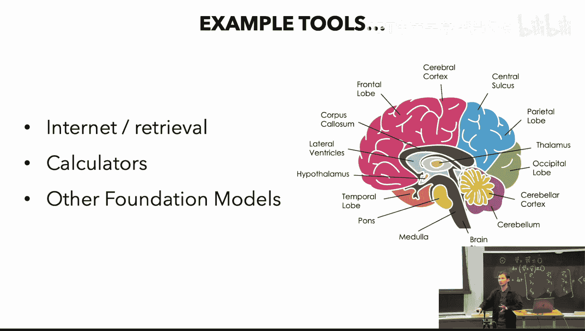

Okay， so still。What are we seeing， right， We're seeing that in robot， etc cea。

 having a language model is's extremely useful， actually critical。Right， and then， of course。

 you know， So it， it helps even in robotics。 And you want to add other abilities well or you want to add vision abilities。

 And I'm always trained on understanding。

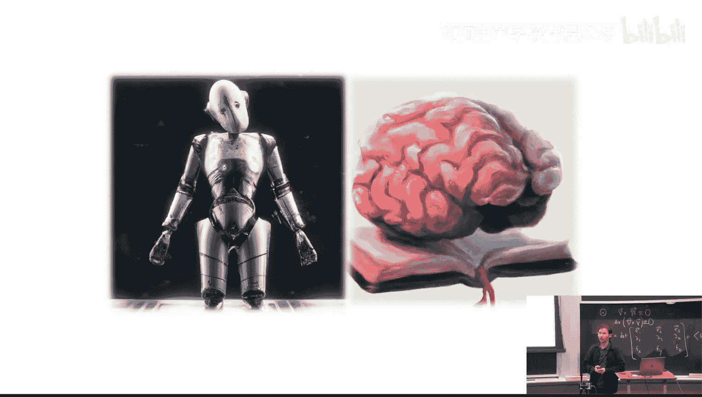

Images and vision as well， because you don't want to retrain that for a robot has to start with the starting point。

 And it's， it's useful， right， And， and also this shows kind of that。All of this。

Different intelligence are very syn。

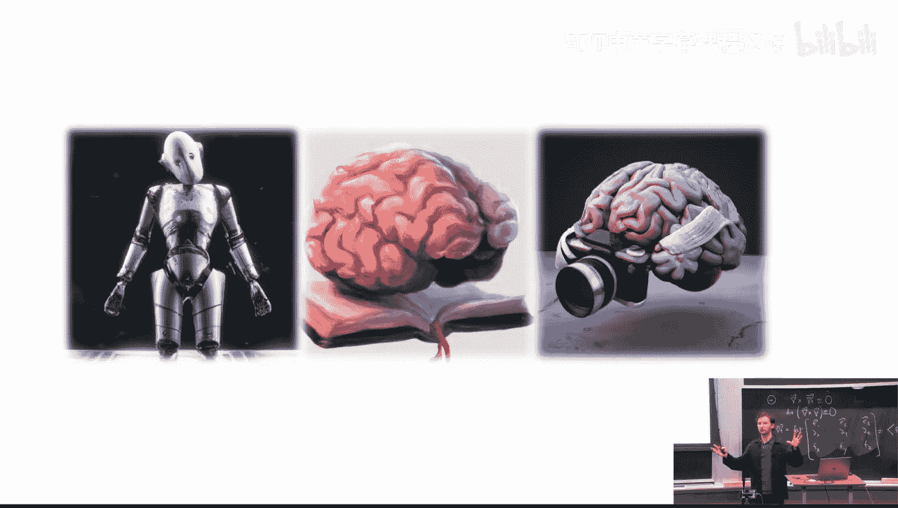

And I think there's also something that that。Took people by surprised as this new AI is intelligent in a much deeper way also shows that intelligence is very syn。

 Every time we tried to split it apart， it loses abilities and it becomes， you know， even harder do。

 right a lot of times now as well， when you try to solve more。

 it becomes easier and not only does it become better performance also but also becomes easier。

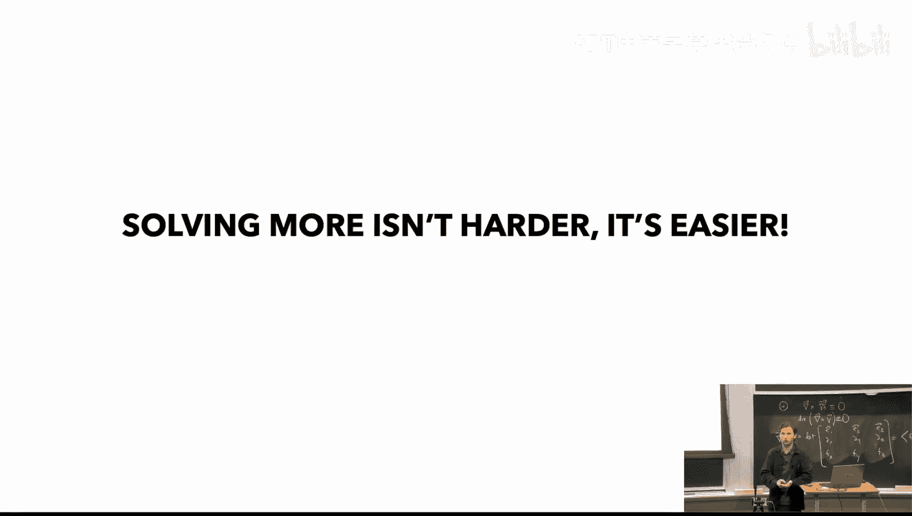

And so。Intelligence is very centralized。 You don't have a brain in each finger tape you have one single brain。

But also probably there's a limit to this because we don't have one single brain。You know。

 as humanity， right， And our brain is constructed by a lot of subbrains。 So there's。

 this nuance to this。 And I think I'm going to talk about this in sub subsequent lectures like， well。

 we're seeing。Different foundation models emerging。

 and it's going to be useful to know how would those foundation models look like， right。

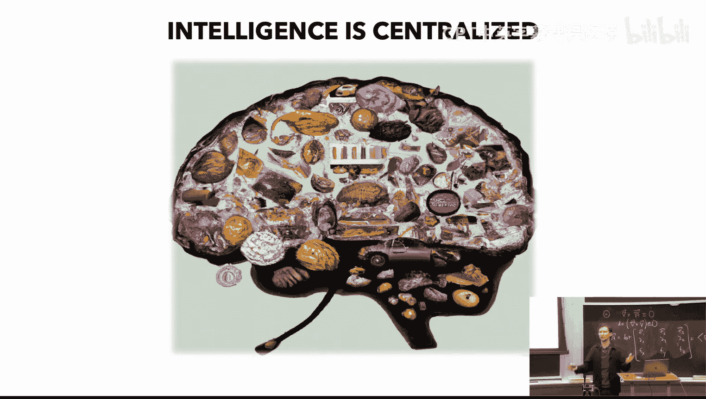

But。I think something that we saw early is that people felt that the market is gonna be very fragmented。

 it's gonna be a lot of room for specialized， you know。

Slightly specialized brains for specific tasks， but。It's it isn't really， right。

 It's very much like a winner takes old market in terms of AI， because if you try to do more。

 you'll do better。And so。I mean， they won't be separate brains for language and vision and for music。

 right there's a lot of synergies in between so needs be some way to connect them and get those synergies for optimal performance。

Right and similar when it comes to business， right。

The days of like when we attack recommendation separately with you know a separate intelligence and like recommendations with isolated separate intelligence like that and thisintelence is like a separate thing No。

 these sort of related things iss about understanding your business right and understanding your consumers in this case。

This is syn aspect and intelligence is centralized。

 so you should leverage data and know how from all all of these different disciplines。

 right So you're basically putting all of this into one single huge brain。

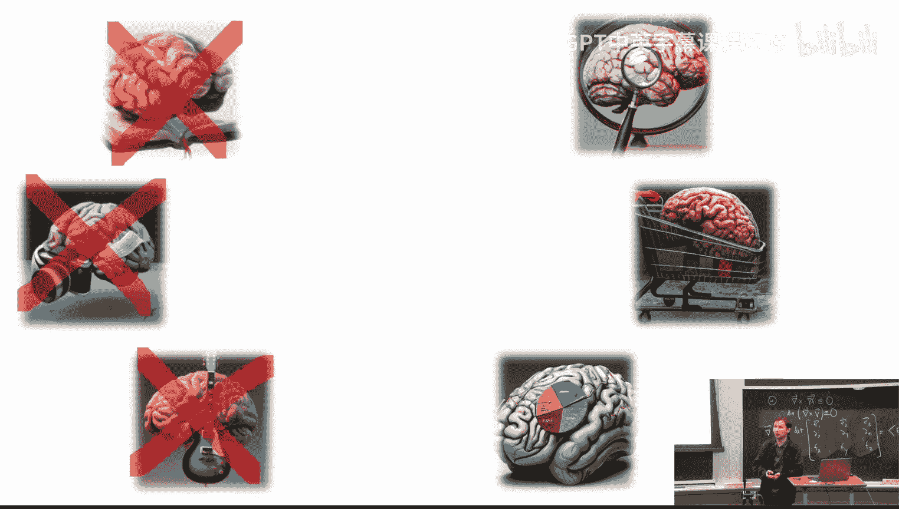

I mean， but but I mean， also the internet bubble， for example， I've already seen start to see this。

Every put a website on the Internet for dog food， whatever it was in the 9 in998， right。

 But now it's basically only Amazon right， somehow like we， I mean， I'm exaggerating。

 but it's gonna be the same thing in AI lot where like there's not。Gna be a lot of room for。

 for some， some of these small hyp players right now。诶 again，嚟。Its， of course， is。

Kind of a warning is scary because we putting more and more power in fewer people's hands， right？

At end of the days like， you know， these are not conscious entities。

 like it's people behind these models， they' are stakeholders behind these models。

 theyll have the power to decide and they'll benefit from this and they're getting like more centralized power。

And now you know ChatedP is taking a big chunk of the market and then suddenly people want CheP everywhere in all our products right and everybody's using it And if everybody on the whole earth is using the same large language model。

 it's very， very fragile because we're all you know doing the same things。 So if it's off。

 it's going to be off systemically I'm going talk more about on A Esex。But also right。

 it's also exciting because the intelligence that we're seeing is so tremendous so you can solve problems that we can do ourselves and it's going to be able to benefit us greatly if for usage responsibly。

😊，And smartly。And I'm going to have the answer to that later in later lectures。Okay。

 so next time we're gonna be even more hands on next time I think we're gonna talk about chatp in detail。

 So we're going it goes through exactly how that works。

 We're gonna demystifies the the transformer model， which is actually quite simple。

 and I think is not that important。 and I'm going to tell you why So you can tell your friends that the are cocktail parties。

 the transformer is not cool。😊。

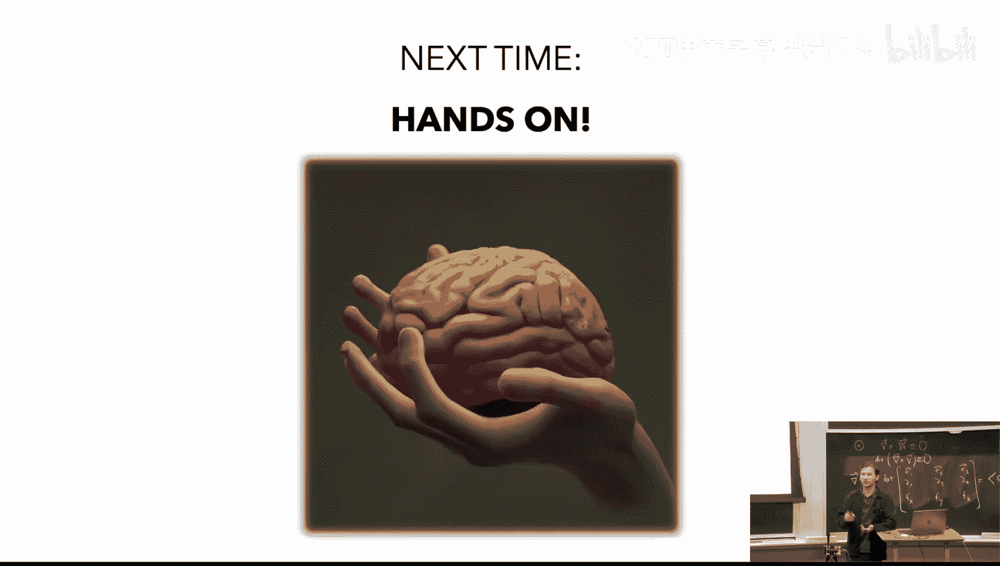

And then lecture after that， we're going dive into text two image models like stable diffusion。诶。And。

 yeah， and， and then after that， we're gonna have lectures right on。Basically。

 how what type of different foundation modelss are emerging。

And how it's gonna look commercially as well。 And then we're gonna have a guest lecture。

 two guest lectures。 So in。After these two lectures were going to have two lectures with guest lectures。

 right， and then we have AN ethicex as well。Okay， so thank you so much。

