# 基础模型与生成式AI：2：工作原理 🧠

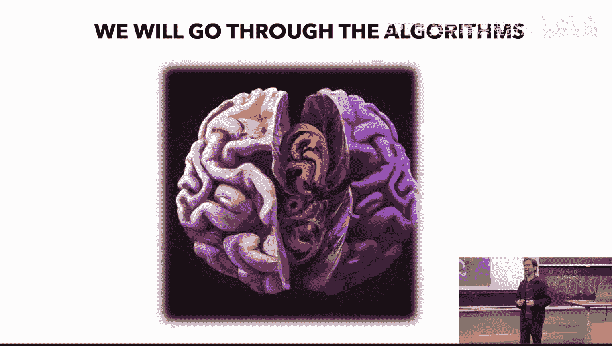

在本节课中，我们将深入探讨训练基础模型和生成式AI的各种方法。我们将了解如何定义目标，让计算机与世界和数据互动并从中学习。这些概念性的突破是理解当前AI技术的关键。

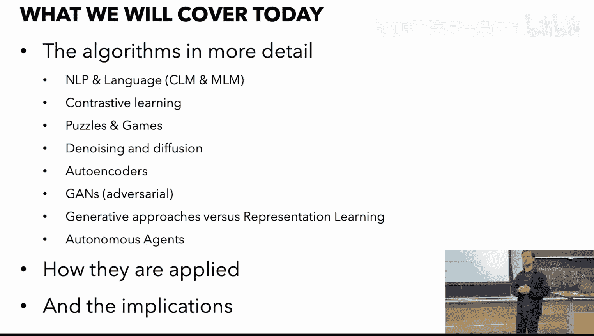

## 课程概述

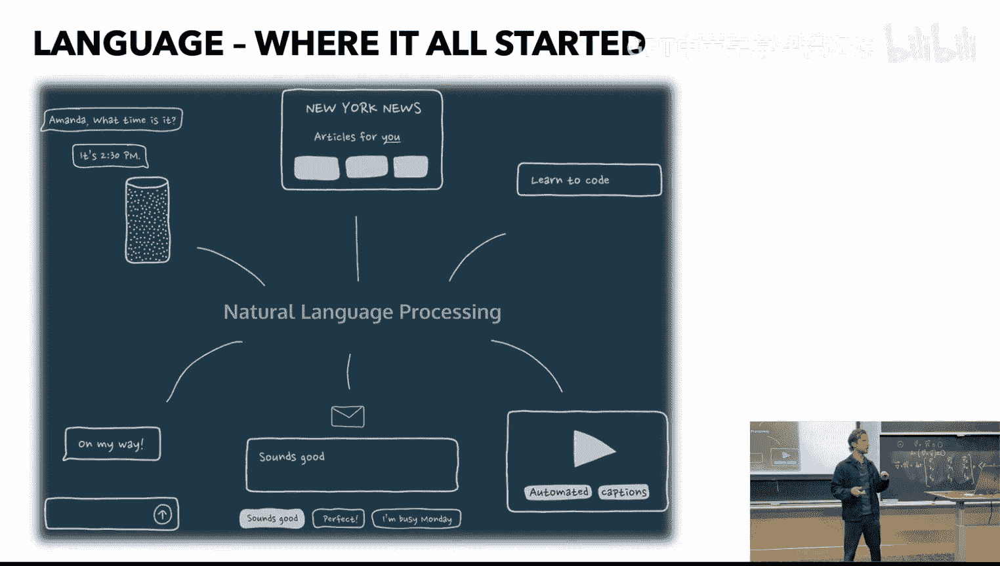

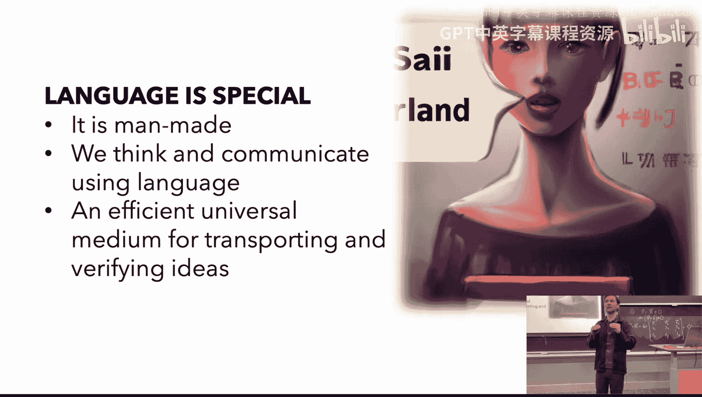

上一节我们介绍了什么是基础模型与生成式AI，以及它们如何通过观察来学习，其中意义是情境化和关系化的。我们探讨了世界的混沌结构，以及神经网络和新型AI如何帮助我们处理这种混沌。我们还讨论了监督学习和强化学习的局限性，并引出了自监督学习这一核心技术。

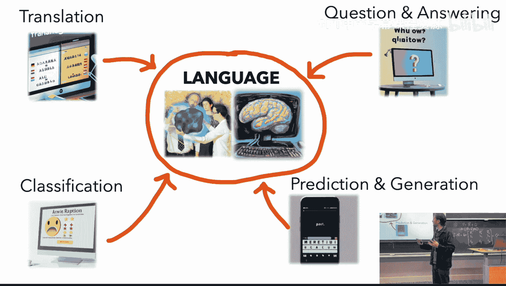

本节中，我们将详细探讨这些不同的方法，包括自然语言处理、对比学习、扩散模型等，并理解它们如何共同构成了现代AI的基础。

## 语言的特殊性与早期方法 🌐

语言有些特殊，它是人造的，我们创造它用于特定目的。我们不仅用语言交流，也用语言思考。语言是传递和验证想法的高效通用媒介。这暗示了我们可以利用大型语言模型来理解语言，甚至创造更类人的智能体。

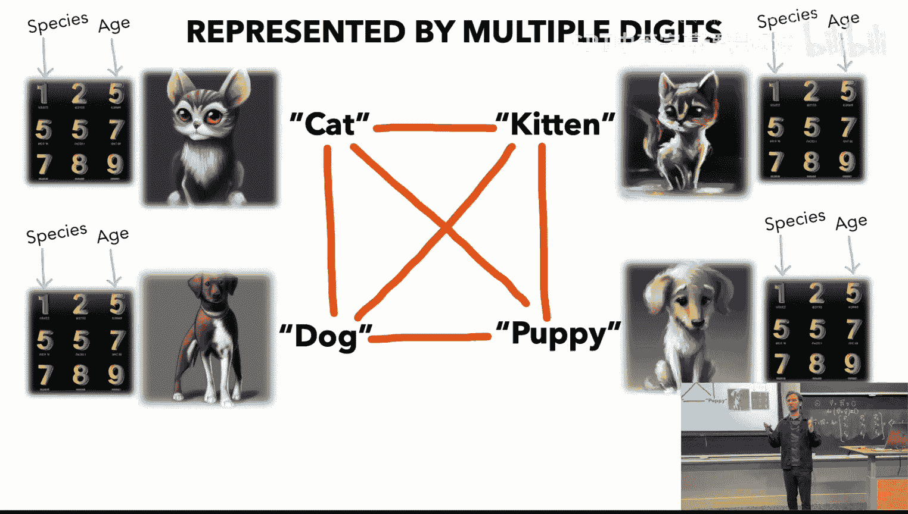

几年前，每个特定的语言任务（如翻译、问答、分类）都有独立的研究团队、数据集和模型。人们开始思考，人类并没有为每个语言任务配备独立的大脑，也许我们可以优化某个目标来学习语言的根本理解，然后将所有下游任务视为应用这个“大脑”来解决的问题。

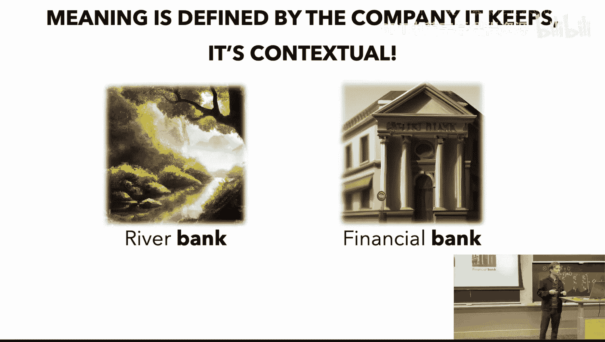

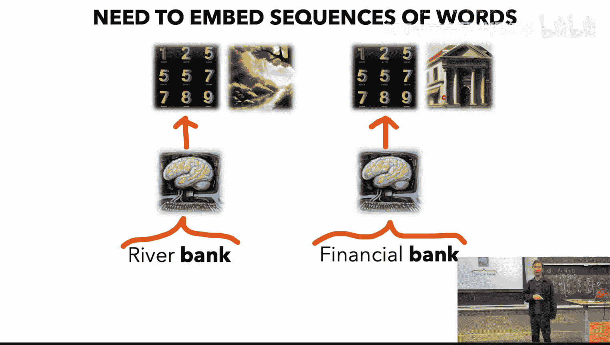

## 从词嵌入到上下文表示

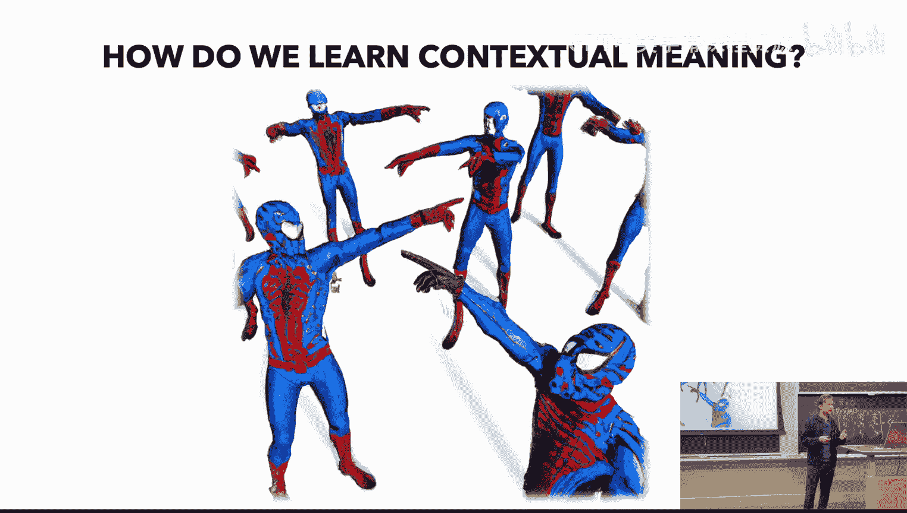

我们希望模型能够消化语言，并将其编码到某种表示空间或特征空间中，以便用于其他任务。如果模型能将语言编码成有意义的数字表示，并将其馈送到所有下游任务，那将是一个很好的起点。

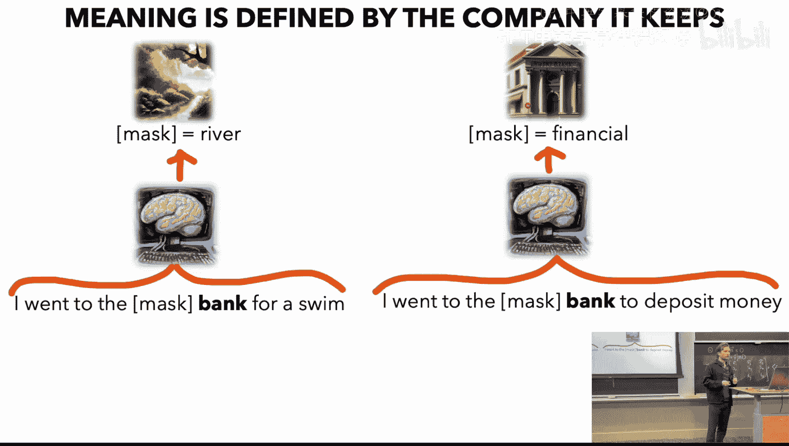

意义是高度维度和细微的。例如，“猫”、“小猫”、“狗”、“小狗”这些词，它们之间的关系很复杂。仅用单个数字无法充分表示这种细微差别。因此，我们需要将单词映射到高维向量（即词嵌入）中，用数组中的不同位置来表示不同的语义维度（如物种、年龄）。

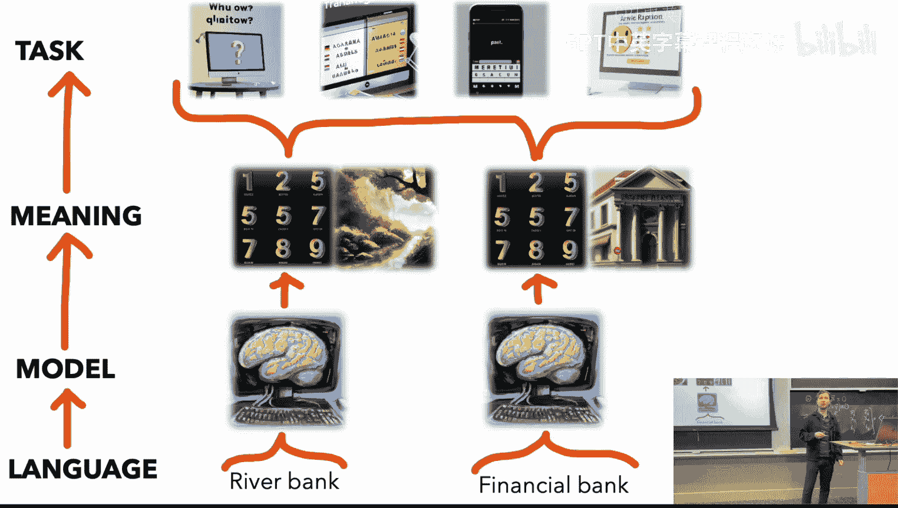

然而，单词的意义本身并不是最好的关注点，因为意义是高度上下文相关的。例如，“riverbank”和“financial bank”中的“bank”意义完全不同。因此，我们需要学习将任何文本序列映射到某种意义表示，而不仅仅是单个单词。

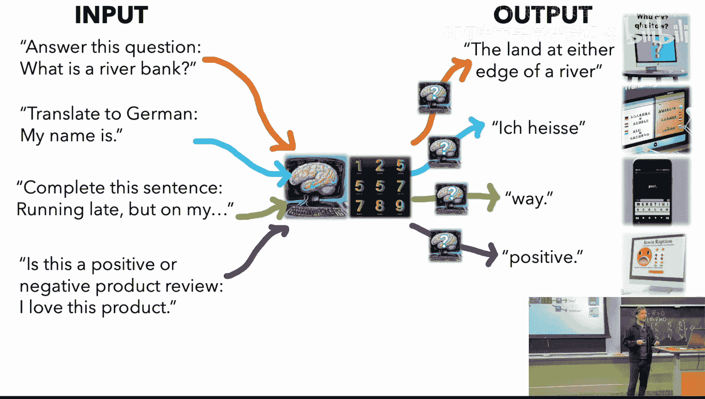

## 掩码语言建模与预测训练

我们如何学习上下文意义呢？意义是由其相伴的词语定义的，这种自指性为我们提供了学习线索。一个非常有效的方法是**掩码语言建模**。

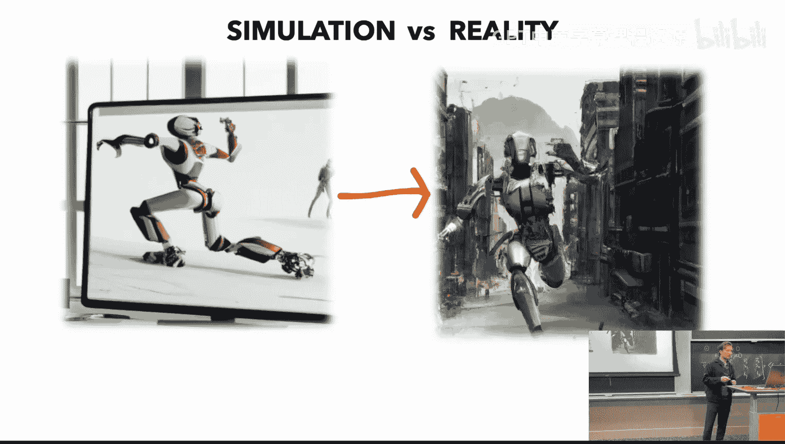

具体做法是：从互联网上获取大量文本，随机掩码或遮盖序列中的一个词，然后训练模型来预测被遮盖的词。例如，给定句子“I went to the [MASK] bank for a swim”，模型需要根据上下文预测出“river”。如果模型能成功预测，就意味着它理解了“bank”在此上下文中的含义。

这种方法能产生非常好的文本特征表示。我们得到一个模型，将其运行在一些文本上，就能获得对应于上下文的特征，然后可以将其用于我们关心的各种任务。这彻底改变了语言处理领域。

## 从预训练到下游任务

由此，我们引入了**预训练**和**下游任务微调**的概念。首先，我们使用掩码语言建模等方法对模型进行预训练，使其获得对语言的一般性理解。然后，针对我们实际关心的特定任务（如对亚马逊评论进行情感分类），我们使用这个大模型为评论生成特征，并在其上训练一个小模型来完成具体任务。

研究的重点是使预训练任务与下游任务尽可能相似，就像在真正开车前，最好的学习方式是坐在副驾驶观察别人开车一样。

## 迈向文本到文本的统一模型

语言本身就能传达意义，那么我们为何不直接使用语言本身作为表示意义的灵活方式呢？这就是下一步：尝试移除中间的高维向量，直接进行文本到文本的转换。

我们可以将所有下游任务重新表述为文本到文本的格式。例如，分类任务可以输出“正面”或“负面”这样的文本，翻译任务直接输出翻译后的文本。这样，所有任务的输入和输出都是文本，工程上更统一，也更容易同时微调多个任务。

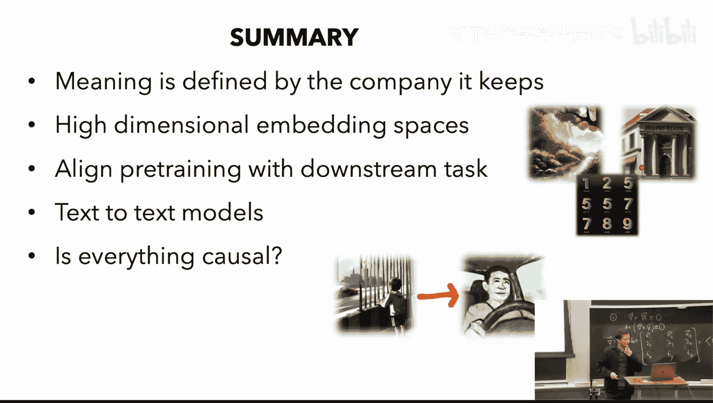

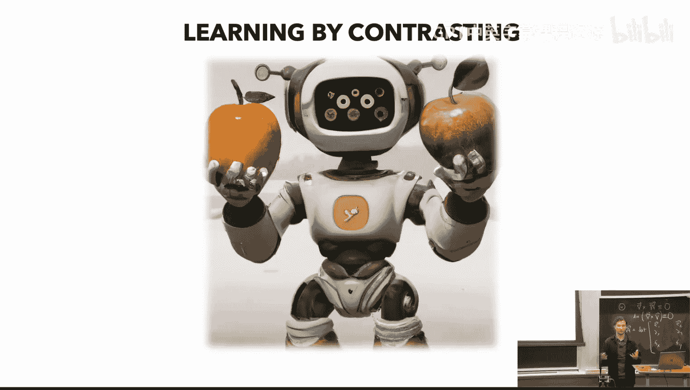

谷歌的T5模型就采用了这种方法，它通过掩码多个词并预测完整句子来进行预训练，形成了一个统一的文本到文本模型。

## 因果语言建模与生成的突破

这里有两种主要方法：
*   **掩码语言建模**：随机掩码句子中的词，并基于所有上下文（前后词）进行预测。
*   **因果语言建模**：只掩码最后一个词，并仅基于前面的词进行预测。

掩码语言建模通常效果更好，因为它能利用更全面的上下文。然而，因果语言建模有一个独特的优势：它专门优化了基于前文预测下一个词的任务，这使得它在**生成**任务上表现出色。

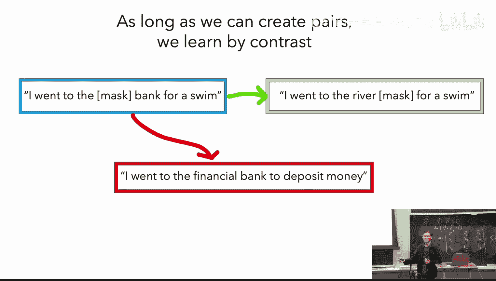

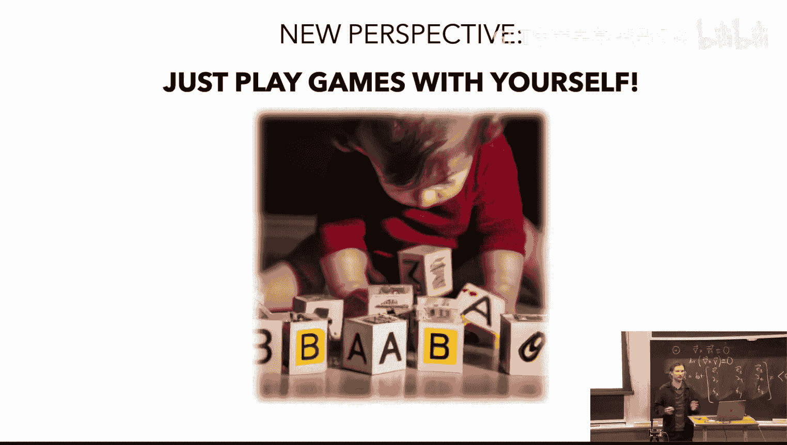

如果我们有一个擅长预测下一个词的模型，那么所有任务都可以被视为文本补全。例如，“回答这个问题：什么是河岸？”最合理的补全就是给出答案。这正是ChatGPT等模型背后的突破：将“基于前文预测下一个词”这个简单概念扩展到巨大规模，使其成为一个多任务求解器。

## 视觉与其他模态的学习方法 👁️

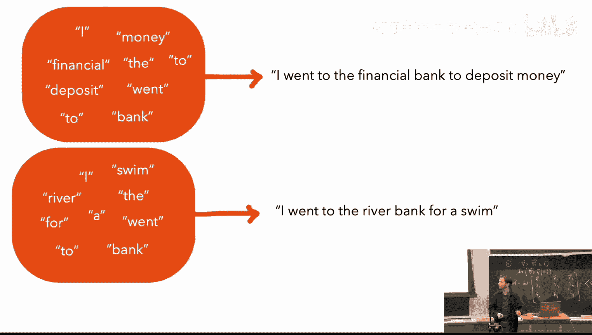

现在，让我们跳转到图像等其他模态。对于图像，我们也可以尝试类似语言的方法，例如按顺序预测像素，但这并非最有效或最先进的方法。

在视觉领域，**对比学习**非常流行。其核心思想是：出现在同一张图像中的物体，平均而言，比出现在不同图像中的物体更相关。我们随机裁剪同一图像的两个部分作为“正样本对”，希望模型将它们映射到特征空间中相近的位置。为了防止模型将所有东西映射到同一个点（坍塌），我们还需要“负样本对”（来自不同图像的裁剪），并推远它们的表示。

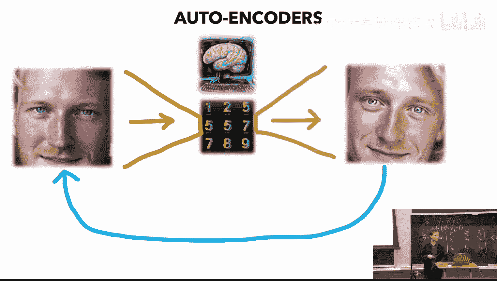

在实践中，这可以转化为一个分类任务：给定一个裁剪图像，模型需要从一堆候选裁剪中识别出它的正样本配对。这种方法能产生非常好的图像表示。

## 通过游戏与任务理解概念

另一种视角是让计算机通过解决简单任务或游戏来学习概念。如果计算机能解决这些任务，我们认为它必须理解其中涉及的概念。

例如：
*   **词语排序**：打乱句子中的单词顺序，让模型重新排序。这需要模型理解语法和语义。
*   **图像拼图**：将图像分割成方块并打乱，让模型预测正确顺序。这需要模型理解视觉概念如何构成。
*   **去噪**：给图像添加噪声，让模型尝试去除噪声（即**扩散模型**的原理）。模型需要理解图像内容才能有效去噪。从纯噪声开始，模型甚至可以生成全新的图像。
*   **压缩游戏**：将高维数据（如图像）压缩为少量数字（瓶颈），再尝试重建原始数据。这被称为**自编码器**，它能学习数据的最重要特征。
*   **生成对抗网络**：让一个“艺术家”网络生成图像，一个“评论家”网络区分真实图像和生成图像。两者相互对抗、共同进步。

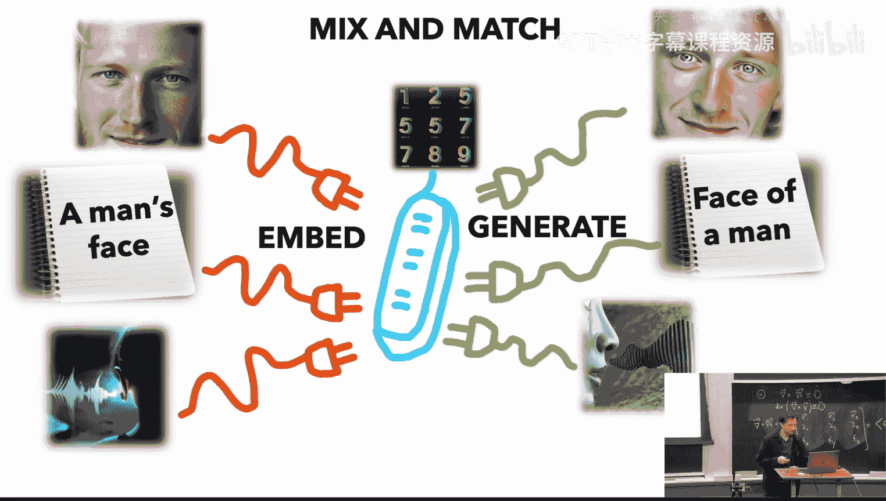

## 表征学习与生成学习

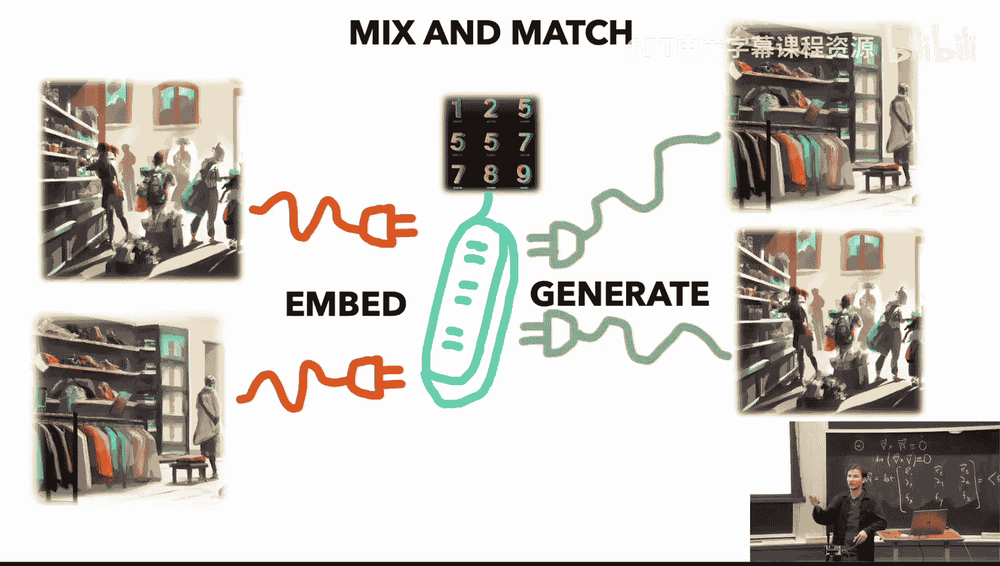

我们讨论的方法大致可分为两类：
1.  **表征学习**：专注于将数据嵌入到一个有意义的特征空间，以便用于分类等任务。
2.  **生成学习**：专注于根据一些提示或采样生成新的数据。

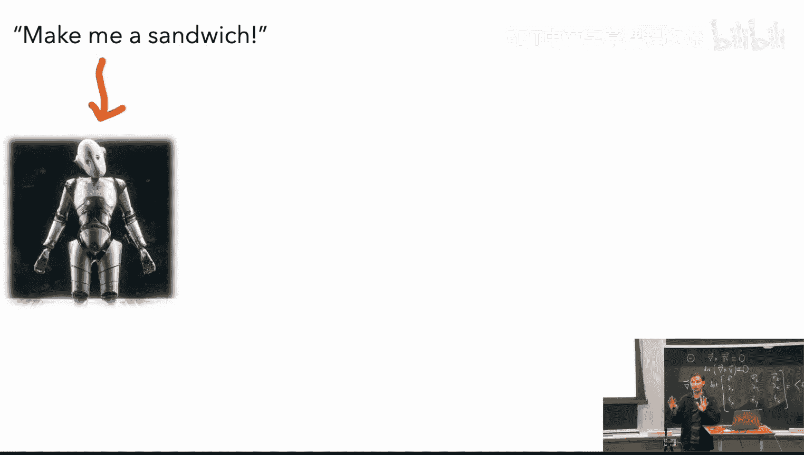

通常，一个模型可能更擅长其中一方面。理想情况下，我们希望有一个**共享的嵌入空间**，使得不同模态（如图像、文本、音频）的等价意义映射到相同的向量。这样，我们就可以将一个模态的编码器与另一个模态的生成器连接起来，实现跨模态理解和生成（如图像描述、文生图）。

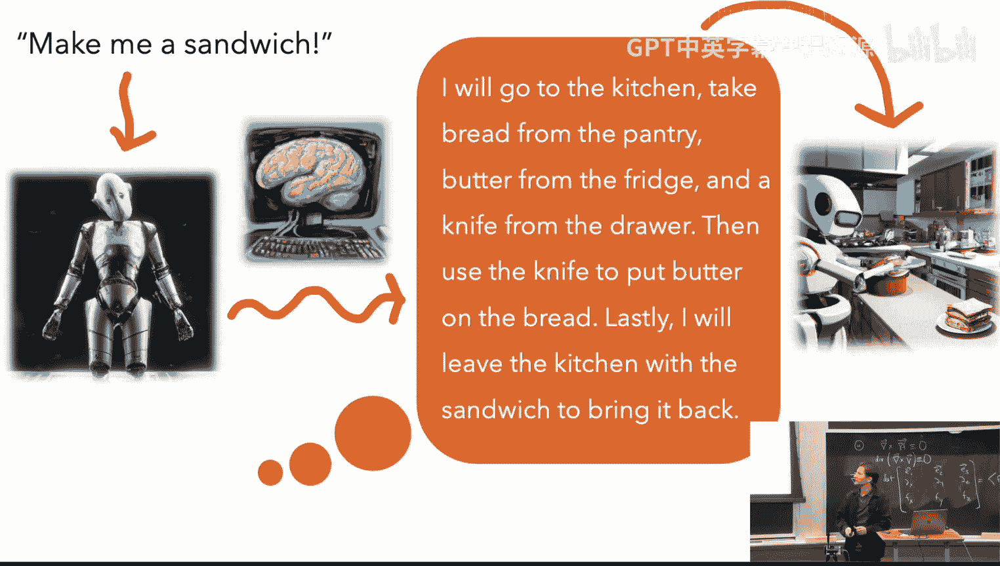

## 语言作为通用媒介与智能体 🤖

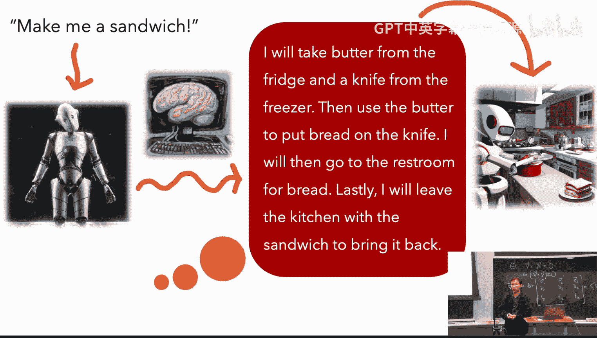

语言本身可以作为一个特权化的通用嵌入空间。为什么这如此有用？因为语言是我们标准化知识、更快学习新事物、确保所学一致性的工具。这在机器人等领域尤为重要。

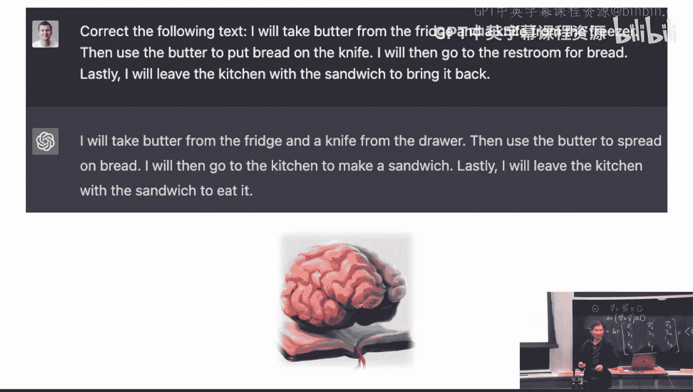

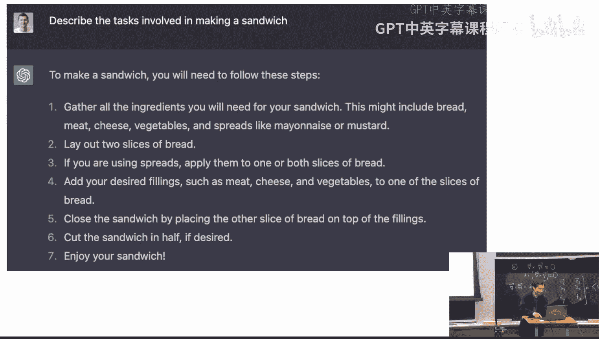

传统方法中，机器人任务被映射到高维数字向量来执行。如果我们改用语言作为中间表示呢？例如，将“给我做个三明治”映射为一个用语言描述的计划。这样，即使我们不完全了解具体任务，仅凭语言知识就能验证这个计划是否合理。如果计划不合理（例如“从冷冻库拿刀”），我们可以利用语言模型来纠正它。

这种利用语言进行规划、验证和自我改进的能力，正是**自主智能体**的核心。一个大型语言模型可以迭代地分析自己的输出，使用工具（如互联网搜索、计算器），并逐步完善计划，表现出非常类人的能力。

## 智能的协同性与集中化

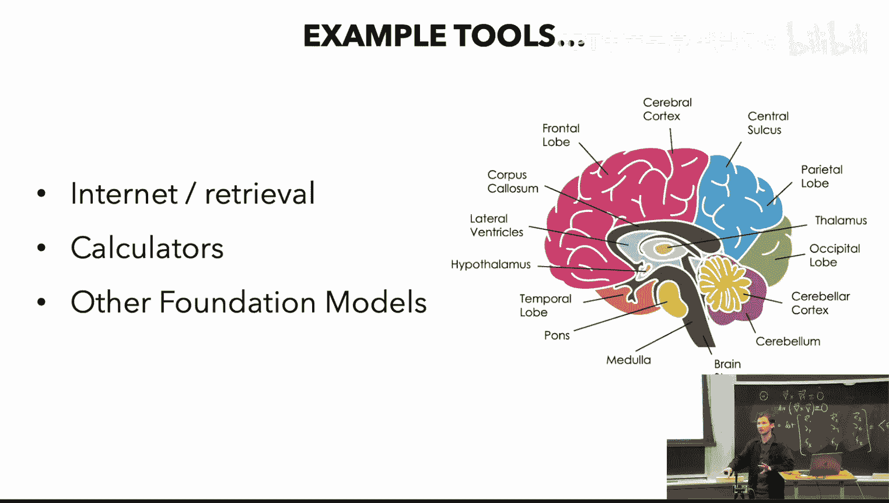

这些发展表明，智能是高度协同和集中的。试图将智能分割成独立部分会削弱其能力。在商业中也是如此，理解业务和消费者需要一个统一的大脑来利用所有数据和知识。

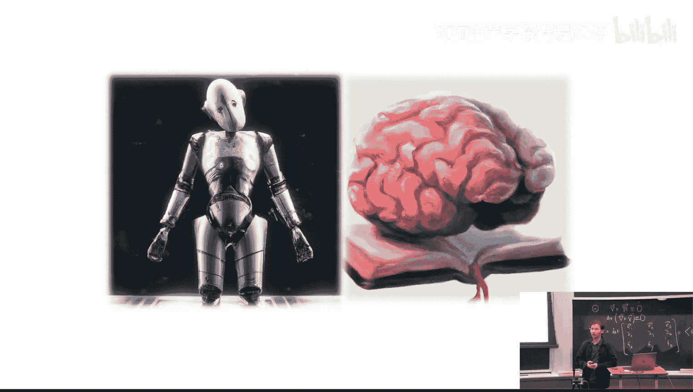

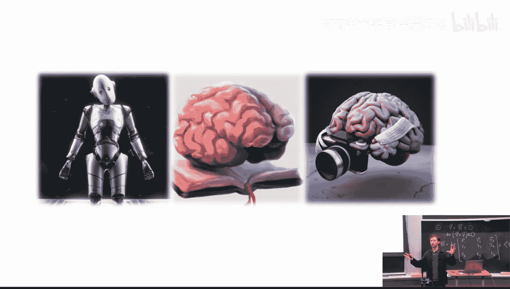

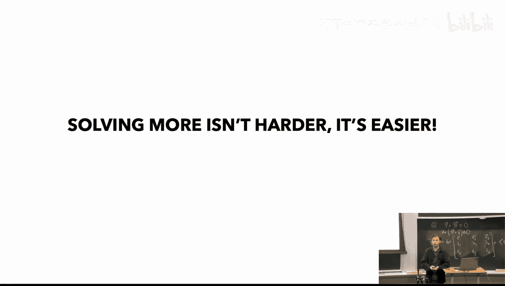

这带来了机遇和挑战。一方面，集中化的强大智能可以解决我们无法独自解决的问题。另一方面，权力可能集中在少数实体手中，带来系统性的脆弱性和伦理问题。

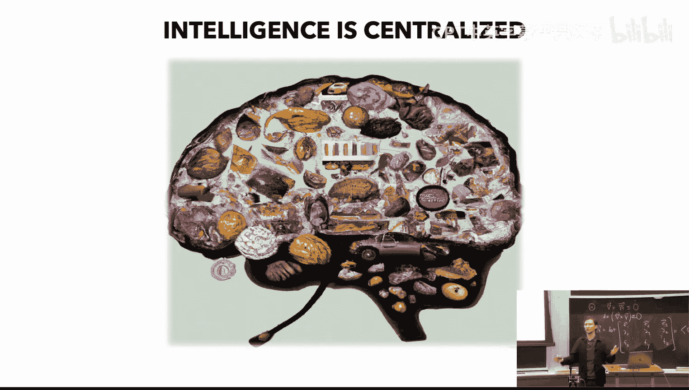

## 课程总结

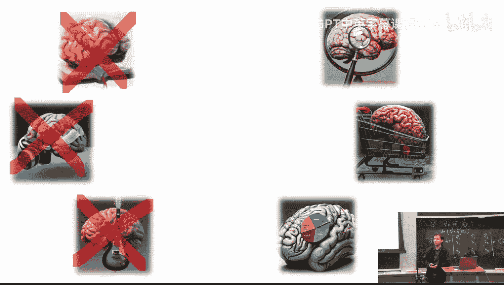

本节课我们一起学习了训练基础模型和生成式AI的核心方法。我们从语言处理入手，探讨了掩码语言建模、因果语言建模如何让模型理解上下文并生成文本。接着，我们了解了对比学习、扩散模型等方法如何让模型理解视觉世界。我们还讨论了表征学习与生成学习的区别，以及共享嵌入空间的重要性。最后，我们探讨了语言作为通用媒介如何赋能自主智能体，并思考了智能协同与集中化带来的影响。

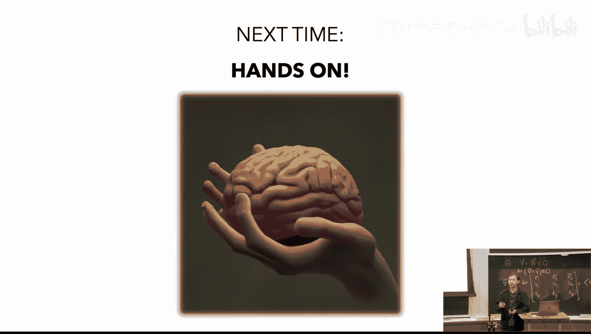

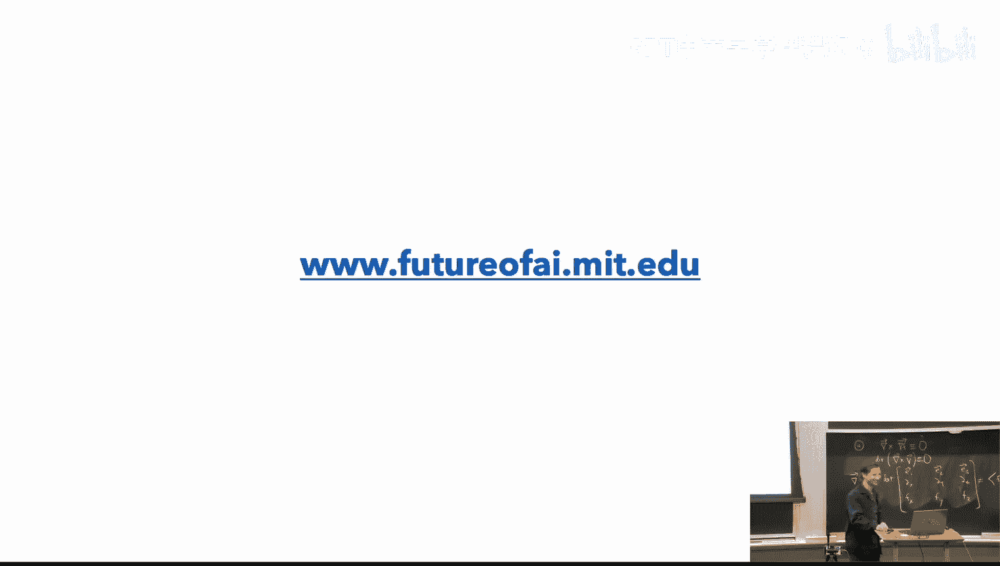

下节课，我们将更具体地深入探讨ChatGPT和Transformer模型的细节。