# 《基础模型和生成式AI｜6.S087 Foundation Models & Generative AI 2024》中英字幕 - P3：6.S087_ Foundation Models & Generative AI. CHAT-GPT & LLMs.zh_en - GPT中英字幕课程资源 - BV1YYWpzaE3q

All right。Welcome to the third lecture。On foundational AI。So today we're going to cover chat GPT。And。

 right， I mean， I think for a lot of people， tragedy P was the。

The tool or the the AI that really made people understand this is different。

 Now we're able to do things we were able to do before and， and definitely create some kind of hype。

 So hopefully， after this lecture， you'll be understand。

Kind of the basic idea and also somehow understand the be， right。

 the be that open AI and Ilia the head researcher did in terms of what actually would lead to ChettP and how in hindsight it might be quite I mean。

 easy， but it was a really daring bet not obvious at all at the time that this would actually work out。

 and。So it should be a lot of fun and just to quickly go through our course schedule result a little bit right so today is Gen 16 and next time we'll talk about stable diffusion image generation and then we'll talk about emerging foundation models。

 basically foundation models andgen AI in the commercial space。

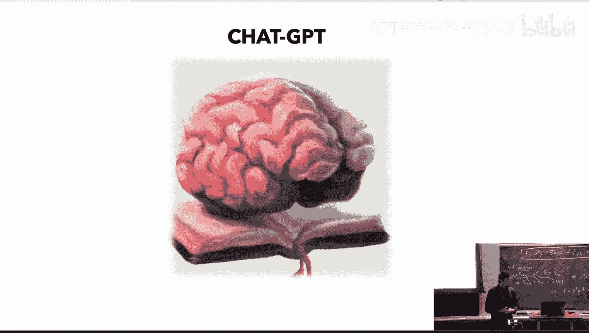

We'll have two guest speakers and then we'll end with the lecture on AI ethicics and regulationulation as well as the panel。

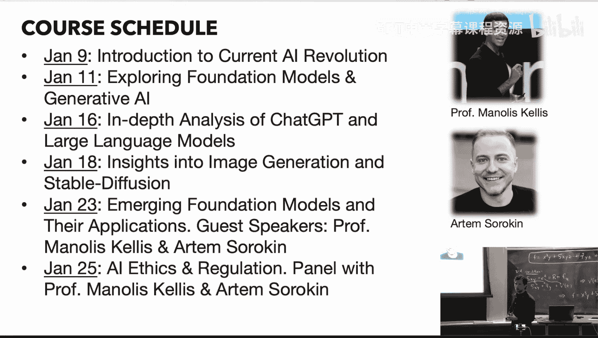

Okay， so what have we talked about before， we started off。With an introduction。

 a short high level intuitive answer to what is financial mostlygen AI。

We went a little bit on a philosophical digression and asked about how's the world structure。

 because that allows us to think about how we should learn in the world。

Then we on the second lecture， we went through all the different algorithms。And yeah， today we。

 we' dive in more specifically the ChajiT and kind of。Pull ourin together。

And to re right So what do we do in foundation mode N Well we apply this selfsupervised learning where we learn without label data so we can we can get you know as much data as we want because there's no human being in the loop So there's no limit how much we can scale this up。

and what we get from this， you know， by learning from observation and learning from the data directly is a very contextual and relational understanding of meaning。

😊。

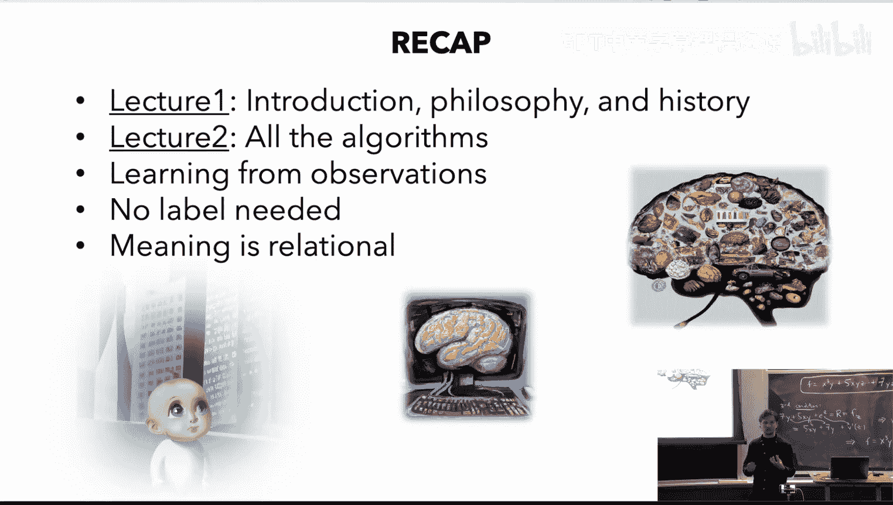

And we gave this example before， but。You know， from a supervised learning perspective you learn what a dog is from seeing you know labeled examples of dogs and in reinforcement learning。

 you focus on optimizing certain goals and you understand a dog in relation to how it makes you happier or fulfilled in some sense or optimizing your goals。

 but in self-supvised learning right that's the foundational technology behind foundation models you learn from observing dogs in different context and you get a very relational definition of a dog so it's something that's walked by an owner with a leash。

It has an energy degradation with cats。 It chases free space windows of th。 Like。

 this is your definition of what a dog is。And today we'll in talk about something that's extremely engineering heavy。

know chat GT relies on a lot of tricks and engineering insights and breakthroughs that we're not going cover and I think still though like it's like talking about a car you can understand the highlevel perspective of a car and get some insights how to work how it works and now it' maybe useful for you without getting into all the engineering details but of course in real life those engineering details really。

 really matters and very， very hard to get right and that's something that we won't really dive into in this lecture because that's just when you bring something up certain scale and you have to paralyise a lot of machines etcter and think about high parameters it's a whole science So it's not trivial at all。

 but it's kind of hard to teach in a course like this and you have to learn by just actually building this stuff。

And。

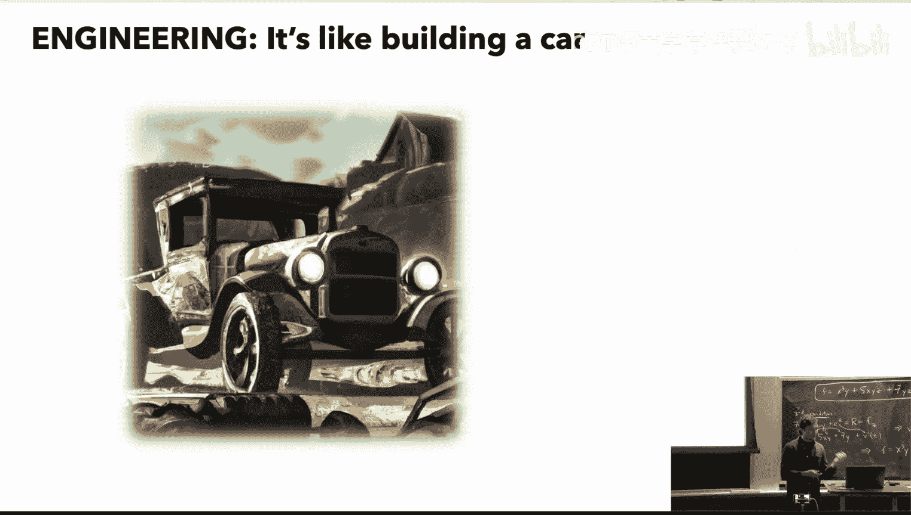

Okay， so。Also， a little bit of philosoing in this class as well。诶。I think that。Again。

 like we talked about a little bit of a theme here is that why these new AI is so powerful is because it doesn't force things to comply to simple rules right it kind of emdens our ability to understand and compress what we're seeing and deals with that chaos directly。

 that's why AI is so powerful and so humanlike it's also like when I talk about this in ChaP we try to make very highlevel statement。

 but of course the nuances matters。And I think it's quite interesting I took this quote from a general from the 18 and 1700s。

 and he says this quote， the pititive theory which sets itself in opposition to the mind and what he meant was that he's a general so he fights in battles and war。

 and at the time people loved to come up and theorize around war like we should have certain rules and households should behave in fighting and stuff like that but he's like。

 well， I've been in war and wars don't comply to rules first off。So， you know。

 everybody has a plan before they get hit in the face basically， so you know。

 as people start shooting at you and you have this fog of war， you don't know what's going on。

There's no simple rules to help you there。 And also what he says is in terms of the mind。

 is says like， well， actually， he's realized by working with soldiers。

 that soldiers and human beings are mind。We're not good at acting according to rules that we try to memorize。

 We're very intuitive and we' very kind of quick to reactactive things。My art intuition。

 That's what really， really matters。 And that's what we're strong at。

 So if you force a soldier as well to try to memorize a lot of rules and that's how it should act in a battle。

 you kind of screwed a very limit in what you can do。

 which also is something that I think AI in a new type of AI leverages。

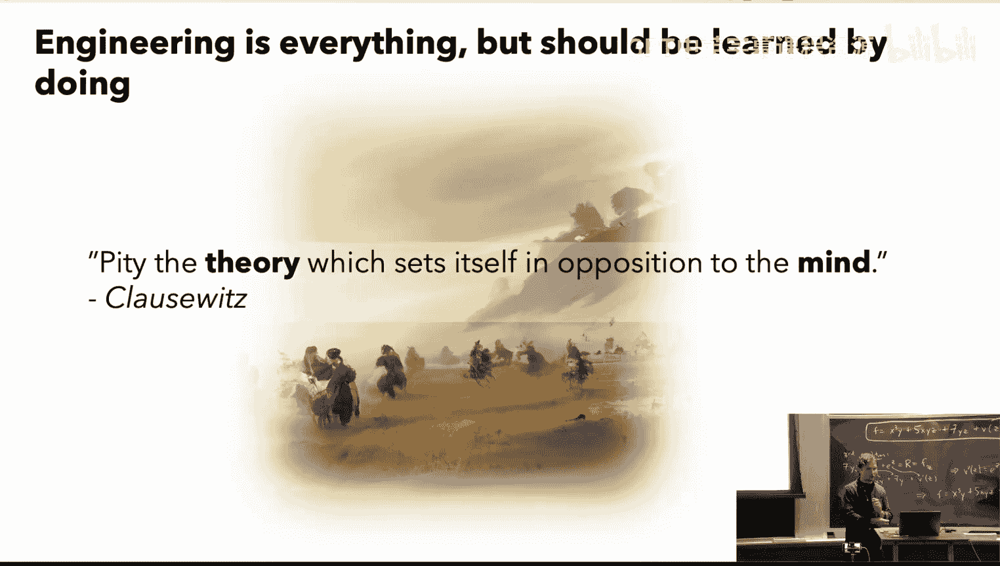

Okay， so chat T。诶。RightThis is a really amazing breakthrough that has some very human like mastery of language that we can communicate。

 can basically solve。😊，A really wide array of tasks for us。

Anything that can be phrasing in terms of text language。

 it can basically solve and now as well with GPT4 ceter becomes is's able to handle multi modalities。

 but it's extremely powerful。So let's try to break this apart。 Well， first off。

What does this name actually stand for？ Well， the chat party's August it stands for chat。

 and then GT stands for geneative pretrain transformer。

And is a meaning a good description of what this actually is。 And I think also， if you look at。

are three different concepts here， they're also almost corresponding length in terms of how important and influential they are in making chatTPT work。

So chat part we'll cover last， it's the kind of the least important one in some sense。

 the Gen pretrained is the self super step of how you train this and arrive at this model and then the transformer is basically the engine behind it in some sense。

So let's start with this gen prechain， what does it mean， how do we prechan this model。

 and that's basically where OpenI spent 99% of their compute was to do this pretraining step。

 so it's very， very important。Okay， so what we're going to do is that we're gonna just take some random text from the internet。

 So we have a sequence of words。 And then we're just going try to predict the next word based on previous words。

 So let's say we have we start with I here as input。 and then we want to somehow predict the target。

 right So we know。You we know or the computer knows somehow by just downloading the text。

That what this whole sequence is。 But when it trains its AI model， it hides。Part of it， right。

 So it just inputs I to the AI model and the AI model is supposed to do something with it。 right。

 So's supposed now to make a guess of what's the next word。

So you you basically would allow the model to guess and then maybe it's off right and then you can give some negative feedback and then when it gets right。

 you can give some positive feedback right so this is the high level what we want to accomplish。😊。

So the first thing actually that you start thinking about is well there's multiple you know giving a sequence。

 there's just one ground truth correct prediction's in this example just one single word that actually will follow but there's tons of words that are not the correct guesses so maybe want you know you want to allow the model to make the best use of this example as possible so you can basically make a lot of guesses and can you can give information about a lot of different guesses that are actually wrong right so you're able to give more information to the model here like hey actually go and gone here or wrong and is also wrong right and then it kind of gets it right and then you give some positive feedback。

And。We're going do this。 We're going to maximize this。

We're going to create scores or predictions for all words in like in the human you know vocabulary in the English vocabulary that sounds extremely expensive and is quite expensive and so have different tricks to make this work。

 but you're going make a guess and a score like a prediction for every word in English in the language language and only one would be correct but it gives a lot of feedback as well because there's a lot of information knowing which ones are not correct。

AndAnd how we're going to do this is that we're going to create these probability scores。

 meaning that these are just non negative numbers and the old sum to one。

 So they actually corresponds to the models。Guess at the likelihoodlude of like the likelihoodlude of a word coming next。

 So you make a distribution of all possible English words。

 and then the score corresponds to likelihoodlude of this word coming after the what is seen so far。

诶。Okay， so here， you know， at this point the model' seen I12。

 it creates a distribution you know here's his four words。

 but all words in the English language then。You know， you you reveal which one is the correct one。

 so the is the correct thing to come after。And then you give this feedback to the model。

 its called back propagation， so you give some feedback to the model that if you push the score or the probability distribution for the correct one to be bigger or larger and then reduce all other ones。

 so you know the next time it sees the same example or a similar example， it actually does better。

And you know this is just one single example， but you accumulate all of these directions and information across a batch of examples that you see at the same time。

 so it takes small， small steps to getting a better and better distribution and a more sophisticated distribution of what word will come next gave them previous words and you do this in a batch on tons of examples and of course we have unlimited amount of data because we can just get text data from online。

Of course， we do this on the whole and。S so we can make the most use of the sequence so we predict the next word for every possible combination in。

😊，All right， so now that we've trained it， we have a model that's able to predict the next word given previous words。

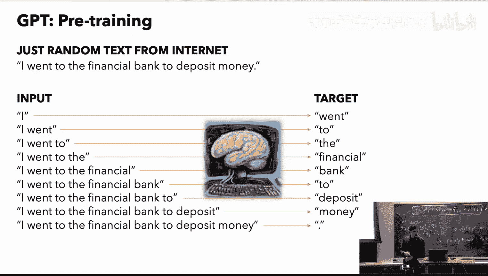

So again， we have some starting point， I， for example， it's not a very interesting pro to model。

 but it's a starting point。It gives us a distribution over all possible words in English language。

 and then we just take the org max， where we can sample where we take the orgM which which is the most likely word to come after this。

 we take org maxax and we put into a sequence and we get a longer sequence and then we can run the model on this sequence。

😡，And then we do the same thing。 and we just keep going。 and we can make our sequence longer， longer。

 And we can continue this， you know， for example， till we reach a period or something。

 like a specific token that I we happy until we complete a complete sentence， for example。And and。

This is kind of expensive to do because you have to generate one thing at a time。

 but of course training is much faster because then you can just you don't need to generate and run on your own input。

 you just rather look at the input that you get， but here you actually have to look at the prompt generate the next word at it and run it again。

 So it's kind of expensive and is sequential in that sense。

 What you don't have to do that during training only evaluation and training is what's most expensive So that's fine somehow。

And。Okay， so， you know， if I went home， it's not a very interesting prompt。

What type of prompts will be more interesting， Well we talked about this a little bit before。

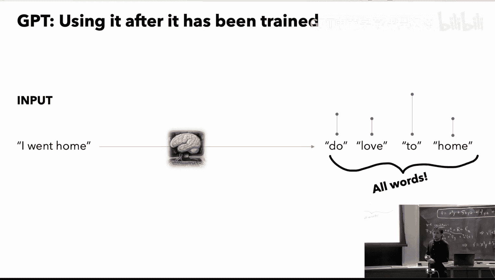

And now， you know， if it's really good at predicting the next word based on previous words。

 we can give it interesting prompts and it can start solving interesting tasks for us by just being able to predict the next word based on previous words。

And so we see that we we basically have this different language task。

 we is give this to the model and if it's really good。

 it should be able to generate the sensible things that we're looking for。😊。

And if you try this for chatP， right， it does。 So it basically has killed。

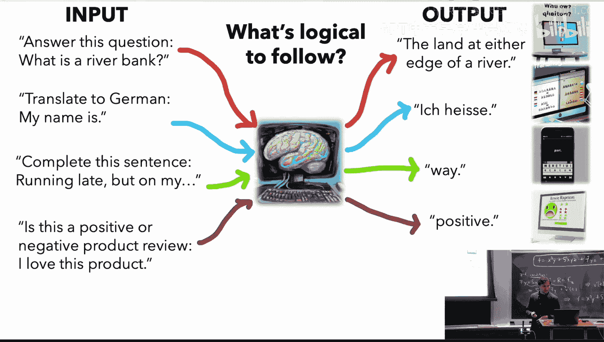

A lot of different research labs that focus on a specific task because now it does all of this really。

 really well。And I mean， this is basically from a modeling perspective。

 this this is a chatty P in a nutshell。Okay， so what's the， I mean。

 it sounds maybe sensible and reasonable， but of course they was set SP apart was a tremendous scale。

😡。

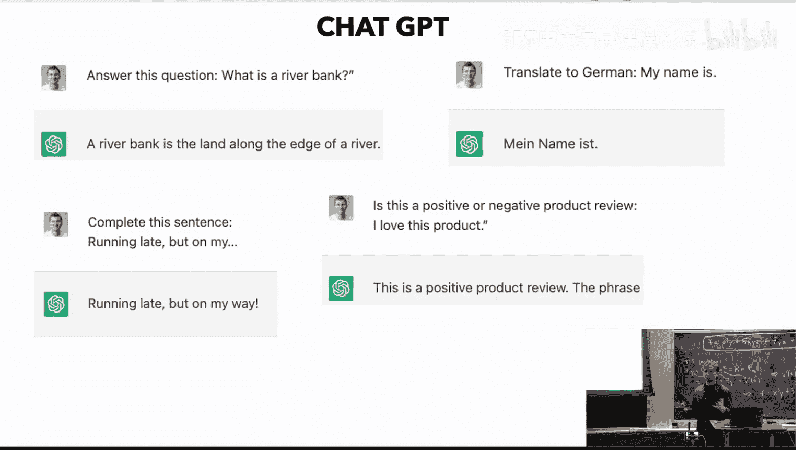

This is trained at a scale with an amount of data and parameters that we've never seen before。

 So this is a year old now， but this is I think this is GPT 3。5 or something。

 The first version it was using $175 billion parameters and just training the final model like not including all the durationeration that you have to do to try things out but just training the final model cost around 5 million just in compute and electricity bills that's how huge and not compute they spent on this。

And the。Again， so it's a very， very simple approach。

 but it's at certain scale that's never been seen before and really that's what's the big part of opening eyes be and the researchers there is like。

 well， you know we've been doing this language modeling for quite some time trying to understand language by predicting the next word based on previous words and then we're doing you know we're using it for certain things。

But， I mean， very few thought。 and we're convinced that if you just scale this up big enough。

 it will become a multitask solver and show humanlike intelligence。

 And that this actually really will work。 And people talk a little bit at his emerging abilities because also it's not linear。

 right。Like you start adding and putting， putting more and more compute and parameters。 and like， oh。

 it's still not very useful。 but then at some point you start being like extremely useful。So it was。

 it was a huge kind of leap of faith as well for opening eyes to say like， well。

 we're just gonna go all in and just make this bigger and bigger and bigger。

And and and then like in hindsight， if it like， maybe it makes sense。

 but it could have been a case that like it wouldn't work。 And then people are like， oh。

 that' is a stupid bet。 Like， why would you think such a simple idea and approach would lead to such sophisticated intelligence。

 but it did。

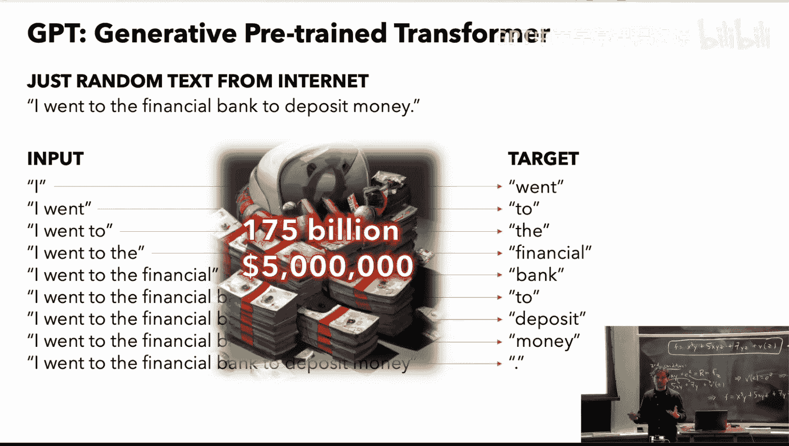

Okay。So we cover the Gen pretrain part， right， so。You know。

 we've now said how we basically are going to train our model。 But how does this model look like。

 how does this kind of engine look like， So if， if this whole thing is a car。

 then basically generally pretrain is how you teach a driver to drive。

 and then the transform is the engine that that it leverages。

 And some people definitely claim that this transformer part is extremely extremely important。

 So there's a debate a little bit。 What was the most influential part of making chatp and large language model possible。

 transformer。

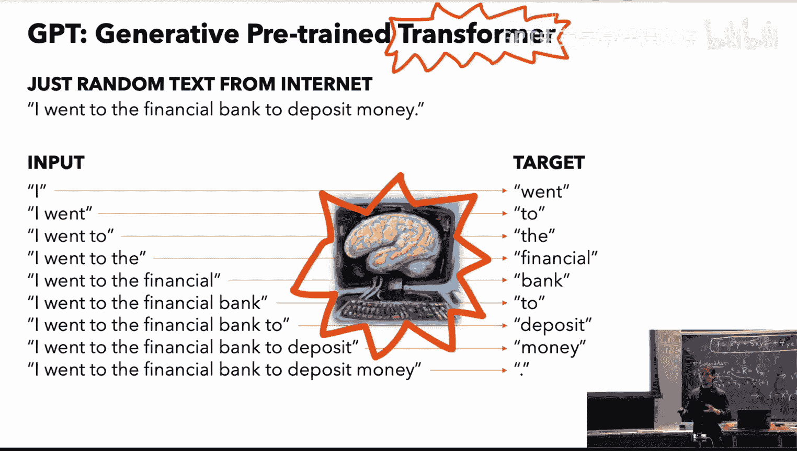

It's definitely a significant part of it。 And， and I'll let you judge for yourself。

 But I think it's less important in the actual modeling perspective that we've， weve come up with。

Okay， so in order to understand the transformer。We're going to start just thinking about how we can process sequences。

 So text is this sequence of words。 So we're just going to think about how we can process sequences。

Okay， so let's say we have this sentence that we downloaded from online and we want to process one word at a time we want to predict the next word。

 so we'll have our model and it basically looks at the first words。

 create some intermediate embedding or feature here one。

AndAnd then it uses that in a second step to predict the next word Okay。

 we go on and then it looks at the second word， so it look as went。

 but of course to be able to do a good job it also once be able to incorporate the previous word in the features from there so it kind of also processes and includes into the second vector both the previous word and the current word to create a new representation of the whole sentence so far and then it uses that to kind of predict the next target okay we go on and we do the same thing。

诶。And of course we do this full sentence and I think whats this sounds maybe trivial。

 but the thing that's important to notice here is that for every step here that's labeled with the same digit。

You know they can all be done in parallel。 Soing at step 2 here can be done in parallel。

 They don't need to wait for anything， right， Step 2 needs to wait on step one to finish， right。

 but all the tools can be run in parallel。 They don't they don't lie on each other And step 3 can be run after step  two has been run because step 3s don't rely on each other and so on。

 And this is key because in in deep learning， we use this。

Computer is called GPUs and basically the cost is， you know， if something can be done in parallel。

 it's a single cost。 We don't care how much they do it's done in parallel， it's a single cost。

So if we can make multiple steps into single step in parallel， this's just a single cost。

 We want to run things in parallels as much as possible。

 So here basically you know this be a cost of four because all these different numbers can be run in parallel So this would just be a cost of four。

 And then of course， processing this whole sequence will be a cost of9。

 and this might be you know seem like a pretty good job and reasonable because this is a sequence。

 we have to process it somehow and we're paralyzing most of the steps。

 So maybe that's the best we can do。

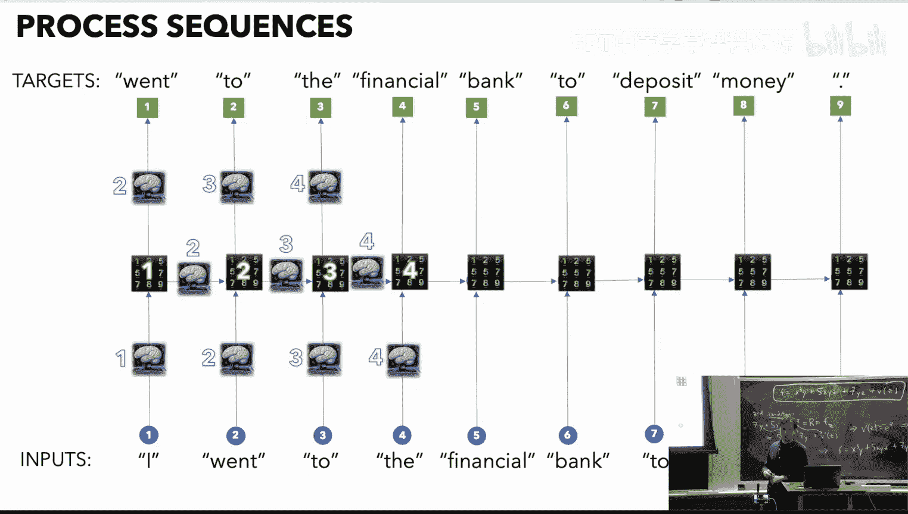

And this is called a recurrent neural network when we process things in a sequential way。

 we try to para as much as possible， but your current process depends on the previous step。

And these are extremely extremely popular and a version of them called LSTM long short term memory networks。

It performs really， really well。 And some people say performs， you know。

 almost better than transformers lot of times。 But they just take a longer to train because we can realize why they won on a point。

 but they work really， really well。 and， and also notice here somehow that。This was very。

 very intuitive for researchers to say like well， text， we read text from left to right。

 it words one at a time， and therefore our models should do able to table to learn effectively from them。

😊。

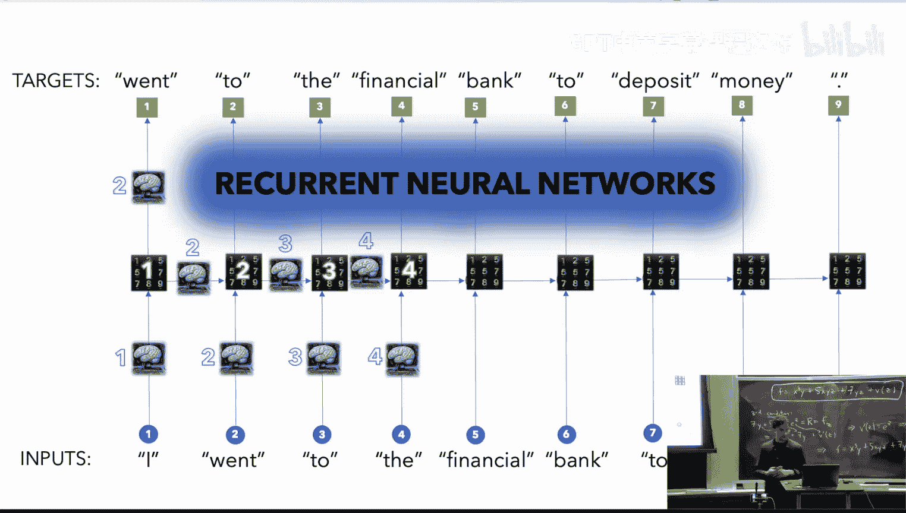

Okay， so。We're going to simplify a little bit and just think about how information flows in these networks or models。

 So again， for Ricon network， we basically have this very simple information flow where things flow forward in kind of sequential way。

RightSo to get from for the information from I to go to the information probably being positive step number nine。

 basically right when you want to predict a period。

 as just travel eight or nine steps here to be used。So。

let's think about this a little bit start off now in a transformer。

 which basically starts off the same way。 so we we let the first。

 we know we just process the first word and we pickrick the next target based on that。

But the difference happens when we look at the second word。

 so instead of doing sequentially and saying that we're going to use the pro that we but that never we used before。

 we are just going to directly incorporate information from I and when to the target。

So we're not going to enforce this sequential structure。

 we're just going to directly let the information flow from the previous word to the current word and ettera。

 right we've seen so far， and then in the third step as well。

 were also just going to let the information flow directly and have a direct connection to the previous words and not force things to happen sequentially。

诶。And。The important thing to notice here， right before when we were postuzzling things sequentially。

 you had to wait for the previous step to finish to do the next step。Right， but here you don't。

 because here， everything is processed independently。

 So you don't have to wait because every target somehow has a node or sorry。

 an edge to the previous words。 So they can all be run in parallel。

 they don't need to wait for anything。basicallyically kind of redoing all the work somehow for every step because they all have this added to the previous words。

 So all of these steps now， like none of these steps have to wait for each other。

 right There's no independency， they can just go direct to the source and use that information。

And of course， you know， we do this for the whole sequence and。😊，Again， to rate rate right。

 so for the last target。All of these computations can be done in parallel， Right， they。

 they're somehow aggregated at the target and they can all be done in parallel because they don't rely on each other。

 but also， right。This can also be done at the same time in parallel because 8 doesn't depend on 9 and9 doesn't depend on 8。

 So they can also be done in parallel。 It's the same step。 And it is true for all of these steps。Yes。

😊，嗯。So this makes sense opportunity。Yeah。9。最考虑。With my。

When we compute a output distribution over all the words later as a prediction。

 we talked about the first thing guess So is we're generating the next， yeah。But if you haven't。

And how do we know。Oh yeah yeah， sorry sorry So exactly this this works only during training now right and I'll come to that actually later。

 so this is only during training where we can optimize this way。😡，But that's also， yeah。

 that's a great question， but that's also like something that's。In in deep learning。

 we basically almost。I mean， the training is the most expensive part。诶。Because then you opt。

 you optimize and and you do back propagation to update， update your parameters， which is very。

 very expensive when you， when you kind of when it's done。

 you freeze it and you don't update things more。 and it's gonna to be much faster to run。

 So it's much less。Well， that's a modification， but。It's a little bit less sensory sense。

We care about。I mean， we care about both being fast。 And yeah， I mean， but somehow。

This is going to be much， much faster trained in a recurrent to network。

 so you're going to be able to get much， much better performance。

 and then the difference in the deployment is going to be less significant。😊，Okay。

 but during training， we can do this because we not append the words。

 we you see them in this sequence， we can do this。Yeah， actually， this is my note， this is。

 of course， only during training。😊。

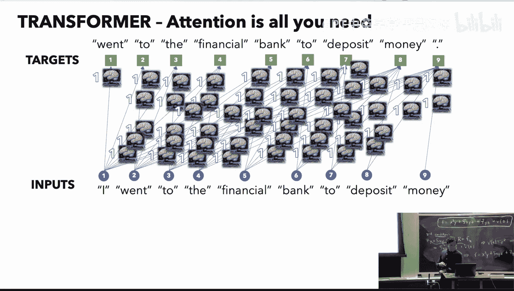

All right。So now again， when look at these next to each other。Like。What， I mean， maybe。I mean。

 what's the biggest difference somehow， right？One of them。

 the top pre network looks very structured as kind of a strong bias of processing things sequentially。

 the bottom looks very chaotic and it looks like a that's just a lot of connections。

 it probably is pretty hard to make sense of the sequence given that it's all fedted you at the same time so it's maybe surprising that one works but another one know one that definitely kind of needs more data to start learning useful things。

 So transformer needs typically needs more data to start doing a good job。

 but it's is another thing that were you know really。Forgetting here， right？

 So in a recruitment network， things are processed one at a time， so。The。

 the model can figure out that。Now， financial comes after the because it sees the first and then financial。

But in a transformer， you know in the below here。😊，Like。

If the only thing you see is the word and they're all fat to you know for if you look at the prediction we going to do it at step number nine。

If you see all these words at the same time， right？

There's some kind of like you can permute all the words and you basically see the same thing。

So there's no there's no sequential structure and force in transform whatsoever。 actually。

 right Everything is being fed at the same time。 So there's no sequence anymore。

We you seeing everything at the same time， so there's no sequence。And so how do you solve this， well。

 you do the simplest thing you can again， just remove the numbers here and make it more obvious that there's just you know words。

 there's no sequence anymore because everything is connected in transformer。

 but we could not there is still the sequence by virtue of how things are processed。

So how we solve this is that for the transformer， were just going to add to each word a position encoding。

 so we just add the position。Again， it' like the transformer has to figure out if the sequence matter is to use that information even。

 but it now has that information at this disposal because we're going to encode a sequential structure not by how things are processed。

 but by just up a position encoding。

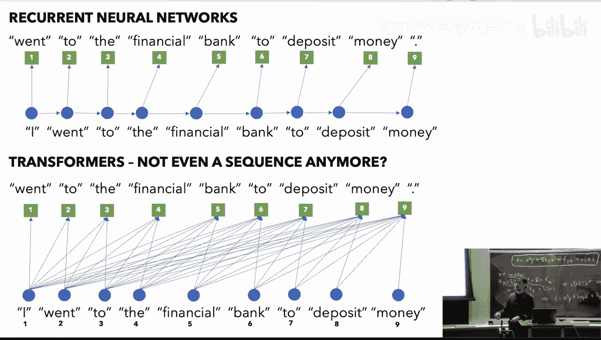

And this is actually quite almost counterintuitive。😡。

It's like seeing all the words in a book at the same time。

Like it's fast but it's very confusing and then you have to like figure out a small you know number how things are actually oriented。

 So like if you go to the movies， you I think in terms of frames。

 you can sit down and digest a whole movie in one second it's like super efficient but you're seeing all the frames you know flash the same time And then after like in your own head。

 you have to put them in a sequential order if it's useful as you know to understand the plot of the movie。

 which typically is right but it's not like the transformer has to learn that implicitly because it's not happening directly。

Okay， so why he as good as well， well， it's good because。Another like， it's fast， but also。

 it's good because for new networks， memory is very hard。

 So it's hard for networks to remember things。😊，So， let's say， you know that that。

If you read a book or you watch a movie， if you want to understand the end part。

 it might be good to kind of go back and look at the starting part of the book or something。

You or it's good if you remember that information， but probably， you know， if you don't remember。

 you have to go back and look it up。 So in a network re neural network because we're processing things sequential here。

 So for something to be used like for information about the first word in the sequence to be used the last step here。

 So you know type information about I at the step when you digest money。

 you have to somehow remember that information throughout this whole processing step。

Right and that's very， very hard for networks to do and a lot of work was done to make that work better。

 What the nice thing we would transform is that it has a direct connection。

 So if you know it has a lot of connections， but if it's a very strong kind of recurring thing that the first word and the last word correlate somehow it can pick up on that very quickly and make that edge very。

 very strong and kill out other edges so you can incorporate information very quickly or very efficiently so you can basically incorporate long distance information in this sequence very efficiently because there is no real sequential structure。

But when we foster sequential structure andcur neural network。

 it's much harder because then we need to remember that as we process things。Okay。

 so to summarize transformers。😡，诶。We do everything。 I mean。

 everything we care about in when it comes to deep learning we want to do things in parallel as much as possible。

 because if everything is not in parallels， it's a single cost。And， and a transformer is doing that。

Optimly， because it just passes everything in parallel and then it remove sequential structures。

 so I have to gave that information to the model by appending positional encodings。

And and also what's good ats， you know it turns out that this long distance information in data is typically very useful to be able to incorporate efficiently and memory is hard So transformer good at incorporating this information is and is able to do better by it。

😊，And they replace these recruit networks。 And again， right， this is。

 we're talking especially during training。 but this is the difference is less severe when it comes to inference or when we deploy them。

And。Again， like since now we have subwe learning and we can train by just downloading text on the internet and there's no human being loop。

 the scale of data is so much， you know。So big that we can learn a lot by， you know， we can learn。

 we can learn and afford to use a lot of data to learn basic things。

So the formerer has much less structure and has to relearn a lot of this structure。

 but since we have so much data and we don't need to have label data。

 we can afford that we can afford train on a scale that we haven't seen before。

 so that's also why this works so well。

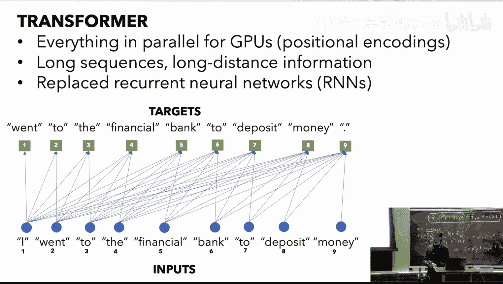

Okay， so now we have a language model， right， We know how to train it。

 We know what kind of engine that it can use to be efficient and work well。

 So now we just going to look at the last part， which is the chat part。

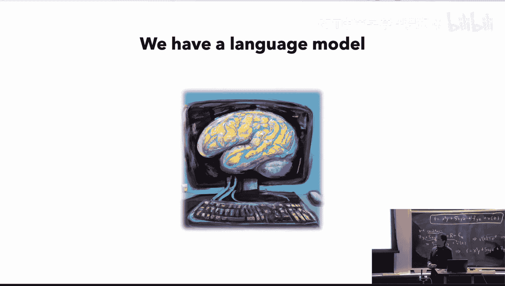

诶。

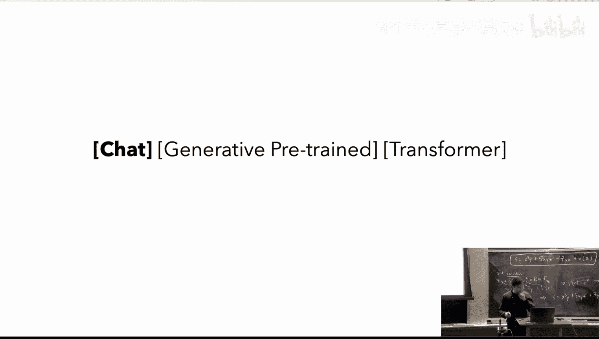

So， you know you train this model now that you call DPT 3。

5 or something and now you want to turn to chat GPT right so we have a really good model So basically we've done 99% of all the work that's required and a lot of people still kind of debate how important this last step is。

 but open access it does a difference。But， you know， when we have this model。

 we see we see that kind of， oh it it works fairly well， but we want to be able to improve it。

 We have some stupid failure cases。 and we just want to make it a little bit more sophisticated。

 So the first thing we we， we're gonna do is that。The model now has been trained on a vast amount of data from。

You know， any source on Internet you can imagine， right？ So novels， Wikipedia， Facebook posts。

 you know。Anything， basically。 but how you， how users are going use this is through some chat bot。

Right so it's dialogue like human dialogue is what they call it and of course it's been trained on a lot of text。

 not human dialogue And now we're just going to say we want to be able to hone in and focus and adjust itself a little bit by training only on human dialogue So we are going to go and collect the best data we have of human dialogue from whatever sources that we have and we're going to train for a little bit longer on only that data so we're going to fine tune the parameters only on human dialogue data so it can hone in its parameters and focus on a specific use case。

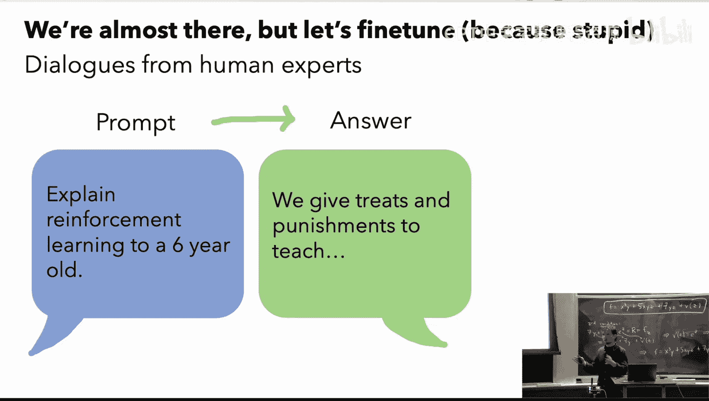

Okay， so we do that and we're even one step closer。诶。So now we even work we work even better。

 but then open I want take it one step further and say like， well。

 there are some absurd problems in this model that we're going to address and。诶。One thing is that。

Right now， when we've trained on on this text data， right each。Each target is worth the same somehow。

 And we don't。 We don't really separate good or bad dialogue。

 So the model doesn't really know what's good or bad dialogue。

 It just knows what's plausible dialogue from the Internet。 But somehow we just want to say like。

 well， yes， you know， what's plausible dialogue。 But with really good if you to what's not helpful dialogue and what's helpful dialogue。

 So you can just give us helpful dialogue。诶。Okay。

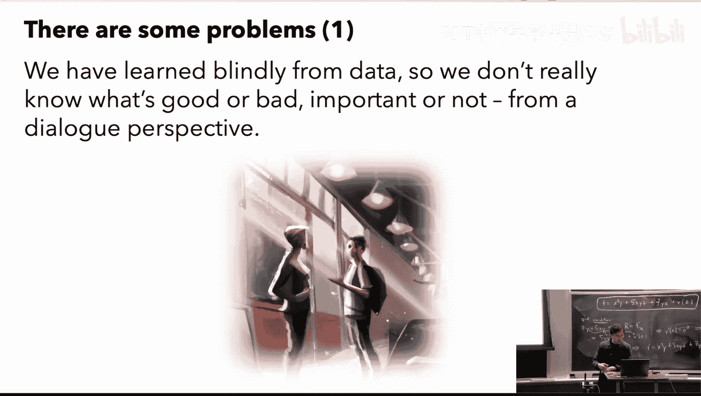

Another， another problem is that we're。Somehow too greedy。

 So when we train things to predict the next word based on previous words。

 all we care about is to give the most likely next word。

 but if you want to generate a sentence right you don't really care about optimizing the likelihood of the next word。

 you care about optimizing the accumulated likelihood of your whole sentence and lower of times you can sacrifice short-term profit for optimal long-term profits and exactly the same thing when it's come to generating the sequences。

 So when we really care about is the score of sentence at the very end when we're done with it。

 we don't care about picking the the best step at you every step of the way for example here right if you go down a little bit at bank you you can reach out reach a much higher optimal score at end of the sentence。

That's of course we care about。 So somehow we're too greedy。

 we should be a little bit more long term optimizing because if we give a whole sentence。

 we care about the quality of that sentence， that's what we want to optimize for。

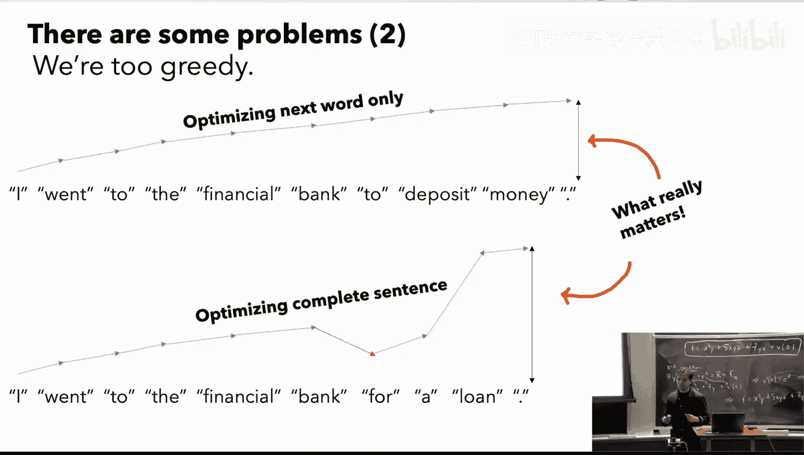

Okay， and then the third nuance or or kind of difficult with the current model is that。

Somehow we would like this model to be a little bit more robust， let's say。

So it turns out that this model now has been trained on text online and of course it works really。

 really well， but people are going to use this and interact with it in ways that maybe it doesn't really correspond perfectly to this training data so it's going to see things that haven't seen before so it might be a kind of a distributional shift between how people use it and what it's been trained on。

And also right， as we said， when we deploy this model， they're going generate a word。

 add it to its own add it to like its current sequence。

 and then re itself on this sequence right so it iter create a longer。

 longer sequence by running itself on its own output so it adds a word afterward and no AI model is perfect so maybe it accumulate some error as they start adding words and it just going to go off a little bit and it just goes off a little bit like here for example。

 when you say I went to the financial and then just some small error happens and it goes off the road to restaurant。

Like somehow you know， sort of seeing it。 okay， now it's basically gonna hay wire because it went off and it's in a different space and it's been trained on and it。

 it's just gonna generate nonsense。 So somehow we want to be able to say， like， well。

 if you find yourself， you know， a little bit off the the the path。

 you should be able to find your way back to be as as robust as possible to any kind of use case。

 And also when you generate things， you don't want to， you know， go off the road。

 you wna be able to find your way back as as much as possible to be as useful as possible。

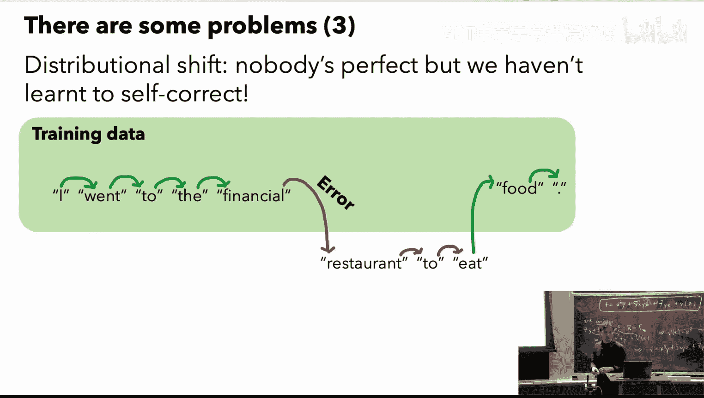

Okay， so。诶。These are the the three different things we want to address， right。

 What's good and bad dialogue， we don't want to be like greedy and we want to be more robust and learn to solve correct。

 And this is where we're gonna do reinforcement learning from human feedback。

 And that's what Open AI does on chattp。 And this is very， very hype for a long time。

 But now people talk less about it。

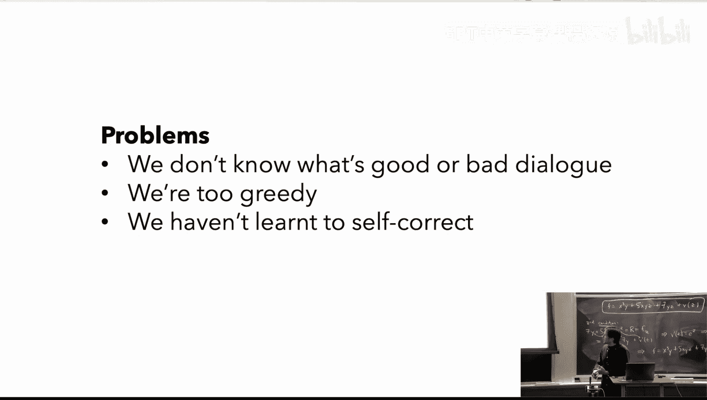

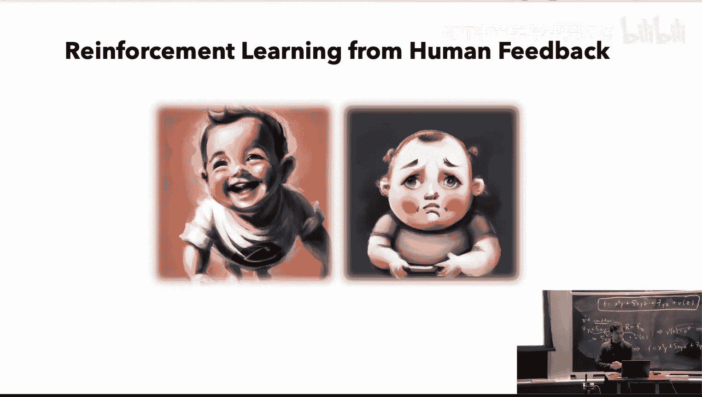

诶 ok。So what do we do， Well， we have a great model that's been fine tune on dialogue。

 and it's able to generate really good answers still to different prompts。😊。

So we're going run this model now on a collection of prompts。 and we're gonna generate four。

 we're gonna sample four prompts for any four answers to any prompt that we have。 So's say we。

 and this is very cheap to do。 let's say we have， you know， a million prompts that we found online。

 Now we run our model four times on each prompt with different random seeds。

 we sample four different answers。 So now we have 1 million prompts with。For candidate answers。Okay。

 and then we're gonna say that we're pretty rich。 So we're gonna to pay people to actual human beings to label these。

 They're gonna rank these these prompt or the answers that these models produce to these prompts。

 So we're going pay pay actual human beings to score them and say， are they good or not？

 They they're going rank。 they're gonna rank the the quality of these outputs okay。But again。

 human beings are very， very expensive。 So we don't want to use them too much。 So here again。

 we're gonna go to reinforcement learning and say to deep learning in AI and say， well。

 we now have 1 million prompts with four ranked answers。

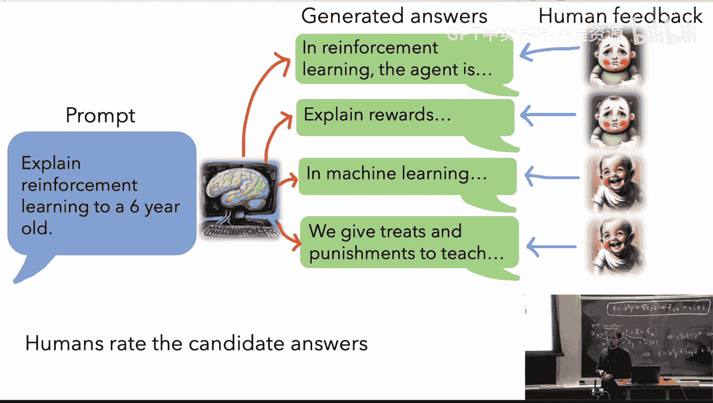

But why don't we train now a AI model as a new AI model basically to simulate a human being assessing equality and ranking these prompts？

诶。So。We're going now take this model， this robot basically right。

 to look at a prompt and generate answer and it tries to predict the score that a human being would give to this answer to this prompt。

 right So just learn to imitate human beings ranking these answers。 Okay， Why is this good。 Well。

 it's good because now we can basically rank and score answers as as much as we want because the computer is very。

 very cheap so we can scale this to as many settings as we want。

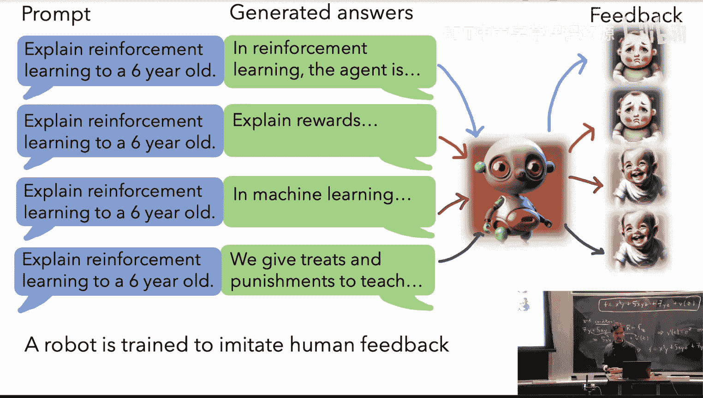

Right， so this is much， much cheaper。😊，Okay， so。What do we have well we have a robot or an AI model here that's able to take a prompt and an answer and then give it a score。

 like let's say team1 and 5 and say， how good is this？

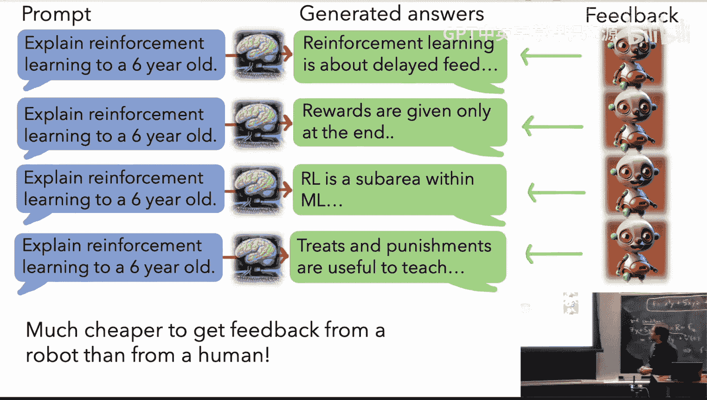

So what we solve now is that we we know what's good or bad dialogue because robot or computers learn to imitate human beings that clearly know what's good or bad dialogue。

 So the robot also knows now what's good and bad dialogue。

 So now we can run this robot on any prompt an answer and get a score of how good this answer is。

 So now we suddenly have at least some insights around what's good or bad dialogue。

 So we've solved that。Okay， and the last two problems we not going to solve by using reinforcement learning。

So what is reinforce4 learning？😊，Well， I thought about this a little bit before。

But something is very important， and the characteristics of reinforcement learnings dis delayeded feedback。

So in reinforced learning， we're going to have our starting point of a really good model。

 but we're going to allow it to start generating things right it generates a word puts that in its own input and it rerunse itself So it comes a longer。

 longer sequence one over at a time So we start off with this I and we now have a probability distribution and we decide what to go for next。

诶。We go with went and then we have a few options again and we we take a next step too。

 and again theres no at this point， there's no feedback。

 We don't know if we're doing good job or not。Before we had instant feedback because we had a target we could learn to do better hairre no instant feedback So we're on our own And only when we you know we reach some predeeffined token like a pi for example。

 then we stop and then we give our sequence that we produced to this robot and then it tell robot tells like  hey is this good or bad so only at the very end when we're like hey。

 we're done we give it to the robot and dis course it， then we get the feedback。Okay。

 and why is this， why is this difficult while it's difficult because let's say we do this again。 So。

 I mean， when we produced， I went to a walk period， I mean。At least it's a pretty good sentence。

 so it's like medium score at least。😊，Well， let's say we now generate I went to lip I row row period。

 I mean， that's not a very good sentence。 It doesn't make any sense。 Basically， this is a very。

 very bad score。But。You a big part of reinforcement learning now is how do you make sense of this information。

 You have two signals， You start off doing the same step at the first step and then you diverge what would actually cause one sentence to be a better another one。

 right？ How do you incorporate this this delayed feedback to actually learn to generate good sentences。

诶。Because I mean， we don't really know right what what did causes us to make better。

 that's what reinforcement is about like how do you figure out what actually helps you reach your goal and optimize you score function。

 even if it's delayed。诶。Okay。So another thing in doing this that's very， very important。

 exploration versus exploitation。So let's say now basically that our model has seen these two different cases and have received two feedbacks。

Right， in one of these， you will got a pretty good score。 and in one， you know， in the lower here。

 it got a pretty bad score。 So let's say we run this model again and it went from eye to end。

 And then it let's say its kind of it remembers a little bit what it've seen so far。

 And then it can say。😊，Either here， we can say we can decide try to be kind of greedy。

 right or exploit what we've seen so far。So if we go down this path to I went to a walk。

 then at least we know that we're going to do a decent job and better than this alternative that we've seen。

So then basically， that means that we just exploit the information that we've seen so far and do the best based on the current knowledge that we've received。

Right， but the problem with this is that。If we do this。You know， we're not going to see anything new。

 We're just going to explore and explore the things they've already had received feedback on that already knows does pretty well。

But we're never going to do really good or do better because we just only going to explore the sequences the world have seen。

And this， of course， is not good because if you start exploring a different route， for example。

 you might again， find a much better solution that's。Much more optimal。

And that's what you want to accomplish you want to explore your space to be able to do better than that you've done before and see parts of the data that you haven't seen before to get more useful feedback and scores from the robots。

诶。And also， what I think is。Quite important to， to emphasize here is that。And this。

Explation cannot be completely random。Let's assume that you would just generate。A sequence， you know。

 of 50 random words。 I mean， that would be completely nonsense。

 And you wouldn't you wouldn't be able to get good feedback on this at all。 right。

 you just be complete nonsense and random。 and you would not be able to get any useful feedback。

 And it would very， very hard to improve。 So in order to generate， you know， this exploration。

 you know， you want to be do a very， very target exploration around language is still kind of make sense So the robot gives you good feedback。

 And you actually can start， you know， making progress。 So that's also why。

Open the eyes able to use reinforcement learning because they have a really good model and Spanish language already。

 and they're only really exploring the fringes of the knowledge this model already has。

 So like the basically they only explore good prompt or good answers。

 but they still do some exploration there， but they're not doing a random exploration。

 they use in the current knowledge to do an effective exploration of the space。😊。

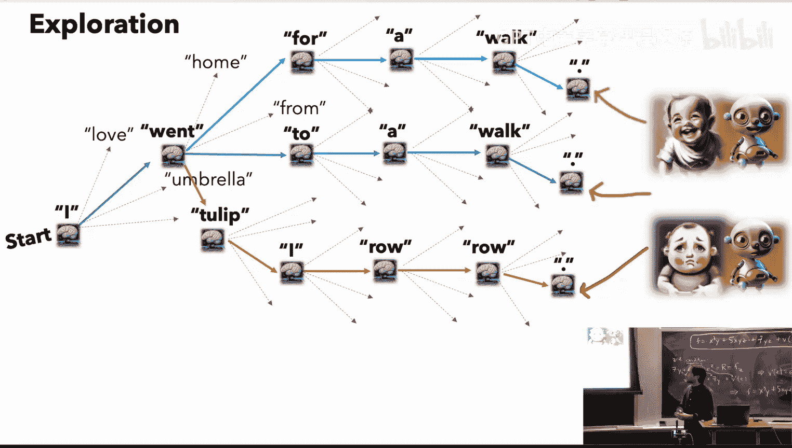

Okay， and so this now。The reinforcement is forced to balance exploration versus exploitation。

 talk to my delayed gratification。Actually leads to very non-griy and independent robustness。

 So these are the consequences of applying reinforcement learning where you only get feedback at the very end。

 So there's less， you know supervision， right， you're more on your own and you have to deal with an uncertainty of not having constant feedback and you have to figure out things by yourself。

 which leads to you being more robust。 And also again， in reinforcement learning here。

 the only thing we care about is the signal at end。 So we don't care about making the best next step。

 we care about optimizing the whole output。 So we now addressing these things。

 And some of these corresponds， you know， if we raise a child， for example。

A lot of children will do better if you give them some space on their own to figure out things as well and not just constantly doing on them and the least kind of more robust people。

Okay。So we've solved our problems。 we used human， I mean。

 we actually paid human beings for label data， which is not maybe it just like goes against our principles here。

 but we still did it because Open AI is rich， So they pay people to label things。But then they， know。

 they didn't want to spend too much money。 So they created an AI to replicate the。

 the job of human beings。But then at least they' got a， you know。

 robot or computer model and now its able to say what's good or bad dialogue。 Okay， we still want。

 you know， we still want to be optimized。 know we don't want to be too greedy。

 We want to optimize the complete output and we want to be more robust and we able to start create。

 So we use reinforce learning to optimize and make this robot happy。So we've。

 we've now addressed all these things， and we've got an even better model。Okay， but。

Now we have an even better model but we already had a good model to start with so why stop here right why don't we just use this model now to generate you know for each prompt generate new answers there are even better answers and then you give these answers now to human beings to score them and train a new robot to imitate this scoring and then you use reinforcement learning to train on this to get an even better model。

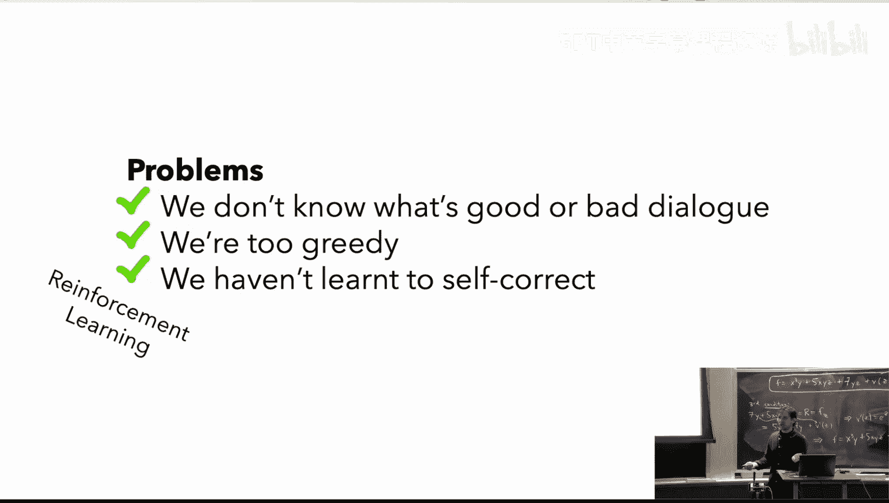

There's nothing stopping you for just rerunning this whole cycle again and some of this makes sense as well because if you now have a better model。

 you kind you want to go to the human beings and get more feedback that's more relevant to this model because this model now is doing better than the previous ones。

 you want to have feedback that's maximally useful for your current abilities if you're a kid learning to write or whatever。

😡，You know， you want to get more sophisticated feedback as you become better at it。

 And it's exactly the same thing we can do these models。 We can。

 we can just run this step and do it all again。And you know you can。

 you can do this as much as you want， of course， maybe with some。YouDecreing returns， I don't know。

 exactly， I think open air runss is two or three times。

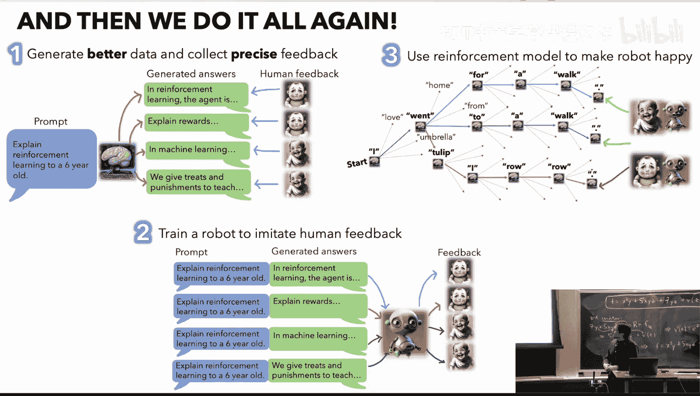

诶。Okay， cool。 So to summarize。What's the big fuss well just predict the next word based on previous words that's basically who knew that this is going to work at the scale that you know and reach these kind of intelligence that we're seeing it was quite hard but it did transformers allows us to leverage more data and train quickly because we can paralyze all these steps in doing training。

Then。When we've done this， we have a really， really sophisticated model and we spent 99% of our time in compute on preaching this transformer to predict the next word based on previous words。

Then we can adjust things to make it a little bit more nice to interact with if you're a human being。

 so you fine tune on some data around human dialogue。

 and then you incorporate human feedback and reinforcement learning to get even a little bit more of performance out of this。

ok 诶。Again。Obviously， self super learning and foundation modelss are at the core of ChatP。Also。

 maybe， I mean。EGently day I subupvised learning。Maybe it's useful to kind of。I mean。

 the difference between N AI and selfuppress learning is not clear in people use it typically。

 I mean is the difference is more clear when it comes to the research base。

 but people say that chatted piece to N AI or exchange business uses selfspress learning。

 I mean Gen AI somehow puts more emphasis on the ability to be able to generate some output right to create something。

But obviously， Chated P knows both how to read and to write。

 They are very related skills and self super learning。Care more about both aspects， somehow。I mean。

 this is terminology。Okay， also， So next time we will talk about we'll do a similar deep dive into stable diffusion。

 There will be selfspressed learning and foundational N AI。

 But I think it's gonna be slightly more conceptually interesting。 So we should be a lot of fun。

 And yes， please go to the website for more information， etca。 And if you have any questions。

 feel free。😊。

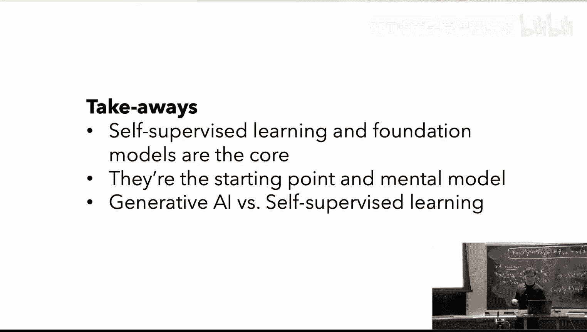

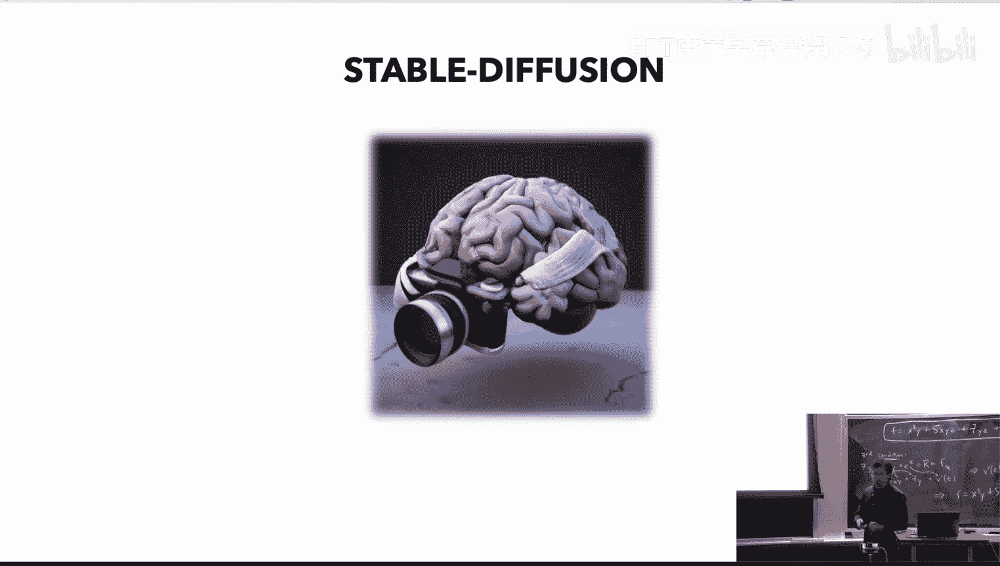

Yeah， can I something。 so can I assume that。Every group。Or。えと。After what's there。Changes。

Based on the subject of the。Tot Yes， yes， it's great question。 Okay， so the question is。

Does the distribution or the， the probability of over the next words， given the previous words。

 change， given the prompt。 Yes， that's the， that's the， you know， the whole point， right， because。

You train to generate the distribution given the previous words and the prompted just the previous words。

 So it's like， yes， the more the longer sequence and the more context or the longer prompt you have。

 the more specific prompt， the more peak to distribution will be because the more information the model have around your specific context in use case。

 the more it knows how to collapse into a space that you want to know about。RightSo if you just say。

 you know， if you start tra the model with no prompt， it's going to generate the most。

Common starting points on the Internet or something。 just like random text。

 But if you start saying like， hey， I'm interested in history。 this is in this。

 then it's gonna say like， well， okay， I know history。

 I'm gonna generate things from Wikipedia history a lot。

 and it's gonna be able to collapse and create distribution。 That's much more targeted。So。

if it doesn't have data run a context or about you and your interests as a person。

 we won't be able to tailor to you， they cannot create magic out of thin there。

 It can only do the best of the prompt that knowledge has so far。

 It's also why data is so important to have around you writing good prompts， etc。

 And it's also why this prompt engineeringing to be able to like how do you create the best prompts to get what you want。

An。Yes， so just to like double check。 So for the reinforcement learning with team。嗯。

The part that the robot that learns to rate the responses is that's supervised learning。Yes。

 it is supervised learning。 And then the actual isment learning because it Yeah。

 that's a great point， actually， Okay， so。😊，Yes， in this， what we talk about right now。 Basically。

 we had a few models involved。 and， and we talk about reinforcement learning。

 supervised learning and self supervised learning， right， So exactly the robot that just。😊。

Try to replicate the human beings， putting scores on the。The answer is to re generatedative prompts。

 Yes， that's trained using self supervised learning， right。

 because you have these labels now do you want to replicate。

 So it's trained using supervised learning。But。You know how it actually works that that model also leverages the pretrain model that we have。

So it's as a starting point。 So again， like you can see now as well that。

Like supervised learning where you have limited amount of label etc only becomes really useful when you have a starting point from self-supvised learning right you already have a world model that you can leverage and then you can use your labels more efficiently so the first step of treating the next word based on previous words that's self-supvised learning right that's 99% of the work and then we have supervised learning when we learn from the human beings。

 but we we have a starting point already。 So it's easier。

 And then we do reinforcement learning right' try to generate。

 So we have a model this reinforcement learning But again。

 the starting point of the reinforcement learning is's this self-supervised learning model that's trained already using self-suppressed learning。

 So that that's what's so fascinating with self-super learning because now it's the building block that makes all of the technologies in AI actually fruitful。

Yes，He language model。那这 actually。based on。How a child learn。ではい。

Is it related to any sort of like cognitive science type of like learning because I saw like principle？

That's kind of在他。No person learns right when you。Content is trying to be with everything else。

 you know。Yes， so I'm just wondering is that like。I mean， this， yeah， okay。So the question is。

 basically， is the transformer inspired by。Research about how weL kids learn right how the brain works。

I mean， you're going to find。A lot of work around making those connections。

 then there's a huge debate in like the deep learning community。Is that， is that actually true。

 Is it kind of wishful thinking？ And in hindsight， we make those connection， right？ And I mean。

 and a lot of people throw around。 I do， too， right。

 you throw around similarities to how own brain works。 And some people are like， oh， that's not。

You know， we have to be very， very careful because we kind of。

Compared we're anthropomorphizing AI in some sense。I think that there is strong connections， right。

 But like what came first， I actually think that。People have some intuition。

 they tinker and they try things and then suddenly something work， and they work on intuition。

 And actually theory is very much hindsight。 So some engineer played around with things。

 actually engineer was from Google right So the transformer。

 they play around things they want to accomplish their things。

 and then like oh this makes sense this is probably how I would do and just have some intuition and then it works。

 And then when it works， the theories come in and say like well， this reminds me of this and this。

 So there was definitely no strong like this is how kids learn and then we replicate that the more I would say the more likely description of how the transformer came about with just engineers。

😊，Tinkering out and trying things。 And then it， it just like， oh， shit， this works now。

 And they are not maybe completely conscious themselves about what they were inspired by， you know。

 So that we do not have collaboration with neuroscientists。Yeah。

 it means that the collaboration with neuroscientists in deep learning is quite quite rare， actually。

对二。That's a good question。 Yeah，' it's it's， I would say it's quite rare， yeah。Proces。Why。

But not just。V。でります。Engineer。Oh I。Yeah。诶。Yes， like the question is。

 why do we want to predict the last word based on previous words。

 why don't we just take a random word， mask it and try to predict it based on the surrounding words。

And。Yeah the answer to that is we used to do that way。 we used to just mask around and predict that。

 and it works better but due to engineering you can basically kind a transformer can maybe this can be like a homework view you。

 but if you look at a transformer works。If you mask a word。Then you will， like， then you will only。

Okay。If you do this， you know， if only predict the last word based on previous words。

You can make this attention that the transformer does。

 it's called attention when it turnss to previous words。诶。

You construct structure it in a certain form in a kind of triangular form。

 so you can process a holes like you can basically in a single goal so you can maybe and any。

 like you have this tensor product， you can define this matrix high dimension dimensionional matrix product in a way that's efficient so you can basically in a single goal。

Predict the target。 like you can know， if you have a sentence， you can。

 you can run the whole sentence and predict the next word based on previous words for all the words in a single go。

If you do mass language modeling。You cannot do that。Then you basically have a full attention。

 So you can attend forward and backwards， but you can only run on the targets that you you masked。

 So this means that。In terms of imp， like in terms of signal to the model。

If you have a sequence of length 2000， you have 2000 signals for autoregressive because you can use each target by itself。

 but if you mask， then you maybe mask like 15% of the words and it's only like there's only 50% then in terms of getting that feedback。

So it is in end of the day， it means that。When you try this empirically。

Doing it more aggressively in in this trick to be able to use each you know each word as a target itself。

 just leads to better performance at this task of generating next word based on previous words。

 So yeah， so it's， I guess it's engineering and empirical okay。😊，It's not as in an ideal world。

 if you have under compute， you would have a， you know。

 you would rather do it in a clean modeling way。 But now because of these restrictions and computing stuff。

 you just try something like， hey， this is sweet up here。 And they see， oh， actually works better。

 Given the same amount of compute。 Yeah， does that give you some sense of answer。

 We can talk more about it offline as well。what are the main challenges of these models nowadays？

Are there other like language models that are like better， but maybe like more expensive and。

You either are like， this is like the best。嗯。Yeah， I think so what are some Cha what are some challenges of these large niche models。

Well， one challenge。Is to。Make them behave like we want them to， meaning like， okay。

 we want them to be， you know， a little bit politely correct， at least right and kind to us。

 we don't want them to make up things， right， we want them to be， I mean。

 we want people to rely on as much as possible。 And if they like ask a factual question。

 And they gave us something that's wrong and they're confident about it。 Maybe it's bad。

 So like I think what we're starting to see is that they。诶。Or very human like。

 even it's in its mistake。 They're like， well， they're somehow they're biased。

 We're gonna to talk about this like they're biased and they have stereotypes around things。

 They also like we do。 I mean， they suffer from wishful thinking and some type of imagination where theyd rather be。

 you know， make you happy than being completely truthful。

It's like these are things that do some then somehow had to balance。Yeah。

 and then so that's like some problems immediately arrive。

 And then what else people definitely working on and the opens work on， autonomous agents， Basically。

 how can you get planning into this。So if you， if you now， you know， let the model be able to。

Generate， you know， digest some input， generate some output。 and then， you know， digest that input。

 generate some more output and suffering like in this kind of planning step。 it becomes has much。

 much better abilities。 So you can basically instead of having a single go at your prompt。

 if you can， you know， have a few tries and improve itself and only get give you the the response after you know。

 done this internal iterative。Processing， it will be to do much better。 And then like again。

 if you throw in some tools there， it can search internet to get more information。

 can retrieve me information and they will do much， much more。

 So this kind of planning is definitely something that people know that these models very。

 very helpful， Of course is' more expensive again because it has to run for longer and stuff。

 but it's very， very useful So that you have this like open I talk about a star and stuff。

 So these are reinforcement learning techniques of how to do planning well。

 So how to incorporate planning is something that people talk about a lot。 And then of course。

 multi the modalities。So。It's not hard to see that this idea of predicting next word based on previous words corresponds really well to videos。

 just to kind of predict the next frame based on previous frames。

And why aren't people doing it well because it's？Videos are suddenly a next level in terms of compute what it needs because they have tons of videos。

 a frame is very expensive because it's a high dimensional picture image。 but clearly。

 you can learn a lot about the world by looking at videos， right。

 You can even sort to understand how human beings work even better because you can see people being upset or sad or happy。

 or whatever， right in an inner。Video is start picking these cues up。

 and you can connect the vision part to the text part and get a multi modality model。

That's able to do both in a really， really sophisticated way。

 It's also something that I think these people are working on。All right， thank you。

