# 《基础模型和生成式AI｜6.S087 Foundation Models & Generative AI 2024》中英字幕 - P4：6.S087_ Foundation Models & Generative AI. IMAGE GENERATION.zh_en - GPT中英字幕课程资源 - BV1YYWpzaE3q

Okay。Welcome to the fourth lecture。On the course called Financial models AI。

Today we will do a very brief managing of data。Data is one of the key components in this new type of AI and really deserves its own course。

 But we're gonna talk a little bit about it。 And then we're gonna cover stable diffusion， which is a。

Text to image generation。AI， don'ative AI。Okay， so what do we have left on this course。 So next week。

 we are going to have a lecture on。

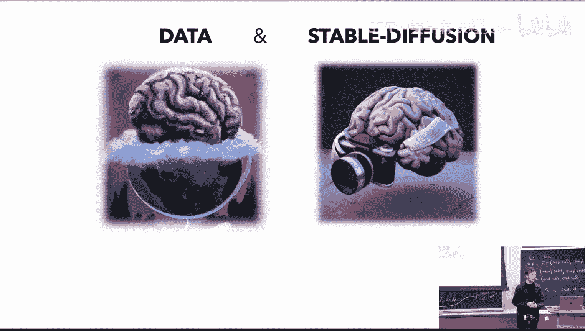

Emerging foundation models and re。 So this is foundation models in the world in the market and in commercial settings。

 especially。We'll have two guest speakers as well， So Mans will talk about AI in genomics and applied biology and Art and will talk about autonomous agents。

And and then the last lecture will be on AI ethics and regulation。

 And then we'll have a panel at end of it and discuss。The ethical aspects of AI。

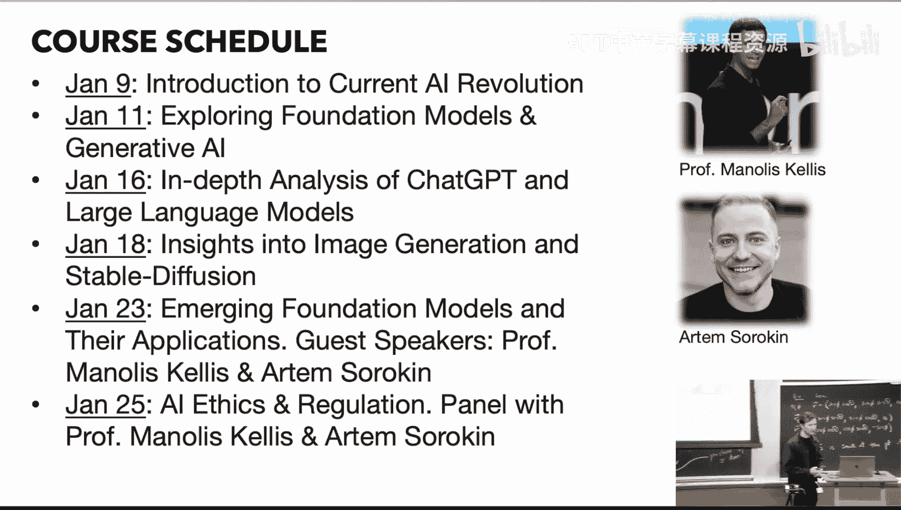

Okay， so to summarize a little bit， right， the first lecture was an introduction。

 a very quick intuitive answer to what is foundation models and Genive AI。

We went on a little bit of a philosophical digression and the history of AI。

The second lecture went through all the different algorithms from a high level perspective。

 and then we went into depth last lecture on ChaPT。

Right so what do we do in in whats the key behind foundation models。

 it's be able to learn from observations。 you don't need human beings in the loop。

 you can scale up as much as you want。And that you get from this is a very kind of contextual relation understanding of meaning that meaning is defined by the company。

 it keeps its self referential。Right so a dog is something that's walked by an owner with a leash。

 it's something that has an interesting relationship of cats。

 it's something where that chases free space when those are pro。

This is how we understand what a dog is， right， Not actually your parents labeling it or。Really。

 you optimize in certain goals like reinforce learning。

 is you observing dogs in different contexts and correlating dogs to other concepts。

 That's how you understand what a dog is。 That's your。You know， that's the main trick。Again。

Something that I think is， you know true when it comes to AI is that you。

 it' a very most understanding is intuitive and relies on all these different relational edges。

 So you don't never really fully understand something。 You can always become better。

 And it's a lot about just familiar familiarizing yourself so。

If you don't understand everything in a lecture that's fine。

 just try to get some intuition and familiarize yourself with it and then kind of keep going。Okay。

 so data。Why is it so important， Well， I think a kind of。

Complimentary perspective and all the breakthroughs in AI that we've been seeing is thinking about in terms of data and actually how the new AI just looks at data。

 the old type of data， but looks at data in a new type of way。

So it becomes more powerful and use more of it。 and that's basically a very big part of what's happening right now。

 and the data is really， really key。嗯。And in some some ways， I think data is you know。

 if you want to apply AI in actual settings that you might care about。

 look at the data and understanding data is gonna to be key for you so that's a very interdependent concept like AI and data goes hand to hand。

 it's very， very hard to develop better models if you don't understand the data and vice versa。

 So if you start applying AI to your own settings， understanding how the data what data you have and also howI how AI leverage data and what kind of data wants。

 it's going to be very， very important for you。And if we take this picture we had before about kind of look at the this new AI development as some kind of iceberg。

 right， the tip of the iceberg or。

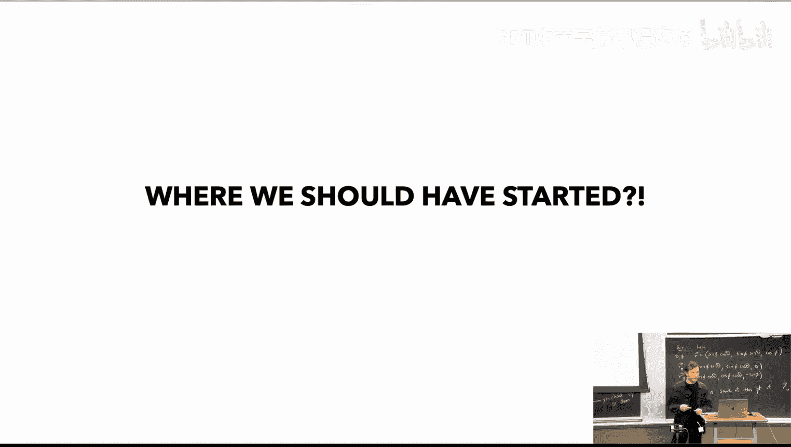

ChatTPT and stable， for example hype stuff that people are talking about and then of course below that it's about understanding self Su learning。

 but training methodologyology to get these AIs on foundation modelsgen AI and then a really big you know significant chunk below that that people don't talk about as much is the data right that's what feeds this whole revolution。

诶。

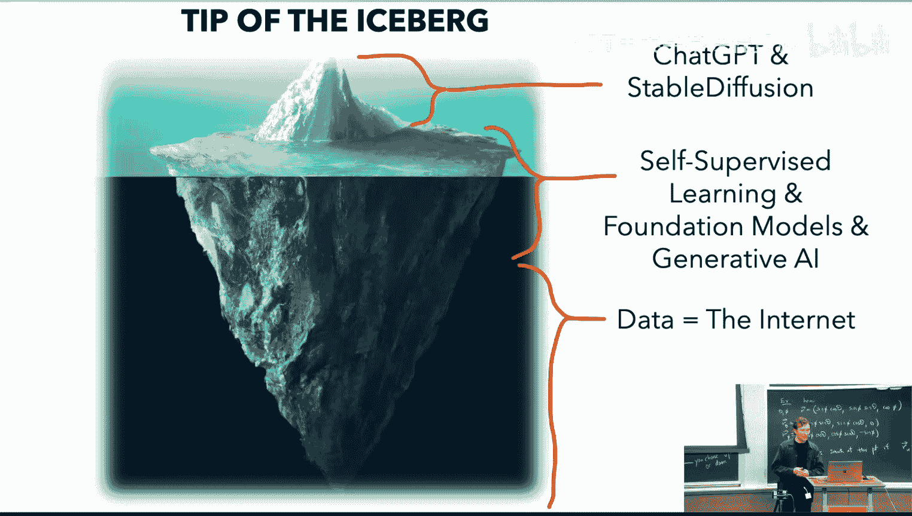

Right。And， I think。So。Let's look at Open AI， for example， the build ChatT， right。

 Maybe it's like 10 to， you know，10 engineers working for a year or six months。

 actually developing the chattBT version they were using right now， right That's not a lot。 I mean。

 that's why you have a lot of startups now that's try to replicate ChaP ChatBT。

 just for a lot of money in computer train on on data with a small team and they can reproduce it。

So that's like in itself， I mean， it it's， of course， impressive。

 but it kind of pales in comparison to how the internet was created， right。

 so that they're able to leverage all of Internet， download it and train on it。 But the Internet was。

 you know， we spent。😊，20 years， you billions of people putting a lot of data online。

 that that's a huge effort that you can't replicate， right。

 Nobody can replicate that process of creating the Internet from scratch。 No company can。

 It would be too， too expensive。And so。Somehow the Internet makes this all this available is basically the greatest data collection effort in human history。

 And that's， I think is even more vital for ChaTP than any of the technology， right。

 So data is really， really key。😊，And again。I mean， if I had to choose between and for you as well。

 if you had to choose between having chattTP or having the internet。

 you would rather have the data and the internet because you can retrain chattP and you can create better versions so the data is really key and having access to it as well it's also going to be problematic now with copyright etc。

 where people want to say like well， stack overflow but if we have this data and now you out competing us by using our data。

😡，And people are going to value data more and more now as well。

 And it becomes very interesting how it's going to affect the development of AI。

Because the internet has been so easy to use and people haven't really cared。

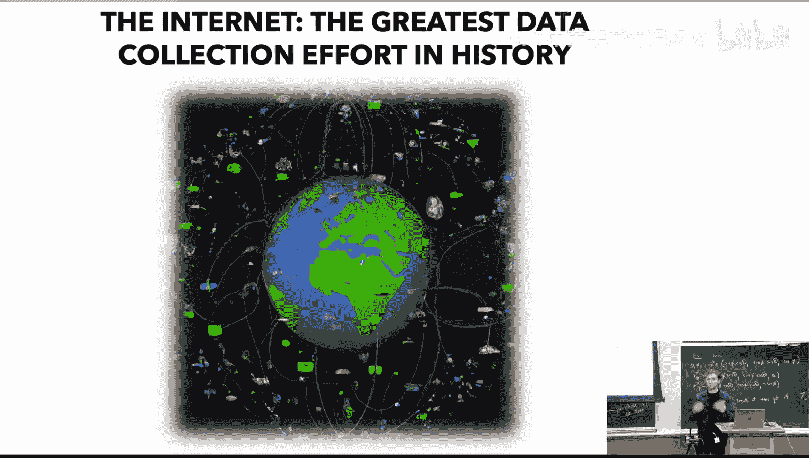

And again， when you work for a company， whatever you do and you have your own problems。

 start looking at the data。 The data has all the secrets。 So it's very。

 very important to think about and not overlook。

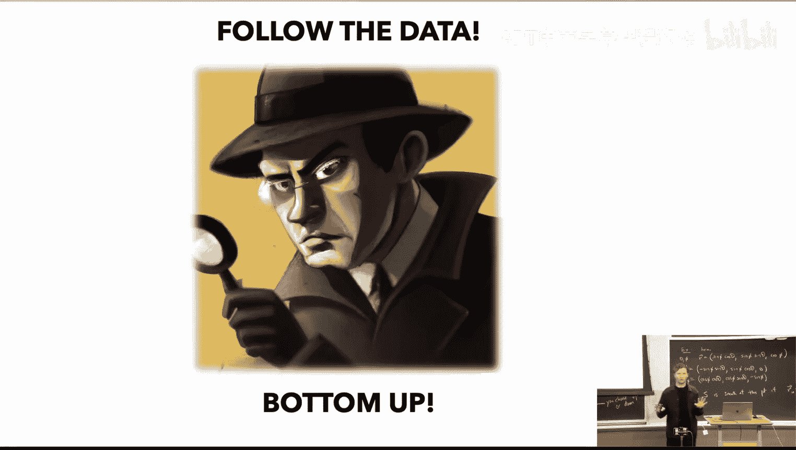

All right， so the small piece of philosophizing in this class will be about data。

So I mean equally that for ChattP， the interesting thing is not the technology right it's not the brain of ChatP。

 but it's the internet maybe it's a similar perspective of also human beings like maybe we're not that impressive as intelligence but actually the data that we've created and the whole like biosphere has created that's what's really matters so maybe we're just more data creators for the gene for example if you know about this stay about the self this gene trying to reproduce itself like maybe we're just collecting data for for another purpose basically so。

Right let's say that an alien came to Earth and discover Earth and we be like， oh。

 they probably want to kidnap us and look at our brains and the sectors understand us。

 Maybe theyd be like， well， no， we don't care about you guys。

 we want your data We just want like all the history of the earth and what's going on here。

 collect that and then they can derive their own human beings improved versions So maybe it's like the data somehow is is really。

 really key and we try to focus， I mean sometimes we focus on the AI itself but the data behind these creations are extremely important。

All right。Okay， so conditional image generation takes to image generation that's what we're going to talk about today。

诶。

So two of the first most popular models here was called Dali and and stable diffusion。

 So this is a year ago and you can see the two different versions compared。On the left hand side。

 you have dli and on the right hand side， you have stable dition。

 and this says a high tech solar punytop in that is on rainforest。So it does a good job。

 looks realistic， and it adheres to the prompt and it has some kind of imagination as well to be able to create this。

😊，And we can just check quickly how it's progressed。 So this is DP 4 now asking the same thing。

 I would say it looks。Even better。嗯。

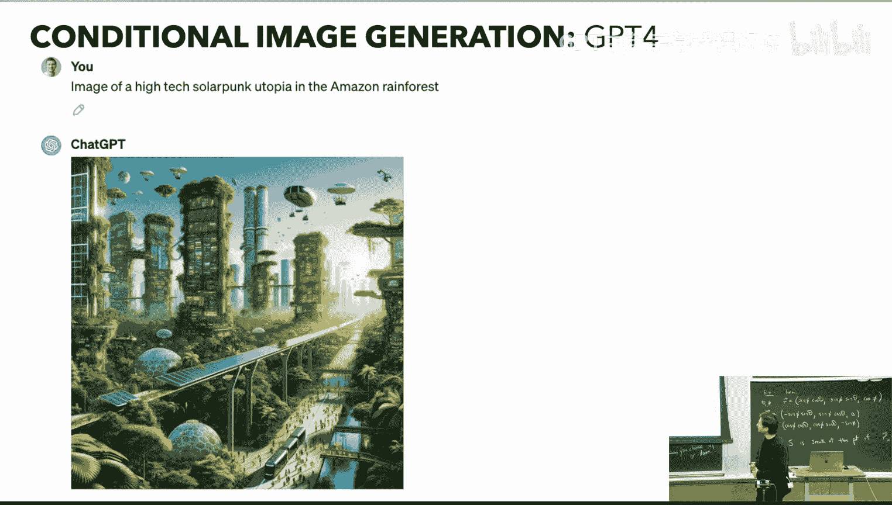

So that's good to' been some progress。Of course like I mean almost all of the images that's in these lecture slides are from these text to image models。

 and this is how I created this strange image so prompting can be quite hard。

 I think prompting has become easy and easier， but you can also sell prompts online to get you know for people can get exactly the image that they want。

 So that's interesting。 I think that people are very hyped about prompt engineering in the beginning。

 but now it seems to be a little bit less hype and as the model become better。

 it's also easier to create the prompts and the images that you want。

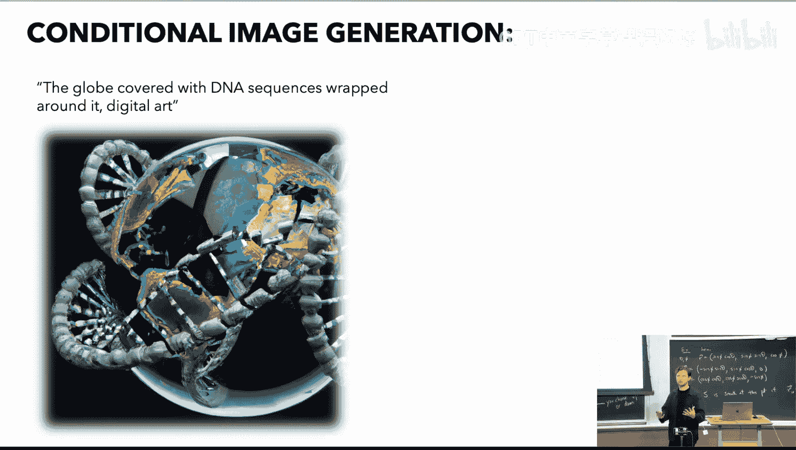

And again， it's also a year ago when where Facebook， I think Google released this image。

 So they went from takes to videos， which was something that we've seen improved substantially。

 And and hopefully this year， we'll get something that works extremely well。

 So we can start creating videos from scratch。 of course， the online。😊。

Approach of technology is very， very similar， but you have to scale up now and think about frames。

 which is just a collection of images。Okay， so to be able to。

Successfully create images and have a text to image conditional generation。

 there's a few things we want to accomplish。

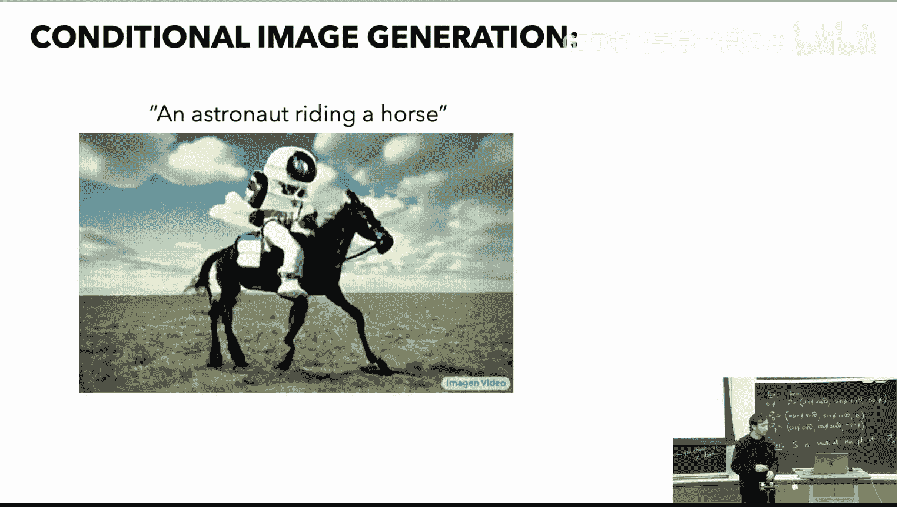

So we want to have a high real image quality。 We want our image to look real realistic， right。

 That's important。We also want a high correspondence between language and the images that's being created。

 So if we write something， we want something that looks like what we're writing about， right。

 we don't want to write something and then get something completely different。

 It's gonna to be a strong correspondence And also we want to somehow capture a variety of images around a concept。

 So let's say we want to generate a dog。 we want to be able to generate all possible dog somehow。

 that's going to show that the AI understands what a dog is is more。

 you know what a dog is in a more nuance sense because it can create all the different versions and it's gonna be useful as well because you want to sample and it shows some kind of performance criteria。

And we want it to be fast to train and to use。So how do we accomplish this？Well。

 we're gonna use engineering and smart tricks to accomplish everything besides high language nu correspondence。

 which will have to rely again on data。 So its gonna be。You can see it's labeled data。

 so it's correspondence between images and text， you can get it up from you can get that from different scripts and scraping online。

 but you need that correspondences to get a really good performance。

 and you can reduce the need for data， but you need to have that data in how you build these models。

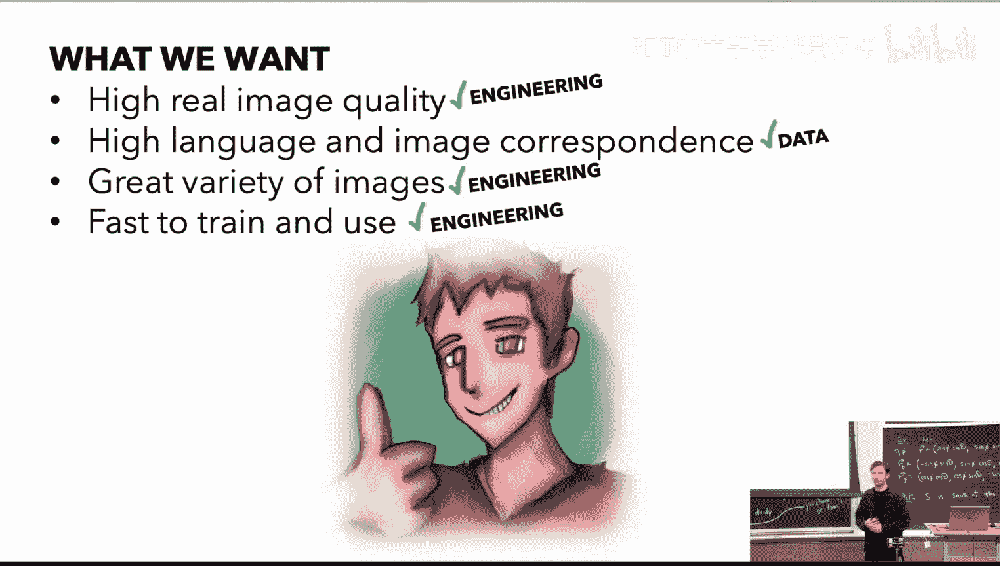

So far。Okay， so let's just talk about how we can go about this。

 How can we generate learn to generate images。 And maybe we can first talk about。

Drawing faces a starting point。So let's say we want to learn to draw faces。

 we want going to train our AM model to learn to draw faces。

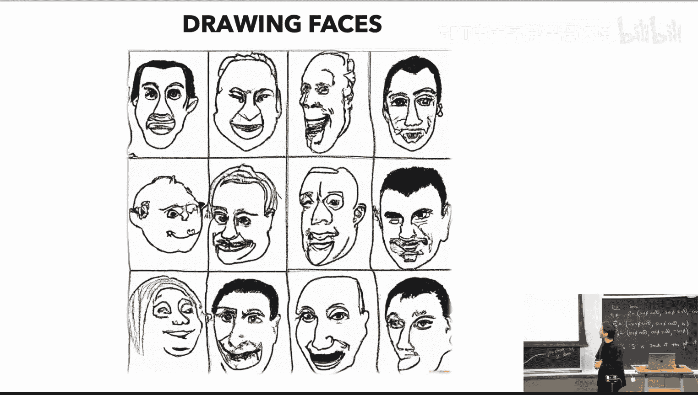

And we we arrive at something that's able to。Generate the same phase over and over again。Right。

 do we trust this model somehow does a good job， And it's able to understand what a。You know。

Entails the face or whatever what's included a face。 Probably not because you know。

 it collapse a single instance， maybe just memorizing something。 So we want to have some variety。

 I also prefer it to be more useful。 We want to be able to say， like。

 yeah generate 10 faces I can use in my slides， right， And you want different faces。

 You don't want the same phase。 It's less utilities is decreased。

And so you want to be able to generate different things。

So the first thing you notice when you think about is that， okay， well。

These deep learning models are still deterministic functions。So if you give it the same input。

 you get the same output。So there's no randomness here for the new network leverage to create different samples for instances。

You know， if you give it the same input， is going to produce same output。 and randomness is very。

 very hard for a neural network to kind of create by itself。

 So you need to feed that randomness as our input to it。 like it's as part of its environment。

 let's say。诶。And。You know， maybe it's same for our as well that if you would be able to very。

 very carefully recreate exactly the same environment。

 you would also act in very similar ways if you find yourself in exactly the same environment and maybe that when we find ourselves in new environments actually。

 that's conducive to us being creative。So maybe we can learn something from this as well。

 but it's very important for networks， at least that we gave them some randomness that they can leverage to explore and generate different versions。

Okay， so we're gonna as part of the input in a new network， we're gonna feed some randomness right。

 So it's gonna every time it's run， it has some different type of input So we can leverage that to say。

 like， hey， I'm gonna now create a face that looks like this or like a face looks like that。

 It can leverage this randomness to create a distribution of faces。😊。

So now each time when it gets a slightly different input。

 it can generate a different type of phase and now I think we feel like okay now it we believe more that I start to understand what drawing a phase means and it's actually pretty good at it because it's able to do a lot of different phases and it's also becoming more useful to us。

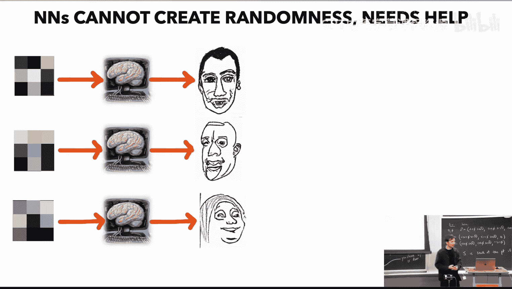

诶。And also， what's important is that。We want to have randomness in a way that's very easy for us to sample from a computer right so we can create this randomness very cheaply from a computer。

 fit it in it and run the model right so we don't have to create a randomness。

 but it's created by the computer itself and computers are very good at creating this pseudoran input that we can use。

O。So。诶。

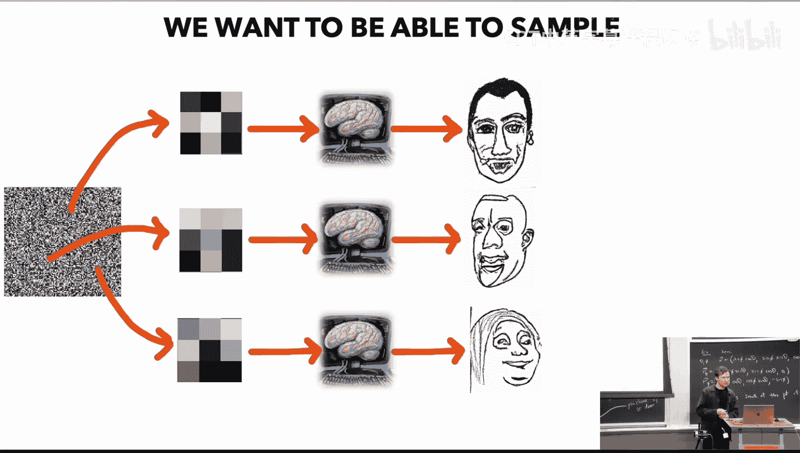

Let's say we want to give this。Random input to the model。 and it want to generate some face。

 How can we go about doing this？Well， we could try to just draw the face in a single goal。

RightJust from having the randoms and removing all randomness complete at one single goal for the model gets one try。

 or we can say you can remove some randomness iterativeably。And it's going to be very。

 very useful because it's going to be somehow easy for them all to do， right。

 You just have to do everything in a single step。 It can remove some randomness and then basically feed it。

 you know， run run itself in its own output and try to remove some more randomness。And I think。

 you know as well as human beings， we probably when we learn to draw， we draw things。

 we don't just draw everything in a single go， we kind of sketch it out and kind of itly improve on our drawing。

 and we're going to try to allow for the same ability that is for this new network。诶。And okay。

 so why is this useful as well， Well it's useful because。Now， also， when you think about。You know。

 different levels of randomness。 And you can remove only part of it， right。

 then most kind of different levels of difficulties。

 So maybe if you want to go from a complete random input， some noise to just。

Removing some noise and putting some features there。

 that's kind of maybe that's harder because it requires more of imagination to get going。

 But at the very end here， when we just have to finish the cheek。 maybe that's easier。

 So suddenly as well we're gonna have different levels of randomness and the input。

 and we have different levels of difficulties。 So this is both useful like both useful for the model when it's being used because it can iteratively try to improve on its improve itself just have to everything in want a single goal。

 it can generate a little bit and then kind of add to that。 know it runs itself on its own output。

 but also if it sees different different levels of randomness during training。

 So it has to go from left to right at these different levels。

 it also good because it can start making some progress at a certain level of difficulty and then it can start improving and it's learn something there and then when it's learn something then reach the next level。

 it can make more use of the more difficult。Pa。So I know you guys remember but when we talked about gene adversarial networks。

 it was very difficult because then you have a kind of a critic and a artist and they have to be very synced So the critic needs to be able to give feedback on the level at which the artist is right now its skill level but if one gets ahead of the other one it breaks down here's actually what happens during training。

But here， somehow， we give a。You know different levels of difficulties during training if you can create these examples。

 so the model is able to do make use of some examples and start improving and that we can make use ofable examples。

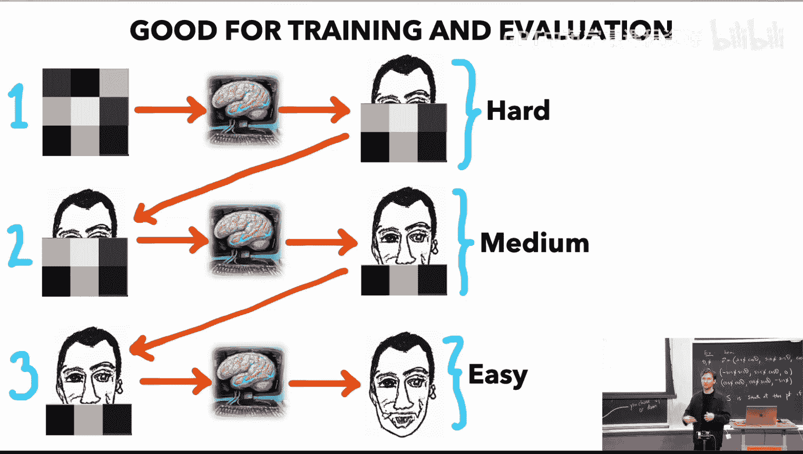

诶。Okay。So in order to be able to create a like a variety， a sample like samples of different outputs。

 right， we need to be able to sample noise and computers are good at creating certain type of noise。

 we're going to use that。😊，Creating everything in one single goal is very difficult。

 so we're going to allow the computer to iteratively improve in itself。

 so it's going to be able to start from some noise， add some part of an image。

 you know but not remove all noise and a single go and then keep going iteratively。诶。

And if you want to do that， right， somehow the noise needs to be part of both the input and output。

 So if it doesn't have to remove all the noise， it can still be part of the output that it generates and it can run itself on its own output。

Okay， and handling different noise levels are good both for training because it gets training examples at different difficulty levels and it's also good when we actually use it because it can iteratively improve itself。

Again， we like in Gs。

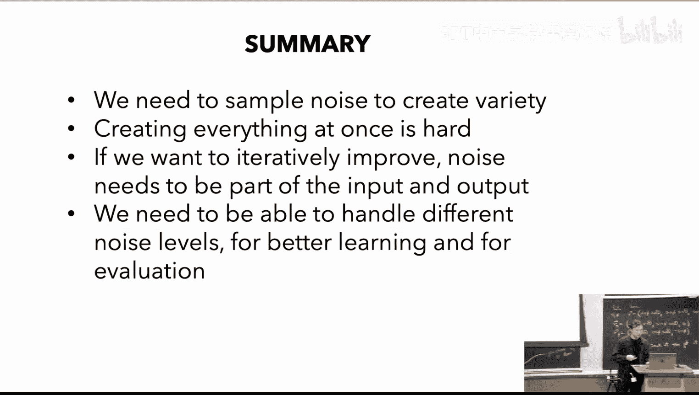

The artist only have a single attempt to create a image and then a critic criticizes it。😊。

AndAnd here， the artist in a critic has to be on a similar level because the artist is supposed to fool the critic to feel like this is a good creation of a face。

 for example， right， So it's gonna the， the artist creates a。Image of a face。

The critic gets a real face from a distribution of images。

 And then it also looks at this fake face that artist created and it learns to critique and say its supposed to learn to say。

 like， whoa， which one is the real image， Which one is the fake。

 And the artist is supposed to fool the the critic。

 So the critics the critic feels or believes that the artist is actually creating。

Re lookinging faces。But it's very， very difficult because the feedback needs like the the artist and critic needs to be in a similar skill level for them to kind of co develop and co-learn together。

Okay。So if we actually look at these。

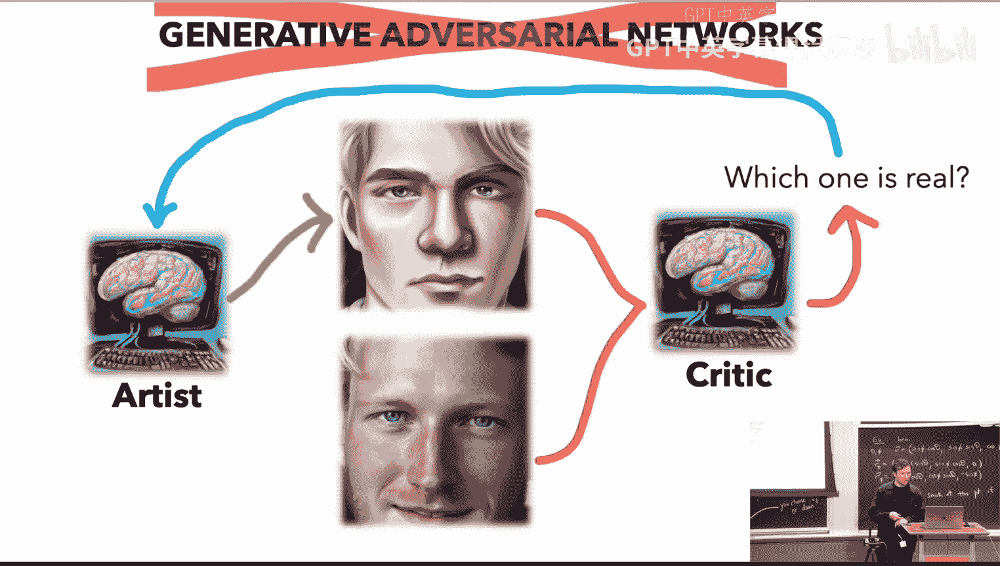

You know， what drawing professionals do when they draw something is that they start with some outline and then they add details。

So it seems to be a good idea also from how human beings do this professionally。

And that's what we're going to try to。Imitate。 and also， as you can see here。

 they don't go from having some random noise and then removing it bottom to bottom。

 like top to bottom。I they start from some outline and they make add more details right。

 not just removing the top of the face， middle to face the low face。

 they go from some kind of outline to details and that's also what we want to do。

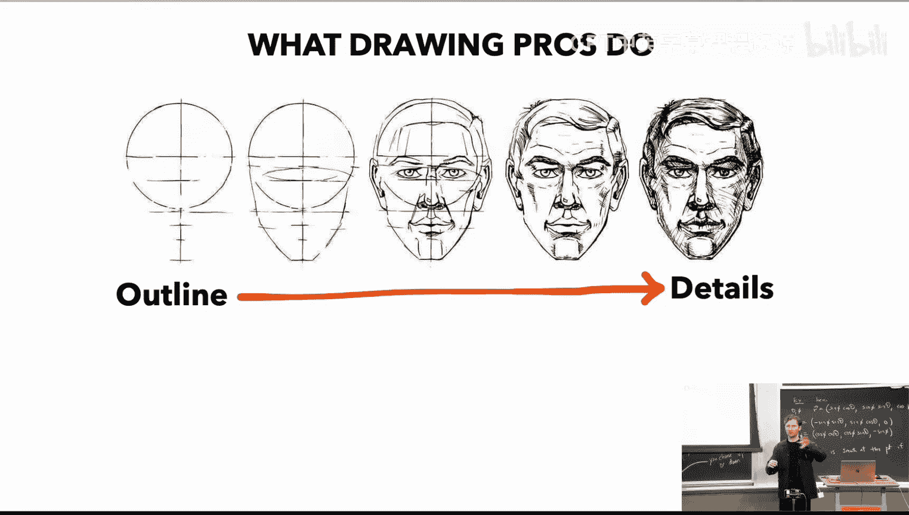

诶。And I think this is why this is also very， very powerful is because when you want to learn something。

 it's much easier to point in the right direction and make some progress than find the exact location immediately。

So right if somebody asks you where Uzbekistan is， right。

 it's probably you will' know the exact coordinates or location。

 but you can point in the right direction。 So maybe you point， if you're America。

 you' point towards Europe and you make some progress and then you can keep going kind of。

 but it's easy to learn that way and making some progress that way when you have to get kind of directional feedback。

Okay， so how we're going to try to recreate this is that we're going to have this type of。

诶 settinging。Where we start with some and。Noisy image， like a complete noise。

 Gal noise that the the computer can generate。 And then the。

 the model will start adding some features， right， adding some。

Beginnings of an image should basically remove some noise and start going towards some type of image in this case。

 a face。And then when it's done this one step， it can run itself on its output and keep going。

 And then it can make even more improvements and even more decisions around how this phase will look like。

 right， So start somehow from。Pure noise and adding some outlines of the face。

 and then it adds more and more detail at subsequent steps。

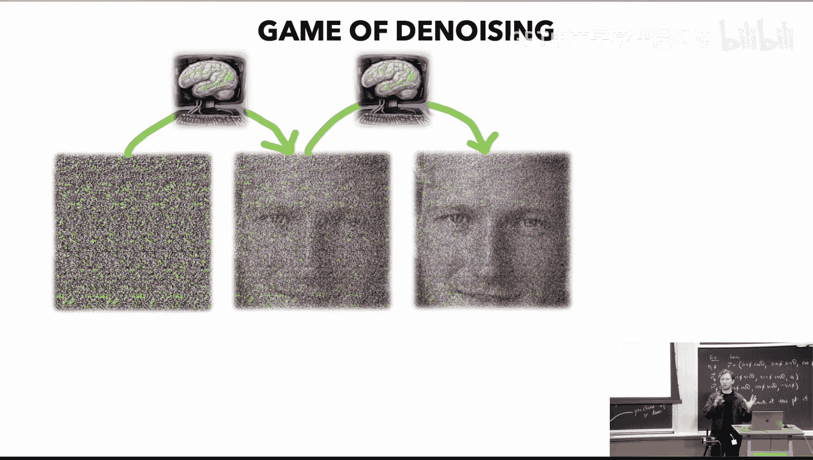

And then we can run this until， you know， we're pretty happy with output and deliver it。

And this is called， you know， again， one single step of this is called thenoicing。

 So you remove noise and add details of an image。 And if you do the noicing several step。

 it's called diffusion。 So that's where stable diffusion comes in。

 Its that multiple step of denoicing。Okay， and we also of course。

 want to add some abelius here from text to Iidus， so we have these correspondences。

 imagesus with text descriptions。We also feed this and condition the model on this。

 so in its creation process， it can guide its generations by having access to this text。

So you can kind of collapse into a space that's useful based on this prompt。And。

Were on need to start。To understand language from scratch。

 we can leverage a pretraining language model to get some good starting point of understanding language。

 right， That's helpful。 But still， we need these correspondence to actually train the model。Okay。

 so that's like a very， very high level of。How the diffusion stable fuion model works。

And we're going to go to go a little bit more detail and talk about how we actually create the training data around this。

How you train the model and then how it's being used。

 and then we'll end the lecture talking about some more integrated details。

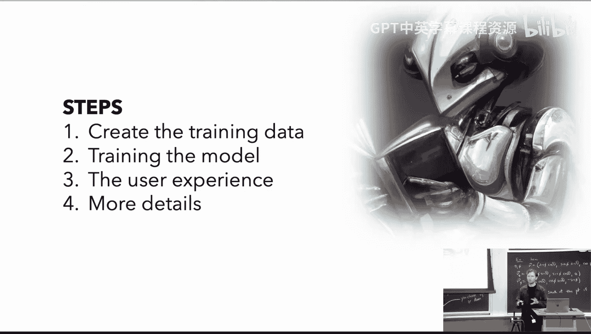

So of course， it would very， very nice if we had tons of these different outlines。

 you know so we would take an image from the internet， give it to some human being。

 and the human being could create some type of outline to details examples。

That would be extremely extremely expensive to give a billion images to millions of human beings to try to create different levels of abstractions。

 so we're going to try to recreate it by using on the computer。And we do this by adding。

 taking an image from the internet， which is cheap。

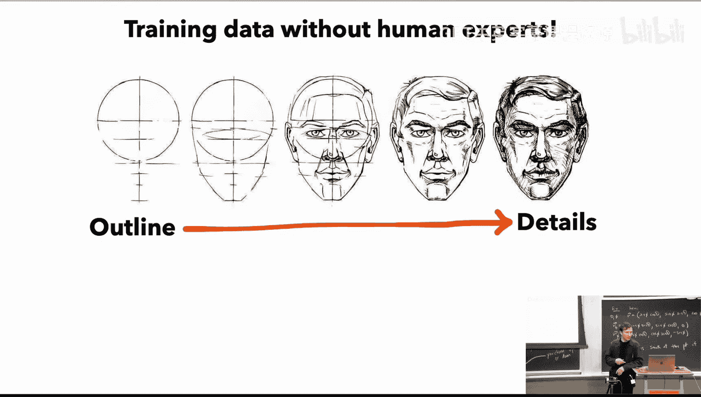

Creating noise， which is cheap。 And then we just add these two together basically。

 And then we're going to add different noise levels。 So we get an image。

 which is the image that we actually want to recreate。

 We add some noise that we can generate a computer can generate。

And then we get the input on this left side， and then we have the target。

 which is just the image that we we had from the beginning。

 So we want to learn to go from this noisy version of the image to the target。So this is very。

 very cheap to create because noise is very cheap to create。

 a computer can do it and image is easy to download。

 that's why there needs to be no human being in this loop。And of course， we want to。诶。

Have different types of noise levels because we want to be able to go from any type of noise level to less noise。

Because when we actually when we train it， we want to go from any noise level to less noise because when we deploy it。

 it's going to be deployed， you know iteratively running on itself。

 so it might come across a lot of different type of noise levels when actually being deployed。

So we're going to just have different types of knowledge lab to create different types of pairs。

For tons of different images and for tons， tons of different noise levels。 And also。

 we're gonna throw in pure noise sometimes。 So then it has， then basically。

 it has no idea about the image， whatsoever has to just。

Haucinate to make up an image from pure noise。But it's also important because when we actually deploy this。

 we want to be able to start from pure noise。because we want to be able to generate from thin air something。

And of course。We want to to make this even more useful， useful not to sample randomly。

 we're going to add text that corresponds to the image to be able to guide that generation。😡。

So we can we can give a prompted dial stable diffusion， it generates damage that we want to see。O。诶。

😊，RightAnd then when we train this model， we now have a input。

 which is a noisy know image plus some noise level and noise。

The model gets this input and it gets the prompt that we feed through a language model just to kind of make it more useful features or latent features of it。

 we feed it to the model and then it's supposed to generate a guess of how it believes that the real image looks like and make a step towards the real image that that we know that we have and then we can look we can look or we can have some loss function looks at a difference between the guess and the actual target that we want to reach and we can give some directional kind of feedback saying like hey。

 you go in the right direction but this is how you can improve on yourself。

So that's how we're going to be able to train this。

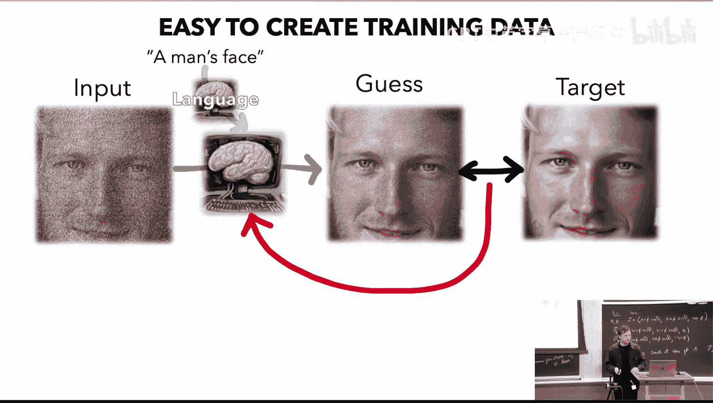

And then when it's trained again， were going to feed when it's been trained on all the different types of images and noise levels。

 were going to actually start to mo off using pure noise。😊。

And some text prompt and then it tries to take steps towards a real image or like an actual image and then we can run this as many times as you want right step1。

 step two to three， we just rerun the model and we get a battery and battery image and we stop at some point and say hey。

 we're happy now but of course it's very important here because now that it's being deployed there's no need to download an image from online or anything because it can generate an image from pure noise which we can just create by the computer concrete by itself。

Okay， so。All right， so that that's kind of the little bit more detailed high level perspective of how stable diffusion works and image generation works works。

😊，We're now going to jump in a little bit more into how stable diffusion makes very interesting choices of how to improve this pipeline。

And they connect a lot of different concept that we've been talking about throughout the class。

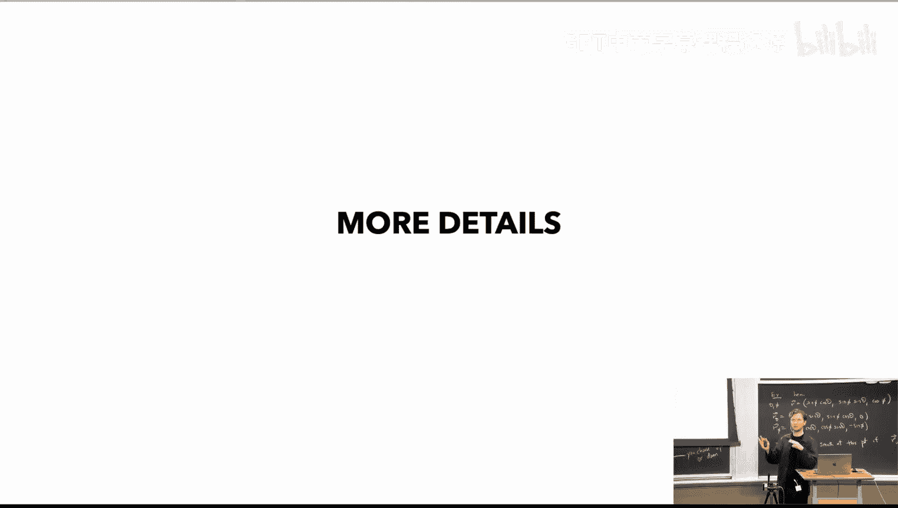

So first thing that they。Mention it or realizes that。Details and images are very repetitive。

 And maybe you don't want to spend too much effort in your training and in your model in just generating details。

 So if you look at this， if you saw me on this face。

 like these are probably not that hard for A model to add。 They're pretty repetitive。

 All these courses and details stuff。 you can just。You know， it's not going to be very。

 very hard for them all。 That's what they believe。 So they shouldn't put too much too much work on on creating the details。

 It's hard to create the outline or the， you know， the port features of a face and the detail is gonna to be less demanding。

 maybe it's an empirical observation， but that's what they believe。

And also because these diffusion models like work on the pixel space so it takes some pixel image right so maybe it's 1024 times 201044 adds noise of the same dimension and then that's a pretty big input of like a million pixels and then it removes some noise and creates the same resolution again with less noise and it keeps running on it over and over and refines itself and that's expensive then because resolution is quite expensive So it's a kind of the resolution that you're using。

Determininees the cost of running this training and in deployment。So be very。

 very nice if we could magically reduce the resolution of this image and run on run diffusion on these smaller images instead。

 right so if you're able to make the resolution eight times smaller， I think， right。😊。

The actual number of pixels are much， much smaller， hydrralic， right？诶。Okay。

 so what they do to accomplish this is that they're going to do this thing that we talked about right。

 game of compression and order encoders， so they're going to try to push an image， right？

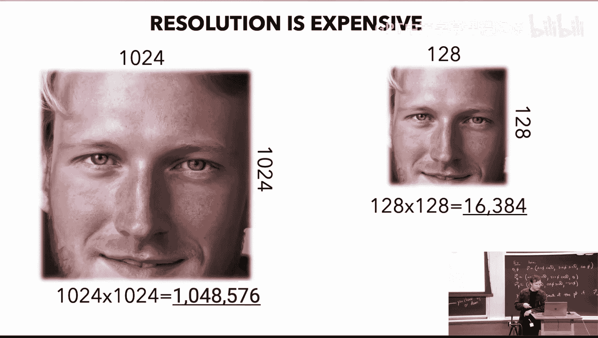

And compress it to a smaller space。And。😊，And instead of using just a random。Victor， a small vector。

 dash you're going to try to create a smaller image and then be able to kind of upscale and downscale without losing any significant information。

So they're going learn to compress to a lower resolution image that basically is a very good compression and summary of the image without all the details that might not be might not be that。

Difficult to re recreate， right。 So it's actually， I mean you look at this one is's being trained。

 The small image is actually like a small image， you know。

 So I just learns to compress this in a smart way。 because this order code that it creates is really good at creating these details。

 So it's very good at upcal the image and increasing resolution。

And we're going to split this apart into the order encoder into an encoder and a decoder。

 so the encoder is that one that takes a big image compresses it to a smaller image right that's the encoder and then also we can have a decoder that goes from a small image to a bigger image。

And for now we're just going assume that these we have these， they work really。

 really well at downscale and upsscaleing the image。

 and we're basically losing you know no information about the image in the process because these details are not something they really care about。

Okay。So let's say now we have a perfect encoder and decoder。 How can we utilize this well？

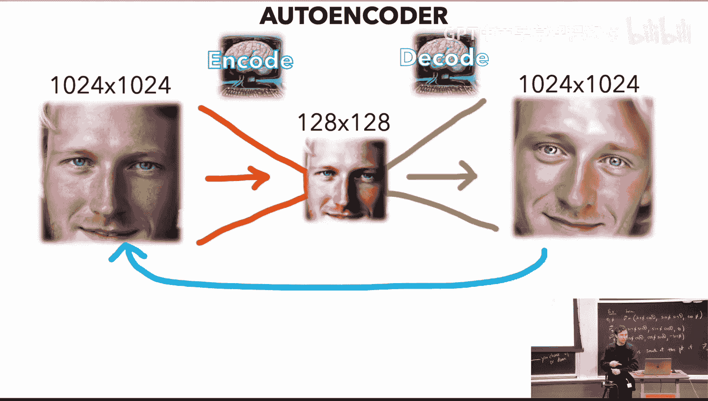

We can now take our image from the net， we can encode it to a smooth image。

 we can create noise in that smooth space。And then do you know。

 the whole thing of diffusion theno in this smaller space instead。 And then when we're done。

 we can recreate the original image。Okay， so let's talk about this actually works in detail。 But now。

 you know， in the factor we can just。We do everything that we did before。

 but we can is do in a smaller space， which saves a lot of compute terms of training and also its much faster when it's being deployed。

Okay， so does this work？We take an image from online that's big。

 We run it through our perfect encoder。 we get a smaller image， right so that's our new target now。

 We add this smaller noise as well in resolutions， we get an input and we now feed this input to our model with this prompt and we try to create remove some of this to noise we try to noise a rules some noise and then we can compare ourselves to our target and give feedback and improve ourselves right So just do this training now but in this smaller space。

😊，And of course we can it is to us generate noise， you know different types of noise at different levels in this smaller space。

 and so we just were doing this whole thing and this turns out to work really， really well。😊。

Right so what we do is that we instead of taking an image from a， we take an image from a line。

 we run it through our encoder to make it smaller， and then we do the training there instead。

And when we use this right so now notice we only used the encoder during training。

 but now when we want to deploy this。

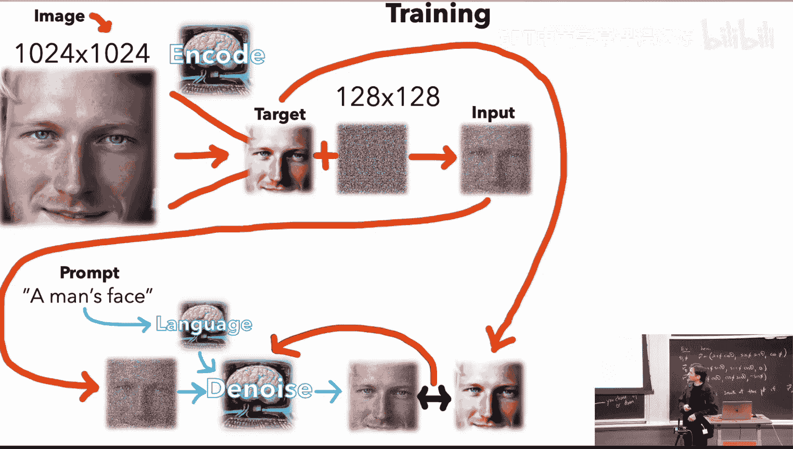

We're going to have some user typing on his computer a prompt。 when we receive a prompt。

 we the computer creates pure noise。So the full noise level maximum possible。

 we have some model that encodes language feeder toward thenoicing model。

 I guess the pure noiser starts making a step towards a real image。And then we can run， you know。

 keep running this on the output as many times as many regions that we want to。 And when we're。

 you know， happy and depending on how much compute we want to make available， right。

 how many steps this on threshold like， okay， you know， get a kind of diminishing return。

 But you run it for number of iterations until。😊，It's good enough and then you feed it to your decoder and you upscale to a image of the resolution that the user is interested in and you deliver that。

And as long as staying code and decoder works really， really well， you're not losing out anything。O。

So hopefully this makes some sense and it's a nice trick to be able to get lower resolution images。

That makes training faster and deployment faster。Because this step of denoing。

 we do multiple iteration， maybe we do it 10 times a thousand times。 So it's going to be the most。

 the number of iteration is going to be the most exp part of this training and deployment。

 That's why it's nice because we only decode onces during deployment and we only encode onces during training。

 it's not very expensive。

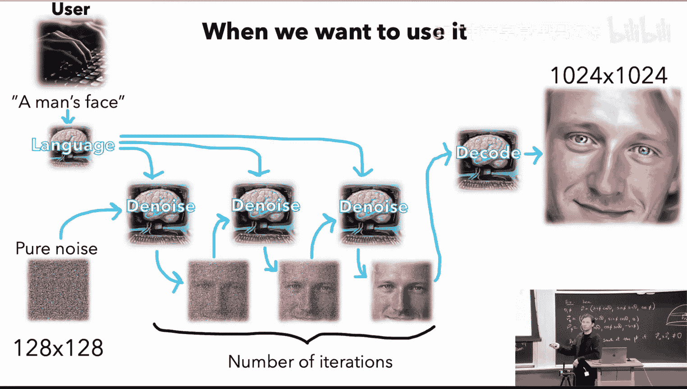

Okay。诶。So we now said we had this perfect。Encoder and decoder in an order encoder。

 And now we're going talk about how we get them。Right， so， and why what kind of。

Tricks we use to make them work well。

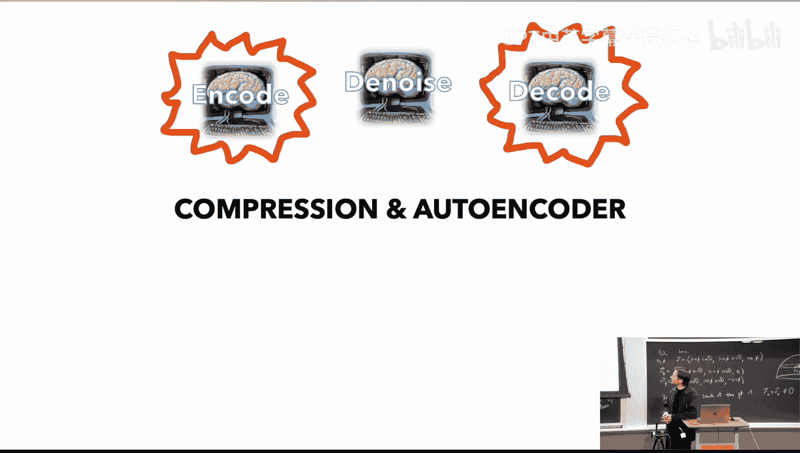

Okay， so in a order encoder setup right， we want to take some image from the internet and any image then a data set。

 we want to run through our encoder to a smaller image， a compressed version。

 and then we want to run it through the decoder and upscale it and we want to get back original image right we want to be do this this loop without losing any information。

And actually， this is。I mean， there's a lot of nuances are harder than than you might at first think。

 So first off you got to decide like how do you how do you measure if you get your original image back what's a good loss function or perspective on how close these images are because you want to have some loss function says you want to minimize the dissimilarity between these images after being run through this old encoder but how can you do that。

So one of the first things you can try， you know， what people did is that you can just say。

 we're just gonna compare pixel to pixel。 We're going take the pixels values in the input image。

 the pixel values in the output image， do a negative or something or like an do the negative and make sure that the difference is very small。

Right， so what's good about that， The good thing about that if if if the old encoder recreates the original image perfectly。

Then the loss is 0。 So the optimize is good， right， When you do a perfect job。

 the loss is perfectly optimized。诶。But， of course。There's clear kind of drawbacks in how it's actually able to。

Measure simil in a way that we think is sensible。 So let's say you take an image now and you just basically shift image a little bit。

Right，These are still very， very similar images。 But because to shift a little bit。

 the pixel correspondences when you do the negative between two images， they're going to be very。

 very different。 Like here， for example， these images are kind of shift a little bit。

 So comparing an eyebrow with an eye。And you can see these images are very， very different。

 though they're clearly quite similar。So the just doing the negative with the minus subtracting two images and looking at that is not sophisticated enough to capture a similarity that we as human beings perceive。

Okay， so。What can we do， Well， the first thing that stable efficient decides to do is that。

They should use now introduce GNs and they say， well， GNs have been used for quite a long time。

 empirically we've seen that they're good at capturing details。

So they're going to leverage this in this work。😊，And since cameraners are good at the detail level rather than the big picture comparisons。

 they're going to take small patches of each image and then they're going to feed this patch right so have a patch now from the original image and the recreation。

 youre going to you're going to feed these two patches to a crytic。

And critic is trained to say which one is from the original image。

 right the true actual patch from a real image and which one is from the recreation。

RightSo it makes a guess and then we train it by saying okay， this is actually this one is original。

 this one is to fake。 So next time you see something similar you do better right but then of course。

 then code decoder is trained to fool the critic。So encodeder and decoder is trained to make the patches look very similar from the Cs perspective。

And this turns out just to work really really well at capturing all those vi and details。

 so you know when you generate an image of a face like you won't go and zoom in on the pores too much and care too much。

 it's only that looks quite similar you're going to be happy with it and that's what they leverage here as well。

And of course， you do this on all the different patches and feed to this scan。Okay， so this gets。

 this gets now solving kind of the generating the details of an image。

 so we can downscale an upscale again without losing those abilities right because we want to when we ask dollar stable futures generate image for us。

 We want to look realistic。 We want the details to be be there。

 We don't want have a face with no pores or something like that， right。

 We want to look realistic And now we'm able to do that。 But this like。

One thing that's missing in the setup is that we just have this local loss。

 but we still also want the overall image to look nicely you know similar and from a bigger perspective as well。

 we want the face to be put together like a face not just the patches， you know being skin。

 but they want eyes to be in the right place， etc。So we're going to try to also include a loss now or compare these images from a more global perspective。

 not just patch level， but more global。 And we're going be。

 we're going to try because this is gonna this is going to be used by human beings。

 They're going to judge the the quality of this output。

 We're going to try to imitate how human beings。Judge images or how they think images are similar or not。

So we can try to compare this image in a way that humanss would。Yes。啊。I doesn't match。

Do you have model。比如。And what。我嚟睇下呢个。哦又说诶。So I think in this work。

 actually they take they compare pairs of patches and they take the same patch on both places。

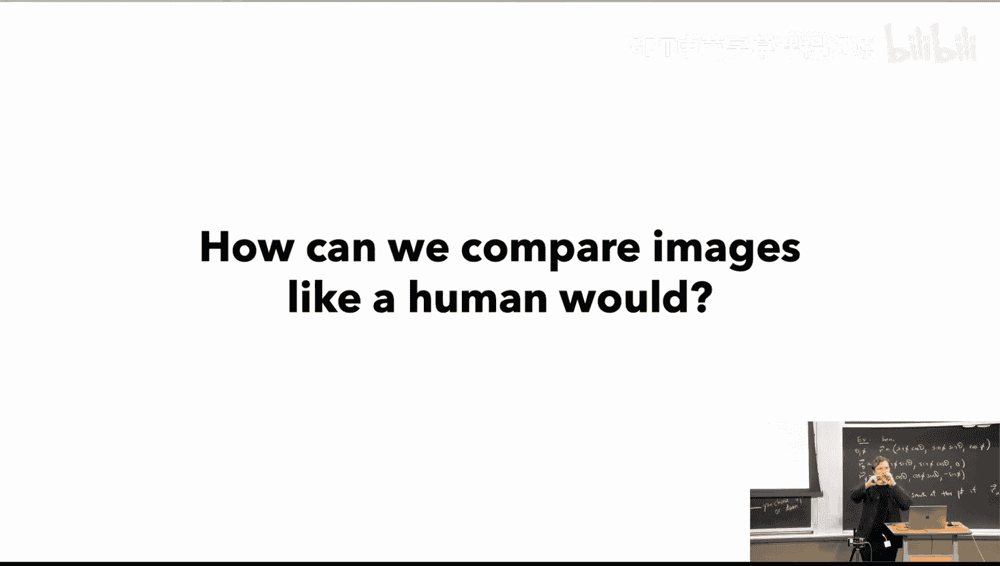

诶。And is that a problem now， Like， okay， is it a problem now that these patches don't。

Aren't perfectly aligned。Well， if you think about it。

 because if we're not using the the this we don't，t， we don't subtract now and get a value。

 this model literally looks at both of these and says which one could be for an actual real image。

 right？ Like which one is from the original image and which one is from the fake one。

EAnd if you look at this yourself， like， this would be hard for you to tell because they look like they both come from really images。

 from a face。So， then， like。T being off in terms of not being the same patch。

Is now kind of fairly irrelevant because you as a critic will just judge looking at that patch and saying。

 does this actually look like it comes from a real image or not？

Which makes this loss not now so much more informative because it it's not as as simple as like doing the negative。

 It actually has to understand more how patches look like。て。The critic is another model。Yeah。

 so it's another model that's trained adversararily， right， So after after after we've done what I。

 liquidity is not used。 So that's just we're going throw away the critic when we're done。Okay。

 good question。

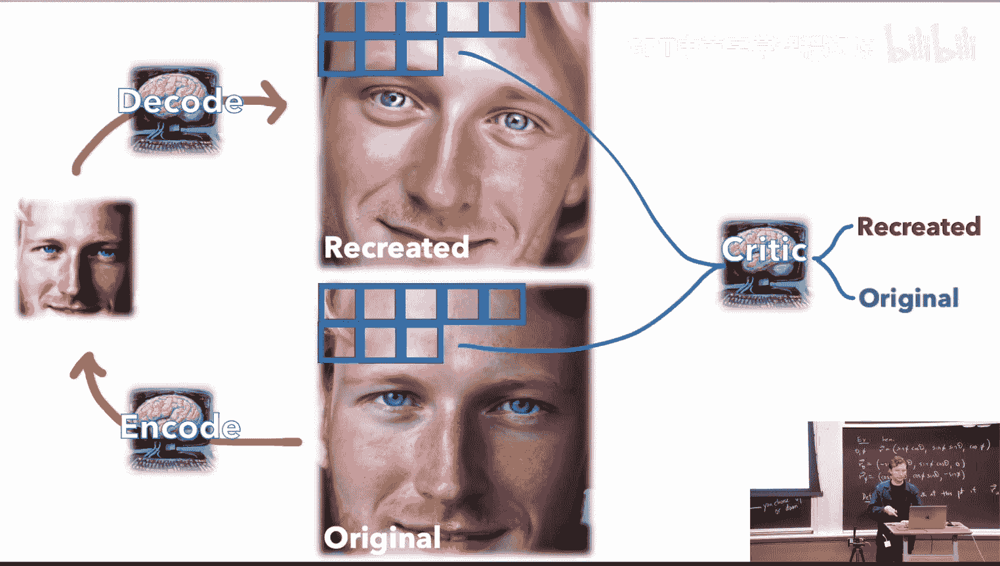

诶。All right。Okay， so we have the comparing the patch level done。 So we are able to handle details。

 but we want to be able to handle the complete image， right。

 So we want to have some more global loss to compare images。 and we want to have something that。😊。

You know。Such these images look similar from a human perspective。

 because human beings are gonna to use this eventually。AndOkay。

 so what they do actually to they say that there's been a lot of work。

 we talked about contrastive learning this class before。 So this is， again。

Self super learning on how you learn good image features for images。Alright， so we what we do。

 well in this case， we we take images from online， we say that。

Concepts that appear in the same image are more related and similar in meaning than concepts that appear in different images on average。

 right when you look at a lot of images。So you just in contrast learning， you just take an image。

 you create two random crops so patches。And then in， you know， you train this trainer model to say。

 like， well， if you， if you a one crop or the model， the model is supposed to be able to say。

Which of all possible crops in my data that is from the same image and which one is from other images。

 It needs to be be able to identify what patches or crops come from the same images。Right。So yeah。

 somehow， you know， it would have to understand that if it sees a。

Image or a crop or a patch of a human being with a leash。

 it's probably walking a dog right so someone understand these two things are related and it's more likely to be a dog that is walking than a cat for example。

 right another crop you has to understand these different things how they relate and when you train this it creates an output that you use like a feature a latent space feature that summarizes the image so basically and it process creates a compressed vector that summarizes like a feature representation of this image if you will。

And it turns out that there's been a lot of work done where you look at the features and the representation that these models learn and you look at the distance。

 you take two images， you run it through this emr that we got from professoror learning。

 and then you get representation vectors features， and then you look at a simple L like a simple you know negative subtraction distance in this embedding space。

 latent space， that distance corresponds very closely to how human beings judge similar or dissimilarity in images。

So this they basically take how classes they to take。One image， and then they might have。

Well let's say maybe I don't know how I do exactly。

 but maybe it take like five images and then let that human beings grouped them together of like okay。

 which ones are closest or they take like one image and then for targets and say like rank these images in terms of how close they are to this image。

 And then these models will do very similarly to how human beings rank these So this is kind of empirical。

 which also suggests actually we are also learning in similar ways。

Okay but why why is this nice well it's nice now because we have this em that we can we don't need to train it now it's trained。

 we can freeze it， but we have an em that can create you know global features of images and then we can look at distance in this latent space because the distance here when the distance is when the distance is small in this representation or latent space。

 then they're very similar according to a human being。

So now we can optimize and minimize this distance in this latent space。

To get at the global similarity somehow between these images。Okay。

 so now we just combine these so we have both a critic。

 you know that we tried to fool and we have this embedded that we tried to make happy but。

Aligned in the representation in this latent space。

 So we get both details locally and globally kind of aligned。

And this turns out to work well and converges nicely。 mean you could imagine， for example。

 that these two losses would be contradictory and work against each other。

 but empirically this works well and they converge nicely。Okay， so。To summarize。So the no thing。

 right， when we。Take some noise and we try to refine it by adding details and taking what steps towards I can actually create from thin air or pure noise if you train it on different levels of noise。

Diffusion is when we are able to do this iteratively right so we have a denoisy models able to take some noisy version of an image and taking steps in right direction to make it more look more like a real image when we do this iteratively right improving the image in several steps。

 it's called diffusion。😊，If we condition on some language input。

 So we have language and image correspondences， we can make this generation not just random。

 but actually。You know， make you happy based on the prompt so it adheres to the prompt that you gave it is's a correspondence between the prompt and the actual generated image。

And so diffusion works on the pixel level， so it's expensive so if you have a high resolution。

You will have a very expensive model to train and to deploy。

 So if you can do it in a compressed small resolution space， you gain a lot。

So that's why stable diffusion uses an order encoder to compress the image to a smaller image and does all the training there。

And when we create order encoders or encoder and decoder。

 we have to be careful about how we think about similarity to get something that is actually useful。

 and also we have to take somehow inspiration from how human beings judge similarity because at the end of the day our models are deployed to human beings and we want to make them happy with our product。

😊，And I think also it's pretty cool because right in all these different approaches we used a language model。

 let's train on let's say just next token or next word prediction。

 so that's selfuppress learning we used the noiseing diffusion as we talked about before。

 we used order encoders that were trained using Gms like so genative adversarial networks and then we also even used a contrastive learning from images to get a useful representation that we can use for training our order encoder as well。

So it's like really cool that all these different selfuped learning concepts came together to create stable diffusion and how they able to kind of know stitch together。

😊，And this is possible， of course， because theyll rely on no label data。

 so they can be trained at scale and yeah， I think that that's also like a very cool thing of how you can combine all these different things。

Okay， and， and as well a little bit， I mean， I think。Also。

 it's pretty nice that we can use a little bit of our human intuition to engineer and use AI。

 that maybe we can say， like， how do we think about when we draw images midist。

 This It's useful to be able to improve on yourself and， and。😊，Also， when we look， for example， at。

How do human beings judge similarity， it kind of corresponds to how these self supervised learning contrasted learning models judge similarity。

 it iss also very encouraging that we're some are also getting a little bit closer perhaps to understanding how we work ourselves and our brains learn because we starting to see these similarities。

And again， also is quite interesting is is that。Like that creativity from new networks come from noise a lot。

If you give the same input， expect the same output and maybe as well like。

I think maybe a lot of us we have the same routines and if you want to be creative in your work and your research。

 you might have to get out of your comfort zones once in a while and put yourself in weird positions。

 maybe even if you just go to like a new setting and work。

 you'll be more creative because your brain is not good at making up randomness。

 it's good at leveraging randomness in your environment。Which is also pretty cool。Okay。

 we also talked about。The tip of the iceberg， and we made a little bit more。

 We kind of filled in some bottom part here that of course， at the top。

 we have chattp and stable diffusion。 and this cool stuff that people are talking about。 But this。

 of course， comes from South Su learning Foundation mostly N AI that's been around for。

 for some time in the。Research had been excited about， right， But then also， of course， the data。

 the data took a long time to create the Internet。You know we were not able to reproduce easily。

 so the data is so key to making these AI models work and also something that I think a lot of people that work with AI underestimate in research a lot of times our data sets are curated。

 cleaned up and structured for us in a way that the real world listened so data is really。

 really important if you want to go from theory to practice。Okay， so that's for today。 Yeah。

 can for if you have questions， I can take them now。

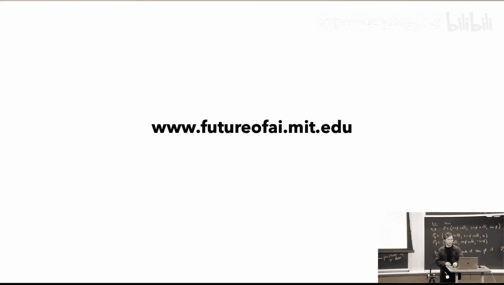

Yes，とある。That's a good question。All right， I mean， we didnt even cover variational encoders in this class。

 right？I don't know which one they used。I don't they you used the variation on record。

I think its very local， but yeah。It's a little bit。 we' talk about it offline。

And what would be loss function that。Because I know they use the again and they contrast and learn be in there。

Yeah。The diffusion loss is called score matching。诶。Yeah， that' I mean。

 it's not super mathematically involved。But the。It's a little bit mathematically involved how to define it。

 So I think the high level intuition is that。You're trying to， you're trying to go from。

You try to go from like a distribution that's random Gaussian noise。

 which we like compute love to create。 That's like one distributions is Gaussian noise。

And then you have a distribution of images。 Allright。

 you want to be able to sample from your Gaussian noise and then。

Project yourself or transport yourself to this space of images。 Okay， and yes。

 it's very hard if you just take random noise and you should take you know。

 one giant step to the space of real images。 Okay， so let's say the image leave over here。

 And then noise load is very。 It's very hard to just be like， bam， jump。But if you're smart about it。

 you can create training samples so during training， you don't have to go all the way like this。

 you can create samples all the way in between so mean you can take an image。

 add some noise and end up in the middle between the full Gaussian noise and the complete images So then during training you can start to learn and a loss is basically directional mean that like if you're here and you get a training sample you take a small step towards the real images you get like a directional feedback saying like okay are you taking a steps in the right direction that's the kind of feedback you get which is very nice It turns out it's like that's nice feedback you get that's easy to learn from。

And then it's nice because now during training， you have seen。

All the different combinations of like being in between the full the Gaussian noise and real images。

 And you've seen everything in between。r you in training So now that you when you're being deployed and you only fed this thing。

 you can actually take steps like this。😊，Along this from noise to image space and actually end up at a realistic image。

 So you can find your way by removing noise iteratively。

 like diffusion and find yourself in the space where you want to。

 as long as you take steps in the right direction。 So basically， right now。

 since this model has been trained to get from。America to any place in Europe， we can say， you know。

 and it learned by taking the right steps。 So then say， hey， let's you know。

 go to Uzbekitan and can be like， well， I'm gonna start taking a step towards Europe。

 then a step towards the end step step step。 and then eventually we'll find itself in the right。

 right place。 Basically。 Does that make sense。It idea it changes the direction。

 not like necessarily whether it was easy to go or what， just just there。Yeah。Yeah。Alright。

 thank you guys。