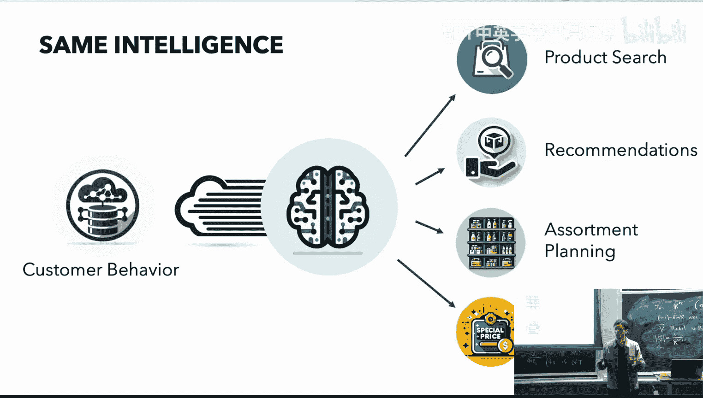
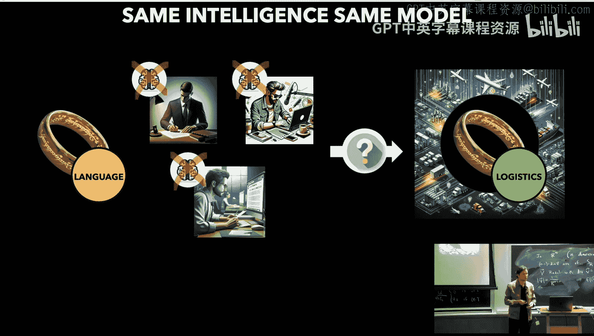
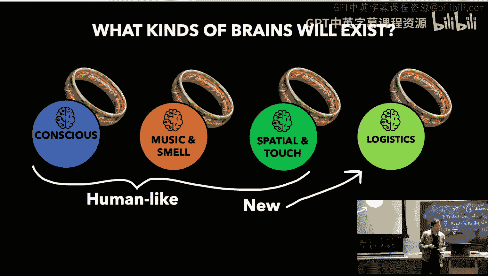
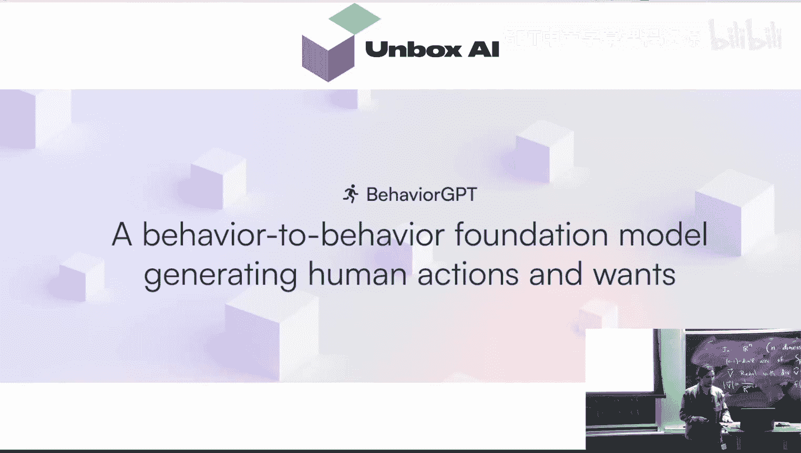
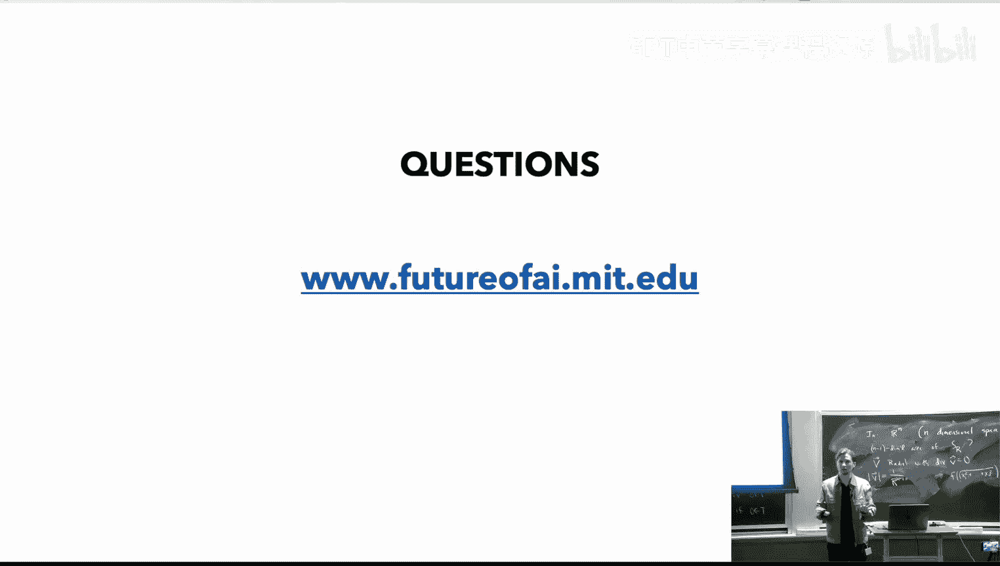

# 《基础模型和生成式AI｜6.S087 Foundation Models & Generative AI 2024》中英字幕 - P5：6.S087_ Foundation Models & Generative AI. ECOSYSTEM.zh_en - GPT中英字幕课程资源 - BV1YYWpzaE3q

Welcome to the fifth lecture on Foundation multi NAI。

And today should be especially fun because we have two guest lectures。So诶。

Professor Mers Kellyis from MIT will show up and give a talk about biology and AI and the AI frontiers in completion biology。

When Autum is here， he's flown in from Silicon Valley to talk about autonomous agents。

 so it should be a lot of fun。And， and I'll start off talking about。

A framework for foundation models right so will it be a single foundation model like a single brain to rule them all will open AI have a monopoly on AI or not what will be if not right what kind of foundation models will exist。

 what can you leverage and I think it's gonna to be useful if you're a researcher。

 but also especially if you're in business， understand what kind of foundation models technologies that will exist and how you can use them and leverage them。

And this is based on a talk that I've been giving to peri firms and kind of CC level at bigger companies around how to survive data explosion。

 Okay， like a lot of things aren' changing now and。

 and people feel it's a different type of technology。 and it's changing the landscape。

 And how do you survive survive and prosper in this new age。

 That's what we're gonna figure out today。AndO， so。You've seen this before， but a primer。

 So what was the breakthrough that happened that allowed us to do all of these different advancements that we've been seeing？

Well， we've been using ourselves as a reference frame right to ask the critical question。

 how do we learn about the world， how do we go from being a blank slate baby with no knowledge about the world fairly useless to becoming a useful。

 knowledgeable adult？What enables us to learn from the world that we interact with。

 right this is a key question in AI。What we've been saying is basically that。

What's responsible for giving you most knowledge that you have about the world。

 It's not your parents。 It's not your teachers， It's not academia。 So it's not supervised learning。

 You， you don't learn from experts。 Okay， so I thought that technology that we tried for a long time。

 but it's not the answer。 It's part。 I mean， it's helpful， but it's not the answer。 Also。

 it's not a DNA right It's not in your genetics。 It's not your immediate environment and you're trying to optimize your goals in that environment。

 So it's not reinforcement learning which reinforcement by itself。

 It's not the key answer to how we learn about the world， right It's helpful， but it's not the main。

Responsible part。So what is it， right？ Well， it turns out that most things that we know we learn by ourselves。

 So this is the key， you know， insight that allows us do all the things that we're doing right now。

 And this is possible by defining company like meaning by the company it keeps。

So if you take a dog right you don't know what a dog is from your parent telling you or your emotions is getting you。

 you learn what a dog is by observing dogs in different contexts。

 correlating contrasting dog without other concepts。

 So what you get what how you understand a dog is a dog is something that's walk by an owner with a leash it's something that has an antagonistic relationship with cats it's something that chases freesbe butos a thrown。

 this is what allows you to understand what a dog is and this is how you define what a dog is。

And what you get by this is a very relational understanding of meaning And as you learn about dogs by correlating contrasting dogs with other concepts like cats。

 you internal learn what cats are。 So it's kind of self referential and and very， very powerful。

 and can pick up I'm going about cross modalities， of course。

 because the word dog will be uttered or named more in column takes where dogs appear。

 So it's extremely powerful。So what does this lead to。

 what it leads to the more relations that you able understand。

 the better understanding you get of meaning？😡，You understanding what a dog what a love is right。

 you understanding what love is helps you understand what a dog is because an owner loves his dog so it's like a lot of synergy networks affected play。

😡，Okay this is the key insight here， so why not take a know huge model with as many parameters as possible and train train it on as much data as possible to learn all of these different relations to get the most precise and powerful understanding of meaning and then use this model basically everywhere。

😡，And this is what a foundation model is， this is a key breakthrough throughout geneative AI and everything that we're seeing right now。

 and also， of course， your brain is a prime example of this。😡，Okay。

 so here we kind of they've got diverge a little bit to have thought about this before。

 So what does this actually mean， right？ What does it mean now that we have these foundation models that learn relational meaning and the more data you train on。

 them on， the better they get somehow and just get bigger and bigger。So one thing that， you know。

 that's happened， right， is that there's been a complete change in transformation in the research world。

 So six years ago， when I was at Stanford， it used to be。One research lab。

 data set and AI model per different language task right so you start start off happening issuing language。

 you would have one data， one model， one research team working on translation。

 another one working on question answering， a third one on sentiment analysis and then a fourfront predictions right in isolation。

 isolated effort。But asked them， hey， you know， there seems to be a shared perspective here a shared intelligence being language modeling or language intelligence。

 Can we optimize that instead and you know pull our data and efforts together and optimize single intelligence。

 that's synergtic because we don't have a separate brain for each language task。

 So real intelligence should be general and synergtic right， So's what they did。

 we're able now to build these language models。 that are trained and really understand language in a deep intelligence way。

 So all the different tasks that we care about in language are just downstream tasks of this real intelligence。

 this real foundation model。And of course， even though a lot of companies are behind in this。

 the same applies to companies and businesses， if you come to a company today， right。

 how to think about AI or data or technologies is typically very isolated efforts。You。

 solving something， right， So if you， if you go to a retailer， for example。

 they may might have a separate service and data data set and team working on product search。

 Another one for recommendations， a third one for assortment planning， right， campaigns marketing。

But these of course， are not separate intelligences， these are very。

 very syn if you're able to recommend the right product at the right time to a user search recommendations that should influence your marketing。

 like what product should you market to who So somehow you want to build this intelligence around a company as well。

And it's what you can do right so you can build a single brain around a company to really get at all the synergies and get the most performance。

Okay， so what this leads to is basically right so at Stan for now。

 the only research team that survived and prosperpers are the one focusing on building a foundation all wrong language。

 right the key core intelligence。And also the businesses that build a key core intelligence around their own business space。

 also the ones surviving So you're seeing really kind of a major extinction happening now the AI hits us like how do we survive and prosper with this changing the space completely and that's what we're going to try to understand today right？

So the first question that comes to mind is， okay， if this is the case， where does it stop。

 will it be a single AI model or brain to rule them all？😡，Right。

 will open I have a monopoly on intelligence。 Okay， Well。

 first of like who knows in the a few hundred years。

 But what we're seeing now is that in the foreseeable future， that's not not going to be the case。

 right， It's going to be a collection of financial models。

 And one way to kind of see how this happens is。Let's say you have like a large language model。

 for example。😊，You know， when it comes to different applications of。

 of large language modelss in language settings， you might have， you know。L。

 you might have marketing。 You might have writing articles， right。

 This is still going be one core intelligence， right。

 This is not sufficient to split and build completely separate brains。

 it's going to be the same similar foundation on technology around this。

 they're gonna subscribe to ChatpT。 Maybe find you a little bit。

 but they're gonna to share the same model， right。But let's say now use this language model and come to a new setting like logistics。

 maybe you work with DHL or F or something。 and they have like 100 billion data points around these different movements and you try to apply large language models。

 but its intuition fails it like firstly， okay data is different。

 It's a completely different setting and its understanding from what is learned from the internet language generally it might not apply it might come up with a bias is's actually hurtful you want to relearn in these things from the data itself right So let you start seeing that okay heres there's a different applications and adding these data and these potential to the big model kind of dilutes its abilities almost it's not helpful。

So you can see a new foundation model， technology model arriving and being able。

 being able right around logistics， and that's kind of defensible has a mode and a large language model is not able to compete。

Right so another way to see this is that， yes， we want to share edges to new concept to get a more precise meaning。

 understanding of meaning， but also want to make sure that the cost of adding that edge and the dilution that you might get is the value is outweighed somehow you don't want tolute the model and you don't want to know add so much cost that the value it gets is not justified。

Right。诶 okay。So what we're seeing is that there's not going to be one single AM alter rule the all。

 so it will be a collection of different types of brains。So how will they look like？Well。

And I think it's going to be quite hard to say， we're going to try to think about。

 build some kind of intuition and framework around it。

 and I think we can take inspiration from our own brain in a human setting and it's going to be a combination a little bit because we have human-like intelligence that we want to replicate that we can be inspired by our own abilities。

 but also now in a modern economy and civilization。

 we have so many unnatural and unhuman settings like logistics， for example。

 that there are our own intuition might fail us that is also enables new types of foundation models around settings that we haven't seen before because we live in a new kind of world。

Okay， yes so。In asking what kind of AI models that。

Or foundation model technologies that have a unique defensibility， a mode and a unique selling point。

 It's important because that will allow you as well to understand what AM modelss you can leverage and invest in。

And it's also going to be key because if you're， if you're a researcher。

 you might want to invest in certain foundational technology and build it。

 you might interact with other foundation models， but you want to invest in a specific one。

 And almost as a company as a business， it's going be key to be able to identify what type of foundation model is most important to your business cases。

 So you can incorporate your own knowhow data and secret source and structure and competitive advantage。

That's where we seen， right？😊，Well， when the large language malls and chatted P was released。

 there was a lot of， you know， attempts to just build separate brains， let's say。

 around specialization。So there was a lot of companies， for example。

 that would take a large language model and find you into different settings， just in language。But。

 you know， what we see as well， like you， you won't have， again， a separate brain for history。

 language， for legal language， for customer service language。 Those won't be separate， right， This。

 this， this does not justify kind of。I mean， a lot of companies that went hyped and focused on specific settings of this language didn't survive in prospectsper because if they don't have the data。

 right， If they don't own the channels， that's not sufficient mode to kind of justify their own existence。

 A big company as a customer customer service company will just subscribe to Chat to P。

 find tune in a little bit thrown setting， right， It's quite simple and then use that right。

 So it won't be like a separate brain built from scratch just specialized settings。Yeah。

Right then again， it's like technique here， like prompt engineering。

 writing the best prompt possible for your setting。

There a kind of prompt tuning and fine tuning even like these are not。You know。

 these are just taking a foundation modeled core technology， adapting to new setting， which is very。

 very powerful。 And a lot of companies， of course is going to use this， but it's not， you know。

 it's not going to be multiple companies just focusing on this， right。Okay。

 so these are not separate brains， they's just fine tune in versions of the same brain。

 and they might be multiple providers like Open AI， cohere An Troic， you know。

 but they is very similar， these are same language large language mode， right？Okay。

 another way that we initially thought that we would see different types of brains were in terms of different data types。

 almost like censs for ourselves， that there would be one really big foundation model around language。

 another really big one separate one around vision， a third one around audio， etc。

 this is also not sufficient to justify its own foundation model or technology。

Because it's a lot of syn again， right， You can， you can hear a dog， You can smell a dog。

 You can read about a dog。 And some of these are synthetic things。

 and you want to separate them too much。 So it's also not like。

 that's not the proper way to think about how this works。

So I think a really good inspiration about thinking what type of foundation models that we will see exist and that we can leverage is taking inspiration from our own brain。

 because actually our own brain is a collection of multiple brains interacting collaborating。

And this is a combination typically evolved throughout evolution。

 a combination of going for both specialized data data and specialized application。

 so it's key to have both。😊，And a lot of times we look at these large language models they were able to interpret。

 and they do some kind of reasoning planning。You know。

 when it comes to this kind of consciousness and rationality， that in our own brain。

 that's like we have a brain for that， right， But it's actually a very， very small part of our brain。

 Most of our brain is， you know， quick， intuitive， automatic systems that show real deep intelligence。

 but they're not as kind of conscious as maybe， you know。

Large language model might seem to be right but consciousness and planning rationale is actually a very。

 very small part of how we live and make our decisions is's almost in hindsight mostly that we maybe make rational arguments and stories around what we do so it's going to be a lot of these foundation models as well there are not going for these kind of consciousness。

 They're go for these automatic systems and intuition and that's really really key as well。Okay。

 right， so。If you want to be able to build a defensible brain in terms of foundation model technology。

 a large language model work versus like large behavior model。

 it has to be unique both in terms of a specialized setting and a specialized type of data。

And what does means basically is that you need proprietary data and proprietary algorithms to make this work。

And for a lot of companies， they won't be able to provide the proprietary algorithms and develop that because it might be too expensive。

 So they they subscribe to some big model that's already pretrain with really good algorithms that draft for their setting and then incorporate their own data and build on top of that。

Right， and again。I mean， we we， these all these different models are gonna communicate with each other。

 right， So they're gonna interact， etctera， but they're gonna be specialized in own ways。

 And then maybe it's gonna be different models like a large line model can connect all of them in certain ways。

 but they're gonna interact be specialized， but they're definitely gonna be able to work together。

Okay， so to recap。Right so we know by now that meaning is contextual rational and foundation models are basically leveraging that as much as you can。

 okay？So it means you know the more relationship able to understand you get a much more precise and powerful understanding of meaning。

 but theres a limit somehow， and there's more nuance right so we try to scale this as much as possible say like well therere actually there's justification for having separate foundation malls around certain areas。

And those foundation models that will exist will have both proprietary algorithms and data。

 right that's key to be able to be defensible as the foundation model technology。Okay。

 so now we're going to jump and talk a little bit more about this means commercially。😡，Right。

 so I talked about foundation models。 And this I mean。

 applies a little bit in terms of research and what you want to focus on it as well。

 but especially when it comes to businesses now and。So for the commercial setting， right？

uman companies are not really babies， but they seem to be almost like human babies in some sense。

And what I'm convinced about， and I think what we're starting to see is that。

Every company that exists right now I mean， every company that will be able to exist in the future in the near future and to be able to have a mode in defensibility will have to have one single core intelligence that it leverages one single core model and foundational around its business that leverage leverages all of its secret sauce and synergies in its setting。

 right If it splits those things apart。 it allludes itself。

 So it have to have one single core model that builds on to structure its intelligence and know how to be able to be competitive。

 And this is gonna to be summarizing its its kind of intelligence around its space。ok。诶。And。

It's going to have this core brain So this is gonna to be a foundation model that it's going say what kind of foundation models exist there and it's going to subscribe to one of them。

 which is going to be its key foundation model technology。

 incorporate all of its own data and secret sauce know how and build on top of it And then of course this model itself will communicate and interface with other models that exist foundation models but won't be as important to it it won maybe won't be able to contain its secret source So it might have this core brain that interfaceable language model and other foundation models。

 maybe whether there is something like aer vision and incorporates that and use that right It's like using a computer。

 It's very， very useful and use assistant but it doesn't contain its secret source and competitive advantage So it has to build that structured intelligence to a foundation model。

And of course， and other companies will be also building their own foundation models that will summarize its own competitive advantage setting。

 and they can collaborate and communicate with other companies， etc。诶。Alright。

 so if you're starting to see a little bit that these brains right are built across companies。

 so like if you're not Google Amazon， you won't be able to build model from scratch so you subscribe to some foundation mode technology and incorporate drone data and build on top of it right so now we can think a little bit about how this is going to define indice a little bit right so what indice is going to share a similar foundation mode technology。

诶。RightAnd again， so each company will leverage and build a single core intelligence around this business。

 but the foundation all technologies may be shared across companies right。And we might see that。

When it comes to large language models， like if you're in publishing or in the legal sector。

 that might be the key foundational technology that you want to use to incorporate your own data and know how and leverage。

 you it is going to be your core intelligence。But if you're in retail then your transactional data is much。

 much more important and it' like 99ns of the data you have。

 and then you won't have a model able to understand that behavior behavior of consumption and incorporate that effectively and build around that。

 So that would gonna be a core foundational technology。 And then again you have like logistics。

 And then financial time search or something as well that doesnt isn't really capture well online on the Internet or really complies with human intuition。

 So it'll be a separate foundational around those datas， which are huge。

 but hidden in companies databases and not online So that also is a foundation model technology we're seeing emerging。

诶。And again， I want to reiterate that， of course， AI and this new AI is gonna be everywhere。

 like a computer。 I mean， it's gonna be super useful technology for everybody to use。

 And that's not really what we're talking about now。

 It's gonna be a difference between having a super useful assistant and also， you know。

 building your competitive advantage，structuring your intelligence。

 your know how and secret source around your business and leveraging that。 right。

 That's gonna be your existential kind of competitive advantage。Right。

 because if you're just using the other models that everybody else is using。

 you're not really incorporating your own unique setting， right， This is useful assistance。

 but it's not actually your own unique intelligence， right that you need to build。诶。

And I think I start thinking about。Understanding what type and how to build your own defensible brain for your business。

It's very， very important to。Look at the data Okay， so if you're running your business right now。

 start thinking about what are your competitive advantages and how can you get the data to learn about them right so you can structure and build intelligence at scale。

😡，do you have the data channels to track the data that summarizes what you do well。

 And if you know if there's data out there that you are not able to track。

 but some other company might be able to track。That you would like to use。

 because it's very synthetic to your setting。 And it's key right to understand how you can get your hands on data。

 because that company that has the data that you would really benefit from。

 Is it your best collaborator or your worst competitor。Okay。

 so we're going jump now into some more actual specific examples of how we can do this。

 but also just to kind of quickly mention in a business setting that there's a lot of hype around AI for quite some time。

 So there's a lot of companies that say they do AI。

 but they do the old type of AI and maybe not real AI in an intelligent way。So again， if you know。

 be variant in skeptical of companies that said do AI， but they peaked pre220， right。

 These are new technologies and a lot of the companies that that became big and successful before 2020 are not leverages these new technologies。

 their legacy。Okay， if they come in and say， hey， we're gonna help you out。 Oh， yeah。

 but we don't need your data。 We'll， we'll fix anyways。 Well， that's， that's B， S， right。

 The data is the key。 That's how you incorporate and and help you out。

 so then also that not doing the real type of intelligence that needs your data。

If they require a lot of manual tuning， right you're not supposed to do the job。

 your data is supposed to do the job。 So if you're in a retail for example。

 your customers is supposed to tell you what they want by acting your channels。

 you shouldn' do that by doing a lot of manual tuning and guesswork。😡，Okay。

 statisticians and pretty use interfaces again like。

People in data that are love to come in and look at certain statistics like the， you know。

 some race like me standard deviationvis is's just too。Compressed， right， It doesn't。

 It's not nuanced enough。 You need to build。 You actually need to train these billion and parameter models on your data。

 You can't just look at the averages and do some kind of wishful storytelling around it。

 So also be skeptical of that。 right， These are not very explainable technologies。 You'll train them。

 and I try to figure out what they've learned。And also single function AI companies， right again。

 if somebody says， hey， you know， you're a retailer， oh， we're gonna do your search only。

 we don't do recommendations。 don't do search。 It's like， wait， that doesn't make any sense。

 You're splitting your intelligence apart， don't have separate services and don't trust these AI companies just focus in a single function。

Because they they're not building real deep general intelligence to just specialize in building complicated systems。

Okay， so I'm going to give to go some examples that I've been doing with my startup onbox CI。

 So we build behavior to behavior foundation models that generates human actions and wants。

 So what' does it mean。Well， again， like if you're， I mean， so reless it's one of the core areas。

Becauseuse consumptionious behavior。So if you're in retail， right。

 ChattP is a super useful assistant， but it's not revolutionizing retail at its core because retail is core is not a textbased language from the Internetnet and it's very hard to incorporate data right retail at its core is consumption and consumptionist behavior right So onbox and behavior G is that kind of Chatttp revolution。

 but for retail and behavior driven businesses so they can incorporate their own data and build their own competitive advantage。

 In that right It's not only about using that oh hey。

 we have a helpful chattedp assistance that helps you buy things easier like well。

 let's everybody can incorporate build that quite easily You won't have a big huge model that incorporate billions of your transactional data points that learns from your customers。

And structures your secret sauce and intelligence。

Okay。So let's look at one example from retail。 And again， what we're doing is that we're building。

Like not you know one single model for everything， but for everything for this business。

 which is in retail right it's paper ribbonbbs， we try to build one single core deep intelligence around this business and we don' you know we don't think first about the downstream tasks。

 right？We actually don't care about the downstream tasks initially。

 right we just care about building a deep intelligence around the business。

 The performance on the downstream task are just proof that we're actually making progress in solving real things。

 So it's about building this deep intelligence or just solving specific problems。

And so the first thing you can do when you have this right is to also start applying where it makes the biggest impact。

So we started applying this model for making navigation on the ecommerce-commer sites。

 This is a company that sells wallpapers and posters and canvases online。

 So made the navigation extremely personalized and tailored because we can now understand consumers and and their behaviors so we can make their experience much more automatic and pleasant。

😊，Okay， and this makes a YouTube impact。 And， of course。

 like there's a lot of AI companies that has been doing personalized stuff navigation before。

But it's a huge difference。 I guess comparing a horse to a Ferrari。

 And you need to put your Ferrari where it really matters。 And a cool thing as well， right。

 we had we had chat bots before Chated P。 But when you started playing with chatted P。

 you understand this is intelligence at a completely new level。

 it's exactly the same thing with these new technologies， just because it's the similar setting。

 it has a much better performance and outputs。😊，Again， right。

 another thing is illustratell say that it is important。 You know， if youre a computer to a site and。

You search for something。 They have like 100 different motives and and different versions， but。

They don't have real estate to this is a top real estate of six products， right？

 So here we can see that we give completely different experience。

 There's like there's nothing in common between these two results here。

Though they both make sense in terms of terms term searching for blue。

 which an apps like Sur somehow in one of the cases right。

 is it's a family probably with kids looking for something for the kids room and we can give results for that。

 In other case， it's probably some teenager looking for something in the room。

 but it's extremely important to make unique tailored experience for people and getting to know them at a very。

 very you know deep level to make it a site that's uniquely theirs。

 which is possible to do an ecommerce-commerce setting and it really makes a difference in drive sales。

Again， and this， of course leads to increase in terms of revenue and sales。

 but also applying deep intelligence。You know， might not always just lead to short term increasing sales。

 and thats not might not be the most important。 It gives other metrics that are also extremely important for long term prosperity revenue。

 like people being happy， coming back。Spending more time， you know， etc cetera。

 So these are also extremely important KpiIs。Anyways with this。

 just by doing a more personalized navigation we're able to increase revenue with 14% right totalary revenue with 14% British cost is huge。

 Again， this was done with 12 eggs less work。So now there's no need for。Experts going through。

 looking at mispell search queries and tagging things up because it's done automatically and we let the customers do the job right。

 They tell us what they want。 We just need to find it and learn about it。Okay， so some。

Interesting quiz here。 So here， for example again。😊。

One of these models that look at similarity of product， right。

 One is a decent model is trained on behavior online generally， right。

 So like some kind of general model for online behavior。 And another one is。

 is highly fine tune and specialized for these。You know。

 European e-commerce shopping of pulses and wallpapers and canvases。

So in one of the cases when you look at similarity， if the skylines。

 one care more about geographical locations， so Durham here is closed because it's the same place。

 Another one when you look at similarity care more about the color palette。So it's like， well。

 both of these are very reasonable， but which one is actually the true one for a typical customer at the site。

 right It makes a big difference。What do you think？Well， so it turns out that actually。

 for customers that buy wallpaper wallpapers and canvases online in Europe。

 they care much more about the color palette than they care about the product being from the same place。

It makes， you know， but both， of course， makes sense of similarity。

 but one drive sales and one doesn't。Similarly， we have。😊，You know。

 a model is trained and is working reasonably well on in datata and it looks at similarity。

 the old one。 So you have Clinicewood here with a gone。 it's a black and white。

 you know old movie picture in one setting， we're recommending other old black and white pictures from movies。

 right。😊，They seem to be more。Romantic something right， But in other case。

 we actually look at customers interacting with this product similarities and it's different。

 if you let customers define similarity here， you can see that people actually care about the gun and like in a cool old movie。

 and and it seems to me more cleanins would focused。

 and maybe it's a young man or something looking for something for his room right And of course。

 they have nothing in common both make sense from just an abstract perspective。

 but one is given by looking at user behavior and one is just looking at Internet overall。Okay。

 similarly， we can look at the search and search engine in optimization and keywords tagging for products。

RightSo a lot of these companies have huge teams that go through all the products to add keywords and categories to maximize interaction SEOo。

So here on the top， we have a。Picture of swans flying over some with colors here， right？

 So if you look at an expert at company saying like， okay。

 how should they start adding labels to this picture that explains it， right？

 So they add nature forest woodlands trees， etc ceter。

 And then you actually look at AI that's trained on how people interact track with this part what they search for and learn how actually the language that customers use。

 You can see that it says the most obvious thing in this picture that stands out from a user perspective。

 It's not nature forest trees woodlands。 It's the sunset。But that's missed by an expert。 It's very。

 very hard。 Of course， like， how do you know that science is the thing that this is the most important thing and how people think about this product。

It's very hard。 but， it it's not very intuitive。 but if you look at all this data。

 it picks it up and learns what what makes this thing stand out。

And similarly in in the thing below here， right， we have a lot of different， you know。

 human expert putting categories and labels here， but they're missing the key words that people would want to have when they interact with this product。

 right and how they， how they think about segmenting products， right， T and Japanese and sand。

 And they're missing all these words。And this makes a huge difference。😡，Okay so and again。

 this is very very nuanced。 This company has you know 21 countries they' are active in certain different languages。

 and you know you also want to be smart because in a lot of different places。

 there's multiple languages being used like in Sweden， for example。

 we love to throw in English words in our everyday vocabulary so then you want to be able to learn you know language from scratch and how people use them to describe wallpapers ands in different types of languages。

So these moreage start picking up， look at all these data。

 start picking up and learn languages and the nuances difference between different markets。

Okay and then， of course， this is just kind of consumer facing things。

 This model was then used for a lot of different settings because there's a deep intelligence around your business so it uses for store planning and physical stores。

It can do， again， coinsur and master data to find mistakes and make sure everything think is legal and correct。

 And also it can do business intelligence。 like， okay。

 you understand your different markets in Europe。 Okay。

 how does if you want to go into Belgium a new market， how does it relate to other markets。

 What's the best charity to go in there and succeed， What should， What product should you focus on。

And it's a very deep intelligence now they can use everywhere。😊，Okay。

 another example is from workforce。

And here again， we try to build， you know， a model of everything around this consumer service company。

 Okay， the workforce， we call it， They are do customer service。 They have 50000 employees。

30000 employees leave every year。 So it's a huge cost。 call atians。 So people leave。

Fairly early in customer service， when they do phone calls and customer support， it's a huge cost。

 They interact with half a million candidates that they want to hire every year。

So this is a huge cost for them， so the outline was like， hey， if they're able to understand better。

 who's going to leave in one， it's going to be able to reduce cost dramatically。😡。

Okay but when we came to them it was like well we don't care about people leaving right this attrition。

 we don't care about the downstream task， we care about building a core intelligence around your employees and your business and getting to know your employees right so then we build and look at all these behavioral data points around employees to get to know who they are and based on their behavior and we start looking at that first and then when we solve that and we're able to build intelligence that understands and able to break what employees can do then we look at the specific case of attrition。

And to our surprise， when we built this model and we then started fine on attrition of predicting who's going to leave and when the model was able to predict if a person is going to leave in the next two weeks or not with a 91% accuracy。

which is unprecedented in this setting。And we came there， it's been a huge effort， right。

 like big consultancy firms coming in， spending， you know， millions of dollars， you know。

 doing surveys and data analytics with no know， basically no results。 They came in。 it was like， hey。

 we have tons of data。 We have 10 to 20000 surveys in questionnaires that we've done on employees like。

20，000 data points are nothing in this setting right and then we looked at this servers and there was like zero correlation between the people answered on this servers and how they actually behaved。

So we're did in studies that we looked at the behavioral data because actions don't lie。

 and if we look at the behavioral data， we can look at data being tracked。

 which is much cheaper and you can get to like 100 million data points quite quickly。O。Also。

 I've been talking a little bit with different insurance companies because they rely a lot on data and predictions。

This is I think it's an interesting industry where actually。

 I wonder if it's going to be able to survive and prosper。

It's possible to build a single model around insurance。 And the problem for insurance， for example。

 is that it spans so， many other industries and they don't typically have control over the data channels。

So I think it's it's going to be very hard for an insurance company to provide both the best healthcare care insurance and the best real estate insurance。

 like if if you're not a real estate developer and you're able to gather all the data around how people。

 you know how properties behave and how people act around them and how things actually turn out。

 it's going to be very hard to build a real competitive advantage and intelligence because you don't own those data channels。

So for insurance companies， for example， I think it's going to be an interesting space to see how they developed and if they're able to still provide the best predictions if they don't control the data and how they cannot spread themselves too thin by saying we're going to do insurance in a lot of different areas。

 right， you want to do it anywhere that perhaps single area and build them something Italian there。

Okay， and lastly， again。This isn't only applied to companies。

 This applies to any entity in a commercial space。 So if you sample。

 if you're a private equity fund as well， you also need to think about how to leverage these technologies。

And so something that we've been working on is to build a single model of intelligence around a private equity company。

So。Typically if you're in private where do you think about horizontal and， for example。

 vertical integration， you want to pull tiles across your companies that try production。

 but it's also so important not to think about you know sharing intelligence and having in talents across the companies。

 data and AI， right like AI integration。So that， you know。

 you are able to build a core model around all these different companies because you own a majority in them and they can then get all the synergies of actually putting the data and they know how to and collaborative。

 And now when you add a new company， you know exactly what they're gonna to add to this intelligence that they fit in and that they can。

😊，You know， benefit from these synergies and network effects immediately。Right。

 and it's also very important to structure intelligence because you don't want to rely on a single brilliant person or like some fingertip feeling。

 you want to build in structure intelligence。 You're more robust to these things。Okay。

 so to summarize。诶。Wite this new AR revolution， we know it's foundational models。

So understanding what type of formation models that will exist out there so that you can leverage is going to be key。

😊，And the process of doing this is understanding the core intelligence that drives your business area right and you need to capture that and be able to structure what makes your business unique and successful into real structured intelligence like a foundation model and it starts off by identifying the data that's key for that and you need to do it early and do it really well and do it now right because people are starting to do it doing this and it's being basically a lot of extinctions because they're not actually。

😡，Capturing the intelligence that they need。 And they don't have the data chance to do it。

 And need to make sure you do。And I think everybody can agree for a lot of businesses。Right。

Basically， a key competitive advantage in your existential justification is that you have some unique intelligence around what you do。

and before I think it was more indirectly， but now it's more and more directly that you need to capture intelligence in a structured way。

More and more， right through these foundation models。O。All right， thank you so much。 That was it。

 And if you have any questions， I can take them out。

