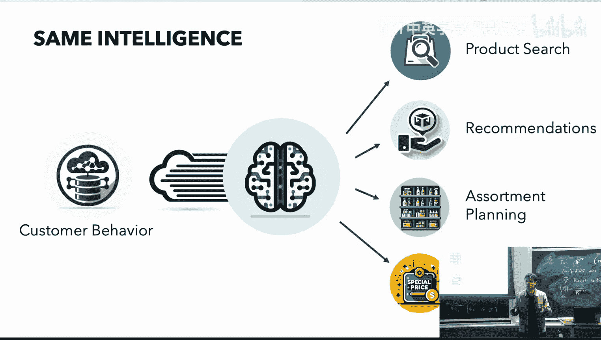
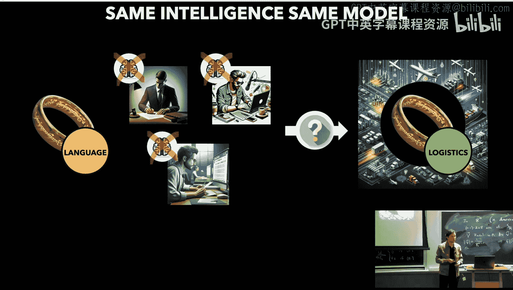
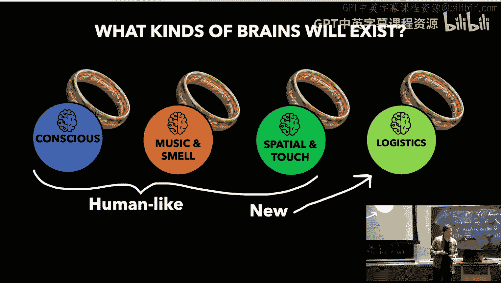
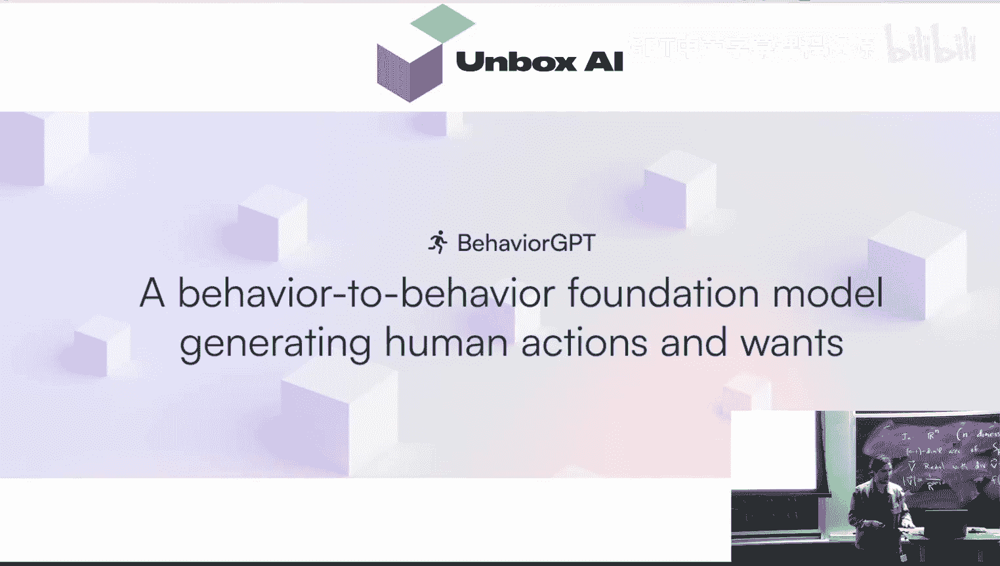

# 基础模型与生成式AI：第5讲：生态系统 🧠

在本节课中，我们将要学习基础模型的生态系统框架。我们将探讨未来是否会出现一个“统治一切”的单一模型，还是会存在多种不同类型的基础模型。这对于研究人员和商业从业者都至关重要，因为它能帮助我们理解未来将存在哪些技术，以及如何利用它们来生存和发展。

## 概述：学习的本质与基础模型

上一节我们介绍了基础模型的概念。本节中，我们来看看其背后的核心思想：我们是如何学习世界知识的？

我们自身就是一个参考框架。关键问题是：我们如何从一个对世界一无所知、毫无用处的婴儿，成长为一个有用、博学的成年人？我们如何从所交互的世界中学习？这在人工智能领域是一个核心问题。

我们的大部分知识并非来自父母、老师或学术界。所以，答案不是监督学习。我们并非主要从专家那里学习。这曾是我们长期尝试的技术，但它不是根本答案。它有帮助，但不是答案。

同样，答案也不是DNA或遗传基因。它也不是你为了在特定环境中优化目标而进行的即时环境互动。所以，答案也不是强化学习本身。它有帮助，但不是主要部分。

那么，答案是什么？事实证明，我们知道的绝大多数事物都是**自学**的。这是实现当前所有成就的关键洞见。这是通过**定义共现关系**来实现的，即通过一个事物所处的上下文来理解它。

例如，你理解“狗”这个概念，不是通过父母告诉你或老师教你，而是通过在不同情境中观察狗，将狗与其他概念进行关联和对比。你理解狗是主人用绳子牵着走的东西，是与猫有对抗关系的东西，是会追逐飞盘的东西。正是这些关系让你理解了狗是什么。你通过这种方式获得了一种非常**关系化**的意义理解。

当你通过将狗与“猫”等其他概念关联对比来学习狗时，你也内在地学习了猫是什么。因此，这种学习是自我参照的，非常强大，并且能够跨模态学习（例如，“狗”这个词更常出现在有狗出现的语境中）。

这导致了什么结果？你能够理解的关系越多，你对意义的理解就越深刻。你理解“爱”是什么，有助于你理解“狗”是什么，因为主人爱他的狗。这是一种协同的网络效应。

那么，为什么不构建一个拥有尽可能多参数的巨大模型，在尽可能多的数据上进行训练，以学习所有这些不同的关系，从而获得最精确、最强大的意义理解，然后把这个模型用在几乎所有地方呢？

**这就是基础模型**。这是生成式AI和我们现在看到的一切成就的关键突破。当然，我们的大脑就是最好的例子。

## 单一模型还是多元生态？🤔

上一节我们介绍了基础模型的核心思想。本节中我们来看看，既然基础模型通过海量数据学习关系化意义，并且模型越大、数据越多似乎效果越好，那么这是否意味着最终只会有一个单一的AI模型或“大脑”来统治一切？OpenAI是否会在AI领域形成垄断？

在可预见的未来，情况并非如此。未来将是一个**基础模型的集合**。

一种理解方式是考虑大型语言模型的应用。在语言应用的不同场景中，例如营销、撰写文章，可能仍然会共享同一个核心智能（即同一个基础模型技术）。它们可能会订阅ChatGPT，或进行微调，但共享同一个模型。

但是，当我们将这个语言模型应用到一个全新的场景时，比如物流（与DHL或FedEx合作），情况就不同了。它们可能拥有数千亿个关于货物移动的数据点。大型语言模型的直觉在这里可能会失效。首先，数据完全不同。其次，模型从互联网通用语言中学到的理解可能不适用，甚至可能产生有害的偏见。你需要从这些数据本身重新学习。这时你会发现，将这些数据和潜力添加到大型模型中，几乎会稀释其能力，没有帮助。

因此，你可以看到一个新的、围绕物流的基础模型技术出现，并且具有防御性。大型语言模型无法与之竞争。

另一种理解方式是：我们确实希望共享新的关系（边）以获得更精确的意义理解，但也必须确保添加这条边的成本以及可能带来的模型能力稀释，其价值是得不偿失的。你不想稀释模型，也不想增加过多成本以至于获得的价值不合理。

所以，我们看到未来不会有一个单一的AI模型统治一切，而将是不同类型“大脑”的集合。

## 未来基础模型的特征 🏗️

上一节我们探讨了未来将是多元基础模型的生态。本节中我们来看看这些模型将如何构成，以及它们需要具备哪些特征才能存在。

我们可以从人类大脑和现代经济文明中汲取灵感。我们拥有人类智能，可以从中获得启发。但同时，在现代经济和文明中，存在许多非自然、非人类的场景（如物流），我们自身的直觉可能失效，这也催生了围绕这些新场景的新型基础模型。

在探讨哪些AI模型或基础模型技术具有独特的防御性和卖点时，这一点很重要。因为这将帮助你理解可以利用和投资哪些AI模型。

对于研究人员，你可能希望投资于特定的基础技术并构建它。对于企业，关键在于能够识别哪种类型的基础模型对你的业务案例最重要，以便将你自己的专业知识、数据、秘密配方和竞争优势融入其中。

那么，哪些因素不足以构成一个独立的基础模型呢？

*   **仅针对语言领域的过度专业化**：例如，为历史语言、法律语言、客服语言分别构建独立的大脑。这并不合理。一家大型客服公司完全可以订阅ChatGPT，在其特定场景下进行微调即可。这不会是从零开始构建的独立大脑，只是同一大脑的微调版本。
*   **仅基于不同数据类型**：例如，一个围绕语言的巨大基础模型，另一个围绕视觉，第三个围绕音频。这也不足以证明其作为独立基础模型的合理性，因为跨模态的协同效应很强（你可以听到狗叫、闻到狗的气味、读到关于狗的文字）。将它们过度分离不是正确的思考方式。

一个很好的灵感来源是我们自己的大脑，因为它实际上是多个相互协作的“大脑”的集合。这是进化的结果，是**专业化数据**和**专业化应用**的结合，两者兼备是关键。

很多时候，我们看到大型语言模型能够进行某种推理和规划。在我们的大脑中，负责意识和理性的部分其实非常小。我们大脑的大部分是快速、直觉、自动的系统，它们展现出深刻的智能，但不像大型语言模型那样显得有“意识”。意识和理性规划只是我们生活和决策中非常小的一部分。未来也会有很多这样的基础模型，它们追求的不是这种“意识”，而是这些自动系统和直觉，这同样非常关键。

因此，如果你想构建一个在基础模型技术层面具有防御性的“大脑”（例如大型语言模型 vs. 大型行为模型），它必须在**专业化场景**和**专业化数据类型**两方面都具有独特性。

这意味着你需要**专有数据**和**专有算法**来实现这一点。对于许多公司来说，它们可能无法提供专有算法（因为开发成本太高），因此它们会订阅某个已经预训练好的、算法优秀的大型模型，然后融入自己的数据并在其基础上构建。

当然，所有这些不同的模型会相互通信、交互，但它们会以各自的方式专业化。也许会有像大型语言模型这样的模型以某种方式连接它们，但它们肯定会协同工作。

## 商业应用：构建企业的核心智能 💼

上一节我们讨论了未来基础模型的特征。本节中，我们将把这些概念应用到商业环境中。

对于商业环境而言，我认为我们开始看到的是：未来能够存在并拥有护城河和防御性的**每一家公司**，都必须拥有一个单一的、围绕其业务的核心智能，即一个单一的核心模型和基础，来利用其所有的秘密配方和业务场景内的协同效应。如果将这些东西分开，就会稀释自身的能力。因此，它必须有一个单一的核心模型来构建和构建其智能和专业知识，以保持竞争力。这个核心大脑将总结其所在领域的智能。

企业将拥有这个核心大脑。这意味着它将订阅某种基础模型技术（这将是其关键的基础模型技术），融入其所有的自有数据和秘密配方知识，并在此基础上构建。当然，这个模型本身会与其他存在的基础模型通信和交互，但这些外部模型对它来说不那么重要，可能无法包含其秘密配方。所以，它可能拥有一个核心大脑，可以与语言模型和其他基础模型（如航空视觉模型）交互并利用它们。这就像使用计算机或助手，非常有用，但它不包含企业的秘密配方和竞争优势。企业必须将结构化的智能构建到自己的基础模型中。

其他公司也会构建自己的基础模型，来总结其自身的竞争优势和场景，它们可以与其他公司协作和通信。

如果你不是谷歌或亚马逊这样的大公司，你可能无法从零开始构建模型，但你可以订阅某种基础模型技术，融入自己的数据并在其上构建。

现在，我们可以思考一下这将如何定义行业。哪些行业将共享相似的基础模型技术？

每个公司都将围绕其业务利用和构建单一的核心智能，但基础模型技术可能在公司间共享。我们可能会看到：

*   **大型语言模型**：如果你是出版业或法律行业，这可能是你想要利用的关键基础技术，以融入自己的数据和专业知识，它将成为你的核心智能。
*   **大型行为模型**：如果你在零售业，你的交易数据重要得多，可能占你数据的99%。你需要一个能够理解消费行为、有效融入并围绕其构建的模型。这将成为核心基础技术。
*   **其他专业模型**：还有像物流、金融时间序列等，这些数据并未很好地在线捕获，也不完全符合人类直觉。围绕这些海量但隐藏在数据库中的数据，也会出现独立的基础模型技术。

我想重申，AI这项新技术将无处不在，就像计算机一样。这对每个人来说都是超级有用的技术。但这与我们当前讨论的重点不同。关键在于区分拥有一个超级有用的助手，与**围绕你的业务构建你的竞争优势、构建你的智能、你的专业知识和秘密配方并加以利用**。后者才是你生存性的竞争优势。因为如果你只是使用其他人都在使用的模型，你并没有融入自己独特的场景。这是有用的助手，但不是你自己需要构建的独特智能。

## 如何为你的业务构建防御性大脑 🛡️

上一节我们探讨了企业需要构建核心智能。本节中，我们来看看如何着手为你的业务构建具有防御性的大脑。

我认为，理解如何为你的业务构建防御性大脑，非常重要的一点是审视**数据**。

如果你正在经营业务，现在就开始思考：你的竞争优势是什么？你如何获取数据来了解它们，以便大规模地构建和结构化智能？

你是否拥有数据渠道来追踪那些总结了你做得好的方面的数据？如果存在一些你无法追踪但对你的场景非常有协同作用的数据，而其他公司可能能够追踪到，那么理解如何获取这些数据就至关重要。拥有这些你非常需要的数据的公司，是你最好的合作者还是最坏的竞争对手？

接下来，我们将跳转到一些更具体的例子，看看如何实际操作。

## 识别“伪AI”与注意事项 ⚠️

在深入案例之前，需要快速提一下商业环境中的一个现象：围绕AI的炒作已经持续了相当长的时间。

因此，有很多公司声称自己做AI，但它们做的是旧式AI，可能不是真正智能化的AI。所以，要对那些声称做AI但在2020年之前达到顶峰的公司保持警惕和怀疑。这些都是新技术，很多在2020年之前变得庞大和成功的公司并没有利用这些新技术，它们是遗留系统。

如果它们进来说：“嘿，我们会帮助你。哦，我们不需要你的数据。我们无论如何都能搞定。” 那是胡说八道。数据是关键，是你融入并获得帮助的方式。如果它们不需要你的数据，那说明它们没有在做那种需要你数据的真正智能。

如果它们需要大量手动调整，那也不对。工作不应该由你来做，而应该由你的数据来做。例如，在零售业，你的客户应该通过在你的渠道上的行为来告诉你他们想要什么，而不应该通过大量手动调整和猜测来完成。

统计学家和漂亮的用户界面也是如此。喜欢研究某些统计数据（如平均值、标准差、可视化）的数据人员，这些信息过于压缩，不够细致。你需要构建、训练这些拥有数十亿参数的模型来处理你的数据。你不能只看平均值，然后围绕它进行一些一厢情愿的叙述。也要对此保持怀疑。这些技术并不非常可解释。你训练它们，然后试图弄清楚它们学到了什么。

还有单一功能的AI公司。如果有人对零售商说：“嘿，我们只做你的搜索，不做推荐。” 这说不通。你把智能分割开了。不要相信那些只专注于单一功能的AI公司，因为它们没有构建真正深刻的通用智能，而只是在构建复杂的系统。

## 案例研究：零售业与行为基础模型 🛒

现在，我将给出一些我和我的初创公司Onbox AI正在做的例子。我们构建生成人类行动和需求的行为基础模型。

这意味着什么？对于零售业来说，ChatGPT是一个超级有用的助手，但它并没有在核心层面彻底改变零售业，因为零售业的核心不是来自互联网的基于文本的语言，而且很难融入数据。零售业的核心是消费，而消费是行为。Onbox和行为生成模型，就是零售和行为驱动型企业的ChatGPT革命，让它们能够融入自己的数据，构建自己的竞争优势。这不仅仅是使用一个帮助你更容易购物的ChatGPT助手（每个人都能相当容易地构建那个），而是拥有一个融入你数十亿交易数据点、从你的客户那里学习、并构建你的秘密配方和智能的巨大模型。

让我们看一个零售业的例子。同样，我们所做的是为这个业务（零售业，具体是壁纸和海报公司）构建一个单一的、深刻的核心智能。我们最初并不关心下游任务。我们实际上最初并不关心下游任务。我们只关心围绕业务构建深刻的智能。下游任务的表现只是证明我们在解决实际问题方面取得进展的证据。所以，这是关于构建这种深刻智能，而不仅仅是解决特定问题。

拥有这个模型后，你可以首先将其应用在影响最大的地方。我们开始将这个模型用于电子商务网站的导航个性化。这使得导航体验变得极其个性化和定制化，因为我们现在可以理解消费者及其行为，从而让他们的体验更加自动化和愉快。

当然，以前也有很多AI公司在做个性化的导航。但区别巨大，就像比较马和法拉利。你需要把你的“法拉利”用在真正重要的地方。同样，在ChatGPT出现之前我们就有聊天机器人，但当你开始使用ChatGPT时，你明白这是完全不同层次的智能。这些新技术也是如此，即使应用场景相似，其性能和输出也要好得多。

另一个例子说明其重要性：当你访问一个网站并搜索某物时，他们可能有100种不同的图案和版本，但网站的顶部黄金位置只能展示6个产品。在这里我们可以看到，我们提供了完全不同的体验。这两个结果之间没有任何共同点，尽管它们都符合搜索“蓝色”这个词，并且在其中一个案例中似乎是一个有孩子的家庭在寻找儿童房的东西，我们给出了相应的结果；另一个案例可能是一些青少年在寻找房间装饰。为客户提供独特、定制化的体验，并在非常深的层次上了解他们，使网站成为他们独有的，这在电子商务环境中是可能的，并且确实能推动销售。

当然，这带来了收入和销售额的增长。但应用深度智能并不总是仅仅导致短期销售额增长，这可能不是最重要的。它还能带来其他对长期繁荣至关重要的指标，例如客户满意度、回头率、停留时间等。

仅通过更个性化的导航，我们就能将总收入提高14%，这是一个巨大的增长。而且这是在减少了12个人力的情况下完成的。现在不再需要专家去检查拼写错误的搜索查询并手动打标签，因为这一切都是自动完成的，我们让客户来完成这项工作。他们告诉我们他们想要什么，我们只需要发现并学习它。

这里有一个有趣的测试。例如，比较两个产品相似性模型。一个是在通用在线行为数据上训练的体面模型，另一个是高度微调、专门针对欧洲壁纸和画布电子商务购物的模型。

在一种情况下，当你看相似性时，如果一个模型更关注地理位置，那么“达勒姆”在这里更接近，因为它是同一个地方。另一个模型在看待相似性时更关注调色板。两者都非常合理，但对于该网站的典型客户来说，哪一个才是真正正确的？这有很大的区别。

事实证明，对于在欧洲在线购买壁纸和画布的客户来说，他们更关心调色板，而不是产品是否来自同一个地方。两者当然都有相似性，但一个能推动销售，另一个不能。

类似地，我们有一个在通用数据上训练并运行良好的旧模型。它看相似性时，对于一张克林特·伊斯特伍德的老黑白电影图片，会推荐其他老黑白电影图片。但在另一种情况下，我们观察客户与该产品互动时的相似性，结果是不同的。如果你让客户来定义相似性，你会发现人们实际上更关注枪和酷炫的老电影风格。两者从抽象角度来看都有道理，但一个是通过观察用户行为得出的，另一个只是看互联网整体。

同样，我们可以看看搜索和搜索引擎优化以及产品的关键词标记。许多公司有庞大的团队为所有产品添加关键词和类别，以最大化互动和SEO。

例如，顶部有一张天鹅在彩色背景下飞行的图片。公司的专家会如何为这张图片添加解释性标签？他们会添加“自然、森林、林地、树木”等。但如果你观察一个在人们如何与这部分互动、他们搜索什么的数据上训练的AI，学习客户实际使用的语言，你会发现它指出了从用户角度来看这张图片中最突出、最明显的东西。不是“自然、森林、树木、林地”，而是“日落”。这是专家遗漏的。当然，你怎么知道“日落”是人们对这个产品最重要的关注点？这很难，也不直观。但如果你查看所有这些数据，模型就能捕捉并学习是什么让这个东西脱颖而出。

同样，在下面的例子中，有很多人类专家添加的类别和标签，但他们遗漏了人们在与该产品互动时会想要的关键词，以及他们如何思考产品细分，比如“茶”、“日式”、“沙子”。他们遗漏了所有这些词。这造成了巨大的差异。

这非常细致入微。这家公司在21个国家运营，使用不同的语言。你也需要聪明一点，因为在许多地方，人们会混用多种语言（例如在瑞典，我们喜欢在日常词汇中夹杂英语单词）。因此，你需要能够从头学习语言，以及人们如何用不同类型的语言来描述壁纸和画布。模型通过查看所有这些数据，开始学习语言以及不同市场之间的细微差别。

当然，这仅仅是面向消费者的事情。这个模型随后被用于许多不同的场景，因为它围绕你的业务具有深刻的智能。它可以用于实体店的店铺规划，可以用于数据清洗和主数据管理以发现错误并确保一切合法正确，还可以用于商业智能。例如，你了解你在欧洲的不同市场。如果你想进入比利时这个新市场，它与其他市场有何关系？进入那里并取得成功的最佳策略是什么？你应该专注于哪些产品？现在，他们可以随处使用这种深刻的智能。

## 案例研究：劳动力管理与保险业 👥

另一个例子来自劳动力管理。同样，我们试图为这家消费者服务公司构建一个围绕其所有业务的模型。他们提供客户服务，拥有5万名员工，每年有3万名员工离职。这是一个巨大的成本。他们每年要与50万名希望招聘的候选人互动。这也是一个巨大的成本。

最初的目标是：如果他们能更好地理解谁将在一年内离职，就能大幅降低成本。但当我们接触他们时，我们说：我们不在乎人员流失这个下游任务，我们在乎的是围绕你的员工和业务构建核心智能，了解你的员工。因此，我们首先构建并查看员工周围的所有行为数据点，以了解他们是谁，基于他们的行为。我们先关注这一点，当我们解决了这个问题，能够构建理解并能预测员工行为的智能后，我们再来看人员流失这个具体案例。

令我们惊讶的是，当我们构建了这个模型，并开始针对预测谁将离职进行微调时，该模型能够以91%的准确率预测一个人是否会在未来两周内离职，这在该领域是前所未有的。

之前，他们付出了巨大努力，大型咨询公司进来，花费数百万美元进行调查和数据分析，基本上没有结果。他们进来说：“我们有很多数据。我们有1万