# 《基础模型和生成式AI｜6.S087 Foundation Models & Generative AI 2024》中英字幕 - P6：-6-MIT 6.S087_ Foundation Models & Generative AI. BIOLOGY.zh_en - GPT中英字幕课程资源 - BV1YYWpzaE3q

佢系。All right， well welcome to Mons， he's a professor at MIT he's doing amazing stuff in computational genomics and AI and biology。

 he's going to talk about the AI fronts here， supers to having。😊，So give him a warm applause。

Thank you。Awesome welcomecom everyone， so basically there's a lot going on in biology and there's a lot going on in AI and my goal is to tell you a little bit about both and how the field is dramatically changing so I'm going to tell you primarily about health and understanding biology and medicine。

 who wants to live forever here。😊，Good， good， who wants to live at least leave like until next year？

Yeah， so so there's this joke where like like oh， who wants to lift to 100， well。

 the person who's 99 and yeah we never actually want to die。

 we just don't necessarily want to live forever， but anyway。

 so the goal is how can we use AI to truly understand the mechanism through which human biology works and how we can use that to basically develop new therapeutics that put an end to disease as we know it。

Was excited about that， good。

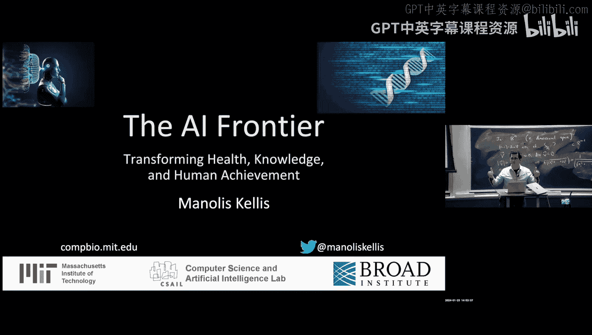

So what's our goal， our goal is to understand medicine and medicine has truly come a long way so this is I was just giving a talk in Athens last week that's when I made the slide and this is how medicine used to work so you would have some type of it's unclear whether here you're depicting a God or a physician but know even nowadays the distinctions kind of blurred in many ways and then they're doing this magic and the patient sort of subjected to that and you know there's some peeryukcommediaia apparently but this is how it used to be done and then eventually we started looking at things closer and closer and this is more than 100 years old。

 the structure of neurons inside our cortex and our different regions of the brain we can basically now see the fact that we're based on smaller and smaller parts and the first diagnosis of Alzheimer's days to 100 years ago from imaging where we could actually see the plaques and neurofibriary。

Tangleles that are still today the definition of Alzheimer's。

But something dramatically changed in the last few years and this something is。Human genetics。

 human genetics basically tells us that there's something playing a causal role here。

 and what that allows us to do is start going beyond just correlation to causation。

And the last part that changed is a lot of our own work in being able to gather massive。

 massive amounts of data for integration。 so you can basically think of this as the next generation microscope。

 where instead of gathering four cells，At single cell resolution， we are gathering 2 million cells。

At single cell solution。 And instead of measuring whatever we can stain and we can stain about like 5。

10，20 things at best。We can measure the expression of 20000 genes for every one of these dots so this is a 20000 dimensional space with two million cells projected down into something that we humans can visualize in 2D so what are the paradigm shifts that are happening。

 The first paradigm shifts is that we're going from hypothesises driven to data driven instead of just saying oh。

 we have a very specific hypothesistheses to gather a bunch of data and then we're going to say yes no answer。

 we now have just massive data we should first and we ask questions later so we basically have systematic data sets we're building resources。

 massive data sharing and really comprehensive use of biology The second as I mentioned。

 we're going from correlation to causation correlation means that countries that eat more chocolate also get more nobel prices。

Does the chocolate need Nobel prizes do they just buy。

 I don't know more chocolate with the Nobel Pris I it correlation causation or reverse causation。

 so that's what epidemiology has always been fuzzy about whereas with genetics we actually now understand mechanism we know that if there's a genetic difference then eventually you can establish causality and then the last step which is the most relevant to this class is we're going from classical data analysis where there was a different methodology for every problem we would just like come up with a question。

 develop a statistical test and answering and the humans did all the thinking to now and where the goal was to develop very few parameters and very targeted models to understand so that we're not overfitting the data whereas now we're basically saying billion parameters。

 no problem bring it on。And we're building these foundation models that are very often multimodel where we're learning representations。

 we're learning hierarchical deep representations， and we're truly understanding concepts and yielding insights。

Everybody with me so far， So these are the major shifts what does that mean。

 that means that we we can combine now causality from genetics and big data to truly understand the mechanism of disease。

Genetics， that means that we're starting with causality because we know these regions have something to do with disease。

 The problem that we don't understand the mechanism and that's where massive data come in。

 we can basically say this correlates with Alzheimer's Let's go and find out what changes in the brain of people that have this genetic difference or the people that have Alzheimer's or people that have this environmental exposure and then we can figure out the specific genes and proteins that are responsible and then use those。

To understand mechanism， so we're gathering these massive data and that's where the deep learning comes in where we can now go from sequence information to a model that understands the language of biology。

 understands how mutations are acting， understands how proteins are folding。

 how chemicals are resulting into their functions， and then eventually make predictions that we can validate experimentally。

 and that's another amazing thing about biology。In society it's very easy to say， well。

 maybe this causes that but intervention would cost like I don't know。

 billions of people changing the way that they do stuff。

 whereas with biology we can take a cell and then change a gene and then see what happens so they're much more transparent as models everybody with me awesome。

So what we need to do is basically go from simply there's something going on genetically here to here's the circuit。

 here's the genetic variance， the differences in the letters， here are the motifs。

 the sequence patterns that these letters perturb here are the regulators that bind these motifs。

 here are the control regions or enhancers and the cell types where they become active and here are the target genes that are controlled。

 so effectively a circuitry， and then using that my lab has basically worked on applying these type of methodology to a dozen plus disorders from cardiac disease。

 obesity cancer， Alzheimer's addiction or degen pathogenesis， schizophrenia。

 psychosis bipolar Down syndrome Moism and PTSD， so every aspect of the human body in the human brain。

 we can now start studying systematically across dozens of cell types across hundreds of tissues and millions of cells and hundreds of individuals we can now start asking how is。

The action of disease percolating through。To give you an example。

 I like to joke that we published a paper in the New England Journal Medicine about one bit of information。

 the human genome， this is about changing a T into a C。

 and what we showed is the mechanism through which we can translate a region of genetic association。

 the strongest association with obesity to a mechanism that basically tells us how is that variant acting。

 what is the option regulator， the downstream target genes。

 the cell types of action in the mechanism， and we were able to by understanding this mechanism switch human cells from fat storing to fat burning just by flipping one letter or switch a whole animal into a fat burning machine。

 so mice where we knock down one of these two genes。Are burning every calorie in their body。

 they are there's no white fat in their body， they're just completely red， juicy， healthy organs。

 and then the normal mice gained weight when you put them on a high fat diet。

 these mice are unable to gain weight。You can basically feed them all you want。

 they don't have to exercise more， they don't have to eat less， they just sleep it off。

 they just burn it off so by manipulating the circuit we are now able to reverse disease circuitry who's with me so far great so that's one example。

 another example for Alzheimer's disease we're able to now reverse the circuitry of Alzheimer's and basically take individuals that have Apo E4 this is the allele that increases your risk for Alzheimer's by factor of 10 so if you're homozyg's risk for Apo E4 you're almost guaranteed to have Alzheimer's disease at some point in your life。

Pretty soon。And what we found is altered cholesterol biosynthsesis。

 we're able to trace it down to the transport of cholesterol to form myelin that protects neurons and by reversing。

This process by restoring cholesterol transport， we were able to effectively restore myelation and restore cognition。

 both in human cells and in mice。Second example from a region to a circuit to manipulation。

 third example in cancer immunotherapy about 50% of the patients respond。

 this used to be a death sentence now for 50% of the patients。

 this is amazing they completely beat the cancer but for the other 50% the cancer comes back and what we were able to show is that by understanding the circuitry we were able to predict the regulator upstream of the genes have turned back on。

 shut them off and then suddenly none of the cancers come back。So again。

 in very different applications， obesity， Alzheimer's cancer， we're able to reverse this。

 so how is this all possible？I'm going to give you a number of vignettes for how we're now able to understand the language of biology and reverse it systematically so the first application is on regulatory genomics that basically means going from the DNA sequence to how that sequence functions。

How does gene regulation work， we basically have small patterns that we call regulatory motifs that are recognized by corresponding regulators or proteins that bind the DNA out those motifs and then together they cooperate to turn regulatory regions on or off and eventually genes on or off everybody with me here。

That's all in need know。Basically， we can measure the binding of these regulators across the genome by building assays that pull these regions down and then sequencing and then asking where did the sequence come from。

 and then we can map all of the regions that are bound by different proteins and now comes a fun part we can basically put that all in a deep learning framework and say what is the sequence pattern that will predict the activity here。

And we can basically build these multi layer neural networks。

 these convolutional neural networks that learn to no these convolutional filters。

 and these are the sequence patterns that ultimately allows to predict activation and repression of different regions。

 and I can show you here the observed。Experiment。And then the prediction。

For every one of these regulators， and you can see just this extraordinary ability to just capture the language of DNA。

 and then the beauty of it is that it is mechanistically insightful。

 basically tells you that this motif contributes here and that motif contributes there and so so forth。

Who's with me so far， awesome。So that's language of DNA then if you have a mutation that we've never seen before。

 can we predict the impact of that mutation， why for personalized genomics we want to be able to adapt therapeutics。

 adapt everything to your DNA so how do we learn the sequence of the genome and how do we learn the impact across individuals and across cells of genetic variation what we would like to know is for any genomic sequence if I change a single letter have a deep learning framework that allows us to predict how is this going to affect the machinery that binds DNA。

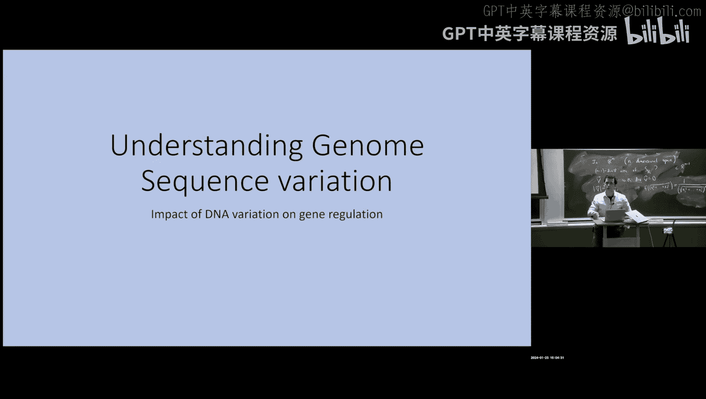

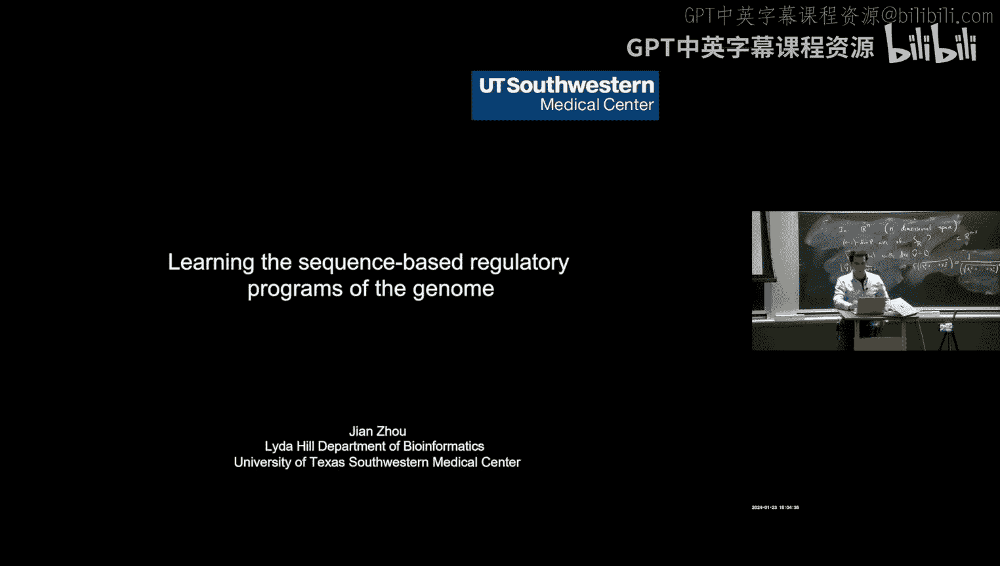

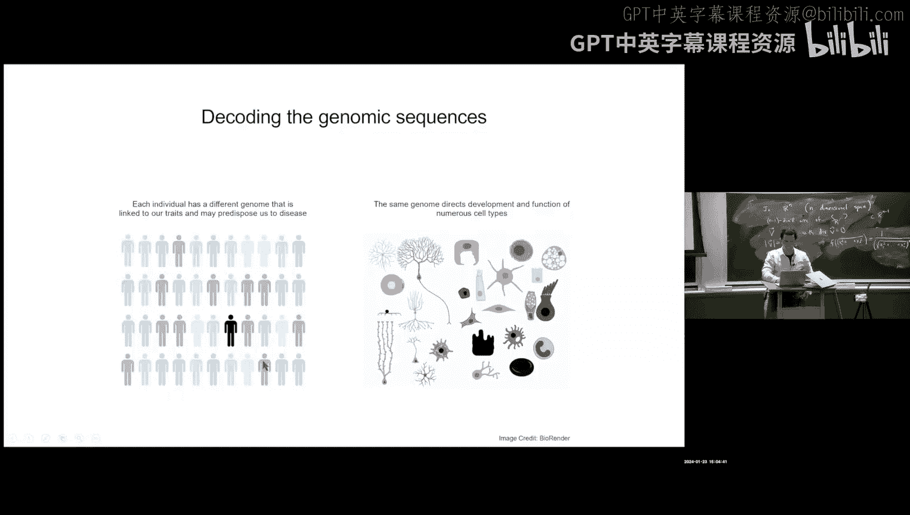

The transcription factors， the accessibility of the DNA。

 and then the modifications of the packaging of the DNA。

So we can basically put this into again a deep neural network and then start predicting from thousands of nucleotides across multiple different layers of information。

 the impact on expression and then start predicting the impact of these genetic variants and you can see that you know this this makes enormous impact。

 The next step beyond that is to understand how cells change in their activity patterns。 So we have。

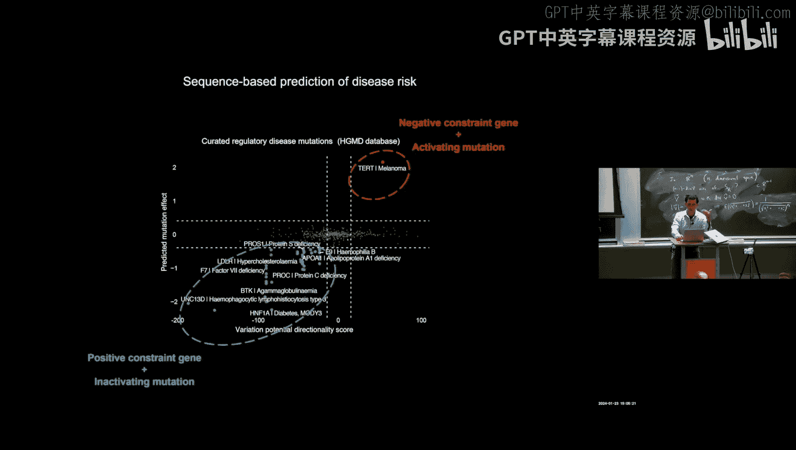

About a trillion cells in our body and for these cells we have the extraordinaryarily different functions between our neurons and our heart cells and our bones and our eyelids and our tears and all of these things have basically very different functionality and then the immune system itself has hundreds of cell types that are playing very distinct functions so can you understand both the dimensionality and the drivers of gene expression space at singleserv solution so we can now basically measure the expression of millions of cells。

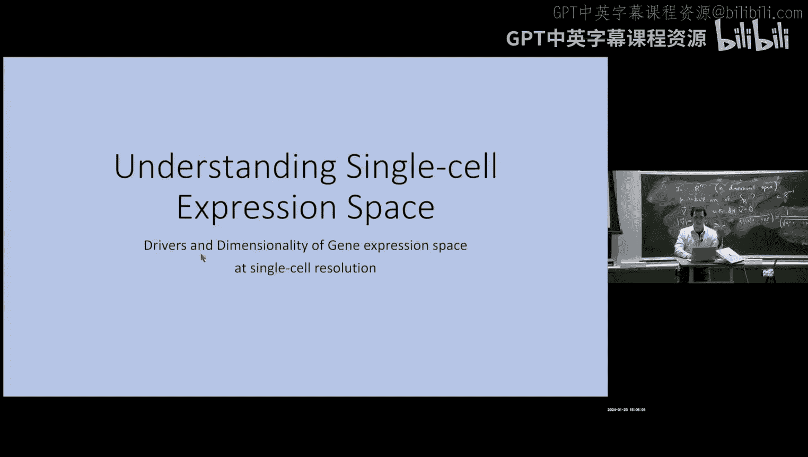

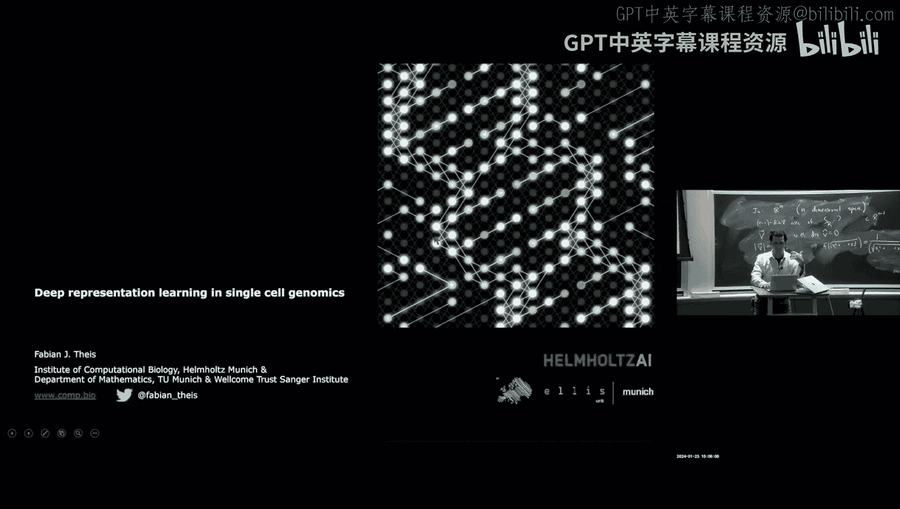

And we can start building deep learning models that allow us to。

 from the sequence information and the expression information compress that through an autoenr。

Into this bottleneck layer and then expanded back out。

 Why is that exciting Because this is where the fun happens。

 That's where the variation matters And in the same way that we can we can transfer styles。

 for example， sunglasses or man versus women or old versus young we can now start asking about the dimensionality of expression variation at single cell resolution and we can use this to start teasing apart the different component of variation through these variational autoencoderrs so we can basically say how much of that is core。

 how much of that is label specific can we now decompose these parts and start varying the labels to turn the expression patterns of a patient into a healthy individual in vice versa or a young to an old a male to female and so so forth。

 So everybody with me so far who feels that theyre learning stuff。Good， it's a very shallow overview。

But the goal is to expose you to all of these different types of problems。

The next step is electronic health records， so basically through massive amounts of phenotyping we can now gather the huge diversity of individuals with geno。

 and with dozens of phenotypic variables so it basically means that for every individual I'm measuring six million common variants。

 very often the whole 3 billion letters of that person of which only a tiny subset like for example6 million vary。

 and then I also measure the phenotype， the disease， the medical information for that person。

And what we're doing for that is that we can now use that to now start decomposing the electronic health record of a person into modules into components that are associated with distinct phenotypic combinations that appear together and we can now start mapping that to the distinct expression patterns that are changing in either their blood or in post-mortem tissue samples from that individual in this particular case。

 we looked at 430 individuals， we looked at their brains postmortem。

 and then we looked at the phs that they had prior to death。

 and we're able to correlate now these transcriptional hallmarks of Alzheimer's disease。

To recurrent patterns of physiological differences between those individuals。

And we've coupled that with electronic health record information longitudinally across different individuals。

 which we have also coupled with the large language model interpretation of these changes so we can now basically take these large language models and start interpreting。

What is actually changing in the activity of those individuals？Okay， so。

So that basically means we can now start decomposing these patterns。

 and we can start using large language models to start interpreting the weird deviations from expectation for many of those。

 So basically we can now look for。Patterns in the electronic health records and then use large language models to interpret these patterns。

Autoomatically and basically come up with insights as to what is actually driving different aspects of the biological variability and we can now take these phenotypic components about how your electronic health record is changing and then combine that with genetic variation for every individual across millions of variants to look for the covariation between them so we can now start building up the building blocks of both genetic and phenotypic variation in the human genome okay so the next part is beyond just the quantitative variables such as lipids and all kinds of other aspects of the electronic health record you can basically now look at imaging and pathology。

And if you take these slides， you can now start using AI to automatically annotate what these slides actually mean and where is a tumor in those slides how by basically extracting features associated with the annotation of those images doing a massive curation for 1 million medical papers that you can download from the web and then annotate every panel based on the legend of these images and then for panel ABCD you have different annotations you can now use multimodal learning that you heard about already to basically do joint learning between the image and the text description of those images and start understanding the features of the image that are responsible for the different annotations so that basically means that across these 1。

17 million image texts for histopathology you can basically now。

Build a foundation model that allows you to look at a new image that you've never seen before。

 maybe even for a tumor class that you've never seen before and start reasoning about the pixels。

 So everybody excited about this。Good， so that allows you to now do zero shot。

 which means in a class that I've never seen before retrieval of ton of information and that allows you to now start learning the foundation of all of these The next frontier is looking at chemistry being able to go from individual atoms to the function of a chemical。

 How do you do that through graph neural networks that interpret the function of a whole molecule through the function of the parts。

 How by building an embedding representation of every atom initially dependent only on the properties of that atom。

And then through the graphph neural network we're propagating convolution operations that basically say in layer zero。

 this only depends on myself， but in layer1 I depend on all of my neighbors and in layer2 I depend on the layer one representations of all of my neighbors which themselves depend on all of their neighbors so I can use this to now start propagating a final prediction for the function of a chemical through the individual organization and layout of the chemical graph representing these molecules so we can use this type of operation to propagate information from the bottom up and eventually start predicting the function of a new molecule and even designing new molecules with particular characteristics you can now start synthesizing those using the techniques that you've seen already by building them from the ground up using either individual atoms or individual motifs in the chemical space and then。

Designing molecules with a particular function in mind， Everybody with me so far。 Yeah。

 who has a right arm。Good， who's with me so far？Good， awesome。 nearly everyone with the right arm。

 So so that basically allows us to now start designing new chemistry。

 And then as you heard in the news， the next frontier after that is understanding the function of proteins and the structure of proteins。

 So on the function side you can basically look at evolution and amino acid properties And this used to be done by massive physics。

 where you would basically simulate how protein chain would eventually fold into three dimensions。

 whereas now we can basically start looking at how this chain maps into multiple species comparison。

 coevolution analysis and also the profile of that sequence itself to start understanding the relationship between sequence and structure and the next frontier after that is now looking at how that structure is encoded into function So basically here you have the prediction you have the modeling and the next frontier that we're working on。

Current my team in collaboration with Marica Zitni over at the Harvard Medical School is building foundation models for translating protein。

 function and chemistry together。So the goal is to basically be able to systematically intervene at the chemical space and at the protein biological space。

And together with Brad and toluuter here in chemistry。

 we basically developed this program that allows us to now drug all of biology and we are building these therapeutics LLM that allows us to now take protein structure。

 protein sequence and the textual description of biological function of that protein through the medical literature together with user queries similar to ChaPT where you can ask anything and we can now start predicting which proteins will have what kind of function from the building blocks of their amino acids and their structure so that allows us to now reason about the types of chemicals that I should use to intervene and to start。

reversing cardiovascular disease， metastatic melanoma， Alzheimer's and so on and so forth。

 so we want to take on disease systematically transform the way that we understand biology。

 enable personalized medicine and bring all these together the last snippet of information I want to tell you about is how we can use AI to now start understanding not just biological function but also any idea that humanity has ever had every paper that has ever been published。

 every poem that has ever been written can map somewhere into the space of ideas and what we have built is a tool that allows you to directly navigate that space of ideas this morning I was actually speaking with the development bank of Greece to basically see how we can use this to understand all of the loans that they're giving out all of the startups all throughout Greece we're working with the New York Times and the Kay Meing newspaper to basically parse all of their。

arrticles and understand their similarities here we're looking at 60。

000 papers written by MIT authors and then we can color those according to either the lab that wrote them or we can actually show them on the map of MIT as to which buildings are generating what types of ideas in this space of ideas here we're basically looking at every course that is being taught at MIT and the graph of prerequisites and the department from which these courses are happening and then the ultimate view is that there's an island for every concept and we can now use a Google maps like navigation technique to look at side by side the papers that I'm reading where it sits on the map where our nearby papers and map all of knowledge in this particular way so again the major paradigm shifts are instead of basically trying to develop a new machine learning method for every new data we are building the。

Mmodal embeddings and this can happen in biological space but also in idea space and the goal is to gain insights that are previously inaccessible to human scientists using this way so again from hypotheses driven to data driven from correlation to causation and instead of classical data analysis。

 understanding foundation models and multidimensional learning Who feels that they've learned stuff today。

Yeah， awesome great。 Should we take a couple of questions， you know。

 maybe you should speak on Thursday， I'm afraid we don't have too much sign。😊，It is now 21。

What then does the class end。Like 30。Okay， but that's question Okay， quick questions。讲这。

thing thatSo we have just built it， we have applied it to as many datas as we could find that' are kind of cool and fun if you have massive data that you'd like to apply to let's collaborate the goal is to eventually release it so that anyone can sort of use it but our initial moduleupandee is that we are working with people who have massive data sets and building one for them as well so that you can navigate your own data if you have specific data sets in mind。

Good。Yeah it's a lot of fun I mean I've wanted this forever。

 but it's now finally possible I've been recording all of my meetings for the last 1012 years and this is the embeddings of 10。

000 meetings that we've had in my team and sort of how they cluster together this is 150000 papers that have cited our work and how they cluster I want to understand everything that way every time I read a New York paper in New York Times article I want to understand what are all of the nearby articles and when I'm reading a paragraph I want to see what is the nearest paragraph anywhere and then what other papers come there。

 you know if if I want to read five papers on the war of Ukraine。

 you know I don't want to read the same intro every time I want to sort of blend these papers and weave together the distinct paragraphs。

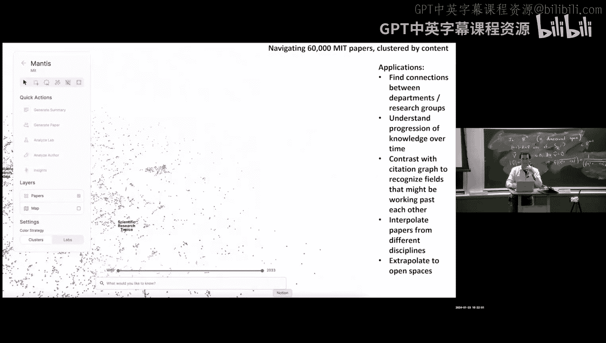

It's now at our fingertips， we should be able to do this systematically。

So it's kind of a distillation of a knowledge graph。So yes， it's basically taking the 74。

000 dimensional latent space of LLM， so we've trained our own LLM。

 so this is a billion parameter model and it's trained using a slightly different objective of reconstruction of the sentence rather than next word prediction so that allows the LLM to capture much more information about the context and the relationships and we're now using that sort of see if we can you know do outbeddings where you know from this paper plus that paper like start generating something new Yeah so a lot of that is selfsupervised learning when you have autoencors you can just like predict the input genes。

So basically in the autoenr that I showed earlier， this was predicting the actual expression patterns。

 So we were basically saying what is the expression initially， How can I predict it from。

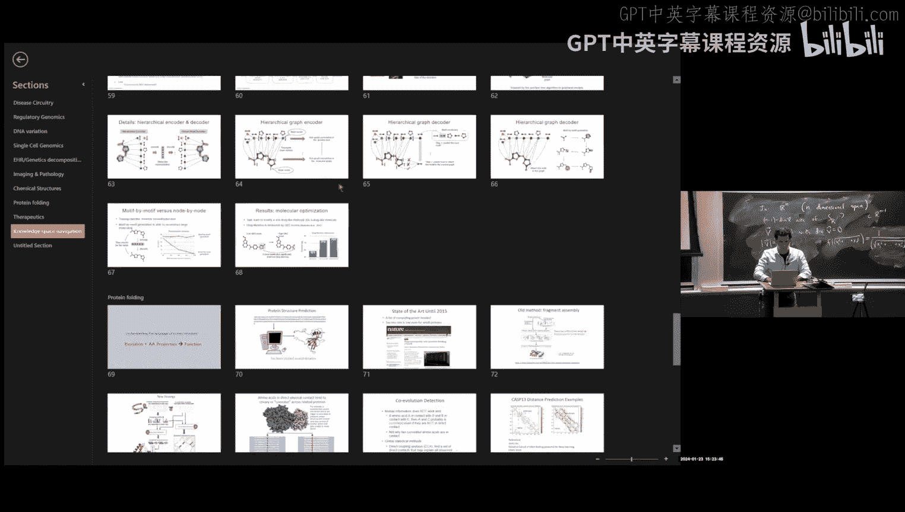

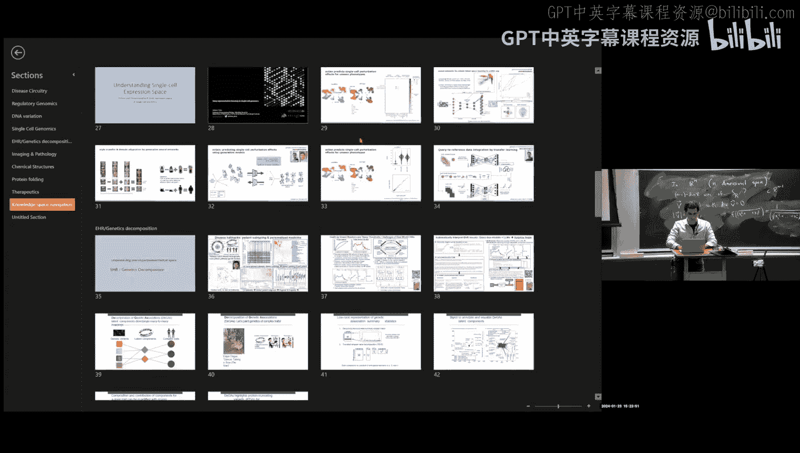

You know， much condensed。Bottleneck layer。 So that's what allows us to now learn this， you know。

So basically the output is the input， so we're trying to predict the original data。

But through this bottleneck layer。But what methodology。So gene expression levels。

 so basically the amount of expression， the amount of mRNA for every protein。Yeah。对。Yeah。啊，你跟这。や那超得吧。

And the way that we see the patient data。How， how do you think would be。The new way of。Diagnosing。

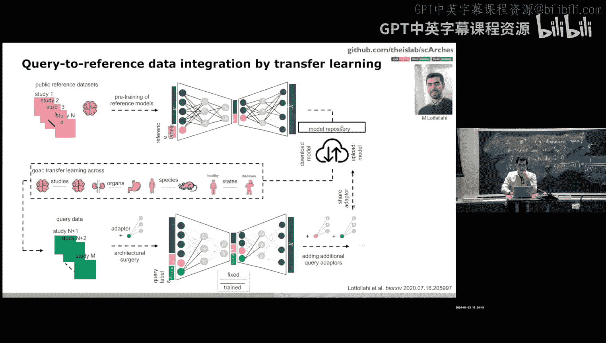

a disease。To啊。Yeah so so multimodal is the way to go if you look at images， for example。

 you can trick an AI that learned only with images。

 but it's much harder to trick an AI that learned with multimodal information so basically by having these multiple modalities humans are constantly integrating multiple modes of information and now with AI we can have a clinical view of a patient based on of course their clinical record but also their image how they're looking how they're feeling how they're talking their cas。

 their gestures， their eye contact the way that their hand shakes or stay steady and so and so forth so basically I expect that。

A lot of patients will be asking for AI augmented diagnosis going forward。

 that right now it seems weird。 hey， is the doctor cheating by looking at AI， whereas in five years。

 I think the patients will say， excuse me， shouldn you have an AI assistant。 What happened。

 I it broken today， you know why don't I get the best service I can get。 So basically。

 I feel that right now， we're diagnosing basically by training doctors to think like a machine over many。

 many years of studies where they're basically saying， oh， I see this evidence。

 I see that thing that basically， you know， they're following flow charts in their heads， Of course。

 they're multimodal creatures， So they're understanding， you know， much more deeply。

 they have intuitions， etc。 But it takes an enormous amount of training for the doctor not to be biased for the doctor to sort of think effectively just like AI is able to think now。

 So basically my expectation is that moving forward。

 a lot of the human aspects of doctors will be the rate limiting step。

 the much more important aspect of。Empathy and understanding and sort of getting the patient to speak to to express themselves。

 to sort of， you know， think。Incily。And that we'll be able to use AI to integrate all that information number one。

 and then number two， doctors currently don't want to look at genetic information， they're like， oh。

 I just want to look at you， I don't want to look at your genetics。

 whereas by having this multimodal information from the blood expression patterns。

 from imaging of your brain from lipid analysis， etc。

 they'll be able to use AI will be able to use all of this information。

 the context of all of the information that you're gathering each time to basically build a much more complete model of a person yeah。

这个。B。Yeah， yeah。Yeah， so so there's something known as non-missing at random and MAR and when a doctor orders a test。

 most of the time the test is abnormal， the doctor will not order a test that they are expecting a normal result。

 so if you look at the distribution of observed data versus unobserved data it's hugely skewed and many models will basically model the missing data as if it was。

You know the same as you observed data when in fact the missing data comes from a very different distribution because it was never ordered。

 so there's many ways around this one is to build cohorts where we measure everything systematically so there's less biased in the specific test that we order and then when you have that you can learn the distribution of covariates with other variables and then start predicting the state of a person prior to knowing whether that information is there or not or use the information about the presence absence of a variable to build an expectation for the distribution of that variable and then imped based on whether it was observed or not as to the existing biases of humans。

 humans are extremely biased， every doctor is biased every human is biased AI in my view is the best hope for building unbiased models or you know antibiased models or sort of correcting for these biases because through these variational to encoders and other techniques we can untangle the different components of variation and look at sex a。

Ancestry， all kinds of aspects as orthogonal variables。

And then use counterfactual analysis that basically says us well well if this person was a man instead of a woman。

 you know how would the data look and you can actually predict that data and sort of make inferences about that so yes。

 medicine is extremely bias current algorithms are extremely biased because they're trained based on the data that we have。

But there is hope for finally overcoming these human biases。Okay， good question， so。

DNA may seems to be the language biology， right？It's very different from the language you use。

Sivization， so probably in2 before it probably requires separate foundational DNA data and of course this huge amount of DNA data。

 how far would you get by just training a huge infiniteive big model on all the DNA that exists。

 how far would you get in terms of understanding model？

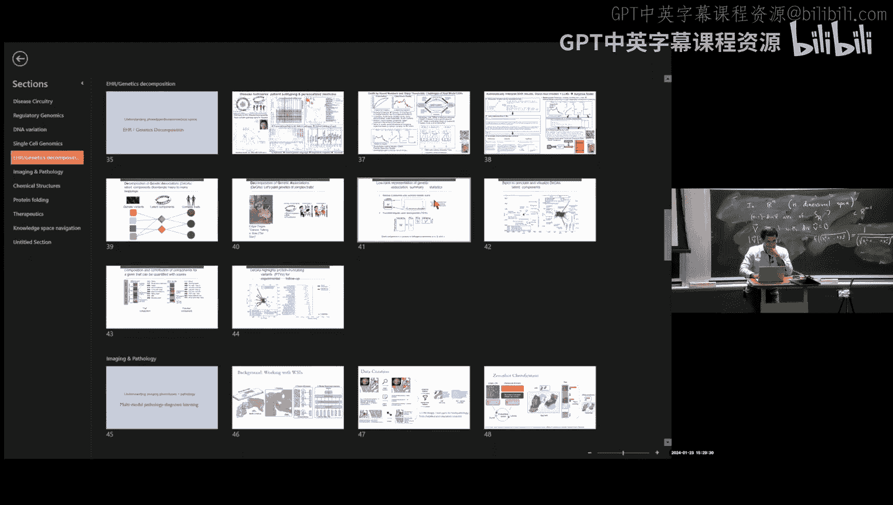

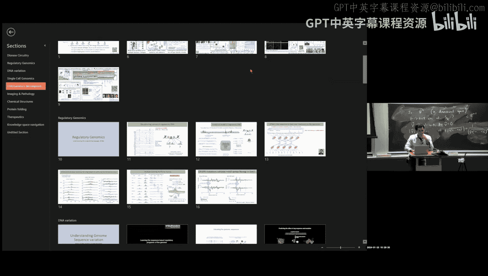

I like to say that human thought is much simpler than biology。

And the reason is that biology has been added for3 billion years。

 and humans have only been thinking for， I don't know， maybe 100，000 years。And like thinking deeply。

 that's one aspect， the other aspect is just one second let me put Riley。

 hi Riley I'll come back to you soon that's my next meeting story so so the second thing is that human thought is constrained to be generated by this thing which itself is constrained to evolve。

😊，Which itself is constrained to develop at every generation from one cell like the zygote is one cell and it takes half the DNA from mom。

 half the DNA from that and divides and eventually set up a neural network which then learns all of human knowledge from scratch at every generation so it's extraordinary that humans can think so well I mean you know frankly。

 if I were to write an NIH grant about developing such a machine I would get rejected like this will never work So I'm surprised that humans can even think and they can invent AI etcer。

 but AI doesn't have these constraints。 AI can basically use dramatically different architectures。

 they don't need to fit in your skull。 they don't need to evolve。

 they don't need to develop they don't need to be a local maximum。

 So in a way it's almost surprising that we haven't found dramatically better architectures and。

Human brain for AI I mean transformers are kind of getting there。

 but I wouldn't be surprised if humans are doing a very transformer like you know hippocampus connectivityivity of ngrams when we're thinking about concepts etc。

 so the question is how much harder is biology than human language I would argue human language kind of simple and that there's like you know only so many islands of ideas if you wish and that biology by contrast。

 there dramatically complex Moreoverover biology has no logic， there's no like physics is beautiful。

 there's like a few equations and that's it whereas I mean。

 a few hundred equations whereas biology there's billions of tinkerings that happen at every generation you're just like changing one letter here and oh it kind of works and kind of adapt etc。

 so in a way the fact that we're even able to understand protein folding and DNA and language and gene regulation and pathology and all of that to me is mindmling the fact that it even works。

Suggest that somehow biology is still constrained and the saving grace might be that we have only 20。

000 genes。And that's a rate limiting step in terms of complexity。

And all of this multimodality is sort of helping channel this knowledge into a much smaller space and the variations that we see are much smaller than all possible variations of 20。

000 genes， why because there's a regulatory circuitry that there's only so many regulators。

 there's only so many states that a cell can enter， so yes。

 you know biology could be in theory infinitely complex， perhaps chemistry is infinitely complex。

But the space of biology， chemistry， protein folding， protein structure。

 et ce that inhabits this world might at least be at least 95% of it might be sort of within the bounds of our existing models。

Awesome， thank you so much， beautiful。Thank you。

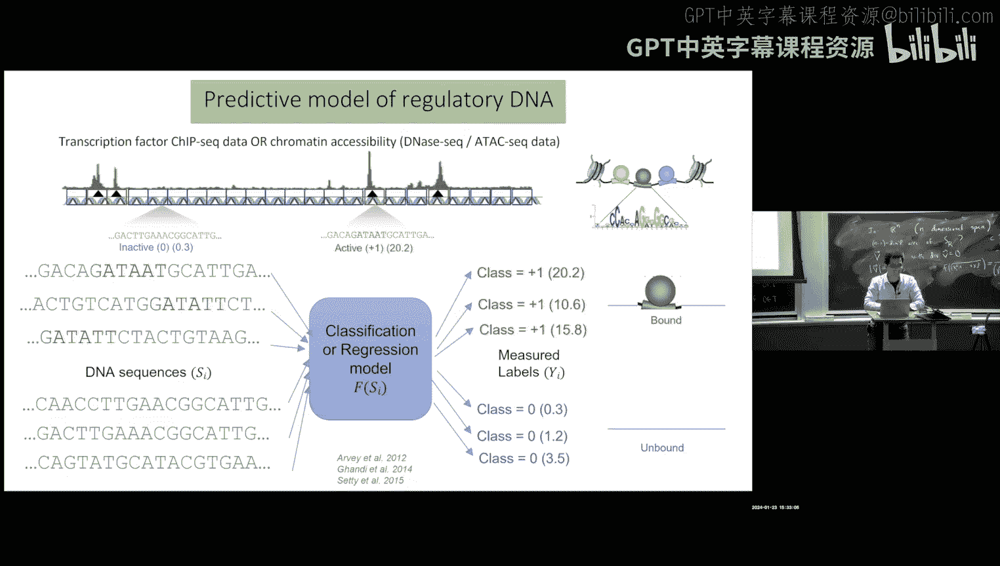

All。