# 基础模型与生成式AI：6：AI在生物学与医学中的应用


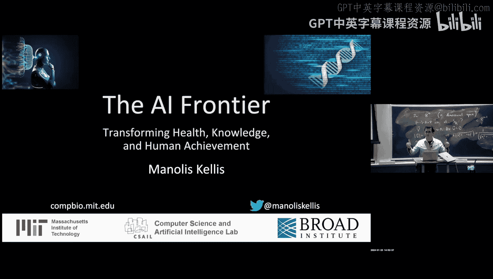

在本节课中，我们将学习如何利用人工智能，特别是基础模型和深度学习技术，来理解生物学机制并推动医学发展。我们将从遗传学、基因调控、单细胞分析、电子健康记录、病理图像分析、化学分子设计以及蛋白质功能预测等多个维度，探讨AI如何帮助我们从海量数据中提取因果性见解，并最终实现疾病的逆转与治疗。

## 从假设驱动到数据驱动

上一节我们介绍了课程的整体目标，本节中我们来看看生物学研究范式的根本转变。传统医学研究始于一个具体的科学假设，然后收集有限的数据来验证它。如今，我们正转向数据驱动的研究范式。

以下是三个关键的范式转变：
1.  **从假设驱动到数据驱动**：我们首先系统性地收集海量数据，构建资源库，然后从中提出问题、寻找答案。
2.  **从相关性到因果性**：过去流行病学研究常受相关性困扰。人类遗传学使我们能够确定基因差异与疾病之间的因果关系。
3.  **从经典数据分析到基础模型**：过去针对每个问题设计特定的统计方法。现在，我们构建拥有数十亿参数的多模态基础模型，学习深层次的表征和概念。

## 结合遗传学与大数据的疾病机制研究

上一节我们了解了研究范式的转变，本节中我们来看看如何将这些转变应用于实际。遗传学提供了疾病的因果线索，而大数据则帮助我们揭示其作用机制。

其核心路径是：从与疾病相关的**遗传区域**出发，通过分析拥有该遗传变异或患有该疾病的个体的大规模数据（如单细胞测序），找出受影响的特定**基因和蛋白质**，从而理解其**作用机制**。这种机制可以被建模为一种**基因调控电路**。

以下是该方法的几个成功应用案例：
*   **肥胖症**：通过解析一个与肥胖最强相关的遗传变异，找到了上游调控因子和下游靶基因，成功将人类细胞从脂肪储存状态转变为脂肪燃烧状态。
*   **阿尔茨海默病**：针对高风险基因ApoE4，发现了胆固醇生物合成和运输的异常，通过恢复胆固醇运输，在细胞和小鼠模型中恢复了髓鞘形成和认知功能。
*   **癌症免疫疗法**：通过理解导致癌症复发的基因调控电路，预测并抑制了上游调控因子，从而防止了癌症复发。

## 理解生物学的“语言”

上一节我们看到了解析疾病电路的成功案例，本节中我们深入探讨支撑这些发现的核心技术：让AI理解生物学的“语言”。

### DNA序列与基因调控的语言

基因调控依赖于DNA上特定的序列模式（**基序**），这些基序被相应的调控蛋白识别并结合。我们可以使用深度卷积神经网络来学习这些序列模式。

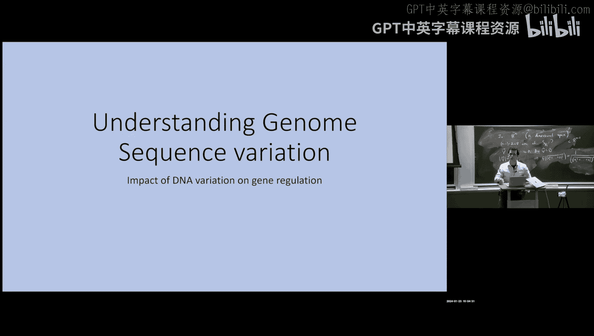

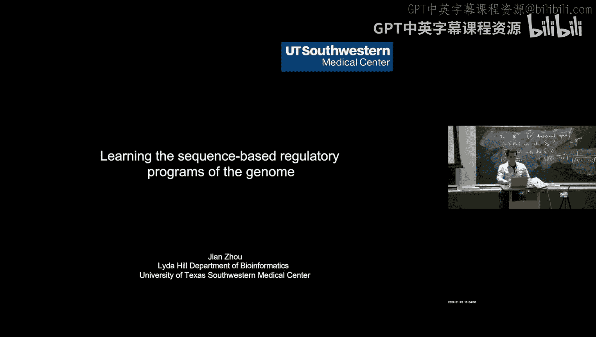

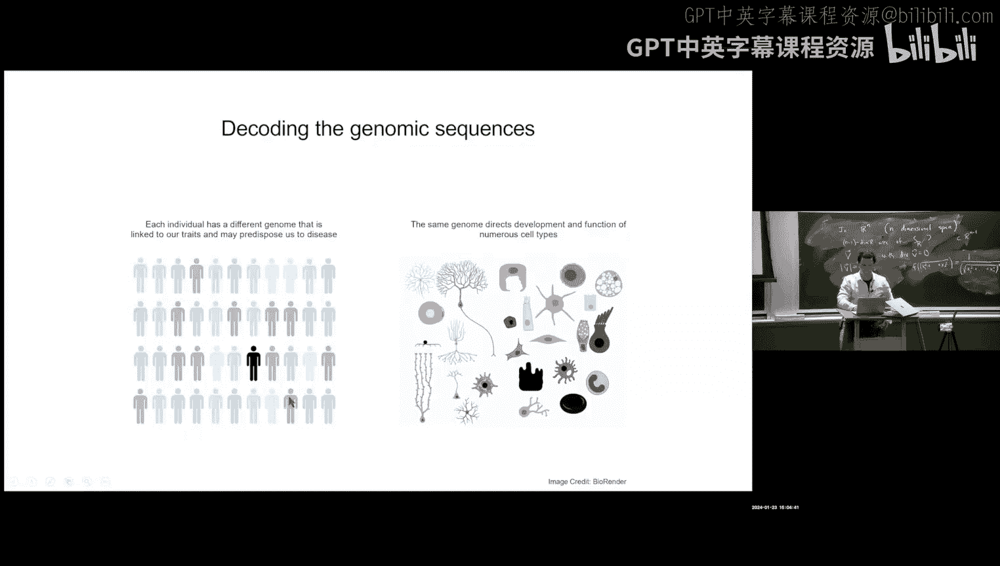

**模型示例**：一个卷积神经网络可以接收一段DNA序列作为输入，通过多层卷积滤波器学习基序特征，最终预测该区域是否会被特定调控蛋白结合并激活。

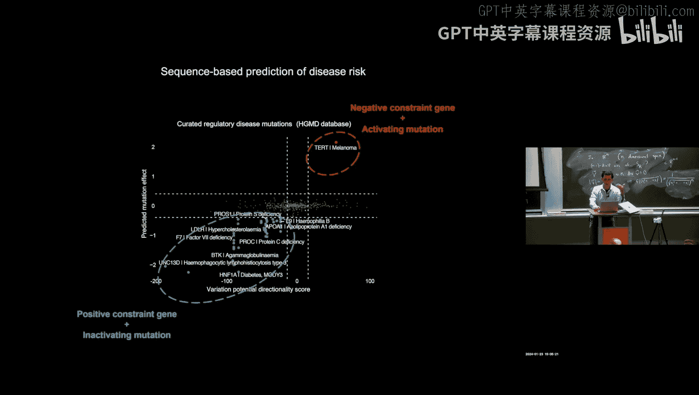

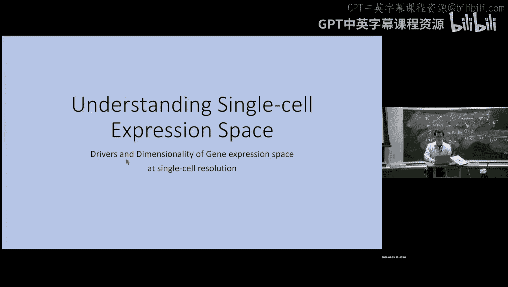

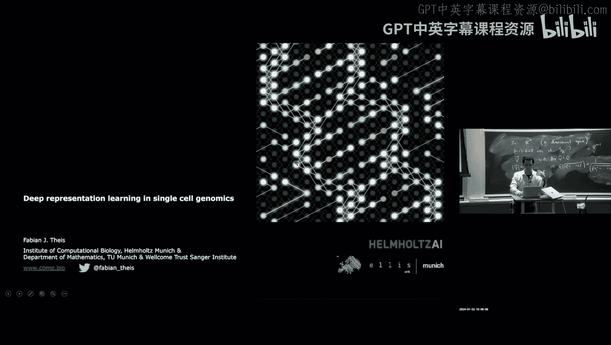

```python
# 简化的卷积神经网络结构概念
输入: DNA序列 (例如， “ATCGATCG...”)
卷积层: 学习识别如 “TGACCT” 等基序模式
全连接层: 整合多个基序的特征
输出: 预测的结合概率或调控活性
```

该模型不仅能准确预测蛋白质结合，还能解释哪些基序对预测贡献最大，提供了机制性见解。对于新的基因突变，我们可以用该模型预测其对调控机器的影响。

### 单细胞表达谱的语言

人体有数万亿细胞，功能各异。单细胞测序技术可以同时测量数百万个细胞中两万个基因的表达水平。

我们可以使用**变分自编码器**来分析和理解这个高维数据。

**模型示例**：变分自编码器将高维的单细胞基因表达数据压缩到一个低维的“瓶颈”层（潜在空间），再重建回原始数据。

```python
# 变分自编码器（VAE）核心思想
输入: 高维基因表达向量
编码器: 学习将其压缩为低维潜在变量z（包含细胞状态的核心信息）
潜在空间: 细胞的“概念空间”，不同维度代表不同生物学因素（如细胞类型、疾病状态）
解码器: 从潜在变量z重建基因表达数据
```

在潜在空间中，我们可以分解变异的来源，例如，可以将患病细胞的表达谱向健康细胞的方向“平移”，从而在概念上逆转疾病状态。

### 电子健康记录与医学文本的语言

电子健康记录包含了个体的基因型和数十种表型变量。我们可以利用大型语言模型来解析和解释这些记录中的模式。

**方法概述**：
1.  将个体的纵向健康记录分解为与不同表型组合相关的模块。
2.  将这些模块与个体血液或组织样本中的基因表达变化关联起来。
3.  使用**大型语言模型**自动解读这些表达变化和临床记录，生成关于生物学变异驱动因素的见解。

### 病理图像的语言

通过分析海量的医学论文和其中的病理图像-文本对，可以训练多模态基础模型。

**方法概述**：
1.  从超过100万篇医学论文中提取图像和对应的图注文本。
2.  训练一个多模态模型，学习图像特征与文本描述之间的关联。
3.  该模型能够对从未见过的新病理图像（甚至是新的肿瘤类型）进行**零样本检索和推理**，识别关键特征。

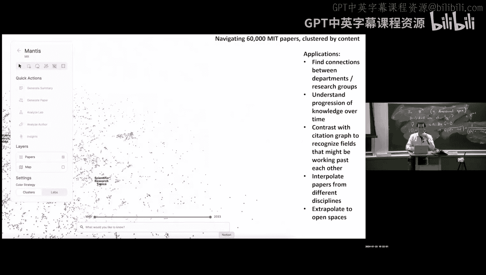

### 化学分子的语言

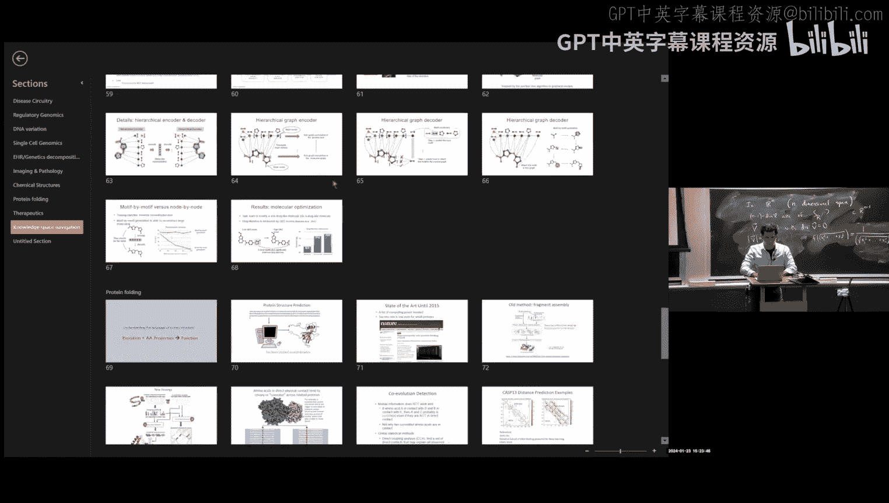

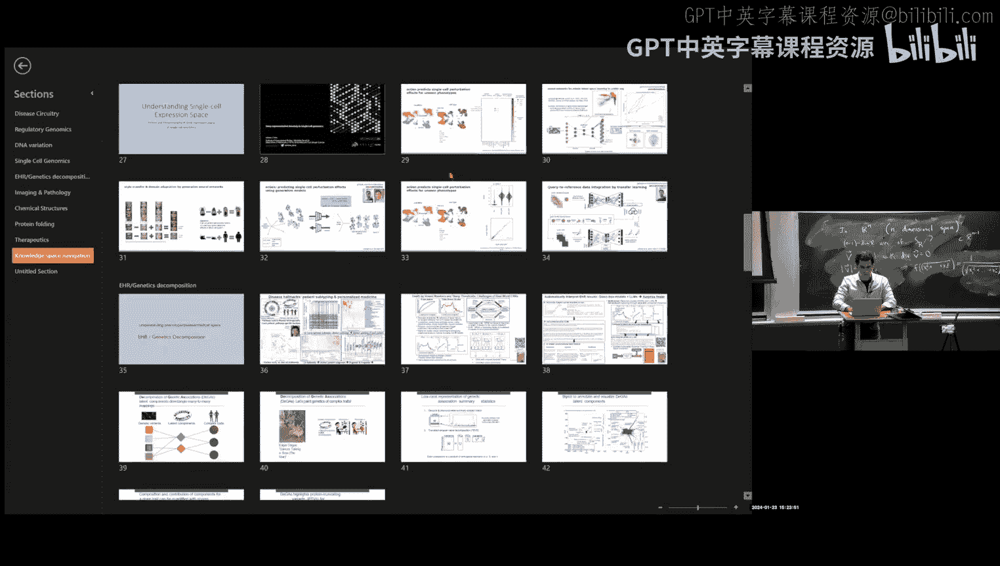

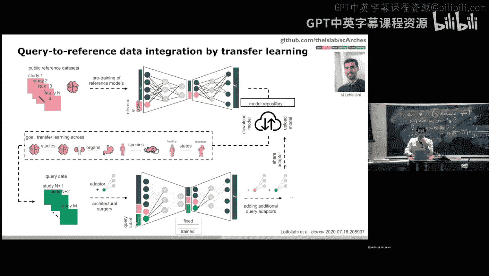

化学分子的功能由其原子类型和连接方式（图结构）决定。图神经网络非常适合处理此类数据。

**模型示例**：图神经网络通过迭代地聚合邻居信息来更新每个原子的表征。
*   第0层：原子表征仅基于自身属性。
*   第1层：原子表征融合了直接相邻原子的信息。
*   第2层：原子表征融合了更远距离（两跳）邻居的信息。
通过多层传播，最终得到整个分子的表征，用于预测其功能或设计具有特定性质的新分子。

### 蛋白质结构与功能的语言

蛋白质的氨基酸序列决定了其三维结构和功能。最新的前沿是构建**蛋白质功能与化学的联合基础模型**。

**目标**：整合蛋白质序列、结构、医学文献中的功能描述以及用户查询，构建一个“治疗性大型语言模型”。该模型能够根据蛋白质的组成和结构推理其功能，并预测可用于干预（如治疗心血管疾病、阿尔茨海默病）的化学物质类型。

## 知识图谱：理解思想的“语言”

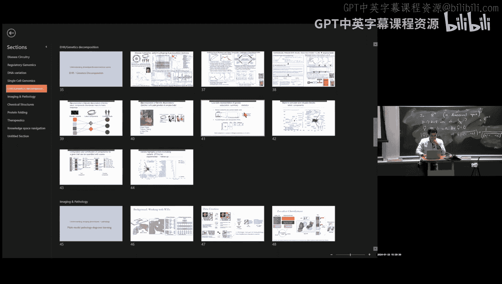

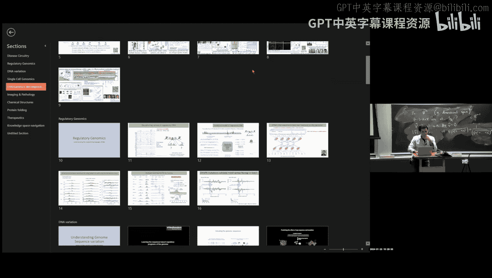

除了生物学，AI还可以用于映射人类的所有知识。通过训练专门的大型语言模型，可以将论文、报告、课程等文本映射到一个高维“思想空间”。

在这个空间中，每个概念或文档都是一个点，相似的内容彼此靠近。这允许我们像使用地图一样导航知识，发现不同领域思想之间的联系，甚至融合不同文献的段落以生成新的见解。

## 总结与展望

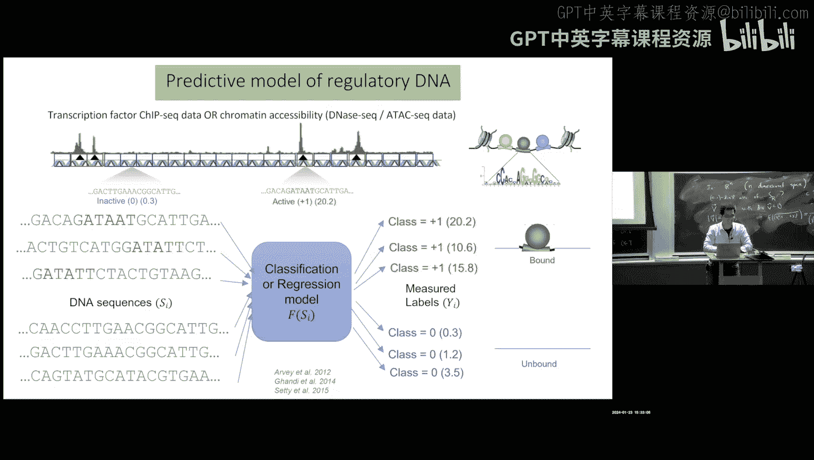

本节课中我们一起学习了AI在生物学和医学中的革命性应用。我们探讨了如何从数据驱动、因果推断和基础模型的新范式出发，利用深度学习解读从DNA、细胞、临床记录到化学分子和蛋白质的多种生物“语言”。这些技术不仅帮助我们深刻理解疾病机制，更在肥胖症、阿尔茨海默病和癌症治疗等领域展示了逆转疾病的潜力。展望未来，多模态AI与人类医生的结合，以及致力于消除偏差的AI模型，将为个性化医疗和系统性攻克疾病开辟前所未有的道路。尽管生物学极其复杂，但AI正在证明，我们有能力解析其核心逻辑并最终驾驭它。